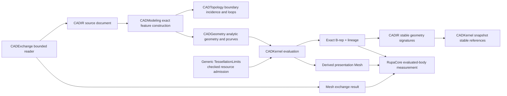
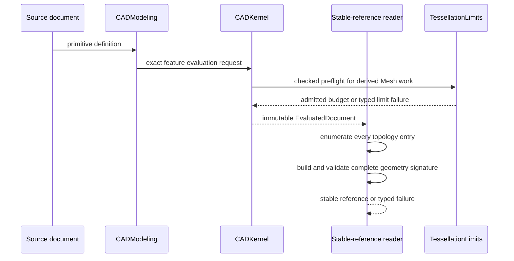
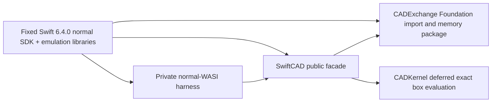

# Swift-CAD Package Design

## Purpose and Scope

Swift-CAD is the native CAD package for source documents, exact analytic
geometry, validated B-rep topology, deterministic evaluation, and derived
presentation Mesh. This package design is the parent of the affected
`CADGeometry`, `CADModeling`, `CADIR`, `CADKernel`, `CADTopology`, and
`CADExchange` module designs. It has no parent inside the Swift-CAD repository.

The package owns the exact source-to-evaluation path used by RupaCore. Exchange
readers may publish a validated source document, but they do not own project
publication or application sessions. Swift-CAD does not own Product metadata,
Agent transport, or measurement-result presentation.

The package distinguishes tessellation fidelity from resource admission.
`TessellationOptions` describes the geometric sampling requested by an
evaluation. A separate generic `TessellationLimits` contract admits or rejects
the resulting work before collection growth or mesh allocation. Neither value
knows a viewport, camera, UI state, Agent request, or product-specific level of
detail policy.

The complete user-authorized functional parity requirement set is tracked in
[OCCT_REQUIREMENTS.md](OCCT_REQUIREMENTS.md). Per-owner designs remain the
authority for implementation contracts; PROGRESS.md alone owns task progress.
No capability registration constitutes geometric completion.

The seven original intersection/contact foundation requirements are: general
surface/surface intersection, general curve/surface intersection, continuous
free-surface overlap, complete boundary clipping, real polynomial component
decomposition, exceptional projected contact components, and self-contact versus
source-defined shared-boundary identity. Completion includes all related
behavioral verification on the fixed Native and portable target combinations.
The [Geometry design](Sources/CADGeometry/DESIGN.md) owns geometric composition;
the [Intersection Algebra contract](Sources/CADGeometry/IntersectionAlgebra/DESIGN.md)
owns real relation authority. PROGRESS.md owns execution state only.

Backward compatibility is not an acceptance constraint for this foundation.
Contradictory legacy tolerance-based identity or incomplete result contracts are
replaced, with affected callers migrated to the original relation contract.
Upper modeling or application repair is not included merely because old
assumptions are invalidated. Compilation and changed public execution paths
remain task-owned integration obligations.

## Responsibilities and Boundaries

Swift-CAD owns:

- validated source geometry and analytic surface parameterization;
- feature evaluation into exact B-rep topology;
- topology identity and geometry signatures suitable for stable selection;
- deterministic evaluation snapshots and read-only topology lookup;
- derived Mesh generation for presentation and exchange.

Swift-CAD does not decide which Rupa Product is visible, publish a project
revision, persist a Rupa package, or replace exact B-rep measurements with Mesh
or bounds data.

## Related Designs

| Design | Relationship | Contract Used | Summary | Cautions |
|---|---|---|---|---|
| [CADWASMSmoke](Sources/CADWASMSmoke/DESIGN.md) | child | bounded public kernel smoke execution | Owns actual Native and normal-WASM executable witnesses. | Witness scope does not establish full M1 or Embedded completion. |
| [Portable Geometry Verification](Sources/CADGeometryWASMSmoke/DESIGN.md) | child | G1 geometry and signature runtime checks | Verifies periodic geometry on the exact emitted WASM artifact | Whole-kernel and Embedded evidence remain required |
| [Portable Contract Verification](Sources/CADContractWASMSmoke/DESIGN.md) | child | Capability and failure runtime checks | Verifies portable contract behavior independently of geometry compilation | Whole-kernel and Embedded evidence remain required |
| [CADCore](Sources/CADCore/DESIGN.md) | child | Common values, typed failures and Native codec capability | Owns the actual Core module and its explicit platform adapters. | Embedded codec absence does not weaken common value or ownership semantics. |
| [Core Portability Verification](Sources/CADCorePortabilitySmoke/DESIGN.md) | child | Actual complete CADCore fixed-target behavior | Exercises unchanged values, COW, errors and available Native codecs | Full Embedded A2 remains a separate requirement |
| [Portable Transaction Verification](Sources/A2DocumentTransactionSmoke/DESIGN.md) | child | Complete public transaction runtime proof | Executes the same exact evaluator and actor snapshot contracts on Native, normal WASM and Embedded | Whole production source/evaluation dependencies must compile and run; a subset probe is insufficient |
| [CADGeometry](Sources/CADGeometry/DESIGN.md) | child | analytic surface and pcurve validation | Owns parameter-domain and structural geometric validity. | Structural validity is not silently relaxed for a model tolerance. |
| [CADModeling](Sources/CADModeling/DESIGN.md) | child | exact primitive construction | Owns generated primitive B-rep topology and analytic seam/pole pcurves. | Generated references must remain valid through the shared geometry contract. |
| [CADIR](Sources/CADIR/DESIGN.md) | child | stable signature value and Codable contract | Owns serialized geometry signatures and their rejection rules. | Signatures retain geometry; they do not identify a new body by themselves. |
| [CADKernel](Sources/CADKernel/DESIGN.md) | child | evaluated snapshot topology reads | Owns snapshot-scoped stable-reference creation and lookup. | Reads use the supplied immutable evaluation; no second authority is created. |
| [CADTopology](Sources/CADTopology/DESIGN.md) | child | exact open-boundary edge loops | Owns incidence-based loop discovery shared by evaluation and presentation. | Only closed, non-branching one-face edge components are returned. |
| [SwiftCAD](Sources/SwiftCAD/DESIGN.md) | child | validated authoring and atomic document transactions | Composes editor, exact evaluation and exchange | Transaction state is separate from application project publication |
| [CADExchange](Sources/CADExchange/DESIGN.md) | child | bounded exchange parse/write and typed format support | Publishes exact STEP source documents and mesh exchange results at the CADIR boundary. | Exchange format support is explicit; unsupported entities never become partial source. |
| [RupaCore](../RupaKit/Sources/RupaCore/DESIGN.md) | used by | evaluated solid and Mesh-backed presentation measurement | Consumes exact B-rep volume and derived Mesh area/bounds. | RupaCore does not construct or approximate CAD geometry; a capability it needs is published here, per the [system kernel/application boundary](../DESIGN.md#kernel-and-application-boundary). |

## Architecture

The [capability catalog](Sources/CADCapabilities/DESIGN.md) owns public command
admission; registration never replaces the evaluator's geometric validation.



The dependency direction remains downward from source/modeling to geometry and
upward only through public value contracts. A stable reference is composed from
the exact topology in one `EvaluatedDocument`; it never re-evaluates a mutable
source document.

## Contracts and Invariants

1. Analytic primitive evaluators retain exact surfaces and exact pcurves. A
   periodic seam or pole is represented by a valid parameter curve with its
   finite domain and orientation, not by dropping a topology entry.
2. Structural geometry validation rejects nonfinite, degenerate, wrong-surface,
   and out-of-domain values. Floating-point representational error at a valid
   analytic basis is handled by the shared structural predicate contract; a
   caller's modeling tolerance is not used to admit malformed input.
3. `CADIR` geometry signatures retain the complete surface, edge, loop, coedge,
   and pcurve geometry required to compare a subshape. Validation and Codable
   round-trip preserve that complete signature.
4. `CADKernel.stableSubshapeReference(for:)` reads the current evaluated
   topology, creates one complete signature, validates it, and returns a
   snapshot-bound value. It does not skip faces, edges, vertices, seams, or
   poles and does not create a second evaluated document.
5. Exact volume comes from the evaluated B-rep. Mesh surface area and bounds
   are presentation measurements only. No tessellated volume or bounds-only
   substitute is a successful solid measurement.
6. Invalid inputs remain rejected after any representational-tolerance fix,
   and planar/cylindrical topology keeps its existing stable-reference
   behavior.
7. `TessellationOptions` is a fidelity input only. It never implies a resource
   budget, viewport policy, or Product representation choice.
8. `TessellationLimits` is a generic, caller-lowerable resource contract for
   one complete tessellation invocation. It covers checked cumulative vertex,
   index, triangle, and estimated-byte ceilings and is enforced before any
   output storage is reserved or grown. Preflight itself samples boundary loops
   to derive the bound, so admission precedes output allocation rather than all
   allocation. Its hard ceiling and defaults are chosen
   from measured kernel fixtures and versioned with the package; no guessed
   presentation number is encoded here.
9. Tessellation preflight derives a conservative geometry-aware upper bound on
   the geometric emission before output allocation; emission also charges
   actual counters before every growth so geometry cannot exceed admission.
   Corner duplication performed to repair winding is charged against
   `TessellationLimits` like any other vertex but is excluded from the
   comparison against the preflight estimate, because the estimate bounds
   geometry and not winding repair. Both phases use checked
   arithmetic, observe cooperative cancellation at document/body/face
   boundaries, and return a typed all-or-nothing failure. A partial mesh is
   never returned or published.
10. Exact B-rep incremental evaluation reuse is valid only when source
    identity, schema/units, parameter and design revisions, evaluator identity,
    and modeling tolerance match; it never depends on presentation
    tessellation fidelity. Mesh artifact reuse is a separate cache decision
    scoped to the requesting `MeshArtifactPurpose`: it requires the source
    fingerprint, the full artifact configuration including tessellation
    fidelity, and a matching purpose, and it refuses an artifact whose recorded
    usage exceeds the requesting `TessellationLimits` instead of inheriting the
    wider ceiling the artifact was built under.
    Otherwise the caller must retessellate or receive a typed failure.

## Runtime Flows



## State, Ownership, and Lifecycle

- The source document owns parameters and feature history.
- `CADKernel` owns the immutable evaluation snapshot for the duration of a
  read.
- `CADIR` signatures own their encoded geometry values after construction;
  they do not retain live model storage.
- Derived Mesh is disposable presentation data and never becomes source
  authority.

## Failure, Concurrency, and Constraints

Stable topology reads are read-only and operate on one immutable evaluation.
Missing topology, missing pcurves, malformed signatures, and invalid analytic
parameters return typed failures. A stable-reference failure does not return a
partial signature or an empty-success placeholder. No external callback or
mutable project operation occurs while a signature is being built.

Tessellation is synchronous inside the Swift-CAD call but is never a
publication boundary. The kernel performs conservative checked preflight before
output allocation, charges actual usage before every output growth, checks
cancellation at document/body/face boundaries, and only returns a complete
validated Mesh map. The caller owns the task that invokes the kernel; Swift-CAD
has no UI or Agent scheduler and does not retry a failed or cancelled
tessellation.

### Normal-WASI Foundation Environment

The `NativeExchange` SwiftPM trait is enabled by default and owns the optional
SwiftCAD-to-CADExchange transport dependency. Native and normal-WASM complete
exchange builds retain that default. The Embedded document authoring and
transaction profile explicitly disables default traits, so its public SwiftCAD
document/evaluation/transaction dependency graph excludes Foundation/OpenUSD
transport modules. This selection changes transport availability only; common
source values, source encoding, state ownership, Sendable, cancellation and
transaction semantics remain the same. SwiftCAD exposes Native exchange
adapters under `CAD_EXCHANGE`; their absence never substitutes another exporter
or a fabricated persistence result. The A2 proof executable selects the same
SwiftCAD public document API under the fixed Embedded SDK and this declared
transport-free package profile. Compilation and runtime proof are deferred
until the complete source implementation phase has finished.

The fixed Swift 6.4.0 normal-WASM SDK provides Foundation and CoreFoundation.
CADExchange uses both to distinguish JSON booleans from numeric values in glTF;
the package owns the corresponding compiler and link environment. On the
`wasi` platform only, CADExchange defines `_WASI_EMULATED_SIGNAL` and
`_WASI_EMULATED_MMAN` through SwiftPM `cSettings.define` and links the matching
SDK `wasi-emulated-signal` and `wasi-emulated-mman` libraries through
`linkerSettings.linkedLibrary`. These formal settings also apply to Swift's
Clang importer. Native targets retain their existing flags and libraries.
No emulation macro weakens geometric, transaction or cancellation semantics.
An SDK missing these libraries fails build/link admission; no parser fallback
or unchecked state replaces the unavailable environment. This normal-WASI
contract does not establish Embedded Foundation or cancellation availability.

SwiftPM target settings are local to the frontend target and do not propagate
through a dependent Swift module's Clang importer. `SwiftCAD` directly imports
and re-exports `CADExchange`, so it repeats the same WASI-only definitions and
libraries. Any portable runtime harness that imports `SwiftCAD` consumes the
same settings. These repeated declarations are one package contract; they do
not change Native targets or provide a separate fallback environment.

```text
Package.swift WASI condition
    -> CADExchange + SwiftCAD target-local Clang-importer definitions
    -> matching SDK emulation libraries
    -> Foundation/CoreFoundation typed JSON boundary
    -> full SwiftCAD graph and transaction runtime
```

Verification separates the fixed-SDK boolean/number compile/link/runtime probe,
the actual full product build/link, and the transaction behavioral runtime.
The minimal probe alone does not prove the full product or A2. Changes to this
environment require checking the full CADExchange/SwiftCAD dependency graph
and its actual executable under the same SDK; Native platform conditions must
remain unchanged.

The full normal-WASM transaction executable is verified on Node.js 24.19.0
with real WASI Preview 1 imports and the existing explicit 64 MiB executable
stack contract. Its atomic commit, history, stale epoch, exact single concurrent
admission, resource refusal and cancelled-publication checks must reach the
final completion marker; returning from `_start` alone is insufficient evidence.
The Swift 6.4.0 toolchain's default WasmKit 0.3.1 runner cannot translate the
large synthesized CADCommand copy functions on the same debug artifact:
its constant-slot/register limit fails during stage. The Node result is scoped
to that explicitly selected backend, not generalized to WasmKit or Embedded.
There is no automatic engine substitution or source-semantic fallback.

### Bounded Main Facade Witness

The existing bounded main-graph witness exercises public `appendFeature`,
deferred exact box topology and literal volume, in-memory Native package
write/read with complete source equality, and malformed-package typed refusal.
ZIP byte limits and host addressability remain owned by
[CADExchange](Sources/CADExchange/DESIGN.md#failure-concurrency-and-constraints).
Its private Foundation/SwiftCAD harness repeats the target-local WASI importer
settings and uses the same explicit 64 MiB executable stack contract.



The real Node.js WASI Preview 1 runner must exit successfully and emit the
harness's dedicated final marker. Its receipt identifies the exact commit,
overlays, private harness, package graph, SDK, runner, artifact and observed
backend. That bounded witness does not establish URL persistence, atomic file
publication, transaction/history behavior, every exchange format, WasmKit, or
Embedded Swift. Transaction and portable-profile evidence remain scoped to
those separate actual executables and source snapshots; earlier receipts do
not certify this merged source snapshot.

## Verification and Change Impact

The affected module tests must prove every generated sphere body, face, edge,
and vertex can produce a stable reference and that JSON round-trip preserves
the complete signature. They must also retain rejection tests for nonfinite,
degenerate, wrong-surface, and out-of-domain pcurves and representative planar
and cylindrical topology. Changes to the shared structural predicate require
rechecking primitive construction, topology signature decoding, stable lookup,
and RupaCore's evaluated-body measurement path.

Tessellation changes additionally require:

- preflight rejection before reserve/allocation for per-body and cumulative
  vertex/index/triangle/byte overflow or limit excess;
- cancellation at every declared checkpoint and all-or-nothing result
  ownership;
- exact-B-rep equality when a tessellation failure or limit rejection occurs;
- exact B-rep reuse acceptance for matching source/evaluator/modeling state
  without a tessellation-fidelity dependency;
- Mesh artifact reuse only when source fingerprint, full artifact
  configuration including fidelity, and measured usage are admitted by the
  current limit.

These checks are kernel behavior evidence; Rupa viewport responsiveness and
Product-specific presentation policy are verified by their owning RupaKit
designs.

## Expression Magnitude Contract

Expression consumers follow the [CADCore expression contract](Sources/CADCore/DESIGN.md), including
unit-preserving hypot, dependency discovery, serialization and explicit failure.

Natural Bezier extension expressions use the shared numeric and unit contract in [CADCore](Sources/CADCore/DESIGN.md). Both expression evaluators retain dependencies and propagate continuation errors.

Authored spline refinement is owned by [CADIR](Sources/CADIR/DESIGN.md#symbolic-spline-refinement):
coordinate expressions survive affine refinement and are evaluated only by consumers.

The prior main normal-WASI facade receipt exercises public appendFeature,
deferred exact box topology and literal volume, complete in-memory Native
source equality, and malformed-package refusal. That receipt is scoped to
its original source snapshot; it does not verify this stopped composition.
URL persistence, every exchange format, WasmKit and Embedded remain separate
proof obligations.
