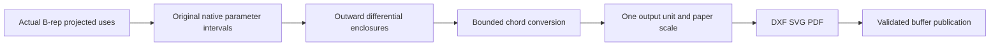

# B-rep Drawing Exchange

## Purpose and Scope
Owns the public DXF/SVG/PDF projection ports consuming actual kernel projected original edge geometry. Parent: [CADExchange](../DESIGN.md). No children.

## Responsibilities and Boundaries
The kernel owns source equality, original edge/curve/native parameter correspondence and projection frames. This component owns bounded screen-curve linearization, output units, paper scale and format records. Unclassified geometry remains geometry; an edge projection does not imply hidden-line visibility. Section publication requires the complete matching evaluation. It emits actual original intersection curves, tangent points, and original coplanar face boundaries. Hatch spans retain producer body/material/row identities and are bounded by the retained section envelope. These are component curves and classified spans; region contour assembly and visibility have separate producer ports.

## Related Designs
| Design | Relationship | Contract Used | Summary | Cautions |
|---|---|---|---|---|
| [B-rep Drawing](../../CADKernel/BRepDrawing/DESIGN.md) | depends on | original projected edge uses | real curve geometry input | Visibility is separately produced |
| [Orthographic Curve Projection](../../CADGeometry/OrthographicCurveProjection/DESIGN.md) | depends on | outward second derivative enclosure | complete-interval chord bound | Native parameter remains original |
| [CADExchange](../DESIGN.md) | parent | bounded writers and atomic URL publication | formats actual drawing geometry | No mesh-outline substitution |

## Architecture

## Contracts and Invariants
Original curve linearization checks the caller's independent
`maximumCurveSubdivisionDepth` before splitting an interval. Structural
`maximumNesting` remains a separate source-path bound. A depth-zero caller
may publish a proved chord but cannot subdivide an unproved chord.
The kernel projected edge already owns coedge-directed endpoints; the writer uses them directly without applying orientation twice. Each emitted polyline retains the original edge identity and directed native interval. Subdivision accepts a chord only when the complete-interval second-derivative error bound is within the requested internal-SI deviation; endpoint samples alone are insufficient. Nonfinite bounds, unresolved projection laws, unrepresentable further subdivision or caller budget exhaustion fail. Output unit and paper scale are applied exactly once after conversion. No projected use is silently dropped. Empty complete sections publish empty geometry rather than fabricated contours. A single validated buffer is published after all conversion and format construction succeed.

## Failure, Concurrency, and Constraints
Operation-local conversion uses the existing caller entity/work/nesting/deadline ceilings. Immutable projected original curves remain Sendable. Cancellation propagates from enclosure and every subdivision.

## Verification and Change Impact
Actual public DXF/SVG/PDF paths must cover original lines/conics/splines, reversed uses, periodic intervals, collapsed projections and malformed/resource/atomic failures. Hidden/section evidence must use the visibility/region producers once integrated. Source implementation alone is not verification evidence.

Material-region publication consumes the kernel producer's validated sewing patches with ordered outer/inner original loops. Region loops are assembled in that order, preserving their directed native edge parameters; output uses DXF solid HATCH, SVG even-odd path fill, and PDF even-odd fill. Complete original section freshness is checked through validateCurrent, including its actual B-rep.

The projection `write(_:in:as:options:to:)` port verifies the kernel's immutable original document/configuration/B-rep snapshot against the supplied current evaluation before conversion or publication. The projection-only port exports that immutable historical projection explicitly; it does not assert freshness against an unprovided current document. Format facades and OfficialFormatExchange expose both operations. Neither operation assigns hidden/visible classification.

Placed projection consumes BRepDrawingPlacedProjection through the required current-evaluation port. Each use retains its occurrence placement identity and original edge/native directed interval. The kernel applies the authored affine placement to the complete original curve before projection; exchange linearizes that projected law and applies only output unit/paper scaling. The immutable receipt validates original CAD freshness; the scene owner separately validates its current occurrence placements. Output identities escape XML attribute values, and DXF source identity strings use UTF-8 Base64 XDATA chunks of at most 255 ASCII bytes so arbitrary authored placement identities cannot corrupt a format record.

PDF drawing paths and material regions retain source identity through standard inline marked-content property dictionaries. Path properties also retain directed NativeStart/NativeEnd and the unclassified output layer. Paper-point conversion changes only geometry coordinates; provenance values pass unchanged to the PDF encoder. These records do not imply hidden-line visibility.

Format authority: [Autodesk XDATA](https://help.autodesk.com/cloudhelp/2025/ENU/AutoCAD-DXF/files/GUID-A2A628B0-3699-4740-A215-C560E7242F63.htm) defines application-selected group ordering and 255-byte strings; [Adobe PDF specification](https://developer.adobe.com/document-services/docs/assets/35e4369068f86065372c18787171a17e/PDF_ISO_32000-1.pdf) defines inline BDC/EMC property dictionaries without indirect references. The PDF encoder uses the standard Span tag with CAD source properties and decimal real tokens, never exponent notation.

### Original SI page-curve producer
BRepDrawingCurveLinearizing exposes the same whole-interval subdivision producer used by format output. DrawingExchangeUsage owns one invocation's cumulative caller allowance; callers reuse its inout value across all page curves. BRepDrawingCurvePath retains the original projected curve, directed endpoints and every original native station with its unscaled SI Point2D. DefaultBRepDrawingCurveLinearizer first partitions the requested directed range through NativeCurveConversionSource.owningParameterCover, then admits chords only inside original owner cells from their complete second-derivative bound, endpoint uncertainty and caller maximumDeviation. Native knots are retained as emitted stations even when their derivatives jump. Unsupported retained mapped/lift owner covers propagate their typed lower failure. Page/style owners consume that SI result; the existing format path maps it through DrawingExchangeOptions exactly once. No visibility, arbitrary point sampling or new per-curve allowance is introduced.

### Paper style publication
DrawingStrokeStyle retains RGB components, positive width and alternating positive dash lengths in paper points. DrawingExchangeStyles supplies geometry/unclassified, visibility, section contour/hatch and annotation roles without inferring visibility from geometry. Styles are independent of model paperScale. PDF emits paper-point graphics state; SVG converts point lengths once to output-unit coordinates; DXF publishes LWPOLYLINE constant width and original alternating LTYPE lengths in output units. DXF true color uses the format's 8-bit display components while SWIFTCAD XDATA retains original RGB, width and dash values. Material fill has explicit RGB source values. Style validation and processing use the same invocation allowance.

DXF constant-width authority: [Autodesk LWPOLYLINE](https://help.autodesk.com/cloudhelp/2015/ENU/AutoCAD-DXF/files/GUID-748FC305-F3F2-4F74-825A-61F04D757A50.htm). Source style values survive publication independently of a viewer's display quantization.

### Composed page boundary
DrawingExchangePage consumes final paper-point coordinates with bottom-left origin, x-right and y-up. The page owner verifies current CAD source receipts and applies model scale and authored page placement before this boundary. DrawingPagePath retains explicit stroke role/source identity and optional native station values. DrawingGlyphOutline retains shaped run text, actual resolved PostScript font identity/size and original move/line/quadratic/cubic/close commands. The Native application font adapter owns shaping and font availability/substitution decisions; this module owns format publication. It never selects a replacement font. Page publication borrows the same DrawingExchangeUsage used for path conversion and glyph extraction; it does not reset the allowance. Glyph deviation is an explicit caller paper-point conversion allowance.

Page SVG/PDF publication renders the producer's actual glyph outlines and retains original Unicode/PostScript font/size/source identity. PDF quadratic outlines use exact rational original control combinations; the maximum control rounding distance is admitted only under the caller's paper-point glyph allowance and the same drawing ledger. Original quadratic controls remain in the content provenance. DXF publishes even-odd outlines as legal exact quadratic/cubic spline-edge HATCH boundaries. Nonzero outlines require the original contour-region resolver receipt described below; unresolved contours fail without reinterpretation.

DXF spline-edge authority: [Autodesk Boundary Path Data](https://help.autodesk.com/cloudhelp/2024/ENU/AutoCAD-DXF/files/GUID-DC5215D6-E73F-4DFF-8BE9-01CA9610FAEE.htm); dash authority: [Autodesk LTYPE](https://help.autodesk.com/cloudhelp/2020/ENU/AutoCAD-DXF/files/GUID-F57A316C-94A2-416C-8280-191E34B182AC.htm).

### Placed section publication authority
Section publication validates the immutable original source and charges its retained preparation entities and consumed preparation work in the caller invocation. Each region and hatch segment must validateCurrent(_:for:) against that exact section producer identity, cutting plane and placement. Coincident contours use section.visitCoincidentContours rather than original evaluated face loops, so the kernel supplies the placed world curve law before projection. Source identities retain the authored placement identity and original body/face identifiers; output scale is still applied once.

Support-bearing section frame is an output projection, while hatch endpoints and ranges belong to the original cutting UV chart. Hatch publication consumes BRepDrawingHatchSegment.originalCurve under the same caller drawing allowance, projects that original world law into the output frame, then uses the existing whole-interval linearizer on native 0...1. DrawingExchangeUsage exposes its original source, subdivision, algebra, byte and work ceilings as read-only values for composed page producers; no nested invocation creates another allowance.

DrawingExchangeUsage copies and its escaping preparationWorkCallback/preparationStorageCallback retain the same [resource owner](../ExchangeResourceAccounting/DESIGN.md). Work callback units are work counts; storage callback units are bytes. Callbacks charge live counters directly, with no detached snapshot or counter copy-back. Drawing source algorithms and format publication remain outside accounting locks.

### Resolved nonzero glyph boundary publication
DrawingResolvedGlyphBoundary binds the kernel's immutable true zero/nonzero boundary receipt to the complete original shaped outline. Its bounded constructor checks the original ordered native Bezier contour controls, knots, weights and implicit closure against the actual glyph commands. Page publication matches the retained text/font/size/identity/commands before using the receipt. DXF HATCH normal island style consumes these resolved cycles with ordinary boundary flags; it does not classify holes by rounded area or reinterpret overlapping authored contours as parity. Original root spans retain algebraic endpoint authority. Whole-span D2 chord bounds plus endpoint enclosure error certify paper-point linearization; adjacent span endpoints share an admitted point from their exact-event enclosure intersection. If that uncertainty cannot meet the caller glyph allowance, publication fails. Kernel contact preparation and output linearization share DrawingExchangeUsage's original work/byte owner. SVG/PDF retain their actual original outline rendering.

### Paid projected-curve preparation
Each linearization prepares NativeCurveConversionSource once under the same live drawing resource owner and one retained GeometryConversionAdmission. Preparation and every owning closed-interval query preserve the projected curve’s original certification tolerance and caller source/subdivision/algebra limits. Position and derivative boxes are projected outward through the retained frame; station coordinates are proposals from singleton position boxes. The chord bound includes both the complete D2 bound and endpoint proposal error, including arithmetic rounding. Neither legacy point evaluation nor an unmetered differential encloser supplies acceptance authority.

DrawingExchangeUsage.sharesAccountingOwner(with:) compares the actual shared accountant reference identity. Preparation issuers may retain a usage copy and require this identity before consuming or publishing their receipts; equal numeric limits do not establish common admission ownership. The check creates no counters or reservations.

### Original algebraic root-span page paths
The public OriginalRootSpanDrawingLinearizing port consumes the original directed RootSpan and an authored original operation word, retaining both in its returned source receipt. It applies the exact word to outward D0 and D2 enclosures before any XY page projection or chord test. Samples use the RootSpan normalized chart; its algebraic endpoint selectors remain the original authority. Point proposals are admitted only with complete interval chord bounds including endpoint enclosure uncertainty. Caller deviation is in final paper points, with no additional page/unit scale. Existing material-left resolved glyph loop joins remain owned by their boundary producer. The same live DrawingExchangeUsage owns word preparation, original jets, output samples and subdivision storage. Source nesting, algebraic depth and curve subdivision remain independent.

### Page algebraic span authority

DrawingPagePath.originalRootSpanPath retains the original directed algebraic endpoint span, paper operation word and chord receipt. A path constructed from that receipt takes its points from the receipt samples and does not label normalized sample parameters as exact native endpoints. Writers keep the receipt through output mapping; the exact original descriptor is the authority for source provenance. Ordinary paths continue to carry their authored native scalar stations.

Root-span chord proof uses D2 only for a retained single smooth native span. General traversals use original D0 boxes and the maximum corner distance to the actual chord segment; this remains valid across native corners. No aggregate D2 hull is promoted to a join-smoothness proof. The silhouette admission issuer retains one drawing accounting owner and creates one live SurfaceSilhouetteUsage; copies and all later extraction/refinement/publication must preserve both admission identity and that usage owner.

The silhouette issuer forwards actual lower cell admissions into the original drawing entity quota, in addition to work and bytes. Cell callbacks run outside lower owner locks and consume no duplicate scalar work. Issuer creation and retained receipt slots are admitted before construction.

### Exact original silhouette page paths
The original silhouette linearizer requires the issuer, its live lower usage,
explicit rational endpoint precision, paper-point deviation and authored paper
map. It queries complete original D0 boxes and admits a chord only when the
rectangle-to-segment bound covers the whole projected traversal. Refinement and
subdivision retain exact endpoint expressions; no numeric station becomes source
authority. The receipt binds both accounting owners, source span and paper map.
Page writers consume its complete original provenance visitor into a staged JSON
event stream, including the full original surface codec and exact field sharing.
Output bytes are admitted before allocation through the same silhouette owner.
Only a balanced complete stream is attached to DXF/SVG/PDF source metadata.

Exact point publication selects a contact, algebraic contact, atlas station,
singular station or collapsed original curve from the actual kernel receipt.
It retains that original source and projected whole enclosure, not only a
sample. A paper point is admitted only if its full enclosure uncertainty fits
the explicit deviation. Refinement belongs to the original source producer;
insufficient precision fails. Point provenance uses the same complete typed
visitor and full surface codec, with original atlas/native-range selectors.

Atlas station publication uses the lower combined admitted-contact visitor.
One emitter owns field references across the original station and its actual
admitted refinement; separate visitors never concatenate restarting ID spaces.

### Original radial dimension provenance

DrawingRadialDimensionSource retains the actual OriginalCircularMeasurement, original source binding (BodyID or the exact FeatureID/SketchEntityID pair), scene occurrence identity string, measurement identity, per-stroke identity, radius/diameter kind and authored frame-to-paper law. Rupa owns current source/evaluation binding and dimension layout; these identifiers come directly from that binding. The body branch requires a real BodyID and absent sketch identifiers; the sketch branch requires both original feature/entity IDs and absent BodyID. No fake body is issued for a sketch measurement. Exchange does not manufacture an AssemblyOccurrencePath from a scene identifier. The receipt retains the same drawing accountant; page publication checks owner, annotation role and exact stroke identity. Native scalar station arrays cannot substitute for this source. Complete raw curve, boundary parameter, original optional placement and effective operation word, original tolerance and paper map reach bounded provenance JSON. Candidate center/radius/boundary boxes and paper stroke points are display results, not replacement source geometry. DXF XDATA, SVG attributes and PDF marked-content properties retain that complete descriptor beside the actual styled strokes. Serialization and output debit the same invocation, with no new preparation allowance.
