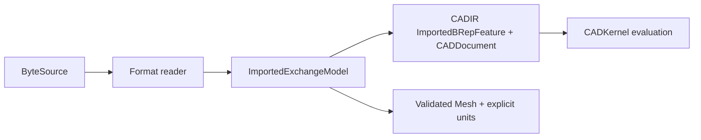
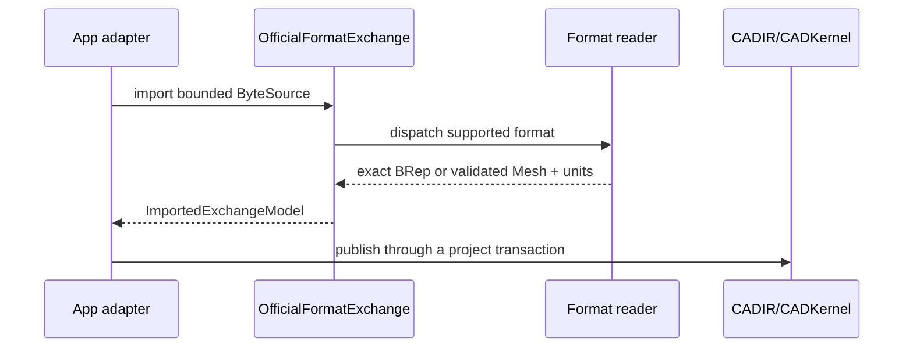

# CADExchange

## Purpose and Scope

`CADExchange` owns bounded parsing and writing of supported external file
formats. It is a child of the [Swift-CAD package design](../../DESIGN.md) and
depends on `CADIR`, `CADTopology`, and `CADKernel` through the package graph.
It publishes exchange results; application and Rupa project publication remain
outside this module.

## Responsibilities and Boundaries

This module owns format detection, resource limits, exact STEP parsing and
writing, mesh exchange parsing and writing, embedded unit extraction, and typed
unsupported-input failures. A STEP import publishes an immutable
`CADDocument` whose source graph contains one ownership-closed
`ImportedBRepFeature` per source body; the exact full model remains available
on the exchange result while each feature retains its exact body submodel.
STL and OBJ imports publish Mesh values and their declared or explicit units.
Unitless mesh input requires a caller-provided unit; embedded format markers
remain authoritative when present and are not silently relabeled. GLB/glTF and VRML use standard meter units; PLY accepts a declared marker or
an explicit caller fallback. This module
does not create a Rupa scene object, choose a presentation representation, or
mutate a project.

Native assembly-description admission follows [Document Assembly](../CADIR/DocumentAssembly/DESIGN.md):
PRODUCT, PRODUCT_DEFINITION_FORMATION and PRODUCT_DEFINITION descriptions are distinct required-nullable source
fields under the current [CADCore envelope](../CADCore/DESIGN.md). Missing fields
are rejected; nullable absence and an empty string retain different meanings.
Standard string lexical encoding and operation-local byte/work accounting are
owned by [STEP Assembly](STEPAssembly/DESIGN.md); readers preserve Unicode
scalars without normalization or replacement.
Global physical Body/Face characterization composes the exact ordinary or
assembly geometry producer with the [STEP Attributes CIWR contract](STEPAttributes/DESIGN.md).
Geometry transfer includes the original item-owned length unit; semantic readers
validate the singleton target view against that authority before publication.
An attributed ordinary writer consumes the existing document name and the
canonical geometry PRODUCT identifier; actual business product identifiers are
owned by DocumentAssembly and are serialized through its writer contract.

Definition-qualified geometry labels, styles and layer membership compose the
exact shared geometry producer and proved PD carrier correspondence with the
[STEP Attributes scoped transport contract](STEPAttributes/DESIGN.md).
The facade admits standard PSBC records and preserves the child-owned selector;
standalone labels and caller-visible failure domains follow that contract.
Direct-usage appearance composes the validated assembly CDSR-to-NAUO transfer
with the same child-owned attribute transport contract. The facade retains the
authored selector and explicit provenance across shared parent placements;
leaf/context admission and standard carrier semantics remain child-owned.

Native section-reference admission follows the [CADIR section contract](../CADIR/SectionReference/DESIGN.md):
curve intervals and explicit traversal direction survive save/load, profile inputs
reject curve-only controls, and missing direction fields are not silently migrated.
Native B-spline field admission follows the validated CADGeometry Codable source
contract: curve periodicity/origin and independent surface U/V periodicity/origins
survive save/load. Unknown fields remain errors; field admission never bypasses
source geometry validation.
Independent STEP import composes the [independent unit-association resolver](IndependentShapeExchange/DESIGN.md#independent-unit-association-selection)
with the original primitive and graph reader under one producer instance and cumulative caller ledger.
Its result carries both the complete source and its resolved document UnitSystem. Distinct real representation
contexts retain their own units; document presentation units never overwrite a represented primitive.
An unassociated primitive requires unambiguous original ambient units, and missing or conflicting descriptors
fail explicitly. Independent ingress admits structurally proved degree contexts for nonangular original
laws while retaining their descriptor and original parameter numbers. Angular curve/surface laws retain
the child-owned explicit parameter-image refusal until their lower owner exists. Writer capability is
unchanged. The ordinary exact Body route retains its existing single-length-unit admission authority.
Shared lexical admission recognizes the standard plane-angle conversion records for independent ingress;
the [Body context partition](IndependentShapeExchange/DESIGN.md) selects only directly owned Body
contexts before ordinary geometry decoding. Independent-only angle declarations do not redefine Body
parameters. Original foreign Body charts retain a marked failure until their original producer is connected.

Native independent source admission follows [IndependentShapeSource](../CADIR/IndependentShapeSource/DESIGN.md).
The required position-association maps retain original primitive FrameIDs and
required-nullable parameter length units. Missing/unknown keys, competing map
keys and inconsistent original law poses fail before publication. The source
remains self-contained; document units do not guess its local parameter units.
Native plane admission also retains the optional original `uDirection` from
the CADGeometry plane parameter contract. A present non-null direction accepts
only vector coordinates; its finite, unit and perpendicular requirements are
validated by the same original geometry owner after decoding. Absent or null
directions retain the existing deterministic chart. Native source equality and
fingerprints include an authored direction, and transport never chooses a new
axis for a stored chart.

## Related Designs

Standalone named curve and surface exchange is owned by
[Independent STEP Geometry](IndependentSTEPGeometry/DESIGN.md), through its
public protocol and complete source-value publication contract. This separate
entry does not change the existing B-rep import result or document authority.

| Design | Relationship | Contract Used | Summary | Cautions |
|---|---|---|---|---|
| [IGES Association Parameters](IGESAssociationParameters/DESIGN.md) | child | original specified extent and generic tails | Retains real inverse/property references | Unknown family grammar stays opaque |
| [Exchange Resource Accounting](ExchangeResourceAccounting/DESIGN.md) | child | one synchronized cumulative accountant | Conversion and drawing callbacks retain the same owner | No copy-back or reset of live counters |
| [Independent Shape Exchange](IndependentShapeExchange/DESIGN.md) | child | Original standalone selections and standard representation graph transfer | Composes original shape exchange without fabricated bodies | Format representability and Native preservation have separate evidence |
| [Independent Shape Source](../CADIR/IndependentShapeSource/DESIGN.md) | depends on | Strict source decoding and bounded semantic validation | Native transport includes the required nullable document field | Missing or unknown fields fail; the complete source affects document fingerprint |
| [Swift-CAD package](../../DESIGN.md) | child of | exact source and typed failure contract | Defines the source-to-evaluation boundary. | Exchange output is not a project publication. |
| [CADIR](../CADIR/DESIGN.md) | depends on | `ImportedBRepFeature`, `CADDocument` Codable | Retains exact STEP source values. | Do not replace exact B-rep with Mesh. |
| [STEP Assembly](STEPAssembly/DESIGN.md) | child | shared product/formation/definition sources, explicit native identity assignments, occurrences and local placement interchange | Composes exact local geometry with standard assembly relationships. | Export requires validated local/world artifacts; ambiguity is an explicit failure. |
| [STEP Physical Source History](STEPPhysicalSourceHistory/DESIGN.md) | child | Actual descriptor/property/precedence graph | Retains unattached descriptors and independent density source | Original values and relationships share the parent caller budget |
| [STEP Attributes](STEPAttributes/DESIGN.md) | child | exact target transfer maps, explicit styling/property relationships and physical units | Preserves admitted product attribute scope through STEP under caller projection/record budgets. | Definition-qualified geometry admission follows the child's property-specific transport contract; Native source admission remains a separate contract. |
| [Document Foundation](../CADIR/DocumentFoundation/DESIGN.md) | depends on | strict typed attributes and persistent references | Native packages retain the complete source foundation. | The required current envelope is owned by CADCore; external links require caller snapshots to resolve. |
| [CADKernel](../CADKernel/DESIGN.md) | depends on | exact source evaluation and local/world assembly consistency | Validates retained imported parts and composed world occurrences. | STEP Assembly maps exchange ceilings into evaluation before world materialization. |
| [Portable Identity](../CADCore/PortableIdentity/DESIGN.md) | depends on | strict Native/STEP wire and schema admission | Consumes the explicit `CADCore/TaggedID` UUID/Codable adapters while owning exchange admission. | Do not make Foundation UUID part of the common Core identity contract. |

Standard glTF/GLB, PLY and VRML mesh contracts are owned by
[Standard Mesh Exchange](StandardMeshExchange/DESIGN.md). Its public protocol
performs static scene baking and typed refusal of unrepresentable semantics.

Standard static GLB/glTF, PLY and VRML mesh exchange is owned by
[Standard Mesh Exchange](StandardMeshExchange/DESIGN.md). Its public protocol
provides bounded scene baking and typed refusal of unsupported semantics.

## Architecture

## Contracts and Invariants

ExchangeFileFormat is the authority for public format-direction admission.
IGES import and export are enabled for the exact B-rep domains documented by
the IGES capability. OfficialFormatExchange routes enabled IGES operations
to IGESExchange, preserving length-unit metadata, exact topology and typed reader
failures. Direction admission does not widen supported entity or surface
domains. IGES imports use canonical radians; a source document display angle
unit is not an IGES file property. URL detection uses the same registry.

Official exchange tests must exercise in-memory and URL IGES round trips,
malformed input, and resource-limit refusal through the public facade.

Native rolling-ball surfaces retain normalized dimensionless parameters, but
the exact STEP/IGES writers currently have no chart-preserving representation
for a general blend. They must reject export with `unsupportedCapability`,
never substitute a display mesh or an uncertified spline. Native project
serialization is independent of this exchange limitation. Manufacturing
exchange remains incomplete until an explicit bounded representation contract
and its round-trip verification are implemented.

Native Sweep package shape validation accepts the optional approximation
allowance and normalized angle law defined by [CADIR](../CADIR/DESIGN.md).
Unknown nested knot or expression keys remain rejected.
Native periodic source verification is owned by
[PeriodicSourcePackageTests](../../Tests/CADExchangeTests/PeriodicSourcePackageTests.swift).

1. `supportsImport` and `supportsExport` are the authoritative format gates;
   an unsupported format returns `ImportError.unsupportedFormat` or the typed
   export failure before parsing or writing.
2. STEP accepts only the implemented exact entity subset. A tessellated or
   otherwise unsupported STEP entity is a typed refusal; no partial B-rep is
   published. A DATA section holding no entity is malformed input
   (`ImportError.invalidData`), distinct from one holding only entities outside
   the exact subset (the reader's unsupported-capability refusal).
3. A successful STEP import retains the reader's exact full `BRepModel`,
   embedded length unit, and a validated `CADDocument` with one validated
   imported feature for each body. Each feature's source model is extracted by
   the ownership-closed topology extractor and carries the same embedded unit
   system; its output role is `.body` for a solid and `.sheet` for a sheet; no
   face, edge, vertex, curve, or surface is dropped. The document source is
   immutable value data and participates in the normal CADIR source
   fingerprint.
4. STL and OBJ imports validate the complete Mesh and require a declared
   format unit or an explicit caller-provided unit. The parser distinguishes a
   format marker from a caller fallback, preserves the resolved unit in
   `ImportedExchangeModel.units`, and refuses missing unit metadata without an
   explicit fallback. Existing `import(..., unit:)` and
   `importBinary(...)` calls retain their historical meter defaults; callers
   that need strict admission use `OfficialFormatExchange.import(...,
   explicitUnit:)`, which propagates cancellation and the caller fallback
   without overriding a format marker. Mesh exchange output is not promoted to
   exact CAD source.
5. Resource limits and cancellation are checked during parse and write. STL
   import admits the source byte count, facet and derived-vertex entity counts,
   parse/vertex iteration cost, and peak derived mesh storage through the
   `ExchangeResourceAccountant` before reserving any output array capacity.
   A failure does not publish a partial result or overwrite an existing output.

## Runtime Flows

## State, Ownership, and Lifecycle

Readers operate on borrowed input where the source permits it and return owned
value results. Exchange caches are not source authority and are not persisted
as part of a CADDocument. Atomic URL output is owned by the public exchange
facade; temporary output is removed on failure.

## Failure, Concurrency, and Constraints

Malformed syntax, unsupported entities, invalid units, resource exhaustion,
and cancellation propagate as typed failures. The parser checks its budget at
bounded checkpoints and never converts an error into an empty-success result.
The ownership-closed topology extractor used by exact STEP import checks
cancellation at every body, shell, face, loop, and edge traversal boundary;
cancelled extraction never returns a partial submodel.
No project state or UI callback is touched while a reader or writer runs.

The package's [normal-WASI Foundation environment](../../DESIGN.md#normal-wasi-foundation-environment)
owns the fixed SDK and target-local compiler/linker settings used by this
module, StandardMeshExchange's Foundation/CoreFoundation boolean-versus-number
admission, and the SwiftCAD facade. The package root remains authoritative for
shared WASI settings because SwiftPM target settings are not transitive through
a dependent Swift module's Clang importer. Native and normal WASM retain the
same typed JSON and numeric admission semantics. The bounded proof exercises
the existing in-memory Native package path and typed malformed-input refusal;
it does not certify URL persistence, all exchange formats, Embedded Foundation
availability, or Embedded Swift. The exact source graph and backend remain
receipt-owned.

Native ZIP reads use the default aggregate cap
`min(UInt32.max, Int.max)`, expressed as `Int(clamping: UInt32.max)`.
The classic ZIP ceiling is unchanged on Native64; on wasm32 the host-addressable
ceiling is explicit. Record size conversions, central-directory end checks and
cumulative byte admission retain their typed failures. A tiny default public
read, malformed metadata and a record beyond the host-addressable or classic
ZIP boundary must be refused or decoded without a conversion trap; these
oracles allocate no large archive. The reader and the borrowed Native package
path consume the same cap definition. Borrowed reads also forward the Native
caller's work callback through parsing, CRC, and decompression.

## Verification and Change Impact

`ExactSTEPExchangeTests` must prove exact source retention, embedded-unit
retention, and evaluation through `DocumentEvaluator`. Format matrix tests must
cover the explicit import/export support gates and typed refusal of unsupported
formats. Changes to the source operation or Mesh import boundary require
rechecking CADIR Codable validation, CADKernel evaluation, and the Rupa adapter
that performs atomic project publication.

`PeriodicSourcePackageTests` owns the positive strict native-package round trip
for independent tensor periodic axes and fundamental origins, including retained
point and derivative behavior after decoding.

Global physical-characterization metadata uses the
[ProductAttributes source contract](../CADIR/ProductAttributes/DESIGN.md) under
the coordinated current envelope owned by [CADCore](../CADCore/DESIGN.md). Native requires the explicit array and
all name/target/nullable-description fields, rejects unknown keys, and refuses
prior envelopes. STEP consumes the child's independent CIWR text contract. Full
source fingerprint/copy/receipt validation and atomic failure remain required;
the source and transport owners retain distinct authority.

### Qualified Description Envelope

PAR.SDESC1 coordinates the current strict 0.10.0 Native source envelope, required
shape-element description source array and prior-0.9.0 refusal. Its source
meaning belongs to [ProductAttributes](../CADIR/ProductAttributes/DESIGN.md#definition-qualified-shape-element-description-parsdesc1),
and standard egress belongs to [STEPAttributes](STEPAttributes/DESIGN.md#definition-qualified-description-transport-parsdesc1).
Current-source fingerprints, exact receipts, unknown/missing-field refusal and
atomic publication compose through the verified source/resolution/exchange fixtures.

### Product Manufacturing and View Metadata

[STEP Product Metadata](STEPProductMetadata/DESIGN.md) owns the standard semantic and draughting transport of [PMI](../CADIR/ProductManufacturingInformation/DESIGN.md) and [View Metadata](../CADIR/ProductViewMetadata/DESIGN.md). NativePackageStore composes both required ProductAttributes fields through their strict decoders and document source validation. STEPExchange retains its existing preflight, operation budgets and atomic publication boundary. Public geometry ownership remains in the original B-rep source and assembly; drawing geometry is separately consumed from the actual kernel projection port.

### Explicit Preservation Policy

[Exchange Preservation](ExchangePreservation/DESIGN.md) owns caller-visible loss records and the production dependency-closed partial STEP route. Existing import overloads remain strict; the policy overload returns a preservationReport alongside the actual imported source. No unsupported record can be dropped without accepted loss domains. Partial reconstruction forwards the remaining work ceiling and the original deadline into the real importer.

### Actual Drawing Geometry Ports

[B-rep Drawing Exchange](BRepDrawingExchange/DESIGN.md) consumes the kernel's actual original-curve projection result through public DXF/SVG/PDF and OfficialFormatExchange memory/URL overloads. Error-bounded conversion precedes unit/paper scaling and complete buffered publication. The edge-only port makes no hidden-line or region classification claim.

[CurveTrimResolution](CurveTrimResolution/DESIGN.md) owns original Cartesian-selector to native-curve parameter correspondence under the existing independent exchange ledger.

[GeometryConversionExchange](GeometryConversionExchange/DESIGN.md) owns explicit exact/certified policy, source-ID guarantees and shared conversion/output allowance before standard coefficient publication.

Native surface-trim admission recognizes the complete persistent Geometry p-curve discriminators, including original chart images, original spline continuation, rigid/offset images and periodic translations. The foundation shape boundary retains strict carrier keys and recursively checks nested p-curve source values; Geometry's strict native codec owns the surface and transformation laws and their typed validation. Neither boundary silently accepts an unknown discriminator.

### Native original-source decoding allowance
NativePackageStore accepts caller ExchangeResourceLimits with explicit standard defaults. Its exact source decoder forwards one invocation-local userInfo context: maximumIterations bounds original work, maximumEntities bounds cells, maximumBytes/4 bounds rational words, maximumAlgebraicDepth bounds algebraic depth, maximumNesting independently bounds source coding paths, and maximumCurveSubdivisionDepth independently bounds geometric subdivision. The original ContinuousClock duration check is shared by nested decoders. Repeated and nested exact payloads consume the same allowance; a child does not reset it. Existing public callers retain the standard default. Native independent source admission requires productAssociations and its strict pair keys; document cross-reference validation remains CADIR-owned. No decoder context is retained after the invocation.

Native selected independent items require explicitly nullable trimmingSource and traversalSource; nested original Geometry codecs own strict family keys and exact decoding allowance. Original graph references admit Body only as a complete SubshapeID payload, then source validation binds it to the actual parent DesignGraph before document publication.

Native source write/load derives IndependentShapeSourceLimits directly from the same caller ExchangeResourceLimits, including the distinct maximumCurveSubdivisionDepth. The original processing deadline begins at the public package boundary and is shared by exact decoding and post-decode source validation. These checks are invocation-owned; their allowances are not persistent source identity.

STEP DATA sections with no entities fail as malformed input (ImportError.invalidData), separately from the typed unsupported-capability refusal for nonempty inputs outside the exact subset. This applies to both ordinary and standalone independent public ingress.

Native assembly placement prevalidation follows the [DocumentAssembly](../CADIR/DocumentAssembly/DESIGN.md) source family. Legacy rigid frames retain exactly basisX/basisY/basisZ/translation. An affine frame requires kind=affine and a transform with those exact four vector fields. A word requires kind=word and an explicit factors array; each factor retains operation forward/inverse and one original direct placement. Nested words, unknown operations/discriminators, extra keys and malformed vectors fail. Semantic determinant and source factor validation belong to the typed original placement owner.

The STEP output table admits original rational operations through the same
invocation allowance as actual source entity/string publication. Original cells
share maximumEntities, exact work shares maximumIterations, and rational words
share maximumBytes with the serialized table. The caller's maximumNesting is
forwarded explicitly. Equal cached gain coefficients do not mint a new budget,
and ordinary Body output can use exact gain equivalence through this same table.

The Native package decoder supplies its actual caller ModelingTolerance via
`OriginalAffineWordDecodingContext.toleranceKey`, together with the same original
exact-source allowance and depth. Normalized placement decode never substitutes
a standard tolerance. Assembly placement `step` uses strict kind/source keys;
its nested original source owns the raw frame keys.

The Native decoder also forwards `OriginalAffineWordDecodingContext.maximumCurveSubdivisionDepthKey` from the actual caller limits. Algorithm subdivision and structural source nesting remain separate admission authorities.

ExchangeResourceLimits.maximumAlgebraicDepth is independently caller-owned, default32 and validated0...32, matching the exact normalized algebra producer ceiling. It is not inferred from source nesting or curve subdivision. Native forwards it through the original word context and exact algebra allowance; source record admission remains independently bounded by original JSON/source nesting.

The exact Body format dispatch includes retained original affine-word surface and hosted pcurve families and corrected endpoint connectors. Unsupported exact carriers fail before publication with explicit incomplete markers. The surface conversion child owns the original whole-domain affine-word certified route and unchanged UV chart; corrected endpoint curve conversion still requires the Geometry curve producer contract.

The [GeometryConversionExchange](GeometryConversionExchange/DESIGN.md) public writeConverting boundary returns both original directed curve and surface guarantees. Official format publication consumes this combined report; legacy surface-only entry points cannot silently discard curve certification. Body incidence remains owned by that child's final boundary certification contract.

Native package ingress checks original archive bytes before ZIP traversal, forwards the original entity and uncompressed-byte ceilings into the ZIP reader, and rejects oversized JSON payloads before Foundation JSON materialization. These guards complement the same exact decode/validation ledger and do not reset it or reinterpret any depth ceiling.

[Native JSON Encoding](NativeJSONEncoding/DESIGN.md) owns bounded actual Native token serialization and original drawing source descriptors. It preserves original Codable semantic grammar and canonical dynamic pairs, with compact whitespace; it does not claim a Foundation allocator-wide cap. Native package publication buffers its bounded archive before external output.

Native ZIP publication forwards the original bounded serializer's live work
callback into both CRC passes and entry assembly. CRC work is one original byte
visit, admitted before its update; the callback checks the same deadline and
cancellation. ZIP headers and payloads still pass through the original bounded
output sink, and only the complete staged archive reaches the external sink.
The existing Native ZIP platform adapter owns these byte operations; this does
not add a new allowance or claim unguarded Foundation input work is accounted.

Native duplicate-key scanning admits each original lexical/value visit through
one load invocation owner and checks maximumNesting before recursive descent.
Its manifest and document scans share the owner. After those scans finish, exact
decoding receives only the remaining work/cells; the existing completed-decoder
snapshot transfers the remaining allowance once to source validation. JSON
Foundation shape materialization remains bounded by original input payload size;
it is not described as an allocator-wide or per-Foundation-operation ledger.

Native ZIP ingress now forwards that same load work callback into central/local
entry traversal, checksum bytes and DEFLATE bit, symbol-table and output-copy
visits. Compressed size and aggregate uncompressed payload ceilings retain their
existing meaning. Budget and cancellation failures remain typed across ZIP
syntax translation. Borrowed compressed pointers remain scoped to the synchronous
ByteSource visit; callbacks receive counts, never pointers.
