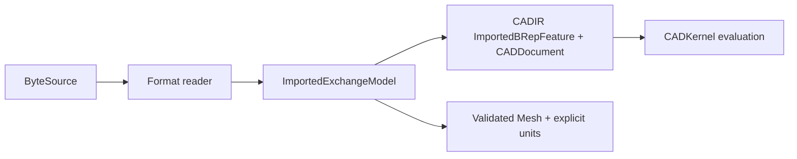
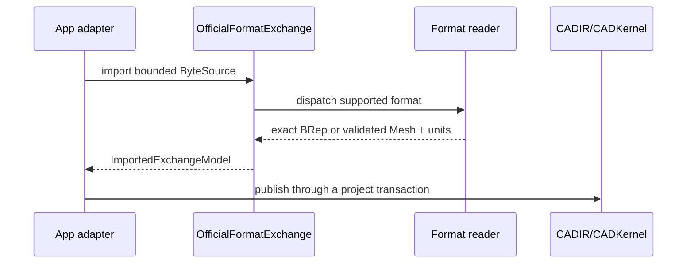

# CADExchange

## Purpose and Scope

`CADExchange` owns bounded parsing and writing of supported external file
formats. It is a child of the [Swift-CAD package design](../../DESIGN.md) and
depends on `CADIR`, `CADTopology`, and `CADKernel` through the package graph.
It publishes exchange results; application and Rupa project publication remain
outside this module.

## Responsibilities and Boundaries

This module owns format detection, resource limits, exact STEP parsing and
writing, mesh exchange parsing and writing, embedded unit extraction, and typed
unsupported-input failures. A STEP import publishes an immutable
`CADDocument` whose source graph contains one ownership-closed
`ImportedBRepFeature` per source body; the exact full model remains available
on the exchange result while each feature retains its exact body submodel.
STL and OBJ imports publish Mesh values and their declared or explicit units.
Unitless mesh input requires a caller-provided unit; embedded format markers
remain authoritative when present and are not silently relabeled. GLB/glTF and VRML use standard meter units; PLY accepts a declared marker or
an explicit caller fallback. This module
does not create a Rupa scene object, choose a presentation representation, or
mutate a project.

Native assembly-description admission follows [Document Assembly](../CADIR/DocumentAssembly/DESIGN.md):
PRODUCT, PRODUCT_DEFINITION_FORMATION and PRODUCT_DEFINITION descriptions are distinct required-nullable source
fields under the current [CADCore envelope](../CADCore/DESIGN.md). Missing fields
are rejected; nullable absence and an empty string retain different meanings.
Standard string lexical encoding and operation-local byte/work accounting are
owned by [STEP Assembly](STEPAssembly/DESIGN.md); readers preserve Unicode
scalars without normalization or replacement.
Global physical Body/Face characterization composes the exact ordinary or
assembly geometry producer with the [STEP Attributes CIWR contract](STEPAttributes/DESIGN.md).
Geometry transfer includes the original item-owned length unit; semantic readers
validate the singleton target view against that authority before publication.
An attributed ordinary writer consumes the existing document name and the
canonical geometry PRODUCT identifier; actual business product identifiers are
owned by DocumentAssembly and are serialized through its writer contract.

Definition-qualified geometry labels, styles and layer membership compose the
exact shared geometry producer and proved PD carrier correspondence with the
[STEP Attributes scoped transport contract](STEPAttributes/DESIGN.md).
The facade admits standard PSBC records and preserves the child-owned selector;
standalone labels and caller-visible failure domains follow that contract.
Direct-usage appearance composes the validated assembly CDSR-to-NAUO transfer
with the same child-owned attribute transport contract. The facade retains the
authored selector and explicit provenance across shared parent placements;
leaf/context admission and standard carrier semantics remain child-owned.

Native section-reference admission follows the [CADIR section contract](../CADIR/SectionReference/DESIGN.md):
curve intervals and explicit traversal direction survive save/load, profile inputs
reject curve-only controls, and missing direction fields are not silently migrated.
Native B-spline field admission follows the validated CADGeometry Codable source
contract: curve periodicity/origin and independent surface U/V periodicity/origins
survive save/load. Unknown fields remain errors; field admission never bypasses
source geometry validation.

## Related Designs

| Design | Relationship | Contract Used | Summary | Cautions |
|---|---|---|---|---|
| [Swift-CAD package](../../DESIGN.md) | child of | exact source and typed failure contract | Defines the source-to-evaluation boundary. | Exchange output is not a project publication. |
| [CADIR](../CADIR/DESIGN.md) | depends on | `ImportedBRepFeature`, `CADDocument` Codable | Retains exact STEP source values. | Do not replace exact B-rep with Mesh. |
| [STEP Assembly](STEPAssembly/DESIGN.md) | child | shared product/formation/definition sources, explicit native identity assignments, occurrences and local placement interchange | Composes exact local geometry with standard assembly relationships. | Export requires validated local/world artifacts; ambiguity is an explicit failure. |
| [STEP Attributes](STEPAttributes/DESIGN.md) | child | exact target transfer maps, explicit styling/property relationships and physical units | Preserves admitted product attribute scope through STEP under caller projection/record budgets. | Definition-qualified geometry admission follows the child's property-specific transport contract; Native source admission remains a separate contract. |
| [Document Foundation](../CADIR/DocumentFoundation/DESIGN.md) | depends on | strict typed attributes and persistent references | Native packages retain the complete source foundation. | The required current envelope is owned by CADCore; external links require caller snapshots to resolve. |
| [CADKernel](../CADKernel/DESIGN.md) | depends on | exact source evaluation and local/world assembly consistency | Validates retained imported parts and composed world occurrences. | STEP Assembly maps exchange ceilings into evaluation before world materialization. |
| [Portable Identity](../CADCore/PortableIdentity/DESIGN.md) | depends on | strict Native/STEP wire and schema admission | Consumes the explicit `CADCore/TaggedID` UUID/Codable adapters while owning exchange admission. | Do not make Foundation UUID part of the common Core identity contract. |

Standard glTF/GLB, PLY and VRML mesh contracts are owned by
[Standard Mesh Exchange](StandardMeshExchange/DESIGN.md). Its public protocol
performs static scene baking and typed refusal of unrepresentable semantics.

## Architecture

## Contracts and Invariants

ExchangeFileFormat is the authority for public format-direction admission.
IGES import and export are enabled for the exact B-rep domains documented by
the IGES capability. OfficialFormatExchange routes enabled IGES operations
to IGESExchange, preserving length-unit metadata, exact topology and typed reader
failures. Direction admission does not widen supported entity or surface
domains. IGES imports use canonical radians; a source document display angle
unit is not an IGES file property. URL detection uses the same registry.

Official exchange tests must exercise in-memory and URL IGES round trips,
malformed input, and resource-limit refusal through the public facade.

Native rolling-ball surfaces retain normalized dimensionless parameters, but
the exact STEP/IGES writers currently have no chart-preserving representation
for a general blend. They must reject export with `unsupportedCapability`,
never substitute a display mesh or an uncertified spline. Native project
serialization is independent of this exchange limitation. Manufacturing
exchange remains incomplete until an explicit bounded representation contract
and its round-trip verification are implemented.

Native Sweep package shape validation accepts the optional approximation
allowance and normalized angle law defined by [CADIR](../CADIR/DESIGN.md).
Unknown nested knot or expression keys remain rejected.
Native periodic source verification is owned by
[PeriodicSourcePackageTests](../../Tests/CADExchangeTests/PeriodicSourcePackageTests.swift).

1. `supportsImport` and `supportsExport` are the authoritative format gates;
   an unsupported format returns `ImportError.unsupportedFormat` or the typed
   export failure before parsing or writing.
2. STEP accepts only the implemented exact entity subset. A tessellated or
   otherwise unsupported STEP entity is a typed refusal; no partial B-rep is
   published.
3. A successful STEP import retains the reader's exact full `BRepModel`,
   embedded length unit, and a validated `CADDocument` with one validated
   imported feature for each body. Each feature's source model is extracted by
   the ownership-closed topology extractor and carries the same embedded unit
   system; its output role is `.body` for a solid and `.sheet` for a sheet; no
   face, edge, vertex, curve, or surface is dropped. The document source is
   immutable value data and participates in the normal CADIR source
   fingerprint.
4. STL and OBJ imports validate the complete Mesh and require a declared
   format unit or an explicit caller-provided unit. The parser distinguishes a
   format marker from a caller fallback, preserves the resolved unit in
   `ImportedExchangeModel.units`, and refuses missing unit metadata without an
   explicit fallback. Existing `import(..., unit:)` and
   `importBinary(...)` calls retain their historical meter defaults; callers
   that need strict admission use `OfficialFormatExchange.import(...,
   explicitUnit:)`, which propagates cancellation and the caller fallback
   without overriding a format marker. Mesh exchange output is not promoted to
   exact CAD source.
5. Resource limits and cancellation are checked during parse and write. STL
   import admits the source byte count, facet and derived-vertex entity counts,
   parse/vertex iteration cost, and peak derived mesh storage through the
   `ExchangeResourceAccountant` before reserving any output array capacity.
   A failure does not publish a partial result or overwrite an existing output.

## Runtime Flows

## State, Ownership, and Lifecycle

Readers operate on borrowed input where the source permits it and return owned
value results. Exchange caches are not source authority and are not persisted
as part of a CADDocument. Atomic URL output is owned by the public exchange
facade; temporary output is removed on failure.

## Failure, Concurrency, and Constraints

Malformed syntax, unsupported entities, invalid units, resource exhaustion,
and cancellation propagate as typed failures. The parser checks its budget at
bounded checkpoints and never converts an error into an empty-success result.
The ownership-closed topology extractor used by exact STEP import checks
cancellation at every body, shell, face, loop, and edge traversal boundary;
cancelled extraction never returns a partial submodel.
No project state or UI callback is touched while a reader or writer runs.

The package's [normal-WASI Foundation environment](../../DESIGN.md#normal-wasi-foundation-environment)
owns the SDK compiler/link requirements used by StandardMeshExchange's
Foundation/CoreFoundation boolean-versus-number admission. This module keeps
the same typed JSON and numeric semantics on Native and normal WASM. Embedded
Foundation availability and full portable exchange support are not implied by
that normal-WASI environment contract. Because SwiftPM target settings are
not transitive through a dependent Swift module's Clang importer, the package
root applies the same WASI settings to SwiftCAD and any private portable
runtime harness; the root design remains authoritative for this shared
contract.

## Verification and Change Impact

`ExactSTEPExchangeTests` must prove exact source retention, embedded-unit
retention, and evaluation through `DocumentEvaluator`. Format matrix tests must
cover the explicit import/export support gates and typed refusal of unsupported
formats. Changes to the source operation or Mesh import boundary require
rechecking CADIR Codable validation, CADKernel evaluation, and the Rupa adapter
that performs atomic project publication.

`PeriodicSourcePackageTests` owns the positive strict native-package round trip
for independent tensor periodic axes and fundamental origins, including retained
point and derivative behavior after decoding.

Global physical-characterization metadata uses the
[ProductAttributes source contract](../CADIR/ProductAttributes/DESIGN.md) under
the coordinated current envelope owned by [CADCore](../CADCore/DESIGN.md). Native requires the explicit array and
all name/target/nullable-description fields, rejects unknown keys, and refuses
prior envelopes. STEP consumes the child's independent CIWR text contract. Full
source fingerprint/copy/receipt validation and atomic failure remain required;
the source and transport owners retain distinct authority.

### Qualified Description Envelope

PAR.SDESC1 coordinates the current strict 0.10.0 Native source envelope, required
shape-element description source array and prior-0.9.0 refusal. Its source
meaning belongs to [ProductAttributes](../CADIR/ProductAttributes/DESIGN.md#definition-qualified-shape-element-description-parsdesc1),
and standard egress belongs to [STEPAttributes](STEPAttributes/DESIGN.md#definition-qualified-description-transport-parsdesc1).
Current-source fingerprints, exact receipts, unknown/missing-field refusal and
atomic publication compose through the verified source/resolution/exchange fixtures.
