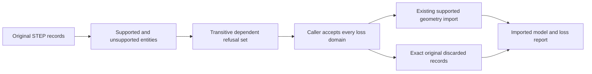

# Exchange Preservation

## Purpose and Scope
Owns X9/X10 caller-visible loss policy and dependency-closed partial STEP import. Parent: [CADExchange](../DESIGN.md). No children.

## Responsibilities and Boundaries
Strict import is the default. An explicit partial policy names accepted information domains. The planner classifies unsupported original records, removes all records transitively dependent on them, retains the original discarded text in a loss report and passes only the dependency-closed supported table to the existing production importer. Geometry parsing and source validation remain owned by the actual importers. Export loss policy owns pre-publication source projection and reports every discarded source domain.

## Related Designs
| Design | Relationship | Contract Used | Summary | Cautions |
|---|---|---|---|---|
| [CADExchange](../DESIGN.md) | parent | public import/export publication | composes policy and actual producer | Reporting is part of the return contract |
| [STEP Product Metadata](../STEPProductMetadata/DESIGN.md) | depends on | known semantic domains | semantic preservation | Missing metadata is never silently treated as empty source |

## Architecture

## Contracts and Invariants
Partial import does not repair malformed supported syntax, fabricate missing entities or reduce existing limits. Every STEP reference and every pointer in a recognized IGES entity grammar must resolve in the original table. Unknown IGES entity parameter numbers have no generic pointer syntax; the entire opaque record is discarded and reported as unknown semantics, without pretending to certify its unknown grammar. Removal computes reverse-dependency closure, so retained records never reference discarded ones. Unsupported record losses are classified conservatively as unknown semantics; dependent geometry or metadata receives its actual domain. Unaccepted loss fails before production import. The original entity text, standard ID, reason and semantic domain remain caller-visible. All graph visits, references, retained reconstruction bytes and source decoding remain bounded by the caller's existing ceilings and deadline.

## Failure, Concurrency, and Constraints
Read-only operation-local value graphs have no shared state. Cycles in standard reference graphs are handled by finite identity sets, not recursive unbounded traversal. Cancellation and resource failures propagate. A partial result is successful only with an explicit nonempty loss report; ordinary strict results use an empty report.

## Verification and Change Impact
Independent files with disconnected unsupported records, dependencies into otherwise supported solids, shared attributes and malformed/dangling references must exercise the public importer. Policy denial and resource/cancellation failures preserve publication targets. External-tool round trips must compare complete semantic source values and measured geometry; a report alone is not parity evidence.

### IGES control path
The validated original directory and parameter table is decoded once. Known pointer-bearing families are scanned by their actual grammar; unsupported entity types seed reverse dependency removal. Missing original pointers are malformed input and never become accepted loss. Retained records are passed directly to the real exact/independent decoder with original IDs, globals, labels and coordinates. Directory appearance/structure/subscript fields that the current source DTO cannot retain are separately reported and require explicit acceptance; strict ingress rejects them. The original directory and parameter records accompany each loss. Planner work reduces the decoder's same caller allowance.

The evaluated-document IGES policy route selects the original independent graph producer for documents with independent source, no feature graph and no assembly. Other evaluated documents select the Body producer and report the discarded independent source. For the independent route, each original frame, definition, instance or primitive-pose adjustment receives a concrete placement loss: finite-decimal projection preserves its exact geometric action but loses authored ordered operations and may change original shared-frame relationships. Strict producers reject that projection. Only an internal capability issued after public policy admission enables it. A nonterminating decimal action still fails; admitting metadata loss does not admit rounded geometry. Product attributes receive their separate domain losses before the independent route may omit them. Unsupported source domains continue to fail in the concrete writer. Publication remains buffered until the selected producer succeeds.

Partial-plan allocation admission precedes reverse-reference, pending, loss and retained-table growth. Reference scanning uses the shared synchronous visitor and checks the original invocation deadline at each reference. STEP plans return consumed work, record and byte counts; retained reconstruction and the production decoder receive only the remaining original allowance. The lexical scanner's actual iteration receipt is transferred without estimating work from Unicode length. Original loss-record strings share their admitted original table storage rather than being rebuilt or replaced.

The IGES production parser receives the paid lexical iteration receipt, admits record views and typed parameter/index storage before allocation, checks integer parameter-range overflow, and forwards its remaining limits to the partial planner. Record views borrow the original immutable text; only actual retained field and source-record boundaries materialize strings. Strict and explicit-partial ingress share this parser and the original deadline.

IGES directory pointer authority follows the original [NIST IGES 4.0 specification, section 2.2.4.3](https://nvlpubs.nist.gov/nistpubs/Legacy/IR/nbsir88-3813.pdf): negative structure, line-font, level and color fields denote absolute directory pointers; view and label-display fields are nonnegative pointers. Every such pointer must resolve in the original table before loss admission. Known target families are validated against their original type/form, and all directory references participate in reverse dependency closure. Int.min cannot be negated into a valid pointer. Blank status retains its own appearance-loss domain rather than being silently discarded.

### STEP original group-family loss admission
The OfficialFormatExchange policy route identifies each original ordered or inverse-pointer group before invoking STEP. It reports independentShapes loss with the original group identity/name/family and original multiplicity/inverse obligations. After that exact report is admitted, a private writer capability may emit legal unordered APPLIED_GROUP_ASSIGNMENT membership, deduplicating only the emitted set. The original CADDocument and evaluated receipt are unchanged. Ordinary STEP/independent writer constructors remain strict. The capability propagates through assembly and certified conversion composition; it cannot accept unrelated losses. Buffered publication returns the admitted report.

Original STEP group-owner sharing projects to distinct IGES 402 membership groups only after an explicit independentShapes loss is admitted. The report identifies each affected assignment, retained GROUP declaration and nonnull description; it includes zero-assignment declaration loss. The internal graph-writer capability follows the actual parent admission and may project only real assignment membership. If no legal entity remains, publication fails as emptyRetainedSource instead of manufacturing a 402 group. Strict output refuses the projection.

Dependency-discarded recognized group assignments and geometric sets are independentShapes losses, not unknownSemantics or placement. IGES402 group and308 template-membership records use that same domain;408 occurrence loss remains placement. This classification ensures accepting an opaque unsupported record alone does not authorize dropping a known independent membership owner that depends on it.
