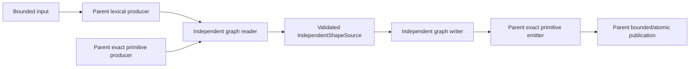

# Independent Shape Exchange

## Purpose and Scope

This CADExchange component owns X7 independent curve/surface, original group-family and retained local-placement transport. Parent: [CADExchange](../DESIGN.md). No children. Public memory and atomic URL composition remains parent-owned. This component must establish all four entity classes before X7 completion; a parser-only or single-entity implementation is insufficient.

## Responsibilities and Boundaries

Consume the single [Independent Shape Source](../../CADIR/IndependentShapeSource/DESIGN.md) owner. Decode/emit actual standard entity associations, source units, named selections, original group ordering/inverse membership and local placements. Root-owned primitive geometry producers provide original curves/surfaces without requiring Body topology. Do not duplicate STEP lexical algorithms, infer product/assembly ownership, bake placement into duplicate geometry, create phantom topology, deduplicate by equal values, or silently omit unrepresentable semantics. X3 product attributes remain separately owned.

## Related Designs

| Design | Relationship | Contract Used | Summary | Cautions |
|---|---|---|---|---|
| [CADExchange](../DESIGN.md) | parent | format routing, bounded ByteSource/ByteSink and atomic URL export | Publishes the result and source-only writer overload. | Shared public routing is one parent owner. |
| [Independent Shape Source](../../CADIR/IndependentShapeSource/DESIGN.md) | depends on | original laws, item selections, original groups and local DAG | Supplies the persistent source authority. | Standard entity IDs are not native UUID authority. |
| [STEP Assembly](../STEPAssembly/DESIGN.md) | coordinates with | STEPFieldReading and exact string codec | Uses shared lexical source without product interpretation. | Independent geometry must not manufacture PRODUCT/PD/NAUO. |
| [STEP Attributes](../STEPAttributes/DESIGN.md) | coordinates with | Material designation consumption and retained target correspondence | Public entity admission dispatches attribute semantics to their owner. | Independent-only source publication refuses uncomposed material attributes. |
| [CADGeometry](../../CADGeometry/DESIGN.md) | depends on | exact geometry/chart/unit contracts | Primitive transport retains native parameter meaning. | Procedural approximation requires its own proved owner, never an implicit fallback. |

## Architecture

## Contracts and Invariants

STEP direct mapping representability follows the merged AP242
[cartesian_transformation_operator_3d](https://www.steptools.com/stds/stp_aim/html/t_cartesian_transformation_operator_3d.html)
and [base_axis](https://www.steptools.com/stds/stp_aim/html/t_base_axis.html).
The operator supplies one uniform scale and orthogonal derived axes, including
reflection; no nonuniform subtype exists in this schema. Authored Native shear
and unequal axis scales cannot be emitted under that entity with tolerance-based
coercion. Strict failure or a caller-accepted actual loss report owns that boundary.
Direct authored columns require exact original-bit rational dot products equal
to zero and equal positive squared lengths. The emitted positive binary scale
must have exactly that squared length; source directions are emitted as their
original unnormalized ratios. Imported standard frames instead require their
original direction/scale source witness, since rounded derived columns do not
replace the normative original law. Exact operations use the same output-table
allowance as source strings/entities, including work, cells and rational storage.

* Public entity capabilities distinguish Native, STEP, IGES and every other enabled format, read/write direction, geometry family and transformation domain. The admitted profile and executable refusal must agree. A standard-representable family still awaiting implementation is marked incomplete and does not count as full X7 completion.
* STEP geometry uses the appropriate geometric/bounded representation and set entities; all subtype WHERE rules are checked, including direct-set requirements. Unassociated generic shape representations are admitted only under the actual AP242 mandatory-subtype rule; a product-associated unsupported generic representation is not a successful substitute. `GEOMETRIC_SET` contains point/curve/surface selections, not recursive groups. Group membership uses `APPLIED_GROUP_ASSIGNMENT`/its actual targets. Mapped-item instances retain a shared definition (actual REPRESENTATION_MAP), source representation, mapping-origin frame and target placement. Representation membership and context identity remain independent of GROUP assignment membership. A Native representation may select a real group (IGES308); STEP egress explicitly refuses that membership since it is not representation_item, before publishing output. Each original AXIS2_PLACEMENT_3D is a single FrameID owner with exact label and affine values. Definitions reference required nullable originFrameID; nil retains IGES's actual implicit identity and is a typed STEP metadata-loss refusal until faithful standard absence transport is proved; explicit IDs actual representation/group frame membership is retained, and mapping-origin context is proved from real representation membership. Multiple maps may share the same frame identity. No origin or membership is inferred from a first instance. The target operator label is retained as instance placementName separately from MAPPED_ITEM.name. Every source context/unit association is validated; group SET order is not interpreted as an ordered compound.
* Standard names/descriptions are exact string values. Internal tagged IDs retain sharing within each import, while wire entity IDs are remapped across STEP/IGES publication. Native source retains its complete original tagged identity. A textual business identifier is never interpreted as a native UUID.
* Native retains finite nonsingular affine source. STEP/IGES transformation domains are admitted only after normative entity semantics and original source mapping are established. Unsupported shear/nonuniform or metadata profiles are explicit refusals; no generic transform claim follows from a rigid-only implementation.
* Ordinary independent geometry import requires no Body or CADKernel materialization. Mixed source profiles are admitted only when every selected entity is accounted for; body-only reader success must not silently discard independent roots.
* Resource accounting shares caller byte/entity/work/depth/duration ceilings across lexical parsing, geometry decode, graph construction, source validation and output emission. Counts/work are charged before allocation, sorting, text decoding and graph/index growth. Cancellation is real and failures publish no result. URL composition preserves an existing destination on all failures.

## Runtime Flows

Read: bounded lexical scan → classify real root associations → original primitive decode/cache by source entity+owned units → graph reconstruction → complete source validation → parent publication. Write: source validation under remaining caller ceilings → entity/domain capability preflight → emit each original law once by source ID → group/instance associations → complete staged bytes → parent sink/atomic URL.

## State, Ownership, and Lifecycle

Producer caches and ledgers are invocation-local. Geometry is shared by source identity+units, never by value equality. Output source is immutable/COW. Primitive producer contracts are abstract; this component does not depend on the private Body builder or topology fabrication.

Original STEP spline control coordinates are retained in their authored model unit. A normalized identity-frame word applies the context's exact normative length gain to that original spline; knots, weights and native parameters are unchanged. Egress proves exact equivalence of that word to the emitted context gain before writing raw control coordinates. A general spatial word is not inferred to be this unit-only carrier; a translated or otherwise composed spline requires a separately admitted legal carrier or explicit loss/conversion policy.

The public STEP entity-name admission recognizes legal `MATERIAL_DESIGNATION` for the existing [STEP Attributes](../STEPAttributes/DESIGN.md) consumer. Name admission does not establish material consumption. An independent-shape import has no product-attribute composition owner, so a retained material designation is a typed unsupported refusal before publishing its source document. Body and assembly routes retain their existing attribute consumer, target correspondence, caller ceilings and cancellation contract.

## Failure, Concurrency, and Constraints

Typed failures distinguish malformed associations, missing entities, unsupported standard semantics, invalid source and resource exhaustion. Cancellation and primitive producer failures propagate. Incomplete callable profiles carry truthful FIXME markers. Concurrent calls share no mutable source or ledger.

## Verification and Change Impact

[IndependentShapeExchangeTests](../../../Tests/CADExchangeTests/IndependentShapeExchangeTests.swift) owns independently authored standard fixtures with no bodies, rational/analytic original laws, directed trims, units, overlapping SET groups, nested placements and shared local geometry. Required integration evidence includes Native complete source equality, two generations of STEP and IGES, literal geometric/placement oracles, actual public memory/URL routing, strict failures, low budgets, cancellation and atomic unchanged destinations. Native/WASM/Embedded proof scope is recorded separately and never inferred from another target. Shared producer changes require the original exact BRep/assembly/attributes regressions owned by the parent.

Normative references: [geometric_set](https://www.steptools.com/docs/stp_aim/html/t_geometric_set.html), [groupable_item](https://www.steptools.com/docs/stp_aim/html/t_groupable_item.html), [applied_group_assignment](https://www.steptools.com/docs/stp_aim/html/t_applied_group_assignment.html), [representation_map](https://www.steptools.com/docs/stp_aim/html/t_representation_map.html), [mapped_item](https://www.steptools.com/docs/stp_aim/html/t_mapped_item.html), [cartesian_transformation_operator](https://www.steptools.com/docs/stp_aim/html/t_cartesian_transformation_operator.html). Format profile details are added only after the corresponding actual normative path is confirmed.

Basis labels are independent from selection/set/representation names. Native absent basis metadata and explicitly empty metadata remain distinct. STEP primitive name attributes are mandatory strings: a source without an explicit basis label requires a separately proved standard absence transport before exact source round-trip is claimed. Unsupported optional/contextual metadata is refused rather than defaulted.

### Shared primitive and cumulative-ledger boundary

STEP `B_SPLINE_SURFACE.control_points_list` and `RATIONAL_B_SPLINE_SURFACE.weights_data` are indexed `[u][v]`, while the original native `BSplineSurface3D` is indexed `[v][u]`. The single exact primitive reader transposes both complete rectangular nets before constructing the native surface; the exact writer emits both transposed nets. Degrees, knots, axis directions, weights and units are not swapped. IGES128 already uses the native v-major ordering and is unchanged. The normative authority is [geometry_schema](https://www.steptools.com/stds/smrl/data/resources/geometry_schema/geometry_schema.htm). Non-square, unequal-axis independent literal input and two-generation output tests detect a missing transpose; existing exact B-rep round-trip tests verify that the shared producer change retains original body geometry.

`IndependentSTEPGeometryReading` owns original primitive law decoding, directed trimmed-curve metadata, context-unit interpretation and original frame decoding. `IndependentSTEPGeometryWriting` owns one shared STEP entity table, original primitive emission, legal named frames (including distinct mapping-target labels), unit contexts, string encoding and the final Part 21 envelope. Both consume the same invocation-local `IndependentShapeExchangeUsage` as the graph codec. They do not reset its caller ceilings. Entity-table caches are keyed by source identity and owned unit context. A graph codec consumes `STEPFieldReading`, never reparses primitive geometry or creates Body topology.

The ordinary exact Body route receives decoded `MATERIAL_DESIGNATION` identities from the assembly reader's existing bounded identity pass even when that reader returns no assembly. The same invocation passes those identities to the ordinary attribute transfer; it does not decode external identity assignments a second time or interpret material identities as product-source ownership. The attribute reader still proves every designation attachment before publication.

The shared exact writer retains one canonical geometry context for item emission and attribute transfer. Each product-associated outer representation receives a distinct context entity with the same declared units and uncertainty; nested representation relationships therefore retain their actual parent/child context distinction. A carrier's unassociated inner geometry keeps the canonical context, original item identities and origin. `WrittenDefinition.context` remains that canonical geometry authority for global item views, not the outer placement context. Context-only emission creates no additional frame, geometry, definition or occurrence. Existing entity/byte retention ceilings and cancellation apply to every additional context record, while the assembly owner continues to precharge child-axis and placement-list work.

The public STEP discriminator reuses entity names from the parent's existing admitted record pass before creating an independent ledger. The preexisting exact Body route retains its own source-byte, lexical-work and absolute processing-deadline contract. Classifying and rejecting leftover independent roots on that route does not instantiate or charge a second independent-graph traversal. An actual independent graph instead retains the same cumulative parent-paid prefix, root-association, primitive, graph and source-validation charges; its allowances are never reset or refunded.

The ledger separately records newly retained entity records, aggregate work and emitted bytes. Root lexical admission is a paid prefix supplied by its parent, not an independent allowance. UTF8 scans, decoded field text, ordered indexes and source-validation consumption are charged into the same work ceiling before retention. The existing absolute processing deadline and real cancellation are checked on every charge. Source validation uses remaining record/work/text/depth ceilings and transfers its consumed work before any subsequent producer traversal.

Parent document validation uses the CADDocument caller-limit overload, with this invocation's remaining source ceilings and existing absolute deadline. Its actual child accounting is transferred into the same exchange ledger. Graph and document validation are distinct completed traversals and, when both execute, both are paid; accounting is not a bypass receipt and is never accepted in place of exact input validation. Writer table composition receives this already-paid ledger instead of creating a new allowance. Standalone real frames are retained as frame roots without creating primitive items or Body topology.

The same-file exact reader adapter borrows the original entity table and its actual primitive builder; it does not create a second parser. Ordinary STEP LINE retains its original normalized direction times VECTOR magnitude converted from model units through a parameter-preserving affine-image curve. Trimmed selections reference one original basis and retain directed endpoints independently of their names. Standard AXIS2 axes are derived by the prescribed projection/default rules, not by rejecting a legal nonorthogonal proposed reference direction. An independently framed plane uses the original Plane3D.uDirection lower chart owner. Wire length UV is converted by the context unit into the internal-SI length chart without scaling its unit axes twice; the original position identity is retained separately. Geometry coefficient/expanded-knot storage is preflighted from actual wire/control counts before construction; staged entity producers and public publication share the caller ledger.

Original coefficient traversal before primitive emission uses the Geometry structural-work visitor under the same remaining exchange work ceiling. Output table record/text retention is charged separately before its growth. Constant-weight polynomial complex STEP splines use the standard implicit unit weights, while explicit rational weights are retained and transposed with the control net. A mapping origin encoded by AXIS2 must retain its right-handed original Y axis; a reflected origin is a metadata-loss refusal rather than silently replacing Y. The legacy IGES circular-arc branch computes a numeric radius and increasing polar trim from actual local endpoints before applying the directory transformation once. This is not a retained exact Cartesian phase/radius source producer: complete X7 source requires the raw Cartesian law, exact unit action and directed endpoint carrier. Directory labels cannot supply that authority. Body import records the original geometry consumed by actual curve, surface and p-curve decode, and refuses leftover independent primitives/groups/maps before body-only publication.

Shared STEP AXIS2 placements use `build_axes`: the normalized axis defaults to +Z, a missing reference uses +X except for an exactly +/-X axis, and the reference is projected into the normal plane. Standard transformation operators separately use `base_axis`, deriving normalized Z, projected X and projected Y from their optional supplied axes. A supplied negative Y retains a reflected frame; an absent Z is +Z, never inferred from X cross Y. Indeterminate projections fail explicitly. The original normalized axes and original scalar scale define the source placement. The same-file adapters implement these functions once, under the caller's paid entity traversal. Ordinary conic labels do not select a law; circle parameter orientation is retained from transformed original U/V even for a reflected affine image. Body LINE emission retains its original meter-per-parameter magnitude in model units, and import retains a nonunit original VECTOR as an affine LINE with an explicit endpoint trim.

Standalone planes retain the original infinite orientation through Plane3D's stored U direction; V is the original normal cross U. Plane UV is an internally normalized length chart: STEP wire U/V length coordinates map through their context length unit into internal SI coordinates, exactly as the existing surface parameter codec. Axes receive no additional unit gain. Position and orientation, not equality of differently dimensioned wire/native numbers, are the interchange invariant. LINE's original VECTOR scaling and the parabola's original length parameter follow their own entity parameter laws and are not treated as plane chart conversion. Native source and fingerprint retain the complete stored framed plane unchanged. STEP writer emits the original named PLANE and derived chart axes without a Body marker.

### IGES graph and primitive boundary

The IGES graph codec consumes a shared `IndependentIGESFieldReading` parser table; raw directory identity/type/form/label/transformation references and decoded parameter tokens are original authorities. It never reparses fixed-column records or Hollerith strings. Primitive ports consume the same cumulative ledger with format `.iges`, including the parent's paid lexical prefix and original absolute deadline. Type124 form0/1 frames are orthogonal (+/- determinant); 408 adds its original uniform scale and translation in the normative order. Native shear is retained but has no claimed Type124 transport.

A real 308 owns its member representation and originalIGES definition source; its nullable forward defining-frame reference is distinct from the nil STEP mapping origin. A real 402 retains its actual ordered/unordered and inverse-pointer family; 408 references the actual 308 and retains its separate instance placement. Standard information that this profile cannot represent is a typed metadata-loss refusal, not guessed labels or discarded membership. [NIST IGES 4.0](https://nvlpubs.nist.gov/nistpubs/Legacy/IR/nbsir88-3813.pdf), sections 2.5.1, 3.14, 4.3.4 and 4.3.8–9, owns these admitted standard relationships. Newer IGES entities remain governed by the shared primitive producer's explicit capability contract.

### Current graph-profile matrix and proof boundary

| Format | Original local geometry | Group/map source transport | Explicit remaining boundaries |
|---|---|---|---|
| Native | Sole original GeometryStore with exact source labels and IDs | Real SET/group/context/representation/frame/map/instance DAG | Original frame/instance nonsingularity uses the source owner's exact rational determinant under the same caller allowance; Geometry operations retain their own numeric guarantees. |
| STEP | Shared parent primitive producer; standard U-major surface rows are adapted to native V-major storage | GEOMETRIC_SET, APPLIED_GROUP_ASSIGNMENT, original real frame membership, REPRESENTATION_MAP/MAPPED_ITEM | Implicit origin absence, unwrapped label mismatch/absence and additional explicit roots are information-loss refusals. Shared original GROUP owners are retained independently of every assignment; unsupported subtype families remain marked incomplete. Native representation-group membership is not a STEP representation_item. |
| IGES | Shared parent primitive producer; original v-major control net and model units | Original 402 forms1/7/14/15, nested 308 member representations/groups/direct template references, 408 placements, real 124 frame members | Defining 308 transforms and semantic property transport remain explicit incomplete implementation. Generic association/property tails and group inverse membership are structurally retained. Named/multiple contexts, nullable group descriptions and distinct basis/selection labels are information-loss refusals. |

This matrix records graph implementation scope, not a verified public capability or full X7 completion. Primitive family availability remains the actual shared producer's authority. [IndependentIGESShapeExchangeTests](../../../Tests/CADExchangeTests/IndependentIGESShapeExchangeTests.swift) owns independently authored rational 126/128 coefficients, exact v-major orientation, grouped/nested 308/408 semantics, original implicit origins, native equality, two public IGES generations and public atomic/resource/cancellation failures. STEP tests additionally distinguish nonidentity original mapping origins from target placements. No world geometry is copied into the local store.

Both format suites independently retain an unassociated primitive-only input through two public output generations. Those fixtures require real item roots without manufacturing a representation, group, definition, instance or Body, and use unequal original surface axes to detect format/storage transposition. The original local degree/knots/weights and analytic coordinate laws are checked alongside association identity; structural existence alone is not a successful exchange proof. Current sources and these fixtures have not yet been compiled or executed.

### Original primitive position identity

The source owns required `curvePositionFrames` and `surfacePositionFrames` maps. Each association retains one original AXIS2 entity FrameID and required-nullable parameterLengthUnit. Primitive positions reuse those real frames on export; a shared frame is emitted once, independently of names or equal poses. The source validator proves the retained frame against the original law without changing either owner. PARABOLA's local affine generator uses its explicit original length parameter unit; dimensionless conics and the internally normalized SI plane chart require nil. A changed output context cannot reinterpret the original parabola parameter numbers: until a complete chart/trim transport is proved, differing parameter units fail with typed metadata loss. Native preserves these associations exactly. IGES egress refuses an AXIS2 identity association without a demonstrated equivalent standard identity carrier. Association record retention, source pose comparison and context indexing are charged to the same caller ledger before work or growth.

A mandatory positioned STEP primitive cannot preserve a Native source without an authored position association exactly. That source distinction has an explicit metadata-loss refusal until a standard absence carrier or caller loss policy is provided; import never synthesizes absent frame provenance.

Unassociated original item/frame roots need an actual unit descriptor in the shared output table. The producer's standaloneUnits operation emits a standard unassociated GLOBAL_UNIT_ASSIGNED_CONTEXT with the caller's requested length/angle units. It does not create a Representation, Frame, source ContextID, or any shape selection. On import that transport descriptor determines ambient document units; only actual representation-associated contexts become source graph owners.

### Original wire basis unit authority

A primitive basis entity is one numeric wire authority even when several differently named or directed trimmed selections refer to it. The graph reader records the first owned length unit for its original CurveID or SurfaceID, and admits every later selection only under that same unit. Distinct representation contexts retain their identities and may declare distinct units when they select distinct original wire bases. A shared basis interpreted with conflicting length units fails with typed invalid association before GeometryStore can be overwritten or a source can be published. The basis-unit index and every lookup/growth consume the existing cumulative caller ledger. This check is independent from item-selection units and is required even when every selected TRIMMED_CURVE has a distinct wire entity ID. No equality-based merging or duplicate native geometry is introduced.

### Independent unit association selection

`IndependentSTEPUnitAssociationResolving` scans actual representation/context references using the already parsed field table and borrows the same primitive producer's context-unit operation. It does not call the ordinary Body-wide single-unit resolver. Representation members and their direct geometric-set selections retain their declared context; source items already decoded by those real associations are not decoded again under ambient document units merely because the parent primitive-root scan also lists them.

Unused GLOBAL_UNIT_ASSIGNED_CONTEXT entities are real ambient transport descriptors. All such descriptors must declare one unambiguous unit system. If no unused descriptor exists, primitive roots not selected by any representation require all declared context unit systems to agree; competing values are a typed invalid association. A representation-only graph may retain different units in distinct contexts: its document presentation units come from the lowest original context entity ID, while original geometry is always decoded by its own actual representation context. The selection never changes context identity, coefficients, charts, trims, frames or sharing. Missing original units fail explicitly; no implicit meter fallback is introduced. Entity scans, association indexes, unit decoding and sorting share the invocation's cumulative entity/work/deadline and cancellation contract.

### Original parameter ownership and analytic source
The original angular descriptor contract is defined by the [Independent Shape Source](../../CADIR/IndependentShapeSource/DESIGN.md) owner. Independent context decoding consumes actual SI radian prefixes and recursive conversion-based units. Unit names remain source labels. The descriptor produces an exact retained Geometry gain under the same caller allowance; canonical presentation units do not override it.

LINE, original splines, hyperbola, parabola, PLANE and coordinate frames have no plane-angle parameter dependency in this profile. CIRCLE and ELLIPSE use the descriptor's original angular gain in their persistent parameter images, while original wire trim numbers remain unchanged. Analytic cylinder/cone/sphere/torus retain each angular axis through the original surface-image gain. Axial length coordinates use their original context length gain. The canonical analytic spatial frame maps to the actual AXIS2 source frame. Cone reference radius, semi-angle and slant chart retain their original source interpretation. Shared-basis admission compares the actual original coordinate gain under the cumulative exact ledger; it never uses a rounded accumulated coefficient or a unit name.

Normative references: [geometry interpretation](https://www.steptools.com/stds/smrl/data/resource_docs/geometric_and_topological_representation/sys/4_schema.htm), [conversion_based_unit](https://www.steptools.com/docs/stp_aim/html/t_conversion_based_unit.html), [plane_angle_measure_with_unit](https://www.steptools.com/docs/stp_aim/html/t_plane_angle_measure_with_unit.html).

### Original IGES analytic surface charts
The primitive reader derives each Type190/192/194/196/198 chart from its actual point, axis and reference entities. A persistent original image owns the canonical analytic law, the original axial model-unit gain, the cone reference-radius offset and the complete spatial frame. Type198 retains its normative meridian/longitude order with `swapAxes`; axis exchange is never inferred from a label. An original directory Type124 is composed once after the defining frame, including reflected orthogonal form1 matrices. The independent writer emits the same real analytic family and chart, retaining the original item label. Matrix-label identity and nonstandard chart gains remain separate graph transport gaps and are not replaced with a successful geometry-only preservation claim.

### Original image p-curve exchange association
Persistent original-image p-curves are validated against their exact target surface before transfer. They select the existing model-curve/surface association route: its spatial law is evaluated from the retained original surface lift and affine frame, rather than publishing rounded inverse UV candidates as an exact rational p-curve. The direct UV serializer must never receive this branch. Readback still requires the corresponding original-image support reconstruction; this dispatch is not proof that every ordinary Body reader chart is complete.

Certified curve transfer admission checks the retained original normalized domain through every parameter-image gain/offset before constructing its existing rational transfer. Foreign trim numbers remain foreign numbers throughout differential and source evaluation. Closure is checked against the original normalized endpoints, never against an assumed foreign [0,1] range. Existing residual, seed and refinement bounds are unchanged.

### Shared STEP authoring and final publication
IndependentSTEPGraphWriting.append authors the complete validated independent source through a caller-owned producer and cumulative ledger without invoking finish. write composes that exact authoring operation with the producer's final publication once. The graph builder retains its concrete producer type so a parent can regain its same entity table without a dynamic cast, byte reparse or replacement allowance. This lower port is the prerequisite for mixed source publication; a port alone does not complete mixed public ingress/egress.

### Actual product association composition
Independent STEP graph read/write accepts explicit actual product-definition entity correspondence from the parent product producer. productAssociations become real PRODUCT_DEFINITION_SHAPE plus SHAPE_DEFINITION_REPRESENTATION selecting the exact emitted independent representation. Reader verifies the actual PDS is owned by a real PD in that correspondence before retaining the pair. One real single-product source is retained through DocumentAssembly even if it has no Body features. Original product values and feature ownership stay in that owner; graph code never constructs fictitious product IDs. The graph author's append port shares the parent's original entity table and cumulative ledger; publication occurs only after both owners finish. Standalone write has no product correspondence and refuses a nonempty association source.

### Original angular descriptor producer
The primitive reader provides contextAngularSource independently of contextUnits. Original angular unit/measure/dimensions identities, SI prefix, original conversion name/factor/kind and recursive base references are decoded under the same cumulative caller ledger. contextUnits is the canonical/native presentation convention; it does not select the original parameter gain when a descriptor exists. Graph membership forwards the exact context descriptor to each actual primitive producer, and unassociated roots use ambientOriginalAngularSource. Shared wire bases are admitted only under compatible original angular coordinate laws. The writer emits the actual descriptor chain and preserves shared original unit/measure/dimension identities through invocation-local indexes. Original coordinate laws compose through Geometry original gain products; rounded accumulated coefficients are never a source authority.

Actual unassociated contexts retain their original identifier/type and unit graph in source.ambientContexts. The resolver compares exact source coefficients and length units before selecting the sole ambient numeric authority, while preserving all distinct equivalent descriptor identities and original labels. This is retention of real input metadata, not an invented representation or context. Egress emits each actual ambient context and shares unit/measure/dimension entities by their original identities.

### Original representation map partition
`STEPRepresentationGeometryOwnership` follows the actual representation-map source graph and classifies Body and independent membership before either consumer interprets its context. A map to independent geometry remains in that graph even when its containing representation has an SDR or a product structure elsewhere uses NAUO. Body-only maps remain with the actual product/whole-part consumer. Frame-only membership is neutral and does not imply Body ownership. Cycles, missing references, and excessive original depth fail before graph publication. A mixed Body/independent map or representation retains the existing explicit heterogeneous-carrier gap. Classification pays the original caller's work, record and depth allowance; cached outcomes never replace original product associations.

### Per-item directed traversal
IndependentExchangeReadCurve transports nullable traversalSource separately from the shared curve identity. The graph reader retains it in IndependentShapeItem. Native requires this nullable field. The actual selected curve is resolved through resolvedCurve(in:), while original STEP trimming selectors refer to the shared basis. Translation preserves the original chart's gain, offset and transformed basis rather than wrapping the chart with another source family.

### Original Body membership binding
Parent product import supplies original wire Body item to actual SubshapeID correspondence and its immutable DesignGraph. Parent export supplies that same selector's emitted entity and actual emitted length unit. Independent graph membership uses the real entity directly and verifies that its representation context matches the emitted coordinate unit. Missing correspondence or conflicting units fail; no remappable evaluated BodyID is retained. Child validation borrows the original parent graph and cumulative allowance. Standalone export cannot publish Body membership without a parent producer.

The ordinary evaluated Body writer also derives Body bindings from its actual current subshape index and the same emitted product geometry table. It forwards its immutable source graph to the shared independent author. A transport product's absence-versus-authored product authority remains owned by the parent product classifier; this lower binding does not infer a product association.

### Body context partition at public mixed ingress
The Body reader borrows only contexts of representations directly selecting an original Body entity. Independent-only contexts and their foreign angular declarations do not redefine Body geometry. The partition producer uses the same original unit decoder and cumulative caller ledger as the independent reader, verifies actual Body coordinate angular gain equals one, and retains each actual Body length unit. Conflicting shared Body contexts fail. Conversion-based Body angles still require their original curve/surface/pcurve producer and remain a marked failure. Assembly imports consume each original product context; ordinary disjoint Body imports require one actual Body length unit, independently of unrelated independent contexts.

### Original orthogonal affine output proof
STEP Cartesian operators and IGES Type124/408 output use the original binary
columns' exact rational dot products. Equal positive squared lengths and zero
pairwise dot products are mandatory; an emitted positive binary scale must have
exact square equal to the original common norm. IGES Type124 additionally requires
unit scale. A Type408 decomposition proves each emitted matrix coefficient times
its original scale equals the original column coefficient before publication.
Rounded normalization or tolerance-close shear/nonuniform values are not proof.
The domain authority is [IGES 5.3 section 4.21](https://paulbourke.net/dataformats/iges/IGES.pdf):
forms 0/1 are orthonormal with positive/negative handedness; special Node forms
10/11/12 cannot carry general geometry. Native general affine law remains retained.
Nonrepresentable source has an explicit placement loss; source materialization
requires the actual certified converter and original legal carrier.

### Original length descriptor producer
Original representation contexts and ambient roots retain a required-nullable
OriginalSTEPLengthSource. Standard SI prefixes use exact decimal powers, and
conversion source keeps real unit/measure/dimensions identities, original labels,
factor/dimension decimal tokens and base chain. Native LengthUnit remains a
numeric presentation convention; a foreign descriptor is sole coordinate gain
authority. Original mapping factors retain that same source in their raw frame.
The paid reader borrows the actual context ID, without selecting a unit by name
or a unrelated global unit. Exact gain admission and raw source retention share
its original record/work/byte/depth allowance. Standard context egress must
publish the same original chain before success.

Original positioned conics are retained as local raw-model primitives plus an exact normalized operation word. Graph publication forwards the original length descriptor independently of the native presentation unit. Egress binds the word to the actual original position source and context gain on the same caller allowance, then emits raw conic dimensions without binary unit division. Shared items must prove exact context-gain equivalence before reuse.

Independent context presentation units use exact normative coefficient recognition for the native length-unit menu; other accepted foreign length laws use canonical metre presentation. This is an explicit presentation convention: originalLengthSource is the sole coordinate authority and is emitted unchanged. Unit names do not select coefficients. Ambient ambiguity and shared bases compare exact original coefficients, including equal menu choices with unequal raw laws.

### IGES group and generic association tails
The [original group source](../../CADIR/IndependentShapeSource/DESIGN.md) owns retained ordering and actual inverse membership. IGES form 1 is unordered with required backpointers, 7 unordered with optional backpointers, 14 ordered with required backpointers, and 15 ordered with optional backpointers. The parent parser separates standard generic association/property tails only after the actual family's specified parameter count has been established. Graph ingress proves each group backpointer selects a real member, and required links exist before publishing source. Egress emits the original group form and appends inverse pointers to each actual emitted member entity after all group entities exist, preserving nested groups without recursive inverse traversal. Other text/property/association families require their original owner or an explicit information loss report; they cannot disappear during tail separation.
Authority: [NIST IGES 4](https://nvlpubs.nist.gov/nistpubs/Legacy/IR/nbsir88-3813.pdf), sections 2.2.4.4.2 and 4.3.3.3.1/.6/.10/.11. Ordered source arrays remain ordered; unordered source arrays retain canonical membership. Existing work/storage/deadline admission covers tail counts, pointers, lookup and parameter-string rewriting before allocation.

STEP group emission is strict for original ordered/inverse groups by default. The parent’s [loss admission](../ExchangePreservation/DESIGN.md) owns the sole private capability permitting a legal set projection. Projection retains original source identity/name/description and emits unique real target references while the admitted report records the original ordering/multiplicity/inverse loss. Native and IGES group semantics remain unchanged.

### Direct IGES subfigure-definition membership
[NIST IGES 4.0 section 4.3.8.1](https://nvlpubs.nist.gov/nistpubs/Legacy/IR/nbsir88-3813.pdf) admits member pointers to entities and other subfigures. A direct 308 member selects the actual child representation owned by its real definition; it does not create a 408 occurrence or imply identity placement. The writer resolves that representation through its existing unique definition association and emits the child308 pointer. Original definition identity is retained independently of instance identity. DEPTH checks continue to inspect actual descendant 408 instances; merely referencing definition data does not synthesize a placement or instance depth. Cycles fail through the same original active-pointer guard and source validator.

Physical-radian positioned surfaces consume IndependentShapeAngularSurfaceSelection on the local ideal primitive before the retained frame operation word. Exact STEP egress reconstructs the expected local angular law under the same context and compares original source fields before raw-dimension publication. Canonical-degree surfaces retain the existing exact Native-label gain chart. The foreign radian law is never substituted with binary gain one.

IGES308 original definition source owns its distinct DE label and nullable actual Type124 defining-frame identity. Ingress creates this carrier from actual wire fields, retains shared Type124 identity once, and treats a directly selected template representation as reaching the same definition source. Egress emits its DE label and defining transform pointer on Type308 itself; Type408 instance operations remain separate. NIST IGES4 section2.5.1 defines the forward order: member matrix, definition matrix, instance parameter scale, instance matrix, instance parameter translation. A STEP mapping origin is the inverse operation and is never used as a substitute. A definition carrying both source families is invalid; unsupported cross-format carrier publication is a typed loss path.

### Original IGES matrix and scoped translation source
The graph reader constructs Type124 and Type408 source carriers from the actual lexical fields and shared frame identity, then asks their exact rational operation producer for a display candidate. The candidate never replaces raw decimal/unit/order authority. The raw Type124 record is immutable across world translation; 308 and 408 carry separate original conjugation adjustments. Native requires each nullable source family and every nested adjustment field. Egress consumes original literals or exact rational actions; rounded candidate columns cannot authorize transport.

### Exact rational IGES publication
The lexical publisher divides translation coefficients by the normative IGES length gain and emits an exact terminating decimal only after proving the reduced denominator contains solely factors two and five. Nonterminating values fail with explicit format loss and cannot be rounded. Unadjusted Type124/408 retain the original decimal tokens and actual shared matrix pointers. Scoped translation changes only exact translation coordinates, preserving original unit orthogonal columns and positive instance scale. Every limb copy, division and output character consumes the same exchange ledger.

### Original IGES adjustment projection

Strict graph egress preserves original lexical matrices and original sharing. Ordered frame, definition, instance and primitive-pose adjustments are not silently flattened into a standard matrix or translation. When the caller admits the concrete placement loss through ExchangePreservation, an internal capability permits exact finite-decimal projection of those operations while keeping the original immutable Native source. Every nonterminating coefficient fails explicitly; this capability never permits geometry rounding or omission of unrelated source domains.

### STEP shared GROUP assignments

The graph reader retains every actual APPLIED_GROUP_ASSIGNMENT and one typed originalSTEPGroupID per referenced GROUP. Membership references continue to select assignments, not bare GROUP entities, as required by [groupable_item](https://www.steptools.com/docs/stp_aim/html/t_groupable_item.html). The writer caches GROUP entities by that original owner identity, while assignment entities remain keyed by their distinct source IDs. No membership union or name-based deduplication occurs. Shared-owner metadata coherence is paid and checked by the child validator before authoring. IGES projection has a concrete independentShapes information loss for this separate shared owner; only the parent preservation admission can authorize assignment-wise 402 output.

Every actual bare GROUP is retained in source.originalSTEPGroups before assignment traversal. A group-only file follows the same public independent importer; no synthetic geometry/context/assignment is inserted. The STEP writer emits all original owners before assignments and reuses their real emitted entity IDs. Ambient declarations need no additional graph-root selector because GROUP itself is not a groupable_item. IGES projection reports and may omit bare owners only under explicit independentShapes loss; it never emits an empty fake 402 assignment.

Unitless owner-only GROUP input has no geometric coordinate authority. The resolver returns the existing metre document presentation convention only when no primitive roots or represented numeric contexts require a foreign unit law. It never synthesizes a standard context, conversion factor or geometry. IGES group projection separately reports nullable description loss; a metadata-only source cannot publish an empty successful retained IGES model.
