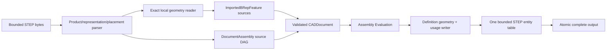

# STEP Assembly

## Purpose and Scope

This component owns exact STEP assembly interchange and the structural transport
needed by PARX.X3 product attributes: part definitions,
placed occurrences, shared parts, nesting, and local coordinate systems through
public STEPExchange and OfficialFormatExchange paths. Parent:
[CADExchange](../DESIGN.md). No children. It composes the existing exact geometry
reader/writer; it does not port OCCT implementation code.

## Responsibilities and Boundaries

The reader owns product-definition and shape-representation association,
occurrence placement syntax, standard coordinate-frame interpretation, and
explicit admission of representation alternatives. Existing ExactSTEPReader
owns exact local geometry. Each local source body is retained by one existing
ImportedBRepFeature; DocumentAssembly references these real FeatureIDs.
Assembly Evaluation owns placed world output and correspondence.

The writer emits each admitted feature's exact local geometry once, then composes
representations by canonical FeatureID lists shared by retained leaf definitions,
with distinct definition metadata,
an optional whole-part style carrier representation, and one
usage relationship per direct source occurrence. It never manufactures a new
part definition for each expanded leaf path. Source DAG and validated local
artifacts authorize export; a flattened world B-rep alone cannot claim to retain
assembly structure. Ordinary B-rep-only STEP export remains a single product.

## Related Designs

| Design | Relationship | Contract Used | Summary | Cautions |
|---|---|---|---|---|
| [CADExchange](../DESIGN.md) | parent | ByteSource/ByteSink, facade routes, limits, atomic URL output | Owns public format routing | All failures occur before output publication |
| [Document Assembly](../../CADIR/DocumentAssembly/DESIGN.md) | depends on | source definitions, occurrences, local frames | Retains assembly semantics in CAD source | The current strict envelope is owned by CADCore; source assembly is required nullable |
| [STEP Attributes](../STEPAttributes/DESIGN.md) | coordinates with | lexical fields, retained definition/topology entity maps, whole-part mapped-item carrier | Preserves source attribute target scope | Attribute policy remains owned by STEP Attributes |
| [Assembly Evaluation](../../CADKernel/AssemblyEvaluation/DESIGN.md) | depends on | local artifacts and world correspondence | Confirms source-to-geometry consistency | World geometry cannot substitute for local definitions |
| [CADTopology](../../CADTopology/DESIGN.md) | depends on | ownership-closed exact B-rep extraction/validation | Retains exact local parts | Unsupported geometry remains typed refusal |

## Architecture



## Contracts and Invariants

- Occurrence-only layers retain the exact transferred representation of an empty
  local subassembly when no identity geometry carrier exists. The attribute
  writer proves the original definition has no local features and uses the
  complete relationship path; assembly export keeps the same definitions,
  child axes, placements and shared geometry. This representation authority is
  exclusive to null layer selection and does not extend nonleaf direct-usage
  appearance or manufacture a local body. Interpretation and cumulative
  attribute admission remain owned by [STEP Attributes](../STEPAttributes/DESIGN.md#usage-and-complete-path-layer-authority).

- The attribute transfer retains CDSR entity identity and its unique validated
  NAUO counterpart only after the existing exact placement, parent/child PD,
  representation and frame checks succeed. Writers retain the actual CDSR they
  emit for each direct source usage. Direct-usage appearance/layer selectors
  request the child PD's proved identity carrier, sharing existing local exact
  geometry. The source usage's real child determines this request, not expanded
  paths or value equality. [STEP Attributes](../STEPAttributes/DESIGN.md) owns
  leaf/context admission and property interpretation. No new source UUID,
  topology, schema field or synthetic assembly occurrence is created.

- Source identity decoding is performed once by the assembly reader. Product,
  formation, and definition identities retain product-source authority. A
  material-designation identity is attribute metadata only: when the remaining
  source is the ordinary CIWR route, the reader returns that bounded
  designation-to-identity map to the facade without constructing an assembly.
  The facade passes the map into STEP Attributes' existing transfer object;
  identity text is never decoded a second time and material identity never
  promotes a canonical ordinary product into an assembly source.
- A definition-qualified geometry style or layer consumes the same proved
  identity whole-part carrier as part appearance. The carrier is one standard
  MAPPED_ITEM uniquely associated with that PD, and its inner exact geometry
  stays shared by canonical FeatureID group. A layer target's actual definition
  selector triggers this transport even when no color exists. Attribute context
  membership and labels remain owned by [STEP Attributes](../STEPAttributes/DESIGN.md);
  this component generates/retains the real PD carrier correspondence without
  a new feature, placement path or duplicated topology owner.

- Product definitions are related to local shape representations through
  PRODUCT_DEFINITION_SHAPE and SHAPE_DEFINITION_REPRESENTATION. Assembly edges
  retain NEXT_ASSEMBLY_USAGE_OCCURRENCE identity and parent/child definition
  references, with CONTEXT_DEPENDENT_SHAPE_REPRESENTATION providing placement.
  Multiple usages of the same product definition retain one shared definition.
- For a representation relationship with transformation, rep_1 is the child
  representation and rep_2 the parent. ITEM_DEFINED_TRANSFORMATION item_1 is
  the child reference frame and item_2 its placed frame in the parent. The local
  transform is frame_2 composed with inverse(frame_1); nested world placement is
  parent-world composed with local. Nonorigin reference frames are supported.
- Ingress retains this operation as the original placement word
  `forward(frame_2), inverse(frame_1)`, including an exactly identity reference
  frame. Reversing the relationship retains the two original frames in the
  opposite order. No rounded inverse matrix or composed columns become source
  authority. Native stores flat forward/inverse factors and rejects nested
  words before recursive decoding. The placement owner supplies inverse-law
  evaluation independently of source transport.
- Original AXIS2 and Cartesian placement factors retain `AssemblyPlacement.step`
  with raw direction ratios, omitted fields, location model unit, original scale
  and ordered world adjustments. Geometry evaluates its normalized law through
  the caller-paid exact affine word; the derived numeric frame is not authority.
- Standard egress of this two-factor word emits the original reference item
  in the child representation and target item in the parent representation,
  connected by ITEM_DEFINED_TRANSFORMATION. Direct uniform orthogonal
  Cartesian operators can retain scale and reflection. The merged AP242
  [3D operator](https://www.steptools.com/stds/stp_aim/html/t_cartesian_transformation_operator_3d.html)
  has no nonuniform subtype, and its
  [base_axis](https://www.steptools.com/stds/stp_aim/html/t_base_axis.html)
  derives orthogonal axes. Native shear or nonuniform columns therefore need
  an explicit unrepresentable-source loss rather than an invented STEP entity.
  Arbitrary original words require a proved legal chain carrier; flattening
  does not preserve that source contract.
- Representation contexts on a transformed relationship have distinct entity
  identities, even when they use the same units. Referenced transformation axes
  belong to the matching representation items. Writers generate a distinct geometric
  context for each definition; equal unit values do not imply equal contexts.
- Assembly rigid placements have scale one and positive determinant. Unsupported
  external definitions, missing placement, conflicting
  representation associations, cyclic products, and alternative flattened
  assembly geometry fail explicitly. No default identity transform is inferred
  for a missing occurrence placement.
- Admitted standard assembly syntax includes transformed representation
  relationships with item-defined axis frames and uniform orthogonal Cartesian
  transformation operators. Representation-map/mapped-item structure must be
  resolved with its standard origin/target semantics when admitted; unsupported
  or ambiguous variants are explicitly refused and never silently flattened.
- STEPFieldReading exposes bounded lexical entity fields, references, strings,
  numeric values, and tuple structure to STEP Attributes. STEPAssemblySyntax
  implements this contract; consumers do not duplicate its lexical parser.
  Its hasComponent requirement scans unquoted root components, returns false
  for absence, and throws the typed lexical error for malformed quote/depth
  structure. Consumers precharge the actual entity-text scan before invoking it.
- STEPStringCoding owns ISO 10303-21 string token encoding and decoding. The
  shared lexical contract exposes bounded decoding with actual consumed work.
  It admits doubled apostrophes/backslashes, direct UTF-8, X, S, X2, X4 and
  per-string PA through PI ISO 8859 alphabet selection. UCS blocks contain
  complete scalar groups, not surrogate pairs; invalid scalars, undefined page
  entries, malformed directives and incomplete blocks fail explicitly. No Unicode
  normalization or replacement character repairs input. Quote/depth/envelope
  lexers recognize ASCII delimiters on Unicode scalar boundaries, including
  a combining scalar immediately after an apostrophe. Their existing marker,
  nesting and resource rules remain authoritative. Writers emit portable
  ASCII tokens with canonical explicit UCS blocks and doubled literal delimiters.
  The normative encoded-token ceiling is 32769 octets including quotes; caller
  input/output/work ceilings may be smaller. Input and output bytes and scalar
  traversal are admitted before allocation/growth. Decode work counts input
  octets plus emitted scalars; encode work counts input octets plus encoded
  octets. Input traversal stops at a caller ceiling without scanning the remainder.
  Consumer operation counters
  charge actual consumed work and retained text. Cancellation propagates.
- The persistent source graph retains PRODUCT, PRODUCT_DEFINITION_FORMATION and
  PRODUCT_DEFINITION as distinct owners. A shared PRODUCT and formation are written
  once and referenced by distinct definitions; no metadata is cloned per view.
  PRODUCT.id, formation.id and PRODUCT_DEFINITION.id retain their original strings,
  including empty and UUID-shaped strings. `$` and `''` remain distinct for each
  optional description. Formation UR1 is enforced; the specified-source subtype
  accepts only MADE, BOUGHT and NOT_KNOWN. Unsupported product graph subtypes fail.
- Public STEP entity admission recognizes EXTERNAL_SOURCE, IDENTIFICATION_ROLE
  and APPLIED_EXTERNAL_IDENTIFICATION_ASSIGNMENT before invoking this component.
  Admission of their entity names does not certify their semantics: the source
  identity reader still validates namespace, role, target, UUID and caller ceilings.
- Product, formation and definition typed UUIDs use a separate standard
  APPLIED_EXTERNAL_IDENTIFICATION_ASSIGNMENT with EXTERNAL_SOURCE
  IDENTIFIER('urn:swiftcad:assembly-source-id') and IDENTIFICATION_ROLE named
  'product', 'formation' or 'definition'. Each assignment has one matching entity
  target and a canonical UUID assigned_id. The role/source are an explicit
  application identification namespace, not a universal standard UUID role.
  Their business identifiers never supply native UUID authority. Existing X2
  occurrence identity transport and occurrence source fields are unchanged by
  this product-owner contract. Absent assignments
  cause distinct entity-scoped source identities to be generated; export retains
  them through explicit assignments. Duplicate/competing assignments, malformed
  UUIDs and role/target mismatches fail. Other namespaces or unsupported assignment
  variants fail explicitly instead of being silently discarded. Identity parsing
  charges the same caller work/text/entity ceilings and checks cancellation.
- Only the exact writer-authored bare profile uses the ordinary geometry route:
  PRODUCT.id SWIFTCAD, empty product name/description, base formation with empty
  version/description, and PD.id design with empty description. `$` is not an
  empty description. CIWR-only global properties do not independently request
  a product source graph: their exact item correspondence remains on the ordinary
  route and is subsequently validated by STEP Attributes. Actual PD, usage and
  shape-aspect physical owners still require product association authority.
  Any other product/PD identifier or nullable distinction uses
  the source product graph, including empty and UUID-shaped business identifiers. Source identity assignments also require
  this route so UUID authority is not discarded. The authored root envelope's
  definition is removed only with its reserved identifier/name, empty local
  geometry, canonical blank descriptions/version and base formation, canonical
  design identifier, and no native identity assignment on any of its three owners.
  Matching business labels on a genuine described or identified product do not
  authorize cleanup. Its formation/product are removed only if no retained
  definition references them.
- Distinct product definitions may associate the same exact local shape
  representation or partially overlapping exact body items. Item entity identity
  and its owned length unit authorize a single local ImportedBRepFeature. The
  reader parses each body item once, reuses its FeatureID in every actual
  representation membership, and rejects conflicting units or topology ownership.
  Equal-valued distinct items remain distinct features. An item must yield exactly
  one local body; a shared face cannot be silently assigned to the first body.
  Existing one-to-many representation/definition transfer and geometry/unit maps
  retain global CIWR and explicit PD GISU/style/layer scope without new source
  fields. Bare mapped usages with several possible PDs remain ambiguous.
- The writer caches geometry emission solely by FeatureID. Each admitted feature
  owns one local body and one exact body item; no phantom PD is emitted to create
  this cache. Complete canonical feature groups compose those existing items and
  retain the existing group representation cache. Partially overlapping groups
  therefore refer to the same actual item, without copying topology. Empty and
  child representations retain their existing separate ownership. Each real PD
  retains its metadata, PDS and explicit identity assignment.
- The initial modular family is homogeneous: sheet items use
  MANIFOLD_SURFACE_SHAPE_REPRESENTATION; solid items use
  ADVANCED_BREP_SHAPE_REPRESENTATION. A PD identity carrier and its inner geometry
  use the same legal subtype. Axis-only assembly representations may use generic
  SHAPE_REPRESENTATION. Mixed sheet/solid groups, multi-body feature output and
  multi-component body emission remain explicitly unsupported on this modular
  path, with incomplete implementation markers. Generic geometry representations
  cannot substitute for an unproved standard family.
  [AP242 subtype rule](https://www.steptools.com/stds/stp_aim/html/t_subtype_mandatory_shape_representation.html),
  [sheet subtype](https://www.steptools.com/stds/stp_aim/html/t_manifold_surface_shape_representation.html)
  and [solid subtype](https://www.steptools.com/stds/stp_aim/html/t_advanced_brep_shape_representation.html)
  own the formal item/carrier admission conditions.
- If any definition sharing a complete feature list requires whole-part
  appearance, each PD in that group receives its own proved identity carrier
  over one shared unassociated inner representation. Partial groups have distinct
  inner representations containing the shared item. A shared carrier cannot be
  treated as a single-PD attachment: unexpressed representation-level set scope
  remains a typed refusal.
- Cache lookup, extraction, topology-map growth and group composition consume
  caller work before traversal/allocation and check duration/cancellation.
  The modular invocation owns one immutable output unit context and identity
  frame, explicitly reused by every feature emission and group. Feature sorting
  cannot select a different context for a shared item. Composition checks that
  context/frame identity agrees; the global CIWR attribute owner may then consume
  the shared item without weakening its context consistency admission.
  Each item cache entry retains its exact unit and immutable source feature for
  the invocation only. Output is published only after all geometry, identity,
  placement and attribute admissions succeed.
- A whole-part styling carrier is structural transport for one real product
  definition. Its product-associated outer representation contains exactly one
  distinct MAPPED_ITEM plus its origin frame and any actual child-placement
  AXIS2_PLACEMENT_3D support items. Support items are validated against the
  retained entity table; a child MAPPED_ITEM or any non-AXIS2 entry is refused.
  The representation map refers to an unassociated inner representation
  containing the complete retained local geometry and its origin. Child
  placement support items are never members of the inner geometry
  representation. A shared geometry group retains a distinct outer
  representation whenever its definition is written, including when its
  current placement support list is empty. Each noncarrier shared definition
  retains the original body item IDs, origin, and only its own current support
  list; a previous definition's support items are never reused. Equal
  declared units and explicitly resolved identity origin/target transformation
  are required. The inner representation has no nested mapped usage, competing
  geometry association, or cycle. These conditions are checked before
  classifying ordinary mapped items as assembly occurrences.
- An admitted carrier retains the existing definition and ImportedBRepFeature;
  it creates no additional feature, definition, occurrence, or semantic name.
  The carrier entity maps to the part attribute target, while inner geometry
  entities retain their body/face maps. A styled MAPPED_ITEM therefore preserves
  whole-part scope rather than expanding that scope into body assignments.
  Overriding face styles retain their explicit predecessor relationship.
- Carrier export is admitted for definitions with real local geometry. Empty
  subassemblies and mixed local-geometry/child definitions keep their existing
  admission contracts. A mixed definition is admitted only when its local
  representation and every child usage retain separate standard ownership:
  local geometry remains in the definition's own representation, while each
  child retains its NEXT_ASSEMBLY_USAGE_OCCURRENCE,
  CONTEXT_DEPENDENT_SHAPE_REPRESENTATION, and placement frame. The local
  representation may carry the child-placement AXIS2 items required by the
  admitted outer representation, but it must not turn a child into a local
  feature or copy child topology. When the same outer representation also
  carries a whole-part MAPPED_ITEM identity carrier, that carrier remains one
  distinct item and the AXIS2 items remain placement support items; they are
  never interpreted as carrier geometry. Reader and writer preserve this distinction
  and reject missing, ambiguous, cyclic, or competing representation links.
  Unsupported or ambiguous carrier structures fail before publication; they
  are not flattened or assigned guessed identity placement.
- A nested occurrence path is admitted only when every prefix has one retained
  NAUO, one CDSR, one child PDS, and one resolved placement frame. A nested
  presentation or physical target uses that complete prefix as its source
  selector; it does not infer a parent from equal geometry or entity order.
  Mixed local geometry in an intermediate definition does not invalidate the
  prefix, provided the local representation and child usage remain separately
  addressable. Sibling paths remain distinct and share only their immutable
  leaf definition and exact local geometry.
- Material identity is a separate standard source identity from product,
  formation, and definition identity. A material UUID is admitted only through
  an AP242 material carrier such as MATERIAL_DESIGNATION with an
  APPLIED_EXTERNAL_IDENTIFICATION_ASSIGNMENT whose item is that designation;
  the assignment's source and role remain the external-identification
  namespace. A product or occurrence UUID assignment cannot be retargeted to a
  material entity. The assembly component preserves this identity link and
  rejects a duplicate, foreign, or role/target-mismatched assignment.
  Material designation applicability to a product or occurrence is owned by
  STEP Attributes and Product Attribute Resolution; this component only retains
  the validated entity correspondence and does not invent a material role.
- Local geometry and placement translations are normalized using their declared
  representation length units. Multiple contexts declaring the same unit are
  not mistaken for conflicting units. Conflicting or unsupported unit contexts
  are refused unless the reader completely resolves each local context.
- Writer geometry helpers append local parts to one globally bounded entity
  table with per-part topology maps. Entity IDs do not collide across parts,
  even when native local topology IDs do. Assembly representations include their
  coordinate-frame items; empty geometry is not an invalid empty item set.
- Import publishes a validated assembly CADDocument and its placed exact B-rep.
  Export through memory and URL facades consumes the same evaluated-source
  assembly contract. Shared definitions, direct local placements, and nesting
  survive STEP and strict native save/load without becoming presentation metadata.
- Parsing, structural traversal, expansion, and entity writing charge existing
  exchange byte/entity/nesting/work/time budgets and explicit assembly evaluation
  limits before standard source expansion or consistency reconstruction. Export
  consistency uses its exchange ceilings, rather than trusting a larger retained
  evaluation allowance. Cancellation propagates; failures publish no partial document/model
  and do not modify an existing URL output.

The string authority is [ISO 10303-21, section 6.4.3](https://www.steptools.com/stds/step/IS_final_p21e3.html).
Product/formation/definition ownership and identifier optionality follow the standard EXPRESS
[PRODUCT](https://www.steptools.com/stds/stp_aim/html/t_product.html) and
[PRODUCT_DEFINITION](https://www.steptools.com/stds/stp_aim/html/t_product_definition.html),
[FORMATION](https://www.steptools.com/stds/stp_aim/html/t_product_definition_formation.html),
and [external identification targets](https://www.steptools.com/stds/stp_aim/html/t_external_identification_item.html).

The standard placement authority is
[ISO 10303-43 representation structures](https://www.steptools.com/stds/smrl/data/resource_docs/representation_structures/sys/4_schema.htm)
and the [PDM Schema Usage Guide 4.3, sections 3.4 and 4.4](https://www.mbx-if.org/home/wp-content/uploads/2024/05/pdmug_release4_3.pdf).
The [official OCCT STEP guide](https://github.com/Open-Cascade-SAS/OCCT/blob/master/dox/user_guides/step/step.md)
documents product/usage/representation mapping and alternative-geometry
ambiguity. These sources establish semantics, not an implementation dependency.

## Runtime Flows

```text
ByteSource -> envelope/entities -> product/representation graph -> local exact parts
 -> source DAG + feature sources -> source validation -> exact assembly evaluation
 -> complete ImportedExchangeModel

EvaluatedDocument -> validate source/local/world correspondence -> serialize definitions
 once -> serialize direct usages/frames -> complete bytes -> ByteSink/atomic URL
```

## State, Ownership, and Lifecycle

The parser borrows complete owned input within its existing byte-source scope.
Entity and association indexes are operation-local. Returned source values own
their exact local models and structural identities. Writer topology dictionaries
are local to each definition, while the entity table belongs to the complete
write operation. No mutable state persists across calls.

## Failure, Concurrency, and Constraints

New assembly operations use a public protocol and typed failures. Existing STEP
syntax, geometry, unit, cancellation, and resource errors propagate. Admission
checks representation ambiguity before publishing source. Export assembles the
entire bounded output before committing to a sink, preserving the existing
facade's atomic URL transaction.

## Verification and Change Impact

[STEPAssemblyExchangeTests](../../../Tests/CADExchangeTests/STEPAssemblyExchangeTests.swift)
owns independently authored standard fixtures containing shared parts, nested
usage, nonorigin frames, and rotation/translation. Assertions verify local and
world coordinates, product sharing, direct placement values, typed correspondence,
public facade in-memory/URL round trips, strict native persistence, source edits,
ambiguity/dangling/cycle/resource/cancellation refusal, and atomic failures.
[STEPAttributesExchangeTests](../../../Tests/CADExchangeTests/STEPAttributesExchangeTests.swift)
owns independently authored whole-part carrier fixtures, multiple local bodies,
face style overrides, source scope round trips, and invalid carrier refusal.
Existing STEPAssemblyExchangeTests verify that genuine mapped occurrences remain
assembly edges rather than styling carriers.
[STEPStringExchangeTests](../../../Tests/CADExchangeTests/STEPStringExchangeTests.swift)
owns independent encoded literals, malformed/resource/cancellation boundaries,
and public STEP/native description and attributed Unicode round trips.
[SharedSTEPProductTests](../../../Tests/CADExchangeTests/SharedSTEPProductTests.swift)
owns independent shared PRODUCT/formation with distinct represented definitions,
raw identifiers versus assigned UUIDs, two STEP generations, native persistence,
shared-name and local attribute edits, incremental geometry reuse and stale receipt
refusal, malformed/competing identity and bounded failure.
Existing ExactSTEPExchangeTests retain ordinary single-product geometry/unit
regression ownership. Changes require coordinated verification of DocumentAssembly,
Assembly Evaluation, native strict schema, and public STEP facade routing.

Unassociated singleton physical target views are consumed by the
[STEP Attributes contract](../STEPAttributes/DESIGN.md); they refer existing exact
items and do not become local geometry owners or PD shape associations.
[SharedSTEPRepresentationTests](../../../Tests/CADExchangeTests/SharedSTEPRepresentationTests.swift)
verify one local owner and multiple real PD/world instances across Native and two
public STEP generations, with shared geometry and distinct structural carriers.

Partial-group verification is owned by
[`PartialSTEPRepresentationTests`](../../../Tests/CADExchangeTests/PartialSTEPRepresentationTests.swift).
Independent same-family literal representations [F1] and [F1,F2] prove one local
owner per item, two STEP generations, Native persistence and new-PD fan-out.
Global CIWR and qualified GISU/style/layer scopes retain actual membership.
Conflicting units/topology, mixed families, unsupported output grouping,
resource/cancellation and atomic failure are separate refusal evidence.

### Independent representation associations
The real product reader may retain an actual PD selected by an independent SDR, including a single product with no Body. It supplies its actual PD-to-AssemblyDefinitionID table to IndependentShapeExchange, which retains original representation graph membership in productAssociations. Body members continue to use their own feature correspondence. Product/source transport must account for every associated representation; source-only authoring is not behavioral evidence. Egress appends the independent graph into the existing bounded table using the actual written definition entity correspondence before publication.

The bounded native source identity profile includes representationCarrier on actual SHAPE_REPRESENTATION entities created solely for assembly placement transport. The explicit assignment distinguishes these emitted transport axes from a genuinely authored frame-only independent representation; member type or equal pose alone never decides this boundary. The carrier identifies the actual retained definition owner UUID. A fresh output table emits the assignment again from the actual product producer; it is not an additional source shape.

Actual map selection borrows the [Independent Shape Exchange map-partition contract](../IndependentShapeExchange/DESIGN.md). Only maps whose original source graph contains Body geometry participate in mapped assembly/whole-part ownership. Independent source maps are consumed by their actual representation graph and may coexist with NAUO Body occurrences. A product association alone never classifies a geometric independent map as a Body occurrence.

Metadata MAPPED_ITEM values, such as an annotation's DRAUGHTING_MODEL placement, do not create Body occurrences. Every actual represented product definition retains product source, except an admitted explicit document framing carrier. Actual original Body membership partitions map occurrence versus independent ownership; the same classification result and paid record/work allowance are reused by later dispatch.

### Heterogeneous representation composition
Product import forwards its original item-to-feature selector map and DesignGraph to the independent representation producer. Egress derives selector-to-entity correspondence from the same exact local artifact and emitted feature geometry, retains the actual emitted length unit, and forwards its source graph. This joins a Body member with independent members without allocating another geometry owner. The child checks actual source context versus emitted coordinates before publication. Distinct-context Body authoring remains a marked producer gap until the actual parent emits those units faithfully.

### Explicit document framing authority
An ordinary CADDocument with no assembly emits its existing DocumentID as APPLIED_EXTERNAL_IDENTIFICATION_ASSIGNMENT.assigned_id, role IDENTIFICATION_ROLE('documentCarrier',$), source EXTERNAL_SOURCE(IDENTIFIER('urn:swiftcad:assembly-source-id')), with the sole actual framing PRODUCT_DEFINITION as its target. This uses the legal [external identification assignment](https://downloads.steptools.com/docs/stp_aim/html/t_applied_external_identification_assignment.html), whose [external identification item](https://www.steptools.com/stds/stp_aim/html/t_external_identification_item.html) includes product_definition; [identification role](https://www.steptools.com/stds/stp_aim/html/t_identification_role.html) has a label name and optional description. It defines a bounded native interpretation, not another STEP entity or a product identity.

The reader requires exactly one framing PD, one base formation and one product, no NAUO usages, no Body-bearing maps, no competing real product identity, and exactly one PDS/SDR framing association selecting its actual Body representation. It verifies the producer's neutral formation/definition descriptors; the product name retains the document name. Duplicate roles, missing targets, foreign UUIDs, competing associations, nonneutral product attributes and ambiguous carriers fail before publication. The explicit carrier authorizes assembly absence and DocumentID restoration. Without it, user-authored product PDs are retained regardless of labels; SWIFTCAD text alone is not authority. The carrier receipt forwards actual paid lexical/classification work and records into the ordinary Body plus independent composition.

### Mixed mapped membership and usage reconciliation
A mixed original MAPPED_ITEM remains in the independent representation source. If the same transport also contains NAUO placements, the product reader admits that map only when its original source representation has a sole actual product association, its complete original Body membership selects the actual child definition subtree feature set, its outer representation has one actual parent association, and its composed original rigid placement equals an unused NAUO child placement. The map does not add a second evaluated occurrence. Matching uses original PD associations and immutable frame values, never labels or inferred product IDs; unmatched or competing placements fail. Original maps, contexts, selectors and independent members remain published through the child graph. Child feature selection recursively follows actual original definition children with cycle/depth/work admission in the same invocation. General affine assembly placement and mixed unassociated whole-part carriers remain explicit producer gaps.

When composed by certified exchange, the writer borrows the original conversion invocation processing deadline. Standalone assembly export creates its own boundary deadline. Passing remaining resource counts never extends elapsed-time authority.

### Independent caller depth authorities

STEP assembly composition forwards maximumNesting to structural AssemblyResourceLimits.maximumDepth and ProductAttributeLimits.maximumDepth. The independent maximumAlgebraicDepth is forwarded separately to AssemblyResourceLimits.maximumAlgebraicDepth and exact original-word operations. A caller algebra ceiling of zero does not make a nonempty structural graph invalid; source recursion, curve subdivision and exact field ancestry never substitute for each other. Reader and writer use the same explicit caller values.
