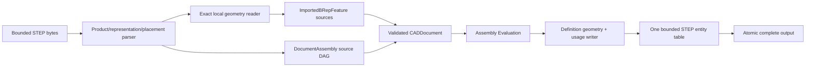

# STEP Assembly

## Purpose and Scope

This component owns exact STEP assembly interchange and the structural transport
needed by PARX.X3 product attributes: part definitions,
placed occurrences, shared parts, nesting, and local coordinate systems through
public STEPExchange and OfficialFormatExchange paths. Parent:
[CADExchange](../DESIGN.md). No children. It composes the existing exact geometry
reader/writer; it does not port OCCT implementation code.

## Responsibilities and Boundaries

The reader owns product-definition and shape-representation association,
occurrence placement syntax, standard coordinate-frame interpretation, and
explicit admission of representation alternatives. Existing ExactSTEPReader
owns exact local geometry. Each local source body is retained by one existing
ImportedBRepFeature; DocumentAssembly references these real FeatureIDs.
Assembly Evaluation owns placed world output and correspondence.

The writer serializes one local geometry representation per retained definition,
an optional whole-part style carrier representation, and one
usage relationship per direct source occurrence. It never manufactures a new
part definition for each expanded leaf path. Source DAG and validated local
artifacts authorize export; a flattened world B-rep alone cannot claim to retain
assembly structure. Ordinary B-rep-only STEP export remains a single product.

## Related Designs

| Design | Relationship | Contract Used | Summary | Cautions |
|---|---|---|---|---|
| [CADExchange](../DESIGN.md) | parent | ByteSource/ByteSink, facade routes, limits, atomic URL output | Owns public format routing | All failures occur before output publication |
| [Document Assembly](../../CADIR/DocumentAssembly/DESIGN.md) | depends on | source definitions, occurrences, local frames | Retains assembly semantics in CAD source | The current strict envelope is owned by CADCore; source assembly is required nullable |
| [STEP Attributes](../STEPAttributes/DESIGN.md) | coordinates with | lexical fields, retained definition/topology entity maps, whole-part mapped-item carrier | Preserves source attribute target scope | Attribute policy remains owned by STEP Attributes |
| [Assembly Evaluation](../../CADKernel/AssemblyEvaluation/DESIGN.md) | depends on | local artifacts and world correspondence | Confirms source-to-geometry consistency | World geometry cannot substitute for local definitions |
| [CADTopology](../../CADTopology/DESIGN.md) | depends on | ownership-closed exact B-rep extraction/validation | Retains exact local parts | Unsupported geometry remains typed refusal |

## Architecture



## Contracts and Invariants

- Product definitions are related to local shape representations through
  PRODUCT_DEFINITION_SHAPE and SHAPE_DEFINITION_REPRESENTATION. Assembly edges
  retain NEXT_ASSEMBLY_USAGE_OCCURRENCE identity and parent/child definition
  references, with CONTEXT_DEPENDENT_SHAPE_REPRESENTATION providing placement.
  Multiple usages of the same product definition retain one shared definition.
- For a representation relationship with transformation, rep_1 is the child
  representation and rep_2 the parent. ITEM_DEFINED_TRANSFORMATION item_1 is
  the child reference frame and item_2 its placed frame in the parent. The local
  transform is frame_2 composed with inverse(frame_1); nested world placement is
  parent-world composed with local. Nonorigin reference frames are supported.
- Representation contexts on a transformed relationship have distinct entity
  identities, even when they use the same units. Referenced transformation axes
  belong to the matching representation items. Writers generate a distinct geometric
  context for each definition; equal unit values do not imply equal contexts.
- Assembly rigid placements have scale one and positive determinant. Unsupported
  scaling, reflection, external definitions, missing placement, conflicting
  representation associations, cyclic products, and alternative flattened
  assembly geometry fail explicitly. No default identity transform is inferred
  for a missing occurrence placement.
- Admitted standard assembly syntax includes transformed representation
  relationships with item-defined axis frames and proper-rigid Cartesian
  transformation operators. Representation-map/mapped-item structure must be
  resolved with its standard origin/target semantics when admitted; unsupported
  or ambiguous variants are explicitly refused and never silently flattened.
- STEPFieldReading exposes bounded lexical entity fields, references, strings,
  numeric values, and tuple structure to STEP Attributes. STEPAssemblySyntax
  implements this contract; consumers do not duplicate its lexical parser.
- A whole-part styling carrier is structural transport for one real product
  definition. Its product-associated outer representation contains exactly one
  MAPPED_ITEM plus its frame. The representation map refers to an unassociated
  inner representation containing the complete retained local geometry and its
  origin. Equal declared units and explicitly resolved identity origin/target
  transformation are required. The inner representation has no nested mapped
  usage, competing geometry association, or cycle. These conditions are checked
  before classifying ordinary mapped items as assembly occurrences.
- An admitted carrier retains the existing definition and ImportedBRepFeature;
  it creates no additional feature, definition, occurrence, or semantic name.
  The carrier entity maps to the part attribute target, while inner geometry
  entities retain their body/face maps. A styled MAPPED_ITEM therefore preserves
  whole-part scope rather than expanding that scope into body assignments.
  Overriding face styles retain their explicit predecessor relationship.
- Carrier export is admitted for definitions with real local geometry. Empty
  subassemblies and mixed local-geometry/child definitions keep their existing
  admission contracts. Unsupported or ambiguous carrier structures fail before
  publication; they are not flattened or assigned guessed identity placement.
- Local geometry and placement translations are normalized using their declared
  representation length units. Multiple contexts declaring the same unit are
  not mistaken for conflicting units. Conflicting or unsupported unit contexts
  are refused unless the reader completely resolves each local context.
- Writer geometry helpers append local parts to one globally bounded entity
  table with per-part topology maps. Entity IDs do not collide across parts,
  even when native local topology IDs do. Assembly representations include their
  coordinate-frame items; empty geometry is not an invalid empty item set.
- Import publishes a validated assembly CADDocument and its placed exact B-rep.
  Export through memory and URL facades consumes the same evaluated-source
  assembly contract. Shared definitions, direct local placements, and nesting
  survive STEP and strict native save/load without becoming presentation metadata.
- Parsing, structural traversal, expansion, and entity writing charge existing
  exchange byte/entity/nesting/work/time budgets and explicit assembly evaluation
  limits before standard source expansion or consistency reconstruction. Export
  consistency uses its exchange ceilings, rather than trusting a larger retained
  evaluation allowance. Cancellation propagates; failures publish no partial document/model
  and do not modify an existing URL output.

The standard placement authority is
[ISO 10303-43 representation structures](https://www.steptools.com/stds/smrl/data/resource_docs/representation_structures/sys/4_schema.htm)
and the [PDM Schema Usage Guide 4.3, sections 3.4 and 4.4](https://www.mbx-if.org/home/wp-content/uploads/2024/05/pdmug_release4_3.pdf).
The [official OCCT STEP guide](https://github.com/Open-Cascade-SAS/OCCT/blob/master/dox/user_guides/step/step.md)
documents product/usage/representation mapping and alternative-geometry
ambiguity. These sources establish semantics, not an implementation dependency.

## Runtime Flows

```text
ByteSource -> envelope/entities -> product/representation graph -> local exact parts
 -> source DAG + feature sources -> source validation -> exact assembly evaluation
 -> complete ImportedExchangeModel

EvaluatedDocument -> validate source/local/world correspondence -> serialize definitions
 once -> serialize direct usages/frames -> complete bytes -> ByteSink/atomic URL
```

## State, Ownership, and Lifecycle

The parser borrows complete owned input within its existing byte-source scope.
Entity and association indexes are operation-local. Returned source values own
their exact local models and structural identities. Writer topology dictionaries
are local to each definition, while the entity table belongs to the complete
write operation. No mutable state persists across calls.

## Failure, Concurrency, and Constraints

New assembly operations use a public protocol and typed failures. Existing STEP
syntax, geometry, unit, cancellation, and resource errors propagate. Admission
checks representation ambiguity before publishing source. Export assembles the
entire bounded output before committing to a sink, preserving the existing
facade's atomic URL transaction.

## Verification and Change Impact

[STEPAssemblyExchangeTests](../../../Tests/CADExchangeTests/STEPAssemblyExchangeTests.swift)
owns independently authored standard fixtures containing shared parts, nested
usage, nonorigin frames, and rotation/translation. Assertions verify local and
world coordinates, product sharing, direct placement values, typed correspondence,
public facade in-memory/URL round trips, strict native persistence, source edits,
ambiguity/dangling/cycle/resource/cancellation refusal, and atomic failures.
[STEPAttributesExchangeTests](../../../Tests/CADExchangeTests/STEPAttributesExchangeTests.swift)
owns independently authored whole-part carrier fixtures, multiple local bodies,
face style overrides, source scope round trips, and invalid carrier refusal.
Existing STEPAssemblyExchangeTests verify that genuine mapped occurrences remain
assembly edges rather than styling carriers.
Existing ExactSTEPExchangeTests retain ordinary single-product geometry/unit
regression ownership. Changes require coordinated verification of DocumentAssembly,
Assembly Evaluation, native strict schema, and public STEP facade routing.
