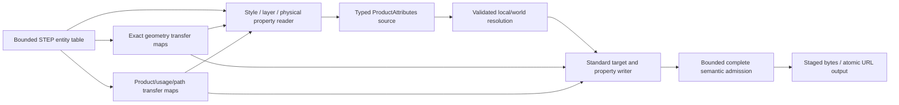

# STEP Attributes

## Purpose and Scope

This component owns PARX.X3 exact STEP correspondence for names, colors, layers,
physical materials, density, and explicit property precedence through public
STEP and OfficialFormatExchange import/export. Parent: [CADExchange](../DESIGN.md).
No children. This is an approved contract design with implementation and runtime
evidence pending. PMI, saved views, general presentation/renderer support, and
new material support in static mesh formats are separate scopes.

## Responsibilities and Boundaries

ExactSTEPReader/Writer own geometry entity-to-local-topology transfer maps;
STEPAssembly owns product-definition, direct usage, representation relationship,
and complete occurrence-path correspondence. This component consumes explicit
owner transfer results instead of reproducing tagged UUID conventions or private
parser state. ProductAttributes owns persistent values; ProductAttributeResolution
owns evaluated target/provenance resolution. STEPAttributes owns interpretation
of admitted standard attribute entities, their target associations, declared
units, and refusal of semantics it cannot preserve.

Existing part/occurrence name owners remain authoritative. Body/face entity names
are transferred to their exact persistent geometry attachments. A name cannot
be assigned to an arbitrary generated feature or first shape found in a product.
Physical name/description/density properties remain independent of presentation
colors and the existing PBR Material model.

## Related Designs

| Design | Relationship | Contract Used | Summary | Cautions |
|---|---|---|---|---|
| [CADExchange](../DESIGN.md) | parent | STEP routes, strict native persistence, ByteSource/ByteSink and budgets | Owns public routing and atomic URL output | Native source envelope authority is CADCore |
| [Product Attributes](../../CADIR/ProductAttributes/DESIGN.md) | depends on | Typed source targets, descriptors, property override graph | Retains imported meanings and source identities | Generic attribute keys and PBR defaults are not exchange meaning |
| [Product Attribute Resolution](../../CADKernel/ProductAttributeResolution/DESIGN.md) | depends on | Effective values and property-specific provenance | Confirms source/local/world attachment before export | Resolved world geometry alone cannot retain source assembly context |
| [STEP Assembly](../STEPAssembly/DESIGN.md) | depends on | Product/usage/representation/path transfer | Connects definition and instance attribute targets | A shared direct usage is not an entire nested path |
| [Standard Mesh Exchange](../StandardMeshExchange/DESIGN.md) | coordinates with | Existing static-mesh loss admission | Retains its explicit material/scene refusals | Facade projection must not silently discard new source attributes |

## Architecture



## Contracts and Invariants

- Definition-qualified body/face material and density attachments use the
  standard shape-aspect PD association plus GEOMETRIC_ITEM_SPECIFIC_USAGE's
  representation and identified item. Import checks actual representation PD
  membership and retains that selector when geometry is shared; export selects
  that PD and common local item. Names, colors and layer membership on a
  definition-qualified geometry target remain unsupported until their standard
  transport retains all instances of that definition without a global item
  overwrite. Both geometry-name projection and record generation preflight
  these narrow unsupported scopes before publication. Global item names/styles/
  layers remain common geometry attachments; complete occurrence style paths
  select actual membership rather than the first PD in the transfer.
  Distinct whole-part appearance uses separate proved structural PD carriers.
- A PD-qualified physical target is exported with one unassociated singleton
  SHAPE_REPRESENTATION view containing its already-emitted body or face item.
  The view shares the geometry context and units; it creates no topology,
  modeling feature or additional PD shape association. Material and density on
  the same source target reuse one view, shape aspect and GISU. Distinct PD
  selectors on the same common face have distinct views, satisfying the standard
  GISU superclass uniqueness rules for (used representation, identified item)
  and (used representation, definition). Import validates both uniqueness rules
  before interpreting properties. An unassociated view must contain exactly the
  identified item, have equal length units, and select an existing feature owned
  by the shape aspect's PD. Associated geometry representations retain the
  existing exact membership proof. Malformed, foreign, unit-conflicting or
  duplicate usages fail before publication; a mapped carrier is not evidence
  that its outer representation directly contains an inner face.
- A shape-aspect GISU always retains its explicit PD selector, including when
  only one PD currently references the item. PD count or equal values never
  convert that scope to a global target. Direct PD/part and direct-usage physical
  targets retain their existing meaning.
- Global body/face physical properties use an actual standard
  CHARACTERIZED_ITEM_WITHIN_REPRESENTATION (CIWR), a characterized-object subtype
  admitted by PROPERTY_DEFINITION.definition. Its item is the existing exact
  body/face item, and its rep is an unassociated singleton SHAPE_REPRESENTATION
  view with the exact producer-owned geometry units. The view has no SDR,
  representation-map, mapped-carrier or representation-relationship association;
  it selects no PD, usage or occurrence path. This structural global profile
  maps to the existing immutable source-geometry target with all scope selectors
  absent. The item is not copied and current PD count or property equality cannot
  infer scope. One target reuses its CIWR/view for material and explicit density;
  CIWR-only properties do not manufacture a source assembly from a canonical
  bare geometry PRODUCT or an input without products; the ordinary route still
  performs the complete CIWR geometry/view/unit admission before publication.
  Ordinary attributed geometry has no AssemblyProduct business identifier owner
  and emits the same canonical SWIFTCAD PRODUCT identifier as B-rep-only output;
  the document UUID is not exported as a business or native product identity.
  Its existing DocumentMetadata.name value remains the PRODUCT name. A genuine
  nonempty name therefore retains real product source authority on reimport,
  while an unnamed canonical CIWR-only product retains the ordinary route.
  Genuine product metadata and explicit PD/usage/ShapeAspect physical owners
  retain the existing assembly-source routing. Every later definition reusing
  that feature receives the same global property
  through the existing resolver contract.
- Reader CIWR admission checks actual exact geometry transfer and owned units,
  direct singleton item membership (the standard WR1), absence of contextual
  associations, and CIWR UR1 item/rep uniqueness before property publication.
  Unsupported characterization text or contextual/chain subtypes fail instead
  of becoming a different native owner. Physical PROPERTY_DEFINITION owners are
  restricted to legal PD, direct-usage, ShapeAspect and admitted CIWR forms;
  writing a raw body or face directly into its characterized-definition select
  is invalid. Explicit GISU and CIWR scopes remain distinct and competing
  applicable properties require the existing explicit override contract;
  physical override transport remains a separate incomplete branch.
  Complex relationship detection consumes STEPFieldReading.hasComponent, the
  lexical owner's exact unquoted component-presence requirement. It distinguishes
  absence from malformed lexical entities; semantic consumers precharge the
  complete entity-text scan rather than searching quoted text or error messages.
  All scans, lexical component checks, indexes and view/owner records consume
  the existing caller work/record/text/duration budget before derived growth.
- Both geometry-name projection and record production require the caller's
  ExchangeResourceLimits. They initialize the existing Writer Builder's cumulative
  product budget and duration, admit the resolved view's consumed work, and charge
  work/check duration before each assignment, layer and layer-member preflight visit.
  Name-map passes and index/result growth consume that same operation budget.
  There is no separate private allowance or implicit default ceiling. A ceiling
  exhausted by resolution fails as a resource error before unsupported-scope
  inspection; public STEP writers forward their admitted exchange limits.

- Public ordinary and assembly STEP routes use the same attribute admission.
  A real PRODUCT_DEFINITION with retained part names or part properties needs
  a persistent AssemblyDefinition source owner even for a single unplaced
  product. Such import retains that real definition with an identity root frame
  through the existing assembly contract; it does not invent a modeling feature
  to hold product metadata. Files without a retained product-level target may
  still use the ordinary geometry-only source path.
  Reader geometry and product transfer maps are complete for every admitted
  attribute target. Body representations can correspond to several standard
  items; maps retain this multiplicity. Missing or conflicting associations
  fail instead of attaching an attribute to the first body/face.
- BRep-only export has no source part-name authority and therefore emits an
  empty PRODUCT name while retaining its transport identifier. Import uses the
  ordinary route for unnamed products without product-level attributes, usages,
  or mapped carriers; body/face names and attributes still use actual geometry
  transfer maps. Genuine product names, product metadata, placements, and
  structural carriers require retained real definition authority. Product and
  definition descriptions use the distinct nullable fields owned by Document
  Assembly, independent of material descriptions.
  The ordinary import result retains the original exact parsed B-rep, including
  deterministic topology identities and canonical curve/p-curve representation;
  independent source evaluation supplies attribute attachment consistency only.
- Presentation style import/export retains explicit STYLED_ITEM,
  OVER_RIDING_STYLED_ITEM, and contextual override relationships. A
  CONTEXT_DEPENDENT_OVER_RIDING_STYLED_ITEM context is the complete top-down
  representation-relationship path and maps to the X2 persistent occurrence
  path. Contextual overrides can further target a face of a placed component.
  They replace specified properties and preserve other property provenance.
  Entity order, UUID order, or an invented target-specific rank is not precedence.
- Both draughting_model and
  mechanical_design_geometric_presentation_representation are admitted global
  styling containers when their role/associations are unambiguous. Multiple
  competing containers, unknown style properties, or unresolved context paths
  fail. Supported color and transparency representations map explicit normalized
  values; they do not generate PBR metallic/roughness/IOR values. Invisibility,
  null-style visibility changes, conflicting front/back styles, or unsupported
  rendering properties cannot be silently discarded: preserve their complete
  meaning if implemented, otherwise refuse the file or export explicitly.
- Standard transparency export is admitted when an explicit color and opacity
  share a target and coincident predecessor style records. Independent opacity
  histories that cannot be carried by those records fail explicitly; export does
  not synthesize a color property or a new precedence edge to make them fit.
- Attributed solid bodies that expand into several independent STEP solid
  representation items fail when a unique Body target cannot be retained. The
  exact geometry transfer retains every item rather than selecting one.
- Physical override chains without an admitted standard ordering relation,
  unattached descriptors, and descriptor density without a matching explicit
  density assignment fail before publication. The latter refusal preserves the
  distinction between a descriptor's owned value and effective target density.
- Presentation layers are flat associations of representation items. Identical
  layer names merge as a set on import; export creates one assignment per layer.
  Definition membership and contextual instance membership retain distinct
  target scope. Layer invisibility and unsupported assigned-item semantics fail
  admission unless their meaning is fully retained. Layers are not property
  override edges.
- Physical material name/description and density on PRODUCT_DEFINITION are the
  part-property baseline. Standard-equivalent direct usage and body/face
  property targets are included where PROPERTY_DEFINITION and explicit
  shape-aspect/item usage establish a unique correspondence. Material and
  density remain separately tracked properties. Import creates a density
  assignment from the standard's explicit density property, never merely from a
  material assignment. Its value may explicitly reference the imported physical
  descriptor's owned density value. Export writes density only when an admitted
  explicit density assignment authorizes it. Competing assignments without
  an explicit ordering relationship fail as typed ambiguity. No implied
  body/face/occurrence material rank is introduced.
- A NEXT_ASSEMBLY_USAGE_OCCURRENCE target means its actual direct source usage;
  it is not substituted for an arbitrarily selected complete nested path. A
  complete path-specific physical assignment requires a standard-equivalent
  contextual association. If the implemented standard representation cannot
  express that meaning, export returns typed unsupported semantics rather than
  expanding shared definitions, flattening placement, or using private STEP
  property names to fake equivalence. Import retains the actual declared scope.
- Density measures have mass/volume dimensions (mass exponent +1, length
  exponent -3). SI prefixes, conversion-based units, and derived-unit factors
  are resolved with finite positive checked values into kilograms per cubic
  meter. Representation length units alone do not determine density units.
  Unknown dimensions, conflicting declarations, nonfinite values, and overflow
  fail. Missing density remains absent; geometric volume or default material
  cannot manufacture it.
- The source document, local geometry, and complete attachment graph are
  validated before import publication. Export validates matching source and
  evaluated correspondence, then admits every attributed target before output.
  Existing Body.material/PBR references require explicit supported conversion
  or a typed refusal; neither branch silently overrides the new source authority.
- Native save/load persists the complete required ProductAttributes value under the current CADCore envelope.
  Other public format routes must perform attribute-loss admission before a
  mesh/B-rep projection removes the source container. This task does not imply
  general GLTF/VRML materials or exact topology support; existing static-mesh
  refusals remain valid and new source metadata cannot disappear silently.
- Name, material and layer strings consume the bounded STEPFieldReading string
  contract; standard decoding and encoding remain owned by STEP Assembly.
  Retained text and actual codec work charge the caller attribute budget.
- Entity parsing, association indexes, override/context traversal, density
  conversion, evaluated resolution, and output staging share the caller's
  existing exchange byte/entity/nesting/work/duration ceilings plus explicit
  source/resolution allocation limits. Checked charges precede growing maps,
  expanded associations, or writer records. Cancellation propagates. Any
  failure publishes no partial imported document and leaves URL output intact.

Standard authorities are the
[CAx Model Styling and Organization 1.10](https://www.mbx-if.org/home/wp-content/uploads/2026/08/rec_prac_styling_org_v1.10.pdf),
[PROPERTY_DEFINITION](https://www.steptools.com/stds/stp_aim/html/t_property_definition.html),
[characterized product targets](https://www.steptools.com/stds/stp_aim/html/t_characterized_product_definition.html),
[characterized-definition select](https://www.steptools.com/stds/stp_aim/html/t_characterized_definition.html),
and [item characterization](https://www.steptools.com/stds/stp_aim/html/t_characterized_item_within_representation.html),
and [geometric item usage](https://www.steptools.com/stds/stp_aim/html/t_geometric_item_specific_usage.html)
with its [item-identified usage constraints](https://www.steptools.com/stds/stp_aim/html/t_item_identified_representation_usage.html).
The [official OCCT STEP guide](https://github.com/Open-Cascade-SAS/OCCT/blob/master/dox/user_guides/step/step.md)
documents the established physical material name/description/density part-property
mapping. These establish admitted semantics, not an implementation dependency.
The unavailable referenced MaterialDensity 2.1 document and private later drafts
are not used to invent additional precedence or unit rules.

## Runtime Flows

```text
bounded STEP -> exact geometry + product transfer -> attributes/units/context
 -> normalize typed source graph -> validate source -> exact local/world evaluation
 -> resolve attributes -> publish complete imported source and geometry

evaluated source -> validate local/world consistency -> resolve property provenance
 -> standard target admission -> append attributes to shared entity table
 -> stage complete bounded bytes -> sink / atomic URL publication
```

## State, Ownership, and Lifecycle

Readers/writers are stateless Sendable implementations. The input entity table
and transfer indexes live for one bounded invocation. Borrowed input does not
escape the byte-source scope; published documents own typed values rather than
borrowed entity references. Writer transfer maps and entity records share one
operation owner. No global registry, platform-specific mutable cache, or hidden
default material is introduced.

## Failure, Concurrency, and Constraints

New public operations are protocol-based with typed malformed-target,
unsupported-semantic, ambiguous-property/context, invalid-density-unit, and
resource failures. Existing STEP syntax/exact geometry/evaluation failures and
cancellation propagate. Loss is never reported as successful default appearance,
empty layer membership, or a different material target. A direct ByteSink I/O
failure retains its existing sink contract; public URL publication remains atomic.

## Verification and Change Impact

Planned [STEPAttributesExchangeTests](../../../Tests/CADExchangeTests/STEPAttributesExchangeTests.swift)
own independently authored standard fixtures and public memory/URL round trips
for body/face/part/usage names and associations, color override provenance,
shared nested contextual styles, same-name layer merge, physical descriptors,
and density in independent mass/length units. They must also prove ambiguous
properties/contexts, unsupported semantics, dangling targets, nested-path
non-equivalence, unit/domain/resource/cancellation refusal, and atomic failure.
Fixtures must not be generated solely by the production writer. Native package
tests own complete source persistence and strict current-envelope admission. Existing exact
STEP, X2, and static mesh tests retain their geometry/unit/loss invariants.
[SharedSTEPRepresentationTests](../../../Tests/CADExchangeTests/SharedSTEPRepresentationTests.swift)
own independent two-PD/shared-item and singleton-view fixtures, two-generation
public transport, scoped property/provenance, usage uniqueness, unit and membership
refusals, and atomic failure. Changes require coordinated validation of the source/resolution owners, exact
transfer maps, public facades, strict native schema, and parent indices/catalogs.

[GlobalSTEPPhysicalAttributeTests](../../../Tests/CADExchangeTests/GlobalSTEPPhysicalAttributeTests.swift)
own independently authored CIWR body/face global properties, Native and two STEP
generations, new shared-PD applicability, legal-selector refusal, target-view
units/association/uniqueness admission and public atomic/resource/cancellation
failures. Existing shared representation tests retain their qualified GISU scope.
