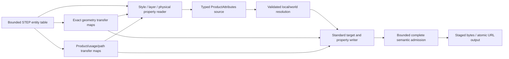

# STEP Attributes

## Purpose and Scope

This component owns PARX.X3 exact STEP correspondence for names, colors, layers,
physical materials, density, and explicit property precedence through public
STEP and OfficialFormatExchange import/export. Parent: [CADExchange](../DESIGN.md).
No children. This is an approved contract design with implementation and runtime
evidence pending. PMI, saved views, general presentation/renderer support, and
new material support in static mesh formats are separate scopes.

## Responsibilities and Boundaries

ExactSTEPReader/Writer own geometry entity-to-local-topology transfer maps;
STEPAssembly owns product-definition, direct usage, representation relationship,
and complete occurrence-path correspondence. This component consumes explicit
owner transfer results instead of reproducing tagged UUID conventions or private
parser state. ProductAttributes owns persistent values; ProductAttributeResolution
owns evaluated target/provenance resolution. STEPAttributes owns interpretation
of admitted standard attribute entities, their target associations, declared
units, and refusal of semantics it cannot preserve.

Existing part/occurrence name owners remain authoritative. Body/face entity names
are transferred to their exact persistent geometry attachments. A name cannot
be assigned to an arbitrary generated feature or first shape found in a product.
Physical name/description/density properties remain independent of presentation
colors and the existing PBR Material model.

Material identity is carried by the standard material model, not by a private
property name or by reusing a product identity assignment. An admitted
material descriptor is a `MATERIAL_DESIGNATION` (or an explicitly admitted
AP242 material subtype) whose stable identifier is an
`APPLIED_EXTERNAL_IDENTIFICATION_ASSIGNMENT` targeting that designation. The
assignment source and role remain the external-identification namespace; its
`items` correspondence is the authority for the descriptor UUID. The
descriptor's applicability is then proved through the standard
`characterized_definition` / `characterized_product_definition` /
`shape_definition` select chain appropriate to the target. A descriptor UUID
without that chain is a typed missing-target or unsupported-semantics failure,
never a material identity inferred from a product, occurrence, name, or entity
order.

This component interprets the admitted material carrier and preserves its
target scope. STEP Assembly retains the entity and source-identity
correspondence; Product Attribute Resolution owns effective-value precedence.
The source identity reader admits the `material` role only for a
`MATERIAL_DESIGNATION` target. The writer's physical target forms are all legal
`characterized_definition` alternatives: occurrence targets use
`PRODUCT_DEFINITION_SHAPE` (`shape_definition`), part targets use
`PRODUCT_DEFINITION` (`characterized_product_definition`), direct usages use
`NEXT_ASSEMBLY_USAGE_OCCURRENCE` (`product_definition_relationship` inside
`characterized_product_definition`), body/face targets use `SHAPE_ASPECT`
(`shape_definition`), and global CIWR targets use
`CHARACTERIZED_ITEM_WITHIN_REPRESENTATION` (`characterized_object`). End-to-end
material UUID round-trip still requires focused runtime evidence; unproved
material targets remain typed failures. No private UUID carrier or arbitrary
`GENERIC_PROPERTY_RELATIONSHIP` priority is authorized.

The SELECT memberships are defined by the AP242 merged AIM schema:
[`material_designation`](https://www.steptools.com/docs/stp_aim/html/t_material_designation.html),
[`characterized_definition`](https://www.steptools.com/docs/stp_aim/html/t_characterized_definition.html),
[`characterized_product_definition`](https://www.steptools.com/docs/stp_aim/html/t_characterized_product_definition.html),
[`shape_definition`](https://www.steptools.com/docs/stp_aim/html/t_shape_definition.html),
[`characterized_item_within_representation`](https://www.steptools.com/docs/stp_aim/html/t_characterized_item_within_representation.html),
and [`next_assembly_usage_occurrence`](https://www.steptools.com/docs/stp_aim/html/t_next_assembly_usage_occurrence.html).

An explicit occurrence-path physical target is characterized by the
`PRODUCT_DEFINITION_SHAPE` owned by that path's validated NAUO. The source
path remains a `ProductAttributeTarget` occurrence selector; shared child
geometry is never copied or flattened. Import accepts only a unique
`PRODUCT_DEFINITION_SHAPE` to NAUO to evaluated occurrence correspondence.
Foreign or ambiguous owners fail with a typed error.

## Related Designs

| Design | Relationship | Contract Used | Summary | Cautions |
|---|---|---|---|---|
| [CADExchange](../DESIGN.md) | parent | STEP routes, strict native persistence, ByteSource/ByteSink and budgets | Owns public routing and atomic URL output | Native source envelope authority is CADCore |
| [Product Attributes](../../CADIR/ProductAttributes/DESIGN.md) | depends on | Typed source targets, descriptors, property override graph | Retains imported meanings and source identities | Generic attribute keys and PBR defaults are not exchange meaning |
| [Product Attribute Resolution](../../CADKernel/ProductAttributeResolution/DESIGN.md) | depends on | Effective values and property-specific provenance | Confirms source/local/world attachment before export | Resolved world geometry alone cannot retain source assembly context |
| [STEP Assembly](../STEPAssembly/DESIGN.md) | depends on | Product/usage/representation/path transfer | Connects definition and instance attribute targets | A shared direct usage is not an entire nested path |
| [Standard Mesh Exchange](../StandardMeshExchange/DESIGN.md) | coordinates with | Existing static-mesh loss admission | Retains its explicit material/scene refusals | Facade projection must not silently discard new source attributes |

## Architecture



## Contracts and Invariants

- Direct-usage appearance uses the actual validated CDSR as its standard context:
  CDSR selects its PDS and real NAUO, retaining one directUsage selector for every
  occurrence of that shared usage. It is not expanded into current complete
  paths. PSBC assigns standalone color/coincident opacity to the proved identity
  carrier of the NAUO child PD; an explicit predecessor is carried by CDORSI with
  the same singleton CDSR context. The child must be a nonempty geometry-bearing
  leaf and the carrier must select that exact PD. Layer-only membership uses a
  PSBC NULL_STYLE scoped styled carrier without a native property or predecessor.
  Existing part/qualified geometry carrier contexts and full-path relationship
  lists remain distinct owners; competing or mixed contexts fail rather than
  guessing a path or usage from values. Nonleaf, empty, unproved and mapped-only
  usages remain explicit incomplete failures. Source resolution still owns
  predecessor applicability and property-specific ambiguity; no scope rank is
  inferred. Lookup, context scans, style/member records and growth consume the
  existing cumulative caller budget and duration before publication.
  When a contextual relationship list is resolved, an evaluated complete
  occurrence path is preferred over a suffix match; the suffix form is
  admitted only when no complete path matches. Multiple matches at either
  precedence level are an ambiguity, never a path selection heuristic.
- Definition-qualified Body/Face names are Shape_element labels: the standard
  ShapeAspect.name owns the label, of_shape selects the real PD, and one GISU
  identifies the existing exact Body/Face in its proved singleton view. The
  common representation_item.name remains the independent global label. The
  name projection excludes qualified labels; named aspects and physical
  properties on the same target reuse one aspect/view/GISU. Standalone nonempty
  labels are admitted. Empty labels, name histories, independent descriptions
  and unknown chained/subtype meanings fail explicitly; a global and qualified
  competing name is not assigned an inferred priority.
- Definition-qualified color/opacity uses the already-proved identity whole-part
  MAPPED_ITEM as its actual standard style context. PRESENTATION_STYLE_BY_CONTEXT
  carries standalone scoped values. A CDORSI with that single carrier context
  carries an explicit predecessor; relationship-list occurrence contexts retain
  their existing separate path contract. The common styled Body/Face must belong
  to the carrier's real definition. An unknown, foreign, competing or nonidentity
  context fails; a representation or GISU view is not substituted for a carrier.
  Source selectors retain every occurrence of that definition without geometry
  copy, part-wide color expansion or invented property rank/provenance.
- Qualified layer members assign the actual scoped STYLED_ITEM. A layer-only
  target uses PRESENTATION_STYLE_BY_CONTEXT with standard NULL_STYLE(.NULL.)
  and the proved carrier; this adds no native color, opacity or predecessor.
  Global appearance and provenance remain unchanged. Layers are sets, not
  override relationships. Complete occurrence layers use the explicit full-path
  null style contract in [Usage and Complete-Path Layer Authority](#usage-and-complete-path-layer-authority);
  a one-component path does not collapse into a direct-usage selector. Unsupported
  visibility/context interpretations fail.
  Reader/writer checks, context/member scans, source-name lookup and derived
  records use the same caller work/record/text/duration budget before growth.
- A PD-qualified physical target is exported with one unassociated singleton
  SHAPE_REPRESENTATION view containing its already-emitted body or face item.
  The view shares the geometry context and units; it creates no topology,
  modeling feature or additional PD shape association. Material and density on
  the same source target reuse one view, shape aspect and GISU. Distinct PD
  selectors on the same common face have distinct views, satisfying the standard
  GISU superclass uniqueness rules for (used representation, identified item)
  and (used representation, definition). Import validates both uniqueness rules
  before interpreting properties. An unassociated view must contain exactly the
  identified item, have equal length units, and select an existing feature owned
  by the shape aspect's PD. Associated geometry representations retain the
  existing exact membership proof. Malformed, foreign, unit-conflicting or
  duplicate usages fail before publication; a mapped carrier is not evidence
  that its outer representation directly contains an inner face.
- A shape-aspect GISU always retains its explicit PD selector, including when
  only one PD currently references the item. PD count or equal values never
  convert that scope to a global target. Direct PD/part and direct-usage physical
  targets retain their existing meaning.
- Global body/face physical properties use an actual standard
  CHARACTERIZED_ITEM_WITHIN_REPRESENTATION (CIWR), a characterized-object subtype
  admitted by PROPERTY_DEFINITION.definition. Its item is the existing exact
  body/face item, and its rep is an unassociated singleton SHAPE_REPRESENTATION
  view with the exact producer-owned geometry units. The view has no SDR,
  representation-map, mapped-carrier or representation-relationship association;
  it selects no PD, usage or occurrence path. This structural global profile
  maps to the existing immutable source-geometry target with all scope selectors
  absent. The item is not copied and current PD count or property equality cannot
  infer scope. One target reuses its CIWR/view for material and explicit density;
  CIWR-only properties do not manufacture a source assembly from a canonical
  bare geometry PRODUCT or an input without products; the ordinary route still
  performs the complete CIWR geometry/view/unit admission before publication.
  Ordinary attributed geometry has no AssemblyProduct business identifier owner
  and emits the same canonical SWIFTCAD PRODUCT identifier as B-rep-only output;
  the document UUID is not exported as a business or native product identity.
  Its existing DocumentMetadata.name value remains the PRODUCT name. A genuine
  nonempty name therefore retains real product source authority on reimport,
  while an unnamed canonical CIWR-only product retains the ordinary route.
  Genuine product metadata and explicit PD/usage/ShapeAspect physical owners
  retain the existing assembly-source routing. Every later definition reusing
  that feature receives the same global property
  through the existing resolver contract.
- Reader CIWR admission checks actual exact geometry transfer and owned units,
  direct singleton item membership (the standard WR1), absence of contextual
  associations, and CIWR UR1 item/rep uniqueness before property publication.
  Singleton global CIWR name and explicitly nullable description belong to the
  ProductAttributes item-characterization record, separately from the item
  name and material descriptor. Contextual/chain subtypes remain incomplete
  typed failures instead of becoming a different native owner. Physical PROPERTY_DEFINITION owners are
  restricted to legal PD, direct-usage, ShapeAspect and admitted CIWR forms;
  writing a raw body or face directly into its characterized-definition select
  is invalid. Explicit GISU and CIWR scopes remain distinct and competing
  applicable properties require the existing explicit override contract;
  physical override transport remains a separate incomplete branch.
  Complex relationship detection consumes STEPFieldReading.hasComponent, the
  lexical owner's exact unquoted component-presence requirement. It distinguishes
  absence from malformed lexical entities; semantic consumers precharge the
  complete entity-text scan rather than searching quoted text or error messages.
  All scans, lexical component checks, indexes and view/owner records consume
  the existing caller work/record/text/duration budget before derived growth.
- Both geometry-name projection and record production require the caller's
  ExchangeResourceLimits. They initialize the existing Writer Builder's cumulative
  product budget and duration, admit the resolved view's consumed work, and charge
  work/check duration before each assignment, layer and layer-member preflight visit.
  Name-map passes and index/result growth consume that same operation budget.
  There is no separate private allowance or implicit default ceiling. A ceiling
  exhausted by resolution fails as a resource error before unsupported-scope
  inspection; public STEP writers forward their admitted exchange limits.

- Public ordinary and assembly STEP routes use the same attribute admission.
  A real PRODUCT_DEFINITION with retained part names or part properties needs
  a persistent AssemblyDefinition source owner even for a single unplaced
  product. Such import retains that real definition with an identity root frame
  through the existing assembly contract; it does not invent a modeling feature
  to hold product metadata. Files without a retained product-level target may
  still use the ordinary geometry-only source path.
  Reader geometry and product transfer maps are complete for every admitted
  attribute target. Body representations can correspond to several standard
  items; maps retain this multiplicity. Missing or conflicting associations
  fail instead of attaching an attribute to the first body/face.
- BRep-only export has no source part-name authority and therefore emits an
  empty PRODUCT name while retaining its transport identifier. Import uses the
  ordinary route for unnamed products without product-level attributes, usages,
  or mapped carriers; body/face names and attributes still use actual geometry
  transfer maps. Genuine product names, product metadata, placements, and
  structural carriers require retained real definition authority. Product and
  definition descriptions use the distinct nullable fields owned by Document
  Assembly, independent of material descriptions.
  The ordinary import result retains the original exact parsed B-rep, including
  deterministic topology identities and canonical curve/p-curve representation;
  independent source evaluation supplies attribute attachment consistency only.
- Presentation style import/export retains explicit STYLED_ITEM,
  OVER_RIDING_STYLED_ITEM, and contextual override relationships. A
  CONTEXT_DEPENDENT_OVER_RIDING_STYLED_ITEM context is the complete top-down
  representation-relationship path and maps to the X2 persistent occurrence
  path. Contextual overrides can further target a face of a placed component.
  They replace specified properties and preserve other property provenance.
  Entity order, UUID order, or an invented target-specific rank is not precedence.
- Both draughting_model and
  mechanical_design_geometric_presentation_representation are admitted global
  styling containers when their role/associations are unambiguous. Multiple
  competing containers, unknown style properties, or unresolved context paths
  fail. Supported color and transparency representations map explicit normalized
  values; they do not generate PBR metallic/roughness/IOR values. Invisibility,
  null-style visibility changes, conflicting front/back styles, or unsupported
  rendering properties cannot be silently discarded: preserve their complete
  meaning if implemented, otherwise refuse the file or export explicitly.
- Standard transparency export is admitted when an explicit color and opacity
  share a target and coincident predecessor style records. Independent opacity
  histories that cannot be carried by those records fail explicitly; export does
  not synthesize a color property or a new precedence edge to make them fit.
- Attributed solid bodies that expand into several independent STEP solid
  representation items fail when a unique Body target cannot be retained. The
  exact geometry transfer retains every item rather than selecting one.
- Physical override chains without an admitted standard ordering relation,
  unattached descriptors, and descriptor density without a matching explicit
  density assignment fail before publication. The latter refusal preserves the
  distinction between a descriptor's owned value and effective target density.
- Presentation layers are flat associations of representation items. Identical
  layer names merge as a set on import; export creates one assignment per layer.
  Definition membership and contextual instance membership retain distinct
  target scope. Layer invisibility and unsupported assigned-item semantics fail
  admission unless their meaning is fully retained. Layers are not property
  override edges.
- Physical material name/description and density on PRODUCT_DEFINITION are the
  part-property baseline. Standard-equivalent direct usage and body/face
  property targets are included where PROPERTY_DEFINITION and explicit
  shape-aspect/item usage establish a unique correspondence. Material and
  density remain separately tracked properties. Import creates a density
  assignment from the standard's explicit density property, never merely from a
  material assignment. Its value may explicitly reference the imported physical
  descriptor's owned density value. Export writes density only when an admitted
  explicit density assignment authorizes it. Competing assignments without
  an explicit ordering relationship fail as typed ambiguity. No implied
  body/face/occurrence material rank is introduced.
- Material descriptor identity and material applicability are separate proofs.
  The descriptor UUID must round-trip through the standard material designation
  external-identification assignment, while the property target must round-trip
  through its admitted product, NAUO/PDS, ShapeAspect/GISU, or CIWR owner.
  A material designation that is identified but not linked to the selected
  target is unattached and fails; a target with a material name but no admitted
  descriptor identity fails without silently generating a new UUID. Material
  identity does not establish precedence between material and density
  assignments.
  The reader first records every designation target, then requires each recorded
  target to have an admitted `PROPERTY_DEFINITION` carrying the material-name
  value before publishing a material descriptor. A designation that has only a
  density property, an orphaned descriptor identity, or no attached property
  fails with `ProductAttributeError.missingTarget`; the reader charges this
  target-attachment scan against the caller's existing cumulative budget. The
  independent-shape route has no ProductAttributes composition owner and is
  refused by its parent route before document publication.
- A physical assignment on an explicit occurrence path uses the occurrence's
  validated NAUO `PRODUCT_DEFINITION_SHAPE` owner. It remains distinct from a
  directUsage selector and preserves nested path identity through the existing
  assembly transfer and resolver.
- A directUsage physical assignment uses the same validated nonempty leaf
  definition selected by its NAUO/CDSR usage as directUsage appearance. The
  writer resolves that definition's transferred product before producing the
  `PROPERTY_DEFINITION` target; local geometry lookup is not a substitute for
  the usage owner.
- A NEXT_ASSEMBLY_USAGE_OCCURRENCE target means its actual direct source usage;
  it is not substituted for an arbitrarily selected complete nested path. A
  complete path-specific physical assignment uses the validated occurrence's
  PRODUCT_DEFINITION_SHAPE owner, preserving the complete path without
  expanding shared definitions or flattening placement. Import retains the
  declared owner only when the PDS points to one validated NAUO and evaluated
  occurrence path; foreign or ambiguous contextual owners remain typed refusals.
- Density measures have mass/volume dimensions (mass exponent +1, length
  exponent -3). SI prefixes, conversion-based units, and derived-unit factors
  are resolved with finite positive checked values into kilograms per cubic
  meter. Representation length units alone do not determine density units.
  Unknown dimensions, conflicting declarations, nonfinite values, and overflow
  fail. Missing density remains absent; geometric volume or default material
  cannot manufacture it.
- The source document, local geometry, and complete attachment graph are
  validated before import publication. Export validates matching source and
  evaluated correspondence, then admits every attributed target before output.
  Existing Body.material/PBR references require explicit supported conversion
  or a typed refusal; neither branch silently overrides the new source authority.
- Native save/load persists the complete required ProductAttributes value under the current CADCore envelope.
  Other public format routes must perform attribute-loss admission before a
  mesh/B-rep projection removes the source container. This task does not imply
  general GLTF/VRML materials or exact topology support; existing static-mesh
  refusals remain valid and new source metadata cannot disappear silently.
- Name, material and layer strings consume the bounded STEPFieldReading string
  contract; standard decoding and encoding remain owned by STEP Assembly.
  Retained text and actual codec work charge the caller attribute budget.
- Entity parsing, association indexes, override/context traversal, density
  conversion, evaluated resolution, and output staging share the caller's
  existing exchange byte/entity/nesting/work/duration ceilings plus explicit
  source/resolution allocation limits. Checked charges precede growing maps,
  expanded associations, or writer records. Cancellation propagates. Any
  failure publishes no partial imported document and leaves URL output intact.

Standard authorities are the
[CAx Model Styling and Organization 1.10](https://www.mbx-if.org/home/wp-content/uploads/2026/08/rec_prac_styling_org_v1.10.pdf),
[PROPERTY_DEFINITION](https://www.steptools.com/stds/stp_aim/html/t_property_definition.html),
[characterized product targets](https://www.steptools.com/stds/stp_aim/html/t_characterized_product_definition.html),
[characterized-definition select](https://www.steptools.com/stds/stp_aim/html/t_characterized_definition.html),
and [item characterization](https://www.steptools.com/stds/stp_aim/html/t_characterized_item_within_representation.html),
and [geometric item usage](https://www.steptools.com/stds/stp_aim/html/t_geometric_item_specific_usage.html)
with its [item-identified usage constraints](https://www.steptools.com/stds/stp_aim/html/t_item_identified_representation_usage.html).
The [official OCCT STEP guide](https://github.com/Open-Cascade-SAS/OCCT/blob/master/dox/user_guides/step/step.md)
documents the established physical material name/description/density part-property
mapping. These establish admitted semantics, not an implementation dependency.
The unavailable referenced MaterialDensity 2.1 document and private later drafts
are not used to invent additional precedence or unit rules.

### Independent Global CIWR Text

The standard [CIWR EXPRESS definition](https://www.steptools.com/stds/stp_aim/html/t_characterized_item_within_representation.html)
inherits required name and optional description from
[characterized_object](https://www.steptools.com/stds/stp_aim/html/t_characterized_object.html).
The bounded global singleton profile retains these independent fields under
the [ProductAttributes owner](../../CADIR/ProductAttributes/DESIGN.md).
The sole empty-name/null-description default maps to absent source metadata
only after full structural admission. Explicit native default records fail;
empty-description records remain present. Reader/writer preserve null versus
empty description and exact decoded text;
material and density on the same target reuse the same metadata record and
CIWR/view. Existing WR1 membership, UR1 uniqueness, original item/unit transfer,
global target authority and associated-view/contextual refusal remain required.
The writer emits source wrapper text and emits canonical empty/null only when
no wrapper metadata exists; it never substitutes geometry/PD/material names.
Source record, target, work/text/duration/cancellation budgets remain cumulative.
Foreign literal STEP, Native and two public STEP generations must preserve
one original FeatureID/local face, selected-definition appearance, separate
geometry name, future-PD physical fanout and wrapper text. Malformed duplicate,
foreign/unit/associated/contextual/unattached metadata, exhausted resources and
atomic-output failure must be rejected. STEP resolves the complete stable
reference against its current exact geometry producer; external LINE and PCURVE
serialization may reconstruct equivalent normalized directions and degree-one
B-spline pcurves. Native retains the complete original source signature. The
independent triangle oracle proves its complete algebraic boundaries rather
than requiring transport enum or floating-point byte identity.

### Definition-Qualified Description Transport (PAR.SDESC1)

Standard [ShapeAspect](https://www.steptools.com/stds/stp_aim/html/t_shape_aspect.html)
owns optional description independently of name. The bounded profile
consumes the [ProductAttributes source description contract](../../CADIR/ProductAttributes/DESIGN.md#definition-qualified-shape-element-description-parsdesc1).
Only complete existing definition-qualified GISU/PD/view/item/unit admission
can retain this field. Source record absence emits `$`; any present String,
including `''`, emits its exact text. Empty input description is retained,
never normalized to absence. Name or physical attachment reuses the same
ShapeAspect/view/GISU; no new geometry, product identity or transport UUID is
created. Global CIWR wrapper text and geometry/material names keep their own
owners. Chained history/contextual/metadata-only authority stays explicitly
unsupported until its separate source and standard egress contracts exist.

Independent foreign literals, two public STEP generations and strict Native
must distinguish null, empty, whitespace and non-normalized Unicode on the
same shared source geometry. Current exact producer references and literal
algebraic geometry replace no source identity by sampled similarity. Competing
signatures, malformed/foreign/unit/GISU targets, exhausted shared limits,
cancellation and atomic failure retain typed refusal. Verification must include
the causal existing qualified-description fixture and source schema consumers;
the bounded design retains separate full-X3 gaps.

### Usage and Complete-Path Layer Authority

A `NULL_STYLE` item with a producer-validated CDSR and the child definition's
identity carrier retains the direct source usage. One usage may expand beneath
several parents; that expansion is neither a competing source selector nor
permission to choose one occurrence. Color/opacity and layer-only direct usages
consume the same validated nonempty leaf and carrier admission.

An occurrence-only layer instead emits a contextual overriding styled item
whose relationship list records every component of the complete source path,
including a one-component root path. Its null predecessor is a supporting style,
not a fabricated source assignment or precedence edge. Exact path admission
continues to reject competing paths and mismatched child definitions. The
contextual null override carries layer selection only, never invisibility. A new
one-component null override requires an explicit layer membership and empty
predecessor properties; other null visibility interpretations stay refused.

[AP242 styled_item_target](https://www.steptools.com/stds/stp_aim/html/t_styled_item_target.html)
admits a representation, while
[layered_item](https://www.steptools.com/stds/stp_aim/html/t_layered_item.html)
admits the styled representation item. For a source-owned subassembly with no
local features and no whole-part carrier, the layer-only writer targets its
actual transferred representation. It proves source emptiness and the matching
PD/representation before emitting that view; this does not fabricate geometry,
flatten children, or admit nonleaf direct-usage appearance. Ordinary appearance
continues to require its existing whole-part carrier. Supporting parent null
styles retain the validated CDSR usage but create no source properties. All
path comparisons, scans, retained selections and writer records consume the
existing cumulative work/target/text/duration/cancellation budget.

The original four direct-usage and root occurrence-only layer failures own the
causal later verification, together with nested paths, sharing, true ambiguity,
precedence, physical/global CIWR and atomic/resource refusal regressions. This
source implementation alone does not establish full X3/X7 completion.

## Runtime Flows

```text
bounded STEP -> exact geometry + product transfer -> attributes/units/context
 -> normalize typed source graph -> validate source -> exact local/world evaluation
 -> resolve attributes -> publish complete imported source and geometry

evaluated source -> validate local/world consistency -> resolve property provenance
 -> standard target admission -> append attributes to shared entity table
 -> stage complete bounded bytes -> sink / atomic URL publication
```

## State, Ownership, and Lifecycle

Readers/writers are stateless Sendable implementations. The input entity table
and transfer indexes live for one bounded invocation. Borrowed input does not
escape the byte-source scope; published documents own typed values rather than
borrowed entity references. Writer transfer maps and entity records share one
operation owner. No global registry, platform-specific mutable cache, or hidden
default material is introduced.

## Failure, Concurrency, and Constraints

New public operations are protocol-based with typed malformed-target,
unsupported-semantic, ambiguous-property/context, invalid-density-unit, and
resource failures. Existing STEP syntax/exact geometry/evaluation failures and
cancellation propagate. Loss is never reported as successful default appearance,
empty layer membership, or a different material target. A direct ByteSink I/O
failure retains its existing sink contract; public URL publication remains atomic.

## Verification and Change Impact

Planned [STEPAttributesExchangeTests](../../../Tests/CADExchangeTests/STEPAttributesExchangeTests.swift)
own independently authored standard fixtures and public memory/URL round trips
for body/face/part/usage names and associations, color override provenance,
shared nested contextual styles, same-name layer merge, physical descriptors,
and density in independent mass/length units. They must also prove ambiguous
properties/contexts, unsupported semantics, dangling targets, nested-path
non-equivalence, unit/domain/resource/cancellation refusal, and atomic failure.
Fixtures must not be generated solely by the production writer. Native package
tests own complete source persistence and strict current-envelope admission. Existing exact
STEP, X2, and static mesh tests retain their geometry/unit/loss invariants.
[SharedSTEPRepresentationTests](../../../Tests/CADExchangeTests/SharedSTEPRepresentationTests.swift)
own independent two-PD/shared-item and singleton-view fixtures, two-generation
public transport, scoped property/provenance, usage uniqueness, unit and membership
refusals, and atomic failure. Changes require coordinated validation of the source/resolution owners, exact
transfer maps, public facades, strict native schema, and parent indices/catalogs.

[GlobalSTEPPhysicalAttributeTests](../../../Tests/CADExchangeTests/GlobalSTEPPhysicalAttributeTests.swift)
own independently authored CIWR body/face global properties, Native and two STEP
generations, new shared-PD applicability, legal-selector refusal, target-view
units/association/uniqueness admission and public atomic/resource/cancellation
failures. Existing shared representation tests retain their qualified GISU scope.

[DefinitionQualifiedSTEPAttributeTests](../../../Tests/CADExchangeTests/DefinitionQualifiedSTEPAttributeTests.swift)
own independent shared geometry, real PD carrier contexts, named shape-element
GISUs and scoped layer literals; Native/two STEP generations/new definition
applicability, actual explicit provenance, resource/cancellation and atomic
refusal evidence. The standard name authority is ISO/TS 10303-1032
[Shape_element ARM](https://www.steptools.com/stds/smrl/data/modules/shape_property_assignment/sys/4_info_reqs.htm)
and its [MIM mapping](https://www.steptools.com/stds/smrl/data/modules/shape_property_assignment/sys/5_mapping.htm).
Style contexts use [PSBC](https://www.steptools.com/stds/stp_aim/html/t_presentation_style_by_context.html)
and [CDORSI](https://www.steptools.com/stds/stp_aim/html/t_context_dependent_over_riding_styled_item.html);
layers consume [layered_item](https://www.steptools.com/stds/stp_aim/html/t_layered_item.html).

[DirectUsageSTEPAttributeTests](../../../Tests/CADExchangeTests/DirectUsageSTEPAttributeTests.swift)
own independently authored shared nested NAUO/CDSR appearance and layer fixtures,
Native/two STEP generations/new parent placement, exact source-selector and
provenance preservation, foreign/mixed/nonleaf context refusal, caller ceilings,
cancellation and atomic output. The standard owner is [CDSR](https://www.steptools.com/stds/stp_aim/html/t_context_dependent_shape_representation.html)
admitted by [style_context_select](https://www.steptools.com/stds/stp_aim/html/t_style_context_select.html).

PAR.SDESC1 Native completion evidence: four independent IR source declarations,
one genuine stale/fresh exact receipt declaration, eight strict topology schema
declarations and five independent foreign STEP/Native/two-generation declarations
pass. All346 current exchange declarations pass across the345 unchanged successful
results and the causal shared-density migration recheck (.297s). The intentional
migration first proves unattached-description refusal, then explicitly removes
only descriptions of both removed exact scoped density targets, preserving other
metadata/override graphs and the original global/memory/URL oracles. Existing
source and resolution regressions pass17 IR,10 Kernel and four physical STEP
cases. Capability42 pass.146s; source projection checks134 actual conditions,
664 fixture bindings and107 public routes. Empty text is never silently omitted.


### Standalone Global CIWR Metadata Egress (PAR.CIWR2)

The CIWR standard requires item/representation membership and pair uniqueness,
not a material/density property attachment. ItemCharacterization source authority
is owned only by [ProductAttributes](../../CADIR/ProductAttributes/DESIGN.md).
The writer precharges standalone metadata traversal under existing cumulative
work/target/entity/text/duration/cancellation limits, then emits one existing
singleton unassociated CIWR/view for each complete global source target. Physical
assignments reuse that exact target cache. Metadata-only egress emits no synthetic
PROPERTY_DEFINITION, material or density; no wrapper record is silently dropped.

The current reader's full geometry/view/unit/UR1/default admission remains owner
of ingress, and ordinary/shared-PD transfer preserves global meaning without
inventing PRODUCT/PD authority. Definition-qualified descriptions, names/styles/
layers, physical provenance and exact source freshness remain independent.
Associated/contextual/subtype/multimember/foreign-unit/competing wrappers retain
typed refusal. Strict Native0.11 owns renamed itemCharacterizations, explicit
nullable description and prior/unknown key refusal. Source-key replacement has
no legacy alias or reader fallback.

Independent hand-authored STEP with no physical properties must survive memory
and atomic URL ingress/egress, full Native and two STEP generations, shared two-PD
and new third-PD fanout without invented values or changed exact geometry owner.
Existing material+density shares one CIWR. Foreign/stale geometry/source receipt,
malformed view/unit/uniqueness, defaultexplicit source, cumulative resource/cancel
and outputbyte preservation fixtures are required. FullX3/contextual chains remain
separate gaps; this bounded lifetime contract is not their completion.

Native verification: all351 Exchange cases pass in46.773s, including five independent
metadata-only literals. Four Kernel metadata cases pass across the original three
and corrected native U-column/V-row coefficient fixture (.053s); the actual
public spline source retains original coefficients and larger input exhausts the
smaller exact consumed-work allowance. Eight strict current-topology cases and
42 capability cases pass. The broad313-case IR run has one existing unrelated
ExtrudeResultKindSchema expectation failure; the312 passing cases include the
affected product source contracts. This does not establish fullX3 or portable parity.

### Manufacturing and View Metadata Composition

[STEP Product Metadata](../STEPProductMetadata/DESIGN.md) composes typed X4/X5 source records into the same paid Builder/entity/publication path. Source targets use the same current geometry transfer map. Standard datum/dimensional/tolerance/presentation/camera/validation graphs are emitted before the existing atomic publication boundary. Metadata-specific shape aspects are resolved by that child and do not create duplicated physical material/name sources. The new native external identity namespace is consumed by the metadata owner; it does not authorize arbitrary unknown namespaces.


### Styling and metadata representation composition
The appearance reader selects presentation containers from their actual membership in the transferred STYLED_ITEM graph. Camera, annotation and measured-value representations are not appearance containers merely because their entity subtype is DRAUGHTING_MODEL. Appearance admission still proves complete style membership, ownership and visibility; metadata containers are consumed by the metadata owner under the same enclosing caller budgets. This composition allows saved views and PMI alongside original appearance without choosing an arbitrary unrelated representation.
