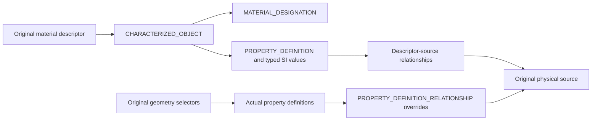

# STEP Physical Source History

## Purpose and Scope
Owns X3 original material descriptors, authored density and physical assignment precedence. Parent: [CADExchange](../DESIGN.md). No children.

## Responsibilities and Boundaries
This component emits and reads actual descriptor-owned standard characterization and property graphs. STEPAttributes owns current geometry correspondence, source validation and publication. The component preserves material identities independently of attachment, and retains descriptor density independently of effective target density. It never creates a product attachment for an unattached descriptor.

## Related Designs
| Design | Relationship | Contract Used | Summary | Cautions |
|---|---|---|---|---|
| [STEP Attributes](../STEPAttributes/DESIGN.md) | coordinates with | shared bounded entity table, source targets and SI density reader | parent composition supplies actual targets | No new resource allowance |
| [STEP Product Metadata](../STEPProductMetadata/DESIGN.md) | depends on | original target selector and identity carrier | preserves the full original source scope | Identity supplements do not replace actual values |
| [Product Attributes](../../CADIR/ProductAttributes/DESIGN.md) | depends on | PhysicalMaterialDescriptor and ProductAttributeAssignment | original immutable physical source | Override references must resolve |

## Architecture

## Contracts and Invariants
A descriptor has one original designation identity and a characterized value object; assignments reference its actual descriptor property through a real directed relationship. Density uses mass exponent +1 and length exponent -3 and the existing physical-density reader. Override direction is predecessor to successor and preserves independent material versus density history. Missing, duplicate, cyclic, competing and kind-incompatible references fail before publication. Every traversal, decoded text and emitted record uses the existing STEPAttributes invocation budget and absolute deadline.

The standard carriers are [characterized_object](https://www.steptools.com/stds/stp_aim/html/t_characterized_object.html), [material_designation](https://www.steptools.com/stds/stp_aim/html/t_material_designation.html) and [property_definition_relationship](https://www.steptools.com/stds/stp_aim/html/t_property_definition_relationship.html). Relationship names explicitly designate original source attachment and predecessor roles; actual dimensional and material values are always present in their representations.

## Failure, Concurrency, and Constraints
Operation-local value graphs have no shared mutable storage. Remaining caller work/depth bounds govern recursion and record retention. Typed source, reference, ambiguity, cancellation and resource failures propagate.

## Verification and Change Impact
After all-source implementation, public STEP and Native fixtures must distinguish unattached materials, latent descriptor density, separate effective density and every original physical override. Source authorship alone is not runtime evidence. Parent STEPAttributes and metadata selector contracts must be rechecked when carriers change.

Only the actual MATERIAL_DESIGNATION carries external identity. CHARACTERIZED_OBJECT is not an external_identification_item SELECT member; the descriptor object is reached through the designation's real definition reference. [external_identification_item](https://www.steptools.com/stds/stp_aim/html/t_external_identification_item.html) owns this carrier boundary.
