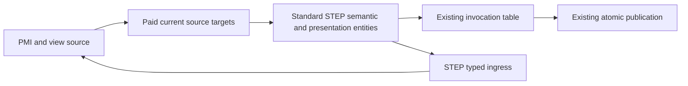

# STEP Product Metadata

## Purpose and Scope
Owns X4/X5 standard STEP transport for typed manufacturing information, saved views, clipping, authored physical validation and annotation placements. Parent: [CADExchange](../DESIGN.md). No children.

## Responsibilities and Boundaries
ProductAttributes owns the source. This component converts its values to standard dimensional characteristics, datum/tolerance graphs, draughting annotations, camera volumes and measured properties. Geometry references use the existing paid source-resolution map and actual written entity correspondence. No label becomes a source target or tolerance law.

## Related Designs
| Design | Relationship | Contract Used | Summary | Cautions |
|---|---|---|---|---|
| [STEP Attributes](../STEPAttributes/DESIGN.md) | coordinates with | entity table, target transfer, caller budget | shares one operation owner | No separate unbounded budget |
| [Manufacturing Information](../../CADIR/ProductManufacturingInformation/DESIGN.md) | depends on | authored PMI source | typed semantic values | Datum order and reference meaning survive |
| [View Metadata](../../CADIR/ProductViewMetadata/DESIGN.md) | depends on | camera, clipping, placements and measures | authored view metadata | Values use internal SI |

## Architecture

## Contracts and Invariants
Standard numerical measures retain their actual unit association. Egress emits SI measures separately from geometry context. Camera geometry shares its containing representation's SI context. Explicit external identification assignments retain source record identity and global or qualified selector scope; they never replace the real standard semantic graph. Foreign standard records without native identities receive fresh identities. Geometry targets must correspond to actual transferred source geometry. Reference, budget and malformed failures propagate before publication.

## Runtime Flows
Source validation and source receipt admission precede entity emission. Reader resolves geometry and standard semantic references, constructs typed source, then invokes the same source validator before publishing the document.

## Verification and Change Impact
Verification after all-source implementation must exercise independent foreign STEP, Native and two public STEP generations across dimensions, ordered datum graphs, all tolerance families, annotation drawing/text, both projections, clipping, placements and dimensional units. Partial-loss policy is a separate owner. Source implementation is not runtime proof.

Camera volume decoding retains every original clipping flag, projection point and local window frame. Multi-clipping union/intersection producers and readers preserve alternating standard SELECT relationships and reject cycles under the caller depth ceiling. Original plane halfspace signs survive the identity-role supplement while their standard positive acceptance normals remain correct. No clipped region is replaced by a flat conjunction. Transformation operators emit all eight inherited explicit attribute positions required by the merged AP schema; the two derived functional names are `*`.

Saved-view planar windows retain the actual AXIS2_PLACEMENT_2D versus AXIS2_PLACEMENT_3D selection in the source value, including camera-local original coordinates and reference direction.

View annotation REPRESENTATION_MAP origin is decoded and re-emitted as the original frame; target axis1, axis2 and axis3 are retained, including a reflected orthonormal target. Window 3D placement is retained independently from focal distance.

Foreign frame and transform axes follow the normative [first_proj_axis](https://www.steptools.com/stds/stp_aim/html/t_first_proj_axis.html), [second_proj_axis](https://www.steptools.com/stds/stp_aim/html/t_second_proj_axis.html), and [base_axis](https://www.steptools.com/stds/stp_aim/html/t_base_axis.html) computations. Optional axes are derived according to the standard; singular projections fail.

Drawing annotation ingress and egress retain each original text occurrence/literal selection, its separate labels, content, predefined font, alignment, path and 2D/3D placement. Multiple literals are not flattened into one positioned item; source plain text is a bounded concatenation alongside the complete original selections. Literal identities use the same existing external-identity namespace and never replace the actual standard fields.

Whole part, occurrence and direct-usage source selectors bind to their actual product or NAUO-owned PRODUCT_DEFINITION_SHAPE. They do not require an appearance carrier or a geometry-bearing leaf child. Geometry-scoped selectors additionally retain real GISU membership; an appearance-only leaf restriction is not a metadata ownership rule. Source usage lookup traverses the immutable assembly under the same operation budget and rejects missing or competing owners.

Ordinary Body readback resolves model length units from actual Body-bearing representations. A camera or annotation representation retains its own SI context without competing with the Body context. Disjoint independent geometry contexts similarly cannot reinterpret Body coordinates. Distinct actual Body context units still require the per-representation Body producer and remain an explicit failure at the single-unit reader boundary.

Original clipping operator grouping is retained in external identification supplements on actual standard clipping operators. Each operator still has a legal physical SET[2:?] with alternating selections; same-operation children contribute their actual flattened operand sets. The supplement lists the original child operator identities in source order. Ingress verifies that expanding those real child operators produces exactly the parent's physical operand sequence before restoring the original tree. A role/description cannot substitute for missing or inconsistent physical clipping values. [Standard union](https://www.steptools.com/stds/stp_aim/html/t_camera_model_d3_multi_clipping_union.html) and [intersection](https://www.steptools.com/stds/stp_aim/html/t_camera_model_d3_multi_clipping_intersection.html) own the minimum operand and SELECT constraints.

The shared metadata reference scanner offers a synchronous visitor over original references outside STEP strings. Callers admit each reference before storing it; the scanner does not materialize an unbounded intermediate reference array. Malformed reference tokens and unterminated strings propagate as failures.
