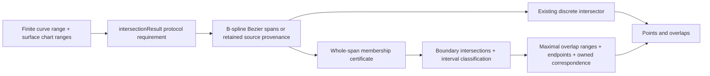

# CurveSurfaceOverlap

## Purpose and Scope

This component is a child of [CADGeometry](../DESIGN.md). It owns the G4
continuous curve/surface overlap result and the public production query that
returns discrete intersections and overlap intervals together. It has no child
components. The existing discrete `CurveSurfaceIntersecting.intersections`
contract remains independently available for callers requiring a finite event
set.

## Responsibilities and Boundaries

`CurveSurfaceIntersectionResolving` owns the richer public query.
`DefaultCurveSurfaceIntersector` implements its requirement through an extension
in this component. `CurveSurfaceIntersectionResult` owns discrete events and
maximal overlap intervals. An overlap retains its immutable source curve,
surface, source interval, tolerance and requested chart ranges; its endpoints
and parameter correspondence remain valid after the input values leave scope.

The component discovers overlap domains, certifies whole-span surface
membership, splits them at requested chart boundaries, preserves remaining
discrete events and returns correspondence values. It does not build topology,
choose Boolean material classification or replace the existing point-only API.

## Related Designs

| Design | Relationship | Contract Used | Summary | Cautions |
|---|---|---|---|---|
| [CADGeometry](../DESIGN.md) | parent | Exact curves/surfaces, interval arithmetic, certified intersections | Supplies the geometric authority. | A sampled coincidence is not a whole-span certificate. |
| [CADTopology](../../CADTopology/DESIGN.md) | used by | Overlap source ranges and point/UV correspondence | Subsequent common operations can preserve continuous intersection regions. | Chart singularity does not establish a unique coordinate. |
| [CADKernel](../../CADKernel/DESIGN.md) | used by | Rich intersection result | Subsequent splitter/section work can consume points and regions. | The old discrete API still refuses non-discrete intersections. |

## Architecture

## Contracts and Invariants

- The query is bounded by a finite positive curve interval. Closed and periodic
  curves use their default finite domain when no interval is supplied;
  unbounded curves require an explicit range or the existing bounded-target
  range derivation. Range validity is checked before geometry is published.
- The result separates isolated points from continuous overlap intervals.
  A point already covered by an overlap is not also returned as isolated.
- Rational B-spline candidates are classified per Bezier span, preserving
  mixtures of continuous and discrete intersections in one source curve.
  Adjacent certified overlap pieces merge without crossing an uncertified gap.
- Whole-span analytic membership uses outward interval Bernstein arithmetic on
  the homogeneous implicit polynomial. Positive rational weights convert its
  numerator bound into a surface-distance bound; output admission requires
  that bound to fit the requested modeling distance tolerance. An ambiguous
  existing coincidence decision is a numerical failure, never a success.
- Retained surface-lift and certified-intersection support provenance certifies
  membership only when the target equals a retained support value, including
  an explicitly transformed retained support. Tolerance-based analytic surface
  equivalence is a discovery hint; angular agreement cannot bound distance over
  an arbitrarily large source span. A different target must pass a whole-span
  distance certificate. For planar targets, the source's outward position jet
  on the complete requested interval bounds normalized signed plane distance.
- Each endpoint returns its source parameter, source-evaluated point and a
  surface parameter whose forward evaluation agrees within the tolerance.
  The correspondence operation performs the same check at any requested
  parameter inside the retained source interval.
- Periodic surface coordinates use the existing requested-range representative
  rules. Canonical coordinates may cross a seam; no globally continuous chart
  derivative is claimed. Pole/apex coordinates explicitly report a singular
  chart, where U is not unique. Authored hosting pcurves retain their chart.
- Analytic chart clipping isolates every boundary crossing via geometric plane
  queries. The extra opposite-angle crossings from meridian planes are harmless
  cut points; region membership is constant between complete boundary cuts.
- Midpoint region classification is used only after the boundary query has
  certified its complete point/overlap endpoint set. Each open cell between
  those cuts is connected and has no boundary crossing; sampling cannot replace
  either completeness or that cell-membership invariant.
- A finite B-spline target's intrinsic closed domains are part of input
  membership. Requested chart ranges cannot bypass these domains.
- A non-hosted B-spline curve can receive an isoparametric membership certificate
  when its degree, knot vector and orientation match one closed target axis.
  Endpoint projection discovers a possible fixed coordinate only. Outward
  Cox-de Boor basis arithmetic encloses every homogeneous isocurve control;
  nonnegative partition-of-unity bounds the homogeneous position and weight
  differences over the entire native curve domain. A positive target weight
  lower bound converts those differences to a spatial bound. Admission requires
  that bound to fit the distance tolerance, and the result owns the explicit
  affine UV correspondence, including reversed source orientation. Reversal
  requires error-free bound summation and reflected knot subtraction; a rounded
  reflection is not treated as an exact native-basis map.
- Isoparametric admission precedes the discrete solver because a rank-deficient
  free-surface intersection does not necessarily report nonDiscreteIntersection.
  Requested chart boundaries are isolated by direct inversion of the retained
  affine UV chart. Each varying boundary gives exactly one source parameter;
  the fixed coordinate has no crossing. Reverse inversion retains the exact
  TwoSum rounding error: the chosen representable source parameter is not
  claimed to be the exact algebraic root. Its affine chart residual enclosure
  and forward chart value must both satisfy the unchanged
  `SurfaceParameterRangeResolver` boundary admission for the known target axis
  and that single requested boundary. Unresolved or excessive rounding fails
  explicitly; requested ranges and tolerances are not expanded. A general scaled
  polynomial solver cannot replace this affine authority because a large
  coordinate offset can erase its normalized linear coefficient.
  endpoint and correspondence forward checks still use the original source and
  original target. No projection station certifies membership.
- Chart-preserving offset images and rigid images with the exact identity
  parameter affine map reduce recursively to their retained source pcurve.
  Rigid-image fraction restriction/reversal remains part of that reduction.
  Periodic translations retain their coordinate shifts. The reduction is used
  only to isolate chart boundaries; the owned source remains the authority for
  reported correspondence.
- An empty result certifies no admitted overlap and no discrete event. Unknown
  coincidence or unsupported clipping fails explicitly before any result is
  returned, including when other spans were successfully classified.

## Runtime Flows

The public query validates options and input, resolves the bounded range, then
classifies whole source spans. Non-overlap spans use the existing discrete
intersector. Overlap spans are clipped at every chart boundary, merged only at
shared endpoints and converted into owned result values. Boundary overlap
interval endpoints are themselves cut points, so an interval lying on a
boundary is preserved without pretending it is one isolated root.

## State, Ownership, and Lifecycle

The query is stateless. Every returned overlap owns value copies of the source
curve and surface together with its proof domain and tolerance. No pointer,
borrow, cache lifetime, mutable provider or separately acquired geometry fields
cross the result boundary. Evaluation after an input variable is reassigned
continues to refer to the captured source values.

## Failure, Concurrency, and Constraints

Invalid intervals/options fail as `invalidInput` or the existing resource-limit
contract. Uncertified numerical coincidence fails as `intersectionFailure`.
Geometry combinations without a whole-span proof or
complete clipping route fail as `unsupportedCapability`; they do not return
partial results. Existing degree, candidate, subdivision, iteration and cell
budgets belong to `CurveSurfaceIntersectionOptions`. Cancellation checks occur
in span, polynomial and clipping loops and propagate `CancellationError`.
Isoparametric control products, basis recurrence work and candidate trials are
charged before array growth against the existing subdivision-cell budget; axis
degree is bounded by the polynomial-degree budget. Nonpositive denominator
enclosures fail as singular geometry and nonfinite arithmetic fails explicitly.
Recursive chart-image reduction consumes the existing subdivision depth and
cell budgets, and checks cancellation before each image reduction.
All new proof state is local immutable value storage with identical Native,
WASM and Embedded declarations.

The initial proof owners cover analytic supports, rational B-spline source
spans, retained hosting-surface provenance and exact affine planar patches.
Non-affine free-surface coincidence without retained provenance and chart
clipping for complex authored pcurves require a further certified proof route.
They remain explicit unsupported domains and are not represented as complete.
The isoparametric route closes only native-basis, nonperiodic U/V correspondence;
arbitrary non-isoparametric free-surface membership remains incomplete.

## Verification and Change Impact

Dedicated `CurveSurfaceOverlapTests` will verify full analytic overlaps,
partial B-spline spans mixed with isolated events, maximal merging, chart
clipping, periodic seam representatives, singular endpoint metadata, owned
correspondence after source release, rejection of a tilted hosting plane whose
harmonic lift leaves the tolerance between sample stations, acceptance of a
nearby parallel plane through a whole-domain distance bound, and explicit invalid/numerical/resource/
cancellation failures. The root task owns native and WASM/Embedded execution
evidence. Existing discrete intersector tests retain their non-discrete failure
expectations; no classifier or Boolean consumer silently changes semantics.
The next bounded proof additionally verifies rational U/V isocurves, reversed
orientation, clipped affine correspondence, a perturbed interior control that
cannot receive a whole-domain certificate, budget refusal, and restricted rigid
and offset chart-image boundaries.
