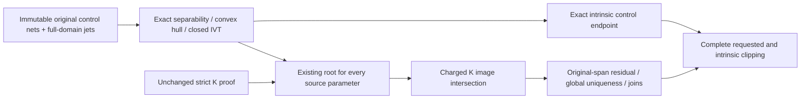
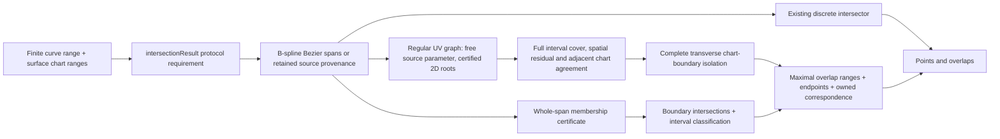
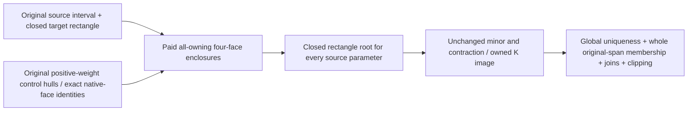

# CurveSurfaceOverlap

## Purpose and Scope

This component is a child of [CADGeometry](../DESIGN.md). It owns the G4
continuous curve/surface overlap result and the public production query that
returns discrete intersections and overlap intervals together. It has no child
components. The existing discrete `CurveSurfaceIntersecting.intersections`
contract remains independently available for callers requiring a finite event
set.

## Responsibilities and Boundaries

`CurveSurfaceIntersectionResolving` owns the richer public query.
`DefaultCurveSurfaceIntersector` implements its requirement through an extension
in this component. `CurveSurfaceIntersectionResult` owns discrete events and
maximal overlap intervals. An overlap retains its immutable source curve,
surface, source interval, tolerance and requested chart ranges; its endpoints
and parameter correspondence remain valid after the input values leave scope.

The component discovers overlap domains, certifies whole-span surface
membership, splits them at requested chart boundaries, preserves remaining
discrete events and returns correspondence values. It does not build topology,
choose Boolean material classification or replace the existing point-only API.

### Closed Original-Domain Endpoint Authority

The bounded regular graph endpoint route admits a nonperiodic, single clamped
rational Bezier source with strictly positive weights and an original clamped
unit-weight tensor B-spline target, or a finite clamped positive-weight rational
target atlas with an exactly rank-one original weight tensor. The selected two Cartesian coordinates must
be exactly separable: one is a function only of original U and the other only
of original V. Original control-net row/column equality, with every target
weight exactly one or the factor identity below, establishes this independence; tolerance-based rationality,
projection and sampled coordinate equality do not establish it.

For the bounded rational target branch, every original weight is positive and
finite and every original tensor coefficient satisfies
`W[j][i]*W[0][0] == W[0][i]*W[j][0]` as an exact real identity. With
`A(U)=sum(W[0][i]*B[i](U))` and `B(V)=sum(W[j][0]*B[j](V))`, this gives
`W(U,V)=A(U)*B(V)/W[0][0]`. Exact Cartesian row/column equality then gives
`HX(U,V)=AX(U)*B(V)/W[0][0]` and
`HY(U,V)=A(U)*BY(V)/W[0][0]`, so the positive common factors cancel and
`X=AX/A`, `Y=BY/B`. Swapping the selected coordinates or UV axes preserves
the same authority. These are identities on the original control coefficients;
no rounded homogeneous product net or computed weight ratio is substituted.
Clamping and positive endpoint weights preserve the original Cartesian endpoint
values. The existing all-owning quotient jets must still prove monotonicity on
the entire closed domain; factorization alone does not certify rank or membership.

The two weight products are compared by decomposing each positive finite binary64
coefficient into an odd UInt64 significand and a binary exponent. A full-width
53-by-53-bit integer multiplication compares the two exact, at most 106-bit,
products and their exponent sums. This fixed-storage operation includes normal
and subnormal inputs and does not perform a floating product, so overflow,
underflow and rounded-product equality cannot authorize a false factor identity.
Zero, negative and nonfinite factors are refused. This exact arithmetic belongs
only to original tensor admission and does not replace interval jet arithmetic.

| Assumption | Guarantee |
|---|---|
| Clamped original axes, exact separability and original endpoint controls | Exact closed endpoint values for the two univariate coordinate maps |
| All-owning closed-domain Jacobian gives a finite derivative interval strictly of one sign on each axis | Continuous strictly monotone coordinate maps on the entire original domain |
| Positive original source weights and every original source coordinate control lies inside the corresponding closed endpoint-value interval | Every source parameter has exactly one inverse on each original target axis by the closed-interval IVT |
| At least one selected source coordinate varies; a constant coordinate requires the original stationary-axis identity below | Constant native-knot or endpoint incidence retains an exact axis parameter; other constant-coordinate inverses remain unsupported |

`OverlapRegularGraphClosedDomainAuthority` owns this original-geometry existence
certificate. It retains the original source and target, selected Cartesian pair,
source interval and full closed target box. It provides an exact parameter only
when an intrinsic source endpoint's two selected coordinate controls coincide
exactly with target axis endpoint controls. Any remaining coordinate is still
subject to the whole-span spatial certificate and public forward residual check.

Fresh strict Krawczyk inclusion remains an independent existence authority with
unchanged strict inequalities. If an endpoint box cannot establish that strict
proof, the closed IVT certificate can establish an existing root for every
source parameter instead. Only then may Krawczyk-image intersection with its
owned full-domain box localize those existing roots. Every image retains the
same original source interval and selected pair, all-owning Jacobian, positive
minor, contraction below one, finite positive widths and original geometry.
The first image counts as the initial iteration, and subsequent localization
uses at most the caller's remaining `maximumIterations - 1` iterations. This
does not extend a native patch beyond its original domain.
After an unsuccessful fresh strict proof, the closed alternative is considered
for a candidate touching an actual original intrinsic target face, including
interior source intervals. Complete source positive hull and original global
coordinate independence/whole-axis monotonicity prove existence for every
original source parameter, so no source-endpoint restriction supplies additional
existence authority.
After localization, the retained root box must lie inside that original candidate
before the graph consumer can use it. Candidates away from original intrinsic target faces keep their existing
strict-proof subdivision behavior. Missing closed authority on an interior
source cell remains unresolved; intrinsic source endpoint refusal retains its
existing typed unsupported contract.
Point reproduction inside an already owned or provisional cell uses the same
original target-face and full closed IVT obligations for its source station
interval. The source control-hull and target independence proof apply
to every original source parameter, not only to the two endpoints. This same-target obligation also applies to fresh near-face interior admission;
no sample or candidate padding alone establishes existence. Its final
localized box must remain inside the owned cell box; otherwise reproduction
fails explicitly rather than replacing the cell's selected root.

Smooth endpoint charts may refine their original differential bounds as their
owned root boxes shrink; collars retain their first-only derivative authority.
The existing whole-original-span residual, global uniqueness, gapless cover,
common-root joins and complete chart clipping remain mandatory. Exact intrinsic
corner parameters let correspondence and boundary consumers avoid introducing
an artificial two-sided source interval outside the native domain. They still
use unchanged range admission and original source/target forward evaluation.

All structural scans, target derivative jets and image iterations are charged
before evaluation using the existing invocation-local work/cancellation budget.
The existing structural scan cost is unchanged for exactly unit target weights.
For other positive target weights, the factorable branch charges one additional
work unit per original tensor coefficient before any exact factor comparison.
Each comparison has four bounded binary64 decompositions and two full-width
products; the tensor size is checked for integer overflow before charging.
The certificate stores fixed metadata and immutable original geometry references,
with no control-net copies, new decomposition, cover array or private allowance.
The original degree, storage and subdivision limits remain unchanged.
Nonseparable maps, nonfactorable weight tensors, multiple source spans, periodic axes,
constant-axis incidence without the original stationary-axis identity below,
unresolved monotonicity/rank and general endpoint coincidence remain outside this bounded authority and fail explicitly. No failed
certificate authorizes an empty intersection result or a sampled correspondence.
The public native-isocurve trial route precedes regular-graph admission. Its
endpoint inverse projection may propagate `ambiguousSelection` for a
rank-deficient chart before the closed-IVT certificate is considered. This
explicit projection refusal does not establish membership; the independent
closed-authority coefficient test also rejects that singular target.

Independent evidence is owned by `CurveSurfaceRegularGraphTests`: literal
`S=(u+u*u,v+v*v,(u+u*u)*(v+v*v))`, rational
`C=(h,h,h*h), h=4*t/(1+t)`, with original source domain `[0,1]`.
Both intrinsic corners have known parameters `(0,0)` and `(1,1)`; the inverse
is `(-1+sqrt(1+4*h))/2`. The clip `[0.5,0.75]` has source interval
`[3/13,21/43]`, and reversed source controls/weights give `[22/43,10/13]`.
Whole, reversed, clipped, zero-width endpoint, owned-mutation, exact-limit and
cancellation cases verify this authority. Middle-Z deviation must receive no
overlap; isolated endpoint events are reported only when the discrete owner
certifies them. Unsupported chart/weight/source/rank fixtures verify refusal.

The independent rational target fixture has literal degree-one tensor controls
`[[(0,0,0),(1,0,0)],[(0,1,0),(1,1,1)]]` and weights
`[[1,17/16],[9/8,153/128]]`, giving
`S=(17*U/(16+U),9*V/(8+V),X*Y)`.
The degree-two source controls `[(0,0,0),(.5,.5,0),(1,1,1)]` with weights
`[1,2,4]` give `C=(h,h,h*h), h=2*t/(1+t)`.
Its literal inverse is `U=16*h/(17-h), V=8*h/(9-h)`;
U clipping to `[.5,.75]` gives source `[17/49,51/83]`, and clipping both
axes gives `[9/25,51/83]`. Reversal gives `[32/83,32/49]` and
`[32/83,16/25]` respectively. Whole-domain, exact corners, swapped axes,
owned mutation, first-image root limits and charged factor scans verify the
production consumer. Positive common uniform weights are now an admitted
factorable case and preserve the independent polynomial known answer.
`[[1,1+2^-52],[1-2^-52,1]]` has unequal exact products differing by
`2^-104` despite rounded product equality and must be refused. Exact product
tests also distinguish equal and unequal overflowing or underflowing products.
Nonfactorable, coupled, periodic and unresolved monotonicity fixtures
retain explicit refusal; middle-Z deviation receives no overlap.

The next bounded extension applies this same global tensor-factor identity to
finite clamped rational target knot atlases. For any nonnegative original
B-spline basis, exact rank-one weights factor the denominator into positive
U/V factors; Cartesian column/row independence therefore remains an axis map.
All-owning original quotient first jets must prove strict axis monotonicity
across every owning knot span before closed IVT admission. C0/C1 collars retain
first-order-only authority, transverse affected axes, strict root localization,
whole-source residuals, common-root joins and complete original-domain clipping.
The source remains one positive-weight clamped span. The original factor scan,
work/depth/degree/storage limits and cancellation owner are unchanged.
The independently authored degree-one axes use knots `[0,0,1/2,1,1]`,
controls `[0,1/2,1]` and weights `[1,9/8,5/4]`. Their map is
`F(u)=9u/(8+2u)` on the first span and `(11u-1)/(8+2u)` on the second.
The tensor surface is `(F(U),F(V),F(U)*F(V))`; the original rational source
`(h,h,h*h), h=2t/(1+t)` crosses the tensor knot at `t=1/3`.
The independent inverse is `8x/(9-2x)` or `(8x+1)/(11-2x)`.
U clipping to `[1/4,3/4]` retains source `[9/59,29/47]`, and reversal
retains `[18/47,50/59]`. Public whole/reverse/clip/zero-width endpoint and knot
proofs, owned-input mutation, exact-factor perturbation, nonseparability,
positive middle-Z deviation and original resource/cancellation failures must
verify this extension before its incomplete marker is removed. General
nonfactorable rational atlases, multispan sources and periodic graphs remain
full-G4 gaps.

### Paid Original Coordinate Independence

The graph operation prepares one immutable coordinate-independence authority
from the same original target retained by its prepared differential encloser.
The component owns preparation, reuse and consumption; this authority lives
only for that operation and has no global cache or mutable shared state.
Preparation charges the existing invocation budget before scanning all original
controls, knots and positive finite weights. Exact dyadic product equality
establishes a global rank-one weight tensor; exact Cartesian row/column equality
then establishes each coordinate's dependence on one native axis. No sampled
coordinates or rounded products establish this identity.

This identity authorizes only zero partial derivatives in the non-owning axis.
The root consumer intersects those zero identities with the corresponding
fields of its existing original target interval jet. An empty intersection is
an explicit proof failure. Original positions, owning-axis quotient bounds,
original knot supports and derivative capability remain unchanged. The same
identity may tighten whole-domain monotonicity and selected Jacobian consumers,
but never supplies existence: source positive control hull, whole-domain strict
axis monotonicity and closed IVT remain separate mandatory obligations.

| Owner | Assumption | Guarantee |
|---|---|---|
| Graph preparation | Charged complete original tensor/Cartesian scan | Immutable exact coordinate dependence tied to the retained target |
| Root jet consumer | Existing original all-owning jet for the same target and native box | Intersection with exact zero for non-owning derivatives only |
| Closed-domain certificate | Coordinate independence plus source hull and strict whole-axis monotonicity | Existing unique original-domain inverse for every owned source parameter |

Preparation is performed once per graph operation and reused without repeated
unpaid comparisons. Direct closed-certificate calls remain self-contained and
retain their exact established work thresholds (unit 39/38 and rational 61/60
fixtures). Reuse accounts only for work already paid by the same invocation.
Unit and single-span routes retain their obligations. Strict K inclusion,
determinant/contraction, every varying affected knot's transverse passage, whole-span
residual, original geometry/coordinates, global uniqueness, clipping,
iteration/depth/storage limits and cancellation remain required. This authority
cannot promote a first-order collar to a smooth chart or replace projected
points with a formula. Public whole/reverse/clip/incidence tests and independent
false-factor, coupled-coordinate, exact-work and cancellation fixtures own the
behavioral evidence.

## Related Designs

| Design | Relationship | Contract Used | Summary | Cautions |
|---|---|---|---|---|
| [CADGeometry](../DESIGN.md) | parent | Exact curves/surfaces, interval arithmetic, certified intersections | Supplies the geometric authority. | A sampled coincidence is not a whole-span certificate. |
| [CADTopology](../../CADTopology/DESIGN.md) | used by | Overlap source ranges and point/UV correspondence | Subsequent common operations can preserve continuous intersection regions. | Chart singularity does not establish a unique coordinate. |
| [CADKernel](../../CADKernel/DESIGN.md) | used by | Rich intersection result | Subsequent splitter/section work can consume points and regions. | The old discrete API still refuses non-discrete intersections. |

## Architecture

## Contracts and Invariants

- The query is bounded by a finite positive curve interval. Closed and periodic
  curves use their default finite domain when no interval is supplied;
  unbounded curves require an explicit range or the existing bounded-target
  range derivation. Range validity is checked before geometry is published.
- The result separates isolated points from continuous overlap intervals.
  A point already covered by an overlap is not also returned as isolated.
- Rational B-spline candidates are classified per Bezier span, preserving
  mixtures of continuous and discrete intersections in one source curve.
  Adjacent certified overlap pieces merge without crossing an uncertified gap.
- Whole-span analytic membership uses outward interval Bernstein arithmetic on
  the homogeneous implicit polynomial. Positive rational weights convert its
  numerator bound into a surface-distance bound; output admission requires
  that bound to fit the requested modeling distance tolerance. An ambiguous
  existing coincidence decision is a numerical failure, never a success.
- Retained surface-lift and certified-intersection support provenance certifies
  membership only when the target equals a retained support value, including
  an explicitly transformed retained support. Tolerance-based analytic surface
  equivalence is a discovery hint; angular agreement cannot bound distance over
  an arbitrarily large source span. A different target must pass a whole-span
  distance certificate. For planar targets, the source's outward position jet
  on the complete requested interval bounds normalized signed plane distance.
- Each endpoint returns its source parameter, source-evaluated point and a
  surface parameter whose forward evaluation agrees within the tolerance.
  The correspondence operation performs the same check at any requested
  parameter inside the retained source interval.
- Periodic surface coordinates use the existing requested-range representative
  rules. Canonical coordinates may cross a seam; no globally continuous chart
  derivative is claimed. Pole/apex coordinates explicitly report a singular
  chart, where U is not unique. Authored hosting pcurves retain their chart.
- Analytic chart clipping isolates every boundary crossing via geometric plane
  queries. The extra opposite-angle crossings from meridian planes are harmless
  cut points; region membership is constant between complete boundary cuts.
- Midpoint region classification is used only after the boundary query has
  certified its complete point/overlap endpoint set. Each open cell between
  those cuts is connected and has no boundary crossing; sampling cannot replace
  either completeness or that cell-membership invariant.
- A finite B-spline target's intrinsic closed domains are part of input
  membership. Requested chart ranges cannot bypass these domains.
- A non-hosted B-spline curve can receive an isoparametric membership certificate
  when its degree, knot vector and orientation match one closed target axis.
  Endpoint projection discovers a possible fixed coordinate only. Outward
  Cox-de Boor basis arithmetic encloses every homogeneous isocurve control;
  nonnegative partition-of-unity bounds the homogeneous position and weight
  differences over the entire native curve domain. A positive target weight
  lower bound converts those differences to a spatial bound. Admission requires
  that bound to fit the distance tolerance, and the result owns the explicit
  affine UV correspondence, including reversed source orientation. Reversal
  requires error-free bound summation and reflected knot subtraction; a rounded
  reflection is not treated as an exact native-basis map.
- Isoparametric admission precedes the discrete solver because a rank-deficient
  free-surface intersection does not necessarily report nonDiscreteIntersection.
  Requested chart boundaries are isolated by direct inversion of the retained
  affine UV chart. Each varying boundary gives exactly one source parameter;
  the fixed coordinate has no crossing. Reverse inversion retains the exact
  TwoSum rounding error: the chosen representable source parameter is not
  claimed to be the exact algebraic root. Its affine chart residual enclosure
  and forward chart value must both satisfy the unchanged
  `SurfaceParameterRangeResolver` boundary admission for the known target axis
  and that single requested boundary. Unresolved or excessive rounding fails
  explicitly; requested ranges and tolerances are not expanded. A general scaled
  polynomial solver cannot replace this affine authority because a large
  coordinate offset can erase its normalized linear coefficient.
  endpoint and correspondence forward checks still use the original source and
  original target. No projection station certifies membership.
- Chart-preserving offset images and rigid images with the exact identity
  parameter affine map reduce recursively to their retained source pcurve.
  Rigid-image fraction restriction/reversal remains part of that reduction.
  Periodic translations retain their coordinate shifts. The reduction is used
  only to isolate chart boundaries; the owned source remains the authority for
  reported correspondence.
- An empty result certifies no admitted overlap and no discrete event. Unknown
  coincidence or unsupported clipping fails explicitly before any result is
  returned, including when other spans were successfully classified.

### Regular UV Graph Envelope

The next bounded route admits non-hosted rational B-spline curves on rational
B-spline surfaces when a regular, continuously owned UV graph and every relevant
chart boundary can be certified. It does not complete arbitrary G4 geometry.
Non-transverse crossings, continuous boundary coincidence, singular graph charts
and unreduced complex authored charts retain the existing incomplete branches.

For a finite source interval `I`, a cell owns a target box `B`, a selected pair
of Cartesian coordinates, the original source/target values and a reproduced
outward proof. In those two coordinates the equation is
`F(t, u, v) = S(u, v) - C(t) = 0`. The source coordinate `t` remains free.
A parameterized 2-by-2 Krawczyk operator must map into `B` with a certified
strict contraction for every `t` in `I`; the target minor must exclude zero.
This establishes a root for every source parameter and uniqueness within the
owned chart box. A numerical projection or Newton station supplies a seed only.
The existing 3-by-3 isolated curve/surface root certificate is not a continuum
proof, and the surface/surface four-coordinate graph implementation is not
represented as a curve/surface solver.

Trial UV tubes enclose the preconditioned selected-coordinate residual between
the original whole source value interval and the owned exact target center jet.
Derivative motion is an additional candidate hint, not a bound on independent
homogeneous value intervals: a numerator/denominator quotient enclosure may
remain wider than true curve motion under arbitrary source subdivision, and a
constant rational coordinate may have a nonzero value-enclosure width. Candidate
padding must contain this uncertainty before applying the unchanged strict
Krawczyk inclusion, minor-rank and complete spatial-residual gates. An enlarged
candidate tube alone never establishes correspondence or membership.

The graph owns one `PreparedBSplineSurfaceDifferentialEncloser` for its original
nonperiodic B-spline target. Krawczyk center values consume its exact native
`pointJet(u:v:tolerance:)` contract, which outwardly evaluates the already
differentiated homogeneous nets and retains every owning knot span. Whole-box
Jacobian and implicit derivative bounds continue to consume its positive-box
`intervalJet(over:tolerance:)` contract. A conditioning expansion for a box
must not replace a point enclosure at the Krawczyk center. This distinction
preserves strict root inclusion and chart-boundary rounding admission without
changing the modeling tolerance or creating a second decomposition owner.

| Cell authority | Required guarantee |
|---|---|
| Source interval | Entire original native interval, including endpoints, lies in the prepared source domain |
| Rational representations | Outward jets consume the original homogeneous values; both denominators have positive enclosures |
| UV root | One graph value exists throughout the interval in the owned box, with certified minor rank and contraction |
| Remaining spatial component | An outward whole-interval residual bound, together with the two solved components, fits the modeling distance tolerance |
| Differential graph | Implicit differentiation of the certified 2-by-2 system encloses UV derivatives; candidate derivatives are not authority |
| Adjacent cells | Shared source endpoints represent the same retained branch, with a common-root and uniqueness proof across their UV boxes |

Residual certification may use a centered Taylor enclosure through third-order
jets and implicit UV derivatives to retain source/target correlation. Its center
values and derivatives must themselves be interval-certified from the original
representations and root box. A sampled center residual plus an unproved
derivative estimate is insufficient. Raw rectangular interval bounds remain
valid when they are tight enough; failure to attain the bound never authorizes
an approximate success.

After strict Krawczyk inclusion, every root in the original chart box lies in
the certified Krawczyk image. The remaining residual value may therefore use
an outward target enclosure over that image, retaining the original source
interval. Implicit derivative and remaining derivative bounds retain the
original box and its positive minor. This localizes a certified value without
requiring another strict contraction of a machine-floor point box; a stalled
constant-coordinate refinement must not inherit the wider input-box position
enclosure as its best center value. The additional image evaluation consumes
the shared work budget before evaluation and preserves denominator authority.

Point correspondence refinement first reproduces a strict existence/uniqueness
certificate on the owned cell with its original prepared source, Cartesian pair
and fixed one-ulp source interval. An invocation-local root authority retains
that first certificate. Subsequent boxes are subsets of its certified root
image. Every existing root is a fixed point of the preconditioned original
equations and therefore lies in each outward Krawczyk image; intersecting that
image with the previously owned root box localizes the same root without a new
existence claim. Strict inclusion remains mandatory for the first certificate
and for every fresh chart proof. A machine-floor coordinate cannot stop another
coordinate's contraction merely because a later image rounds beyond the known
box in that coordinate.

Localization retains the original source interval and selected pair, checks the
whole-box positive minor and contraction bound, and consumes the same prepared
point/box jets and all-owning knot authority. Derivatives and residuals use
their unchanged smooth/collar contracts. Empty or nonfinite intersections fail
explicitly; an uncertified initial box cannot create a root authority. Each
evaluation charges the existing cumulative work budget and checks cancellation;
the existing iteration limit bounds refinement. The boundary corridor and
single-boundary admission predicate remain unchanged, so a bounded but still
insufficient enclosure continues to fail rather than expand the requested range.

Whole-range collar localization uses the same retained-root implication after
its first strict chart proof. Its immutable authority retains the complete
original source interval, selected pair, and initial certified root image.
Only an undecided position residual (upper absolute bound above distance and
lower absolute bound at or below distance) triggers refinement. Every subsequent
box intersects the outward Krawczyk image with the current owned root box,
preserving the root for every source parameter. Original all-owning target
Jacobian, positive minor, contraction and finite positive-width checks remain
mandatory at every step. The original collar authority and first-only UV
derivative bounds remain unchanged; only the certified root box and remaining
position residual are updated. Localization cannot promote a collar to a smooth
Taylor chart. The original source position enclosure retains its full interval.
The initial strict proof consumes the first iteration; at most
`maximumIterations - 1` charged refinements follow. A certified distance bound,
proved distance exclusion, or two stationary axes stops refinement. Otherwise
the existing source subdivision and explicit limit failure remain responsible.
No new root, decomposition, source subdivision, depth allowance or retained
cell is created by this bounded invocation-local refinement.

An already evaluated original remaining-source position interval supplies a
necessary precision condition before whole-range localization. For independent
intervals `A` and `B`, `width(A - B) >= width(A)`, whereas an absolute residual
bound at distance requires width at most twice that distance. If the outward
lower bound of the original source-position width exceeds the outward upper
bound of twice distance, no target-position interval refinement can establish
this position-only certificate. The initial unresolved strict proof is returned
for existing source subdivision; this condition never proves non-membership.
The retained scalar width bound requires no additional lower evaluation,
decomposition, array or budget. Narrow intervals satisfying this necessary
condition still use the unchanged retained-root refinement and caller limits.

Membership is decided for each original Bezier source classification span
intersected with the requested source interval. Graph subdivision only tightens
one complete span certificate. The maximum over its gapless cell cover must
meet the spatial tolerance before any of that span is admitted; small cells
near an isolated intersection cannot become overlap pieces independently.
A certified residual lower bound exceeding distance at any interval or station,
together with global uniqueness of its selected UV root, refutes whole-span
membership. That complete original classification span then reaches the actual
discrete intersector, which owns isolation of any remaining events. Previously
accumulated candidate cells from that span are discarded. A nonzero residual
derivative alone does not override a certified whole-span distance bound.
Failure to prove either complete admission or this refusal remains typed failure.

Source cells split at every original source knot before Taylor certification.
A target root tube containing original C0 or C1 U or V knots uses the bounded
collar authority below. Other unproved low-continuity atlas transitions remain
incomplete and fail explicitly. Within a smooth chart, positive definite symmetric parts of an interval-preconditioned selected
Jacobian prove global injectivity on the convex hull of all retained UV boxes.
Boxes excluded by either selected-coordinate interval cover every other
original-domain location. Local contraction alone never proves global branch
uniqueness or excludes geometry on another branch.

The ordered cells must cover the entire admitted source interval without gaps.
Each connected correspondence records its defining Cartesian equation pair.
Refinement within that chart proves adjacent agreement by root uniqueness on a
common chart box. A different pair is not silently substituted at a cell join:
an atlas transition requires proof of the same original three-coordinate root;
if that agreement cannot be proved, the route fails explicitly. This avoids
joining two nearby projections of an off-surface source and claiming one
continuous correspondence. A conflicting branch is an ambiguity failure.

At a shared endpoint, both one-sided point certificates must overlap. Their
union remains inside a common candidate tube that additionally encloses the
preconditioned original source value interval over the complete two-sided
point range. The union of separately contracted one-sided boxes need not
contain a fresh two-sided quotient enclosure. The common candidate must still
pass strict Krawczyk inclusion and minor rank for the unchanged Cartesian pair;
overlap of boxes or candidate enlargement alone is insufficient for a join.

### Finite Rectangular Original C0 or C1 Knot Atlas

`OverlapRegularGraphAtlas` classifies the closed target proof box as smooth or
as a rectangular collar containing finitely many original C0/C1 knots on either
or both axes, including tensor-knot corners. Knot endpoints
are included because prepared point/closed-box jets retain every owning patch.
The validated original B-spline limits interior multiplicity to degree and
therefore provides C0 continuity. The prepared owner unions every owning native
patch's outward one-sided derivatives and positively enclosed denominator.
Their interval hull contains every convex combination of the one-sided
Jacobians along a segment in the box. For the continuous, piecewise C1 selected
map, this is a mean-value enclosure; strict uniform contraction therefore
establishes a continuous unique UV graph throughout the source interval.
The same continuous piecewise map and all-owning Jacobian hull support the
existing positive-definite symmetric-part proof of global injectivity.

| Proof / Cell authority | Derivatives retained | Membership bound |
|---|---|---|
| Smooth | Implicit UV and remaining-coordinate derivatives through order three | Original centered Taylor enclosure |
| Finite rectangular C0/C1 knot collar | One-sided first UV derivative bounds, valid almost everywhere on the Lipschitz graph | Original position enclosure intersected with an owned centered first-order residual bound |

The bounded first-order collar residual also encloses
`R'=C_remaining' - S_remaining,U*u' - S_remaining,V*v'`
over the complete original source cell, using its original source first jet,
all-owning target first jet and already certified first UV bounds. Finite
original C0/C1 supports, the retained unique root and transverse passage through
every affected knot make this graph piecewise differentiable and Lipschitz;
its residual is absolutely continuous. The derivative enclosure is valid almost
everywhere and its supremum therefore bounds the residual variation across
knots. No second or third collar derivative is asserted.

A charged point reproduction for the same owned cell/pair certifies the center
residual. The residual over the complete cell is intersected with
`R(center) +/- sup(abs(R'))*max(center-lower,upper-center)` using outward
arithmetic. Empty/nonfinite intersections fail explicitly. A center sample alone
never authorizes membership. Both the initial whole-position enclosure and the
retained source/target/UV first-derivative proofs must remain valid. Source-width
localization pruning still applies only to the independent position certificate;
it cannot suppress this separate first-order proof. Original strict K/closed
existence, global uniqueness, whole-span coverage, common-root joins, clipping,
caller work/depth/storage/iterations and cancellation remain mandatory.
The canonical rational multispan whole/reverse test must pass unchanged depth
and tolerance; middle-coordinate deviations and existing atlas/refusal fixtures
must still fail appropriately. The frozen original-coefficient producer passes all 68 regular-graph and 18
continuous-overlap declarations, including the independent factorable atlas,
closed endpoint, first-order collar and unchanged refusal/work fixtures.
This evidence covers the bounded Native route; general full-G4 and portable
cumulative integration remain open.

A collar never assumes second/third derivative continuity and never exposes a
Taylor derivative certificate. Each axis whose closed box contains a C0/C1 knot
must either have a first UV derivative interval excluding zero, establishing a
transverse, monotone passage, or retain the exact original stationary-axis
identity below. Checking only one axis at a tensor corner cannot authorize the
other axis. Without that stationary identity, a knot lying in the tube still
requires the affected axis to be transverse.
Uniform contraction and bounded source derivatives establish Lipschitz graph
continuity; the one-sided derivative bounds then support complete chart-boundary
isolation. The collar joins neighboring cells through the unchanged common-root
uniqueness proof for the same Cartesian pair. No rounded source parameter is
treated as the exact native-knot crossing, and no artificial source gap is left.

Continuity is classified from the original degree minus native knot
multiplicity. C1 knots use the same conservative first-order collar
authority as C0: continuity of the first derivative does not imply continuity
of the second derivative required by the smooth Taylor path. All-owning native
Jacobian enclosures, strict fresh Krawczyk inclusion, retained point-root image
localization, positive minor, global injectivity and common-root joins are
unchanged. The validated surface is continuous across the entire finite tensor
partition. Positive denominators and finite one-sided derivative bounds on its
compact patches give a piecewise Lipschitz map. The prepared owner's closed
intersection rule retains every owning patch at edges and corners. Their
entrywise Jacobian hull contains the generalized Jacobians and every
segment-average Jacobian across any number of these boundaries. Uniform strict
Krawczyk contraction therefore proves the same original graph, and the
positive symmetric part proves global injectivity, without choosing one side
of a corner or enumerating knot crossings as approximate source cuts.

A rational source quotient jet can give a broad first-derivative enclosure
containing zero even when its graph is monotone. If the original strict root
proof succeeds but an affected axis lacks transverse admission, the root owner
may tighten only source first derivatives by unioning jets over a complete
subinterval cover of the same original source range. Covers have two, four,
eight and further power-of-two parts up to the caller's `maximumIterations`;
their local bisection depth uses the existing subdivision-depth limit. Every
endpoint is finite and ordered, adjacent pieces share exactly the same cut,
and the last piece ends at the original upper endpoint. An unrepresentable
complete cover is abandoned without using its partial union.

The same immutable prepared curve supplies every interval jet. The complete
union is intersected with the original first-derivative bounds, and the
implicit first derivatives are recomputed against the unchanged original
target Jacobian and minor. Original source position and higher derivatives,
the strict Krawczyk root image, and the remaining position residual are kept.
No point values, derivative samples, numerical inverse or projection establish
transversality. The final per-axis zero-exclusion guard is unchanged. Constant
or unresolved axes still refuse after bounded refinement. Empty derivative
intersections fail explicitly; they cannot authorize a replacement bound.

Endpoint checks and every lower interval evaluation charge the existing work
budget before execution and check cancellation. Only one fixed-size jet union
and the current interval are retained, with no decomposition or cover arrays.
Cover limits do not increase caller budgets or create independently admitted
source fragments; classification and membership still belong to the complete
original source span.

Atlas metadata has one optional fixed-size summary per axis: first native knot,
last native knot and count of distinct C0/C1 knots in the closed box. Exact native
multiplicities and knot values are scanned without tolerance merging. The
immutable original surface retains the complete knot vectors; summaries do not
replace geometry or own decomposition arrays. An empty summary means that axis
needs no low-continuity collar admission. Any nonempty summary must pass its own
transverse derivative guard. Metadata equality remains part of correspondence
authority together with the original geometry and complete cell boxes.

Candidate tubes containing low-continuity knots additionally consume the entire
one-sided Jacobian hull for their preconditioner hint. A pointwise Jacobian from
the steeper side can under-size the tube relative to the union contraction.
Candidate enlargement is still only a hint; strict inclusion, common minor
rank, global uniqueness and the whole original-span distance bound remain
mandatory. Source subdivision tightens the position-only collar bound under
the existing caller budget. Smooth cells and collar cells form one gapless
cover whose maximum deviation decides complete original-span admission.

A minor whose all-owning union contains zero, failed uniform contraction or
global uniqueness, and continuous/non-transverse knot coincidence without the
exact original stationary-axis identity remain explicit refusals. This family does not complete general
knot atlases or G4: it requires one defining Cartesian pair and the existing
whole-span membership, monotone boundary isolation and finite arithmetic proofs.
All atlas state belongs to immutable original graph owners; no decomposition,
shared cache, target branch or platform-specific storage is added. Atlas scans,
the additional collar candidate jet and retained cells consume the existing
invocation work/storage limits before their associated work or growth. Scanning
still charges both complete original knot vectors before reading them; the two
summaries add fixed-size cell metadata rather than per-knot allocation. Prepared
target representation and all-owning jet evaluations retain their existing
preparation/evaluation work charges and caller depth/degree/iteration limits.

`CurveSurfaceOverlap` owns the original curve, original surface and graph cells.
Its correspondence evaluation locates a certified cell, refines its original
equation within that box under a fresh bounded evaluation budget, resolves chart
coordinates through the unchanged `SurfaceParameterRangeResolver`, and verifies
the original source/target forward residual. It does not invoke an unrelated
global projection to select a replacement branch. Ownership persists after
caller mutation or release. An unresolved evaluation throws; it does not use a
cell midpoint or a nearest station as a success value.

### Transverse Graph Clipping

The graph route considers every requested and intrinsic closed U/V endpoint.
For each boundary, a coordinate enclosure strictly on one side proves exclusion.
Otherwise implicit graph derivative bounds must prove monotonicity and a
transverse crossing, and interval isolation must certify the complete root set
over the source cell. Endpoint root enclosures, neighbor joins and zero-width
requested ranges are included. A coordinate merely touching a boundary, a
coordinate continuously equal to a boundary, or an unresolved derivative is
outside this bounded clipping envelope and reaches the retained incomplete
typed-failure branch. It is never discarded as an empty crossing set.

Boundary isolation retains the original equation and coefficients without
tolerance-based degree truncation. A represented cut is not called the exact
algebraic root: its certified root enclosure and forward UV value must satisfy
the existing single-boundary range admission. Requested ranges and tolerances
are unchanged. The resulting source and spatial rounding bounds must preserve
the result's forward residual guarantee, including any canonical boundary
resolution. Excess or unresolved rounding is an intersection failure.

Only after every boundary has been excluded or completely isolated may connected
cells be classified. Intervals cannot merge across an unproved boundary or an
unproved atlas join. Constant membership between complete cuts justifies one
cell classification; projection, endpoints and samples do not prove crossing
completeness. The existing analytic, native-isoparametric and retained-pcurve
routes keep their own authorities.

## Runtime Flows

The public query validates options and input, resolves the bounded range, then
classifies whole source spans. Non-overlap spans use the existing discrete
intersector. Overlap spans are clipped at every chart boundary, merged only at
shared endpoints and converted into owned result values. Boundary overlap
interval endpoints are themselves cut points, so an interval lying on a
boundary is preserved without pretending it is one isolated root.

The regular-graph dispatcher runs for non-hosted B-spline pairs before the
isolated-root fallback, after the existing native-isoparametric admission.
It prepares the original rational representations once, constructs and certifies
graph cells, proves coverage and joins, then performs transverse clipping and
publishes owned graph correspondence. A membership refusal is not a certificate
of no discrete intersections: a proved non-overlap continues through the
existing discrete path; uncertain graph coverage or clipping fails explicitly.

## State, Ownership, and Lifecycle

The query is stateless. Every returned overlap owns value copies of the source
curve and surface together with its proof domain and tolerance. No pointer,
borrow, cache lifetime, mutable provider or separately acquired geometry fields
cross the result boundary. Evaluation after an input variable is reassigned
continues to refer to the captured source values.

Regular graph preparation and proof budgets are invocation-local values. The
returned cells and prepared original representations are immutable Sendable
owners. The query retains no live geometry provider, mutable cache or borrowed
control buffer. Per-correspondence root refinement uses local workspace and the
stored limits. Native, normal WASM and Embedded keep the same declarations,
storage owners and failure semantics; no target removes synchronization from
shared state, and this route introduces no shared mutable state.

## Failure, Concurrency, and Constraints

Invalid intervals/options fail as `invalidInput` or the existing resource-limit
contract. Uncertified numerical coincidence fails as `intersectionFailure`.
Geometry combinations without a whole-span proof or
complete clipping route fail as `unsupportedCapability`; they do not return
partial results. Existing degree, candidate, subdivision, iteration and cell
budgets belong to `CurveSurfaceIntersectionOptions`. Cancellation checks occur
in span, polynomial and clipping loops and propagate `CancellationError`.
Isoparametric control products, basis recurrence work and candidate trials are
charged before array growth against the existing subdivision-cell budget; axis
degree is bounded by the polynomial-degree budget. Nonpositive denominator
enclosures fail as singular geometry and nonfinite arithmetic fails explicitly.
Recursive chart-image reduction consumes the existing subdivision depth and
cell budgets, and checks cancellation before each image reduction.
A hosted original affine-word pcurve retains target support binding and
directed source fractions. That spatial binding alone does not prove a reduced
coordinate-independent chart. The stopped integration dispatch returns no
reduction for this family until the actual chart transport is admitted; this
is not an empty-overlap certificate.
All new proof state is local immutable value storage with identical Native,
WASM and Embedded declarations.

The initial proof owners cover analytic supports, rational B-spline source
spans, retained hosting-surface provenance and exact affine planar patches.
Non-affine free-surface coincidence without retained provenance and chart
clipping for complex authored pcurves require a further certified proof route.
They remain explicit unsupported domains and are not represented as complete.
The isoparametric route closes only native-basis, nonperiodic U/V correspondence;
arbitrary non-isoparametric free-surface membership remains incomplete.

Regular graph discovery, membership, joins and clipping share one invocation
budget from `CurveSurfaceIntersectionOptions`. Root refinement consumes the
existing iteration limit. Source subdivision consumes depth; trial boxes,
jet/control work, contraction attempts, joins and boundary isolation consume
cell work before allocation or evaluation. Accepted cells and boundary roots
consume candidate storage. Source/target degrees and any predictor/composed
polynomial degree are checked against the degree limit with checked integer
arithmetic. Preparation checks original control, span and derived workspace
counts before constructing prepared storage. Work is not reset independently
for each source span, chart boundary or failed chart candidate. A correspondence
call receives a fresh local budget with the same stored limits; it cannot grow
the immutable retained cover.

| Refusal | Meaning |
|---|---|
| `resourceLimitExceeded` | Work, depth, degree, iterations, storage or finite arithmetic cannot complete the proof |
| `singularGeometry` / `singularSystem` | No positive rational denominator or certified regular minor supports the attempted graph |
| `ambiguousSelection` | Distinct certified candidate branches conflict with a single owned correspondence or a cell join |
| `intersectionFailure` | Spatial residual, cut rounding or forward correspondence violates admission |
| `unsupportedCapability` | Non-transverse/continuous boundary or complex authored clipping has no proof in this envelope |
| `CancellationError` | Cancellation propagates before and during discovery, contraction, refinement and clipping |

No failure returns partial graph coverage or hides already discovered ambiguous
or unsupported cells. The existing incomplete markers remain until their own
full domains and boundary semantics have behavioral evidence.

## Verification and Change Impact

Dedicated `CurveSurfaceOverlapTests` will verify full analytic overlaps,
partial B-spline spans mixed with isolated events, maximal merging, chart
clipping, periodic seam representatives, singular endpoint metadata, owned
correspondence after source release, rejection of a tilted hosting plane whose
harmonic lift leaves the tolerance between sample stations, acceptance of a
nearby parallel plane through a whole-domain distance bound, and explicit invalid/numerical/resource/
cancellation failures. The root task owns native and WASM/Embedded execution
evidence. Existing discrete intersector tests retain their non-discrete failure
expectations; no classifier or Boolean consumer silently changes semantics.
The next bounded proof additionally verifies rational U/V isocurves, reversed
orientation, clipped affine correspondence, a perturbed interior control that
cannot receive a whole-domain certificate, budget refusal, and restricted rigid
and offset chart-image boundaries.

The regular-graph tests use an independent algebraic-UV known answer, not a
target isocurve extraction or a fitted pcurve. Let
`S(u,v) = (u*u/(1+u), v, u*u*v/(1+u))` and
`C(t) = (h, h, h*h)` with `h=t/(1+t)` on the requested source `[0.1,0.8]`.
The target has degree `(2,1)`, closed unit knots, repeated weight rows
`[1,1.5,2]`, lower controls `[(0,0,0),(0,0,0),(0.5,0,0)]` and upper controls
`[(0,1,0),(0,1,0),(0.5,1,0.5)]`. The source is quadratic with closed unit
knots, controls `[(0,0,0),(0.25,0.25,0),(0.5,0.5,0.25)]` and weights `[1,2,4]`.
Its independent correspondence is
`u=(h+sqrt(h*h+4*h))/2`, `v=h`. The inverse U coordinate is algebraic rather
than rational. Requested U `[0.5,0.75]` retains source `[0.2,9/19]`.

| Behavioral evidence | Contract refuted by a wrong implementation |
|---|---|
| Full requested source graph and algebraic UV | Native-basis-only matching, rational fitting or projection stations masquerading as continuum proof |
| U clip `[0.5,0.75]`, known source `[0.2,9/19]` | Missing or approximate-only transverse root isolation, lost orientation/endpoints |
| Original source/target mutation after publication | Reacquisition, borrowed lifetime or replacement global projection |
| Middle source Z control increased by `1/8` | Endpoint-only membership: on `[0.1,0.8]` the independent positive deviation is `0.5*t*(1-t)/(1+t)^2`, with no overlap or exact discrete event |
| Distinct chart candidates and conflicting joins | Treating local contraction as a unique global branch or silently switching correspondence |
| Singular minor / unresolved denominator | Dividing an enclosure containing zero or using a pointwise rank test |
| Non-transverse or continuously coincident boundary | Reporting an empty root list as complete clipping |
| Exhausted work/depth/degree/candidate/iteration limits | Reset budgets, hidden partial results or uncontrolled workspace growth |

The root task owns public Native/WASM runtime evidence and any Embedded
limitations. This sprint verifies the regular graph envelope and its refusals;
it does not establish full G4, complete general clipping or all 87 requirements.

The single-C0-knot evidence uses `S(u,v)=(f(u),v,f(u)*v)` with
`f(u)=u*u` for `u<=0.5` and `f(u)=0.25+2*(u-0.5)+(u-0.5)^2` otherwise.
Degree `(2,1)`, U knots `[0,0,0,0.5,0.5,1,1,1]`, V knots `[0,0,1,1]`,
unit weights and X controls `[0,0,0.25,0.75,1.5]` produce lower controls
`(x,0,0)` and upper controls `(x,1,x)`. The independently authored rational
source remains `C=(h,h,h*h)`, `h=t/(1+t)`, requested `[0.1,0.8]`.
The piecewise inverse is `u=sqrt(h)` on the left and
`u=sqrt(0.75+h)-0.5` on the right, with `v=h`. The crossing is `t=1/3`,
and the one-sided U derivative changes by a factor of two. Swapping target
parameter axes supplies an independent V-knot fixture with the same geometry.
Requested knot-axis `[0.4,0.55]` retains source `[4/21,141/259]`.

| C0 atlas evidence | Failure identified |
|---|---|
| Full source, before/at/after native knot, both axis orientations, owned mutation | Missing collar coverage, Taylor across a derivative jump, or replaced correspondence |
| Known clipped interval crossing the knot | Incomplete crossing isolation or joining across a chart gap |
| Nonlinear coordinate refinement after the other axis reaches its numerical floor, with swapped axes | Returning a broad root because a rounded image fails fresh strict inclusion in the already precise coordinate |
| Uncertified point box, exhausted localization work and cancellation | Manufacturing root authority or bypassing caller limits during image localization |
| Measured tensor-corner full interval, literal inverse endpoint containment, iteration-one unresolved bound, exact localization work and cancellation | Losing any parameter's root, changing collar derivative authority, or creating an uncharged whole-range refinement allowance |
| Broad source-position interval with exact one-certificate work, unchanged unresolved proof and literal inverse containment | Spending refinement work where independent position intervals cannot certify distance, or treating the precision gate as non-membership |
| Explicit smooth/collar derivative capability | Consuming nonexistent global higher derivatives on a C0 knot |
| Middle Z control increased by `1/8` | Endpoint or seam coincidence masquerading as whole-span membership |
| Opposite one-sided minor, continuous knot and budget refusal | Hidden branch/rank change, unsupported atlas success or reset caller limits |
| Original C0 tensor-corner graph with independent piecewise inverse | Dropping an owning patch or checking only one corner axis |

The independent single-C1-knot evidence uses `S(u,v)=(f(u),v,f(u)*v)` with
`f(u)=u*u` for `u<=0.5` and `f(u)=u*u+(u-0.5)^2` otherwise. Degree `(2,1)`,
U knots `[0,0,0,0.5,1,1,1]`, V knots `[0,0,1,1]`, unit weights and X controls
`[0,0,0.5,1.25]` produce lower controls `(x,0,0)` and upper controls `(x,1,x)`.
The original native knot has multiplicity one. The two owning patches have
first derivative one at the knot, but second derivatives two and four.
The independently authored source remains `C=(h,h,h*h)`, `h=t/(1+t)`.
Its inverse is `u=sqrt(h)` on the left and `u=(1+sqrt(8*h-1))/4` on the right,
with `v=h`; swapping axes supplies the V-knot case. The crossing is `t=1/3`.
Requested knot-axis `[0.4,0.55]` retains source `[4/21,61/139]`, while the
zero-width request `[0.5,0.5]` retains only the isolated point `t=1/3`.

| C1 atlas evidence | Failure identified |
|---|---|
| Whole source, both axis orientations, original geometry and owned mutation | Single-C1 native knot rejected, incomplete cover or replacement correspondence |
| Independent clipped endpoints and zero-width knot crossing | Incorrect source inversion, chart admission or boundary isolation |
| Native second-derivative jump with first-order-only collar certificate | Treating C1 as a globally smooth Taylor chart |
| Middle source Z increased by `1/8`, with positive independent deviation | Tolerance subdivision admitting fragments of a non-admitted original span |
| Constant knot coordinate | Unsupported continuous-boundary success |
| Multiple native C1 knots representing identity XY and C1 tensor corner with piecewise inverse | Rejecting a finite certifiable atlas or omitting corner ownership |
| Caller work/depth/degree/storage limits and cancellation | Reset budgets or hidden fallback during C1 admission |

The independent finite rectangular fixture uses the literal piecewise-linear
map `f(u)=u/2` for `u<=1/4`, `f(u)=u-1/8` for `1/4<=u<=1/2`, and
`f(u)=2*u-5/8` otherwise. Native degree one, knots
`[0,0,1/4,1/2,1,1]`, unit weights and controls `[0,1/8,3/8,11/8]`
represent both original C0 slope changes exactly. The one-axis target is
`S=(f(u),v,f(u)*v)`; its tensor-corner counterpart is
`S=(f(u),f(v),f(u)*f(v))`. Both consume the same independently authored rational
source `C=(h,h,h*h)`, `h=t/(1+t)`, on `[0.1,0.8]`.
The literal inverse is `2*h`, `h+1/8` or `(h+5/8)/2` in the three regions.
Crossings occur at `t=1/7` and `t=3/5`, simultaneously on both tensor axes.
Requested knot-axis `[0.2,0.525]` retains source `[1/9,17/23]`. Zero-width native
knot requests retain only the corresponding isolated crossing. At a tensor
corner the prepared point/closed-box Jacobian must contain every native
one-sided slope combination; no one-sided station replaces that authority.

| Finite collar evidence | Failure identified |
|---|---|
| Whole original source, two crossings, independent numerical inverse and owned forward correspondence | Single-knot-only admission, missing span coverage or projection replacement |
| Known clipped interval and both zero-width native knot requests | Incomplete boundary roots, incorrect source endpoints or tolerance widening |
| Closed multi-knot summary and all-owning corner Jacobian with first-order-only strict proof | Dropped native span, higher derivative assumption or corner side selection |
| Broad source interval with zero-containing quotient derivative but an independent positive exact derivative | Premature transverse refusal without a complete original-source derivative enclosure |
| Positive middle-Z deviation | Tiny overlap fragments from a failed original-span certificate |
| Constant U and constant V at native knots | Checking only one affected axis |
| Folded corner Jacobian, work/depth/degree/storage limits and cancellation | Unproved rank/injectivity or unbounded atlas work |

### Finite Original Degree-Fold Source Atlas (PAR.G4R3)

The next bounded source extension replaces the single-source-span structural
restriction only for a finite nonperiodic clamped positive-weight curve with
degree at least one and every interior native knot of multiplicity exactly its
degree. Each original span already takes the direct control/weight-slice route
in `BSplineCurveBezierDecomposer`; no rounded extraction supplies its proof.
Adjacent slices share one original endpoint control and weight, proving C0
position continuity. The existing single-span branch and its exact work fees
remain unchanged, including its existing degree policy.

The charged original source-knot scan owns admission. The complete original
positive control hull, target's exact coordinate factorization and strict
whole-axis monotonicity continue to prove closed IVT existence. Certifier
cuts at every exact native source knot, classifies each complete original span,
retains a gapless requested cover and proves common roots across every join.
Strict K/minor/global uniqueness, whole-span residual, original clipping and
owned correspondence remain mandatory; first/second/third source derivatives
are never asserted continuous across a degree-fold knot. Failed existence is
not an empty intersection. General extraction, periodic sources and
nonfactorable target closed boundaries remain separate full-G4 gaps.

| Owner | Contract | Required evidence |
|---|---|---|
| Source admission | Charged original clamped degree-fold knot shape and positive hull | Unsupported other multiplicities; unchanged single-span fees |
| Original producer | Direct original homogeneous control/weight slices for every span | Two and three span independent literal curves |
| Graph composition | Complete source partition and common-root joins | Whole/reverse/clipped/zero-width/knot endpoints and owned-input mutation |
| Invocation | One cumulative original work/depth/storage/cancellation budget | Exhaustion after a prior span and pre-cancellation; no partial success |

The independent two-span quadratic has knots `[0,0,0,.5,.5,1,1,1]`,
controls `[(0,0,0),(.25,.25,0),(.5,.5,.25),(.75,.75,.5),(1,1,1)]`
and weights `[1,2,4,4,4]`. It is `C=(h,h,h^2)`, with
`h=2t/(1+2t)` before `.5` and `h=t` afterward; its one-sided first
slopes differ at the shared original point. Polynomial and existing factorable
rational target atlases supply independent inverse/clip oracles. A three-span
fixture must reject any hidden two-span ceiling or reset of cumulative work.
This contract is pending actual production execution and makes no new portable
or full-G4 completion claim.

G4R3 Native completion evidence: seven independent declarations (sixteen parameter
cases) pass61.429s for the original two/three-span whole/reverse/clip/knot/fee/
deviation/cancellation profiles. Ten existing single-source closed/rational
atlas, work and refusal declarations pass93.096s. No root, residual, correspondence,
source geometry, precision or option budget is weakened. Capability42 pass.149s;
three staged-source checks retain133 conditions,664 bindings and107 public routes.
General source multiplicities and periodic charts remain separate full-G4 gaps.

### Original Triangular Affine Closed Chart (PAR.G4R4)

A new bounded closed-domain existence family may consume only original unit-weight,
nonperiodic single bilinear target controls whose selected Cartesian coordinate
pair is an exact nonsingular triangular affine map of the normalized native axes.
Its mixed Bernstein coefficient must be exactly zero in original binary64 real
arithmetic. The univariate first coordinate has a signed nonzero diagonal;
the second may include a shear of the first axis and a signed nonzero second
diagonal. Coordinate permutations and axis interchange may share this structural
contract, but a general coupled/rational/nonfactorable map supplies no authority.

ClosedDomainAuthority owns an immutable separable-or-triangular mapping, not a
fake coordinate-independence claim. Before minting it, the existing cumulative
OverlapProofBudget precharges original control scans and all exact arithmetic.
Bounded exact difference/product/signed-cofactor comparisons prove the complete
original positive source control hull lies in the target native rectangle under
the inverse affine map. Positive original source basis/weights and complete
original source atlas then prove existence for every owned source parameter.
Underflow/overflow or uncertain exact arithmetic must not become a boundary
comparison; they retain typed refusal/unsupported closed authority. No source
extraction, coefficient rounding, outward enlarged face or extrapolated support
may replace that original existence proof.

Original rank/global uniqueness, strict Jacobian/Krawczyk, third-coordinate whole
membership, root ownership, correspondence, clipping, native joins and existing
work/cell/depth/endpoint rules remain separate mandatory guarantees. The new
mapping never zeros an actual coupled partial or modifies TargetIndependence.
Root consumes only the existing immutable closed-domain certificate fields;
original intrinsic endpoint native coordinates may be returned only when exact
cofactor equality proves their original closed face/corner. Otherwise the
existing root enclosure owns the result.

Independent literal target S=(U,V+U/4,U*V), curve C=(h,5h/4,h*h),
h=2t/(1+t), original degree-two controls [(0,0,0),(.5,.625,0),(1,1.25,1)]
and weights[1,2,4] prove UV=(h,h). Complete/reversed domains, each clipped native
face/corner and singleton0/.5/1, original support immutability, paid budget and
cancellation must execute publicly. An independent interior Z perturbation has
no overlap on a restricted interior domain. One-ULP nonzero mixed coefficients,
singular diagonals, source pullback hull outside the rectangle and unavailable
exact comparisons must not mint closed authority; existing valid interior
proofs remain available. This family is not full general/periodic G4 completion.

### Original Periodic Native Isocurve (PAR.G4P1)

The native-isocurve membership owner may admit one periodic varying target axis and a closed fixed native-endpoint axis when the original periodic source and target varying-axis degree, stored knots, control count and positive homogeneous weights define the same cyclic basis. Exact stored knot translations, finite represented period and original repeated-tail/position continuity are proved by charged original scans, not modeling tolerance. Paid fixed-endpoint basis evaluation and the complete original coefficient/denominator difference prove membership across every native cycle side. The existing exact/error-free reflected-map conditions and full original knot equality govern reversal. That whole-cycle bound extends to the finite requested source interval by the proved original periodic law. It supplies an explicit retained native affine correspondence; it does not claim exclusion of other geometric UV solutions or general periodic regular-graph completeness.

For a periodic requested varying-axis range narrower than one period, correspondence clipping enumerates every boundary copy a+kP incident to the owned finite source interval. Bounded checked enumeration, exact or compensated inverse arithmetic and the existing forward chart residual admission prove each cut. Zero-width requests retain all finite incidences; a target range covering a complete period retains the existing all-representatives policy. Endpoint/interior representatives continue to use SurfaceParameterRangeResolver: explicit requested range when supplied, the existing canonical chart when absent. Original periodic origins must be equal or have proved exact integral-period translation; unsupported origin/translation/finite arithmetic refuses rather than inferring phase. Periodic membership scans and every boundary candidate share one invocation OverlapProofBudget derived from the original options, with storage/work charged before growth or execution and cancellation at scans/cuts. The nonperiodic fee/path contract remains unchanged. No private cut budget, clipped original source or rounded reconstructed curve replaces authority.

Independent rational diamond-cycle U/V fixtures verify literal native positions, all owning seam sides, source [3.5,4.5] clipped to [3.75,4.25] by target [-.25,.25], periodic singleton incidence, complete/native/negative/shifted cycles, reversal and immutable inputs. A changed interior original control, unproved translated knots/tails/origin, inadequate aggregate work/storage and cancellation must refuse. Existing nonperiodic isocurve/regular graph evidence remains valid unless a touched shared path changes its premise; targeted regressions precede the bounded sprint commit. General periodic graphs/global uniqueness and full G4/portable integration remain open. Shared preparation and selected-span APIs are consumed unchanged and do not depend on PAR.M1PC1.

## General G4 Completion and Closed Rectangle Existence

The complete G4 owner retains all legal `Curve3D` and `Surface3D` families under
the existing finite-query admission. An unbounded source requires an explicit
finite interval unless the current search-range owner derives one. Every
continuous component, its source interval and endpoints, owned correspondence
and remaining isolated events must be returned together. An unresolved proof
is a typed failure, never an empty or partial successful result. Existing
bounded families and their receipts do not establish full completion. Native,
matching normal WASM and Embedded runtime evidence are required; the shared
Foundation portability barrier remains a root-owned dependency.

The first general-domain extension separates closed root existence from global
coordinate independence. `OverlapClosedRectangleRootAuthority` owns an original
closed-rectangle Poincare--Miranda certificate for the selected Cartesian pair.
For every original source parameter in the retained interval, one selected
residual coordinate is nonpositive on one U face and nonnegative on the
opposite U face, and the other has the corresponding signs on the V faces.
Either sign orientation and either Cartesian-to-parameter assignment is allowed.
Continuity and these complete four-face inequalities prove a root inside the
same rectangle for every source parameter. No factorable tensor, sample,
projection or strict-inclusion relaxation supplies this existence claim.

Every face enclosure uses the existing original prepared surface's closed-box
entry, including constant axes and all owning original knot sides. Source
values come from the whole retained source interval. A positive original source
control hull may intersect this enclosure, but cannot replace a failed original
enclosure. On an original clamped intrinsic target face, equality of every
original Cartesian face control proves a constant coordinate even for a
non-factorable positive weight tensor. Intersecting that exact value with its
original face enclosure preserves coefficient authority; an empty intersection
is an explicit numerical failure. No independence of interior derivatives is
inferred. All scans, face jets and retained storage are charged before work
under the same caller budget, with cancellation at every charged operation.

The certificate retains the exact original operands, source interval, selected
Cartesian pair and actual candidate rectangle. Root localization consumes it
only for that same rectangle; every subsequent image retains every existing
root. The original positive minor, contraction below one, global uniqueness,
whole remaining-coordinate residual, gapless source cover, common-root joins
and complete clipping remain separate mandatory proofs. This first extension
does not yet close non-transverse clipping, general periodic graphs, singular
charts or complex authored pcurves; their incomplete branches remain explicit.

`Tests/CADGeometryTests/OriginalGeneralClosedOverlapTests.swift` owns the
independent first public oracle. A bilinear tensor with weights
`[[1,1],[1,2]]` and Cartesian controls
`[(0,0,0),(1,0,0);(0,1,0),(1,1,1)]` gives
`S=(u(1+v),v(1+u),2uv)/(1+uv)`. The rational quadratic source with controls
`[(0,0,0),(.5,.5,0),(1,1,1)]`, weights `[1,1,2]` gives exactly the retained
correspondence `U=V=t`. Its non-factorable weight identity, whole interval,
reverse, clip `[.25,.75]`, native corner incidences and immutable inputs are
independent of the producer. Whole-span off-surface deviation, insufficient
caller work and cancellation must not publish an overlap. Matching public
runtime evidence is required before this extension is committed; unit helper
success alone is insufficient.

Periodic interior-fixed hints are not admitted by an uncharged projection helper. This bounded producer retains an explicit incomplete marker and typed unsupported consumer path until interior localization shares the same invocation work owner. Existing nonperiodic hint/fee behavior is unchanged.

### Original Fixed-Axis Face Coefficient Enclosure

The closed-rectangle existence owner consumes the validated original selected-native
basis interval API at derivative order zero. Original nonperiodic validation guarantees
C0 position continuity, so an actual owning closed native side represents the same
fixed-axis position at an interior knot. Each basis enclosure is intersected with
its proved nonnegative partition-of-unity range `[0,1]`; an empty intersection is
an explicit enclosure failure.

For each original control row along the varying axis, the owner contracts only the
fixed-axis original homogeneous coefficients. Its outward positive denominator and
Cartesian quotient enclose that row's original coefficient. The positive varying
basis then puts every face value over the complete varying domain in the streamed
three-coordinate row hull. This independent enclosure is intersected with the
already paid original face jet value; neither an empty intersection nor unresolved
finite/positive-denominator arithmetic can mint existence. No fitted Cartesian net,
point samples, or derivative independence are introduced.

Selected-basis workspace, original knot validation/search, row coefficient arithmetic,
and quotient work are charged before allocation/evaluation to the same invocation
budget. Cancellation remains checked in that budget and the row loop. The owner
retains only the original operands and existing rectangle certificate; row scalars
and three streamed hulls remain invocation-local scratch. The Poincare–Miranda signs,
strict contraction/minor, global uniqueness, whole-original-span residual, joins,
clipping, caller options and existing failure contracts remain unchanged.

The public reverse literal at source `[0,1/16]` is the decisive regression: with the
measured candidate lower axis `a=0.6566713398677618`, the original coefficient hull
proves face `X <= 2a/(1+a)`, while the broad quotient jet alone reaches `0.91764034`.
The independent source lower bound is `0.908203125`; the hull intersection closes
that failed whole-face sign without widening the candidate or tolerance.

### Original Affine-UV Composed Residual and Root Transfer

`OverlapAffineComposedResidualAuthority` owns a membership error certificate,
not root existence. For an original positive single-clamped rational source net
and a positive single-clamped bilinear tensor, exact selected-coordinate matches
between the original source endpoints and original tensor corners may propose an
affine corner-to-corner UV path. That path is only a hint. The owner retains the
original operands and pair, and composes original homogeneous tensor coefficients
with the affine normalized UV Bernstein polynomials. Each complete cross-product
`Ntarget * Wsource - Nsource * Wtarget` is enclosed coefficient by coefficient.
Positive original weights bound both whole-domain denominators from below. The
resulting three Cartesian residual bounds cover the entire original source domain,
including reversal; sampled endpoint agreement cannot supply membership.

For an existing proof over the same original operands, pair and source interval,
the root consumer encloses the affine candidate's UV range. Its convex union with
the certified root box must remain inside the original native domain. Charged
all-owning first jets on that union provide a finite preconditioner `M` and the
strict contraction `q = ||I - M J||_infinity < 1`. The mean-value theorem then
bounds candidate-to-root UV distance by
`||M * residual_pair||_infinity / (1 - q)`. The remaining spatial residual is
bounded by the candidate's remaining-coordinate error plus the complete target
first-derivative row norm times that UV distance. Intersection with the existing
position enclosure is mandatory; an empty intersection is a typed numerical
failure. Strict K or closed Poincare--Miranda existence, positive selected minor,
global uniqueness, original-span gapless cover, common-root joins and clipping
remain independent mandatory proofs. Neither the affine hint nor this residual
certificate creates an unproved root or promotes differential continuity.

Preparation admits the original and composed degree against the same caller
polynomial limit and charges coefficient arithmetic, binomial normalization and
all scratch before allocation. It is prepared once per invocation; every transfer
charges the original whole-box first jet and checks cancellation. Missing hints
or nonapplicable original-net shapes retain the existing whole-jet route. No new
private budget, tolerance, depth or retry allowance is introduced.

The public nonfactorable literal has composed homogeneous coefficients
`X=Y=[0,1/2,2]`, `Z=[0,0,2]`, `W=[1,1,2]`, identical to its independent source.
All five degree-four cross-product coefficients are exactly zero. Changing the
source middle Z control to `1/1000` instead gives target-minus-source coefficients
`[0,-1/2000,-1/1500,-1/1000,0]`. Dedicated tests must distinguish these complete
coefficient certificates, work/degree refusal and cancellation, while the
unchanged whole/reverse/clip/native-corner public oracles establish integration.
This bounded residual owner does not establish full G4 for other tensor degrees,
non-affine UV graphs, periodic domains or contacts.

### Source-Correlated First-Derivative Tubes

The composed residual transfer retains its actual original root proof, original
operands, affine source fraction/orientation and certified whole-range UV distance.
If the original cell first-derivative intervals cannot prove transverse passage,
the root consumer may form a finite gapless partition of that same closed source
interval. On each piece, the affine candidate range expanded by the retained UV
distance and intersected with the original proved root box contains every actual
root for every parameter in the piece. It is an owned range localization, not
existence from a sampled parameter or a new strict inclusion claim.

Paid original source interval first jets and all-owning original target closed-tube
first jets, with a positive selected minor, enclose the implicit first UV
derivatives on each whole piece. Only after the complete partition is checked may
the union of those derivative enclosures intersect the original cell's first
bounds. Empty/nonfinite intersections are typed failures; missing minor or
unresolved transversality retains the original proof/refusal path. No higher
jet is replaced or continuity promoted. The actual root existence, unique chart,
original source domain/orientation and every local tube remain bound to the same
immutable transfer owner.

Each cover validation, local candidate arithmetic, source/target jet and implicit
solve is charged to the same caller work budget before allocation/evaluation.
Partition size and depth use existing maximumIterations and subdivision depth,
without a private retry allowance or source/tolerance expansion. The independent
forward/reverse literal has first UV derivatives exactly +1/-1; dedicated tests
require their containment and strict sign, and the unchanged public whole/clip/
corner cases establish that the original clipping guard is reached with proof.

### Complete Original Higher-Order Tensor Composition

The affine-UV residual owner admits every positive, nonperiodic, single-clamped
original tensor net with positive U/V degrees `p,q`, and every positive original
single-clamped source net of degree `n`, when the existing caller degree and work
limits admit the complete computation. There is no new fixed degree or tensor
count ceiling. Exact selected-coordinate endpoint matches at native corners
remain only an affine-UV hint; the existing closed-face or strict-K proof owns
root existence, and global uniqueness, residual transfer, joins and clipping
remain separate mandatory proofs.

In normalized original source coordinates, a corner-to-corner U hint is `t`,
`1-t`, or a constant native endpoint. Each original U Bernstein basis therefore
has its exact degree-`p` coefficient vector: a unit coefficient at its forward
index, at its reversed index, or the constant zero/one vector. V uses the same
rule at degree `q`. Complete outward Bernstein products of these original basis
vectors compose every original homogeneous tensor coefficient into degree
`p+q`. Cross-products with the original source homogeneous coefficients have
degree `n+p+q`. The existing positive original weight minima bound both whole
denominators; original stored Cartesian/weight products, including representation
roundoff, are enclosed rather than replaced by an ideal or fitted net.

Before any coefficient allocation, the owner checks degree/count arithmetic and
charges original scans, every tensor basis product, four-coordinate accumulation,
six source cross-products, binomial normalization and all live scratch to the
same invocation budget. The bilinear fee definition remains unchanged. Higher
order fees are deterministic upper bounds on the performed scalar work and
scratch, with checked arithmetic and cancellation at the existing charged and
per-row boundaries. Missing original-net eligibility returns no residual hint;
degree/work/finite-arithmetic exhaustion throws explicitly, and cannot publish
an overlap. The opaque transfer's operands, source fraction/orientation, convex
original domain, strict contraction, root-distance tube and complete first-jet
cover are unchanged by target degree.

`OriginalGeneralClosedOverlapTests` owns the independent higher-order public
oracle. The biquadratic positive rational tensor represents
`S=(u(1+v),v(1+u),2uv+u^2v^2)/(1+uv)` and the quartic source represents
`C=(t+t^2,t+t^2,2t^2+t^4)/(1+t^2)`, with the independently known UV path `(t,t)`.
Their original stored coefficients are compared to these literal expressions
with explicit rounding error, and the production whole-coefficient certificate
must enclose that error. Reverse, whole/clip/corner ownership, a positive middle
Z perturbation, exact higher-order fee/fee-minus-one, degree refusal and
cancellation provide behavioral evidence. This closes higher-order affine-UV
composition only; non-affine predictors, arbitrary source/target atlases,
periodic graphs and contacts remain required full-G4 work.

### Original Interior Affine-UV Predictors

The residual owner also accepts an affine predictor joining two finite UV
values inside the complete original native rectangle. The public graph resolver
first retains the existing exact-corner route and its charges. Only when that
route supplies no certificate does it obtain predictor endpoints from the
original source endpoint stations using the existing paid Newton seed operation.
These values are candidates: convergence, proximity or endpoint agreement
provides neither membership nor root existence.

For each native axis, the owner outward-normalizes the represented UV endpoints
against the original knot-domain endpoints. It composes every original Bernstein
basis with the degree-one predictor through complete outward Bernstein products,
then contracts every original positive homogeneous tensor coefficient. The
original source/target cross-products and strictly positive denominator lower
bound cover the full original source domain, including reversal, constant-axis
predictors and interior endpoints. No rounded extracted control net, fitting,
point-only proof or reconstructed source is used.

| Boundary | Required authority | Result |
|---|---|---|
| Predictor construction | Finite endpoints contained in the original rectangle | Candidate only |
| Whole residual | All original homogeneous coefficients and positive weights | Complete affine-predictor Cartesian error |
| Graph transfer | Existing strict-K or closed-root proof, complete Jacobian contraction and original root image | Error at the already owned root |
| Publication | Global uniqueness, complete source cover, joins, original clipping and forward correspondence | Directed overlap result |

The new route prepays all basis powers, products, binomial arrays, normalization
and scratch using the same invocation work budget. It retains the original
polynomial ceiling, depth, storage, iteration, tolerance and cancellation
contracts. The existing corner route remains unchanged; a failed predictor does
not replace a proof failure with success. Behavioral verification is deferred
during the implementation phase. Non-affine predictors, general source/target
atlases, periodic regular graphs and contacts remain full-G4 gaps.

### Original Stationary Native-Knot Incidence

A regular graph may remain continuously on one original target C0 knot axis
while crossing the other axis. This route requires the existing complete
original rank-one positive weight identity, Cartesian coordinate independence
and strictly monotone whole-axis quotient jet. Every original source control
for the independent selected coordinate must equal the same represented value.
An original degree-fold target knot selects exactly one original control on
that native axis; its coordinate must equal that source constant exactly.
Original clamped endpoints use the same exact control-selection identity.
The unique inverse is therefore the represented original knot (or endpoint)
for every source station, not an approximately stationary projected sample.

The closed-domain owner retains that constant native parameter in its separable
axis certificate. At least one selected source coordinate must still vary. A
strict root or the existing closed-IVT owner must establish every graph root.
Only then may the exact constant-coordinate identity intersect the existing
root enclosure and first derivative with the constant value and zero. The
remaining axis retains all affected-knot transversality obligations. Collars
continue to use complete original first-order jets and Lipschitz residuals;
stationary incidence never supplies a smooth-chart or higher-order claim.

| Consumer | Original authority | Action |
|---|---|---|
| Closed inverse | Original constant controls, exact native control-selection, positive factorization and whole-axis monotonicity | Retain a unique constant native coordinate |
| Root and join | Existing strict/closed root and all-owning original jets | Intersect the same root with the exact coordinate and zero first derivative |
| Boundary clipping | Retained complete-cell constant-coordinate identity | Classify the entire boundary incidence without isolated-root division |
| Correspondence | Owned cell plus reproduced original root | Return the represented original constant coordinate and checked varying coordinate |

Every original scan remains charged before work through the existing invocation
ledger. No knot extraction, tolerance equality, private allowance, new sampling
rule or dropped transverse requirement on a varying axis supplies this proof.
The whole-source residual, global uniqueness, gapless cover, common-root joins,
maximal component merge and forward residual checks remain mandatory. General
non-transverse contacts and nonfactorable stationary axes remain explicit
unsupported gaps. This implementation phase does not establish runtime evidence.

## Periodic Interior Isocurve Discovery

Periodic original same-basis isocurves enumerate both fixed endpoints and
interior fixed-axis native spans. Each interior seed is refined by a bounded
Gauss-Newton step on the original complete homogeneous control rows. Numerical
refinement produces only a candidate fixed parameter. Publication still requires
the existing outward whole-control rational residual on all original varying
controls, with the original common cycle/origin/reversal and seam-cut authority.
Every candidate, basis recurrence, original control accumulation and residual
probe debits the invocation's `OverlapProofBudget`; iteration count comes from
`maximumIterations`. No projection helper or independent search budget is used.
A common positive homogeneous scaling of the source weights is admitted by an
outward scale interval and is included in the residual bound.

## Nontransverse Interior Native-Knot Contacts

C0/C1 collars retain the complete original closed native-span Jacobian hull.
The same strict Krawczyk inclusion and uniform preconditioned contraction prove
a unique Lipschitz inverse over the entire collar, including contact with a
knot where an inverse-coordinate derivative contains zero. The piecewise
chain rule is valid almost everywhere and the inverse is absolutely continuous;
its complete first-derivative hull supplies the existing integral Lipschitz
residual bound. Transversality is therefore a clipping-root classification
requirement rather than a prerequisite for this already-proved interior root
cover. No second/third derivative is inferred at a contacted knot. Exact
stationary-axis evidence remains optional tighter authority, retaining identity
and caller accounting. General requested-boundary contact isolation remains
owned by the boundary resolver.

### Caller-Admitted Original Native Plane Sectors

The bounded richer result consumes the [original native plane contact producer](../OriginalNativePlaneContacts/DESIGN.md) using one curve-surface invocation. Each positive clipped sector retains exact authored or algebraic endpoints and its original native owner. A prepared sector supplies exact rational position and plane UV quotients, with only the final numerical bounds converted outward. `CurveSurfaceOverlap.originalTraversal` exposes the normalized original law; `curveRange` and published endpoint coordinates are numerical representatives or containing localization bounds.

One retained prepared plane is shared by isolated contacts and overlap correspondence. A normalized fraction evaluates the original endpoint expression, not a rounded native station. Publication refines under existing iteration and algebra limits until the original position box and original plane singleton box establish the unchanged physical residual and representative error. Later correspondence queries reuse the same invocation callbacks and preparations. Legacy native-parameter correspondence cannot invert nonrepresentable sector endpoints by silently using numerical range endpoints; its selected sector branch directs callers to normalized correspondence and fails explicitly.

The bounded protocol witness includes independent source/subdivision/algebra admission and optional bytes. Other conformers must implement the actual witness. General continuous procedural/rational surface graphs remain explicit unsupported branches until their own shared-admission complete sector producer is connected; finite isolated queries still use the actual selected intersector.

Maximal native-plane components compose exact adjacent sector receipts in source
order. Shared cut ordinals are scoped to one immutable clipping owner; native
joins require original knot equality and homogeneous endpoint identity. A
compound correspondence retains each original homogeneous owner law. Point
suppression uses original sector endpoint incidence, and isolated same-knot
compaction uses exact sided contact identity. Approximate ranges, point proximity
and numerical sorting do not authorize assembly. Component preparation shares
the invocation; repeated whole-native preparation is a retained allocation and
performance limitation until the prepared-owner constructor is available.
