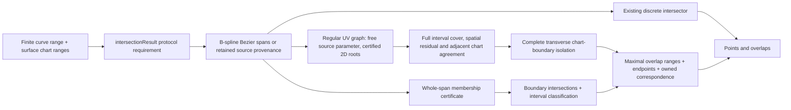

# CurveSurfaceOverlap

## Purpose and Scope

This component is a child of [CADGeometry](../DESIGN.md). It owns the G4
continuous curve/surface overlap result and the public production query that
returns discrete intersections and overlap intervals together. It has no child
components. The existing discrete `CurveSurfaceIntersecting.intersections`
contract remains independently available for callers requiring a finite event
set.

## Responsibilities and Boundaries

`CurveSurfaceIntersectionResolving` owns the richer public query.
`DefaultCurveSurfaceIntersector` implements its requirement through an extension
in this component. `CurveSurfaceIntersectionResult` owns discrete events and
maximal overlap intervals. An overlap retains its immutable source curve,
surface, source interval, tolerance and requested chart ranges; its endpoints
and parameter correspondence remain valid after the input values leave scope.

The component discovers overlap domains, certifies whole-span surface
membership, splits them at requested chart boundaries, preserves remaining
discrete events and returns correspondence values. It does not build topology,
choose Boolean material classification or replace the existing point-only API.

## Related Designs

| Design | Relationship | Contract Used | Summary | Cautions |
|---|---|---|---|---|
| [CADGeometry](../DESIGN.md) | parent | Exact curves/surfaces, interval arithmetic, certified intersections | Supplies the geometric authority. | A sampled coincidence is not a whole-span certificate. |
| [CADTopology](../../CADTopology/DESIGN.md) | used by | Overlap source ranges and point/UV correspondence | Subsequent common operations can preserve continuous intersection regions. | Chart singularity does not establish a unique coordinate. |
| [CADKernel](../../CADKernel/DESIGN.md) | used by | Rich intersection result | Subsequent splitter/section work can consume points and regions. | The old discrete API still refuses non-discrete intersections. |

## Architecture

## Contracts and Invariants

- The query is bounded by a finite positive curve interval. Closed and periodic
  curves use their default finite domain when no interval is supplied;
  unbounded curves require an explicit range or the existing bounded-target
  range derivation. Range validity is checked before geometry is published.
- The result separates isolated points from continuous overlap intervals.
  A point already covered by an overlap is not also returned as isolated.
- Rational B-spline candidates are classified per Bezier span, preserving
  mixtures of continuous and discrete intersections in one source curve.
  Adjacent certified overlap pieces merge without crossing an uncertified gap.
- Whole-span analytic membership uses outward interval Bernstein arithmetic on
  the homogeneous implicit polynomial. Positive rational weights convert its
  numerator bound into a surface-distance bound; output admission requires
  that bound to fit the requested modeling distance tolerance. An ambiguous
  existing coincidence decision is a numerical failure, never a success.
- Retained surface-lift and certified-intersection support provenance certifies
  membership only when the target equals a retained support value, including
  an explicitly transformed retained support. Tolerance-based analytic surface
  equivalence is a discovery hint; angular agreement cannot bound distance over
  an arbitrarily large source span. A different target must pass a whole-span
  distance certificate. For planar targets, the source's outward position jet
  on the complete requested interval bounds normalized signed plane distance.
- Each endpoint returns its source parameter, source-evaluated point and a
  surface parameter whose forward evaluation agrees within the tolerance.
  The correspondence operation performs the same check at any requested
  parameter inside the retained source interval.
- Periodic surface coordinates use the existing requested-range representative
  rules. Canonical coordinates may cross a seam; no globally continuous chart
  derivative is claimed. Pole/apex coordinates explicitly report a singular
  chart, where U is not unique. Authored hosting pcurves retain their chart.
- Analytic chart clipping isolates every boundary crossing via geometric plane
  queries. The extra opposite-angle crossings from meridian planes are harmless
  cut points; region membership is constant between complete boundary cuts.
- Midpoint region classification is used only after the boundary query has
  certified its complete point/overlap endpoint set. Each open cell between
  those cuts is connected and has no boundary crossing; sampling cannot replace
  either completeness or that cell-membership invariant.
- A finite B-spline target's intrinsic closed domains are part of input
  membership. Requested chart ranges cannot bypass these domains.
- A non-hosted B-spline curve can receive an isoparametric membership certificate
  when its degree, knot vector and orientation match one closed target axis.
  Endpoint projection discovers a possible fixed coordinate only. Outward
  Cox-de Boor basis arithmetic encloses every homogeneous isocurve control;
  nonnegative partition-of-unity bounds the homogeneous position and weight
  differences over the entire native curve domain. A positive target weight
  lower bound converts those differences to a spatial bound. Admission requires
  that bound to fit the distance tolerance, and the result owns the explicit
  affine UV correspondence, including reversed source orientation. Reversal
  requires error-free bound summation and reflected knot subtraction; a rounded
  reflection is not treated as an exact native-basis map.
- Isoparametric admission precedes the discrete solver because a rank-deficient
  free-surface intersection does not necessarily report nonDiscreteIntersection.
  Requested chart boundaries are isolated by direct inversion of the retained
  affine UV chart. Each varying boundary gives exactly one source parameter;
  the fixed coordinate has no crossing. Reverse inversion retains the exact
  TwoSum rounding error: the chosen representable source parameter is not
  claimed to be the exact algebraic root. Its affine chart residual enclosure
  and forward chart value must both satisfy the unchanged
  `SurfaceParameterRangeResolver` boundary admission for the known target axis
  and that single requested boundary. Unresolved or excessive rounding fails
  explicitly; requested ranges and tolerances are not expanded. A general scaled
  polynomial solver cannot replace this affine authority because a large
  coordinate offset can erase its normalized linear coefficient.
  endpoint and correspondence forward checks still use the original source and
  original target. No projection station certifies membership.
- Chart-preserving offset images and rigid images with the exact identity
  parameter affine map reduce recursively to their retained source pcurve.
  Rigid-image fraction restriction/reversal remains part of that reduction.
  Periodic translations retain their coordinate shifts. The reduction is used
  only to isolate chart boundaries; the owned source remains the authority for
  reported correspondence.
- An empty result certifies no admitted overlap and no discrete event. Unknown
  coincidence or unsupported clipping fails explicitly before any result is
  returned, including when other spans were successfully classified.

### Regular UV Graph Envelope

The next bounded route admits non-hosted rational B-spline curves on rational
B-spline surfaces when a regular, continuously owned UV graph and every relevant
chart boundary can be certified. It does not complete arbitrary G4 geometry.
Non-transverse crossings, continuous boundary coincidence, singular graph charts
and unreduced complex authored charts retain the existing incomplete branches.

For a finite source interval `I`, a cell owns a target box `B`, a selected pair
of Cartesian coordinates, the original source/target values and a reproduced
outward proof. In those two coordinates the equation is
`F(t, u, v) = S(u, v) - C(t) = 0`. The source coordinate `t` remains free.
A parameterized 2-by-2 Krawczyk operator must map into `B` with a certified
strict contraction for every `t` in `I`; the target minor must exclude zero.
This establishes a root for every source parameter and uniqueness within the
owned chart box. A numerical projection or Newton station supplies a seed only.
The existing 3-by-3 isolated curve/surface root certificate is not a continuum
proof, and the surface/surface four-coordinate graph implementation is not
represented as a curve/surface solver.

Trial UV tubes enclose the preconditioned selected-coordinate residual between
the original whole source value interval and the owned exact target center jet.
Derivative motion is an additional candidate hint, not a bound on independent
homogeneous value intervals: a numerator/denominator quotient enclosure may
remain wider than true curve motion under arbitrary source subdivision, and a
constant rational coordinate may have a nonzero value-enclosure width. Candidate
padding must contain this uncertainty before applying the unchanged strict
Krawczyk inclusion, minor-rank and complete spatial-residual gates. An enlarged
candidate tube alone never establishes correspondence or membership.

The graph owns one `PreparedBSplineSurfaceDifferentialEncloser` for its original
nonperiodic B-spline target. Krawczyk center values consume its exact native
`pointJet(u:v:tolerance:)` contract, which outwardly evaluates the already
differentiated homogeneous nets and retains every owning knot span. Whole-box
Jacobian and implicit derivative bounds continue to consume its positive-box
`intervalJet(over:tolerance:)` contract. A conditioning expansion for a box
must not replace a point enclosure at the Krawczyk center. This distinction
preserves strict root inclusion and chart-boundary rounding admission without
changing the modeling tolerance or creating a second decomposition owner.

| Cell authority | Required guarantee |
|---|---|
| Source interval | Entire original native interval, including endpoints, lies in the prepared source domain |
| Rational representations | Outward jets consume the original homogeneous values; both denominators have positive enclosures |
| UV root | One graph value exists throughout the interval in the owned box, with certified minor rank and contraction |
| Remaining spatial component | An outward whole-interval residual bound, together with the two solved components, fits the modeling distance tolerance |
| Differential graph | Implicit differentiation of the certified 2-by-2 system encloses UV derivatives; candidate derivatives are not authority |
| Adjacent cells | Shared source endpoints represent the same retained branch, with a common-root and uniqueness proof across their UV boxes |

Residual certification may use a centered Taylor enclosure through third-order
jets and implicit UV derivatives to retain source/target correlation. Its center
values and derivatives must themselves be interval-certified from the original
representations and root box. A sampled center residual plus an unproved
derivative estimate is insufficient. Raw rectangular interval bounds remain
valid when they are tight enough; failure to attain the bound never authorizes
an approximate success.

After strict Krawczyk inclusion, every root in the original chart box lies in
the certified Krawczyk image. The remaining residual value may therefore use
an outward target enclosure over that image, retaining the original source
interval. Implicit derivative and remaining derivative bounds retain the
original box and its positive minor. This localizes a certified value without
requiring another strict contraction of a machine-floor point box; a stalled
constant-coordinate refinement must not inherit the wider input-box position
enclosure as its best center value. The additional image evaluation consumes
the shared work budget before evaluation and preserves denominator authority.

Point correspondence refinement first reproduces a strict existence/uniqueness
certificate on the owned cell with its original prepared source, Cartesian pair
and fixed one-ulp source interval. An invocation-local root authority retains
that first certificate. Subsequent boxes are subsets of its certified root
image. Every existing root is a fixed point of the preconditioned original
equations and therefore lies in each outward Krawczyk image; intersecting that
image with the previously owned root box localizes the same root without a new
existence claim. Strict inclusion remains mandatory for the first certificate
and for every fresh chart proof. A machine-floor coordinate cannot stop another
coordinate's contraction merely because a later image rounds beyond the known
box in that coordinate.

Localization retains the original source interval and selected pair, checks the
whole-box positive minor and contraction bound, and consumes the same prepared
point/box jets and all-owning knot authority. Derivatives and residuals use
their unchanged smooth/collar contracts. Empty or nonfinite intersections fail
explicitly; an uncertified initial box cannot create a root authority. Each
evaluation charges the existing cumulative work budget and checks cancellation;
the existing iteration limit bounds refinement. The boundary corridor and
single-boundary admission predicate remain unchanged, so a bounded but still
insufficient enclosure continues to fail rather than expand the requested range.

Membership is decided for each original Bezier source classification span
intersected with the requested source interval. Graph subdivision only tightens
one complete span certificate. The maximum over its gapless cell cover must
meet the spatial tolerance before any of that span is admitted; small cells
near an isolated intersection cannot become overlap pieces independently.
A certified residual lower bound exceeding distance at any interval or station,
together with global uniqueness of its selected UV root, refutes whole-span
membership. That complete original classification span then reaches the actual
discrete intersector, which owns isolation of any remaining events. Previously
accumulated candidate cells from that span are discarded. A nonzero residual
derivative alone does not override a certified whole-span distance bound.
Failure to prove either complete admission or this refusal remains typed failure.

Source cells split at every original source knot before Taylor certification.
A target root tube containing one original C0 U or V knot uses the bounded
collar authority below. Other unproved low-continuity atlas transitions remain
incomplete and fail explicitly. Within a smooth chart, positive definite symmetric parts of an interval-preconditioned selected
Jacobian prove global injectivity on the convex hull of all retained UV boxes.
Boxes excluded by either selected-coordinate interval cover every other
original-domain location. Local contraction alone never proves global branch
uniqueness or excludes geometry on another branch.

The ordered cells must cover the entire admitted source interval without gaps.
Each connected correspondence records its defining Cartesian equation pair.
Refinement within that chart proves adjacent agreement by root uniqueness on a
common chart box. A different pair is not silently substituted at a cell join:
an atlas transition requires proof of the same original three-coordinate root;
if that agreement cannot be proved, the route fails explicitly. This avoids
joining two nearby projections of an off-surface source and claiming one
continuous correspondence. A conflicting branch is an ambiguity failure.

At a shared endpoint, both one-sided point certificates must overlap. Their
union remains inside a common candidate tube that additionally encloses the
preconditioned original source value interval over the complete two-sided
point range. The union of separately contracted one-sided boxes need not
contain a fresh two-sided quotient enclosure. The common candidate must still
pass strict Krawczyk inclusion and minor rank for the unchanged Cartesian pair;
overlap of boxes or candidate enlargement alone is insufficient for a join.

### One Original C0 Target Knot Atlas

`OverlapRegularGraphAtlas` classifies the closed target proof box as smooth or
as a collar containing exactly one original C0 knot on one axis. Knot endpoints
are included because prepared point/closed-box jets retain every owning patch.
The validated original B-spline limits interior multiplicity to degree and
therefore provides C0 continuity. The prepared owner unions every owning native
patch's outward one-sided derivatives and positively enclosed denominator.
Their interval hull contains every convex combination of the one-sided
Jacobians along a segment in the box. For the continuous, piecewise C1 selected
map, this is a mean-value enclosure; strict uniform contraction therefore
establishes a continuous unique UV graph throughout the source interval.
The same continuous piecewise map and all-owning Jacobian hull support the
existing positive-definite symmetric-part proof of global injectivity.

| Proof / Cell authority | Derivatives retained | Membership bound |
|---|---|---|
| Smooth | Implicit UV and remaining-coordinate derivatives through order three | Original centered Taylor enclosure |
| Single C0 knot collar | One-sided first UV derivative bounds, valid almost everywhere on the Lipschitz graph | Original source position minus target position over the certified K image |

A collar never assumes second/third derivative continuity and never exposes a
Taylor derivative certificate. Its knot-axis first derivative must exclude
zero, establishing a transverse, monotone passage through the native knot.
Uniform contraction and bounded source derivatives establish Lipschitz graph
continuity; the one-sided derivative bounds then support complete chart-boundary
isolation. The collar joins neighboring cells through the unchanged common-root
uniqueness proof for the same Cartesian pair. No rounded source parameter is
treated as the exact native-knot crossing, and no artificial source gap is left.

Candidate tubes containing the C0 knot additionally consume the entire
one-sided Jacobian hull for their preconditioner hint. A pointwise Jacobian from
the steeper side can under-size the tube relative to the union contraction.
Candidate enlargement is still only a hint; strict inclusion, common minor
rank, global uniqueness and the whole original-span distance bound remain
mandatory. Source subdivision tightens the position-only collar bound under
the existing caller budget. Smooth cells and collar cells form one gapless
cover whose maximum deviation decides complete original-span admission.

Two low-continuity knots, tensor corners, an unproved C1 transition, a minor
whose union contains zero, and continuous/non-transverse knot coincidence remain
explicit refusals. This family does not complete general knot atlases or G4.
All atlas state belongs to immutable original graph owners; no decomposition,
shared cache, target branch or platform-specific storage is added. Atlas scans,
the additional collar candidate jet and retained cells consume the existing
invocation work/storage limits before their associated work or growth.

`CurveSurfaceOverlap` owns the original curve, original surface and graph cells.
Its correspondence evaluation locates a certified cell, refines its original
equation within that box under a fresh bounded evaluation budget, resolves chart
coordinates through the unchanged `SurfaceParameterRangeResolver`, and verifies
the original source/target forward residual. It does not invoke an unrelated
global projection to select a replacement branch. Ownership persists after
caller mutation or release. An unresolved evaluation throws; it does not use a
cell midpoint or a nearest station as a success value.

### Transverse Graph Clipping

The graph route considers every requested and intrinsic closed U/V endpoint.
For each boundary, a coordinate enclosure strictly on one side proves exclusion.
Otherwise implicit graph derivative bounds must prove monotonicity and a
transverse crossing, and interval isolation must certify the complete root set
over the source cell. Endpoint root enclosures, neighbor joins and zero-width
requested ranges are included. A coordinate merely touching a boundary, a
coordinate continuously equal to a boundary, or an unresolved derivative is
outside this bounded clipping envelope and reaches the retained incomplete
typed-failure branch. It is never discarded as an empty crossing set.

Boundary isolation retains the original equation and coefficients without
tolerance-based degree truncation. A represented cut is not called the exact
algebraic root: its certified root enclosure and forward UV value must satisfy
the existing single-boundary range admission. Requested ranges and tolerances
are unchanged. The resulting source and spatial rounding bounds must preserve
the result's forward residual guarantee, including any canonical boundary
resolution. Excess or unresolved rounding is an intersection failure.

Only after every boundary has been excluded or completely isolated may connected
cells be classified. Intervals cannot merge across an unproved boundary or an
unproved atlas join. Constant membership between complete cuts justifies one
cell classification; projection, endpoints and samples do not prove crossing
completeness. The existing analytic, native-isoparametric and retained-pcurve
routes keep their own authorities.

## Runtime Flows

The public query validates options and input, resolves the bounded range, then
classifies whole source spans. Non-overlap spans use the existing discrete
intersector. Overlap spans are clipped at every chart boundary, merged only at
shared endpoints and converted into owned result values. Boundary overlap
interval endpoints are themselves cut points, so an interval lying on a
boundary is preserved without pretending it is one isolated root.

The regular-graph dispatcher runs for non-hosted B-spline pairs before the
isolated-root fallback, after the existing native-isoparametric admission.
It prepares the original rational representations once, constructs and certifies
graph cells, proves coverage and joins, then performs transverse clipping and
publishes owned graph correspondence. A membership refusal is not a certificate
of no discrete intersections: a proved non-overlap continues through the
existing discrete path; uncertain graph coverage or clipping fails explicitly.

## State, Ownership, and Lifecycle

The query is stateless. Every returned overlap owns value copies of the source
curve and surface together with its proof domain and tolerance. No pointer,
borrow, cache lifetime, mutable provider or separately acquired geometry fields
cross the result boundary. Evaluation after an input variable is reassigned
continues to refer to the captured source values.

Regular graph preparation and proof budgets are invocation-local values. The
returned cells and prepared original representations are immutable Sendable
owners. The query retains no live geometry provider, mutable cache or borrowed
control buffer. Per-correspondence root refinement uses local workspace and the
stored limits. Native, normal WASM and Embedded keep the same declarations,
storage owners and failure semantics; no target removes synchronization from
shared state, and this route introduces no shared mutable state.

## Failure, Concurrency, and Constraints

Invalid intervals/options fail as `invalidInput` or the existing resource-limit
contract. Uncertified numerical coincidence fails as `intersectionFailure`.
Geometry combinations without a whole-span proof or
complete clipping route fail as `unsupportedCapability`; they do not return
partial results. Existing degree, candidate, subdivision, iteration and cell
budgets belong to `CurveSurfaceIntersectionOptions`. Cancellation checks occur
in span, polynomial and clipping loops and propagate `CancellationError`.
Isoparametric control products, basis recurrence work and candidate trials are
charged before array growth against the existing subdivision-cell budget; axis
degree is bounded by the polynomial-degree budget. Nonpositive denominator
enclosures fail as singular geometry and nonfinite arithmetic fails explicitly.
Recursive chart-image reduction consumes the existing subdivision depth and
cell budgets, and checks cancellation before each image reduction.
All new proof state is local immutable value storage with identical Native,
WASM and Embedded declarations.

The initial proof owners cover analytic supports, rational B-spline source
spans, retained hosting-surface provenance and exact affine planar patches.
Non-affine free-surface coincidence without retained provenance and chart
clipping for complex authored pcurves require a further certified proof route.
They remain explicit unsupported domains and are not represented as complete.
The isoparametric route closes only native-basis, nonperiodic U/V correspondence;
arbitrary non-isoparametric free-surface membership remains incomplete.

Regular graph discovery, membership, joins and clipping share one invocation
budget from `CurveSurfaceIntersectionOptions`. Root refinement consumes the
existing iteration limit. Source subdivision consumes depth; trial boxes,
jet/control work, contraction attempts, joins and boundary isolation consume
cell work before allocation or evaluation. Accepted cells and boundary roots
consume candidate storage. Source/target degrees and any predictor/composed
polynomial degree are checked against the degree limit with checked integer
arithmetic. Preparation checks original control, span and derived workspace
counts before constructing prepared storage. Work is not reset independently
for each source span, chart boundary or failed chart candidate. A correspondence
call receives a fresh local budget with the same stored limits; it cannot grow
the immutable retained cover.

| Refusal | Meaning |
|---|---|
| `resourceLimitExceeded` | Work, depth, degree, iterations, storage or finite arithmetic cannot complete the proof |
| `singularGeometry` / `singularSystem` | No positive rational denominator or certified regular minor supports the attempted graph |
| `ambiguousSelection` | Distinct certified candidate branches conflict with a single owned correspondence or a cell join |
| `intersectionFailure` | Spatial residual, cut rounding or forward correspondence violates admission |
| `unsupportedCapability` | Non-transverse/continuous boundary or complex authored clipping has no proof in this envelope |
| `CancellationError` | Cancellation propagates before and during discovery, contraction, refinement and clipping |

No failure returns partial graph coverage or hides already discovered ambiguous
or unsupported cells. The existing incomplete markers remain until their own
full domains and boundary semantics have behavioral evidence.

## Verification and Change Impact

Dedicated `CurveSurfaceOverlapTests` will verify full analytic overlaps,
partial B-spline spans mixed with isolated events, maximal merging, chart
clipping, periodic seam representatives, singular endpoint metadata, owned
correspondence after source release, rejection of a tilted hosting plane whose
harmonic lift leaves the tolerance between sample stations, acceptance of a
nearby parallel plane through a whole-domain distance bound, and explicit invalid/numerical/resource/
cancellation failures. The root task owns native and WASM/Embedded execution
evidence. Existing discrete intersector tests retain their non-discrete failure
expectations; no classifier or Boolean consumer silently changes semantics.
The next bounded proof additionally verifies rational U/V isocurves, reversed
orientation, clipped affine correspondence, a perturbed interior control that
cannot receive a whole-domain certificate, budget refusal, and restricted rigid
and offset chart-image boundaries.

The regular-graph tests use an independent algebraic-UV known answer, not a
target isocurve extraction or a fitted pcurve. Let
`S(u,v) = (u*u/(1+u), v, u*u*v/(1+u))` and
`C(t) = (h, h, h*h)` with `h=t/(1+t)` on the requested source `[0.1,0.8]`.
The target has degree `(2,1)`, closed unit knots, repeated weight rows
`[1,1.5,2]`, lower controls `[(0,0,0),(0,0,0),(0.5,0,0)]` and upper controls
`[(0,1,0),(0,1,0),(0.5,1,0.5)]`. The source is quadratic with closed unit
knots, controls `[(0,0,0),(0.25,0.25,0),(0.5,0.5,0.25)]` and weights `[1,2,4]`.
Its independent correspondence is
`u=(h+sqrt(h*h+4*h))/2`, `v=h`. The inverse U coordinate is algebraic rather
than rational. Requested U `[0.5,0.75]` retains source `[0.2,9/19]`.

| Behavioral evidence | Contract refuted by a wrong implementation |
|---|---|
| Full requested source graph and algebraic UV | Native-basis-only matching, rational fitting or projection stations masquerading as continuum proof |
| U clip `[0.5,0.75]`, known source `[0.2,9/19]` | Missing or approximate-only transverse root isolation, lost orientation/endpoints |
| Original source/target mutation after publication | Reacquisition, borrowed lifetime or replacement global projection |
| Middle source Z control increased by `1/8` | Endpoint-only membership: on `[0.1,0.8]` the independent positive deviation is `0.5*t*(1-t)/(1+t)^2`, with no overlap or exact discrete event |
| Distinct chart candidates and conflicting joins | Treating local contraction as a unique global branch or silently switching correspondence |
| Singular minor / unresolved denominator | Dividing an enclosure containing zero or using a pointwise rank test |
| Non-transverse or continuously coincident boundary | Reporting an empty root list as complete clipping |
| Exhausted work/depth/degree/candidate/iteration limits | Reset budgets, hidden partial results or uncontrolled workspace growth |

The root task owns public Native/WASM runtime evidence and any Embedded
limitations. This sprint verifies the regular graph envelope and its refusals;
it does not establish full G4, complete general clipping or all 87 requirements.

The single-C0-knot evidence uses `S(u,v)=(f(u),v,f(u)*v)` with
`f(u)=u*u` for `u<=0.5` and `f(u)=0.25+2*(u-0.5)+(u-0.5)^2` otherwise.
Degree `(2,1)`, U knots `[0,0,0,0.5,0.5,1,1,1]`, V knots `[0,0,1,1]`,
unit weights and X controls `[0,0,0.25,0.75,1.5]` produce lower controls
`(x,0,0)` and upper controls `(x,1,x)`. The independently authored rational
source remains `C=(h,h,h*h)`, `h=t/(1+t)`, requested `[0.1,0.8]`.
The piecewise inverse is `u=sqrt(h)` on the left and
`u=sqrt(0.75+h)-0.5` on the right, with `v=h`. The crossing is `t=1/3`,
and the one-sided U derivative changes by a factor of two. Swapping target
parameter axes supplies an independent V-knot fixture with the same geometry.
Requested knot-axis `[0.4,0.55]` retains source `[4/21,141/259]`.

| C0 atlas evidence | Failure identified |
|---|---|
| Full source, before/at/after native knot, both axis orientations, owned mutation | Missing collar coverage, Taylor across a derivative jump, or replaced correspondence |
| Known clipped interval crossing the knot | Incomplete crossing isolation or joining across a chart gap |
| Nonlinear coordinate refinement after the other axis reaches its numerical floor, with swapped axes | Returning a broad root because a rounded image fails fresh strict inclusion in the already precise coordinate |
| Uncertified point box, exhausted localization work and cancellation | Manufacturing root authority or bypassing caller limits during image localization |
| Explicit smooth/collar derivative capability | Consuming nonexistent global higher derivatives on a C0 knot |
| Middle Z control increased by `1/8` | Endpoint or seam coincidence masquerading as whole-span membership |
| Opposite one-sided minor, tensor corner, continuous knot and budget refusal | Hidden branch/rank change, unsupported atlas success or reset caller limits |
