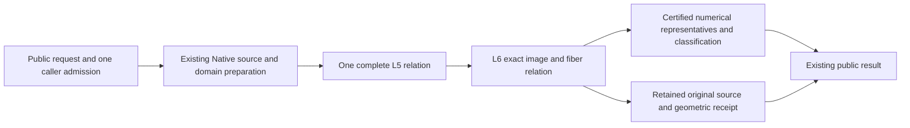
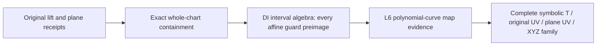
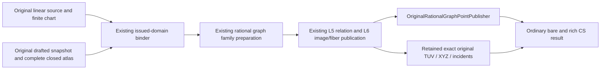

# Native Exact Geometric Relations

## Purpose and Scope
Parent: [CADGeometry](../DESIGN.md). Compose the verified original Native L5 source
receipt with L6 image/fiber evidence, then publish original CS/SSI results. Existing
finite closed nonperiodic positive-weight single-span preparation is reused. Whole
seven completion also requires existing full-family/domain and boundary/projected/
self-contact contracts; this component does not redefine their mandatory scope.

## Responsibilities and Boundaries
This component owns source-bound geometric receipts and numerical publication from
one retained L5/L6 relation. NativeExactRelations owns original source preparation;
L6 owns image/fiber correspondence. Public intersectors own applicability/dispatch.
A started query must propagate failure; it cannot replay a legacy TUV/UVUV solver.
Numerical samples do not prove existence, equality, topology or complete exclusion.
Root owns shared contracts, result types, admission and dispatch. CS and SSI helpers
have separate file owners and do not mutate the other owner's source.

## Related Designs
| Design | Relationship | Contract Used | Summary | Cautions |
|---|---|---|---|---|
| [Parent](../DESIGN.md) | parent | Existing intersectors and source representation | Production composition | No new production target |
| [Native preparation](../NativeExactRelations/DESIGN.md) | depends on | Source-bound L5 relation | Complete supported requested/native domain intersection | Unsupported input is decided before solver dispatch |
| [L6](../RationalBivariateAlgebra/ExactGeometricRelation/DESIGN.md) | depends on | Resolution, strata, exact fibers and curve spans | Immutable geometric evidence | Parameter components are not image connectivity |
| [CS publication](../CurveSurfaceOverlap/DESIGN.md) | coordinates with | Existing rich/discrete result contracts | Retain points and positive relations | No partial discrete success |
| [SSI publication](../NativeSurfaceSurfaceRelations/DESIGN.md) | coordinates with | Both-UV original relation publication | Points, curves and regions | No numerical identity merging |
| [Verification](../../../Tests/NativeExactRelationVerification/DESIGN.md) | test owner | Full production public execution | Native and matching WASI lanes | Isolated L6 proofs are reused but do not prove adapters |

## Architecture


## Contracts and Invariants

### Ordinary retained Coons and plane SSI

The ordinary bare/rich, caller-admitted and boxed SSI entries select the retained
Coons/axis-normal plane producer before the historical numerical fallback. The
producer reuses the original Coons atlas, issued domain/graph family, original
plane basis/whole-domain compiler and mixed relation resolver. Applicability is
decided before solving; a selected path never retries a legacy solver on failure.
The scope is explicit: other source families and plane basis capabilities keep
their existing dispatch and remain uncompleted coverage obligations.

`OriginalSurfacePlaneGeometricRelations` implements the existing public reading
protocol and retains the full mixed source relation plus existing L6 strata and
exact points. Shared publication treats an absent transport as the original
primitive parameter identity on EITHER source side. Plane-first therefore keeps
public coordinate roles; it does not normalize the result to Coons-first.
There is one L5 decomposition and one L6 resolution per retained chart pair.

Rich results publish that owner even for a continuous or empty intersection.
Bare array results explicitly report nonDiscreteIntersection for positive
parameter dimension; they cannot return an empty array for a nonempty exact
relation. Isolated contacts require the existing exact-point owner in rich output;
an unimplemented numerical bare publisher must fail explicitly. All allocations,
component/stratum/count bounds, source/transport depth and final cancellation use
the original caller admission. Immutable owners and protocol witnesses are common
to Native/WASM/Embedded; new mutable storage is limited to local scratch arrays.

Verification owns full selection/all-incidence/XYZ/image-fiber oracles, both source
orders, closed request boundaries/singletons/complete-empty, exact resource and
one-less failures, callback terminal cancel and detached-source readers. Fixed
four-lane receipts must bind the changed source and actual public dispatch bodies.
Prepared-only evidence cannot discharge ordinary dispatch or main delivery.
- Preserve every source parameter tuple, requested domain, nonzero denominator guard,
  complete selection and topology owner. Equal XYZ never merges distinct UV.
- L5-backed publication resolves L6 exactly once from the retained L5 relation.
  Exactly contained polynomial families use the source/DI/map proofs below instead.
  Station queries are explicit new constrained problems with a caller-supplied query admission.
- Positive results retain their complete exact relation. Discrete-only queries reject
  positive-dimensional solutions atomically. Empty results retain full exclusion.
- Numerical representatives must satisfy existing position/parameter/classification
  guarantees. A missing required publication capability is explicit failure, not a
  placeholder curve, point, empty success or partial complete result.
- Exact comparison maintains closed brackets containing the original XYZ values.
  Publication checks each dyadic representative against both bracket endpoints in
  the original coefficient field. An axis error at most distance/2 proves squared
  Euclidean authored-position error at most 3*distance^2/4. This consumes retained
  enclosure evidence instead of issuing a new nonlinear algebraic sign problem
  for the sum of squared errors. Candidate source-to-target residuals retain their
  exact squared-distance checks in the original coefficient field. No depth proof,
  refinement limit or requested accuracy is weakened.
- Same admission flows through preparation, algebra, refinement, reservation and
  final cancellation. Checked bytes/words and independent limits retain their meaning.
- SSI publication preserves the existing maximumSeedCount ceiling for all
  connected source-parameter components, including positive-dimensional ones.
  The isolated representative count separately obeys maximumRootAttempts.
- CS publication preserves maximumCandidateCount for all selected solution cells,
  connected source-parameter components and isolated representatives. Positive
  components count even when the numerical points array is empty. The shared
  publisher checks the retained L5 selection before numerical materialization;
  ordinary, callback-admitted and explicit exact-admission entries share this check.

Numerical CS and SSI publication compare each retained exact coordinate with
both finite seed endpoints in the original coefficient field under the same
caller admission. Proven equality collapses that coordinate to an exact
singleton before bisection, preserving authored closed endpoints and exact
hull corners. Approximate proximity never triggers this collapse. A failed
containment or exact comparison propagates failure; no representative is
snapped to an endpoint from residuals or tolerance.

## Runtime Flows
Validate applicability -> prepare source/domain -> L5 -> L6 -> retain source-bound
receipt -> numerical publication -> final cancellation -> return. Ordinary,
callback-admitted and explicit exact-admission numerical entries share the producer
for the supported single-span family. SSI prepared entries use that same dispatch.
Other families retain their existing producers; resource exhaustion never selects
another solver. Exact geometric operations accept explicit lower limits/admission.

## State, Ownership, and Lifecycle
All published evidence and source snapshots are immutable Sendable values. Solver
scratch and exclusive inout admissions are invocation-local. No shared mutable cache,
unsafe pointer, target-specific ownership weakening or new synchronization is added.

## Failure, Concurrency, and Constraints
Typed geometric failures preserve L0-L6 and source/domain issuance causes. The
public geometry boundary recursively normalizes nested cancellation and resource
causes; non-discrete intersections retain their own code, malformed source/domain
inputs retain invalidInput, and unsupported source capabilities remain explicit.
The normalization entry is emitted into its caller so Embedded's error type tests
use the same metadata as the boxing caller. A separately compiled `any Error`
entry can compare owner-local error metadata against a client's imported copy and
miss the same nominal error. The fixed-toolchain `@_alwaysEmitIntoClient` boundary
keeps the existing internal API and classification rules on every target. Its
cross-module fixture verifies actual resource and cancellation codes, not merely
that an error was thrown. The scalar publisher and terminal error constructor are
ABI-visible internal helpers for this serialized body; no public API is added.
KernelError conversion is owned by this boundary. No increased degree, work, storage, depth or result
limits, tolerance-based source equality, hidden exploration window or budget reset.

## Verification and Change Impact
Reuse b26fa47c's identical lower source evidence. Verify full production compilation
and actual public source-bound geometric queries first, then rich/discrete numerical
adapters with weighted contact/repeated roots, multiple UV, closed/singleton/empty,
continuous/mixed, folded/collapsed, source release, independent limits and terminal
cancel. Matching Swift6.4.0 Native/normal WASM/Embedded proofs and affected ASAN paths
are required before adapter completion/main integration. Review each stable snapshot
once and recheck only concrete findings. Source/domain expansion has its own tests.

## Public Migration Boundary

The prepared retained-lift/plane public overload consumes the sealed complete
relation from [NativeExactRelations](../NativeExactRelations/DESIGN.md#retained-lift-against-the-whole-original-plane).
It reuses L6 and the existing exact public point/image/fiber representation.
The common publication algorithm retains the supplied immutable relation owner,
maps local parameters through the proved original transport, and publishes all
auxiliary lifts; it performs no additional decomposition or XYZ deduplication.
The plane graph's two coordinates already are the original basis UV.
Source preparation and every later query use explicit independent admissions.
The prepared port and the ordinary Curve3D selector share this publication.
[CS-POLY-01 verification](../../../Tests/OriginalPublicAcceptanceVerification/Evidence/CS-POLY-01-ordinary/VERIFICATION.md)
binds the frozen ordinary input to both distinct authored T roots and all exact
incidents. This input does not establish general lift/plane family coverage.
The changed path requires focused real-source success/exclusion, exact domains,
wrong-owner/field and resource/cancel/lifetime checks on the fixed target lanes.

### Exactly contained polynomial lift families

CS-POLY-COINC-01 stops in the first template's three-variable L5 decomposition
under the unchanged public work allowance. Its alternative complete proof is an
identically zero original plane incidence polynomial, a constant nonzero weight,
a source-issued bijective UV elimination, and the complete preimage of every
affine source guard. This is a proof-selected publication path, selected before
any intersection decomposition; a failed solver never triggers this path.



The initial ordinary capability requires the full curve and whole-plane request,
identity authored T transport, affine source guards and polynomial UV elimination.
Other requests and unproved containment use the existing selected relation path.
The original source owner supplies all formulas; this consumer never reconstructs
UV from XYZ. All source templates, including empty and singleton selections,
retain their ordinals, guard proofs and owners. No cell sampling or finite plane
window establishes coverage. A nonzero constant guard gives the whole line or
empty set as its exact sign requires; a nonconstant affine guard has its unique
exact root and sign-correct open/closed half-lines or singleton/complement.
Existing DI set intersection computes their complete conjunction with support.

The sealed polynomial-curve map receipt in
[L6](../RationalBivariateAlgebra/ExactGeometricRelation/DESIGN.md#polynomial-curve-map-evidence)
retains the existing derivative-minor proof of a constant map or a nonconstant
coordinate with finite fibers. Each nontrivial parameter interval has dimension
one; each singleton has dimension zero. A constant map has image dimension zero;
a nonconstant polynomial curve has the interval's dimension and zero-dimensional
fibers. Image connectivity and injectivity are not inferred. The public family
preserves every original TUV and the target basis UV=(H-OW) dot basis / W.

The rich CS result exposes an immutable non-generic reader requirement and exact
pieces, separately from L5-cell-backed relations. The bare API rejects a positive-
dimensional solution. Isolated-only numerical publication from this family is
explicitly unfinished; it cannot return an empty successful point array. All
operations use the same caller admission, checked chart/candidate counts, depth,
charged buffers/owner storage and terminal cancellation. A single erased strong
owner is shared by all pieces; detached pieces retain source, plane and reduction
proofs. Independent readers use independent admissions. Native/ASAN/WASM/Embedded
changed-path checks own the full public oracle, boundaries, failure, exact/one-less
resources, cancellation, COW and detached lifetime. Existing point paths are
regressions, not evidence for continuous-family completion.

### Ordinary retained lift against an axis plane

The ordinary CS selector recognizes a retained rational Coons or original boundary-corrected host with an
authored Euclidean polyline pcurve and an N+origin plane whose normal has one
nonzero component. Applicability is decided before spending its allowance. This
axis-plane capability supplies exact positive basis lengths without a rounded
square root. Other shape/basis capabilities retain their existing dispatch;
failure after selection never retries a legacy solver. General plane bases and
remaining lift families stay mandatory open cells.

CS-DERIVATIVE-LIFT-PLANE-01 additionally selects an original plane-derivative
host with an authored Native B-spline pcurve. It consumes the existing
`OriginalNativePcurveRetainedAtlasLiftSnapshotProvider` and
`OriginalPlaneDerivativeSurfaceSnapshotProvider`; these providers retain the
original positional atlas, rational denominators, source constraints and closed
chart incidents. Derivative constraints are construction inputs, not extra
intersection equations. No formula, host reconstruction or derivative equality
authority is introduced by this public routing.

The private generic preparation closure returns the source-owned finite lift
family under the same admission created by the common producer. Polyline host
preparation and Native derivative-host preparation then share the unchanged
curve/plane DI selection, guarded polynomial UV reduction, L5/L6 solve and exact
numerical publication. The original three-axis graph and forward-restored
`(T,U,V)` remain retained. A rational/nonlinear pcurve that the checked reducer
cannot eliminate fails explicitly; general derivative hosts and pcurve families
remain open capabilities. Applicability never bypasses an unavailable position
atlas, unsupported graph layout or exhausted caller allowance.

| Frozen cell | Public input and complete independent oracle |
|---|---|
| CS-DERIVATIVE-LIFT-PLANE-01 | Existing `DerivativeHostShape.shape(weighted:true,projected:true)`, mode0 Native diagonal pcurve, full T=[0,1], whole plane x=1/2 with raw normal unitX. The sole root T=1/2 has host UV=(1/2,1/2), XYZ=(1/2,1/2,5/32), plane UV=(5/32,-1/2), all eight closed source incidents, and image/fiber dimensions zero. |

The admitted selected-entry decline is the red evidence. Acceptance owns actual
ordinary and callback bare/rich entries, exact incident/parameter/image/fiber
correspondence, authored selections and complete empty results, typed failure,
existing work/storage/depth ceilings, cancellation and detached/COW lifetime on
fixed Native/ASAN/normal-WASM/Embedded lanes. Existing Coons and corrected
polyline public cells are regressions. Unchanged source/DI and algebra contracts
are reused by admitted products; verification module namespace adaptation does
not create a production source prerequisite or require a broad lower rebuild.

CS-POLY-CORRECTION-01 consumes the existing
`OriginalBoundaryCorrectionSnapshotProvider` through
`OriginalRetainedLiftHostSnapshotting`. The selected host provider binds the
original authored surface using the polyline's exact field; the common generic
producer and point publisher retain its concrete source owner. Source laws,
domain guards, UV reduction, and L5/L6 publication keep their existing authority.
The provider factory selects a source importer; it cannot issue equality proof
or replace the original position formula. Each query creates one caller ledger
before binding either host, and all subsequent work uses that ledger.

| Frozen cell | Public input and complete independent oracle |
|---|---|
| CS-POLY-CORRECTION-01 | Existing `PolylineAtlasLiftProof.shape(multi:false).1`, the original repeated-vertex polyline lift, whole authored T and whole plane x=1/2. Distinct roots sqrt(2)-1 and1 both have original UV=(1/2,1/2), XYZ=(1/2,1/2,1/16), plane UV=(1/16,-1/2); the first root has two incident segments and the second one. |

The [observed entry decline](../../../Tests/OriginalPublicAcceptanceVerification/Evidence/CS-POLY-CORRECTION-01/STOP.md)
binds the unchanged Coons-only producer and the existing correction source/DI
oracle. It establishes both selected bare/rich producer declines, without
claiming an unexecuted fallback failure. Acceptance requires the actual ordinary
and callback-admitted public entries, the complete three-incident oracle,
request/empty, resource/depth/count, cancellation and detached/COW lifetime
checks on fixed Native/ASAN/normal-WASM/Embedded changed paths. Existing Coons
public cells are regressions. General correction atlases, pcurves and plane
bases remain separate open capabilities. This routing adds no shared mutable
state, target-specific branch, unsafe owner or buffer copy.

Work-budget edges remain owned by the unchanged `NativeExactPublicAdmission`
and `NativeCurveSurfacePointAllowance` contracts and their admitted evidence.
Whole-query work is not specified as deterministic: repeated actual corrected
queries have different totals even after a warmup and with fresh inputs. A
previous run's total therefore cannot define the next run's exact work boundary.
This cell composes the existing per-unit budget proof with actual public-query
success under the existing finite allowance and exact callback-cap failure
propagation. Full-query storage totals are stable for the frozen input and are
verified at the exact total and one byte below it. Final publication cancellation
is injected after the final storage callback; the unchanged admission checkpoint
must observe it before returning the result. Diagnostic work-count failures are
retained as rejected test premises, without changing limits or claiming a solver
defect. No lower proof is regenerated solely for this routing change.

The producer uses the existing Native caller allowance for source issuance,
domain selection, one retained L5/L6 solve and numerical publication. Authored
curve and plane requests restrict their exact domains; the plane is never given
a guessed finite support. Original polynomial degree, source depth, chart/cell,
candidate, storage and cancellation ceilings remain authoritative.

The numerical publisher transfers the retained exact T/plane-UV/XYZ values once
through the existing original-scalar transporter. An in-place index heap orders
exact authored TUV tuples, preserving distinct T at equal XYZ. Group ranges map
each numerical representative to every original exact point ordinal. The sealed
`OriginalIssuedNumericalCurveSurfacePoints` retains that transfer, grouping and
geometric owner; the rich result shares its immutable owners and buffers.

Existing persistent scalar isolations refine numerical representatives. Every
candidate must have a source chart whose original guards hold, and exact
squared-distance predicates certify source/target/point mismatch and parameter
error under the same ledger. These numerical predicates do not establish contact.
Angular classification consumes the sealed plane basis's orthogonal unit axes.
Their exact cross product is a unit normal parallel to the retained authored
normal, so the squared angular predicate is invariant under that replacement.
The source normal and the incidence equation retain their original coefficients;
this change applies only to classification. Computing the cross product uses the
same admission and charged invocation-local storage, without another source
preparation, normalization, decomposition or coefficient approximation.
CS-POLY-NORMAL-SUBNORMAL-01's Native trace reaches complete geometric publication,
then exhausts the work allowance while comparing the angular predicate for the
second incident using the raw subnormal normal. The required change uses the
already-issued basis theorem rather than repeatedly squaring that scale in each
algebraic witness field. Public success must retain the independent two-root/
twelve-incident oracle and unchanged limits, failure and lifetime contracts.

Every incident extension must agree on the published angular classification;
disagreement remains an explicit unsupported germ-selection case until actual
one-sided germ receipts are consumed. All incidents remain in the exact result.

Ordinary rich results may carry both numerical points and the exact graph owner.
Their representation is numerical when the sealed numerical mapping is present;
prepared exact-only results retain their existing representation. Positive
relations remain available to rich consumers, while discrete array calls reject
them atomically. The changed ordinary entry and its callback-admitted overload
must be executed before this selector is counted as public-cell completion.

BSpline caller-ledger and existing Curve3D/Surface3D ordinary/callback-admitted
intersectionResult/intersections requirements use one L5/L6 relation for the
finite closed nonperiodic positive-weight single-span Native family. Multi-span
and periodic inputs retain their original producers and are not L6-migrated.
The numerical residual is a certified upper bound; exact squared-distance checks
prove it bounds representative mismatch and never establish contact existence.

## Existing Caller Admission Migration

Ordinary and callback entry composition uses an invocation-local adapter of the
existing NativeCurveSurfacePointAllowance / SSI allowance. The L0 required cell
visit port forwards value and coefficient visits to the same existing cumulative
cell counter after lower causal-depth mapping. `admitDepth` checks depth only and
does not consume cells. Checked bytes-to-UInt32-word rounding preserves the old
storage policy. Source/decomposition/root/result caps remain independent.

Applicability is decided before the first exact solve. Finite closed nonperiodic
positive-weight single-span Native inputs use one L5/L6 relation; unsupported
shape/domain cases retain their existing issuer. Failure after exact dispatch is
propagated and never replays the legacy solver. Rich receipt consumers, including
boundary clipping, must consume the new retained evidence before their route is
claimed migrated. No old receipt is reconstructed by solving the same problem.

The legacy entry has no separate L6 stored-cell, closure, attachment, strata,
projection-span or scalar-extension-level option. The adapter starts these fields
at Int.max; CS transports its existing selected-cell ceiling through closure
capacity as specified below. No additional independent public ceiling is invented.
Actual L2/L3 visits, work, allocation bytes and both independent depths still
reach the same finite original allowance. Final CS selected-cell/component checks
remain before numerical publication, alongside the early topology capacity check.
Publisher candidate/component/root limits retain their previous meanings. Explicit
exact-ledger overloads continue to honor every caller-specified lower structural
limit. This internal mapping is not an increase to any existing public option.

Default supported single-span results retain `originalExactGeometricRelation`;
older optional Native receipt properties remain available for their unchanged
multi-span/periodic producers. The L6 receipt is the complete original parameter,
image and fiber authority, including empty results. Legacy receipt consumers
require a separate compatible L6 consumption route; no recreated legacy solve is
used to populate optional properties. Migration tests must cover that consumption.

## Current Lower Contract Integration

Compose main326af519 consumers with verified lower69cd4c4f contracts. The public
Geometry allowance owns cumulative actual visits; its bridge forwards L0.visitCell
without a reset or new ceiling. Weighted CS (work16777216/depth32) and folded SSI
(work80000000/depth32) must complete through existing entries and retain L5 guard/
square reduction and L6 correspondence. Reuse saved b7cc13e4 CS/SSI migration
source after review and actual stable public proof. Diagnostic and boundary
changes are not imported. Failure after applicability cannot replay another solver.

NativeExactRelationVerification owns actual full Core/Geometry Native/ASAN/matching
WASI/Embedded execution. Lower evidence is reused by exact source input hashes;
changed callers and upper assembly are verified separately. Project PROGRESS.md
owns this integration; no whole-seven or full87 completion is inferred.

### Authored Request Retention

When neither surface axis is explicitly selected, CS passes the original absent
surface-domain request to the Native source issuer. If either axis is explicitly
selected, the complete box uses that axis and the unchanged native bound for the
other axis. The source issuer owns the effective intersection with native domains.
A numerical publisher must not rewrite an absent request into an explicit box.
Weighted public proof checks the retained original request and raw-equation TUV.

### Early CS candidate rejection

The CS publisher bounds the existing topology closure capacity by the smaller of
the caller's `maximumClosures` and `options.maximumCandidateCount`. Complete L4
incidence requires one closure per selected cell, so this transports the existing
selected-result ceiling to the earliest topology boundary without interpreting
the full partition count as a result count. All other caller limits are preserved.
The final selected-cell/component/isolated checks remain defense in depth.
The L4 issuer owns early closure-count rejection as specified in
[its contract](../RationalBivariateAlgebra/ExactRealTopology/DESIGN.md#incidence-closure-capacity-preflight).
No approximate identity, different field, solver retry or partial publication is
introduced. Existing successful CS parameter/geometry/numerical receipts remain
unchanged; public rejection is still `resourceLimitExceeded`.


## Planned Composition Consumer Migration

Status: design only; current implementation guarantees above remain unchanged.
Public family consumers will retain the issued source/domain evidence and solved relation, including the exact compatibility bridge for existing point receipt accessors.
The [common consumer handoff](../OriginalSourceIssuance/DESIGN.md#composition-consumer-handoff-design)
owns coefficient transport, complete-cover, publication and migration acceptance.

## Issued graph composition

The prepared graph port consumes `OriginalIssuedGraphRelations` from the complete
DI family resolver. One geometry pair retains each L5 relation and its L6 image/fiber
receipt; a source-bound immutable result retains both source families and complete
DI covers, including empty families. No chart pair is re-solved. Public CS/SSI rich
results expose this evidence through an additive read-only protocol requirement.
The existing Native rational numerical producers and result properties remain
compatible. Exact prepared publication distinguishes retained exact contacts from
legacy numerical representative arrays; a discrete numerical adapter must refuse
results for which it cannot publish the complete requested representation.

Prepared publication has no solver fallback. Source/DI proof reuse, L6 preparation,
result limits and final publication use the same caller admission. Public exact
contacts expose original local tuples, all auxiliary lifts, forward authored
parameter transport, and XYZ/fiber witnesses through the retained pair. They are
not XYZ-deduplicated. Positive-dimensional relations remain available through the
rich receipt and cannot become discrete/empty success. Native/ASAN and matching
ordinary/Embedded tests exercise actual result constructors and public methods.


Checked polynomial lift reductions restore each isolated point's full original
`(T,U,V)` in `OriginalIssuedExactIntersectionPoint.originalFirstCoordinates`.
The shared publication algorithm evaluates the source-issued forward laws in the
retained witness field. Existing unreduced producers keep this optional field
nil and retain their original auxiliary witnesses as before. Continuous fibers
retain the same forward laws and original graphs in the lift/plane relation owner.
Other ordinary lifted-curve and plane capabilities still require explicit
migration. Neither this prepared capability nor CS-POLY-01 establishes complete
family coverage; continuous and subnormal-normal public cells remain separate.

## Finite Original Line Against a Zero-Draft Wall

`OriginalDraftedZeroLinePublicProducer` composes an explicitly finite authored
line request with the source-owned zero-angle wall atlas. The source contract is
owned by [OriginalSourceIssuance](../OriginalSourceIssuance/DESIGN.md); the
canonical signed-axis translation and generator traversal law remain owned by
[OriginalDraftedSection](../OriginalDraftedSection/DESIGN.md). This consumer does
not reconstruct the wall as a Native or ordinary ruled surface.



The existing linear chart issuer supplies the checked line homogeneous law and
identity authored T transport. The existing retained surface preparer supplies
the wall laws and proves their authored cells cover [0,1]^2. Its surface frame
and selected request enter the existing issued-domain binder once with the
same-owner laws, without a redundant second cover or nominal rewrapping. Both graph
families share the field created under the single public caller admission.
`DefaultOriginalIssuedGraphRelationResolver` and
`DefaultOriginalIssuedGeometricRelationResolver` retain both source bindings,
complete DI covers, original guards, every closed incident, and image/fiber
evidence. The retained drafted snapshot exposes its checked exact generator
parameter map at authored U; no extra intersection coordinate is invented.

The smallest missing consumer is numerical publication from these existing
generic rational graph receipts. `OriginalRationalGraphPointPublisher<S,E,C,T,F,D>`
receives the producer's actual original scalar field explicitly, including for
an empty request; it does not allocate a replacement field. It groups exact
authored TUV tuples, transfers exact coordinates once through the
existing scalar transporter, and refines their existing certified isolations.
It evaluates both retained rational graph laws and denominator/source guards,
checks the representative displacement and both-source residuals exactly, and
classifies each incident using rational quotient derivatives and the surface
Jacobian cross product. Every incident must agree on classification. Its initial
capability requires proved identity authored parameter transports; other maps
are explicitly unsupported rather than evaluated in the wrong coordinates.
The immutable numerical receipt retains all incidence ordinals and the complete
geometric owner. Exact existence and exclusion remain L5/L6 responsibilities.

Applicability requires a line, an original zero-angle drafted wall, and an
explicit finite line range. Whole-line requests and the general draft/ruling
families remain incomplete capabilities. Once selected, source, guard, domain,
resource, cancellation, non-discrete, or required publication failures propagate
atomically without a fallback solve. Rich results retain positive-dimensional
relations; bare results refuse them. Candidate counts bound selected cells,
components and isolated contacts before numerical materialization.

All source preparation, both domain covers, one graph solve, publication scratch
and output reservations use the existing `NativeExactPublicAdmission` and
`NativeCurveSurfacePointAllowance`. Caller work, storage, visits, source/value/
coefficient depths, chart, degree and candidate ceilings are unchanged. A final
checkpoint follows result reservation. No shared mutable state, target-specific
ownership, source fitting or unchecked authority conversion is introduced.

The frozen generic graph path succeeds under the unchanged public algebraic
depth allowance of 32. An explicit zero-depth query is observed to refuse with
the typed resource code. Rational final coordinates do not establish zero
intermediate computational depth, and this cell does not claim an exact minimum
algebraic depth. Source-depth acceptance is independently checked at the actual
retained depth two, with refusal at one. Work uses fixed callback caps and the
successful original allowance; a previous whole-query total is not a required
deterministic work boundary.

| Frozen cell | Full authored request and independent oracle |
|---|---|
| CS-DRAFT-ZERO-RULED-01 | Reversed degree-one Native rational generator with controls (0,0,0),(1,0,0), weights 1,2 and authored span [0,1]; raw axis/pull (0,0,4), normal (0,0,2), height 1, angle +0, wall end height 3. Full UV=[0,1]^2 against line (1/2,T,2), T=[-1,1]. The unique tuple is T=0,U=2/3,V=1/2, original generator parameter 1/3 and XYZ=(1/2,0,2), with one incident and image/fiber dimensions zero. |

The admitted observation establishes numerical contact with no exact receipt.
Acceptance owns the four actual ordinary/callback bare/rich entries, the exact
oracle and source mapping, complete-empty and singleton selections, selected
failures, existing independent budgets, cancellation and detached/COW lifetime.
Existing lift/plane cells are dispatch regressions. Unchanged lower contracts
and products are reused by receipt/hash admission; focused Native assembly is
followed by stable Native/ASAN/normal-WASM/Embedded changed-path evidence. This
finite cell does not establish general drafted-wall or whole-line completion.


## Ordinary Finite Axis-Line / Revolution Publication

`OriginalRevolutionAxisLinePublicProducer` selects a finite authored line on the
exact axis of a retained rational-generator original revolution. Its initial
coefficient capability is a signed coordinate axis with a rational exact length;
other axes or child capabilities retain the existing explicit incomplete route.
The producer consumes original line/source law preparation and the full selected
revolution cover. The pair intake contract is owned by
[NativeExactRelations](../NativeExactRelations/DESIGN.md#pair-bound-revolution-axis-intake).
It does not replace the revolution by its axial projection over the whole source.

`OriginalRevolutionAxisGeometricRelationReading` extends the existing issued
geometric reading protocol with the typed original cover and pair-bound owner.
Its immutable implementation retains the source-issued axis-section and complement
exclusion. `OriginalIssuedGeometricPublication` publishes the existing solved L5
pairs once, using their authored forward maps. Every U remains a parameter even
when the XYZ image is a singleton; no root or chart incident is merged by XYZ.
The full cover owns seam and generator incident queries through protocol requirements
available on Native, WASM and Embedded.

The ordinary rich result retains this exact relation and reports exactRelation
representation. Bare point-array entry points explicitly refuse any nonempty
positive-dimensional parameter relation. A nonempty isolated-only section without
a certified numerical publisher is also an explicit unsupported result; it never
becomes an empty successful array. Full empty exclusion may publish an empty array.
The public result retains the same immutable owner without cloning graph/pair arrays.

Public limits, source/value/coefficient/transport depths, guard failures, cancel
and typed publication failures use the original caller allowance. This finite
cell adds no mutable shared state or target-dependent synchronization. Tests use
the actual ordinary rich entry, including final publication and later retained
incident queries, with resource and lifetime checks. Lower proof premises are
reused and their evidence scope is preserved.

## Finite Physical-Arc Plane Publication

The ordinary producer for CS-ANGULAR-PHYSICAL-ARC-PLANE-01 recognizes a direct
stored circle with normal +Z, wrapped in physicalRadianArc(0,1,+1 turn), and an
analytic stored unitX plane through the circle center's X coordinate, with an
explicit finite T request. Its scope is this exact construction family; other
angular/plane inputs retain their existing dispatcher paths. Selection uses
original stored values, never proximity or a rounded phase ratio. After this
selector admits the input, every preparation, completeness, resource or cancel
failure propagates without another solver attempt.

The [Q(pi) pair compiler](../NativeExactRelations/DESIGN.md#source-proved-finite-physical-phase-plane-relations)
composes actual source/DI proof with generic L5/L6. Ordinary and caller-admitted
rich and bare entries share one producer and the existing invocation allowance.
A new immutable `OriginalAngularPlaneRelationReading` protocol exposes exact
Q(pi) points, all original TUV/phase/child labels/incidents and source-bound L6
pair owners through non-generic requirements callable on Embedded. The additive
CurveSurfaceIntersectionResult.originalAngularPlaneRelation slot defaults to nil
for other producers. Existing fixed-field point DTOs are unchanged. Numerical
arrays are representatives alongside the exact receipt; they alone never prove
absence, source equality or complete coverage. Empty exact results retain the
full source/pair exclusion owner.

Numerical authoredT is enclosed by exact Q(pi) comparisons against binary64
bracket endpoints in the original finite request. Refinement respects existing
iteration and caller resource ceilings. Existing original interval evaluation
establishes forward numerical accuracy; approximation does not merge roots,
UV or branches. Exact plane UV and XYZ retain their source values. All output
allocation, comparisons, original interval evaluation and terminal publication
use the same caller allowance. Detached/COW/independent-reader lifetime,
source/frame/field/depth/count/resource failures, entry/mid/final and empty
publication cancellation, finite-UV forwarding and the existing synthetic
proof-plane path belong to the changed public-cell verification. One stable
review and exact latest-main delivery are required; broader angular windows,
other primitives and general M4-M8 completion remain open.

## Certified Apex Empty Publication

OriginalCertifiedApexPlanePublicProducer consumes the
[complete-empty pair binding](../NativeExactRelations/DESIGN.md#certified-apex-empty-pair-binding)
for CS-CERT-SPHERECONE-APEX-EMPTY-01. It selects the source issuer's explicit
checked capability before each existing ordinary bare/rich, standard/callback
CS route. Nonselected live routes retain their precedence; after selection,
issuance/admission failure propagates through the existing public mapper.

```text
ordinary four-entry CS -> same caller allowance -> source separation issuer
  -> exact selected pair owner -> final empty publication checkpoint
  -> bare [] / rich [] plus retained exclusion reader
```

OriginalCertifiedApexPlaneExclusionReading exposes the concrete immutable owner,
isEmpty and dimensional flags as non-generic protocol requirements. The additive
CurveSurfaceIntersectionResult.originalCertifiedApexPlaneExclusion defaults nil
for other producers and retains the owner for rich results. Empty points/overlaps
and positive-dimensional flags remain false. Existing representation behavior
is preserved. The source/selection theorem, rather than an empty candidate
array, proves the result complete. There is no unchecked initializer or Boolean
callback that can approve completeness.

The producer reuses NativeExactPublicAdmission and the existing failure mapper,
never resets work/storage/depth/cancel limits, charges new output storage before
allocation and checks cancellation immediately before returning even an empty
result. Later reader queries re-admit retained proof/selection under independent
ledgers. Ownership, Sendable requirements and isolation are target-common; the
new state is immutable or invocation-local.

Verification uses the actual observed constructor/request and independent whole-T
empty oracle, all four dispatch entries, source/plane/selection correspondence,
invalid capability/guard/scalar/owner and attained resource limits, entry/mid/
final-empty/follow-up cancellation, COW/detached lifetime and independent readers.
Changed nonselected routes receive only causally affected regression checks.
Fixed Native/ASAN/normal-WASM/Embedded selected-body evidence, one comprehensive
review, coherent commit and independent latest-main comparison close only this
cell; all other mandatory certified branches and M4-M8 remain open.

## Implicit curve publication

The narrow ordinary implicit selector accepts only the source-owned supported
`CertifiedImplicitIntersectionCurve` cell capability and an admitted finite
Native target. It selects before preparation; after selection every typed
source/domain/algebra/resource/cancellation failure propagates atomically. General
implicit branches remain on their existing dispatch until their source authority
is supported. The source-owned finite admission covers forward one/two-cell and
reversed single-cell triangular Native constructions. Publication consumes the
sealed reduction for the actual cell; it does not reverse T or negate the
source's total derivative again. The producer follows one caller ledger through source graphs,
[complete-family preparation](../NativeExactRelations/DESIGN.md#complete-original-curve-graph-families),
existing L5/L6, scalar transfer, numerical representatives and terminal checkpoint.

`OriginalImplicitCurveRelationReading` exposes the actual immutable source
snapshot, checked source evidence and existing issued geometric reading receipt.
Its sealed immutable implementation retains the typed full original family,
Native target and geometry; it does not duplicate lift arrays or create proof
from numerical points. Existing exact points expose original T, target UV and
XYZ. The solver witness is `[T,U,V]`; `originalFirstCoordinates` restores the
source tuple `[T,firstU,firstV,secondU,secondV]` through the existing checked
forward-coordinate publication hook. The source-specific reading receipt also
exposes the sealed reduction retaining the full original five-variable graph,
every original guard and its whole-support bijective forward correspondence.
No seven-variable CAD cells are fabricated or claimed. The retained reduced raw
projection/partition contains every selected TUV incident, and the source
bijection establishes the complete original host fiber. A single witness is not
that completeness proof. Empty publication retains those same owners and complete
exclusion. L6 owns image/fiber dimensions.

The ordinary rational graph publisher shares its exact TUV grouping, scalar
transfer, isolation and displacement validation through an internal statically
specialized curve evaluator contract. Its existing identity evaluator preserves
all current arity/transport checks and failure behavior. The implicit evaluator
consumes the source-issued reduction, univariate forward homogeneous position,
total derivative and forward host-coordinate laws. It validates restored exact
source tuples and represented numerical source tuples against the retained full
five-variable graph, and uses the reduced graph's guards as well. It never
differentiates that auxiliary-held graph at a T-only tuple. All arithmetic and retained history
use the caller admission. Source equations are not reconstructed in publication,
and equal XYZ never merges different TUV. Nonidentity target transports or
unproved incident classification remain explicit unsupported failures.

```text
source-issued full graph5 + checked graph1 and bijective forward host laws
    -> existing L5 CS3 -> existing L6 + exact original-coordinate restoration
    -> shared scalar transfer/grouping/isolation + checked curve evaluator
    -> ordinary numerical points + retained implicit/source/geometric receipts
```

The split-cell consumer selects the source reduction by the actual pair's
`firstGraphIndex`, checked against the corresponding graph evidence's original
cell ordinal. Exact coordinate restoration, tuple validation, total derivative
and represented position all use that same cell's sealed reduction. The shared
numeric publisher already supplies the actual graph to these operations and
retains every exact incident while grouping equal TUV tuples. No generic grouping
or evaluator protocol change is required. At the shared endpoint, the complete
result has one exact TUV group and two actual cell incidents; the source-owned
local-parameter laws identify cell 0's local end and cell 1's local start. Neither
a coordinate sample nor equality of XYZ replaces the finite-cover/seam theorem.
The public complete-family reader retains the entire finite coverage, including
all reductions, guards and owners for empty results and later admitted reads.
Its `finiteCoverage` requirement is the whole-family authority. Explicit
`firstEvidence` and `firstReduction` requirements denote only the first stored
cell. Legacy `evidence` and `reduction` remain deprecated aliases to those
first-cell views, preserving existing single-cell source compatibility without
claiming that one cell covers a split family. All production consumers use the
complete collection and the actual graph/pair correspondence.

Verification owns the actual ordinary bare/rich and callback routes, full TUV and
host UV oracle over every retained terminal cell, complete empty/singleton
selections, image/fiber meaning, candidate/source/depth/resource/cancel boundaries
and detached/COW independent reads. Changed identity evaluator behavior requires
the smallest existing rational numeric regression; no unchanged lower solver
reproof or broad unrelated public replay is implied.

## Implicit host-plane empty publication

`OriginalImplicitHostPlanePublicProducer` selects only the separate source-owned
whole Native-host/analytic-plane separation capability, before creating a caller
admission. It is called first by the existing implicit producer, so all four
ordinary bare/rich and callback entries share it. Unsupported representations
decline into the existing dispatch; once selected, typed source/domain/arithmetic,
resource and cancellation failures propagate with the existing publication mapper.
The existing positive implicit graph consumer remains unchanged.

The producer binds the actual implicit snapshot through the separate exclusion
provider and the actual plane through its existing provider. It uses the exact
rational field, existing checked unit-plane basis issuer, source separation issuer
and [complete-empty DI owner](../NativeExactRelations/DESIGN.md#implicit-host-plane-empty-pair-binding).
The source owner alone proves the constant Native-host height, strictly positive
weights, actual closed-cell bounds and nonzero plane separation. Publication
never synthesizes source equations, a positive host UV map or an empty L5/L6
relation. Missing T range means authored full support; plane UV requests preserve
the existing unbounded or explicit interval semantics.

`OriginalImplicitHostPlaneExclusionReading` declares non-generic requirements for
its concrete immutable owner, emptiness and dimensional flags, preserving
Embedded witness-table access. The additive result field
`originalImplicitHostPlaneExclusion` retains this theorem with empty numerical
points/overlaps. Existing representation and legacy fields remain unchanged;
all positive-dimensional flags are false. The owner, rather than empty arrays,
proves completeness. Its checked internal factory and private initializer prevent
unchecked publication authority.

One `NativeExactPublicAdmission<NativeCurveSurfacePointAllowance>` owns all
binding, source proof, DI selection, output allocation and the final cancellation
checkpoint. It keeps existing work/storage/depth/candidate limits and invocation
callbacks. Later proof queries use explicit independent admissions. All retained
state is immutable Sendable, with no target-specific state or isolation branch.
Verification owns actual standard/callback bare/rich empty behavior, exact
requested/effective domains, capability decline, selected typed failures,
cell/source/depth/resource limits, entry/processing/final-empty cancellation and
detached/COW lifetime. The unchanged positive source/graph path needs only the
causally affected dispatch regression.

## Finite rolling/plane ordinary SSI

SSI-ROLLING-BALL-PLANE-01 selects the actual rollingBall source with an axis-normal
original plane. The ordinary six SSI entries prepare the existing child/source/DI
receipts, consume the checked auxiliary reduction, and retain the checked section
owner using existing real-cell selection and geometric map evidence. Both source orders and requested boxes use the same
caller admission, limits, terminal cancellation and immutable ownership.
Unreducible required graphs fail explicitly; the live legacy path remains for
unselected shape pairs. Positive-dimensional bare output refuses nonDiscreteIntersection.
Success means the complete rational arc, original UV and all child incidents,
not rolling-family or whole-M7/M8 completion. Verification belongs to
Tests/OriginalPublicAcceptanceVerification/RollingPlaneSSIAcceptance.swift.

The observed general four-parameter topology projection exceeds the unchanged
caller work budget even for one reduced rolling chart. For this cell, the public
owner therefore consumes a checked plane-section theorem: exact division of the
original plane equation by guarded W must yield a nonconstant affine law in U
alone. Its unique root fixes U; the existing exact real-cell domain selects V
under every retained guard and the exact plane-UV request preimage. The original
plane basis uniquely determines both plane coordinates. No inverse is fitted.
`OriginalIssuedGeometricRelationReading.surfacePlaneSections` is a protocol
requirement, defaulting to no sections for existing cell-backed owners. `pairs`
enumerates cell-backed relations; section-backed contacts enumerate this new
requirement. `isEmpty` and dimension flags cover the owner's complete represented
set. Every section retains original source/DI/reduction/plane owners, full forward
witness lifts, rational XYZ/UV and derivative-numerator finite-fiber evidence.
It owns no shared mutable state; storage/Sendable/isolation are identical on all
targets. Cell, topology and relation solvers remain unchanged. ExactScalar adds
an admitted package-only rational-square-root capability; its producer is
relocated unchanged into the standalone L0 source set.

Within one section query, normalized nonconstant guard laws and the remaining
parameter interval identify a reusable exact partition. Reuse requires exact
coefficientwise polynomial and endpoint/closure equality; each original chart
still receives its own predicate selection, forward laws, ordinal and owner.
Constant atoms are decided exactly before partitioning. This shares decomposition
without identifying or merging original UV or chart incidents.


## Periodic zero-offset stationary curve publication

The ordinary CS producer consumes existing periodic Native offset source/DI and
finite Native curve chart receipts. Its scope is a stationary rational curve
with constant nonzero denominator and zero-distance offset charts whose guarded
position quotient is affine in original UV and independent of the positive root.
The original normal/denominator/root guards remain mandatory. A constant zero
normal-square excludes the chart; otherwise two independent affine rows fix the
only possible UV, and every remaining position equation, original support and
guard must accept it. A required rank-deficient/nonaffine/irrational surviving
root case fails explicitly. All fundamental charts are checked before publication.

The retained symbolic contact templates own exact curve selections, fundamental
UV/root/XYZ, original chart ordinals, independent integer-cycle selections and
complete source/DI/graph owners. Integer endpoints are derived by exact floor/
ceiling of request pullbacks; unbounded axes remain unbounded. Integer cycles
are never enumerated or narrowed to fixed-width integers. Members consume the retained DI/source period theorem to lift UV and exact
integer selection; the constructor checks every original guard before issuing
the sealed template. Native-specific owners remain private, while the public
template uses only scalar/domain types shared with independent IssuedGeometry. Image0 and
fiber equal to the retained T interval dimension follow the proved constant map.
An appended protocol requirement exposes these templates through the existing
issued geometric result. Existing readers have an empty default requirement.
Bare positive-dimensional calls refuse rather than returning a finite sample.

All source preparation and scratch share the caller admission, depth, chart and
candidate limits; final checkpoints guard empty/nonempty publication. No new
shared mutable state or platform-specific ownership is introduced. Tests belong
to Tests/OriginalPublicAcceptanceVerification/PeriodicOffsetCSAcceptance.swift;
CS-OFFSET-PERIODIC-ZERO-GEOM-01 closes this fixed input and requests only. Other
periodic/nonzero/general offset capabilities remain incomplete.

## Certified coaxial ordinary publication

`OriginalCertifiedCoaxialPublicProducer` selects the source-owned unit-Z coaxial
full-branch capability before legacy dispatch. Supported targets are the exact
retained cylinder or `Plane3D(origin:0,normal:Y,uDirection:X)`. Once selected,
invalid domains, incomplete admission and cancellation propagate as failures.
The [retained DI relation](../NativeExactRelations/DESIGN.md#certified-coaxial-cone-cylinder-selections)
owns complete T, target UV and both parent UV families. Rich/prepared publication
retains it; the finite-array entry rejects positive-dimensional results.
Plane points are certified numerical representatives of the exact source roots;
height bounds come from the existing outward trigonometric evaluator on the
stored physical half-angle using the same allowance. Bounds certify only
localization and never prove equality or merge T/UV.
The reader exposes every needed operation as a protocol requirement for Embedded.
Verification covers ordinary, composed callback and retained reader paths on
Native, ASAN, normal WASM and Embedded, without rebuilding independent L2-L6.

## Certified sphere-cone full-branch publication

The ordinary selector consumes the two supported original full branches and
the declared planeY0/uX target. Exact mixed-coordinate receipts retain original T,
selected radical, target UV and both parent UV. A sphere latitude is a canonical
unit-circle inverse coordinate, not a manufactured binary64 UV. Numerical
representatives are localized with the existing outward trigonometric evaluator
and exact source-selected radical bounds; they establish no equality. Every
publication/query retains source/field owners and the original caller admission.
The public cell fixture owns complete roots, all UV, strict/open/disconnected
scopes, empty results, independent depth/resource/cancel/lifetime and four targets.

### Cone-cone full-branch public plane contacts

Ordinary/callback bare and rich CS entries consume the source/DI cardinal
contact owner before the tolerance-based certified reducer. The concrete source
pair, branch, original angles/traversal and target frame are checked. Complete
T0,pi/B and both-parent UV survive publication; approximate localization serves
only numerical representatives. The false T1 seam is excluded by the exact
phase theorem. Finite guards, output accuracy, resources and cancellation can
fail explicitly; no old solver retry follows a selected source failure.
Other target frames/branches remain marked incomplete and are not generalized
from the two fixed direct-CS cells.

### Certified analytic-pair lift public CS

All ordinary/callback bare/rich entries select the checked coaxial role-lift
producer before the unconverted lift solver. Source/DI retains both original
parent UV and selected-role UV, exact local/child parameters and reverse endpoint
incidents. Numeric point/T localization serves only output accuracy, with the
same caller admission through source, child relation and result publication.
A selected source failure is explicit and never retries a different solver.
Other certified role/source families remain independently marked incomplete.

### Coaxial whole-family ordinary SSI publication

All six ordinary/admitted/box bare/rich SSI entries consume the original primitive
family before tolerance-based coaxial dispatch. Rich output retains complete
symbolic XYZ/UV families on finite/unbounded requests. Bare and rich entries publish originalCoaxial geometric cover pieces, with exact
interval scope, image/fiber dimensions and retained symbolic XYZ/all-UV queries.
Complete empty selections succeed. Legacy numeric-only consumers explicitly
refuse this representation until original material/curve composition is connected.
The same caller allowance flows through source, exact DI selection, coefficient/
period queries, output and final cancellation; retained queries reuse preparation.
Other axes/noncoaxial families remain separate mandatory capabilities.

### Original coaxial geometric array components

The existing SurfaceSurfaceIntersection array gains an originalCoaxial case
whose payload owns the previously issued relation and one selected phase interval.
The source producer alone constructs it after complete DI resolution, under the
same caller admission; no unchecked certificate initializer is public. Each
component exposes its original source pair, interval inclusion, image0 or image1
and fiber0, and exact symbolic XYZ/both-UV member queries. Independent arbitrary
integer lifts remain constrained by both retained requests. Interval components
are not rounded Curve3D circles and singleton components are not guessed points.

The payload holds an immutable relation and ordinals; no source preparation,
solver replay, per-component array copy or new mutable state is introduced.
Hashable compares retained owner identity and ordinals, never XYZ proximity.
Native serialization rejects retained proof objects explicitly rather than
dropping authority or constructing unchecked proof during decoding. Unconverted
legacy consumers must reject this representation explicitly; their remaining
material/curve conversion capability is not counted as complete by publication.
Verification must cover all six ordinary/admitted/box entries, prepared arrays,
whole/finite/seam/singleton/empty, count/work/storage/depth/cancel/lifetime and
member scope. All target witnesses share the same immutable ownership contract.

Output interval counts are checked with overflow and the caller's result cap
before complete payload storage is admitted and reserved. A three-component
selection must not grow to an unadmitted four-element buffer. The resource
fixture covers this input as well as whole and complete-empty publication.

### Bounded sphere-cone CS publication

Consume the [source-owned bounded theorem](../OriginalSourceIssuance/DESIGN.md#bounded-sphere-cone-plane-contact-source)
through the existing sphere-cone relation and ordinary/callback CS dispatch.
Selected T quarters are exact; projected numeric representatives are certified
outputs only. Target U/V is(x,-z), all parent UV/cycles and source ownership remain
retained. Requests act on T and exact target coordinates; whole-source exclusion
is retained for empty selection. No solver retry or rounded critical law is used.
The source owns critical normalization and root choice; DI owns selection and
the geometric producer owns admitted representation/enclosure/terminal cancel.

### Bounded sphere-cone SSI publication

The [source](../OriginalSourceIssuance/DESIGN.md#bounded-sphere-cone-whole-pair-source)
and [domain relation](../NativeExactRelations/DESIGN.md#bounded-sphere-cone-parent-ssi-domain)
feed all six existing ordinary SSI entries and prepared closed-box queries.
A source-backed geometric component retains the one connected two-branch
common curve, exact source/XYZ/inverse-UV membership and closed incidents.
The rich result exposes its sealed reader through protocol requirements.
Prepared sessions retain the same source once; the selected empty query does
not reconstruct the pair. Other finite nonempty requests fail explicitly.

Add only the required result owner and dispatch. Existing numeric Boolean
material/residual consumers reject the new symbolic representation under their
existing incomplete gates; diagnostics count its image dimension without
pretending a numerical residual is exact authority. Serialization cannot
construct/discard proof objects. Native/ASAN/normalWASM imported and Embedded
composed success, whole/quarter scopes, resource/depth/cancel/lifetime and
existing certified CS regressions are the verification ownership boundary.

### Full sphere-cone public family

Six SSI entries and prepared pair queries retain the full ordered original
pair, two branch components, both closed source charts, symbolic exact XYZ
and uniquely scoped inverse UV plus independent arbitrary integer cycles.
Empty publication retains complete source/request exclusion. All output
storage, counts/depth/work and terminal cancel remain caller-admitted.
The new full-family representation joins existing original proof-loss codec
and unconverted Kernel material-refinement refusal gates.

### Full cone-cone symbolic geometric publication

Six public SSI entries/prepared sessions publish both source-bound opposite
slant families and exact source coordinate/UV expressions. Each receipt
retains source/r/branch/role and admits the original work/storage/depth/count
and cancellation. Coordinates from independent alpha/beta owners are not
relabelled as beta-field scalar values. Existing codec and unconverted Kernel
material-refinement refusal gates preserve source authority.

### Apex sphere-cone symbolic strata

Public SSI/prepared owner retains one connected common image, apex stratum
image0/fiber1 and two regular arcs image1/fiber0, all original UV/cycles and
four apex incidents. Geometric publication keeps these source receipts and
caller limits/cancel; it never reports a sampled point as the full apex fibre.

### Common-apex cone point publication

Publish one retained geometric point component with all selected original UV
pairs and both collapse receipts through ordinary/callback/prepared SSI.
Each arbitrary real U is checked in its effective source fiber. The output
retains immutable source owners and the exact authored apex; XYZ-only consumers/codecs
must explicitly refuse discarding authority. No global equality is inferred
from the collapsed subset.
