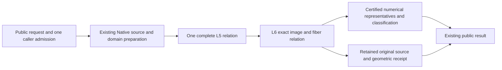

# Native Exact Geometric Relations

## Purpose and Scope
Parent: [CADGeometry](../DESIGN.md). Compose the verified original Native L5 source
receipt with L6 image/fiber evidence, then publish original CS/SSI results. Existing
finite closed nonperiodic positive-weight single-span preparation is reused. Whole
seven completion also requires existing full-family/domain and boundary/projected/
self-contact contracts; this component does not redefine their mandatory scope.

## Responsibilities and Boundaries
This component owns source-bound geometric receipts and numerical publication from
one retained L5/L6 relation. NativeExactRelations owns original source preparation;
L6 owns image/fiber correspondence. Public intersectors own applicability/dispatch.
A started query must propagate failure; it cannot replay a legacy TUV/UVUV solver.
Numerical samples do not prove existence, equality, topology or complete exclusion.
Root owns shared contracts, result types, admission and dispatch. CS and SSI helpers
have separate file owners and do not mutate the other owner's source.

## Related Designs
| Design | Relationship | Contract Used | Summary | Cautions |
|---|---|---|---|---|
| [Parent](../DESIGN.md) | parent | Existing intersectors and source representation | Production composition | No new production target |
| [Native preparation](../NativeExactRelations/DESIGN.md) | depends on | Source-bound L5 relation | Complete supported requested/native domain intersection | Unsupported input is decided before solver dispatch |
| [L6](../RationalBivariateAlgebra/ExactGeometricRelation/DESIGN.md) | depends on | Resolution, strata, exact fibers and curve spans | Immutable geometric evidence | Parameter components are not image connectivity |
| [CS publication](../CurveSurfaceOverlap/DESIGN.md) | coordinates with | Existing rich/discrete result contracts | Retain points and positive relations | No partial discrete success |
| [SSI publication](../NativeSurfaceSurfaceRelations/DESIGN.md) | coordinates with | Both-UV original relation publication | Points, curves and regions | No numerical identity merging |
| [Verification](../../../Tests/NativeExactRelationVerification/DESIGN.md) | test owner | Full production public execution | Native and matching WASI lanes | Isolated L6 proofs are reused but do not prove adapters |

## Architecture

## Contracts and Invariants
- Preserve every source parameter tuple, requested domain, nonzero denominator guard,
  complete selection and topology owner. Equal XYZ never merges distinct UV.
- Geometry resolves L6 exactly once from the retained L5 relation. Station queries
  are explicit new constrained problems with a caller-supplied query admission.
- Positive results retain their complete exact relation. Discrete-only queries reject
  positive-dimensional solutions atomically. Empty results retain full exclusion.
- Numerical representatives must satisfy existing position/parameter/classification
  guarantees. A missing required publication capability is explicit failure, not a
  placeholder curve, point, empty success or partial complete result.
- Exact comparison maintains closed brackets containing the original XYZ values.
  Publication checks each dyadic representative against both bracket endpoints in
  the original coefficient field. An axis error at most distance/2 proves squared
  Euclidean authored-position error at most 3*distance^2/4. This consumes retained
  enclosure evidence instead of issuing a new nonlinear algebraic sign problem
  for the sum of squared errors. Candidate source-to-target residuals retain their
  exact squared-distance checks in the original coefficient field. No depth proof,
  refinement limit or requested accuracy is weakened.
- Same admission flows through preparation, algebra, refinement, reservation and
  final cancellation. Checked bytes/words and independent limits retain their meaning.
- SSI publication preserves the existing maximumSeedCount ceiling for all
  connected source-parameter components, including positive-dimensional ones.
  The isolated representative count separately obeys maximumRootAttempts.

## Runtime Flows
Validate applicability -> prepare source/domain -> L5 -> L6 -> retain source-bound
receipt -> numerical publication -> final cancellation -> return. The explicit exact-admission numerical overloads share the producer. Migration of
legacy ordinary/callback-admitted/prepared receipt consumers remains unconverted; resource exhaustion never selects another
solver. Exact geometric public operations accept explicit lower limits/admission.

## State, Ownership, and Lifecycle
All published evidence and source snapshots are immutable Sendable values. Solver
scratch and exclusive inout admissions are invocation-local. No shared mutable cache,
unsafe pointer, target-specific ownership weakening or new synchronization is added.

## Failure, Concurrency, and Constraints
Typed geometric failures preserve L0-L6 causes. KernelError conversion is owned by
the public geometry boundary. No increased degree, work, storage, depth or result
limits, tolerance-based source equality, hidden exploration window or budget reset.

## Verification and Change Impact
Reuse b26fa47c's identical lower source evidence. Verify full production compilation
and actual public source-bound geometric queries first, then rich/discrete numerical
adapters with weighted contact/repeated roots, multiple UV, closed/singleton/empty,
continuous/mixed, folded/collapsed, source release, independent limits and terminal
cancel. Matching Swift6.4.0 Native/normal WASM/Embedded proofs and affected ASAN paths
are required before adapter completion/main integration. Review each stable snapshot
once and recheck only concrete findings. Source/domain expansion has its own tests.

## Public Migration Boundary

The added BSpline caller-ledger intersectionResult/intersections requirements use
one L5/L6 relation. Existing Curve3D/Surface3D ordinary and callback-admitted queries
still use their original producers until retained legacy receipt consumers migrate
together with their public-path proofs. They are not claimed as L6-connected.
The numerical residual is a certified upper bound; exact squared-distance checks
prove it bounds representative mismatch and never establish contact existence.
