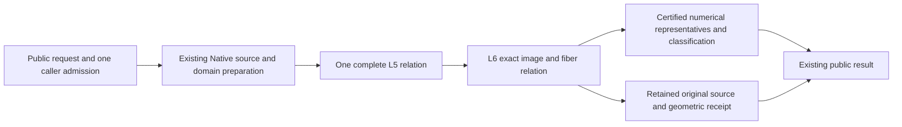
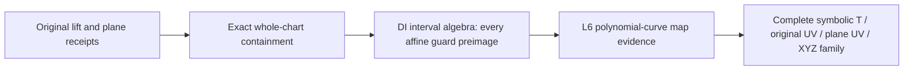

# Native Exact Geometric Relations

## Purpose and Scope
Parent: [CADGeometry](../DESIGN.md). Compose the verified original Native L5 source
receipt with L6 image/fiber evidence, then publish original CS/SSI results. Existing
finite closed nonperiodic positive-weight single-span preparation is reused. Whole
seven completion also requires existing full-family/domain and boundary/projected/
self-contact contracts; this component does not redefine their mandatory scope.

## Responsibilities and Boundaries
This component owns source-bound geometric receipts and numerical publication from
one retained L5/L6 relation. NativeExactRelations owns original source preparation;
L6 owns image/fiber correspondence. Public intersectors own applicability/dispatch.
A started query must propagate failure; it cannot replay a legacy TUV/UVUV solver.
Numerical samples do not prove existence, equality, topology or complete exclusion.
Root owns shared contracts, result types, admission and dispatch. CS and SSI helpers
have separate file owners and do not mutate the other owner's source.

## Related Designs
| Design | Relationship | Contract Used | Summary | Cautions |
|---|---|---|---|---|
| [Parent](../DESIGN.md) | parent | Existing intersectors and source representation | Production composition | No new production target |
| [Native preparation](../NativeExactRelations/DESIGN.md) | depends on | Source-bound L5 relation | Complete supported requested/native domain intersection | Unsupported input is decided before solver dispatch |
| [L6](../RationalBivariateAlgebra/ExactGeometricRelation/DESIGN.md) | depends on | Resolution, strata, exact fibers and curve spans | Immutable geometric evidence | Parameter components are not image connectivity |
| [CS publication](../CurveSurfaceOverlap/DESIGN.md) | coordinates with | Existing rich/discrete result contracts | Retain points and positive relations | No partial discrete success |
| [SSI publication](../NativeSurfaceSurfaceRelations/DESIGN.md) | coordinates with | Both-UV original relation publication | Points, curves and regions | No numerical identity merging |
| [Verification](../../../Tests/NativeExactRelationVerification/DESIGN.md) | test owner | Full production public execution | Native and matching WASI lanes | Isolated L6 proofs are reused but do not prove adapters |

## Architecture

## Contracts and Invariants
- Preserve every source parameter tuple, requested domain, nonzero denominator guard,
  complete selection and topology owner. Equal XYZ never merges distinct UV.
- L5-backed publication resolves L6 exactly once from the retained L5 relation.
  Exactly contained polynomial families use the source/DI/map proofs below instead.
  Station queries are explicit new constrained problems with a caller-supplied query admission.
- Positive results retain their complete exact relation. Discrete-only queries reject
  positive-dimensional solutions atomically. Empty results retain full exclusion.
- Numerical representatives must satisfy existing position/parameter/classification
  guarantees. A missing required publication capability is explicit failure, not a
  placeholder curve, point, empty success or partial complete result.
- Exact comparison maintains closed brackets containing the original XYZ values.
  Publication checks each dyadic representative against both bracket endpoints in
  the original coefficient field. An axis error at most distance/2 proves squared
  Euclidean authored-position error at most 3*distance^2/4. This consumes retained
  enclosure evidence instead of issuing a new nonlinear algebraic sign problem
  for the sum of squared errors. Candidate source-to-target residuals retain their
  exact squared-distance checks in the original coefficient field. No depth proof,
  refinement limit or requested accuracy is weakened.
- Same admission flows through preparation, algebra, refinement, reservation and
  final cancellation. Checked bytes/words and independent limits retain their meaning.
- SSI publication preserves the existing maximumSeedCount ceiling for all
  connected source-parameter components, including positive-dimensional ones.
  The isolated representative count separately obeys maximumRootAttempts.
- CS publication preserves maximumCandidateCount for all selected solution cells,
  connected source-parameter components and isolated representatives. Positive
  components count even when the numerical points array is empty. The shared
  publisher checks the retained L5 selection before numerical materialization;
  ordinary, callback-admitted and explicit exact-admission entries share this check.

Numerical CS and SSI publication compare each retained exact coordinate with
both finite seed endpoints in the original coefficient field under the same
caller admission. Proven equality collapses that coordinate to an exact
singleton before bisection, preserving authored closed endpoints and exact
hull corners. Approximate proximity never triggers this collapse. A failed
containment or exact comparison propagates failure; no representative is
snapped to an endpoint from residuals or tolerance.

## Runtime Flows
Validate applicability -> prepare source/domain -> L5 -> L6 -> retain source-bound
receipt -> numerical publication -> final cancellation -> return. Ordinary,
callback-admitted and explicit exact-admission numerical entries share the producer
for the supported single-span family. SSI prepared entries use that same dispatch.
Other families retain their existing producers; resource exhaustion never selects
another solver. Exact geometric operations accept explicit lower limits/admission.

## State, Ownership, and Lifecycle
All published evidence and source snapshots are immutable Sendable values. Solver
scratch and exclusive inout admissions are invocation-local. No shared mutable cache,
unsafe pointer, target-specific ownership weakening or new synchronization is added.

## Failure, Concurrency, and Constraints
Typed geometric failures preserve L0-L6 and source/domain issuance causes. The
public geometry boundary recursively normalizes nested cancellation and resource
causes; non-discrete intersections retain their own code, malformed source/domain
inputs retain invalidInput, and unsupported source capabilities remain explicit.
The normalization entry is emitted into its caller so Embedded's error type tests
use the same metadata as the boxing caller. A separately compiled `any Error`
entry can compare owner-local error metadata against a client's imported copy and
miss the same nominal error. The fixed-toolchain `@_alwaysEmitIntoClient` boundary
keeps the existing internal API and classification rules on every target. Its
cross-module fixture verifies actual resource and cancellation codes, not merely
that an error was thrown. The scalar publisher and terminal error constructor are
ABI-visible internal helpers for this serialized body; no public API is added.
KernelError conversion is owned by this boundary. No increased degree, work, storage, depth or result
limits, tolerance-based source equality, hidden exploration window or budget reset.

## Verification and Change Impact
Reuse b26fa47c's identical lower source evidence. Verify full production compilation
and actual public source-bound geometric queries first, then rich/discrete numerical
adapters with weighted contact/repeated roots, multiple UV, closed/singleton/empty,
continuous/mixed, folded/collapsed, source release, independent limits and terminal
cancel. Matching Swift6.4.0 Native/normal WASM/Embedded proofs and affected ASAN paths
are required before adapter completion/main integration. Review each stable snapshot
once and recheck only concrete findings. Source/domain expansion has its own tests.

## Public Migration Boundary

The prepared retained-lift/plane public overload consumes the sealed complete
relation from [NativeExactRelations](../NativeExactRelations/DESIGN.md#retained-lift-against-the-whole-original-plane).
It reuses L6 and the existing exact public point/image/fiber representation.
The common publication algorithm retains the supplied immutable relation owner,
maps local parameters through the proved original transport, and publishes all
auxiliary lifts; it performs no additional decomposition or XYZ deduplication.
The plane graph's two coordinates already are the original basis UV.
Source preparation and every later query use explicit independent admissions.
The prepared port and the ordinary Curve3D selector share this publication.
[CS-POLY-01 verification](../../../Tests/OriginalPublicAcceptanceVerification/Evidence/CS-POLY-01-ordinary/VERIFICATION.md)
binds the frozen ordinary input to both distinct authored T roots and all exact
incidents. This input does not establish general lift/plane family coverage.
The changed path requires focused real-source success/exclusion, exact domains,
wrong-owner/field and resource/cancel/lifetime checks on the fixed target lanes.

### Exactly contained polynomial lift families

CS-POLY-COINC-01 stops in the first template's three-variable L5 decomposition
under the unchanged public work allowance. Its alternative complete proof is an
identically zero original plane incidence polynomial, a constant nonzero weight,
a source-issued bijective UV elimination, and the complete preimage of every
affine source guard. This is a proof-selected publication path, selected before
any intersection decomposition; a failed solver never triggers this path.

The initial ordinary capability requires the full curve and whole-plane request,
identity authored T transport, affine source guards and polynomial UV elimination.
Other requests and unproved containment use the existing selected relation path.
The original source owner supplies all formulas; this consumer never reconstructs
UV from XYZ. All source templates, including empty and singleton selections,
retain their ordinals, guard proofs and owners. No cell sampling or finite plane
window establishes coverage. A nonzero constant guard gives the whole line or
empty set as its exact sign requires; a nonconstant affine guard has its unique
exact root and sign-correct open/closed half-lines or singleton/complement.
Existing DI set intersection computes their complete conjunction with support.

The sealed polynomial-curve map receipt in
[L6](../RationalBivariateAlgebra/ExactGeometricRelation/DESIGN.md#polynomial-curve-map-evidence)
retains the existing derivative-minor proof of a constant map or a nonconstant
coordinate with finite fibers. Each nontrivial parameter interval has dimension
one; each singleton has dimension zero. A constant map has image dimension zero;
a nonconstant polynomial curve has the interval's dimension and zero-dimensional
fibers. Image connectivity and injectivity are not inferred. The public family
preserves every original TUV and the target basis UV=(H-OW) dot basis / W.

The rich CS result exposes an immutable non-generic reader requirement and exact
pieces, separately from L5-cell-backed relations. The bare API rejects a positive-
dimensional solution. Isolated-only numerical publication from this family is
explicitly unfinished; it cannot return an empty successful point array. All
operations use the same caller admission, checked chart/candidate counts, depth,
charged buffers/owner storage and terminal cancellation. A single erased strong
owner is shared by all pieces; detached pieces retain source, plane and reduction
proofs. Independent readers use independent admissions. Native/ASAN/WASM/Embedded
changed-path checks own the full public oracle, boundaries, failure, exact/one-less
resources, cancellation, COW and detached lifetime. Existing point paths are
regressions, not evidence for continuous-family completion.

### Ordinary retained polyline lift against an axis plane

The ordinary CS selector recognizes a retained rational Coons host with an
authored Euclidean polyline pcurve and an N+origin plane whose normal has one
nonzero component. Applicability is decided before spending its allowance. This
axis-plane capability supplies exact positive basis lengths without a rounded
square root. Other shape/basis capabilities retain their existing dispatch;
failure after selection never retries a legacy solver. General plane bases and
remaining lift families stay mandatory open cells.

The producer uses the existing Native caller allowance for source issuance,
domain selection, one retained L5/L6 solve and numerical publication. Authored
curve and plane requests restrict their exact domains; the plane is never given
a guessed finite support. Original polynomial degree, source depth, chart/cell,
candidate, storage and cancellation ceilings remain authoritative.

The numerical publisher transfers the retained exact T/plane-UV/XYZ values once
through the existing original-scalar transporter. An in-place index heap orders
exact authored TUV tuples, preserving distinct T at equal XYZ. Group ranges map
each numerical representative to every original exact point ordinal. The sealed
`OriginalIssuedNumericalCurveSurfacePoints` retains that transfer, grouping and
geometric owner; the rich result shares its immutable owners and buffers.

Existing persistent scalar isolations refine numerical representatives. Every
candidate must have a source chart whose original guards hold, and exact
squared-distance predicates certify source/target/point mismatch and parameter
error under the same ledger. These numerical predicates do not establish contact.
Angular classification consumes the sealed plane basis's orthogonal unit axes.
Their exact cross product is a unit normal parallel to the retained authored
normal, so the squared angular predicate is invariant under that replacement.
The source normal and the incidence equation retain their original coefficients;
this change applies only to classification. Computing the cross product uses the
same admission and charged invocation-local storage, without another source
preparation, normalization, decomposition or coefficient approximation.
CS-POLY-NORMAL-SUBNORMAL-01's Native trace reaches complete geometric publication,
then exhausts the work allowance while comparing the angular predicate for the
second incident using the raw subnormal normal. The required change uses the
already-issued basis theorem rather than repeatedly squaring that scale in each
algebraic witness field. Public success must retain the independent two-root/
twelve-incident oracle and unchanged limits, failure and lifetime contracts.

Every incident extension must agree on the published angular classification;
disagreement remains an explicit unsupported germ-selection case until actual
one-sided germ receipts are consumed. All incidents remain in the exact result.

Ordinary rich results may carry both numerical points and the exact graph owner.
Their representation is numerical when the sealed numerical mapping is present;
prepared exact-only results retain their existing representation. Positive
relations remain available to rich consumers, while discrete array calls reject
them atomically. The changed ordinary entry and its callback-admitted overload
must be executed before this selector is counted as public-cell completion.

BSpline caller-ledger and existing Curve3D/Surface3D ordinary/callback-admitted
intersectionResult/intersections requirements use one L5/L6 relation for the
finite closed nonperiodic positive-weight single-span Native family. Multi-span
and periodic inputs retain their original producers and are not L6-migrated.
The numerical residual is a certified upper bound; exact squared-distance checks
prove it bounds representative mismatch and never establish contact existence.

## Existing Caller Admission Migration

Ordinary and callback entry composition uses an invocation-local adapter of the
existing NativeCurveSurfacePointAllowance / SSI allowance. The L0 required cell
visit port forwards value and coefficient visits to the same existing cumulative
cell counter after lower causal-depth mapping. `admitDepth` checks depth only and
does not consume cells. Checked bytes-to-UInt32-word rounding preserves the old
storage policy. Source/decomposition/root/result caps remain independent.

Applicability is decided before the first exact solve. Finite closed nonperiodic
positive-weight single-span Native inputs use one L5/L6 relation; unsupported
shape/domain cases retain their existing issuer. Failure after exact dispatch is
propagated and never replays the legacy solver. Rich receipt consumers, including
boundary clipping, must consume the new retained evidence before their route is
claimed migrated. No old receipt is reconstructed by solving the same problem.

The legacy entry has no separate L6 stored-cell, closure, attachment, strata,
projection-span or scalar-extension-level option. The adapter starts these fields
at Int.max; CS transports its existing selected-cell ceiling through closure
capacity as specified below. No additional independent public ceiling is invented.
Actual L2/L3 visits, work, allocation bytes and both independent depths still
reach the same finite original allowance. Final CS selected-cell/component checks
remain before numerical publication, alongside the early topology capacity check.
Publisher candidate/component/root limits retain their previous meanings. Explicit
exact-ledger overloads continue to honor every caller-specified lower structural
limit. This internal mapping is not an increase to any existing public option.

Default supported single-span results retain `originalExactGeometricRelation`;
older optional Native receipt properties remain available for their unchanged
multi-span/periodic producers. The L6 receipt is the complete original parameter,
image and fiber authority, including empty results. Legacy receipt consumers
require a separate compatible L6 consumption route; no recreated legacy solve is
used to populate optional properties. Migration tests must cover that consumption.

## Current Lower Contract Integration

Compose main326af519 consumers with verified lower69cd4c4f contracts. The public
Geometry allowance owns cumulative actual visits; its bridge forwards L0.visitCell
without a reset or new ceiling. Weighted CS (work16777216/depth32) and folded SSI
(work80000000/depth32) must complete through existing entries and retain L5 guard/
square reduction and L6 correspondence. Reuse saved b7cc13e4 CS/SSI migration
source after review and actual stable public proof. Diagnostic and boundary
changes are not imported. Failure after applicability cannot replay another solver.

NativeExactRelationVerification owns actual full Core/Geometry Native/ASAN/matching
WASI/Embedded execution. Lower evidence is reused by exact source input hashes;
changed callers and upper assembly are verified separately. Project PROGRESS.md
owns this integration; no whole-seven or full87 completion is inferred.

### Authored Request Retention

When neither surface axis is explicitly selected, CS passes the original absent
surface-domain request to the Native source issuer. If either axis is explicitly
selected, the complete box uses that axis and the unchanged native bound for the
other axis. The source issuer owns the effective intersection with native domains.
A numerical publisher must not rewrite an absent request into an explicit box.
Weighted public proof checks the retained original request and raw-equation TUV.

### Early CS candidate rejection

The CS publisher bounds the existing topology closure capacity by the smaller of
the caller's `maximumClosures` and `options.maximumCandidateCount`. Complete L4
incidence requires one closure per selected cell, so this transports the existing
selected-result ceiling to the earliest topology boundary without interpreting
the full partition count as a result count. All other caller limits are preserved.
The final selected-cell/component/isolated checks remain defense in depth.
The L4 issuer owns early closure-count rejection as specified in
[its contract](../RationalBivariateAlgebra/ExactRealTopology/DESIGN.md#incidence-closure-capacity-preflight).
No approximate identity, different field, solver retry or partial publication is
introduced. Existing successful CS parameter/geometry/numerical receipts remain
unchanged; public rejection is still `resourceLimitExceeded`.

## Planned Composition Consumer Migration

Status: design only; current implementation guarantees above remain unchanged.
Public family consumers will retain the issued source/domain evidence and solved relation, including the exact compatibility bridge for existing point receipt accessors.
The [common consumer handoff](../OriginalSourceIssuance/DESIGN.md#composition-consumer-handoff-design)
owns coefficient transport, complete-cover, publication and migration acceptance.

## Issued graph composition

The prepared graph port consumes `OriginalIssuedGraphRelations` from the complete
DI family resolver. One geometry pair retains each L5 relation and its L6 image/fiber
receipt; a source-bound immutable result retains both source families and complete
DI covers, including empty families. No chart pair is re-solved. Public CS/SSI rich
results expose this evidence through an additive read-only protocol requirement.
The existing Native rational numerical producers and result properties remain
compatible. Exact prepared publication distinguishes retained exact contacts from
legacy numerical representative arrays; a discrete numerical adapter must refuse
results for which it cannot publish the complete requested representation.

Prepared publication has no solver fallback. Source/DI proof reuse, L6 preparation,
result limits and final publication use the same caller admission. Public exact
contacts expose original local tuples, all auxiliary lifts, forward authored
parameter transport, and XYZ/fiber witnesses through the retained pair. They are
not XYZ-deduplicated. Positive-dimensional relations remain available through the
rich receipt and cannot become discrete/empty success. Native/ASAN and matching
ordinary/Embedded tests exercise actual result constructors and public methods.

Checked polynomial lift reductions restore each isolated point's full original
`(T,U,V)` in `OriginalIssuedExactIntersectionPoint.originalFirstCoordinates`.
The shared publication algorithm evaluates the source-issued forward laws in the
retained witness field. Existing unreduced producers keep this optional field
nil and retain their original auxiliary witnesses as before. Continuous fibers
retain the same forward laws and original graphs in the lift/plane relation owner.
Other ordinary lifted-curve and plane capabilities still require explicit
migration. Neither this prepared capability nor CS-POLY-01 establishes complete
family coverage; continuous and subnormal-normal public cells remain separate.
