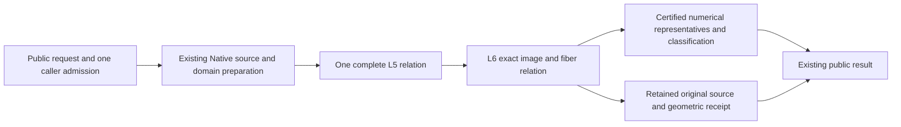

# Native Exact Geometric Relations

## Purpose and Scope
Parent: [CADGeometry](../DESIGN.md). Compose the verified original Native L5 source
receipt with L6 image/fiber evidence, then publish original CS/SSI results. Existing
finite closed nonperiodic positive-weight single-span preparation is reused. Whole
seven completion also requires existing full-family/domain and boundary/projected/
self-contact contracts; this component does not redefine their mandatory scope.

## Responsibilities and Boundaries
This component owns source-bound geometric receipts and numerical publication from
one retained L5/L6 relation. NativeExactRelations owns original source preparation;
L6 owns image/fiber correspondence. Public intersectors own applicability/dispatch.
A started query must propagate failure; it cannot replay a legacy TUV/UVUV solver.
Numerical samples do not prove existence, equality, topology or complete exclusion.
Root owns shared contracts, result types, admission and dispatch. CS and SSI helpers
have separate file owners and do not mutate the other owner's source.

## Related Designs
| Design | Relationship | Contract Used | Summary | Cautions |
|---|---|---|---|---|
| [Parent](../DESIGN.md) | parent | Existing intersectors and source representation | Production composition | No new production target |
| [Native preparation](../NativeExactRelations/DESIGN.md) | depends on | Source-bound L5 relation | Complete supported requested/native domain intersection | Unsupported input is decided before solver dispatch |
| [L6](../RationalBivariateAlgebra/ExactGeometricRelation/DESIGN.md) | depends on | Resolution, strata, exact fibers and curve spans | Immutable geometric evidence | Parameter components are not image connectivity |
| [CS publication](../CurveSurfaceOverlap/DESIGN.md) | coordinates with | Existing rich/discrete result contracts | Retain points and positive relations | No partial discrete success |
| [SSI publication](../NativeSurfaceSurfaceRelations/DESIGN.md) | coordinates with | Both-UV original relation publication | Points, curves and regions | No numerical identity merging |
| [Verification](../../../Tests/NativeExactRelationVerification/DESIGN.md) | test owner | Full production public execution | Native and matching WASI lanes | Isolated L6 proofs are reused but do not prove adapters |

## Architecture

## Contracts and Invariants
- Preserve every source parameter tuple, requested domain, nonzero denominator guard,
  complete selection and topology owner. Equal XYZ never merges distinct UV.
- Geometry resolves L6 exactly once from the retained L5 relation. Station queries
  are explicit new constrained problems with a caller-supplied query admission.
- Positive results retain their complete exact relation. Discrete-only queries reject
  positive-dimensional solutions atomically. Empty results retain full exclusion.
- Numerical representatives must satisfy existing position/parameter/classification
  guarantees. A missing required publication capability is explicit failure, not a
  placeholder curve, point, empty success or partial complete result.
- Exact comparison maintains closed brackets containing the original XYZ values.
  Publication checks each dyadic representative against both bracket endpoints in
  the original coefficient field. An axis error at most distance/2 proves squared
  Euclidean authored-position error at most 3*distance^2/4. This consumes retained
  enclosure evidence instead of issuing a new nonlinear algebraic sign problem
  for the sum of squared errors. Candidate source-to-target residuals retain their
  exact squared-distance checks in the original coefficient field. No depth proof,
  refinement limit or requested accuracy is weakened.
- Same admission flows through preparation, algebra, refinement, reservation and
  final cancellation. Checked bytes/words and independent limits retain their meaning.
- SSI publication preserves the existing maximumSeedCount ceiling for all
  connected source-parameter components, including positive-dimensional ones.
  The isolated representative count separately obeys maximumRootAttempts.
- CS publication preserves maximumCandidateCount for all selected solution cells,
  connected source-parameter components and isolated representatives. Positive
  components count even when the numerical points array is empty. The shared
  publisher checks the retained L5 selection before numerical materialization;
  ordinary, callback-admitted and explicit exact-admission entries share this check.

Numerical CS and SSI publication compare each retained exact coordinate with
both finite seed endpoints in the original coefficient field under the same
caller admission. Proven equality collapses that coordinate to an exact
singleton before bisection, preserving authored closed endpoints and exact
hull corners. Approximate proximity never triggers this collapse. A failed
containment or exact comparison propagates failure; no representative is
snapped to an endpoint from residuals or tolerance.

## Runtime Flows
Validate applicability -> prepare source/domain -> L5 -> L6 -> retain source-bound
receipt -> numerical publication -> final cancellation -> return. Ordinary,
callback-admitted and explicit exact-admission numerical entries share the producer
for the supported single-span family. SSI prepared entries use that same dispatch.
Other families retain their existing producers; resource exhaustion never selects
another solver. Exact geometric operations accept explicit lower limits/admission.

## State, Ownership, and Lifecycle
All published evidence and source snapshots are immutable Sendable values. Solver
scratch and exclusive inout admissions are invocation-local. No shared mutable cache,
unsafe pointer, target-specific ownership weakening or new synchronization is added.

## Failure, Concurrency, and Constraints
Typed geometric failures preserve L0-L6 causes. KernelError conversion is owned by
the public geometry boundary. No increased degree, work, storage, depth or result
limits, tolerance-based source equality, hidden exploration window or budget reset.

## Verification and Change Impact
Reuse b26fa47c's identical lower source evidence. Verify full production compilation
and actual public source-bound geometric queries first, then rich/discrete numerical
adapters with weighted contact/repeated roots, multiple UV, closed/singleton/empty,
continuous/mixed, folded/collapsed, source release, independent limits and terminal
cancel. Matching Swift6.4.0 Native/normal WASM/Embedded proofs and affected ASAN paths
are required before adapter completion/main integration. Review each stable snapshot
once and recheck only concrete findings. Source/domain expansion has its own tests.

## Public Migration Boundary

BSpline caller-ledger and existing Curve3D/Surface3D ordinary/callback-admitted
intersectionResult/intersections requirements use one L5/L6 relation for the
finite closed nonperiodic positive-weight single-span Native family. Multi-span
and periodic inputs retain their original producers and are not L6-migrated.
The numerical residual is a certified upper bound; exact squared-distance checks
prove it bounds representative mismatch and never establish contact existence.

## Existing Caller Admission Migration

Ordinary and callback entry composition uses an invocation-local adapter of the
existing NativeCurveSurfacePointAllowance / SSI allowance. The L0 required cell
visit port forwards value and coefficient visits to the same existing cumulative
cell counter after lower causal-depth mapping. `admitDepth` checks depth only and
does not consume cells. Checked bytes-to-UInt32-word rounding preserves the old
storage policy. Source/decomposition/root/result caps remain independent.

Applicability is decided before the first exact solve. Finite closed nonperiodic
positive-weight single-span Native inputs use one L5/L6 relation; unsupported
shape/domain cases retain their existing issuer. Failure after exact dispatch is
propagated and never replays the legacy solver. Rich receipt consumers, including
boundary clipping, must consume the new retained evidence before their route is
claimed migrated. No old receipt is reconstructed by solving the same problem.

The legacy entry has no separate L6 stored-cell, closure, attachment, strata,
projection-span or scalar-extension-level option. Those structural fields are
Int.max in the adapter rather than an invented additional ceiling. This does not
remove any existing caller ceiling: actual L2/L3 visits, work, allocation bytes
and both independent depths still reach that same finite original allowance.
The complete CS selected-cell/component ceiling is checked after exact resolution
and before numerical publication; the unchanged finite allowance bounds construction.
Publisher candidate/component/root limits retain their previous meanings. Explicit
exact-ledger overloads continue to honor every caller-specified lower structural
limit. This internal mapping is not an increase to any existing public option.

Default supported single-span results retain `originalExactGeometricRelation`;
older optional Native receipt properties remain available for their unchanged
multi-span/periodic producers. The L6 receipt is the complete original parameter,
image and fiber authority, including empty results. Legacy receipt consumers
require a separate compatible L6 consumption route; no recreated legacy solve is
used to populate optional properties. Migration tests must cover that consumption.

## Current Lower Contract Integration

Compose main326af519 consumers with verified lower69cd4c4f contracts. The public
Geometry allowance owns cumulative actual visits; its bridge forwards L0.visitCell
without a reset or new ceiling. Weighted CS (work16777216/depth32) and folded SSI
(work80000000/depth32) must complete through existing entries and retain L5 guard/
square reduction and L6 correspondence. Reuse saved b7cc13e4 CS/SSI migration
source after review and actual stable public proof. Diagnostic and boundary
changes are not imported. Failure after applicability cannot replay another solver.

NativeExactRelationVerification owns actual full Core/Geometry Native/ASAN/matching
WASI/Embedded execution. Lower evidence is reused by exact source input hashes;
changed callers and upper assembly are verified separately. Project PROGRESS.md
owns this integration; no whole-seven or full87 completion is inferred.

### Authored Request Retention

When neither surface axis is explicitly selected, CS passes the original absent
surface-domain request to the Native source issuer. If either axis is explicitly
selected, the complete box uses that axis and the unchanged native bound for the
other axis. The source issuer owns the effective intersection with native domains.
A numerical publisher must not rewrite an absent request into an explicit box.
Weighted public proof checks the retained original request and raw-equation TUV.
