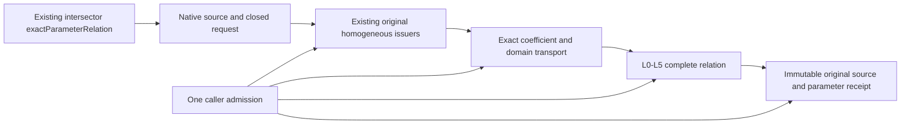

# Native Exact Relations

## Purpose and Scope
Parent: [CADGeometry](../DESIGN.md). Connect the independent L0-L5 foundation to
actual authored B-spline CS/SSI inputs in the existing production module. The
bounded input is finite, nonperiodic, positive-weight, source-valid, with exactly
one positive knot span per axis. No new production package or module is added.

## Responsibilities and Boundaries
This component owns source extraction, exact coefficient transport and closed
native/request domain intersection. Existing original homogeneous producers own
basis semantics. L5 owns equations and complete parameter topology. Public
`exactParameterRelation` requirements and the existing default intersectors return
a source-bound receipt; this explicit query accepts an L0 admission and lower
limits. Existing `intersectionResult` XYZ representatives, classification and
image/fiber publication are unchanged: parameter dimension does not establish
geometric dimension. The new query does not run the legacy solver or post-process
its roots. Unsupported source coverage is a typed failure, never a fallback.

## Related Designs
| Design | Relationship | Contract Used | Summary | Cautions |
|---|---|---|---|---|
| [Parent](../DESIGN.md) | parent | Native source types and public intersectors | Actual production integration | Preserve existing numerical APIs |
| [Algebra](../RationalBivariateAlgebra/DESIGN.md) | depends on | Original homogeneous curve/surface issuers | Exact stored coefficient authority | No fitted map |
| [L0](../RationalBivariateAlgebra/ExactScalar/DESIGN.md) | depends on | Scoped numeric admission, exact import | One exclusive caller ledger | Checked words-to-bytes |
| [L1](../RationalBivariateAlgebra/ExactPolynomial/DESIGN.md) | depends on | Checked ordered construction | Retain final canonical terms | Strict descending slot order and exact nonzero validation |
| [L5](../RationalBivariateAlgebra/ExactParametricRelation/DESIGN.md) | depends on | Compile, resolve and tuple membership | Complete parameter relation | Preserve denominator guards and all UV |
| [Verification](../../../Tests/NativeExactRelationVerification/DESIGN.md) | test owner | Full production Core/Geometry | Public Native and WASI routes | No subset build as integration evidence |

## Architecture

## Contracts and Invariants
- Validate input and degree before indexed source access. Count every visited knot
  with the same admission; require one positive span on each entire native axis.
- Import original rational coefficients directly into one shared L2 coefficient
  field. Do not convert coefficients to Double or use tolerance to assert equality.
- Requested bounds are finite ordered stored binary64 values. Clip with exact
  ordering of those values. Out-of-domain selections become L2 empty domains;
  singleton and native closed endpoints remain closed. The original requested
  bounds remain retained even when the effective domain is empty.
- Preserve all selected tuples, closure/incidence and denominator guards. Empty
  success includes L5 full exclusion evidence, never just an empty point array.
- Return source snapshots by value. COW buffers and proof owners survive original
  input release/mutation. One field is shared by both map sources and result.
- All extraction, preparation, import, resolution, result reservation and final
  checkpoint use the same admission. No internal budget defaults/resets exist.
- Explicit caller degree/extension, L3 cell/root and L4 closure/piece/component
  ceilings remain independent. Preparation failure aborts the query atomically.

## Runtime Flows
Validate and admit source -> issue original homogeneous laws -> import exact laws
and clip domains -> compile CS/SSI relation -> resolve L3/L4 -> reserve complete
source-bound result -> terminal cancellation -> publish. Later membership queries
receive their own explicit admission and consume retained L5 receipts.

## State, Ownership, and Lifecycle
Only invocation-local arrays mutate. No shared mutable state, cache, unsafe pointer
or callback owner is introduced. The existing L0 scoped bridge borrows the exact
same admission during legacy coefficient extraction; it cannot escape its closure.
All published owners and Sendable contracts are identical across targets.

## Failure, Concurrency, and Constraints
NativeExactRelationFailure preserves scalar, root, cell, L5 and original geometry
causes, plus explicit unsupported coverage and invalid request/degree failures.
No caught error is interpreted as empty, absence or applicability fallback.

## Verification and Change Impact
Compile all production CADCore/CADGeometry sources together and execute public
CS/SSI weighted isolation, contact, continuous overlap, multiple UV, endpoint,
singleton, clipped empty, source lifetime and independent failure/cancel paths.
Use fixed Swift 6.4.0 and matching normal/Embedded SDKs. Reuse unchanged lower
proofs; verify optimized L5 composition in this integrated module. Changes to
coefficient/basis, domain or admission contracts require these owning tests.
This milestone is not completion of the full CS/SSI/seven requirement families.
The integrated checkpoint executes the shared public fixtures and unchanged
legacy public smoke in Native, normal WASM and Embedded WASM, plus the shared
fixtures under Address Sanitizer. All lanes compile the complete production
module inventories; [retained evidence](../../../Tests/NativeExactRelationVerification/VERIFICATION.md)
owns exact source hashes, compiler inputs, runtime logs and proof limits.

## Integration Findings Closed
The complete production build exposed the parent/L0 filename collision and the
old provenance writer's geometric root assumption. Both are handled by their
owning parent helpers and scalar-authority provenance record, with actual tests.
Legacy scalar error normalization is specified by the CADGeometry parent and
IntersectionAlgebra designs; no original mathematical result is substituted.
The full existing public portability proof remains required beside this new path.

## Homogeneous Preparation and Ordered Import
The parameter-only surface path selects its original nonperiodic positive knot
span and consumes OriginalRationalSurfaceHomogeneous. This immutable issuer owns
stored-source validation, native indices/domain and exact Cox-de Boor laws. It
does not prepare interval jets, derivatives, normals or silhouette equations.
The existing differential law uses this same issuer after validating its existing
native token, including periodic translations; its normal/view behavior remains.

Native import visits the original coefficient dictionary directly into one final
term buffer, preserving exact coefficient embedding and checked powers. It sorts
that buffer once in L1's descending slot order with admitted comparison work and
workspace. L1's ordered construction validates every exponent, coefficient and
strict adjacency before retaining the same buffer; it never trusts caller flags.
The legacy ascending v/u ordering is not treated as L1's descending u/v ordering.
All entry/depth/storage/cancel contracts remain; no global cache or new shared
state is introduced. This change does not compose XYZ images or reuse topology
across modified domains. Its before/after proof uses identical public CS/SSI
inputs, fixtures, mathematical guarantees and query limits.
