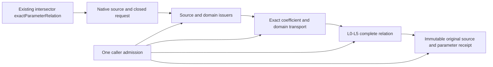

# Native Exact Relations

## Purpose and Scope
Parent: [CADGeometry](../DESIGN.md). Connect the independent L0-L5 foundation to
actual authored B-spline CS/SSI inputs in the existing production module. The
bounded input is finite, nonperiodic, positive-weight, source-valid, with exactly
one positive knot span per axis. No new production package or module is added.

## Responsibilities and Boundaries
This component owns source/domain protocol composition, checked exact coefficient
transport to L5 and retained query publication. SourceIssuer owns original
homogeneous laws; DomainIdentity owns whole support, request intersection and
chart correspondence. This consumer uses their receipts and does not clip the
same domains again. L5 owns equations and complete parameter topology. Public
`exactParameterRelation` requirements and the existing default intersectors return
a source-bound receipt; this explicit query accepts an L0 admission and lower
limits. Existing `intersectionResult` XYZ representatives, classification and
image/fiber publication are unchanged: parameter dimension does not establish
geometric dimension. The new query does not run the legacy solver or post-process
its roots. Unsupported source coverage is a typed failure, never a fallback.

## Related Designs
| Design | Relationship | Contract Used | Summary | Cautions |
|---|---|---|---|---|
| [Parent](../DESIGN.md) | parent | Native source types and public intersectors | Actual production integration | Preserve existing numerical APIs |
| [Algebra](../RationalBivariateAlgebra/DESIGN.md) | depends on | Original homogeneous curve/surface issuers | Exact stored coefficient authority | No fitted map |
| [L0](../RationalBivariateAlgebra/ExactScalar/DESIGN.md) | depends on | Scoped numeric admission, exact import | One exclusive caller ledger | Checked words-to-bytes |
| [L1](../RationalBivariateAlgebra/ExactPolynomial/DESIGN.md) | depends on | Checked ordered construction | Retain final canonical terms | Strict descending slot order and exact nonzero validation |
| [L5](../RationalBivariateAlgebra/ExactParametricRelation/DESIGN.md) | depends on | Compile, resolve and tuple membership | Complete parameter relation | Preserve denominator guards and all UV |
| [Domain and Identity](../OriginalDomainIdentity/DESIGN.md) | depends on | Source-verified covers and selected domain-bound laws | Retains original request/support and correspondence | Current preparation is nonperiodic single-span; full-family and generic injection migration remain open |
| [Source Issuance](../OriginalSourceIssuance/DESIGN.md) | depends on | Validated source binding and original local laws | Shares one source authority with DI | Image-only capabilities do not establish all UV |
| [Verification](../../../Tests/NativeExactRelationVerification/DESIGN.md) | test owner | Full production Core/Geometry | Public Native and WASI routes | No subset build as integration evidence |

## Architecture

## Contracts and Invariants
- Validate input and degree before indexed source access. Count every visited knot
  with the same admission; require one positive span on each entire native axis.
- Import original rational coefficients directly into one shared L2 coefficient
  field. Do not convert coefficients to Double or use tolerance to assert equality.
- Requested bounds are finite ordered stored binary64 values. Clip with exact
  ordering of those values. Out-of-domain selections become L2 empty domains;
  singleton and native closed endpoints remain closed. The original requested
  bounds remain retained even when the effective domain is empty.
- Preserve all selected tuples, closure/incidence and denominator guards. Empty
  success includes L5 full exclusion evidence, never just an empty point array.
- Return source snapshots by value. COW buffers and proof owners survive original
  input release/mutation. One field is shared by both map sources and result.
- All extraction, preparation, import, resolution, result reservation and final
  checkpoint use the same admission. No internal budget defaults/resets exist.
- Explicit caller degree/extension, L3 cell/root and L4 closure/piece/component
  ceilings remain independent. Preparation failure aborts the query atomically.

## Runtime Flows
Validate and admit source -> issue original homogeneous laws -> import exact laws
and clip domains -> compile CS/SSI relation -> resolve L3/L4 -> reserve complete
source-bound result -> terminal cancellation -> publish. Later membership queries
receive their own explicit admission and consume retained L5 receipts.

## State, Ownership, and Lifecycle
Only invocation-local arrays mutate. No shared mutable state, cache, unsafe pointer
or callback owner is introduced. Source snapshot providers validate stored Native data using the same caller
admission. No legacy homogeneous producer or second clipping authority is used.
All published owners and Sendable contracts are identical across targets.

## Failure, Concurrency, and Constraints
NativeExactRelationFailure preserves scalar, root, cell, L5 and original geometry
causes, plus explicit unsupported coverage and invalid request/degree failures.
No caught error is interpreted as empty, absence or applicability fallback.

### Protocol composition destination

The existing public intersector remains the composition root. It supplies matching
source/domain/law protocol conformers to generic preparation, preserving default
public behavior. The preparation implementation consumes the selected cover and
law; it neither reads knots to rederive whole coverage nor creates another binding.
Checked ring import remains its responsibility because the L5 ring has a distinct
owner. Consumer-specific degree/capability checks remain at this boundary.

At main5de88ec1 the helpers instantiate concrete Default issuers and enforce
nonperiodic single-span capability before preparation. The protocol injection and
broader cover-consumption changes described here are planned, not implemented.
On migration, a supported capability must be selected before solving; an admitted
failure aborts atomically. A finite-only consumer rejects a required symbolic
family rather than materializing a guessed window. Family-aware compilation and
publication must preserve every selected chart/lift and complete exclusion.

Only the existing exactParameterRelation path is currently DI-composed. Do not
infer that legacy intersectionResult, boundary clipping, self-contact or L6 image
publication consume DI receipts. Their required contracts and evidence are listed
in the [DI consumer matrix](../OriginalDomainIdentity/DESIGN.md#di4-consumer-acceptance-and-migration-boundary).

## Verification and Change Impact
Compile all production CADCore/CADGeometry sources together and execute public
CS/SSI weighted isolation, contact, continuous overlap, multiple UV, endpoint,
singleton, clipped empty, source lifetime and independent failure/cancel paths.
Use fixed Swift 6.4.0 and matching normal/Embedded SDKs. Reuse unchanged lower
proofs; verify optimized L5 composition in this integrated module. Changes to
coefficient/basis, domain or admission contracts require these owning tests.
This milestone is not completion of the full CS/SSI/seven requirement families.
The integrated checkpoint executes the shared public fixtures and unchanged
legacy public smoke in Native, normal WASM and Embedded WASM, plus the shared
fixtures under Address Sanitizer. All lanes compile the complete production
module inventories; [retained evidence](../../../Tests/NativeExactRelationVerification/VERIFICATION.md)
owns exact source hashes, compiler inputs, runtime logs and proof limits.

## Integration Findings Closed
The complete production build exposed the parent/L0 filename collision and the
old provenance writer's geometric root assumption. Both are handled by their
owning parent helpers and scalar-authority provenance record, with actual tests.
Legacy scalar error normalization is specified by the CADGeometry parent and
IntersectionAlgebra designs; no original mathematical result is substituted.
The full existing public portability proof remains required beside this new path.

## Homogeneous Preparation and Ordered Import
The parameter-only surface path selects its original nonperiodic positive knot
span and consumes OriginalRationalSurfaceHomogeneous. This immutable issuer owns
stored-source validation, native indices/domain and exact Cox-de Boor laws. It
does not prepare interval jets, derivatives, normals or silhouette equations.
The existing differential law uses this same issuer after validating its existing
native token, including periodic translations; its normal/view behavior remains.

Native import consumes the source issuer's four exact homogeneous polynomials
through L1's checked importing contract. No legacy dictionary conversion,
normal/silhouette preparation or separate source reconstruction is performed.

## Domain Receipt Composition
Native single-span/nonperiodic capability is unchanged. The adapter binds a
validated source, prepares its full domain, issues the exact request cover, and
consumes its selected domain-bound rational chart. The published result retains
both covers even for empty selection. Source depth is zero for these direct
snapshots; there is exactly one chart and no family/identity proof. Its fixed
transport word is identity (depth one) followed by inverse (depth two); this is
an adapter construction bound, not a replacement for any caller scalar depth.
All preparation still passes through caller work/storage/depth/cancel admission.

L3 owns its polynomial ring. Import across that distinct ring is an explicit
checked coefficient transfer; domain intervals are consumed as owner-backed
views, preserving emptiness and inclusion. No binary64 clipping is repeated.

Verification compiles the changed production consumer files against fresh
independent lower modules and validated unchanged Native DTO/intersector cache.
This proves this adapter composition, not a fresh build of the whole module.
The cached module premises and runtime artifact are checked against retained
full-production evidence before reuse. Legacy XYZ APIs remain outside this change.

## Verified Issuer Composition
Preparation retains the selected source-law receipt with the L5 map in
NativeExactPreparedMap. curveMap/surfaceMap also return the complete domain cover;
publication retains both covers and keeps both source laws alive through terminal
cancellation. DomainBoundBSplineChartIssuer remains the sole request-clipping
owner. The generic bound-map helper returns its already-issued law; it does not
issue or solve the same relation again. All work/storage/depth/cancel operations
use the existing caller admission. Original source and domain failure wrappers
remain explicit, while scalar admission causes preserve their existing public
classification. Independent source/domain composition verification reuses checked
lower modules and unchanged geometry DTOs without an upper-target build.
