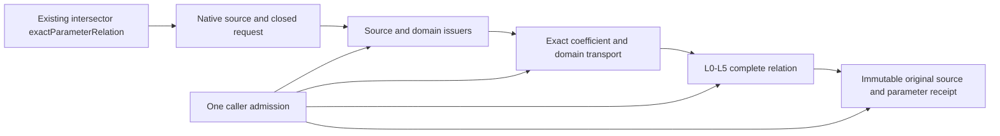
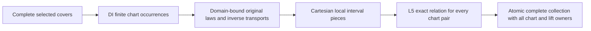
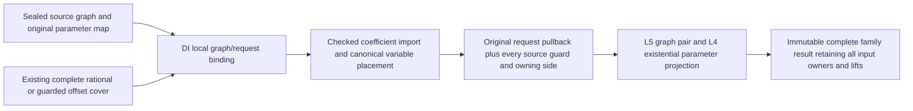

# Native Exact Relations

## Purpose and Scope
Parent: [CADGeometry](../DESIGN.md). Connect the independent L0-L5 foundation to
actual authored B-spline CS/SSI inputs in the existing production module. The
scalar input remains finite, nonperiodic, positive-weight and single-span. The
additive M2 collection accepts every selected positive Native span and finite
periodic lifts. No new production package or module is added.

## Responsibilities and Boundaries
This component owns source/domain protocol composition, checked exact coefficient
transport to L5 and retained query publication. SourceIssuer owns original
homogeneous laws; DomainIdentity owns whole support, request intersection and
chart correspondence. This consumer uses their receipts and does not clip the
same domains again. L5 owns equations and complete parameter topology. Public
`exactParameterRelation` requirements and the existing default intersectors return
a source-bound receipt; this explicit query accepts an L0 admission and lower
limits. Existing `intersectionResult` XYZ representatives, classification and
image/fiber publication are unchanged: parameter dimension does not establish
geometric dimension. The new query does not run the legacy solver or post-process
its roots. Unsupported source coverage is a typed failure, never a fallback.

## Related Designs
| Design | Relationship | Contract Used | Summary | Cautions |
|---|---|---|---|---|
| [Parent](../DESIGN.md) | parent | Native source types and public intersectors | Actual production integration | Preserve existing numerical APIs |
| [Algebra](../RationalBivariateAlgebra/DESIGN.md) | depends on | Original homogeneous curve/surface issuers | Exact stored coefficient authority | No fitted map |
| [L0](../RationalBivariateAlgebra/ExactScalar/DESIGN.md) | depends on | Scoped numeric admission, exact import | One exclusive caller ledger | Checked words-to-bytes |
| [L1](../RationalBivariateAlgebra/ExactPolynomial/DESIGN.md) | depends on | Checked ordered construction | Retain final canonical terms | Strict descending slot order and exact nonzero validation |
| [L5](../RationalBivariateAlgebra/ExactParametricRelation/DESIGN.md) | depends on | Compile, resolve and tuple membership | Complete parameter relation | Preserve denominator guards and all UV |
| [Domain and Identity](../OriginalDomainIdentity/DESIGN.md) | depends on | Source-verified covers and selected domain-bound laws | Retains original request/support and correspondence | Current preparation is nonperiodic single-span; full-family and generic injection migration remain open |
| [Source Issuance](../OriginalSourceIssuance/DESIGN.md) | depends on | Validated source binding and original local laws | Shares one source authority with DI | Image-only capabilities do not establish all UV |
| [Verification](../../../Tests/NativeExactRelationVerification/DESIGN.md) | test owner | Full production Core/Geometry | Public Native and WASI routes | No subset build as integration evidence |

## Architecture

## Contracts and Invariants
- Validate input and degree before indexed source access. Count every visited knot
  with the same admission; require one positive span on each entire native axis.
- Import original rational coefficients directly into one shared L2 coefficient
  field. Do not convert coefficients to Double or use tolerance to assert equality.
- Requested bounds are finite ordered stored binary64 values. Clip with exact
  ordering of those values. Out-of-domain selections become L2 empty domains;
  singleton and native closed endpoints remain closed. The original requested
  bounds remain retained even when the effective domain is empty.
- Preserve all selected tuples, closure/incidence and denominator guards. Empty
  success includes L5 full exclusion evidence, never just an empty point array.
- Return source snapshots by value. COW buffers and proof owners survive original
  input release/mutation. One field is shared by both map sources and result.
- All extraction, preparation, import, resolution, result reservation and final
  checkpoint use the same admission. No internal budget defaults/resets exist.
- Explicit caller degree/extension, L3 cell/root and L4 closure/piece/component
  ceilings remain independent. Preparation failure aborts the query atomically.

## Runtime Flows
Validate and admit source -> issue original homogeneous laws -> import exact laws
and clip domains -> compile CS/SSI relation -> resolve L3/L4 -> reserve complete
source-bound result -> terminal cancellation -> publish. Later membership queries
receive their own explicit admission and consume retained L5 receipts.

## State, Ownership, and Lifecycle
Only invocation-local arrays mutate. No shared mutable state, cache, unsafe pointer
or callback owner is introduced. Source snapshot providers validate stored Native data using the same caller
admission. No legacy homogeneous producer or second clipping authority is used.
All published owners and Sendable contracts are identical across targets.

## Failure, Concurrency, and Constraints
NativeExactRelationFailure preserves scalar, root, cell, L5 and original geometry
causes, plus explicit unsupported coverage and invalid request/degree failures.
No caught error is interpreted as empty, absence or applicability fallback.

### Protocol composition destination

The existing public intersector remains the composition root. It supplies matching
source/domain/law protocol conformers to generic preparation, preserving default
public behavior. The preparation implementation consumes the selected cover and
law; it neither reads knots to rederive whole coverage nor creates another binding.
Checked ring import remains its responsibility because the L5 ring has a distinct
owner. Consumer-specific degree/capability checks remain at this boundary.

At main5de88ec1 the helpers instantiate concrete Default issuers and enforce
nonperiodic single-span capability before preparation. The protocol injection and
broader cover-consumption changes described here are planned, not implemented.
On migration, a supported capability must be selected before solving; an admitted
failure aborts atomically. A finite-only consumer rejects a required symbolic
family rather than materializing a guessed window. Family-aware compilation and
publication must preserve every selected chart/lift and complete exclusion.

Only the existing exactParameterRelation path is currently DI-composed. Do not
infer that legacy intersectionResult, boundary clipping, self-contact or L6 image
publication consume DI receipts. Their required contracts and evidence are listed
in the [DI consumer matrix](../OriginalDomainIdentity/DESIGN.md#di4-consumer-acceptance-and-migration-boundary).

## Verification and Change Impact
Compile all production CADCore/CADGeometry sources together and execute public
CS/SSI weighted isolation, contact, continuous overlap, multiple UV, endpoint,
singleton, clipped empty, source lifetime and independent failure/cancel paths.
Use fixed Swift 6.4.0 and matching normal/Embedded SDKs. Reuse unchanged lower
proofs; verify optimized L5 composition in this integrated module. Changes to
coefficient/basis, domain or admission contracts require these owning tests.
This milestone is not completion of the full CS/SSI/seven requirement families.
The integrated checkpoint executes the shared public fixtures and unchanged
legacy public smoke in Native, normal WASM and Embedded WASM, plus the shared
fixtures under Address Sanitizer. All lanes compile the complete production
module inventories; [retained evidence](../../../Tests/NativeExactRelationVerification/VERIFICATION.md)
owns exact source hashes, compiler inputs, runtime logs and proof limits.

## Integration Findings Closed
The complete production build exposed the parent/L0 filename collision and the
old provenance writer's geometric root assumption. Both are handled by their
owning parent helpers and scalar-authority provenance record, with actual tests.
Legacy scalar error normalization is specified by the CADGeometry parent and
IntersectionAlgebra designs; no original mathematical result is substituted.
The full existing public portability proof remains required beside this new path.

## Homogeneous Preparation and Ordered Import
The parameter-only surface path selects its original nonperiodic positive knot
span and consumes OriginalRationalSurfaceHomogeneous. This immutable issuer owns
stored-source validation, native indices/domain and exact Cox-de Boor laws. It
does not prepare interval jets, derivatives, normals or silhouette equations.
The existing differential law uses this same issuer after validating its existing
native token, including periodic translations; its normal/view behavior remains.

Native import consumes the source issuer's four exact homogeneous polynomials
through L1's checked importing contract. No legacy dictionary conversion,
normal/silhouette preparation or separate source reconstruction is performed.

## Domain Receipt Composition
Native single-span/nonperiodic capability is unchanged. The adapter binds a
validated source, prepares its full domain, issues the exact request cover, and
consumes its selected domain-bound rational chart. The published result retains
both covers even for empty selection. Source depth is zero for these direct
snapshots; there is exactly one chart and no family/identity proof. Its fixed
transport word is identity (depth one) followed by inverse (depth two); this is
an adapter construction bound, not a replacement for any caller scalar depth.
All preparation still passes through caller work/storage/depth/cancel admission.

L3 owns its polynomial ring. Import across that distinct ring is an explicit
checked coefficient transfer; domain intervals are consumed as owner-backed
views, preserving emptiness and inclusion. No binary64 clipping is repeated.

Verification compiles the changed production consumer files against fresh
independent lower modules and validated unchanged Native DTO/intersector cache.
This proves this adapter composition, not a fresh build of the whole module.
The cached module premises and runtime artifact are checked against retained
full-production evidence before reuse. Legacy XYZ APIs remain outside this change.

## Verified Issuer Composition
Preparation retains the selected source-law receipt with the L5 map in
NativeExactPreparedMap. curveMap/surfaceMap also return the complete domain cover;
publication retains both covers and keeps both source laws alive through terminal
cancellation. DomainBoundBSplineChartIssuer remains the sole request-clipping
owner. The generic bound-map helper returns its already-issued law; it does not
issue or solve the same relation again. All work/storage/depth/cancel operations
use the existing caller admission. Original source and domain failure wrappers
remain explicit, while scalar admission causes preserve their existing public
classification. Independent source/domain composition verification reuses checked
lower modules and unchanged geometry DTOs without an upper-target build.

## Planned Composition Consumer Migration

Status: finite source/domain map binding, complete pair aggregation and exact original
TUV extraction are implemented. Existing public family receipt migration remains open.
Generic internal composition consumes family source/domain receipts. Existing rational Native public types remain unchanged; algebraic families use their retained original scalar Base.
The [common consumer handoff](../OriginalSourceIssuance/DESIGN.md#composition-consumer-handoff-design)
owns coefficient transport, complete-cover, publication and migration acceptance.

### Complete Issued-Pair Resolution

`OriginalIssuedRelationResolving` owns aggregation of every selected map pair.
It calls the existing L5 compiler/resolver once per pair under the same admission;
it retains both complete covers and all pair receipts. Discrete mode rejects any
positive-dimensional or mixed result before output. Pair and isolated-cell ceilings
are checked with overflow-safe counts. Empty output retains full domain exclusion
or all solved pair exclusions. A failed pair invalidates publication; no alternate
solver is invoked. Exact tuple reconciliation and public numerical/receipt assembly
remain owned by the consuming publisher, and are not established by this aggregate.

The isolated CS tuple port consumes the retained aggregate without resolving any
pair again. It samples only certified zero-dimensional cells, evaluates each issued
source parameter correspondence in the retained selected-root field, and transports
one flat batch of original T/U/V values into the L0 original field. Exact tuple
ordering coalesces only identical original T/U/V triples and retains every chart/cell
incidence. In-place heap ordering allocates no implicit sorting scratch; comparisons
and heap visits consume the same admission. Distinct UV fibers remain distinct. The immutable point owner retains the
complete relation and scalar transfer; numerical XYZ/classification and existing
public family receipts remain responsibilities of the consuming publisher.

Tuple extraction forwards the caller admission through the existing scoped proof
tracker, admits retained effective-domain/component/source-law proof depth, and stores both reached
depth axes on its immutable result. Later parameter access inherits this depth even
when an original coordinate simplifies to a depth-zero rational scalar.

The independent consumer proof executes weighted issued-map construction, complete
domain exclusion, mixed-result rejection, selected algebraic T, native seam
reconciliation and distinct UV at one XYZ. Exact work/storage and both depth axes,
result ceilings and cancellation are exercised on the tuple consumer. These tests
prove the issued contract; they do not establish existing public CS dispatch or
family receipt compatibility.

## M2 Finite Family Publication Contract

The additive `exactParameterRelations` entry consumes source-bound B-spline
covers, retaining their original support, request, effective selection and chart
family. The scalar single-map API remains compatible. The family entry admits
all positive Native spans and exact finite selections over independently periodic
axes. `OriginalFiniteChartFamilyQuerying.selectedMembers` owns exact cycle
enumeration; the consumer never infers periods or clips original support.

Each occurrence is prepared once. Each disconnected local axis interval produces
an exact Cartesian map piece retaining open/closed/singleton boundaries. Every
pair is compiled and resolved once, including complete empty relation evidence.
The collection retains the bound laws and original/local correspondences beside
each TUV or UVUV relation. Equal XYZ, adjacent sides and closed periodic seam
lifts are never deduplicated. Empty effective source selection returns an empty
collection with both complete covers retained. Unbounded selected periodic
families fail explicitly at DI enumeration, rather than inventing a window.

All enumeration, chart issuance, map import, Cartesian expansion, pair resolution
and publication use one caller admission, caller domain limits and unchanged L3/L4
limits. Caller `maximumMaps` bounds each source preparation and `maximumPairs`
bounds their complete product. L3/L4 ceilings apply to each distinct relation;
the noncopyable admission owns aggregate work, storage, depth and cancellation. Checked counting precedes allocation; partial collections cannot escape
on failure or cancellation. No derivative, normal, legacy solver or L0-L5 change
is needed. Verification builds the actual production CADCore/CADGeometry graph because the
Native surface DTO names the original span/jet owner in its signature. It executes
the new public family entry on actual source snapshots. No other CAD targets are
required. Prior scalar/lower evidence is retained on unchanged premises.

## Issued graph and DI connection (B3-B4)

The additive graph consumer ports compile sealed domain-bound source graphs and
resolve complete finite graph families. Existing issued-map APIs remain unchanged.
No new production module, solver or geometric publisher is introduced.

| Owner | Input | Output and guarantee |
|---|---|---|
| DI | Source graph, original request, same limits/admission | Sealed local binding; source provenance and inherited depth, no whole-cover claim |
| Graph compiler | Local binding, explicit L2 field | One canonical graph with parameters before auxiliaries; exact coefficient import, source guards, chart boundaries and forward request pullback |
| Family preparers | Existing complete issued rational/guarded offset cover | Every required chart compiled once; empty selection retains its complete cover |
| Family resolver | Two complete preparations, query kind/limits | Every chart pair resolved once; projected parameter topology and all lifted correspondence, no partial publication |

The compiler accepts OriginalExactScalarDomain coefficients through checked L2
import. Physical-angle fields and XYZ-only implicit receipts do not satisfy this
capability; protocol conformance is not a coefficient or UV compatibility proof.
Each original homogeneous law and guard is imported once with checked coordinate
placement. Requested interval membership of N/D is encoded by D!=0 and exact
signs of (N-bound*D)*D, so negative denominators and nonlinear/many-to-one maps are
handled without sign assumptions or inverse maps. Axis intervals are disjoined;
axis conditions are conjoined. Infinite ends add no invented finite bound.
Local source support and its owning upper sides are independent solver domains.
Auxiliary coordinates remain unbounded unless the original guards restrict them.

Constant guards are folded only by exact coefficient sign. When the compiler
proves N == D*localParameter and the requested axis has one interval, its
intersection with source support is represented directly in the solver domain;
disjoint support becomes a false predicate. Other maps and interval unions keep
the forward predicates above. The existing scoped admission tracks all reached
decision depths even when these proofs remove a polynomial or predicate.

A prepared graph retains the original DI binding and source receipt, reached
proof depth and L2 field. Family results retain both full covers, every prepared
graph, each exact L5 result and all original parameter maps. Local tuple labels
are not relabeled authored coordinates; the retained forward correspondence is
the authority. Cross-chart structural identity and numerical XYZ publication are
outside this foundation. Auxiliary lift multiplicity is not parameter dimension.

Preparation and resolution use one caller admission, with no budget reset or
legacy solver fallback. Caller maximumGraphs/maximumPairs and existing L3/L4
limits remain separate. Source/DI limits and retained depths are re-admitted on
reuse, including empty results. Checked products precede allocations. Every
unresolved chart/pair or terminal cancellation aborts the whole publication.

Verification: [OriginalGraphRelationVerification](../../../Tests/OriginalGraphRelationVerification/DESIGN.md)
executes actual source issuers, existing DI covers, these public consumer ports and
L5 projection on Native/ASAN/matching ordinary and Embedded WASM. It checks original
TUV/UVUV membership, positive offset branch, nonowning chart sides, exact request
pullback (including negative denominator and nonlinear correspondence), complete
empty/lifetime and independent work/storage/depth/source/chart/pair/cancel failures.
Unchanged lower evidence is reused. Main integration checks the exact verified
inputs against latest main in a separate worktree. Full-seven completion and new
shape publication remain separate.

`OriginalIssuedGraphRelationOwning` exposes immutable kind/pair requirements while
retaining the concrete family/source/DI value. Upper exact point values keep this
owner after extraction from a result. This additive protocol changes no relation
construction or lower solve; it avoids a point dropping authored source evidence
when its containing publication value leaves scope.

### Issued graph parameter refinement

`OriginalIssuedGraphParameterRefining` consumes a concrete source/DI-bound issued
collection, a checked pair ordinal, and a predicate over that pair's complete
solver layout. `DefaultOriginalIssuedGraphParameterRefiner` admits the retained
source/domain/L5 proof and refines `relation.projection.original` through L4's
`refinePullback`. Parameters and both auxiliary suffixes remain distinct; a
predicate with a different arity is rejected; L4 validates coefficient-field
compatibility. No original
intersection equations are solved again and no parameter inverse is inferred.

The immutable `OriginalIssuedGraphParameterRefinement` retains the entire issued
collection, pair ordinal and pullback. Each included refined cell has L4's raw
lifted-cell ordinal; excluded cells retain -1 and complete exclusion evidence.
Membership accepts full lifted coordinates with an independent caller admission.
All source/proof admission, coordinate-map/output storage, work and terminal
cancellation use that admission. COW copies share the original buffers. There is
no shared mutable state or target-specific isolation/Sendable branch.

This port owns parameter refinement only. Boundary consumers must separately
prove face binding and compile exact material/pcurve conditions; self consumers
must compile only checked scoped structural identity exclusions. Arbitrary input
predicates do not certify material membership, structural identity or embedding.
Projected XYZ/image/fiber publication remains the upper consumer's responsibility.

Verification uses the production component in the independent graph proof target:
a guarded offset source supplies a real auxiliary coordinate; conditions preserve
its positive branch, reject a negative witness and produce complete empty
refinements. A continuous CS component is split at an exact nonbinary boundary.
Raw correspondence, source lifetime, invalid arity, independent resource
limits and cancellation at entry and final publication are checked. Existing
lower source/toolchain/product receipts must match before cached reuse; independent
component proof does not replace full production integration evidence.
