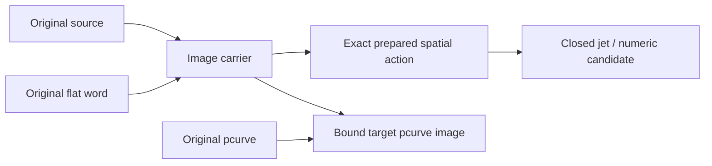

# Original Affine Image

## Purpose and Scope

This Geometry child retains original curve, surface and pcurve images under a
flat original affine operation word. Parent: [Geometry](../DESIGN.md). No children.

## Responsibilities and Boundaries

The carrier owns the original spatial image binding and unchanged native chart.
The [word producer](../OriginalAffineOperationWord/DESIGN.md) owns exact forward,
inverse and normalized-frame action. Representative matrices are not stored.

## Related Designs

| Design | Relationship | Contract Used | Summary | Cautions |
|---|---|---|---|---|
| [Geometry](../DESIGN.md) | parent | Family dispatch | Composes original source laws | Exhaustive dispatch required |
| [Word](../OriginalAffineOperationWord/DESIGN.md) | depends on | Prepared exact action | Flat factors with rational/ordered-field coefficients | Factor count is not source depth |
| [Conversion](../GeometryConversion/DESIGN.md) | used by | Closed source jets | Transforms each original derivative field | No native join smoothness from hull |
| [Parameter image](../ParameterImage/DESIGN.md) | coordinates with | Exact jet word transport | Shares bounded transform arithmetic | UV gains remain independent |

## Architecture

## Contracts and Invariants

Directed pcurve derivatives scale componentwise by the first, second and third
powers of the original fraction gain. Third-order helpers remain module-internal;
no package API exposes an internal derivative carrier. Taylor vector assembly
propagates its throwing validation. Optional physical metric admission keeps
short-circuit evaluation and propagates the original metric proof failure.

Curve native parameters and surface native UV remain unchanged. One image adds
one original source descendant; its operation factors do not add source depth.
The immutable source and operation word define value identity. Prepared caches
are excluded. Translation applies only to spatial order zero. Original pcurve
images retain the hosting SurfaceLift and exact target source binding, directed
fraction endpoints, and unchanged original UV law. Restricting a directed chart
requires exactly representable composed fraction endpoints; numerical endpoint
rounding cannot replace the retained original traversal. An unavailable exact
fraction carrier produces an explicit precision failure. A model-space lift consumes
the source lift before the original word, avoiding rounded UV reconstruction.

Original normal fields and station cones use the prepared exact cofactor action,
including its orientation under reflection. Collapsed boundary positions retain
the complete original source position enclosure through the exact word. Physical
representatives never replace the source law; their admitted deviation remains
part of the receipt.

A hosted curve/support/pcurve using the identical original operation word
recurses to the original source correspondence after paid structural comparison.
An exact zero source residual remains zero; a nonzero certified source residual
is transported by the exact word linear norm upper bound on the same caller
work/byte ledger. This preserves the original junction acceptance.

A prepared differential transport retains the exact word's rigorous linear
norm and cofactor condition bounds once for a composing tessellation request.
It transports the seven whole-panel derivative upper bounds without changing
native UV. Condition preparation has its own caller-admitted failure; numerical
point evaluation does not require finite differential condition bounds.

## State, Ownership, and Lifecycle

COW source values and immutable word caches remain retained with the image.
Query callbacks are borrowed lexically and are never stored in source values.

## Failure, Concurrency, and Constraints

Word revalidation reuses its retained original algebra-depth capability unless
an explicit composing algebra ceiling is supplied. Native callers provide
separate algebra-depth and curve-subdivision-depth keys. Neither is inferred
from source nesting or the other depth.

Bounded preparation/query forwards composing work, retained bytes, span,
subdivision and source-depth limits. Common numerical convenience retains an
explicit cancellation-only, unbounded legacy policy and supplies no cumulative
caller resource proof. Missing family routing is typed incomplete, never a
rounded affine fallback. The word action may refuse unresolved exact arithmetic
under the caller allowance. All carriers remain Hashable and Sendable on every
target; Native codecs are separately guarded.

## Verification and Change Impact

Source-only phase: implementation is not behavioral evidence. Required later
verification covers long forward/inverse words, reflections, near cancellation,
normalized STEP frames, original D0-Dn action, model-space pcurve shortcut,
resource exhaustion/cancellation, strict Native round trips and all target
exhaustive dispatch. Parent/Topology/Exchange/Kernel consumers must route the new
families before source gates close.

Rigid placement of an original affine-word image appends the authored rigid columns as one forward operation to the retained word. The local source and its native parameters remain unchanged; the appended immutable word retains its algebra capability and exact action instead of becoming a spatial wrapper or rounded composed matrix. Legacy placement uses the cancellation-only numerical policy.

Original ideal primitive lengths under a word are admitted in physical coordinates. For exact similarities, every radius threshold uses the exact Gram metric against the unchanged target distance. Only after that proof succeeds, local source evaluation may use a smaller distance bound derived from positive authored radii; angle and relative tolerances remain unchanged. This local calculation policy does not establish target acceptance. Exact torus clearance compares the original rational radius difference before squaring. General nonsimilarity primitive metrics remain explicitly incomplete until their complete physical inequalities are available. Source validation, word revalidation and metric arithmetic use the same caller work and byte allowance.

General primitive metric admission uses exact shifted Gram positivity for the original chart axes with raw lengths kept separate until exact arithmetic. Circle/cylinder radial planes and ellipse semiaxes use two axes; sphere radius uses three coordinate axes. A torus admits its major radial loop on two axes, its tube radius on all three original tube axes, and its central clearance from the exact original major-minus-minor difference projected perpendicular to the transformed torus axis. The latter uses the exact Gram Schur complement so shear cannot overstate distance from the axis. These are physical source inequalities against the unchanged target distance, not a norm-based sufficient substitute. Existing binary chart basis vectors remain the original basis authority for this adapter.

### Original Primitive Coefficients Before Harmonics

Ideal circular curve images admit finite positive original radii structurally, retain the original dimensionless frame admission and prove physical principal lengths with the exact word metric. Preparation applies the exact word to each original direction and original radius as separate scalar operands before any harmonic interval multiplication. The retained world center and cosine/sine coefficients are reused for numeric points, closed derivatives and requested-order jets. Thus a subnormal local radius never requires an impossible smaller binary distance tolerance, and cannot underflow in local trigonometric arithmetic before a large world scale. Source identity remains the raw primitive and operation word; derived coefficient bounds are excluded. Surface primitive adapters must consume the corresponding coefficient contract before their tiny-radius source domain closes.

Original cylinder, sphere and torus word images retain exact world-scaled primitive coefficients before canonical U/V harmonics. Structural finite-positive radii and original frame admission precede the exact physical principal-length/torus clearance tests. Derived center, radial and axial coefficient bounds are shared by position and requested-order derivative queries, with physical tolerance metadata. Their point candidates are midpoints of original closed bounds. No subnormal local calculation tolerance or binary radius-times-direction product supplies authority.

For harmonic primitive normals the adapter removes only the source-proved positive radius/angular factors. The remaining raw source-frame tangent/normal gauge is transported by the exact cofactor action and normalized in physical coordinates. Sphere uses its canonical radial gauge through closed poles; cylinder/torus retain the actual source-frame cross law. No squared subnormal radius or rounded transformed matrix is required.

Generic word-image construction forwards the same exact caller into descendant validation: source visits consume work, retained canonical UInt32 words convert checked actual bytes back into that caller, and independent algebra admission remains unchanged. Preparing image coefficient buffers does not replace descendant allocation accounting.

The harmonic coefficient preparation admits an unchanged UV chart wrapped by
one original spatial image. It composes the image's authored affine factor
before the retained outer operation word using exact original factors. Primitive
radius products, physical metrics and the normal cofactor gauge consume that
same effective word. A changed gain, offset or axis permutation does not enter
this spatial-only adapter. The normal-gauge receipt exposes the original binary
chart basis, raw dimensions, symbolic phase descriptors and effective word;
interval world coefficients never become exact algebraic source coefficients.

The same harmonic surface coefficient producer supports original cone longitude.
It retains the physical half-angle independently and multiplies its certified
sine/cosine by the authored scalar V jet before spatial action. Both nappes and
the apex position remain in the original law. Cone normal gauges retain V sign
and vanish at the apex; regular normal queries do not manufacture an apex normal.
Physical sphere latitude admission delegates to the retained original angular
transport. Exact support/period/fiber authority belongs to
[OriginalSourceIssuance](../OriginalSourceIssuance/DESIGN.md); numerical enclosures
never substitute for those exact source values. General cone silhouette relation
consumption remains an explicit M7 capability refusal.
