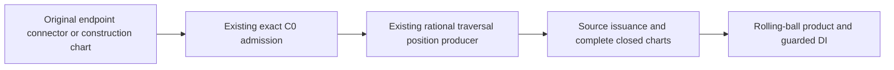

# Original Coons

## Purpose and Scope

This component retains a Coons surface as four original directed curve
traversals. Its parent is [CADGeometry](../DESIGN.md). Its child is
[Original Endpoint Connector](EndpointConnector/DESIGN.md).
Its [Original Plane Derivatives](PlaneDerivatives/DESIGN.md) child owns exact
generated endpoint and transverse-field projections for strict plane targets.
Persistent original laws, shared boundaries and closed third-order jets are its
scope. A rounded rational tensor image is a separate construction representation.

## Responsibilities and Boundaries

The component owns the immutable four-boundary source, original corner incidence
admission, Coons product law and structural shared-boundary authority. Traversal
endpoints and their prepared original curve law belong to Original Root Span.
This component also owns caller-paid original surface embedding and side-pair
separation consumed by Loft. Finite-face cap contact classification remains
with its topology owner. Surface publication cannot assume embedding from the
existence of the source value.

## Related Designs

| Design | Relationship | Contract Used | Summary | Cautions |
|---|---|---|---|---|
| [CADGeometry](../DESIGN.md) | parent | Procedural original-source publication | Owns dispatch and embedding composition | All consuming dispatches must retain this source |
| [Original Root Span](../OriginalRootSpan/DESIGN.md) | depends on | Immutable directed traversal and closed original D0–D3 | Retains native and algebraic endpoints | No image parameter is inferred as a native endpoint |
| [Loft](../../CADModeling/Loft/DESIGN.md) | used by | Canonical shared connector and four-boundary source | Publishes adjacent original surface sides | Same boundary authority must be reused by both charts |
| [Original Coons Intersection Sources](../OriginalCoonsIntersectionSources/DESIGN.md) | depends on / used by | Shared original homogeneous position-cell issuer | Supplies the same exact position laws to differential and intersection consumers | Differential stripping remains owned here; intersection admission is bounded separately |

## Architecture

```text
four original directed traversals + caller allowance
    -> original corner incidence admission
    -> immutable original Coons source
        -> closed boundary jets -> Coons product jet
        -> structural boundary receipt -> adjacent seam reconciliation
    -> original procedural surface dispatch and whole embedding admission
```

## Contracts and Invariants

Original traversal C0 admission has a source-bound entry that accepts exact
directed endpoints and immutable source, geometric and algebraic capabilities.
Already prepared callers need no additional RootSpan or numeric preparation to
reuse this issuer. It assumes original structural/source validation and retains
the same exact join law as the RootSpan adapter. Positional continuity grants
neither a smooth join nor a continuous normal; unresolved implicit/lift joins
remain explicit non-admission.

The parameter domain is the original normalized closed square. Horizontal
boundaries traverse U and vertical boundaries traverse V. Every original corner
must have exact original incidence, rather than distance-tolerance snapping.
Authored rational endpoints are evaluated from their original homogeneous basis
and exact parameter-image gains and spatial transforms. Corner equality is
exact equality of all three reduced rational coordinates, including unequal
degree and knot bases. A native algebraic endpoint is compared with a rational
endpoint by exact signs of all three original homogeneous position residuals
at the retained root, under its traversal's independent retained algebra limit. No
new root isolation or default depth is introduced. Two native algebraic
endpoints transport all three original homogeneous N/W coordinates through
their retained parameter roots and compare each resulting exact real value.
Projected coordinate root isolation remains derived, caller-paid and causally
depth-bound under that scalar algebra capability, independently of geometric
subdivision. Generated connector endpoints first descend to their immutable
original endpoint traversal and side. Each descent decrements the incoming
source capability and intersects it with the retained child capability; no
new preparation, root isolation or source-depth allowance is created. Rational
coordinate and algebraic-root comparisons then consume those original endpoints.
Persistent parameter-law charts can prove the same endpoint recipe by exact
source equality, original labels/law and exact directed endpoint fraction.
Authored affine endpoint labels are compared as exact rational source
expressions; unrestricted ideal conic endpoint fractions zero/one retain the
original authored angle or hyperbolic label. Complete source payloads are paid
before structural comparison. Unequal recipes mean no proof, not unequal
positions.
Corner values retain their original endpoint evaluation
authority. The source
law is the sum of the two boundary interpolants minus the original corner
bilinear interpolant. Exact boundary values consume the corresponding retained
curve directly while derivative fields retain the whole Coons product law.
Shared-boundary identity first compares retained traversal source and directed
endpoint authority. For authored native traversals inside their original
base knot cover, including periodic sources whose seam C0 law was admitted,
differing
bases are reconciled over the exact normalized union of their original knot
partitions. On every positive interval, all three original homogeneous
cross-weight residual polynomials must vanish identically after the exact
original directed affine parameter substitution. Constant weight scaling is
therefore admissible without copying or renormalizing source controls. An
unavailable source parameter law remains explicit failure. It never reconstructs
controls from a rounded tensor image. A periodic lift outside the base cover
requires its selected original-cycle recipe; this producer never infers a
cycle by rounding a translated endpoint or an interval hull.
The package normalized rational traversal producer exposes those same
immutable cells to final edge-continuity consumers. Each cell retains exact
normalized lower/upper parameters and original homogeneous XYZ/W polynomials;
the caller supplies the original directed traversal and cumulative admission.
Unavailable nonlinear or algebraic parameter laws remain typed failure. These
cells describe position authority and do not themselves prove a supporting
plane, G1/G2 matching or complete regularity.
All source preparation, arithmetic, retained storage and lower closed queries
charge the same caller allowance before work. Tolerance binding is immutable;
no private budget, reset or discount is introduced.

The package native positional-continuity issuer accepts an already validated
original B-spline surface and returns an immutable source/tolerance receipt.
It proves every original full-multiplicity join and periodic seam by exact
homogeneous XYZ cross-weight identity over all transverse native spans.
Its source is flat and its proof uses no root isolation; source and coefficient
depth zero suffice independently of geometric subdivision. It consumes the
existing caller's exact-work, cell and UInt32-word storage admission. Receipt
rebinding pays both complete source payloads before equality comparison.
This receipt guarantees C0 only. Offset-normal continuity, C1/C2 matching and
injectivity require their separate original-source proofs.
Original physical-angle circular boundaries retain their admitted symbolic
phase transport for C0 admission. The transport is an affine continuous real
phase, including an exact full-turn expression; its continuity does not make
its phase an intrinsic binary period or a rational native seam coordinate.

Bounded embedding, pair separation and boundary-contact entry points accept an
explicit remaining source depth independently from every subdivision ceiling.
The legacy facade retains the original Loft source policy of twenty levels.
Subdivision zero remains a legal request and never changes source recursion.
A flat native source remains legal with source depth zero. Prepared sources and
all subsequent queries retain the same explicit source ceiling and caller.

Bounded Taylor queries retain the caller's original span and source-depth caps.
Their explicit storage stride translates lower native byte reservations to the
composing owner's storage units before each allocation. The Coons scalar
product, sum, axis transpose, corner lift and boundary-value replacement all
forward the same byte admission; vector composition does not bypass scalar
reservations. Corner preparation uses canonical UInt32 words and retains at
least its historical storage admission, augmented by actual value strides.
Piecewise first-order queries use each retained boundary's D0/D1 owning hull,
with the same byte reservation path; they do not require C1 or substitute a
higher-order closed Taylor proof across a C0 join. The embedding consumer
selects this bounded first-order path for original Coons charts.
Legacy callback queries remain available; a bounded consumer must supply its
same storage callback rather than treating legacy work-only queries as a
storage receipt.

Authored rational boundary partitions additionally retain parameter-preserving
spatial words with original rational forward/inverse factors. Their immutable
exact matrix acts on every original homogeneous polynomial before knot-union
identity and stationary quotient proofs. Normalized algebraic coefficients
require an ordered-field boundary law and cannot be replaced by interval or
rounded matrix values. Original source recursion and all factor scans remain
caller-paid under the retained traversal capability.

Embedding cell and subdivision queues reserve typed payload storage before
materialization. Existing numeric precharges remain a lower reservation bound;
exact strides increase reservations when needed. First-order monotonicity proofs
borrow one or two stack values directly rather than materializing a temporary
jet array for every cell. They retain the same ordered proof inequalities and
work debits.
The package first-order enclosure exposes immutable axis value, derivativeU
and derivativeV bounds to final continuity consumers. It remains a closed
original field enclosure, not a C1 join, regularity or continuity certificate.

### Whole Original Embedding and Pair Separation

An immutable original preparation is retained per invocation. Every closed
cell and arithmetic/storage operation uses the caller's cumulative allowance.
A fixed spatial two-coordinate projection is selected from candidate derivative
midpoints. Success requires the entire original projected Jacobian's symmetric
part to be positive definite. This proves strong monotonicity on the whole
convex parameter rectangle; midpoints select the projection and never admit a
surface. Unresolved original cells subdivide under the original local cap.
All admitted cells are compared: a projected monotone proof on their complete
parameter hull or separated original spatial enclosures proves injectivity;
otherwise the complete pair domain subdivides under the original pair cap.
An unresolved leaf fails explicitly. No converted tensor image authorizes the
original surface. Native full-multiplicity joins and periodic seams first
compare all three exact original homogeneous cross-weight numerators over
every positive transverse knot interval. Ordinary lower-multiplicity knots
retain their structural C0 continuity. A whole derivative hull cannot admit
a discontinuous position jump. Original Coons retains separately admitted
piecewise-C0 boundary authority. At full native multiplicity, all three exact
one-sided original positions must agree; ordinary native knot multiplicity
provides structural C0. Its embedding-only D0/D1 query composes the four
prepared piecewise first derivatives directly, without fabricating higher
jets or asserting C1 at a native join. Spatial rigid, affine and original-word images inherit the unchanged native
parameter traversal C0 law. Authored parameter images compose both endpoints
with the exact original gain and offset before deciding native join membership.
The original retained source-depth capability bounds this descent; a new
traversal is not prepared and no higher continuity is inferred. Generated
endpoint connectors inherit C0 from their retained construction traversal:
their correction is a continuous polynomial with constant original endpoint
expressions. This descent consumes one source level and never treats the
construction endpoint coordinates as original endpoint incidence. Persistent
normalized construction charts consume the original exact directed fractions.
Affine charts substitute those exact fractions into the original endpoint
labels before checking C0; ideal circular and hyperbolic charts preserve their
original analytic positional continuity. The same source descent is charged
and the full first-order query still checks every finite chart bound. Other source
families retain their existing requested-order authority until their C0 receipt
is available.

For two surfaces, only original spatial separation excludes contact. Nominated
shared seams require exact original directed traversal identity. Their charts
are glued along that same source law and use a common strong-monotonicity proof.
Nominated corners require original endpoint identity and strict outward cone
separation. No small box or sampled distance exempts a contact neighborhood.
The rational native atlas is retained once for each Coons side. Shared seams
orient its exact quotient tangent fields into one common free/transverse chart.
One fixed projection must have consistent strict principal-minor signs on
every original cell of both touching hulls; removed own-axis factors are
positive in each source interior. Shared-corner cones likewise use all original
quotient tangent fields with inward signs, and require one strictly separating
plane for both complete cones. Candidate axes never authorize either proof.
Mixed native/Coons pairs issue the same quotient field contract from each
selected original native homogeneous owner. Native tangent numerators are
derived directly from the original rational derivative law, with its own
exact normalized source boundaries; a Cartesian tensor image is not used.
Only admitted original C0 sources and exact shared seam/corner incidence can
consume these fields; the quotient fields are not physical derivative jets.

A structural bilinear image may be issued only when every retained boundary
is exactly the two-control-point, unit-weight, clamped degree-one source on
its original authored [0,1] traversal. The four original corner identities
then prove the tensor image's complete Coons law without coefficient products,
degree conversion or division. This exact special case uses caller-paid exact rational convex-planar
admission. All four projected turns have the same nonzero orientation except
at most one collinear corner; all original vertices are distinct and exactly
coplanar. The bilinear Jacobian determinant is affine over the square and has
positive interior orientation, so a stationary corner does not erase its
whole injective chart. Pair support planes use exact original vertex projections.
A touching support set must be wholly contained in an already proven shared
original edge or corner; separated supports exclude all contact. Other tensor
images remain candidates.

## Runtime Flows

Construction admits all four corner incidences before retaining a surface.
Closed queries admit the original square and source tolerance, evaluate all
four prepared boundary laws and compose D0–D3 with normalized parameter jets.
Point publication checks the original value enclosure's error before returning
its midpoint. A shared edge retains the same original boundary on both charts.

## State, Ownership, and Lifecycle

Source traversals and corner authority are immutable values. Their prepared
original owners remain alive with the surface. There is no target-dependent
mutable state, unsafe borrow or shared cache.

## Failure, Concurrency, and Constraints

Invalid domains, mismatched original corners, unavailable exact endpoint
incidence, nonfinite jets, exhausted caller allowances and cancellation produce
explicit failures. An unavailable general corner producer remains a marked
source gap. A tensor image or a successful local jet cannot publish a globally
embedded surface without its whole embedding authority.

## Verification and Change Impact

Deferred public behavioral checks must cover unequal boundary degrees, knots
and weights, original native and algebraic endpoints, exact shared seams,
corner mismatch, reversed directed traversals, full derivative bounds,
self-intersection, cancellation and cumulative exhaustion. Procedural dispatch,
portable raw-source encoding and whole Loft embedding must be checked after
source integration. No compile, runtime or behavioral success is claimed here.

Authored native boundaries admit an immutable exact rational cell atlas. Each
original boundary's directed knot partition is retained in normalized source
coordinates. The four rational boundary terms and original rational corners
form the exact Coons numerator/denominator on every common cell through the
[shared position-cell issuer](../OriginalCoonsIntersectionSources/DESIGN.md).
Its original position formula is consumed before the unchanged quotient
derivative and stripping steps below. Only exact
all-coordinate factors at the global parameter boundaries may be removed from
own-axis tangent numerators; inward signs make the removed factors positive
inside the source square. Whole consistent principal-minor signs then certify
original closed chart injectivity. Algebraic endpoint substitutions require
ordered-field coefficients and cannot use rounded endpoint caches. The atlas
is a positive proof producer; inability to prove a chart is never publication.

Authored rational traversal pieces also retain spatial rigid/affine images by
exact original homogeneous matrix coefficients. Authored parameter images
compose the exact gain and offset into both rational endpoints before original
knot clipping; normalized positive cut coordinates are exact rationals even
when their binary64 representations are unavailable. Neither composition
builds a replacement source curve or an approximate endpoint token.

Persistent affine construction charts compose their exact directed fractions
with the original authored labels before knot clipping. Generated endpoint
connectors retain the original construction rational law and add the exact
linear, cubic or quintic endpoint residual polynomial on every owning piece.
Corner coordinates are evaluated from those same original piece laws; neither
an interval corner cache nor a binary64 representative becomes exact authority.
Algebraic endpoint and angular charts remain separate exact-field contracts.

RationalAlgebraAdmitting retained storage is canonical UInt32 words. Raw native
byte callbacks are converted with checked ceiling division by four before
forwarding to that same cumulative owner. Native local slot ceilings remain
independent producer constraints and do not widen to compensate for accounting.

## Boundary Correction Child

[Original Boundary-Corrected Surface](BoundaryCorrection/DESIGN.md) owns the
quintic endpoint-flat final boundary law for native Hermite constructions.

Original conic construction charts retain positional continuity through spatial
rigid/affine/original-word images admitted by their immutable issuer. The C0
producer descends those spatial laws under the retained source-depth capability;
it neither replaces angular labels with construction fractions nor certifies
endpoint incidence from a numerical conic candidate.

The package OriginalSurfacePositionContinuityAdmission retrieves source-bound
C0 authority from immutable Coons/position-corrected/plane-derivative sources
that were already source-validated at the caller's current tolerance and source
caps. The Coons constructor proves every original boundary traversal C0 and
exact corner incidence; the corrected constructor also proves native C0.
Polynomial endpoint/derivative corrections preserve that position continuity.
The receipt proves no C1 normal continuity, injectivity or implicit-cell joins.
Retrieval does not reprepare curves or create a separate allowance.

Original rational traversal pieces include the plane-derivative child by reconstructing endpoint quotient derivatives and its exact null-space Hermite source law. Interval derivative caches are excluded from this polynomial authority.

[Guide Traversal Chain](GuideTraversalChain/DESIGN.md) owns the declared exact aggregate parameter chart of multiple original directed guide traversals, preserving their native source maps and differential join authority.

Declared guide-chain rational pieces compose each retained original traversal
through its exact rational station partition. The guide endpoint correction
adds exact endpoint-difference polynomials to those same homogeneous laws.
Authored rational traversals use this issuer for strict plane and shared seam
proofs. Algebraic normalized endpoint coefficients require the ordered-field
issuer; interval or midpoint coefficients never enter this rational route.

The normalized rational piece issuer also accepts an already retained declared
guide chain or guide endpoint correction directly, under the caller's source
cap. It does not construct another RootSpan or repeat differential preparation.
Contact consumers bind one polynomial piece to the exact aggregate owner
bounds before composing the original U/V law; multiple source pieces cannot be
merged into an invented single polynomial. Algebraic endpoints remain outside
this rational-only capability.

### Retained Original Position Handoff

The common rational differential atlas retains each original homogeneous position
cell before stripping its tangent fields. Cell slots admit their actual enlarged
payload; immutable coefficient owners are shared by COW. The
[boundary correction child](BoundaryCorrection/DESIGN.md#retained-original-position-handoff)
owns its correction assembly and position retention. The existing differential
field contract is unchanged, while SourceIssuer consumes the retained law through
exact import. Coons and Native initializer paths retain their original position
arrays directly, without recomputing their laws.

Each cell additionally retains `originalConstructionHomogeneous`, the immutable
position law already used as its construction input. Native and Coons cells use
their same original position owner; corrected cells retain the original Native
tensor owner before correction. This field is construction provenance rather
than a claim that a Coons law is Native. The concrete cell-stride admission pays
the additional retained array slot, without recharging or recreating its COW
coefficients. [Plane Derivatives](PlaneDerivatives/DESIGN.md) consumes the actual
boundary construction laws for transverse fields, preserving Native owner sides.

A direct Native differential atlas remains an owner-wise chart law; this retained
field alone supplies no canonical closed-join position witness. Whole retained
surface position families consume the correction constructor's exact C0 admission
and original Coons position authority. A caller-authored raw Native tensor with a discontinuous full-multiplicity
knot cannot acquire whole closed-cell position authority through this port;
the existing Native knot validation rejects it before construction. Numerical derivative continuity remains a
separate query contract.


## Normalized Construction Curve Position Supply

The existing rational traversal producer exposes a source-owned normalized entry
for OriginalEndpointConnectorCurve3D and affine OriginalCurveConstructionChartImage.
It retains the same exact construction, endpoint basis, fractions and traversal
position law over [0,1], without constructing another RootSpan or preparing jets.
The original positional-continuity issuer must prove full selected C0 before closed
cells are supplied. Discontinuous source positions cannot acquire whole closed-cell
authority from a collection of one-sided rational pieces.



The source entry admits the original carrier's retained depth plus its own descent
with checked arithmetic and the caller's cap. It preserves the carrier tolerance,
source/field owners and every side. Work, rational storage, coefficient depths and
cancel remain charged to the same caller. Non-affine/angular/algebraic laws remain
explicitly incomplete. The source-issuance consumer transfers exact coefficients;
it does not own or rebuild the position formula. This additive entry changes no
stored payload or existing producer body. Verification is owned by
Tests/OriginalConstructionCurveRollingBallVerification and checks actual source,
complete products/DI, upstream invalid-knot refusal and inspected C0 admission, all sides and independent resource/cancel/lifetime
under Native, ASAN, normal WASM and Embedded. Unchanged numerical dependencies may
be reused only after exact additive-body and source/product receipt admission.
The changed producer file is freshly compiled in the independent assembly; private
producer symbols cannot be linked through an isolated extension. Production source
adapters and this producer assembly use ordinary access control.
