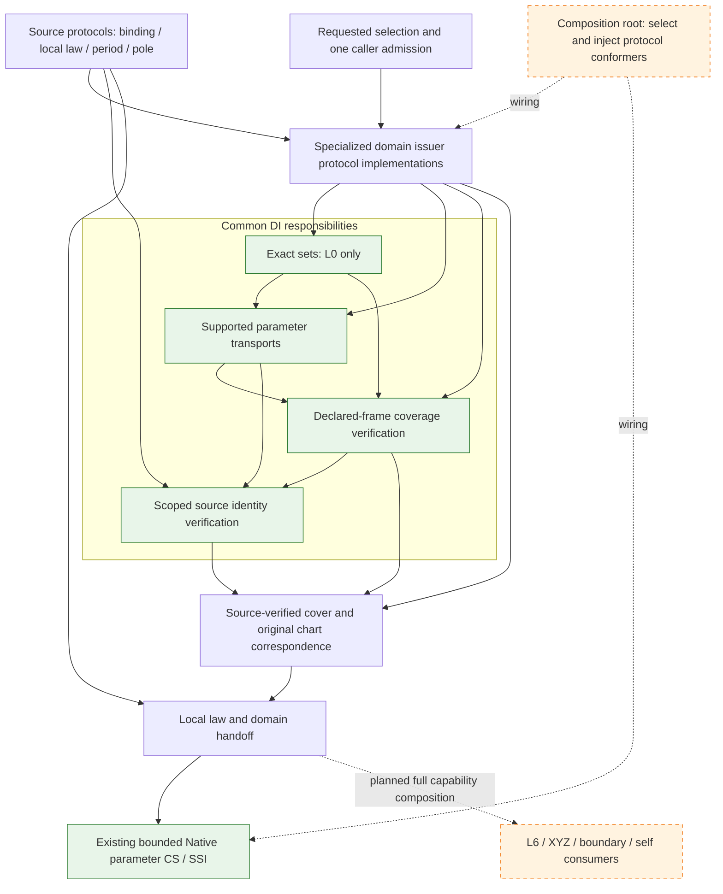
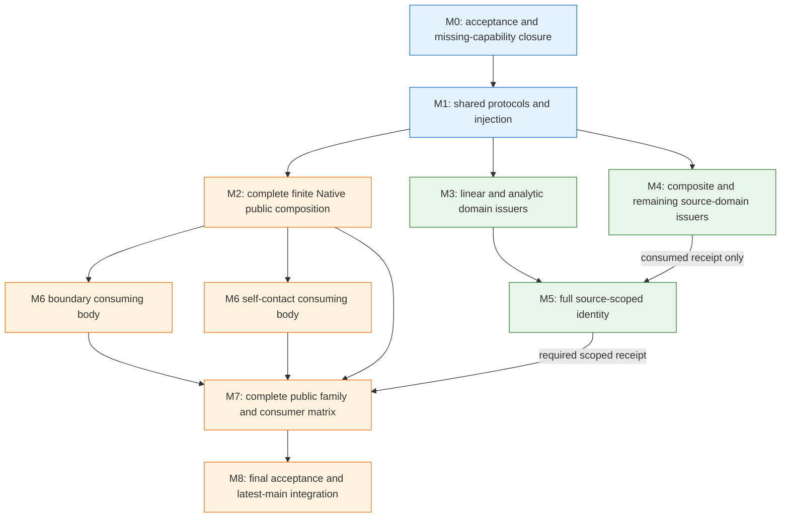

# Original Domain and Identity Foundation

## Purpose and Scope

Direct child of [CADGeometry](../DESIGN.md). ExactParameterDomain, exact affine/periodic
transport, finite/cartesian Native covers and checked scoped identity constructors
are implemented. Intrinsic sphere coverage and pole certificates use their dedicated
source-law contract. Existing consumer migration and the remaining mandatory
source-family issuer implementations are not complete; this foundation does not
complete DI.4 or the seven requirements.
Children: ExactParameterDomain, OriginalParameterTransport, OriginalDomainCoverage,
and OriginalParameterIdentity. All remain within CADGeometry; no production package,
SwiftPM target, external dependency or replacement root solver is introduced.

Own exact requested/support parameter sets, certified chart transport, complete
source-domain coverage and source-defined identity evidence. Full acceptance includes
curve/surface arity, open/closed/empty/singleton/disconnected/unbounded selections,
Native joins, independent periodic axes, collapsed poles and source images.
Finite Native issuance is a staged implementation dependency, not reduced acceptance.

## Responsibilities and Boundaries

| Owner | Generates and retains | Consumes | Does not decide |
|---|---|---|---|
| ExactParameterDomain | Exact set values and set-operation receipts | L0 ordered values | Shape semantics, XYZ, roots |
| OriginalParameterTransport | Source/axis-bound correspondence and exact lifts | Exact sets, original transport authority | Intersection, shape identity |
| OriginalDomainCoverage | Charts/families, overlap ownership, complete coverage proof | Support/request and transports | Common points, smoothness, topology sewing |
| OriginalParameterIdentity | Scoped structural equivalence witnesses | Source-issued equality laws and valid supports | Coincidence inferred from XYZ or proximity |
| Existing shape issuer | Original law, authored source owner, source identity theorem | Existing primitive/native semantics | Common solution components |
| L3/L4/L5/L6 | Solution selection, connected components, image/fiber evidence | Verified sets, charts and declared correspondences | Inventing source identity |
| Kernel/topology | Declared face/coedge incidence and material policy | Scoped identity and intersection receipts | Turning proximity into foundation identity |

### Protocol-oriented composition decision

A family-specific domain issuer is a concrete protocol implementation, not an
additional adapter layer. Group implementations by actual source capability;
curve and tensor B-splines already share OriginalBSplineSourceReading. Introduce
another implementation only when authoritative support, chart construction or
source correspondence has a different change reason. Do not add a wrapper for
each shape case or a universal issuer that switches over every geometry enum.

The source component binds and proves local laws. A specialized domain issuer
derives the complete parameter space and chart templates from that same retained
source authority. Common DI implementations verify sets, supported transports,
coverage and scoped identity. Their generic algorithms do not read geometric
controls or choose a shape family. Consumer composition selects compatible
protocol conformers, compiles query predicates and retains all resulting owners.
It does not perform a second domain intersection or source-identity decision.

Composition roots own implementation selection. The intended injection is generic
over the required source/domain/transport/identity protocols with matching Source,
Field and receipt associated types. Existing concrete Default constructors in
Native preparation and specialized issuers are current wiring, not evidence that
this injection migration is implemented. Keep existing public default entrypoints;
their composition roots supply defaults once. Generic protocol operations remain
witness requirements and are never invoked through an Embedded existential.

| Cross-boundary decision | Sole owner | Required handoff |
|---|---|---|
| Meaning of the authored source and its coordinates | Existing family/source issuance | Validated binding and supported original laws |
| Which charts cover the whole requested source domain | Specialized domain issuer using common coverage verification | Source-verified cover retaining request, support and original correspondence |
| Whether a source theorem applies on a selected scope | Parameter identity issuer | Scoped, retained proof; never a deduplication flag |
| Which equality/trim/self-contact predicates to solve | Relation or boundary/self consumer | Predicates consuming DI proofs without redefining them |
| Which implementation satisfies those capabilities | Consumer composition root | Typed protocol composition, one admission, unchanged public defaults |

The general cover issuer proves a union relative to a declared frame. That proof
alone does not certify a shape's full support. Specialized source-domain issuance
must establish the latter authority before consumers accept the cover. Finite
cover views and symbolic chart-family queries remain distinct capabilities; their
child-owned contracts are specified in [coverage](OriginalDomainCoverage/DESIGN.md#protocol-capabilities-and-implementation-selection).

Reuse the existing OriginalSourceBinding from the adjacent source-issuance design;
this component does not create a competing binding issuer. The domain-side role
record retains that authored source/issuer owner, parameter roles,
source depth and coordinate semantics. It is not a UUID, structural hash, callback or
new mutable source registry. Copying a receipt preserves its owner. A separately
prepared equal-valued source needs explicit verified rebinding; it is not implicitly
accepted as the same handle owner.

## Related Designs

| Design | Relationship | Contract Used | Summary | Cautions |
|---|---|---|---|---|
| [Geometry](../DESIGN.md) | parent | Authored source and canonical primitive semantics | Determines original meaning | No source-law redefinition |
| [Original source issuance](../OriginalSourceIssuance/DESIGN.md) | depends on | OriginalSourceBinding and source-supported local-law receipts | Reuses source provenance rather than rebinding it | Local law support does not establish complete coverage or identity |
| [ExactParameterDomain](ExactParameterDomain/DESIGN.md) | child | Exact set operations | Shape-independent foundation | L0 only |
| [OriginalParameterTransport](OriginalParameterTransport/DESIGN.md) | child | Certified parameter correspondence | Keeps requested and local coordinates | No rounded lift |
| [OriginalDomainCoverage](OriginalDomainCoverage/DESIGN.md) | child | Whole-support/request cover | Finite and symbolic unbounded coverage | A chart list alone is not proof |
| [OriginalParameterIdentity](OriginalParameterIdentity/DESIGN.md) | child | Scoped identity witnesses | Periods, joins and collapse | Does not merge UV tuples |
| [Native curve cover](../OriginalNativeCurveChartCover/DESIGN.md) | coordinates with | Existing finite exact source owners | First shape adapter | Its closed/Double subset remains limited |
| [Native surface cover](../OriginalNativeSurfaceChartCover/DESIGN.md) | coordinates with | Tensor owners and independent cycles | First surface adapter | Existing mesh policy stays separate |
| [ParameterImage](../ParameterImage/DESIGN.md) | coordinates with | Original exact gain/translation words | Reuse existing symbolic arithmetic | A transform alone proves no periodic law |
| [Canonical angular chart](../CanonicalSphereChart/DESIGN.md) | depends on | Intrinsic labels versus physical radians | Owns mathematical phase and poles | A pi enclosure is not an exact scalar |
| [Native L5 consumer](../NativeExactRelations/DESIGN.md) | used by | Complete selected domain-bound charts | Existing Native parameter queries retain covers | XYZ/boundary/self migration remains open |
| [L6](../RationalBivariateAlgebra/ExactGeometricRelation/DESIGN.md) | used by, proposed | Original correspondence and collapse evidence | Interprets complete retained relation | Parameter dimension remains distinct |

## Architecture

Green denotes implemented bounded contracts; it does not claim every source
family or requested-domain capability. Orange denotes pending consumer/injection
migration. Family issuance and local-law handoff have both implemented and pending
capabilities, detailed in the child design. Arrows show evidence flow, not a new
SwiftPM dependency graph. No source issuer calls back into DI.

The ordered set kernel is reusable without Curve3D, Surface3D, L1-L6, root solving,
normal preparation or Kernel. Specialized issuers may use existing scalar/polynomial
proof machinery; those dependencies do not leak into the set kernel.

## Contracts and Invariants

All decisions are relative to an explicit retained source and parameter space.
Requested sets are retained separately from effective sets. Effective membership is
exact request AND original support; out-of-support selections may be completely
empty without becoming malformed. Invalid/foreign/nonfinite scalar inputs fail.
A reversed traversal is orientation metadata; reversed interval bounds are invalid.

There are three different relations: exact authored-coordinate equality, declared
source-structural equivalence, and geometric XYZ coincidence. The first two are
issued here; the third belongs to intersection. Equal XYZ at a self-crossing does
not identify parameters. Equal endpoint values do not imply equal one-sided jets.
Every original tuple, chart side and requested cycle survives in the receipt even
when an upper consumer uses a proven quotient identity for a particular purpose.

Source period evidence is supplied by the original law owner, not inferred from
`parameterDomain.periodic`, two matching samples or a rounded endpoint subtraction.
Removing a Double representation restriction does not redefine the period or
admit an approximately periodic source as exactly periodic.

Nonrectangular authored trimming is owned by boundary selection. This foundation
covers ambient source/request sets and retains references to separately certified
restrictions when composed. A trim's bounding box is never its material set.
Neither a raw ambient cover nor structural source identity certifies trim inclusion.

### Public protocol surface

These contracts are compiled protocols with separate concrete implementations.
Each field/ordering/source/map type is an associated type. Input values are borrowed;
all fallible operations take the same generic inout admission and typed failure.

| Protocol | Required operations | Published authority |
|---|---|---|
| ExactParameterDomainConstructing | interval, empty, set, union, intersection, difference, product | Checked immutable set |
| ExactParameterDomainQuerying | scalar/tuple contains, setEqual | Exact decision or typed failure |
| OriginalParameterTransporting | construct supported word, forward, inverse correspondence, compose, restrict | Checked source/axis-bound transport |
| OriginalDomainCoverIssuing | issue checked finite declared-frame cover | Frame-relative cover, not original support authority |
| OriginalBSplineDomainIssuing / OriginalIntrinsicSphereDomainIssuing | prepare authoritative space and issue source-bound selection | Complete source coverage within each implemented capability |
| OriginalDomainCoverQuerying | support/request/effective and finite chart views, incident indices | Finite owner-backed read-only records |
| OriginalParameterIdentityIssuing | authored-coordinate proof | Non-forgeable scoped receipt |
| OriginalRationalParameterIdentityIssuing / OriginalPeriodicParameterIdentityIssuing / OriginalIntrinsicParameterIdentityIssuing | supported boundary/collapse/period/pole proofs | Proof-kind-specific structural identity |
| OriginalParameterIdentityQuerying | identity decision, restrict, supported compose | Scoped evidence; no guessed XYZ result |

No protocol wraps a root solver or permits a client to mint a completed receipt from
an arbitrary array/Bool. Checked construction owns the invariant; implementations
are separate and may reuse existing issuer tokens. Generic operations stay statically
dispatched. Embedded callers do not invoke generic requirements through `any P`;
non-generic existential facades, if later needed, require their own compiled witnesses.

## Runtime Flows

Retain source semantics -> construct support/request sets -> exact selection ->
certify parameter transports -> construct and verify complete cover -> issue scoped
identity receipts -> final cancellation -> publish immutable owner.
No phase solves intersection or prepares normal/silhouette evidence. Consumers use
these receipts alongside original laws; applying boundary predicates may require
new refinement, but does not rerun the original intersection to reconstruct a receipt.

## State, Ownership, and Lifecycle

Each published cover/identity retains its source, scalar owners, transport expressions
and immutable proof buffers. Handles contain owner plus index; foreign indices fail.
Arrays share COW storage; queries use owner-backed views/scoped borrows. Shared mutable
caches, unsafe pointers, global IDs and a separate budget ledger are unnecessary.
Swift generics provide static dispatch. The caller admission is borrowed exclusively
as `inout A` with `A: ExactScalarAdmission & ~Copyable`.

## Failure, Concurrency, and Constraints

Typed OriginalDomainIdentityFailure preserves lower scalar causes and
separately represents invalidDomain, foreignOwner, incompatibleCoordinateSemantics,
singularTransport, incompleteCoverage, unsupportedSourceProof and countOverflow.
Resource/cancellation failures keep their existing causes. An unsupported required
proof is unfinished coverage, never successful absence or completion.
Work, storage, source/value/coefficient depth and chart/family/identity-result counts
remain independent caller limits. Checked payload admission precedes allocation;
all scans/compositions/queries and final publication observe the same admission.
No query resets counters. Later queries receive explicit new admissions and inherit
retained source/depth constraints. Reused immutable payload is not allocated/charged
again; newly generated receipts, indices and expressions are charged.
The same Sendable/storage/isolation contract applies on all targets. No new mutable
shared state is planned; any later addition requires the common Mutex/actor contract.

## Verification and Change Impact

### Confirmed current facts and gaps

| Current source/test | Observed contract | Gap closed by this design |
|---|---|---|
| [ParameterDomain](../ParameterDomain.swift) | Tolerance-based contains; closed validation rejects singleton | Exact membership must not delegate to this facade |
| [CurveParameterDomain](../CurveParameterDomain.swift) / [SurfaceParameterDomain](../SurfaceParameterDomain.swift) | Closed/unbounded/periodic Double descriptors | Explicit open, empty, field and semantic ownership |
| [L2 interval](../RationalBivariateAlgebra/ExactRealRoot/ExactRealRootInterval.swift) | Immutable exact bounds/open flags/depth | Share its set semantics without bringing root solving into the kernel |
| [Native curve cover source](../OriginalNativeCurveChartCover/OriginalNativeCurveChartCover.swift) / [tests](../../../Tests/CADGeometryTests/OriginalNativeCurveChartCoverTests.swift) | Finite closed selected owners; exact represented cycles; failure/cancel | Broader exact/symbolic transport and coverage receipt |
| [Surface preparation](../PreparedBSplineSurfaceDifferentialEncloser.swift) / [tests](../../../Tests/CADGeometryTests/OriginalNativeSurfaceChartCoverTests.swift) | Closed tensor covers and independent cycles; limited Double lifts | Independent domain/coverage contract without jet preparation |
| [Periodic translation](../ParameterImage/OriginalParameterPeriodicTranslation.swift) | Rational exact turns*period and transported endpoints already exist | Reuse arithmetic; require actual source-period theorem separately |
| [Angular chart](../CanonicalSphereChart/DESIGN.md) | Intrinsic labels differ from physical radians | Preserve coordinate semantics rather than treating pi as dyadic |
| [Self-contact atlas](../OriginalSurfaceEmbedding/OriginalSurfaceSelfContactAtlas.swift) | Finite box traversal with injectivity/cross callbacks | Explicit scoped diagonal/seam/pole exclusion input |

The retained PublicReviewFixEvidence source hashes match current main209a5b46.
Existing issuer and L2 behavioral tests/receipts are understanding evidence for
unchanged implementations, not proof that these proposed interfaces work.
Current foundation verification is owned by [the independent DI package](../../../Tests/OriginalDomainIdentityVerification/DESIGN.md). Historical evidence is not generalized to newly compiled source adapters or public consumers.

### DI.4 consumer acceptance and migration boundary

| Work boundary | DI evidence consumed | Consumer-owned acceptance | Current state at main5de88ec1 |
|---|---|---|---|
| Native parameter CS/SSI | Both source covers and selected source-bound laws | All tuples/exclusion and owner retention under one admission | Verified nonperiodic single-span path; broader domains remain open |
| Multi-chart and periodic CS/SSI | Every incident side, exact lift and complete family selection | No missing/duplicated components; all original tuples/lifts retained | Existing broad paths require migration; the new path rejects these inputs |
| XYZ/image publication | Complete cover, original maps, scoped collapse annotations | Image/fiber dimension and numeric guarantees | Pending; parameter dimension is insufficient |
| Boundary clipping | Ambient cover, lifted pcurve correspondence and seam/pole proof | Exact material predicate and raw-cell correspondence | Existing consumer uses legacy raw receipts; periodic/pole authority is explicitly unfinished |
| Self-contact | Source-product cover and supported structural identity scopes | Exclude only proved structural pairs; solve all remaining contacts | Existing finite-box/injectivity atlas has no DI identity input |
| Prepared result reuse | Same retained binding/field/space and sufficient coverage | Owner compatibility, inherited depth, explicit later query admission | No implicit equal-value rebinding or global cache |

Required source families are owned by [source issuance](../OriginalSourceIssuance/DESIGN.md#purpose-and-scope).
The shape-specific DI obligations and missing capabilities are owned by
[coverage](OriginalDomainCoverage/DESIGN.md#required-source-family-obligations).
Implementation acceptance is the cross product of the applicable family obligations
and consumer rows, with success/failure on the required Native/ASAN/ordinary-WASM/
Embedded lanes. A row marked pending is an implementation gap, not permission to
reduce the full acceptance scope. Tests of the same unchanged lower invariant are
reused; new wiring requires its own public behavioral evidence.

Begin with protocol composition and the already-certified Native source contracts;
then extend multi-chart/periodic consumption, source-family issuance and the
boundary/self/image handoffs from the specific lower capabilities they consume.
These may be separate implementation work items after file ownership is fixed;
this documentation task does not start those implementations or close DI.4.

### Complete implementation milestones

The executable schedule is owned by project [PROGRESS.md](../../../PROGRESS.md)
under the existing DIA.4/DIA.INT IDs. The following milestones cover the entire
responsibility design, not only OriginalChartFamilyQuerying or the Native route.
Existing DI0-DI3 evidence remains a lower premise. No implementation is started
by this plan, and no whole-seven/87 completion is implied by DI completion.

| Milestone / progress ID | Complete deliverable | Required predecessors | Exit evidence |
|---|---|---|---|
| M0 / DIA.4.I.M0 | Freeze concrete family x domain x identity x consumer acceptance, missing source-capability work, protocol relationships and file owners | Verified DI0-DI3 and responsibility design | Every mandatory family has an owned producer/consumer path and success/failure fixture; nonlinear/singular correspondence and symbolic public-output contracts are specified before their implementation |
| M1 / DIA.4.I.M1 | Implement family-query protocol and Native/intrinsic conformances; inject common protocol dependencies and preserve public defaults | M0 | Concrete/generic results match; no field/owner erasure, proof bypass, new owner/cache or admission reset; independent Native/ASAN/ordinary/Embedded execution |
| M2 / DIA.4.I.M2 | Complete finite Native CS/SSI DI consumption for all spans, finite periodic selections and exact request sets | M1 and existing Native law/identity contracts | Actual public requests cover open/closed/singleton/disconnected/excluded selections, all chart sides and independent cycles; complete parameter relations and retained original correspondence |
| M3 / DIA.4.I.M3 | Complete linear/plane and angular/analytic source-domain issuance | M1 plus the particular source laws required by each branch | Unbounded line/plane support, stored-N evaluation/UV correspondence, original conic/analytic UV, genuine angular periods, poles/seams and all branches; image-only equations do not close the milestone |
| M4 / DIA.4.I.M4 | Complete operation-word, parameter-image, procedural and implicit/certified/lift/join/guide domain composition | M1 plus each branch's actual child-law/correspondence capability | Whole descendant support pullback, all preimages/guards/lifts and construction boundaries; nonlinear/singular maps preserve relational correspondence rather than claim an inverse |
| M5 / DIA.4.I.M5 | Complete structural identity issuance for the covered source families | The exact source/domain receipts consumed by each public cell; no whole-M4 execution barrier | Source-scoped join/seam/pole/shared-boundary proofs, exact restriction/composition and one-sided roles; equal XYZ at distinct nonstructural tuples stays distinct |
| M6 / DIA.4.I.M6 | Connect boundary and self-contact consumers through the fixed typed DI ports | M2; supported DI3 identity proofs permit early work | Boundary retains certified material predicates/raw-cell ownership; self-contact excludes only proved structural pairs; generic wiring is independent of unfinished source-family bodies |
| M7 / DIA.4.I.M7 | Finish general CS/SSI/XYZ publication and exercise every applicable family/consumer combination, including M6 consumers | Per-cell retained source/domain/identity/consumer receipts; aggregate closure still requires all applicable M2-M6 obligations | Public success/exclusion, complete XYZ/UV/fiber correspondence and symbolic periodic-family results; required cases cannot finish as unsupported; immutable prepared reuse and explicit later-query admission |
| M8 / DIA.4.V and DIA.INT | Close stable final acceptance and latest-main integration | All implementation milestones | One scoped aggregate review, finding confirmation, changed-boundary Native/ASAN/ordinary/Embedded runtime evidence, source/artifact hashes and latest-main composition; no remaining required matrix cell |

Arrows describe receipt supply and aggregate closure, not a whole-M4 execution
barrier for M5/M6 or permission to edit shared files in parallel. Public-cell
execution is owned by [coverage acceptance](OriginalDomainCoverage/DESIGN.md#public-acceptance-cell-execution). PROGRESS contains the source-delivery/file-owner serialization within
M3/M4. The verified word/image/traversal branch of M4 can start from M1 and its
existing source receipts before the unrelated M3 source branches finish.

M0 is a closure of the identified capability gaps, not a redesign of L0-L5.
Record an actual retained source input and required proof for every missing source
capability. Reuse the OSI.ALL owner/commits for existing source work instead of
starting a duplicate source issuer. Any necessary missing proof is a named
dependency/repair under that owner; the receiving DI branch cannot count it as
unsupported completion or wait for the unrelated whole OSI.ALL aggregate.

### Ownership, parallel work and convergence

| Owner role | Owned implementation/files | Coordination boundary |
|---|---|---|
| Common DI owner | Existing ExactParameterDomain/OriginalParameterTransport/OriginalDomainCoverage/OriginalParameterIdentity protocol and shared receipt files | Sole writer for shared contracts, family-query declaration and admission/failure helpers |
| Source authority owner | Required OriginalSourceIssuance/family law/provider changes, including saved-N plane and physical-angle correspondence | Reuse existing OSI.ALL work; shared source files change serially and are delivered as verified receipts |
| Linear domain owner | Dedicated line/plane domain issuer files in OriginalDomainCoverage and their focused tests | Consumes frozen common/source ports; source-provider edits return to source owner |
| Angular domain owner | Dedicated conic/analytic domain issuer files and focused tests | Preserves physical versus intrinsic semantics; common/source edits return to their owners |
| Composite domain owner | Dedicated word/image/procedural/descendant domain issuer files | Owns only domain composition; new source-law capabilities remain with source owner |
| Relation/publication owner | NativeExactRelations, applicable CurveSurfaceOverlap/NativeRelation, NativeSurfaceSurfaceRelations, L6/public composition and result handoff | Sole writer for shared public entries/results; reuses existing solving rather than another engine |
| Boundary owner | Geometry and Kernel OriginalBoundaryClipping files and owning tests | Owns material selection/refinement and source-side correspondence, not source semantics |
| Self-contact owner | OriginalSurfaceEmbedding and affected self-contact consuming files/tests | Owns structural exclusion use, not identity issuance |
| Integration owner | Snapshot manifests, dedicated build/integration paths and Git integration | Returns implementation findings to the relevant writer |

Roles describe planned ownership, not dispatched agents. M0 fixes exact filenames
and test-resource owners before simultaneous edits. Linear/angular issuer bodies
and boundary/self consumer bodies may share a source snapshot only when their
owned files and build resources are disjoint. Shared protocol/result/source changes
are serial owner deliveries; an independently mutable snapshot uses a separate
worktree/task, not the same PROGRESS parallel group. Preserve Claude changes,
uncommitted work and valid evidence. Consumer ports can be implemented from proven
Native contracts before every producer body is complete; full matrix acceptance
still waits for the actual required source receipts.

Each leaf closes implementation, focused success/failure validation, one scoped
review, finding confirmation and a coherent commit. Validate affected composition
against latest main/Claude commits in an independent integration worktree and merge
each verified coherent unit; do not defer all merges until M8. M8 owns cumulative
interaction evidence and remaining required target coverage, not a repeat of every
unchanged lower test. Build caches/evidence may be reused only with matching input,
toolchain/SDK/backend premises. Every test/runtime command has a timeout.

Maintain work/storage/source/value/coefficient/transport/count limits, numerical
tolerances, caller cancellation and owner lifetimes. Do not increase a budget,
omit a mandatory source family or change phase semantics to finish a milestone.
When an actual required route fails, report the input, broken contract, owning
repair and affected milestone. Report completed milestones/main-integrated units
and remaining matrix cells; foundational edits or expected failures are not DI4
completion. No fixed delivery-time claim precedes a representative measurement.

### Staged acceptance with the full destination retained

| ID | Responsibility closed | Required independent evidence |
|---|---|---|
| DI.0 | Exact sets, L0-only protocols and interval semantics | All endpoint truth tables, disconnected sets, unbounded support, failure/lifetime/cancel |
| DI.1 | Source-bound affine/periodic parameter transport | Exact non-Double intermediates, reversal/composition/inverse, foreign owner, source period refusal |
| DI.2 | Complete finite Native cover and chart overlap ownership | All spans/joins/singletons/independent cycles, hole-in-cover rejection, no jets/solver, atomic limits |
| DI.3 | Scoped source identity, intrinsic poles and periodic families | Whole-source laws, one-sided germs, unbounded family theorem, distinct self-crossing tuples |
| DI.4 | Existing consumer composition and all required source adapters | CS/SSI/boundary/self consumers, original UV preservation, Native/ASAN/normal/Embedded success and failure |

Each implementation stage closes its contract through one stable verification/review
and coherent commit; later stages do not reopen it without a concrete violation.
A proposed isolated test package may compile DI.0 with L0 only; it is a test harness,
not a new production module. Broader source adapters compile only their transitive
production dependencies. DI completion is distinct from completion of the seven intersection requirements.
