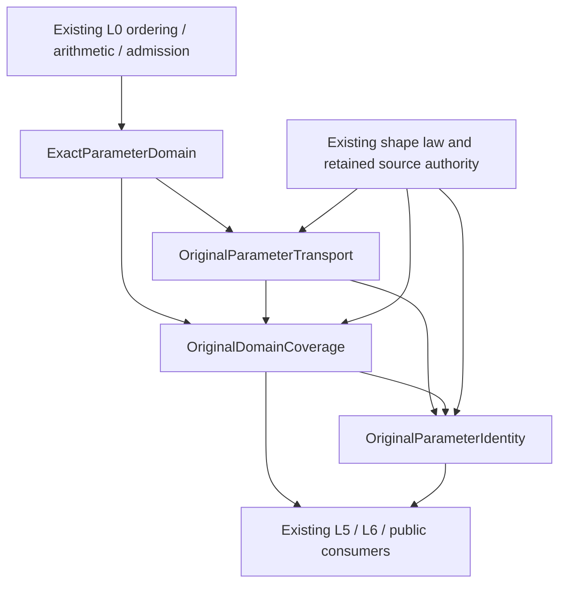

# Original Domain and Identity Foundation

## Purpose and Scope

Proposed direct child of [CADGeometry](../DESIGN.md). This is a design-only component;
none of the proposed protocols or receipts in these documents is implemented yet.
Children: ExactParameterDomain, OriginalParameterTransport, OriginalDomainCoverage,
and OriginalParameterIdentity. All remain within CADGeometry; no production package,
SwiftPM target, external dependency or replacement root solver is introduced.

Own exact requested/support parameter sets, certified chart transport, complete
source-domain coverage and source-defined identity evidence. Full acceptance includes
curve/surface arity, open/closed/empty/singleton/disconnected/unbounded selections,
Native joins, independent periodic axes, collapsed poles and source images.
Finite Native issuance is a staged implementation dependency, not reduced acceptance.

## Responsibilities and Boundaries

| Owner | Generates and retains | Consumes | Does not decide |
|---|---|---|---|
| ExactParameterDomain | Exact set values and set-operation receipts | L0 ordered values | Shape semantics, XYZ, roots |
| OriginalParameterTransport | Source/axis-bound correspondence and exact lifts | Exact sets, original transport authority | Intersection, shape identity |
| OriginalDomainCoverage | Charts/families, overlap ownership, complete coverage proof | Support/request and transports | Common points, smoothness, topology sewing |
| OriginalParameterIdentity | Scoped structural equivalence witnesses | Source-issued equality laws and valid supports | Coincidence inferred from XYZ or proximity |
| Existing shape issuer | Original law, authored source owner, source identity theorem | Existing primitive/native semantics | Common solution components |
| L3/L4/L5/L6 | Solution selection, connected components, image/fiber evidence | Verified sets, charts and declared correspondences | Inventing source identity |
| Kernel/topology | Declared face/coedge incidence and material policy | Scoped identity and intersection receipts | Turning proximity into foundation identity |

Reuse the proposed OriginalSourceBinding from the adjacent source-issuance design;
this component does not create a competing binding issuer. The domain-side role
record retains that authored source/issuer owner, parameter roles,
source depth and coordinate semantics. It is not a UUID, structural hash, callback or
new mutable source registry. Copying a receipt preserves its owner. A separately
prepared equal-valued source needs explicit verified rebinding; it is not implicitly
accepted as the same handle owner.

## Related Designs

| Design | Relationship | Contract Used | Summary | Cautions |
|---|---|---|---|---|
| [Geometry](../DESIGN.md) | parent | Authored source and canonical primitive semantics | Determines original meaning | No source-law redefinition |
| [Original source issuance](../OriginalSourceIssuance/DESIGN.md) | depends on, proposed | OriginalSourceBinding and source-supported local-law receipts | Reuses source provenance rather than rebinding it | Local law support does not establish complete coverage or identity |
| [ExactParameterDomain](ExactParameterDomain/DESIGN.md) | child | Exact set operations | Shape-independent foundation | L0 only |
| [OriginalParameterTransport](OriginalParameterTransport/DESIGN.md) | child | Certified parameter correspondence | Keeps requested and local coordinates | No rounded lift |
| [OriginalDomainCoverage](OriginalDomainCoverage/DESIGN.md) | child | Whole-support/request cover | Finite and symbolic unbounded coverage | A chart list alone is not proof |
| [OriginalParameterIdentity](OriginalParameterIdentity/DESIGN.md) | child | Scoped identity witnesses | Periods, joins and collapse | Does not merge UV tuples |
| [Native curve cover](../OriginalNativeCurveChartCover/DESIGN.md) | coordinates with | Existing finite exact source owners | First shape adapter | Its closed/Double subset remains limited |
| [Native surface cover](../OriginalNativeSurfaceChartCover/DESIGN.md) | coordinates with | Tensor owners and independent cycles | First surface adapter | Existing mesh policy stays separate |
| [ParameterImage](../ParameterImage/DESIGN.md) | coordinates with | Original exact gain/translation words | Reuse existing symbolic arithmetic | A transform alone proves no periodic law |
| [Canonical angular chart](../CanonicalSphereChart/DESIGN.md) | depends on | Intrinsic labels versus physical radians | Owns mathematical phase and poles | A pi enclosure is not an exact scalar |
| [L5](../RationalBivariateAlgebra/ExactParametricRelation/DESIGN.md) | used by, proposed | Exact domains and source-map slots | Accepts complete chart relations | Does not yet consume this proposed issuer |
| [L6](../RationalBivariateAlgebra/ExactGeometricRelation/DESIGN.md) | used by, proposed | Original correspondence and collapse evidence | Interprets complete retained relation | Parameter dimension remains distinct |

## Architecture

The ordered set kernel is reusable without Curve3D, Surface3D, L1-L6, root solving,
normal preparation or Kernel. Shape adapters may use their existing scalar/polynomial
proof machinery; those dependencies do not leak into the set kernel.

## Contracts and Invariants

All decisions are relative to an explicit retained source and parameter space.
Requested sets are retained separately from effective sets. Effective membership is
exact request AND original support; out-of-support selections may be completely
empty without becoming malformed. Invalid/foreign/nonfinite scalar inputs fail.
A reversed traversal is orientation metadata; reversed interval bounds are invalid.

There are three different relations: exact authored-coordinate equality, declared
source-structural equivalence, and geometric XYZ coincidence. The first two are
issued here; the third belongs to intersection. Equal XYZ at a self-crossing does
not identify parameters. Equal endpoint values do not imply equal one-sided jets.
Every original tuple, chart side and requested cycle survives in the receipt even
when an upper consumer uses a proven quotient identity for a particular purpose.

Source period evidence is supplied by the original law owner, not inferred from
`parameterDomain.periodic`, two matching samples or a rounded endpoint subtraction.
Removing a Double representation restriction does not redefine the period or
admit an approximately periodic source as exactly periodic.

Nonrectangular authored trimming is owned by boundary selection. This foundation
covers ambient source/request sets and retains references to separately certified
restrictions when composed. A trim's bounding box is never its material set.
Neither a raw ambient cover nor structural source identity certifies trim inclusion.

### Proposed public protocol surface

These are contract names and operation groups, not compiled declarations.
Each field/ordering/source/map type is an associated type. Input values are borrowed;
all fallible operations take the same generic inout admission and typed failure.

| Protocol | Required operations | Published authority |
|---|---|---|
| ExactParameterDomainConstructing | interval, empty, finiteUnion, Cartesian selection | Checked immutable set |
| ExactParameterDomainQuerying | contains, intersection, difference, union, setEqual | Exact decision or typed failure |
| OriginalParameterTransporting | construct supported word, forward, inverse correspondence, compose, restrict | Checked source/axis-bound transport |
| OriginalDomainCoverIssuing | issue support/request cover, verify source charts/family theorem | Complete cover receipt |
| OriginalDomainCoverQuerying | request/effective views, charts/families, incident owners, scoped restriction | Owner-backed read-only records |
| OriginalParameterIdentityIssuing | verify supported source theorem and its scope | Non-forgeable identity receipt |
| OriginalParameterIdentityQuerying | identity decision, restrict, supported compose | Scoped evidence; no guessed XYZ result |

No protocol wraps a root solver or permits a client to mint a completed receipt from
an arbitrary array/Bool. Checked construction owns the invariant; implementations
are separate and may reuse existing issuer tokens. Generic operations stay statically
dispatched. Embedded callers do not invoke generic requirements through `any P`;
non-generic existential facades, if later needed, require their own compiled witnesses.

## Runtime Flows

Retain source semantics -> construct support/request sets -> exact selection ->
certify parameter transports -> construct and verify complete cover -> issue scoped
identity receipts -> final cancellation -> publish immutable owner.
No phase solves intersection or prepares normal/silhouette evidence. Consumers use
these receipts alongside original laws; applying boundary predicates may require
new refinement, but does not rerun the original intersection to reconstruct a receipt.

## State, Ownership, and Lifecycle

Each published cover/identity retains its source, scalar owners, transport expressions
and immutable proof buffers. Handles contain owner plus index; foreign indices fail.
Arrays share COW storage; queries use owner-backed views/scoped borrows. Shared mutable
caches, unsafe pointers, global IDs and a separate budget ledger are unnecessary.
Swift generics provide static dispatch. The caller admission is borrowed exclusively
as `inout A` with `A: ExactScalarAdmission & ~Copyable`.

## Failure, Concurrency, and Constraints

Proposed typed OriginalDomainIdentityFailure preserves lower scalar causes and
separately represents invalidDomain, foreignOwner, incompatibleCoordinateSemantics,
unprovedTransport, incompleteCoverage, unsupportedSourceProof and countOverflow.
Resource/cancellation failures keep their existing causes. An unsupported required
proof is unfinished coverage, never successful absence or completion.
Work, storage, source/value/coefficient depth and chart/family/identity-result counts
remain independent caller limits. Checked payload admission precedes allocation;
all scans/compositions/queries and final publication observe the same admission.
No query resets counters. Later queries receive explicit new admissions and inherit
retained source/depth constraints. Reused immutable payload is not allocated/charged
again; newly generated receipts, indices and expressions are charged.
The same Sendable/storage/isolation contract applies on all targets. No new mutable
shared state is planned; any later addition requires the common Mutex/actor contract.

## Verification and Change Impact

### Confirmed current facts and gaps

| Current source/test | Observed contract | Gap closed by this design |
|---|---|---|
| [ParameterDomain](../ParameterDomain.swift) | Tolerance-based contains; closed validation rejects singleton | Exact membership must not delegate to this facade |
| [CurveParameterDomain](../CurveParameterDomain.swift) / [SurfaceParameterDomain](../SurfaceParameterDomain.swift) | Closed/unbounded/periodic Double descriptors | Explicit open, empty, field and semantic ownership |
| [L2 interval](../RationalBivariateAlgebra/ExactRealRoot/ExactRealRootInterval.swift) | Immutable exact bounds/open flags/depth | Share its set semantics without bringing root solving into the kernel |
| [Native curve cover source](../OriginalNativeCurveChartCover/OriginalNativeCurveChartCover.swift) / [tests](../../../Tests/CADGeometryTests/OriginalNativeCurveChartCoverTests.swift) | Finite closed selected owners; exact represented cycles; failure/cancel | Broader exact/symbolic transport and coverage receipt |
| [Surface preparation](../PreparedBSplineSurfaceDifferentialEncloser.swift) / [tests](../../../Tests/CADGeometryTests/OriginalNativeSurfaceChartCoverTests.swift) | Closed tensor covers and independent cycles; limited Double lifts | Independent domain/coverage contract without jet preparation |
| [Periodic translation](../ParameterImage/OriginalParameterPeriodicTranslation.swift) | Rational exact turns*period and transported endpoints already exist | Reuse arithmetic; require actual source-period theorem separately |
| [Angular chart](../CanonicalSphereChart/DESIGN.md) | Intrinsic labels differ from physical radians | Preserve coordinate semantics rather than treating pi as dyadic |
| [Self-contact atlas](../OriginalSurfaceEmbedding/OriginalSurfaceSelfContactAtlas.swift) | Finite box traversal with injectivity/cross callbacks | Explicit scoped diagonal/seam/pole exclusion input |

The retained PublicReviewFixEvidence source hashes match current main209a5b46.
Existing issuer and L2 behavioral tests/receipts are understanding evidence for
unchanged implementations, not proof that these proposed interfaces work.
No new implementation, build or runtime success is claimed by this design.

### Staged acceptance with the full destination retained

| ID | Responsibility closed | Required independent evidence |
|---|---|---|
| DI.0 | Exact sets, L0-only protocols and interval semantics | All endpoint truth tables, disconnected sets, unbounded support, failure/lifetime/cancel |
| DI.1 | Source-bound affine/periodic parameter transport | Exact non-Double intermediates, reversal/composition/inverse, foreign owner, source period refusal |
| DI.2 | Complete finite Native cover and chart overlap ownership | All spans/joins/singletons/independent cycles, hole-in-cover rejection, no jets/solver, atomic limits |
| DI.3 | Scoped source identity, intrinsic poles and periodic families | Whole-source laws, one-sided germs, unbounded family theorem, distinct self-crossing tuples |
| DI.4 | Existing consumer composition and all required source adapters | CS/SSI/boundary/self consumers, original UV preservation, Native/ASAN/normal/Embedded success and failure |

Each implementation stage closes its contract through one stable verification/review
and coherent commit; later stages do not reopen it without a concrete violation.
A proposed isolated test package may compile DI.0 with L0 only; it is a test harness,
not a new production module. Broader source adapters compile only their transitive
production dependencies. Full seven requirements remain the task's final acceptance.
