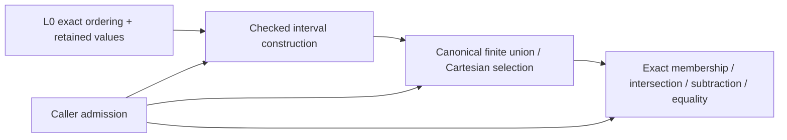

# Exact Parameter Domain

## Purpose and Scope

Implemented child of [Original Domain Identity](../DESIGN.md), without children.
Own exact ordered parameter sets independently of source geometry and root solving.
The independent implementation is present. The only mathematical dependency is existing
L0 ExactScalarOrdering; arithmetic is not required for interval membership.

## Responsibilities and Boundaries

Construct, compare, intersect, subtract and union exact intervals and finite unions;
compose curve/surface Cartesian selections. Retain original endpoint scalar owners,
open/closed flags and inherited depths. Shape issuers supply the semantic parameter
space; this kernel never decides a period, pole, source validity or XYZ dimension.
Nonrectangular trim predicates retain their boundary owner and are not approximated
by this kernel's Cartesian envelopes.

## Related Designs

| Design | Relationship | Contract Used | Summary | Cautions |
|---|---|---|---|---|
| [Parent](../DESIGN.md) | parent | Scope and source semantics | Part of issuer foundation | No shape types |
| [L0](../../RationalBivariateAlgebra/ExactScalar/DESIGN.md) | depends on | ExactScalarOrdering, retained values, admission/depth | Exact compare or typed failure | Unknown is never equal |
| [L2](../../RationalBivariateAlgebra/ExactRealRoot/DESIGN.md) | coordinates with | Existing exact interval/bound value contract | Lossless interval consumption | This kernel does not import L2 |
| [Transport](../OriginalParameterTransport/DESIGN.md) | used by | Set membership and intersection | Parameter-map support | Transport arithmetic stays outside |
| [Coverage](../OriginalDomainCoverage/DESIGN.md) | used by | Whole set equality and endpoint events | Proves complete cover | Samples cannot replace it |

## Architecture

## Contracts and Invariants

Public protocols ExactParameterDomainConstructing and ExactParameterDomainQuerying
use an associated ordering domain and opaque immutable interval/set values. Required
operations are interval, empty, union, intersection, difference, contains and setEqual.
Operations take borrowed inputs and the same generic exclusive admission. Concrete
implementations are separate. Correctness-preserving union normalization is owned
by the checked constructor, not an overridable unchecked helper.

The semantic interval has explicit empty or lower/upper bounds; a bound is finite,
negative infinity or positive infinity. Infinities are tagged endpoints, not Double
infinity scalar values. They are never included. Lower>upper is invalid. Equal finite
bounds produce one point exactly when both ends are included; otherwise they produce
empty. Finite membership uses exact ordering and the two inclusion flags. Half-open
intervals, half-lines and the whole line have the same contract. NaN never enters.
Empty is a valid set, not evidence of unsupported source or failed comparison.

Normalize finite unions by exact endpoint events. Two touching intervals may join
only if the common endpoint is included by at least one interval. If neither includes
it, that hole survives. Difference can create disconnected intervals and invert cut
endpoint inclusion. Comparisons preserve original field/axis compatibility; unrelated
fields fail rather than comparing numerical representatives. Zero-dimensional Cartesian
products contain one empty tuple; an empty axis makes any positive-arity product empty.
Stored parameter arity is not the dimension of an intersection or its XYZ image.

One canonical implementation owns this interval meaning. During implementation,
the existing L2 bound/interval value storage is factored into this L0-only component
where structurally compatible. L2 keeps its existing names through compatibility
aliases or lossless wrappers and delegates interval semantics to the common constructor.
Its inherited depth remains retained. Root-specific algorithms and admission axes stay
in L2. There must not be two independently maintained interval validators. The L2 composition delegates to the shared checked constructor and requires
the isolated L2 interval/count regression. The root facade preserves its existing error classification, endpoint
field validation and depth checks through explicit failure mapping, without resetting
or duplicating admission. Its isolated compiler input manifest must include the shared
DI.0 value kernel alongside L0, while the DI.0-only manifest remains free of L2.
No coefficient field, root isolation or import-through-Double is added.

Intrinsic angular labels can use exact scalar ordering in their own parameter space.
Physical-radian and symbolic phase expressions need their actual source order provider;
a mathematical pi enclosure cannot be cast to an exact algebraic endpoint. Providers
must satisfy the same compare-or-failure requirement. An unavailable phase comparison
is explicit incomplete support, not rounding or a new tolerance membership rule.

## State, Ownership, and Lifecycle

Immutable values retain ordering/scalar ownership and axis semantics. Endpoint and
range views retain their owner. Invocation-local ordered buffers are admitted before
allocation; there is no mutable cache. The common source code has the same Sendable
and ownership contract on all targets. Generic protocol requirements permit static
specialization; no existential extension-only operation is needed.

## Failure, Concurrency, and Constraints

Invalid endpoints, foreign field/axis and overflow are typed failures. ExactScalarFailure
for order, depth, work, bytes or cancellation propagates unchanged. Empty set publication
requires completed construction. Every visited endpoint/event and emitted interval is
charged. No epsilon, root solver, implicit ledger or numeric min/max on representatives.

## Verification and Change Impact

Independent literal fixtures exercise every open/closed endpoint combination, singleton
and empty construction, difference/union holes, whole/half-line sets, disconnected
selections, Cartesian arity, foreign field/axis, released-input owners and work/storage/
depth/cancel limits including final publication. Compare set operations with direct
exact membership at all endpoint cells and open sectors. Existing L2 open/closed/
singleton/unbounded/count fixtures verify the shared-value composition. A
separate L0+DI.0 compiler inventory must exclude L1-L6 and Geometry shape implementations.
No downstream shape or solver build is part of isolated DI.0 acceptance.

### Implementation and acceptance boundary

`ExactParameterDomain<F>` implements both public protocols. A domain context owns one
immutable parameter-axis authority and its inherited depth. Copies preserve that
context; `init(retaining:using:)` restores it from a surviving set without another
allocation. Binding raw scalar intervals explicitly validates finite endpoints under
that axis's ordering provider. Bound set operations reject another context.
`ExactParameterProduct` retains its ordered axes, each with its own field/axis owner;
tuple validation uses each retained provider. The product's issuing context controls
subsequent product queries. Zero arity and empty-axis state are computed during the
admitted construction scan, making metadata access constant time.

`ExactParameterInterval.checked` is the sole interval validator. The scalar interval
is independent of an axis, retaining bound values and explicit inherited depth.
`retainingDepth` only joins causal depths; it cannot weaken them. L2's lossless
wrappers retain its existing public storage fields and tagged bound cases. Its facade
maps typed failures and preserves depths discovered by its scalar admission. A
source-side provider must validate its own retained endpoint depths in sign/compare;
source issuers additionally pass inherited source depth when constructing the axis.
No root dependency or second interval validator is introduced.

Unsorted raw input uses one admitted insertion-sort scratch buffer, O(n²) worst case,
and one canonical output buffer. Every comparison/shift scan is charged. Existing
canonical union/intersection/difference use ordered sweeps, O(n+m) comparisons plus
output; membership is O(n) and structural set equality O(n). Output capacity is bounded
by n+m. Admission counts generated typed payload bytes and immutable owner headers;
allocator rounding/Swift Array capacity overhead is not claimed to be peak physical
memory. ArraySlice views and product-axis sharing do not copy retained payload.
The view fixture checks shared buffer addresses inside scoped standard-library borrows.

Behavior owners: [isolated package](../../../../Tests/OriginalDomainIdentityVerification/Package.swift),
[fixtures](../../../../Tests/OriginalDomainIdentityVerification/Sources/Fixtures/DomainFixtures.swift),
[tests](../../../../Tests/OriginalDomainIdentityVerification/Tests/DomainTests.swift),
and [verification](../../../../Tests/OriginalDomainIdentityVerification/Evidence/VERIFICATION.md).
Only this component and the L2 interval facade are implemented in this task. Transport,
source-chart coverage, periods, poles and source-structural identity remain separate
unimplemented children. Their design is not evidence of implemented source issuance.

The isolated L2 facade keeps its bound enum and read-only interval member types local
to L2. The interval contains exactly one shared DI0 value; bound conversion preserves
finite values and infinity tags, adds no coefficient buffer, and performs no second
validation. This avoids leaking the DI0 alias into consumers on Embedded, whose
specialization requires the declaring module to be imported by the consuming file.
Only the root construction/access files import DI0; no upper source changes are needed.

## Explicit query ordering field

The refining ExactParameterDomainFieldQuerying protocol adds membership under an
explicit ordering field without changing existing querying conformers. The retained
set still owns its axis and depth: the original domain re-admits that set, then the
query field validates the coordinate and every finite endpoint before comparison.
A descendant algebraic field can therefore compare a new algebraic coordinate to
ancestor bounds without rebinding/copying the set. Foreign values/fields, depth,
resource and cancellation failures remain typed; exclusion never hides validation.
Existing membership continues to use the retained field with unchanged admission.
M6 consumer fixtures own the descendant-field integration counterexample.
