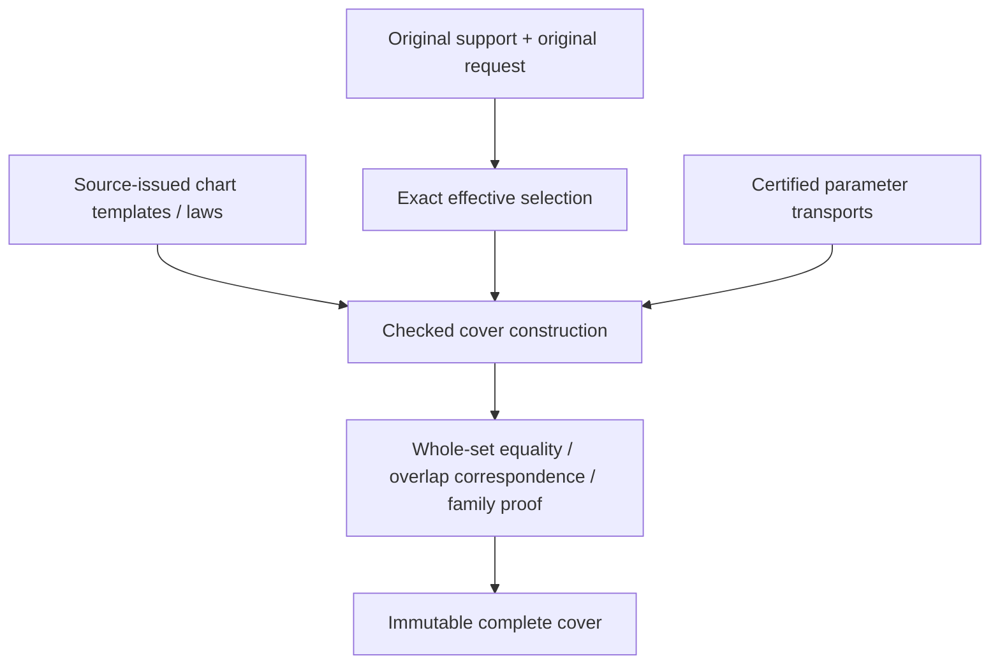

# Original Domain Coverage

## Purpose and Scope

The composition handoff additionally owns `OriginalIssuedDomainBinding`: consume
immutable issued laws and an independently authoritative requested source frame,
prove every finite affine template correspondence, and retain the existing complete
cover together with the selected inverse images and law indices. A law support
union never defines the authoritative source support. Missing templates fail with
the existing incomplete-coverage error; periodic/unbounded and non-affine transport
remain outside this finite handoff. All original source/chart owners and both proof
depth axes survive. Verification composes the new binding with unchanged domain/lower
implementations using independent products; no production-target build.

`DefaultOriginalDomainCoverIssuer.issue` returns selected charts in input-template
order, preserving each retained local frame. Templates with empty selected images
are omitted. The issued-law binder uses this contract to associate template indices
in one forward scan; equal geometric or coefficient values never determine identity.

Child of [Original Domain Identity](../DESIGN.md), without children.
Own complete source/request coverage by charts or certified chart families.
Chart coverage is parameter coverage; it does not assert solution existence or
source-map injectivity. Shape producers remain responsible for authored laws.

## Responsibilities and Boundaries

Retain original support, original request, exact effective selection, every selected
chart's local support/transport and all overlap ownership. A separate numerical or
mesh chart width policy does not constrain this intersection issuer's source meaning.
Coverage construction consumes exact set/transport contracts and shape-source tokens.

## Related Designs

| Design | Relationship | Contract Used | Summary | Cautions |
|---|---|---|---|---|
| [Parent](../DESIGN.md) | parent | Source and completeness invariants | Common admission | No partial success |
| [Exact domains](../ExactParameterDomain/DESIGN.md) | depends on | Effective set and exact set equality | Verifies finite coverage | Closed-owner overlap is intentional |
| [Transport](../OriginalParameterTransport/DESIGN.md) | depends on | Whole-chart correspondence | Maps local support to authored space | Preserve unreduced cycles |
| [Native curve](../../OriginalNativeCurveChartCover/DESIGN.md) | coordinates with | Original span/law/source ownership | First existing adapter | Exact finite/Double subset only today |
| [Native surface](../../OriginalNativeSurfaceChartCover/DESIGN.md) | coordinates with | Tensor source spans | First existing surface adapter | Homogeneous-only preparation must be separate from jets |
| [Identity](../OriginalParameterIdentity/DESIGN.md) | used by | Chart support/overlap ownership | Scopes equivalence proofs | Coverage alone does not prove a seam law |
| [L5](../../RationalBivariateAlgebra/ExactParametricRelation/DESIGN.md) | used by, proposed | Complete chart domains and maps | Original equations consume domains | Current single-map implementation needs composition |

## Architecture



## Contracts and Invariants

OriginalDomainCoverIssuing constructs a finite declared-frame cover.
OriginalDomainCoverQuerying exposes support/request/effective sets, a finite chart
view and incident indices. It does not expose symbolic family operations. Source
provenance is retained through its frames/transports. Specialized Native/sphere
issuers establish source support independently of the caller's declared frame.
No root/XYZ API is part of these protocols. Source-law references retain issuer
authority rather than unchecked callbacks.

### Protocol capabilities and implementation selection

| Contract | Status | Responsibility and implementation |
|---|---|---|
| OriginalDomainCoverIssuing / Querying | Implemented | Verify/read finite frame-relative coverage; DefaultOriginalDomainCoverIssuer does not inspect shapes |
| OriginalBSplineDomainIssuing | Implemented | DefaultOriginalBSplineDomainIssuer derives Native support/spans/periods through OriginalBSplineSourceReading and uses common DI verification |
| OriginalIntrinsicSphereDomainIssuing | Implemented | DefaultOriginalIntrinsicSphereDomainIssuer derives canonical intrinsic support and retains its certified longitude period |
| OriginalDomainBoundRationalChartIssuing | Implemented Native capability | DefaultOriginalDomainBoundBSplineChartIssuer combines the same source law, selected occurrence and local selection; it proves no intersection |
| OriginalChartFamilyQuerying | Implemented at M1 | Generic requirement dispatch for integer-indexed Native/sphere covers, retained support and explicit member/incident; no flattening or replacement owner |

The new family-query protocol is required because OriginalDomainCoverQuerying's
finite `charts` view cannot describe an unbounded set of occurrences. It is an
interface on retained covers, not another execution layer or a type-erased wrapper.
Use Source/Field associated types and an associated Occurrence type so different
source-issued chart keys remain statically typed. Its protocol requirements expose
the retained source, support/request/effective selection, finite template count,
integer-family rank, member lookup by template and exact cycle vector, and all
incident occurrences at an exact tuple. All fallible queries take the explicit
generic admission and DI limits. An occurrence retains its template owner, exact
unreduced cycles, selected image and original correspondence. A zero-rank cover
may implement the same query capability; this does not turn an infinite family
into a finite `charts` view.

The following declaration is a design contract, not an existing source symbol:

```swift
public protocol OriginalChartFamilyQuerying: Sendable {
    associatedtype Source: Sendable
    associatedtype Field: ExactScalarArithmetic & ExactScalarOrdering
    associatedtype Occurrence: Sendable
    var source: OriginalSourceBinding<Source> { get }
    var support: OriginalParameterSelection<Source, Field> { get }
    var request: OriginalParameterSelection<Source, Field> { get }
    var effective: OriginalParameterSelection<Source, Field> { get }
    var templateCount: Int { get }
    var integerFamilyRank: Int { get }
    func member<A: ExactScalarAdmission & ~Copyable>(
        template: Int, cycles: borrowing [OriginalParameterCycle],
        limits: OriginalDomainIdentityLimits, using admission: inout A
    ) throws(OriginalDomainIdentityFailure) -> Occurrence
    func incident<A: ExactScalarAdmission & ~Copyable>(
        at tuple: borrowing [Field.Value], limits: OriginalDomainIdentityLimits,
        using admission: inout A
    ) throws(OriginalDomainIdentityFailure) -> [Occurrence]
}
```

The cycle vector has authored parameter arity, with exact zero on nonperiodic
axes; family rank counts only independently certified periodic axes. Member lookup
may return a valid occurrence with empty selected image. Incident lookup returns
every selected incident side, or no occurrences only after effective-membership
exclusion. Both operations reject foreign scalars/indices and obey retained depths.
The family-specific law issuer consumes that typed occurrence/cover with the same
Source and Field, so the query protocol need not erase different chart-key types.
No operation exposes an iterator that promises to finish over all integer cycles.

Family-query conformance verifies template/index ownership and complete family
authority. It cannot publish a new proof by adding an extension to an arbitrary
array. Native member/incident algorithms already exist; sphere incident queries
exist, while explicit template/member query conformance remains to be implemented.
The same fixture body must exercise both the concrete and generic requirement
calls, including Embedded witness behavior, before this capability is completed.

Specialized issuers receive the smallest required generic protocol dependencies
from their composition root: transport, cover verification, source-period/local-law
issuance as applicable. Match source and coefficient owners through associated-type
constraints and runtime binding checks. Current direct Default construction is
preserved until that injection migration is verified. Common DI does not select
shape enums, request a stronger coefficient field or import a hidden solver.

### Required source-family obligations

The following rows specify domain responsibilities, not newly completed source
formulas. A missing source law/correspondence remains an explicit upstream
implementation dependency under the unchanged full-family acceptance.

| Source capability | Specialized issuer must establish | Evidence handed to common DI | Current DI scope |
|---|---|---|---|
| Native curve/tensor B-spline | Every positive span, exact support, one-sided knot owners, independent cyclic axes | Original chart keys, complete fundamental cover and source-period receipts | Foundation implemented; public multi-span/periodic composition pending |
| Intrinsic sphere | Full two-coordinate support, longitude lifts, exact latitude boundaries | Canonical period/pole authority and all selected longitudes | Foundation implemented; general public consumers pending |
| Line / stored-N plane | Entire unbounded support and exact authored coordinate meaning | Original line law or exact plane-basis owner, support and chart correspondence | Plane basis/coordinate operations exist; full domain/public wiring pending |
| Physical-angle conics / analytic surfaces | Actual angular domains, all seams/branches, original UV and genuine periods | Exact phase/chart correspondence, period/collapse evidence | Image-only source receipts do not establish this capability |
| Spatial operation words | Unchanged parameter support through the retained spatial action | Descendant cover, original word owner and mapped local law | Domain composition pending; spatial action does not itself authorize new parameter identity |
| Affine parameter images / directed traversal | Pullback of the original descendant support, axis roles, reversal and all lifts | Original exact gain/offset word and verified descendant correspondence | Source laws exist in bounded capabilities; complete domain composition pending |
| Nonlinear / singular parameter images | Full supported correspondence, including every preimage and guard | Source-issued relational correspondence; never a guessed inverse | Pending beyond current affine transport; inverse refusal must not discard the required relation |
| Ruled / Coons / revolution / remaining procedural | Original construction domains, descendant restrictions and declared boundaries | Owned child charts/laws/maps and any genuine seam/collapse theorem | Pending complete DI issuance; derivative/normal work remains outside DI |
| Implicit / certified / lift / join / guide | The actual authored parameterization and supported relation to descendants | Original chart authority and full parameter correspondence | Pending where only image membership is issued |

For non-Cartesian restrictions, preserve the separately certified boundary/relation
predicate owner and its exact chart correspondence. DI's interval-product kernel
does not replace it by a bounding box. Pullback/selection must be discharged by
the owner of that restriction before a consumer claims complete restricted coverage.
Until the necessary correspondence capability exists, the required path fails
explicitly and remains incomplete; this is not an alternate approximation policy.

Finite/source-family issuers publish only after whole coverage, owner compatibility
and final cancellation checks. Source-issued local guards are retained when domain
selection is combined with a law; parameter coverage never implies denominator
validity or root exclusion. Converting an implicit image receipt into a complete
parameter cover is prohibited without an independent full correspondence proof.

For finite covers, mapped selected charts have union exactly equal to the effective
selection, and each is a subset of the authored support. An exact endpoint event
sweep or Cartesian refinement verifies inclusion/gaps against the retained request;
checking sample points, summed lengths/areas or an array count is insufficient.
Every overlap retains incident chart sides and parameter transports. A singleton
Native knot retains both one-sided owners; a tensor corner retains all applicable
owners. Zero-width knot spans are not ordinary charts. Empty effective selection
retains complete request-versus-support exclusion, not an empty candidate list.

The stored geometric support may be open or unbounded. One unbounded parameter
chart can cover a line/plane without any finite window. Periodic unbounded requests
require a finite template cover plus an exact integer-indexed family certificate:
source period law, complete fundamental support, integer index domain, exact lift,
selection predicate and a proof that every requested coordinate has a template/lift.
Merely storing a lazy generator does not establish these properties. Repeated root
families and original lifts must remain symbolically represented by downstream
results; a consumer demanding an infinite flat array fails explicitly rather than
truncating. Finite requests materialize only admitted charts with checked counts.
No signed-Int overflow is repaired by saturating or wrapping a cycle.

A pole does not shrink an ambient two-coordinate support into a one-coordinate set.
Its collapsed image is retained as a separate identity/fiber witness. The latitude
boundary and every selected longitude stay in the cover. Open pole boundaries exclude
the pole exactly; near-pole points are not collapsed. Infinite endpoint inclusion is
always false; limiting XYZ values are not extra domain points.

Native adaptation validates the original cyclic law, not just its isPeriodic flag.
Exact knots/control laws and original parameter meaning stay unchanged. General
shapes supply their actual supported chart law/transport tokens; unsupported required
coverage remains explicit unfinished implementation. Spatial transforms and parameter
images preserve the original source binding through checked transport, not conversion
of a bounding box or fitted rational surface.

## Runtime Flows

Retain original support/request -> exact intersection -> validate chart templates ->
transport/select -> verify union and ownership/family theorem -> reserve receipt ->
final cancellation. Existing source extraction prepares only required homogeneous
laws. Jets/normals/silhouettes are prepared by separate consumers when necessary.

## State, Ownership, and Lifecycle

One immutable owner stores source, set receipts, chart templates, selected ranges,
transports and proof handles. Views use owner plus index/range; repeated operations
share original buffers. No callback is retained as a promise of coverage. Both source
release and a caller mutation of its COW copy leave proof authority unchanged.

## Failure, Concurrency, and Constraints

Missing chart boundaries, incompatible source tokens, unknown selection or missing
family theorems yield incompleteCoverage or the exact lower failure. Chart count,
family template count, source/transport depth, work and bytes are independently
admitted before allocation. All chart/event/index visits are charged; final cancel
prevents empty/partial successful receipts. Immutable concurrent readers use separate
explicit query admissions. Native/normal/Embedded keep identical owner semantics.

## Verification and Change Impact

Independent expected endpoint cells and open sectors refute holes/extra coverage.
Required cases include nonclamped/multispan/native joins, singleton seams and tensor
corners, negative/large independent cycles, reversed maps, open endpoints, disconnected
requests, exact empty support intersections and unbounded charts/families. Reject a
missing chart even when samples/length sum agree. Test source lifetime, foreign owner,
period-law mismatch, independent count/work/storage/depth and final cancellation.
Existing Native cover suites remain adapter regression owners. New cover acceptance
must include current limits and actual portable execution; source-only adapters do
not establish domain completion or whole-seven acceptance.

## Implementation Boundary

`OriginalDomainCover` certifies exact parameter coverage relative to a declared frame.
It is not an assertion that a caller's frame is a shape's whole support.
`OriginalBSplineDomainSpace` is issued only from a validated retained Native reader;
it derives original knots, positive spans, full support and independently proved periods.
`OriginalBSplineDomainCover` retains the original request and its exact support
intersection. Nonperiodic covers are finite. Periodic covers retain all-integer
Cartesian families over a verified complete closed fundamental cover; `member` and
`incident` materialize only the requested lifts, preserving both seam sides.
No operation implicitly flattens an infinite family.


## M0 implementation acceptance and ownership

This matrix fixes mandatory inputs, proof gaps and receiving consumers. Source
law issuance owns coordinate meaning; coverage never infers it from an image
polynomial. M0-M3 do not change L0-L5 authority, numerical tolerances or limits.

| Family / concrete input | Required domain and correspondence | Existing authority / owned repair | Acceptance / consumer |
|---|---|---|---|
| Native degree-one line and weighted multi-span curve | All positive spans; exact open, closed, singleton, disconnected and excluded requests | OriginalBSplineSourceReading, chart and period receipts; no new producer | member/incident preserve both knot sides; public CS includes all TUV |
| Native tensor surface with independently periodic U/V | Finite selections with independent arbitrary-size cycles; all seam sides | Same source receipts; NativeExactRelations owns multi-chart compilation/publication | CS/SSI cover every selected chart pair; folded fixture retains current work/storage ceilings |
| Infinite original line with nonunit direction | Entire real parameter axis, original origin/direction | OriginalLinearSourceReading; source owner supplies unbounded support, not a finite chart-window law | No intersection request invents whole support; exact selected position and exclusion |
| Stored-N plane, scaled and oblique N | Entire real UV product; exact normalized basis and inverse projection under N+origin authority | OriginalPlaneSourceReading / OriginalPlaneBasisReceipt; source provider and evaluation/UV handoff owned by OriginalSourceIssuance | Exact plane equation, UV roundtrip, owner retention; rounded old basis is not proof |
| Circle/ellipse, hyperbola/parabola | Full authored angular or real coordinate and branch; radius/axis positivity | Conic source-coordinate reading/law capability is missing and belongs to source owner | Original branch/all parameters retained, full support and exact boundaries; no image-only UV assertion |
| Cylinder / cone | Authored angular axis and unbounded axial/radial axis, apex fiber for cone | Primitive/cone image receipts exist; source angular coordinate/phase and branch law are missing | Period proof uses actual original angular map; all apex UV retained |
| Sphere | Intrinsic longitude family, closed latitude and both poles; physical-angle sources retain their distinct meaning | Intrinsic sphere period/pole receipts exist; physical angular source-law capability is separate | Generic family member and incident agree; near-pole cannot become pole |
| Torus | Two independent original angular axes and complete branch/fiber correspondence | Primitive image receipt exists; two-axis source-coordinate law is missing | Independent cycles, seams and all UV retained |
| Rigid/affine/parameter image/original word | Whole descendant support pullback, exact reversal and original axes | Existing OSI word/image/traversal receipts; M4 consumes them | Finite/infinite requests compose without invented inverse |
| Offset/rolling-ball/revolution/Coons/correction/derivative/draft/angular transport | Original construction domains, joins and child correspondence | Existing ruled/Coons receipts reused; remaining specific laws delivered by source owner at M4 | Every defined branch/guard retained; unsupported cannot complete a required cell |
| Implicit/certified/lift/join/guide | Certified original relation and non-Cartesian guards, complete preimages | Specific source relation capabilities delivered by source owner at M4 | Boundary/self/XYZ consume the same certified relation at M6/M7 |

Nonlinear or singular parameter correspondence is a relation, not
OriginalParameterTransport's invertible affine map. Its future receipt must retain
source/target bindings, original equations, denominator/branch guards, complete
selected domain and all preimages. Forward/inverse queries return complete fibers
or typed failure under a fresh explicit admission; no unique inverse is promised.
Non-Cartesian material restrictions stay certified predicates over an ambient
cover. Their implementation belongs to M4; this contract does not authorize
pretending a bounding box proves material membership.

A symbolic public result at M7 retains the family owner, template, independent
integer cycle vector, authored parameter correspondence and full requested
coverage. Its member/incident queries use explicit admissions and preserve all
UV/fibers. A finite convenience entry explicitly refuses an unbounded family;
it cannot silently select one cycle or a finite search window. M2 accepts bounded
requests only and enumerates their complete finite chart occurrences.

| Exclusive owner | Exact files / resources |
|---|---|
| Common DI | OriginalDomainCoverage/OriginalChartFamilyQuerying.swift; existing cover, bound-chart issuer and family methods; OriginalParameterTransport contracts only when required; Tests/OriginalDomainIdentityVerification family fixtures/proof/tests |
| Native composition | NativeExactRelations/*.swift and changed public consumer requirements; its DESIGN and Tests/NativeExactRelationVerification fixtures; separate Native composition scratch path |
| Source authority | OriginalSourceIssuance reading/law/provider/receipt files and original evaluation/UV handoffs; its DESIGN and Tests/OriginalSourceIssuanceVerification; shared source changes serialize |
| Linear/plane issuance | Dedicated linear/plane issuing protocols and implementations in OriginalDomainCoverage; dedicated primitive fixtures in domain verification |
| Angular issuance | Dedicated conic/analytic issuing protocols and implementations in OriginalDomainCoverage; dedicated angular fixtures in domain verification |
| Integration | PROGRESS.md, exact input/artifact receipts and independent latest-main worktree; no simultaneous edits of implementation owners' files |

The implementation task currently has one writer on an isolated worktree. File
owners describe responsibility boundaries, not concurrently dispatched agents.
Independent Native, ASAN, ordinary WASM and Embedded scratch paths never mutate
the same build directory. Each milestone records actual behavioral evidence and
its commit before it is marked complete. The matrix itself is not evidence that
any missing source law is implemented.

## M1 implemented composition

Native and intrinsic sphere covers conform to OriginalChartFamilyQuerying.
The default Native issuer delegates to overloads accepting period, parameter
transport and cover-issuance protocols. Bound-chart issuance separately accepts
the rational source-law and transport protocols. Intrinsic issuance accepts its
source-law and transport protocols. All associated Source, Field and chart
Selection types must match statically. Defaults preserve existing call sites;
there is no existential erasure, global cache, mutable owner or new ledger.

Injected source receipts are checked for the retained source/chart owner and
original coordinate role before composing a result. Native period endpoints and
period length must match the authoritative knot interval; a receipt from another
binding fails even when original values are equal. Generic query tests exercise
zero-rank and independent families, arbitrary-size signed cycles, seam/pole
incidence, malformed cycles and terminal cancellation. Both source and transport
failures propagate through the existing typed failure contracts.
