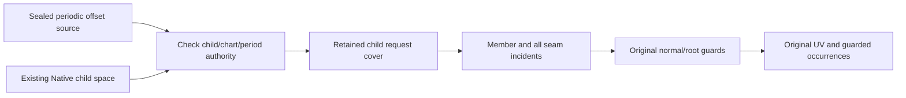
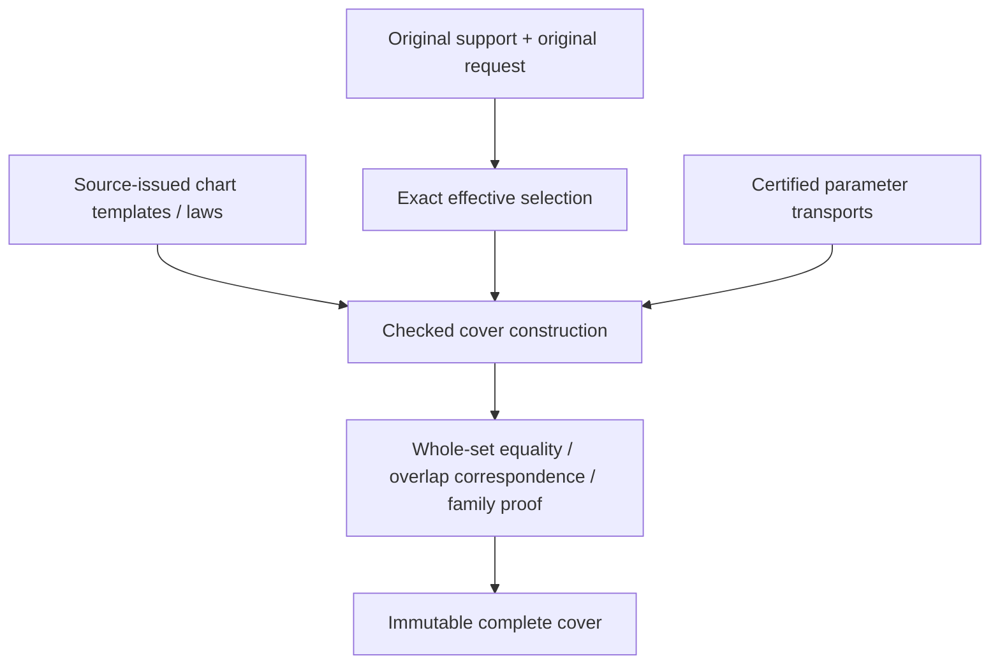
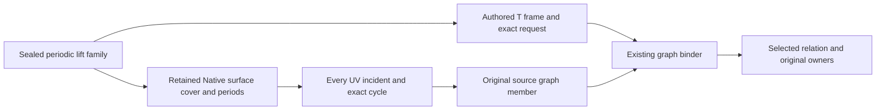

# Original Domain Coverage

## Periodic Native offset domain composition

The periodic offset domain issuer consumes the sealed source fundamental family
and an existing Native child domain space from the same retained child owner and
scalar field. It checks every chart key and period against that space; source law
order need not equal DI template order. It retains a checked ordinal map rather
than copying chart laws. The original offset UV support is all real values on each
proved periodic axis and the original finite support on other axes. Requests are
intersected exactly, including open/disconnected/singleton/empty selections.

Member and enclosure-incident queries delegate arbitrary-size cycle arithmetic,
all seam sides and exact selected correspondence to the existing Native cover.
The occurrence retains original parent selection, child transport, cycle vector,
source family and law ordinal. Position queries evaluate the original offset guard
in the occurrence's fundamental coordinates; lifted queries additionally validate
the positive normal-length root. Nonowning upper knot/seam germs remain available
as occurrences but cannot claim canonical offset position. Every coordinate is
validated before exclusion, including empty requests and the auxiliary root.



The additive public protocol exposes cycle-aware member/enclosure/guarded queries
as requirements, including Embedded generic protocol dispatch. It does not
flatten the infinite family. Same-ledger storage/work, chart/family/source/transport
and coefficient depths, final cancellation and immutable source lifetime remain
mandatory. No geometry solver, new normal formula or unchecked coverage callback
is introduced. Existing finite offset APIs retain their scope. Final symbolic
CS/SSI/image/fiber output is still M7. Verification belongs to the focused periodic
offset fixture and retained finite-offset fixtures; see [source authority](../../OriginalSourceIssuance/DESIGN.md#periodic-native-offset-supply).

## Purpose and Scope

The composition handoff additionally owns `OriginalIssuedDomainBinding`: consume
immutable issued laws and an independently authoritative requested source frame,
prove every finite affine template correspondence, and retain the existing complete
cover together with the selected inverse images and law indices. A law support
union never defines the authoritative source support. Missing templates fail with
the existing incomplete-coverage error; periodic/unbounded and non-affine transport
remain outside this finite handoff. All original source/chart owners and both proof
depth axes survive. Verification composes the new binding with unchanged domain/lower
implementations using independent products; no production-target build.

`DefaultOriginalDomainCoverIssuer.issue` returns selected charts in input-template
order, preserving each retained local frame. Templates with empty selected images
are omitted. The issued-law binder uses this contract to associate template indices
in one forward scan; equal geometric or coefficient values never determine identity.

Child of [Original Domain Identity](../DESIGN.md), without children.
Own complete source/request coverage by charts or certified chart families.
Chart coverage is parameter coverage; it does not assert solution existence or
source-map injectivity. Shape producers remain responsible for authored laws.

## Responsibilities and Boundaries

Retain original support, original request, exact effective selection, every selected
chart's local support/transport and all overlap ownership. A separate numerical or
mesh chart width policy does not constrain this intersection issuer's source meaning.
Coverage construction consumes exact set/transport contracts and shape-source tokens.

## Related Designs

| Design | Relationship | Contract Used | Summary | Cautions |
|---|---|---|---|---|
| [Parent](../DESIGN.md) | parent | Source and completeness invariants | Common admission | No partial success |
| [Exact domains](../ExactParameterDomain/DESIGN.md) | depends on | Effective set and exact set equality | Verifies finite coverage | Closed-owner overlap is intentional |
| [Transport](../OriginalParameterTransport/DESIGN.md) | depends on | Whole-chart correspondence | Maps local support to authored space | Preserve unreduced cycles |
| [Native curve](../../OriginalNativeCurveChartCover/DESIGN.md) | coordinates with | Original span/law/source ownership | First existing adapter | Exact finite/Double subset only today |
| [Native surface](../../OriginalNativeSurfaceChartCover/DESIGN.md) | coordinates with | Tensor source spans | First existing surface adapter | Homogeneous-only preparation must be separate from jets |
| [Identity](../OriginalParameterIdentity/DESIGN.md) | used by | Chart support/overlap ownership | Scopes equivalence proofs | Coverage alone does not prove a seam law |
| [L5](../../RationalBivariateAlgebra/ExactParametricRelation/DESIGN.md) | used by, proposed | Complete chart domains and maps | Original equations consume domains | Current single-map implementation needs composition |

## Architecture



## Contracts and Invariants

OriginalDomainCoverIssuing constructs a finite declared-frame cover.
OriginalDomainCoverQuerying exposes support/request/effective sets, a finite chart
view and incident indices. It does not expose symbolic family operations. Source
provenance is retained through its frames/transports. Specialized Native/sphere
issuers establish source support independently of the caller's declared frame.
No root/XYZ API is part of these protocols. Source-law references retain issuer
authority rather than unchecked callbacks.

### Protocol capabilities and implementation selection

| Contract | Status | Responsibility and implementation |
|---|---|---|
| OriginalDomainCoverIssuing / Querying | Implemented | Verify/read finite frame-relative coverage; DefaultOriginalDomainCoverIssuer does not inspect shapes |
| OriginalBSplineDomainIssuing | Implemented | DefaultOriginalBSplineDomainIssuer derives Native support/spans/periods through OriginalBSplineSourceReading and uses common DI verification |
| OriginalIntrinsicSphereDomainIssuing | Implemented | DefaultOriginalIntrinsicSphereDomainIssuer derives canonical intrinsic support and retains its certified longitude period |
| OriginalDomainBoundRationalChartIssuing | Implemented Native capability | DefaultOriginalDomainBoundBSplineChartIssuer combines the same source law, selected occurrence and local selection; it proves no intersection |
| OriginalChartFamilyQuerying | Implemented at M1 | Generic requirement dispatch for integer-indexed Native/sphere covers, retained support and explicit member/incident; no flattening or replacement owner |

The new family-query protocol is required because OriginalDomainCoverQuerying's
finite `charts` view cannot describe an unbounded set of occurrences. It is an
interface on retained covers, not another execution layer or a type-erased wrapper.
Use Source/Field associated types and an associated Occurrence type so different
source-issued chart keys remain statically typed. Its protocol requirements expose
the retained source, support/request/effective selection, finite template count,
integer-family rank, member lookup by template and exact cycle vector, and all
incident occurrences at an exact tuple. All fallible queries take the explicit
generic admission and DI limits. An occurrence retains its template owner, exact
unreduced cycles, selected image and original correspondence. A zero-rank cover
may implement the same query capability; this does not turn an infinite family
into a finite `charts` view.

The following declaration is a design contract, not an existing source symbol:

```swift
public protocol OriginalChartFamilyQuerying: Sendable {
    associatedtype Source: Sendable
    associatedtype Field: ExactScalarArithmetic & ExactScalarOrdering
    associatedtype Occurrence: Sendable
    var source: OriginalSourceBinding<Source> { get }
    var support: OriginalParameterSelection<Source, Field> { get }
    var request: OriginalParameterSelection<Source, Field> { get }
    var effective: OriginalParameterSelection<Source, Field> { get }
    var templateCount: Int { get }
    var integerFamilyRank: Int { get }
    func member<A: ExactScalarAdmission & ~Copyable>(
        template: Int, cycles: borrowing [OriginalParameterCycle],
        limits: OriginalDomainIdentityLimits, using admission: inout A
    ) throws(OriginalDomainIdentityFailure) -> Occurrence
    func incident<A: ExactScalarAdmission & ~Copyable>(
        at tuple: borrowing [Field.Value], limits: OriginalDomainIdentityLimits,
        using admission: inout A
    ) throws(OriginalDomainIdentityFailure) -> [Occurrence]
}
```

The cycle vector has authored parameter arity, with exact zero on nonperiodic
axes; family rank counts only independently certified periodic axes. Member lookup
may return a valid occurrence with empty selected image. Incident lookup returns
every selected incident side, or no occurrences only after effective-membership
exclusion. Both operations reject foreign scalars/indices and obey retained depths.
The family-specific law issuer consumes that typed occurrence/cover with the same
Source and Field, so the query protocol need not erase different chart-key types.
No operation exposes an iterator that promises to finish over all integer cycles.

Family-query conformance verifies template/index ownership and complete family
authority. It cannot publish a new proof by adding an extension to an arbitrary
array. Native member/incident algorithms already exist; sphere incident queries
exist, while explicit template/member query conformance remains to be implemented.
The same fixture body must exercise both the concrete and generic requirement
calls, including Embedded witness behavior, before this capability is completed.

Specialized issuers receive the smallest required generic protocol dependencies
from their composition root: transport, cover verification, source-period/local-law
issuance as applicable. Match source and coefficient owners through associated-type
constraints and runtime binding checks. Current direct Default construction is
preserved until that injection migration is verified. Common DI does not select
shape enums, request a stronger coefficient field or import a hidden solver.

### Required source-family obligations

The following rows specify domain responsibilities, not newly completed source
formulas. A missing source law/correspondence remains an explicit upstream
implementation dependency under the unchanged full-family acceptance.

| Source capability | Specialized issuer must establish | Evidence handed to common DI | Current DI scope |
|---|---|---|---|
| Native curve/tensor B-spline | Every positive span, exact support, one-sided knot owners, independent cyclic axes | Original chart keys, complete fundamental cover and source-period receipts | Foundation implemented; public multi-span/periodic composition pending |
| Intrinsic sphere | Full two-coordinate support, longitude lifts, exact latitude boundaries | Canonical period/pole authority and all selected longitudes | Foundation implemented; general public consumers pending |
| Line / stored-N plane | Entire unbounded support and exact authored coordinate meaning | Original line law or exact plane-basis owner, support and chart correspondence | Plane basis/coordinate operations exist; full domain/public wiring pending |
| Physical-angle conics / analytic surfaces | Actual angular domains, all seams/branches, original UV and genuine periods | Exact phase/chart correspondence, period/collapse evidence | Image-only source receipts do not establish this capability |
| Spatial operation words | Unchanged parameter support through the retained spatial action | Descendant cover, original word owner and mapped local law | Domain composition pending; spatial action does not itself authorize new parameter identity |
| Affine parameter images / directed traversal | Pullback of the original descendant support, axis roles, reversal and all lifts | Original exact gain/offset word and verified descendant correspondence | Source laws exist in bounded capabilities; complete domain composition pending |
| Nonlinear / singular parameter images | Full supported correspondence, including every preimage and guard | Source-issued relational correspondence; never a guessed inverse | Pending beyond current affine transport; inverse refusal must not discard the required relation |
| Ruled / Coons / revolution / remaining procedural | Original construction domains, descendant restrictions and declared boundaries | Owned child charts/laws/maps and any genuine seam/collapse theorem | Pending complete DI issuance; derivative/normal work remains outside DI |
| Implicit / certified / lift / join / guide | The actual authored parameterization and supported relation to descendants | Original chart authority and full parameter correspondence | Pending where only image membership is issued |

For non-Cartesian restrictions, preserve the separately certified boundary/relation
predicate owner and its exact chart correspondence. DI's interval-product kernel
does not replace it by a bounding box. Pullback/selection must be discharged by
the owner of that restriction before a consumer claims complete restricted coverage.
Until the necessary correspondence capability exists, the required path fails
explicitly and remains incomplete; this is not an alternate approximation policy.

Finite/source-family issuers publish only after whole coverage, owner compatibility
and final cancellation checks. Source-issued local guards are retained when domain
selection is combined with a law; parameter coverage never implies denominator
validity or root exclusion. Converting an implicit image receipt into a complete
parameter cover is prohibited without an independent full correspondence proof.

For finite covers, mapped selected charts have union exactly equal to the effective
selection, and each is a subset of the authored support. An exact endpoint event
sweep or Cartesian refinement verifies inclusion/gaps against the retained request;
checking sample points, summed lengths/areas or an array count is insufficient.
Every overlap retains incident chart sides and parameter transports. A singleton
Native knot retains both one-sided owners; a tensor corner retains all applicable
owners. Zero-width knot spans are not ordinary charts. Empty effective selection
retains complete request-versus-support exclusion, not an empty candidate list.

The stored geometric support may be open or unbounded. One unbounded parameter
chart can cover a line/plane without any finite window. Periodic unbounded requests
require a finite template cover plus an exact integer-indexed family certificate:
source period law, complete fundamental support, integer index domain, exact lift,
selection predicate and a proof that every requested coordinate has a template/lift.
Merely storing a lazy generator does not establish these properties. Repeated root
families and original lifts must remain symbolically represented by downstream
results; a consumer demanding an infinite flat array fails explicitly rather than
truncating. Finite requests materialize only admitted charts with checked counts.
No signed-Int overflow is repaired by saturating or wrapping a cycle.

A pole does not shrink an ambient two-coordinate support into a one-coordinate set.
Its collapsed image is retained as a separate identity/fiber witness. The latitude
boundary and every selected longitude stay in the cover. Open pole boundaries exclude
the pole exactly; near-pole points are not collapsed. Infinite endpoint inclusion is
always false; limiting XYZ values are not extra domain points.

Native adaptation validates the original cyclic law, not just its isPeriodic flag.
Exact knots/control laws and original parameter meaning stay unchanged. General
shapes supply their actual supported chart law/transport tokens; unsupported required
coverage remains explicit unfinished implementation. Spatial transforms and parameter
images preserve the original source binding through checked transport, not conversion
of a bounding box or fitted rational surface.

## Runtime Flows

### Native rolling-ball graph domain consumption

The rolling-ball domain issuer consumes the sealed complete three-child graph
family from [source issuance](../../OriginalSourceIssuance/DESIGN.md#rolling-ball-native-child-graph-family).
It issues an authored UV frame over the original normalized square, verifies
source ownership/coordinate semantics/exact frame support, and intersects the
retained request with that enclosure. Per-template members use the existing graph
binder and retain all positive-root/normalization/regular-arc guards. A request box
does not prove those guards. Lifted incident queries preserve all five graph
coordinates while only U/V belong to the source domain. They validate all coordinate
fields before empty selection can short-circuit, then preserve every closed child
chart incident. No unique inverse, root search or Boolean UV-only validity callback
is introduced. Immutable members retain the same family/source/proof owners;
selection/member/query allocations use one caller admission and terminal cancel.
Focused rolling-ball source/domain verification owns request singleton, strict,
disconnected/empty and foreign-owner/semantics/frame counterexamples. Generic rails
and final ordinary CS/SSI publication remain separate open obligations.

Retain original support/request -> exact intersection -> validate chart templates ->
transport/select -> verify union and ownership/family theorem -> reserve receipt ->
final cancellation. Existing source extraction prepares only required homogeneous
laws. Jets/normals/silhouettes are prepared by separate consumers when necessary.

## State, Ownership, and Lifecycle

One immutable owner stores source, set receipts, chart templates, selected ranges,
transports and proof handles. Views use owner plus index/range; repeated operations
share original buffers. No callback is retained as a promise of coverage. Both source
release and a caller mutation of its COW copy leave proof authority unchanged.

## Failure, Concurrency, and Constraints

Missing chart boundaries, incompatible source tokens, unknown selection or missing
family theorems yield incompleteCoverage or the exact lower failure. Chart count,
family template count, source/transport depth, work and bytes are independently
admitted before allocation. All chart/event/index visits are charged; final cancel
prevents empty/partial successful receipts. Immutable concurrent readers use separate
explicit query admissions. Native/normal/Embedded keep identical owner semantics.

## Verification and Change Impact

Independent expected endpoint cells and open sectors refute holes/extra coverage.
Required cases include nonclamped/multispan/native joins, singleton seams and tensor
corners, negative/large independent cycles, reversed maps, open endpoints, disconnected
requests, exact empty support intersections and unbounded charts/families. Reject a
missing chart even when samples/length sum agree. Test source lifetime, foreign owner,
period-law mismatch, independent count/work/storage/depth and final cancellation.
Existing Native cover suites remain adapter regression owners. New cover acceptance
must include current limits and actual portable execution; source-only adapters do
not establish domain completion or whole-seven acceptance.

## Implementation Boundary

`OriginalDomainCover` certifies exact parameter coverage relative to a declared frame.
It is not an assertion that a caller's frame is a shape's whole support.
`OriginalBSplineDomainSpace` is issued only from a validated retained Native reader;
it derives original knots, positive spans, full support and independently proved periods.
`OriginalBSplineDomainCover` retains the original request and its exact support
intersection. Nonperiodic covers are finite. Periodic covers retain all-integer
Cartesian families over a verified complete closed fundamental cover; `member` and
`incident` materialize only the requested lifts, preserving both seam sides.
No operation implicitly flattens an infinite family.


## M0 implementation acceptance and ownership

This matrix fixes mandatory inputs, proof gaps and receiving consumers. Source
law issuance owns coordinate meaning; coverage never infers it from an image
polynomial. M0-M3 do not change L0-L5 authority, numerical tolerances or limits.

| Family / concrete input | Required domain and correspondence | Existing authority / owned repair | Acceptance / consumer |
|---|---|---|---|
| Native degree-one line and weighted multi-span curve | All positive spans; exact open, closed, singleton, disconnected and excluded requests | OriginalBSplineSourceReading, chart and period receipts; no new producer | member/incident preserve both knot sides; public CS includes all TUV |
| Native tensor surface with independently periodic U/V | Finite selections with independent arbitrary-size cycles; all seam sides | Same source receipts; NativeExactRelations owns multi-chart compilation/publication | CS/SSI cover every selected chart pair; folded fixture retains current work/storage ceilings |
| Infinite original line with nonunit direction | Entire real parameter axis, original origin/direction | OriginalLinearSourceReading; source owner supplies unbounded support, not a finite chart-window law | No intersection request invents whole support; exact selected position and exclusion |
| Stored-N plane, scaled and oblique N | Entire real UV product; exact normalized basis and inverse projection under N+origin authority | OriginalPlaneSourceReading / OriginalPlaneBasisReceipt; source provider and evaluation/UV handoff owned by OriginalSourceIssuance | Exact plane equation, UV roundtrip, owner retention; rounded old basis is not proof |
| Circle/ellipse, hyperbola/parabola | Full authored angular or real coordinate and branch; radius/axis positivity | Conic source-coordinate reading/law capability is missing and belongs to source owner | Original branch/all parameters retained, full support and exact boundaries; no image-only UV assertion |
| Cylinder / cone | Authored angular axis and unbounded axial/radial axis, apex fiber for cone | Primitive/cone image receipts exist; source angular coordinate/phase and branch law are missing | Period proof uses actual original angular map; all apex UV retained |
| Sphere | Intrinsic longitude family, closed latitude and both poles; physical-angle sources retain their distinct meaning | Intrinsic sphere period/pole receipts exist; physical angular source-law capability is separate | Generic family member and incident agree; near-pole cannot become pole |
| Torus | Two independent original angular axes and complete branch/fiber correspondence | Primitive image receipt exists; two-axis source-coordinate law is missing | Independent cycles, seams and all UV retained |
| Rigid/affine/parameter image/original word | Whole descendant support pullback, exact reversal and original axes | Existing OSI word/image/traversal receipts; M4 consumes them | Finite/infinite requests compose without invented inverse |
| Offset/rolling-ball/revolution/Coons/correction/derivative/draft/angular transport | Original construction domains, joins and child correspondence | Existing ruled/Coons receipts reused; remaining specific laws delivered by source owner at M4 | Every defined branch/guard retained; unsupported cannot complete a required cell |
| Implicit/certified/lift/join/guide | Certified original relation and non-Cartesian guards, complete preimages | Specific source relation capabilities delivered by source owner at M4 | Boundary/self/XYZ consume the same certified relation at M6/M7 |

Nonlinear or singular parameter correspondence is a relation, not
OriginalParameterTransport's invertible affine map. Its future receipt must retain
source/target bindings, original equations, denominator/branch guards, complete
selected domain and all preimages. Forward/inverse queries return complete fibers
or typed failure under a fresh explicit admission; no unique inverse is promised.
Non-Cartesian material restrictions stay certified predicates over an ambient
cover. Their implementation belongs to M4; this contract does not authorize
pretending a bounding box proves material membership.

A symbolic public result at M7 retains the family owner, template, independent
integer cycle vector, authored parameter correspondence and full requested
coverage. Its member/incident queries use explicit admissions and preserve all
UV/fibers. A finite convenience entry explicitly refuses an unbounded family;
it cannot silently select one cycle or a finite search window. M2 accepts bounded
requests only and enumerates their complete finite chart occurrences.

| Exclusive owner | Exact files / resources |
|---|---|
| Common DI | OriginalDomainCoverage/OriginalChartFamilyQuerying.swift; existing cover, bound-chart issuer and family methods; OriginalParameterTransport contracts only when required; Tests/OriginalDomainIdentityVerification family fixtures/proof/tests |
| Native composition | NativeExactRelations/*.swift and changed public consumer requirements; its DESIGN and Tests/NativeExactRelationVerification fixtures; separate Native composition scratch path |
| Source authority | OriginalSourceIssuance reading/law/provider/receipt files and original evaluation/UV handoffs; its DESIGN and Tests/OriginalSourceIssuanceVerification; shared source changes serialize |
| Linear/plane issuance | Dedicated linear/plane issuing protocols and implementations in OriginalDomainCoverage; dedicated primitive fixtures in domain verification |
| Angular issuance | Dedicated conic/analytic issuing protocols and implementations in OriginalDomainCoverage; dedicated angular fixtures in domain verification |
| Integration | PROGRESS.md, exact input/artifact receipts and independent latest-main worktree; no simultaneous edits of implementation owners' files |

The implementation task uses one isolated implementation worktree and a separate
main-integration worktree. Each source file has one writer: Native consumer and
source-family work proceed concurrently in disjoint files, while shared contracts
remain with the common DI owner. Production compilation starts after both source
owners freeze their shared module snapshot.
Independent Native, ASAN, ordinary WASM and Embedded scratch paths never mutate
the same build directory. Each milestone records actual behavioral evidence and
its commit before it is marked complete. The matrix itself is not evidence that
any missing source law is implemented.

### Public acceptance cell execution

M4-M8 work is scheduled by finite public acceptance cells, not by producer-only
slices or completion of every unrelated M4 family. The mandatory family/consumer
scope above is unchanged. Before changing a cell's production path, its record
must name one reproducible public input, one independently derived expected
result, the observed stopping operation, the necessary end-to-end change and the
accepted evidence reference. A missing observation or constructor is an unresolved
cell-definition task, never a passing cell or permission to narrow the family.

The finite mapping must explicitly distinguish the five certified-curve variants,
finite versus symbolic periodic publication, nonlinear/singular transport,
non-Cartesian material and the applicable boundary/self/XYZ/projection consumers.
A family name, generic success statement or product count is not an executable
cell. Each discrete variant/probe receives its own stable cell ID and exact input;
continuous parameter ranges and unbounded integer cycles stay within that cell's
complete symbolic proof obligation, rather than becoming an enumerated test window.
The existing acceptance scope is mapped, not extended. One passing example does
not prove a generic family theorem.

| Cell field | Required authority |
|---|---|
| Public input | Concrete original constructor/fixture, public API and exact request |
| Expected result | Independent tuples/geometry/material/contact or complete exclusion, with all UV/image/fiber obligations |
| Stop | Actual public-path diagnostic and source operation; distinguish observed behavior from a proposed explanation |
| Necessary change | The smallest causal source -> DI -> required identity/consumer -> public-result path |
| Receipt dependencies | Exact retained capabilities needed by this input; no dependency on all M4 |
| Evidence | Initial red, changed-path success/failure/boundary/resources/cancel/lifetime targets, one scoped review and latest-main delivery |

A new prerequisite is admitted only when this cell's concrete stop shows why an
existing receipt cannot satisfy the next operation. Internal source/field/adapter
commits may remain coherent checkpoints, but do not complete a public cell.
Unchanged lower evidence is reused under its original premises; unrelated
hardening and duplicate evidence acquisition are not additional cell work.
Boundary/self identity dependencies are the actual consumed receipts. Unproved
identity is left selected and cannot delay unrelated supported M5/M6 inputs.

The first frozen public input is CS-POLY-01. Its original host is the four-cell
planar Coons construction in
[PolylineAtlasLiftProof.shape(multi:true)](../../../../Tests/OriginalPolylineAtlasLiftVerification/Proof.swift),
and its authored pcurve is [(0,0),(0,0),(1/2,1/2),(1,1/2),(1/2,1/2)].
Call DefaultCurveSurfaceIntersector.intersections with that SurfaceLiftCurve3D,
the plane through (1/2,0,0) with normal unitX, default options and standard
tolerance. The two distinct authored roots are T=sqrt(2)-1 and T=1; both have
XYZ=(1/2,1/2,0). They must remain distinct with all original parameter/auxiliary UV
and source authority. The first root is shared by incident closed charts; those
representatives must not invent extra roots or erase the second traversal.

The Native public diagnostic is retained at
[CS-POLY-01 red](../../../../Tests/OriginalPublicAcceptanceVerification/Evidence/CS-POLY-01-red/receipt.json).
The generation-bound cached public dispatcher reports the U-domain failure from
SurfaceParameterBox.validate. The
[Native trace receipt](../../../../Tests/OriginalPublicAcceptanceVerification/Evidence/CS-POLY-01-trace/receipt.json)
binds the observed call chain: certifiedSurfaceLiftAnalyticIntersections -> bounds
-> surfaceLiftBounds -> surfaceBounds -> DefaultSurfaceDifferentialEncloser ->
SurfaceParameterBox.validate. On the candidate T interval
[0,0.41421356237309492], both UV bounds are
[-4.9406564584124654E-324,0.49999999999999983] against the original [0,1]^2.
The selected surfaceParameterBounds(polyline) calls parameterBounds(points:),
which applies outwardInterval and nextDown to the point minimum zero. This is
the concrete rejected enclosure, not a hypothesis based on the error string.

The observed branch is the legacy lifted-curve analytic search; it does not
consume the prepared complete lift/DI graph receipt. Repairing only that hull
would not establish the cell's complete source equality, original TUV or retained
identity/auxiliary correspondence. The end-to-end change must connect those
existing receipts to the public result while retaining the original plane's
whole UV domain and basis authority. No finite target window, tolerant source
equality or receiving-domain clamp can substitute for that connection. Existing
polyline/Coons lift and plane-source/domain receipts are the initial dependencies;
the distinct-polyline shared-field prerequisite is not needed by this input.
The trace proves this Native cached branch/stop only. It is not a current full
module build, a repair, four-target acceptance or completion of the cell.

CS-POLY-COINC-01 uses the same authored lift and full request, changing only the
target to the whole plane at the origin with normal unitZ. The independent oracle
is all T in [0,1], retaining the original polyline correspondence (x(T),y(T)),
target UV=(y(T),-x(T)) in the original plane basis, a one-dimensional image and
zero-dimensional station fibers. The bare public API must refuse a non-discrete
intersection; the rich API must retain the complete relation. The ordinary Native
initial diagnostic exhausted the unchanged 8,388,608 work ceiling in the first
template's three-variable decomposition. The complete alternative proof combines
whole-chart plane containment, source-issued UV elimination, exact affine-guard
preimages and the existing L6 map theorem, as owned by
[contained lift publication](../../NativeExactGeometricRelations/DESIGN.md#exactly-contained-polynomial-lift-families).
Raising the ceiling or replacing the continuous T domain by samples cannot close
this cell. Execution and evidence status belong to PROGRESS.md; it does not gate
supported point or boundary cells.

CS-POLY-NORMAL-SUBNORMAL-01 uses the CS-POLY-01 constructor and full request,
with target origin (1/2,0,0) and authored normal
(Double.leastNonzeroMagnitude,0,0). This positive axis scale preserves the exact
plane basis and independent two-root TUV/XYZ oracle; the raw saved normal remains
source authority. A retained, hash-admitted Native ordinary public probe returns two points and
twelve incidents for scales 2 and -2, then reports work allowance exhausted for the
subnormal input under the unchanged 8,388,608 ceiling. A changed-path Native trace
localizes the stop after complete geometric publication, at the angular-predicate
comparison for the second incident. Numerical classification repeatedly squares
the raw scale in the algebraic witness field. The causal change consumes the
existing sealed orthogonal unit plane basis for that scale-invariant angular
predicate, as specified by [geometric publication](../../NativeExactGeometricRelations/DESIGN.md#ordinary-retained-polyline-lift-against-an-axis-plane).
It preserves the raw source normal, incidence equation, every original guard/UV
and caller budget. Its diagnostic is separate
from acceptance of the unit-normal input. Evidence and execution state belong to
PROGRESS.md and the corresponding retained public diagnostic receipt.

Cell readiness is local. A cell may enter production implementation when its own
input, oracle, observed stop, causal change and consumed receipt dependencies are
fixed; it does not wait for completion of the catalog or unrelated cells. The
catalog-mapping item owns completeness of the mapping, not execution authority for
an already frozen cell. An unobserved proposed stop remains a definition gap in
that cell. A source-signature limitation is identified as such and is not reported
as a reproduced runtime failure.

#### Accepted remainder crosswalk

This index maps the accepted remainder IDs to their existing contract owners and
finite public cells; it does not restate those contracts or certify their closure.
PROGRESS.md alone owns execution state and whole-seven/full87 accounting.
A mapped example closes only its recorded
source, construction branch, request and consumer. An unmapped row stays open
without becoming a prerequisite for a separately frozen cell.

The cell references below are CS-POLY-01, CS-POLY-COINC-01,
CS-POLY-NORMAL-SUBNORMAL-01, CS-NATIVE-PERIODIC-PARAM-01,
the three B-COONS-HOLE policy cells and S-COONS-PLANE-01 already defined here.
The following cells retain their defining input, oracle and observation
provenance; execution state is recorded only in PROGRESS.md:

| Candidate | Exact existing input, API and request | Independent oracle | Observation and next assignment |
|---|---|---|---|
| CS-POLY-CORRECTION-01 | Use [PolylineAtlasLiftProof.shape(multi:false).1](../../../../Tests/OriginalPolylineAtlasLiftVerification/Proof.swift) as the actual originalBoundaryCorrected host, SurfaceLiftCurve3D with [PolylineLiftProof.points()](../../../../Tests/OriginalPolylineSurfaceLiftVerification/Proof.swift), and the whole stored-N plane through (1/2,0,0), normal unitX. Invoke ordinary DefaultCurveSurfaceIntersector.intersections and intersectionResult with full authored T=[0,1], default options and standard tolerance. | The independent correction law in the existing fixture is X=u, Y=v, Z=u(1-u)(1-H(v))/2, H(v)=10v^3-15v^4+6v^5. Exactly T=sqrt(2)-1 and T=1 meet the plane; both retain source UV=(1/2,1/2), XYZ=(1/2,1/2,1/16) and stored plane UV=(1/16,-1/2). Retain distinct T and every closed incident owner. | [Recorded Native entry stop](../../../../Tests/OriginalPublicAcceptanceVerification/Evidence/CS-POLY-CORRECTION-01/STOP.md): the receipt-identified original producer snapshot declined both bare and rich modes with nil after the actual source/DI and independent oracle passed. This is a selected-entry decline; the complete ordinary fallback outcome remains unobserved. The cell consumes existing correction/polyline source, graph, DI and polynomial UV reduction; its [acceptance receipt](../../../../Tests/OriginalPublicAcceptanceVerification/Evidence/CS-POLY-CORRECTION-01/VERIFICATION.md) binds the resulting public path. Execution state belongs to PROGRESS.md. |
| SSI-COONS-PLANE-01 | Use [PolylineAtlasLiftProof.shape(multi:true).0](../../../../Tests/OriginalPolylineAtlasLiftVerification/Proof.swift), the whole stored-N plane through (1/2,0,0), normal unitX, and ordinary DefaultSurfaceSurfaceIntersector.intersections / intersectionResult. Original Coons request is the full square; plane UV is unbounded. | All tuples are (U,V;planeU,planeV)=(1/2,v;0,-v), v in [0,1]; XYZ=(1/2,v,0), image dimension 1 and station-fiber dimension 0. Every closed Coons chart side remains incident. | [Assembly observations](../../../../Tests/OriginalPublicAcceptanceVerification/Evidence/SSI-COONS-PLANE-01/STOP.md) record a cached PlanePlane signature mismatch, then a 120-second compile timeout after adding only its current body. Neither attempt reached bare/rich runtime. The ordinary dispatcher has a bounded parametric fallback; absence from the Native exact selector is not a geometry failure. A missing source/DI/publication receipt is not yet established as the causal runtime stop. |
| S-COONS-OFFSET-CALLER-01 | Use the same four-chart planar Coons support and the outer unit-square face construction from [CoonsHoleBoundaryProbe.face](../../../../Tests/OriginalPublicAcceptanceVerification/CoonsHoleBoundaryProbe.swift), omitting its inner hole. Retain exact constant-U/V edge pcurves, one shell and one sheet body; validate through ValidatedBRepModel(.exact), then call DefaultOffsetResultValidator.validate(bodyID:validatedModel:admission:) over the full original face. | The authored map (u,v)->(u,v,0) is injective on the full square; subtracting only its scoped authored diagonal leaves no cross-contact. This caller oracle is separate from merely querying S-COONS-PLANE-01. | No observed stop. The actual validator prepares retained Coons self bounds, proves continuity and whole-box differential contraction, then applies both trim callbacks only if contact remains. It does not call the issued-graph self query. The full raw oracle is u=p and v=q on all16 closed chart products; residual is empty, with raw image dimension2/fiber0. Its Void success alone does not publish a raw/refined material receipt or prove graph-receipt consumption. Exact model admission and one caller diagnostic remain to be recorded; do not introduce a new session before an actual stopping input establishes its necessity. |
| CS-DERIVATIVE-LIFT-PLANE-01 | Use [DerivativeHostShape.shape(weighted:true, projected:true)](../../../../Tests/OriginalDerivativeLiftHostVerification/Shape.swift), its existing [mode-0 Native diagonal pcurve](../../../../Tests/OriginalDerivativeLiftHostVerification/Proof.swift), SurfaceLiftCurve3D, and the whole plane through (1/2,0,0), normal unitX. Invoke ordinary intersectionResult with full authored T=[0,1]. | The specific row-constant weights cancel from the X quotient, and the existing U basis/control X gives X=u; projection changes only Z and the Hermite correction preserves X. Thus X=t and the complete root is T=1/2. Host UV=(1/2,1/2), XYZ=(1/2,1/2,5/32), plane UV=(5/32,-1/2). Pcurve/U/V knot sides give eight incidents at the same tuple. Image and coordinate-fiber dimensions are0; incidence count is distinct from fiber cardinality. The former65/512 was a derived-oracle arithmetic error, corrected against the original Hermite coefficient owner; the authored construction is unchanged. | [Native selected-entry observation](../../../../Tests/OriginalPublicAcceptanceVerification/Evidence/CS-DERIVATIVE-LIFT-PLANE-01/STOP.md) records the historical exact producer returning nil and the actual rich entry reaching an explicit verification-only fallback tripwire. Complete production fallback behavior remains unobserved; the tripwire is not a geometric failure. Existing [derivative lift source/DI evidence](../../../../Tests/OriginalDerivativeLiftHostVerification/VERIFICATION.md) supplies the actual construction and eight incidents. Consume those existing Native-pcurve/retained-host capabilities to close the missing exact publication receipt; no new source prerequisite is inferred. |
| CS-REVOLUTION-AXIS-FIBER-01 | Use the actual [weighted reversed rational generator revolution](../../../../Tests/OriginalRevolutionSourceVerification/Sources/Proof/Proof.swift): degree1 generator origin to(1,0,0), weights[1,2], reversed authored[0,1], raw axis(0,0,2), U=[-B,B], V=[0,1], where B is the exact binary64 value2*Double.pi. Query the origin/unitZ line with T=[-1,1] through ordinary intersectionResult. | Radius r(v)=2(1-v)/(2-v), denominator in[1,2], zero only atv=1; Z=0. Complete tuples are{(T,U,V):T=0,U in[-B,B],V=1}, XYZ={origin}, parameter dimension1/image dimension0/XYZ fiber dimension1. Retain all U and generator-local parameter0. Fundamental[-B,0] yields cycles-1,0,1,2 with closed seam endpoints; each of U=-B,0,B has two incidents. B is not mathematical2pi. | The original ordinary call threw invalidVectorLength(0.0); its [red observation](../../../../Tests/OriginalPublicAcceptanceVerification/Evidence/CS-REVOLUTION-AXIS-FIBER-01/STOP.md) is preserved. [Four-lane acceptance](../../../../Tests/OriginalPublicAcceptanceVerification/Evidence/CS-REVOLUTION-AXIS-FIBER-01/VERIFICATION.md) now verifies checked source-owned axis sections and complement exclusion through the existing DI/L5/L6 publication and actual rich dispatch. Whole-terminal and geometric oracles preserve all U, reversed generator correspondence, guards, image/fiber strata and seam incidents; exact empty controls, bare non-discrete refusal, resource boundaries, cancel and retained/COW/readers are verified. Source authority remains the original revolution law and full guarded domain; M5.R period evidence is not a collapse theorem or added prerequisite. General axes, non-Native generators, unbounded requests and isolated bare numerical publication remain separate open capabilities. |
| SSI-ROLLING-BALL-PLANE-01 | Use the actual CADGeometry RollingBallBlendSurface3D construction recipe from [the existing shape/lift fixture](../../../../Tests/OriginalRollingBallGraphIntakeVerification/Proof.swift), default radius5, center(0,0,u), rails(3,4,u)/(3,-4,u), full authoredUV=[0,1]^2. Ordinary rich SSI compares this original rollingBall surface with the whole plane through(0,0,1/2), normal unitZ. Do not pass the independent adapter payload as the public shape. | Set q(v)=5-4v+4v^2, X(v)=(15+20v-20v^2)/q, Y(v)=20(1-2v)/q. Complete tuples are u=1/2, allv in[0,1], XYZ=(X,Y,1/2), planeUV=(Y,-X). q>=4 and Y'= -40(3+4v-4v^2)/q^2<0 prove complete exclusion elsewhere, image dimension1 and each station-fiber dimension0. Everyv retains16 closed child-knot incidents at childUV=(1/2,0). Full graph tuple=(1/2,v,1/2,0,1/2,0,1/2,0,5,5,3/5); the last three values are positive radial-length/half-angle witnesses, not additional intersection roots. | Public runtime and stop remain unobserved. Reuse [ff67aa6d source/DI scope](../../../../Tests/OriginalRollingBallGraphIntakeVerification/VERIFICATION.md) and its [main integration premises](../../../../Tests/OriginalRollingBallGraphIntakeVerification/Evidence/main-integration/integration.json). Preserve the original radius, regular minor arc, positive roots, child support/pcurve equations, denominators and owning-side guards. The ordinary bounded parametric fallback is a static route, not a reproduced failure. This cell exercises4-P1/P2/P3/P6/P7/P8/P10/P11/M7 for this input; M5 or boundary/self completion is not a prerequisite. |
| CS-DRAFT-ZERO-RULED-01 | Reuse the reversed degree1 weighted generator from [the revolution fixture](../../../../Tests/OriginalRevolutionSourceVerification/Sources/Proof/Proof.swift): knots[0,0,1,1], controls[origin,(1,0,0)], weights[1,2], authored[0,1]. Construct [OriginalDraftedCurve3D](../../OriginalDraftedSection/OriginalDraftedCurve3D.swift) with normal(0,0,2), raw axis=pull=(0,0,4), height1, angle=+0.0, remainingSourceDepth1; construct [OriginalDraftedRuledSurface3D](../../OriginalDraftedSection/OriginalDraftedRuledSurface3D.swift) with endHeight3 and depth2. Ordinary rich CS compares the line through(1/2,0,2), direction unitY, T=[-1,1], against the complete original wall[0,1]^2. | The exact zero branch has unitZ ruling and clearance1. S(u,v)=(2(1-u)/(2-u),0,1+2v), L(t)=(1/2,t,2). The complete set is the single tuple(T,U,V)=(0,2/3,1/2), original generator parameter1/3, XYZ=(1/2,0,2), image/coordinate-fiber dimensions0 and one interior chart incident. Denominator2-u is in[1,2] and derivative-2/(2-u)^2 is nonzero; the contact is transverse. | [Selected Native observation](../../../../Tests/OriginalPublicAcceptanceVerification/Evidence/CS-DRAFT-ZERO-RULED-01/STOP.md) reaches the actual original constructor and real ordinary rich fallback: one transverse numerical pointT0/U0.6666666666666667/V0.5000000000000001/XYZ(1/2,0,2), overlaps0. Actual current lift selector declines; cached-ABI proof fields are nil. Newer issued fields are outside that diagnostic ABI; current resolver/default initializer statically retains no complete original proof. The concrete missing contract is source/domain/exactUV/incident/image-fiber publication, not numerical contact. Reuse generator/traversal premises and source-own the original zero-translation law; revolution period is neither required nor draft evidence. This cell exercises the draft zero branch and 4-P1/P2/P6/P7/P8/P10/M7 only within this input; nonzero angles, other roots, draft-curve publication and drafted-sheet caller migration remain separate. |


##### CS-OFFSET-PERIODIC-ZERO-GEOM-01: original infinite offset family candidate

Use the actual `twoAxes=true,distance=0` constructor in
[ActualPeriodicOffsetProof](../../../../Tests/OriginalPeriodicOffsetVerification/ActualProof.swift):
degree(1,1), both knot vectors[-1,0,1,2,3,4], both periodic, and controls
Pij=(xy[j].x,xy[j].y+yz[i].x,yz[i].y), with
xy=yz=[(0,0),(1,0),(0,1),(0,0)]. Retain the original
OffsetSurface3D(source:.bSpline(native),distance:0), including its normal guards.
The curve is the actual degree1 stationary Native construction in
[FamilyFixtures.stationary](../../../../Tests/OriginalDomainConsumerVerification/Sources/FamilyFixtures/FamilyFixtures.swift),
knots[0,0,1,1] and both controls(1/4,1/2,0). Invoke ordinary
DefaultCurveSurfaceIntersector.intersectionResult with full T=[0,1],
surface U/V ranges nil and standard tolerance; the periodic authored request is
all R^2.

| Cell field | Exact scope |
|---|---|
| Independent complete oracle | All(T,U,V,q)=(t,1/4+3k,1/2+3l,1), t in[0,1], k,l in Z. XYZ=(1/4,1/2,0). Each cycle pair has parameter dimension1, image dimension0 and coordinate-fiber dimension1; the constrained positive q witness adds no dimension. Each original UV has one interior position incident. |
| Full fundamental exclusion | On local s in[0,3), (a(s),b(s))=(s,0) on[0,1), (2-s,s-1) on[1,2), and(0,3-s) on[2,3). S(U,V)=(a(U),b(U)+a(V),b(V)). Z=0 restricts V to the first interval including its seam representatives. X=1/4 gives U=1/4 or7/4. At7/4, b(U)=3/4 forces a(V)=-1/4, impossible; at1/4, V=1/2. No knot/seam supplies another solution. All nine patches, rather than only the first patch, enter this exclusion. |
| Original zero-offset guards | NormalSquared by U/V patch is[[1,2,1],[1,3,2],[0,1,1]]. The law still requires normalSquared>0, q>0 and q^2=normalSquared at zero distance. The sole solution is first/first interior, D=1, normalSquared=1 and q=1. The degenerate patch is excluded by its original guard, not by replacing the zero offset with an unguarded child. |
| Consumed premises | Existing actual periodic offset binding, fundamental charts, period3 on each independent axis, nine templates and rank2 integer-domain/full-cover receipts in [OriginalPeriodicOffsetVerification](../../../../Tests/OriginalPeriodicOffsetVerification/VERIFICATION.md), actual Native/WASM/Embedded receipts and its main-integration record. Their source/DI/evaluator, signed/zero distance, cycle and COW scope remains unchanged. |
| Observation and assignment | Ordinary public result remains UNOBSERVED. The finite offset graph preparer statically accepts OriginalNativeOffsetDomainCover rather than the periodic cover; this is not a runtime failure. Observe the actual public call before selecting a change. Required M7 publication must retain the entire Z^2 family, original UV/guard/incident owners and XYZ/image/fiber evidence; finite enumeration or successful stationary samples do not close this cell. No new source or whole-M5 prerequisite is established. |

##### S-NATIVE-FOLD-01: retained nonstructural contact control

This named cell reuses the already recorded nonstructural control of
S-COONS-PLANE-01; it creates no new prerequisite or verification run.
[CoonsGraphSelfContactFoldScope](../../../../Tests/OriginalPublicAcceptanceVerification/CoonsGraphSelfContactFoldScope.swift)
constructs the actual degree(1,1) Native surface with U knots
[0,0,1/2,1,1], V knots[0,0,1,1] and X controls[0,1,0] in each V row.
Its authored map on D=[0,1]^2 is S(u,v)=(2u,v,0) for u<=1/2 and
S(u,v)=(2-2u,v,0) for u>=1/2. The public
DefaultOriginalIssuedGraphSelfContactQuery consumes the complete D x D,
all four ordered chart pairs and no declared identity; only the scoped
source-authored diagonal is subtracted.

| Cell field | Exact scope |
|---|---|
| Independent complete residual | {(u,v,1-u,v): u in[0,1] excluding1/2, v in[0,1]}. Same-chart products are empty; each cross-chart product retains its ordered branch and all distinct original UV. |
| Complete oracle | The existing fixture compares every full raw/refined cell against independent equations u-p or u+p-1, v-q, authored bounds and u-p!=0, including ordinals and coordinateMap[0,1,2,3]. It does not rely on samples or XYZ distances. |
| Image/fiber meaning | The complete law implies image[0,1) x[0,1] x{0}, image dimension2 and two ordered residual tuples per XYZ, fiber dimension0. This parameter query does not test geometric image/fiber publication fields. |
| Reused observation | [Existing self evidence](../../../../Tests/OriginalPublicAcceptanceVerification/Evidence/S-COONS-PLANE-01/VERIFICATION.md) retains Native/ASAN/ordinary-WASM folded controls, raw484/refined484/retained12 and two empty same-chart pairs. Embedded folded runtime is explicitly historical with currentRootAccepted:false. Current source differs from some receipt inputs; these are historical scoped controls, not a new current-source four-lane acceptance. |
| Remaining assignment | This maps4-P1/P2/P7/P8,5-C10 and6-S1/S2/S4 for this exact parameter-query input. It supplies no declared join, collapse or nonlinear identity, trimmed material, embedding/caller migration, or ordinary geometric SSI result. Changed-path acceptance is required only if a later cell changes these premises. |


##### S-NATIVE-DECLARED-SINGLETON-01: directed boundary identity candidate

[The existing M6 folded fixture](../../../../Tests/OriginalDomainConsumerVerification/Sources/M6SelfFixtures/M6ExactSelfFixtures.swift)
constructs degree(2,1) Native G(u,v)=(u^2,v,0), D=[-1,1]^2, and uses
DefaultSurfaceSurfaceIntersector.exactParameterRelations on the full D x D.
The checked source-law issuer declares only left scope{(-1,0)} to right
scope{(1,0)} with identity axes/gains and offset(2,0). The public
DefaultOriginalExactNativeSelfContactQuery consumes that receipt together
with the authored diagonal. This is not a declaration of the whole U boundary.

| Cell field | Exact scope |
|---|---|
| Independent complete residual candidate | {(u,v,-u,v): -1<=u,v<=1, u!=0} excluding only(-1,0,1,0). The reverse tuple(1,0,-1,0), all V!=0 boundary tuples and other opposite-U contacts remain; the supplied receipt is directed and is not automatically symmetrized. |
| Germ and meaning | At the paired endpoints, Gu=(-2,0,0) and Gu=(2,0,0). The positional declaration cannot authorize equality of derivatives, normals or one-sided germs. |
| Existing observation | The original fixture checks selected opposite-U members, the declared singleton exclusion, an outside-scope boundary member, diagonal exclusion and retained source after COW mutation. It does not compare the complete residual oracle against every refined cell. Its original receipt snapshot/lanes remain the limit of that evidence. |
| Unobserved acceptance | Full residual-cell equality and reverse-direction retention for this exact candidate still require observation; membership success is not complete acceptance. The cell maps only the singleton scope of5-C4/C5/C8/C9 and6-S2/S4, not general join or whole paired-boundary completion. |

The [existing paired child identity fixture](../../../../Tests/OriginalAffinePairedIdentityVerification/PairedProof.swift)
checks the directed whole edge L(u,0)->R(1-u,0), u in[0,1], using an
OriginalParameterIdentity with its Parent source and exact-rational field.
Its two cover calls bind distinct Parent owners; the same Source type does not
make them one original parent. The transverse child derivatives differ, and the
reverse positional receipt is separately issued.
There is no corresponding public self/boundary consumption receipt. The current
[generic issued-graph self query](../../OriginalSurfaceEmbedding/DefaultOriginalIssuedGraphSelfContactQuery.swift)
is not Native-type-limited, but requires the same original source owner on both
raw sides and both identity scopes, with OriginalExactScalarDomain identity
values. The existing paired fixture instead uses ExactRationalScalarDomain and
two owners. These are static field/owner constraints, not an observed runtime
failure. A single-child OriginalImageSurface3D constructor does not supply an
aggregate parent for this pair. The still-unmapped concrete fields are one
actual parent binding with both original children, its complete request/laws,
a same-owner/same-field paired identity and an independent complete public
residual oracle. The existing receipt cannot fill those fields, and is not a new
prerequisite for other frozen cells.

The correction candidate's nonzero Z distinguishes its actual quintic host law
from the planar Coons input. Its source field and Euclidean arc-length owner must
be reused rather than rebuilding stations or host coefficients. The ordinary
publication contract remains with
[NativeExactGeometricRelations](../../NativeExactGeometricRelations/DESIGN.md#ordinary-retained-polyline-lift-against-an-axis-plane).
Candidate observations, implementation and evidence are recorded only in
PROGRESS.md and their named receipts; this index is not a second queue.

##### Domain and graph requirements

| Accepted ID | Canonical contract | Public cell / explicitly unmapped remainder |
|---|---|---|
| 4-P1 | [Required source families](#required-source-family-obligations) | CS-POLY-01 and CS-NATIVE-PERIODIC-PARAM-01 retain authored support; remaining source variants below need their own public inputs. |
| 4-P2 | [Contracts and Invariants](#contracts-and-invariants) | Existing CS-POLY selection receipts and B-COONS-HOLE policies; general open/singleton/disconnected/excluded public requests remain unmapped per source/API. |
| 4-P3 | [Graph/request binding](#local-source-graphrequest-binding-b3) | CS-IMPLICIT-DYADIC-PARABOLA-PLANE-01 fixes one nonlinear original-host preimage and complete public point/empty oracle below; acceptance remains pending. Its unique forward bijection does not close general many-to-one, one-to-many or singular preimages. Finite affine/image/traversal receipts remain reusable premises. |
| 4-P4 | [Native lift domain](#native-surface-lift-domain-consumption) | Existing constant/nonmonotone source premises and self controls; CS-REVOLUTION-AXIS-FIBER-01 now publishes one source-proved axis fiber with all original U and generator correspondence. Other rank-loss/singular/constant public branches remain unmapped; this is not an M5 collapse identity receipt. |
| 4-P5 | [Required source families](#required-source-family-obligations) | Three B-COONS-HOLE policy cells exercise exact material separately from square cover; other non-Cartesian domain predicates remain unmapped. |
| 4-P6 | [Guarded offset](#guarded-offset-domain-composition), [graph/request binding](#local-source-graphrequest-binding-b3) | CS-POLY-01 consumes existing lift guards. Offset normalization/root/branch and general owning-side guard public cells remain unmapped. |
| 4-P7 | [Contracts and Invariants](#contracts-and-invariants) | Existing Coons four-chart / all16-pair self and Native symbolic-family cells; each remaining family's complete public cover needs its own mapping. |
| 4-P8 | [Finite selected-family query](#finite-selected-family-query) | CS-POLY-01, S-COONS-PLANE-01 and periodic Native incidents; remaining join/seam/tensor source variants stay unmapped. |
| 4-P9 | [Native periodic public cell](#cs-native-periodic-param-01-unbounded-independent-native-cycles) | CS-NATIVE-PERIODIC-PARAM-01 covers its symbolic parameter result. CS-OFFSET-PERIODIC-ZERO-GEOM-01 defines one complete guarded Z^2 geometric-family oracle; ordinary runtime is unobserved. Other ordinary geometric infinite families stay unmapped. |
| 4-P10 | [Graph/request binding](#local-source-graphrequest-binding-b3) | Existing lift/Coons self cells consume actual auxiliary layouts and retained depths; general graph/source theorem combinations remain unmapped. |
| 4-P11 | [Source-family obligations](#required-source-family-obligations), [source authority](../../OriginalSourceIssuance/DESIGN.md) | Existing polyline algebraic station and subnormal-normal cells have scoped evidence. CS-ANGULAR-PHYSICAL-ARC-PLANE-01 below binds its exact Q(pi) phase/root/child-label oracle to scoped four-target ordinary-public evidence. Other physical maps retain separate inputs and correspondence obligations. Other algebraic/physical-angle public capabilities remain unmapped. |

##### Identity requirements

| Accepted ID | Canonical contract | Public cell / explicitly unmapped remainder |
|---|---|---|
| 5-C1 | [Affine child identity](../OriginalParameterIdentity/DESIGN.md#affine-child-identity-transport), [paired transport](../OriginalParameterIdentity/DESIGN.md#paired-affine-child-identity-transport) | Existing paired child issuer/view receipts have no corresponding Parent-source public boundary/self consumption receipt, as described under S-NATIVE-DECLARED-SINGLETON-01. General child-to-parent consumption remains unmapped. |
| 5-C2 | [Identity composition](../OriginalParameterIdentity/DESIGN.md#protocol-composition-and-consumer-responsibility) | [S-NATIVE-COLLAPSED-OPEN-SCOPE-01](#s-native-collapsed-open-scope-01-singular-product-with-an-open-scope) fixes one existing Native singular complete-product input and whole residual oracle. Current complete-cell acceptance is unobserved. Nonlinear transport and issued-graph auxiliary compilation remain unmapped. |
| 5-C3 | [Identity contracts](../OriginalParameterIdentity/DESIGN.md#contracts-and-invariants) | S-RULED-CLOSED-GUIDE-SEAM-01 fixes one same-parent whole seam and complete directed residual. Its initial work/Native-type stops are retained diagnostics. Current checked solver reuse completes all49 original raw pairs and law-bound directed issuance succeeds. The subsequent exact domain-wide residual simplifier lets the focused Native prepared query pass its complete reverse-only residual oracle under the unchanged work cap. Final Native/ASAN/ordinaryWASM/Embedded each pass the10 bounded oracle/resource/cancel/lifetime/identity/Coons groups; one comprehensive review passed and [main integration](../../../../Tests/OriginalPublicAcceptanceVerification/Evidence/S-RULED-CLOSED-GUIDE-SEAM-01/integration.json) delivered commit d9abe057; recorded earlier work failures stay historical diagnostics. Other joins remain unmapped. |
| 5-C4 | [Identity contracts](../OriginalParameterIdentity/DESIGN.md#contracts-and-invariants) | Closed germs retained by existing cells; positional identity must not authorize differential/normal equality. General germ consumer remains unmapped. |
| 5-C5 | [Whole relation view](../OriginalParameterIdentity/DESIGN.md#checked-whole-relation-view) | S-NATIVE-DECLARED-SINGLETON-01 fixes the directed Native singleton. S-NATIVE-DECLARED-WHOLE-EDGE-01 below fixes the same-owner whole-edge declaration and complete residual oracle; its dedicated acceptance consumes the checked declaration through the public self query. Distinct-owner/general variants remain separate; delivery is tracked in PROGRESS.md. Distinct-owner paired boundaries and general child consumers remain unmapped. |
| 5-C6 | [Analytic theorem consumption](../OriginalParameterIdentity/DESIGN.md#analytic-source-theorem-consumption), [revolution periods](../OriginalParameterIdentity/DESIGN.md#source-owned-revolution-period-consumption) | Period receipts exist; transported period identity in a concrete boundary/self public cell remains unmapped. |
| 5-C7 | [Analytic theorem consumption](../OriginalParameterIdentity/DESIGN.md#analytic-source-theorem-consumption) | S-COONS-PLANE-01 scoped-collapse controls reuse proved subsets. [S-NATIVE-COLLAPSED-OPEN-SCOPE-01](#s-native-collapsed-open-scope-01-singular-product-with-an-open-scope) fixes one Native half-open collapse-product oracle with current whole-cell runtime unobserved; other constant-subset/collapse sources remain unmapped. |
| 5-C8 | [Checked implementation](../OriginalParameterIdentity/DESIGN.md#checked-implementation) | Existing S-COONS-PLANE-01 scope/role controls; S-NATIVE-IDENTITY-COMPOSITION-01 below fixes one same-owner restricted/symmetric/transitive relation consumed by the public self query. Its four-target scoped evidence is linked below; review and delivery state is owned by PROGRESS.md. Distinct-owner/general intermediate-owner and nonlinear full-pullback combinations remain unmapped. |
| 5-C9 | [Whole relation view](../OriginalParameterIdentity/DESIGN.md#checked-whole-relation-view) | S-COONS-PLANE-01 consumes only its retained proof meaning; remaining proof-kind consumers need explicit cell bindings. |
| 5-C10 | [Issued self-contact port](../../OriginalSurfaceEmbedding/DESIGN.md#issued-graph-residual-self-contact-port) | S-NATIVE-FOLD-01 names the existing complete nonstructural same-XYZ/distinct-UV control with explicitly historical receipt scope; general folded/critical source cells remain unmapped. |
| 5-C11 | [Whole relation view](../OriginalParameterIdentity/DESIGN.md#checked-whole-relation-view) | Existing public self query consumes requirement-dispatched views; remaining boundary/intersection consumers remain unmapped. |
| 5-C12 | [Identity composition](../OriginalParameterIdentity/DESIGN.md#protocol-composition-and-consumer-responsibility) | Existing self failure/scope controls; each new caller must retain proved/counterexample/unsupported-scope outcomes. No general caller closure. |

##### S-NATIVE-COLLAPSED-OPEN-SCOPE-01: singular product with an open scope

| Binding | Fixed cell contract |
|---|---|
| Accepted slice | 5-C2 singular complete-product consumption, 5-C7/4-P4 collapsed subset and 6-S2 scoped exclusion only. General nonlinear transport (4-P3) and issued-graph auxiliary compilation (6-S3) remain open. |
| Actual public input | Reuse [M6ExactSelfFixtures.verifyCollapsedPole](../../../../Tests/OriginalDomainConsumerVerification/Sources/M6SelfFixtures/M6ExactSelfFixtures.swift:235): the original Native surface `G(u,v)=(u*v,v,0)` on `[0,1]^2`, effective self request `D=[0,1]×{0}`, the same prepared cover/source binding/frame/field on both sides, and checked `collapsed(law:raw.pieces[0].first.law,on:Q)` for `Q=[0,1/2)×{0}`. Call `DefaultOriginalExactNativeSelfContactQuery.contacts` with the retained raw collection and scoped receipt. This is an existing constructor and public route. |
| Independent complete oracle | Every raw tuple is `(u,0,uPrime,0)` with both free coordinates in `[0,1]`. Removing the authored diagonal and only `Q×Q` leaves exactly `u != uPrime && (u >= 1/2 || uPrime >= 1/2)`. Both ordered directions remain; `1/2` is outside the open scope. All retained tuples map to the origin. Image dimension0/fiber dimension2 describe the oracle and are not assertions about unexposed DTO fields. On the pole `G_u=0` and `G_v=(u,1,0)`; position identity grants no germ or normal equality. |
| Required receipts / causal change | Reuse the same prepared Native source/cover, complete retained raw self product, source-law-issued `.collapsedSubset`/`.completeProduct` receipt, authored diagonal and existing Native identity compiler/refinement. The existing compiler removes the entire scoped product without a fabricated inverse or axis equation. No production/API change is currently justified. |
| Observation and stop | Current whole-terminal iff, source-binding and changed-path public acceptance are **UNOBSERVED**. Historical M6 Native/ordinary-WASM/Embedded pole logs cover only three member checks (excluded `1/4→0`, retained `1/2→0`, retained `1→0`); they do not prove this complete oracle or current-source acceptance. The separate Native identity-issuer F1 provenance stop remains a recorded constraint, without a new execution or inferred geometric failure. |
| Completion evidence | A bounded actual public observation must bind current source/generation/compiler/product/log authorities and compare every terminal cell with the whole residual oracle, including both directions and the half-open boundary; then applicable failure/resource/cancel/lifetime controls, scoped review, commit and main delivery. Existing three point checks are retained premises only. No zero-gain parameter transport is claimed: that owner rejects singular gain, and this Native receipt is not an issued-graph relation. |

##### Native intake and boundary requirements

| Accepted ID | Canonical contract | Public cell / explicitly unmapped remainder |
|---|---|---|
| 6-I1 | [Native M6 handoff](../../../CADKernel/OriginalBoundaryClipping/DESIGN.md#m6-exact-family-handoff) | M6.PT owns the delivered Native consumer intake; no new general-family result is inferred. |
| 6-I2 | [Native M6 handoff](../../../CADKernel/OriginalBoundaryClipping/DESIGN.md#m6-exact-family-handoff), [Topology wiring](../../../CADTopology/DESIGN.md#m6-portable-validation-wiring) | M6.PT owns direct dependency, cancellation, canonical identity and error portability evidence. |
| 6-I3 | [Public cell execution](#public-acceptance-cell-execution) | M6.PT snapshot receipts and each later cell's independent integration receipt; a changed premise requires its owning check. |
| 6-I4 | [Native M6 handoff](../../../CADKernel/OriginalBoundaryClipping/DESIGN.md#m6-exact-family-handoff) | M6.PT coherent Native-limited main delivery; general boundary/self migration remains separate. |
| 6-B1 | [Issued boundary handoff](../../../CADKernel/OriginalBoundaryClipping/DESIGN.md#issued-graph-boundary-handoff) | Three B-COONS-HOLE cells consume issued graphs; other source families and auxiliary layouts remain unmapped. |
| 6-B2 | [Issued boundary handoff](../../../CADKernel/OriginalBoundaryClipping/DESIGN.md#issued-graph-boundary-handoff) | Existing validated Coons face/source correspondence; general exact face authorities remain unmapped. |
| 6-B3 | [Concrete boundary cells](#concrete-boundary-cells-using-existing-coons-receipts) | Existing outer/inner loops, coedges and directed constant-U/V spans; other loop/span constructions remain unmapped. |
| 6-B4 | [Required source families](#required-source-family-obligations) | B-NATIVE-RATIONAL-QUADRATIC-CLOSED-01 below fixes one genuine rational quadratic and complete material oracle; its initial unsupportedCoverage observation is historical. The dedicated acceptance binds source-owned directed winding to the retained raw/refined public closed clip on four targets. Other rational/implicit/certified/nonrational pcurve branches remain unmapped. |
| 6-B5 | [Issued boundary handoff](../../../CADKernel/OriginalBoundaryClipping/DESIGN.md#issued-graph-boundary-handoff) | Existing retained pcurves are consumed. Missing-pcurve producer branches remain unmapped; no reconstructed placeholder is authorized. |
| 6-B6 | [Native M6 handoff](../../../CADKernel/OriginalBoundaryClipping/DESIGN.md#m6-exact-family-handoff) | B-NATIVE-COLLAPSED-CLOSED-01 below has a scoped four-lane whole-cell parameter/material comparison with exact raw ordinals, all bottom/corner incidents and retained owner. Existing seam/collapse membership receipts remain historical premises only. General pole/apex/multicycle cells remain unmapped. |
| 6-B7 | [Concrete boundary cells](#concrete-boundary-cells-using-existing-coons-receipts) | Exact hole material over every retained raw cell; other material predicates remain unmapped. |
| 6-B8 | [Concrete boundary cells](#concrete-boundary-cells-using-existing-coons-receipts) | B-COONS-HOLE-CLOSED-01, B-COONS-HOLE-STRICT-01 and B-COONS-HOLE-BOUNDARY-01 are separate policy cells. |
| 6-B9 | [Issued boundary handoff](../../../CADKernel/OriginalBoundaryClipping/DESIGN.md#issued-graph-boundary-handoff) | Existing raw/refined ordinal and boundary-span controls; general lifted layouts remain unmapped. |
| 6-B10 | [Issued boundary handoff](../../../CADKernel/OriginalBoundaryClipping/DESIGN.md#issued-graph-boundary-handoff) | Existing cells retain L5 refinement; each new cell must identify the same owner rather than re-solve. |
| 6-B11 | [Issued boundary handoff](../../../CADKernel/OriginalBoundaryClipping/DESIGN.md#issued-graph-boundary-handoff) | Existing cells reach validated Kernel parameter/material publication and lifetime queries; remaining source/caller combinations and M7 geometry stay open. |

##### B-NATIVE-COLLAPSED-CLOSED-01: collapsed material pullback

Use the actual constructors in
[M6ExactBoundaryFixtures.verifyPeriodicAndCollapse](../../../../Tests/OriginalDomainConsumerVerification/Sources/M6BoundaryFixtures/M6ExactBoundaryFixtures.swift):
degree(1,1), both knot vectors[0,0,1,1], surface control rows
[(0,0,0),(0,0,0)] and [(0,1,0),(1,1,0)], and a degree1 Native
curve with both controls at the origin. Thus G(u,v)=(uv,v,0), C(t)=origin,
with the full closed T/U/V product[0,1]^3. The existing `face` constructor
retains one outer rectangle[1/4,3/4]x[0,1], four directed constant-U/V
pcurves and forward coedges, and validates its face/sheet/body with `.exact`.
Invoke `DefaultOriginalFaceBoundaryClipper.clip(.curveSurface(raw),to:in:selection:.closed,...)`
using the retained Native CS L5/DI relation and that validated face.

The independent complete oracle is
{(T,U,V)=(t,u,0):0<=t<=1,1/4<=u<=3/4}: equality forces v=0,
and the closed material predicate restricts only u. XYZ is the origin,
image dimension0 and original-coordinate fiber dimension2; these dimensions
describe the oracle and are not claimed as existing Kernel publication fields.
Retain every T/U, the bottom boundary and both corner incident sides, every
raw/refined ordinal and the existing retained refinement owner. No M5 identity
receipt is needed. This cell maps6-B6/B7/B9/B10/B11 within this input; rational
curved pcurves, general pole/apex/multicycle and M7 geometry remain separate.

The existing fixture checks inside/outside members and raw/refined correspondence,
not equality of every refined cell with this complete oracle. Historical
[M6 receipts](../../../../Tests/OriginalDomainConsumerVerification/Evidence/M6/VERIFICATION.md)
and Native/ordinary-WASM/Embedded seamPole logs retain their original snapshot;
the current fixture differs from that receipt. The [dedicated complete-cell proof](../../../../Tests/OriginalPublicAcceptanceVerification/Evidence/B-NATIVE-COLLAPSED-CLOSED-01/VERIFICATION.md)
compares every terminal raw/refined cell, exact raw ordinal signatures and every
bottom/left/right incidence through this actual Kernel route, after construction
locals are released. Its four-lane receipts bind one final portable fixture and
the selected current32-source adapter with admitted unchanged source/Kernel/lower
products. No production repair was required by this observation. Zero-budget and
positive-result cancellation controls have only their recorded scope; empty final
cancellation, whole-query N/N-1 and concurrency are not new claims. Review/main
execution state remains solely in PROGRESS.md; historical membership is not the
current complete oracle or a new prerequisite.

##### B-NATIVE-RATIONAL-QUADRATIC-CLOSED-01: directed curved trim candidate

Use the existing [Native boundary fixture constructors](../../../../Tests/OriginalDomainConsumerVerification/Sources/M6BoundaryFixtures/M6ExactBoundaryFixtures.swift)
for G(u,v)=(u,v,0), C(t)=(t,7/32,0), the full original T/U/V[0,1]^3,
the exact-validated lifted-edge face and public Kernel `.closed` clip. One
forward outer loop traverses bottom(0,0)->(1/2,0), right->(1/2,1/4),
then a genuine rational quadratic pcurve back to(0,0). Its actual public
`BSplineCurve2D` constructor has degree2, knots[0,0,0,1,1,1], controls
[(1/2,1/4),(1/4,1/4),(0,0)] and weights[1,3,1]. This is a new input
recipe; the existing graph-band fixture's unit weights are not its evidence.
No coedge orientation reversal is applied to the already directed pcurve.

Its original s[0,1] law is D=1+4s-4s^2>=1,
u=(1/2+s/2-s^2)/D, v=(1/4+s-5s^2/4)/D. The closed material is exactly
0<=u<=1/2, 0<=v<=1/4 and
F=9(1-4v)(u-v)-(2v-u)^2>=0. Equality with the original line gives
u=t,v=7/32, and F(t,7/32)=(t-1/4)(7/4-t). The complete tuple oracle is
{(t,t,7/32):1/4<=t<=1/2}, XYZ=(t,7/32,0), image1/fiber0. Boundary
incidents occur only at t=1/4 on curved coedge2, original s=1/2, and
t=1/2 on right coedge1, original affine parameter7/8. Interior tuples
have no boundary incident. Strict and boundary policies would be separate
cells with the open interval and its two endpoints respectively.

At the baseline main0422fa0c, the [boundary compiler](../../OriginalBoundaryClipping/OriginalExactBoundaryCompiler.swift)
did not compile the `.bSpline` pcurve case and its default threw
`NativeExactRelationFailure.unsupportedCoverage`. The [one-call Native observation](../../../../Tests/OriginalPublicAcceptanceVerification/Evidence/B-NATIVE-RATIONAL-QUADRATIC-CLOSED-01/native-observation-v1/receipt.json) at main0422fa0c reaches exact face validation and reproduces that typed failure in the actual public closed clip. Receipt434c08d8 binds unchanged admitted adapters, selected fixture/helper compiler inputs, product and runtime log; it is a refusal observation, not successful material clipping.
The missing consumer authority is the complete directed rational-pcurve
winding law, not another intersection solve or polygonal approximation.
The delivered collapsed Native receipt can supply unchanged lower premises
only. The causal cell change is a source-owned checked whole-arc theorem for this complete positive quadratic chart and its signed winding/material consumption in the existing compiler. The same retained L5 relation is refined; no additional intersection solve or polygonal boundary is needed. This observed stop selects the necessary cell change. The [dedicated acceptance](../../../../Tests/OriginalPublicAcceptanceVerification/Evidence/B-NATIVE-RATIONAL-QUADRATIC-CLOSED-01/VERIFICATION.md) now verifies this complete closed tuple oracle, directed winding/guard controls, original raw/refined correspondence, resources/cancel/lifetime on the four fixed targets. Its one scoped review passes; commit/main delivery remains tracked in PROGRESS.md. General multispan/implicit/nonrational pcurves and required issued-quadratic public cells remain open, so this cell does not complete6-B4 as a whole.

##### S-NATIVE-DECLARED-WHOLE-EDGE-01: same-owner directed whole edge

Use the actual [folded Native constructor](../../../../Tests/OriginalDomainConsumerVerification/Sources/M6SelfFixtures/M6ExactSelfFixtures.swift#L146):
degrees(2,1), U knots[-1,-1,-1,1,1,1], V knots[-1,-1,1,1],
and X controls[1,-1,1] in each V row. Its complete original map is
G(u,v)=(u^2,v,0) on D=[-1,1]^2. There is one closed chart and one ordered
chart pair; adding knots to obtain four pairs would change this input.

| Cell field | Fixed value or unobserved gap |
|---|---|
| Public request | Bind this source once in the existing exact rational algebraic field, prepare full D x D Native exact parameter relations, then call DefaultOriginalExactNativeSelfContactQuery.contacts(in:excluding:) with the single checked directed declaration below and the existing caller limits/admission. |
| Identity receipt | DefaultOriginalParameterIdentityIssuer.declaredBoundary over the same source/chart/frame, leftAxis/rightAxis0, lower/upper sides, left scope{-1}x[-1,1], right scope{1}x[-1,1], permutation[0,1], gains[1,1], offsets[2,0]. The declaration is a candidate; the existing issuer verifies the whole original boundary law before issuing declaredSharedBoundary. |
| Complete raw oracle | {(u,v,p,q) in D x D: (p=u or p=-u),q=v}, from u^2-p^2=(u-p)(u+p). |
| Complete residual oracle | {(u,v,-u,v): -1<u<=1,u!=0,-1<=v<=1}. Only the authored diagonal and directed{(-1,v,1,v)} are removed. The reverse edge remains. Both V corners and the one original closed-span incident remain. |
| Image and fiber | XYZ=(u^2,v,0), image(0,1]x[-1,1]x{0}, parameter/image dimension2 and fiber dimension0. For0<X<1 both ordered tuples remain; X=1 retains the reverse tuple only. |
| Proof meaning | Position-only declaration. Gu(-1,v)=(-2,0,0) and Gu(1,v)=(2,0,0); the positive U transport does not prove equal derivatives or normals. Half-edge scope excludes only that half; V reversal agrees only at V=0 and cannot authorize the whole edge. Distinct source owners remain a separate unmapped variant. |
| Public acceptance / exact limit | [Dedicated acceptance](../../../../Tests/OriginalPublicAcceptanceVerification/Evidence/S-NATIVE-DECLARED-WHOLE-EDGE-01/VERIFICATION.md) consumes the checked whole boundary through the actual public self query and verifies the complete terminal-cell iff residual plus half-scope, directed/reverse, invalid declaration, resource/cancel and retained lifetime controls. It retains unchanged L4 checked correspondence; ordinal alignment/range and full raw-ID order are checked, without independent lower reclassification. Image/fiber values above are oracle meanings rather than unexposed result fields. The historical singleton receipt alone does not provide this whole-edge evidence. |
| Receipt dependency / next observation | Reuse matched Native32, SourceGeometryAdapters and DI/L0-L5 premises; freshly compile only the current self query protocol/query/identity compiler/result and a dedicated complete-oracle fixture. All four current self bodies match the retained consumer-native-stable receipt9ce1b516. Its singleton fixture does not exercise this whole-edge scope, so old binary success is insufficient. Native32 receipt5de3eda0 and its retained source5 nominal dependency are separately matched; the dedicated whole-edge fixture must retain its exact compiled inputs. No new source type, aggregate parent or lower solver is required by this definition. |

This cell maps one same-owner branch of5-C5/C9/C10/C11 and6-S2/S4/S7.
The scoped verification binds the four fixed targets and a single review with
its F1 entry-isolation confirmation. Commit/main delivery is tracked only in
PROGRESS.md; this unit does not complete the general identity or self-contact families. Execution state stays in PROGRESS.md.

##### S-NATIVE-IDENTITY-COMPOSITION-01: consumed scoped symmetry and composition

Use the same existing one-chart G(u,v)=(u^2,v,0), full D=[-1,1]^2
constructor as S-NATIVE-DECLARED-WHOLE-EDGE-01. Bind/prepare it once and
retain the full D x D raw relation; every proof stage uses that same
prepared.space.frame and scalar owner. This definition consumes existing
receipts and does not depend on the whole-edge cell's acceptance.

| Cell field | Fixed input/oracle or explicit gap |
|---|---|
| Public identity input | Let A={-1}x[-1,1], B={1}x[-1,1], J=[-1/2,1/2]. Issue E:A->B using the existing checked whole-boundary declaration, permutation[0,1], gains[1,1], offsets[2,0]. Call restricted(E,left:A with V[-1,1/2],right:B with V[-1/2,1]); the complete pullback is R:A_J->B_J. Call S=symmetric(E), I=compose(S,R), then C=compose(I,S). |
| Verified relation to consume | C:B_J->A_J, permutation[0,1], gains[1,1], offsets[-2,0], depth3/proofCount5. The kind stays declaredSharedBoundary. Restricted/symmetric receipts share E's owner; compositions retain their parents. The scoped fixture reads these values from the actual issued relation and checks both closed scopes. |
| Public consumer | DefaultOriginalExactNativeSelfContactQuery.contacts(in:raw,excluding:[C],domainLimits:cellLimits:topologyLimits:using:). Pass only C, not E/R/S/I. The consumer adds the authored diagonal. Existing caller80m work/1GiB/depth32 and source/transport/proof/cell/topology ceilings remain fixed. |
| Independent complete residual | {(u,v,-u,v): u in[-1,1],u!=0,v in[-1,1],NOT(u=1 AND -1/2<=v<=1/2)}. Forward edge remains for every V. Reverse edge is removed only on closed J, including its endpoints; both V corners remain. Every terminal raw/refined cell and ordinal must satisfy this iff oracle. |
| Image/fiber and proof meaning | XYZ=(u^2,v,0), image(0,1]x[-1,1]x{0}, parameter/image dimension2 and fiber dimension0. X=1,V in J has only the forward ordered tuple; the other image points have both directions. Original one-span incidents remain. Opposite Gu(-1,v)=-2X and Gu(1,v)=2X forbid inferring derivative/normal continuity from the position-only receipt. |
| Owner/scope counterexample | All stages require the identical prepared frame owner. An independently rebuilt equal frame fails foreignOwner at the middle selection intersection. Scope restriction/symmetry/composition cannot widen J or strengthen the proof kind. Distinct-owner paired transitivity is a separate unclosed variant. |
| Receipt dependencies / actual path | Existing Native source/DI/full raw relation, checked declared boundary, restriction/symmetry/compose and relation-view/self compiler. DefaultOriginalParameterIdentityIssuer.swift owns complete middle-scope intersection and inverse pullback; OriginalExactSelfIdentityCompiler.swift consumes both scopes and the affine word in the original four-variable ring. Reuse matched Native32/source5/SourceGeometry/DI/L0-L5 and current self4 premises; no new source/solver or whole-M4 barrier. |
| Actual stop / evidence | The actual public query preserves the complete independent residual through every terminal cell. [Scoped evidence](../../../../Tests/OriginalPublicAcceptanceVerification/Evidence/S-NATIVE-IDENTITY-COMPOSITION-01/VERIFICATION.md) binds the initial Native complete observation, separate Native controls and all six groups on ASAN/ordinary-WASM/Embedded. Fresh upper/source/lower compilation is zero; the four unchanged self bodies reuse exact compiler/product/source receipts. Raw-cell alignment and ordinal range consume the existing checked L4 pullback guarantee; this cell does not independently reclassify each raw cell or publish image/fiber fields. Review F1 identifies a missing compile-time binding between the current identity issuer and cached DI object, so the behavioral packet does not establish current-source acceptance. Review, commit and main delivery are tracked only in PROGRESS.md. |

This cell maps the same-owner restriction/symmetry/transitive-consumer branch
of5-C8/C9/C11 and6-S2/S7. General nonlinear/paired-owner composition remains
open. Execution state is owned only by PROGRESS.md.

##### Self-contact, public output and integration requirements

| Accepted ID | Canonical contract | Public cell / explicitly unmapped remainder |
|---|---|---|
| 6-S1 | [Issued self-contact port](../../OriginalSurfaceEmbedding/DESIGN.md#issued-graph-residual-self-contact-port) | S-COONS-PLANE-01 all16 products and S-NATIVE-FOLD-01 all4 ordered products; complete products of every remaining source/auxiliary family stay unmapped. |
| 6-S2 | [Self cell](#s-coons-plane-01-complete-issued-graph-self-product) | Existing scoped diagonal/subset controls; additional consumed M5 proofs need exact scopes per cell. |
| 6-S3 | [Issued self-contact port](../../OriginalSurfaceEmbedding/DESIGN.md#issued-graph-residual-self-contact-port) | Existing auxiliary-placement controls; nonlinear identity compilation remains unmapped. |
| 6-S4 | [Self cell](#s-coons-plane-01-complete-issued-graph-self-product) | S-NATIVE-FOLD-01 retains both nonstructural ordered branches against an independent whole-cell oracle; general contact source branches remain unmapped. |
| 6-S5 | [Self cell](#s-coons-plane-01-complete-issued-graph-self-product) | Critical, isolated-point, coincident and boundary complete classification requires additional public cells; unmapped. |
| 6-S6 | [Issued boundary handoff](../../../CADKernel/OriginalBoundaryClipping/DESIGN.md#issued-graph-boundary-handoff) | Exact trimmed material on both self tuples has no frozen complete caller cell. The current Native and issued boundary clippers each refine their raw relation; neither public input composes a retained self residual or a previous material refinement. Fixture-side AND of independent membership queries is not a published consumer receipt. This is a static composition gap, not a reproduced runtime refusal. |
| 6-S7 | [Issued self-contact port](../../OriginalSurfaceEmbedding/DESIGN.md#issued-graph-residual-self-contact-port) | Existing scope/resource/cancel controls; every new caller must retain unresolved remainder and policy without exclusion. |
| 6-S8 | [Self cell](#s-coons-plane-01-complete-issued-graph-self-product) | S-COONS-OFFSET-CALLER-01 is an unobserved actual offset-validator candidate. Embedding and drafted-sheet callers remain unmapped. |
| 6-S9 | [Embedding contract](../../OriginalSurfaceEmbedding/DESIGN.md#contracts-and-invariants) | S-COONS-PLANE-01 proves a residual query only; actual embedding certification remains unmapped. |
| 6-S10 | [Issued self-contact port](../../OriginalSurfaceEmbedding/DESIGN.md#issued-graph-residual-self-contact-port) | Existing retained query/COW/lifetime evidence; actual caller reuse must be recorded independently. |
| 6-S11 | [Failure and constraints](#failure-concurrency-and-constraints) | Existing typed self failures and empty-family controls; each new public caller owns binding/coverage/resource/cancel failure propagation. |
| M7 | [Public migration](../../NativeExactGeometricRelations/DESIGN.md#public-migration-boundary) | Existing ordinary CS point/contained cells and symbolic Native parameter-family cell retain their exact scope. CS-POLY-CORRECTION-01 binds its historical selected-entry decline to its scoped acceptance receipt; SSI-COONS-PLANE-01 is unobserved. General ordinary CS/SSI, XYZ plus all UV, image/fiber dimensions and geometric infinite families remain unmapped per source variant. Prepared-port success is not ordinary dispatch evidence. |
| M8 | [Public cell execution](#public-acceptance-cell-execution), [Verification](#verification-and-change-impact) | Every changed cell owns applicable success/exclusion/equality/failure, resource boundaries/overflow/cancel, retained lifetime/concurrent independent queries/reuse and fixed Native/ASAN/ordinary-WASM/Embedded evidence, one scoped review, commit and receipt-matched main delivery. Cumulative interactions remain the task integration owner's obligation; this index authorizes no broad rebuild or duplicate lower proof. |

##### Remaining source and construction variants

These rows preserve accepted variants while exposing the next missing cell fields.
Unless a named cell above supplies them, the public request, independent complete
oracle, consumed receipts and actual stop are unmapped. A source signature limit
is static evidence only; an available numerical fallback may succeed and must
not be reported as a reproduced failure. Links identify actual constructors and
producer boundaries, not a proposal to regenerate their original equations.

| Required variant | Existing constructor / first source boundary | Public mapping or missing fields |
|---|---|---|
| Offset: finite Native, periodic Native, general child | [OffsetSurface3D](../../OffsetSurface3D.swift); [Native law issuer](../../OriginalSourceIssuance/DefaultOriginalOffsetLawIssuer.swift) requires an OriginalBSplineSourceReading child. [Periodic DI](#periodic-native-offset-domain-composition) retains integer cycles; [issued offset graphs](../../NativeExactRelations/DefaultOriginalOffsetGraphFamilyPreparer.swift) currently consume the finite Native cover. | Source/DI receipts are scoped premises. CS-OFFSET-PERIODIC-ZERO-GEOM-01 fixes the two-cycle geometric oracle with runtime unobserved. General children and other periodic inputs remain unmapped. S-COONS-OFFSET-CALLER-01 observes a result validator, not periodic-offset SSI publication. |
| Revolution: rational and nonrational generator | [OriginalRevolutionSurface3D](../../OriginalRevolution/OriginalRevolutionSurface3D.swift); [finite preparer](../../OriginalSourceIssuance/DefaultOriginalFiniteRevolutionLawPreparer.swift) consumes complete rational generator chart receipts. | CS-REVOLUTION-AXIS-FIBER-01 is main-delivered in11f4e9fd/0422fa0c with its full original axis-fiber CS oracle, four-lane evidence and one review. Other rational ordinary inputs, nonrational generator supply and SSI cells remain unmapped. |
| Rolling-ball: Native, mixed retained graph rails, periodic/non-Native rails, actual offset pullback contacts | [RollingBallBlendSurface3D](../../RollingBall/RollingBallBlendSurface3D.swift), public [RollingBallSectionEvaluator](../../RollingBall/RollingBallSectionEvaluator.swift); actual contactCurve emits offsetSurfaceImage pcurves. [Child source dispatcher](../../OriginalSourceIssuance/OriginalRollingBallCurveSnapshotProvider.swift) has an explicit unmatched-lift refusal. | SSI-ROLLING-BALL-PLANE-01 defines one all-lift child input and complete oracle, with public stop unobserved. Existing supported child receipts do not cover automatic polyline/offsetSurfaceImage dispatch or all periodic rails; those public cells remain unmapped. |
| Plane-derivative curve and surface: rational versus angular/algebraic child | [Curve constructor](../../OriginalCoons/PlaneDerivatives/OriginalPlaneDerivativeCurve3D.swift), [surface constructor](../../OriginalCoons/PlaneDerivatives/OriginalPlaneDerivativeSurface3D.swift); [curve provider](../../OriginalSourceIssuance/OriginalPlaneDerivativeCurveSnapshotProvider.swift) and [surface provider](../../OriginalSourceIssuance/OriginalPlaneDerivativeSurfaceSnapshotProvider.swift) reuse the original rational producer. | CS-DERIVATIVE-LIFT-PLANE-01 fixes the weighted/projected rational host and Native diagonal pcurve; existing source/DI/lift/rolling child premises remain scoped. General ordered-field sources and other ordinary public cells remain unmapped. |
| Boundary correction: rational versus angular/algebraic boundary | [OriginalBoundaryCorrectedSurface3D](../../OriginalCoons/BoundaryCorrection/OriginalBoundaryCorrectedSurface3D.swift); [provider](../../OriginalSourceIssuance/OriginalBoundaryCorrectionSnapshotProvider.swift) refuses unavailable original rational atlas authority. | CS-POLY-CORRECTION-01 defines one rational-host input/oracle, historical selected-entry decline and scoped public acceptance receipt. General boundary variants remain unmapped. |
| Draft curve; drafted ruled surface | [OriginalDraftedCurve3D](../../OriginalDraftedSection/OriginalDraftedCurve3D.swift), [OriginalDraftedRuledSurface3D](../../OriginalDraftedSection/OriginalDraftedRuledSurface3D.swift). | CS-DRAFT-ZERO-RULED-01 defines one exact-zero wall input and complete oracle; actual constructor/real fallback return a numerical contact, with the complete original publication receipt missing. Its scoped [source-to-public acceptance](../../../../Tests/OriginalPublicAcceptanceVerification/Evidence/CS-DRAFT-ZERO-RULED-01/VERIFICATION.md) consumes the original source-owned zero-translation atlas and retained DI/L5/L6. CS-DRAFT-POSITIVE-PLANE-01 and SSI-DRAFT-POSITIVE-PLANE-01 below fix one nonzero physical-angle curve/wall recipe and complete oracles; ordinary runtime remains unobserved and the retained physical-sine/selected-root coefficient receipt is absent. Negative-angle/other-root branches and other public requests remain unmapped. |
| Angular curve; angular surface: intrinsic, physicalRadians, physicalRadianArc | [Curve constructor](../../CanonicalSphereChart/OriginalAngularTransportCurve3D.swift), [surface constructor](../../CanonicalSphereChart/OriginalAngularTransportSurface3D.swift), [source maps](../../OriginalSourceIssuance/OriginalSourceAngularMap.swift). Physical maps require the actual pi-capable field; the intrinsic [coordinate issuer](../../OriginalSourceIssuance/DefaultOriginalAnalyticCoordinateIssuer.swift) explicitly refuses absent mathematical pi. | Source-coordinate/DI capabilities are separate from public geometric consumption. CS-ANGULAR-PHYSICAL-ARC-PLANE-01 below closes one positive-turn normalized circle arc against its complete physical-phase oracle through four ordinary public entries. Its reviewed implementation is main-integrated in commit6b8ea495. SSI-ANGULAR-PHYSICAL-CYLINDER-PLANE-01 below separately fixes a finite physicalRadians surface input and complete continuous oracle; runtime is unobserved. Other primitive/map branches remain open. |
| Implicit stored graph curve | [CertifiedImplicitIntersectionCurve](../../CertifiedImplicitIntersectionCurve.swift) retains source surfaces, validated graph cells, connections and closure. | CS-IMPLICIT-DYADIC-PARABOLA-PLANE-01 below fixes one forward single-cell nonlinear input and complete isolated/empty oracle. One ordinary Native call returns a numerical point with all twelve original receipt fields nil; complete original correspondence remains unpublished. Split and reversed constructions now have separate finite input/oracle cells below with unobserved public runtimes. True closed and singular source constructors/complete oracles remain definition gaps; the existing analytic/rational fallback does not close them. |
| Certified sphereCone | [CertifiedSphereConeIntersectionCurve](../../CertifiedSphereConeIntersectionCurve.swift): negativeFullBranch, positiveFullBranch, boundedAngularInterval, negativeOpenAngularInterval, positiveOpenAngularInterval, apexReducedAngularInterval. | CS-CERT-SPHERECONE-POSITIVE-PLANE-01 identifies one actual positiveFullBranch constructor/target and the exact original-pair coefficient/T-binding gaps below. It has no complete stored-curve oracle or observed stop. CS-CERT-SPHERECONE-APEX-EMPTY-01 below fixes the existing apexReduced recipe and target with a complete direct whole-T height-exclusion oracle. The baseline rich call returns numerical empty without retained exclusion. The source-owned whole-support separation theorem, exact selected T/UV binding and all four ordinary public entries now pass the complete empty oracle and applicable controls on fixed Native/ASAN/ordinary-WASM/Embedded; [frozen scoped verification](../../../../Tests/OriginalPublicAcceptanceVerification/Evidence/CS-CERT-SPHERECONE-APEX-EMPTY-01/acceptance/VERIFICATION.md) binds all47 current production bodies. Review and main delivery are tracked in PROGRESS.md. Other four branch recipes and the positiveFullBranch complete stored-curve oracle remain open; existing CS reduction/fallback is not whole-family proof. |
| Certified coneCone | [CertifiedConeConeIntersectionCurve](../../CertifiedConeConeIntersectionCurve.swift): negativeFullBranch, positiveFullBranch, boundedAngularInterval, apexReducedAngularInterval. | CS-CERT-CONECONE-POSITIVE-PLANE-01 below identifies one actual positiveFullBranch input/target and its unresolved exact coefficient/branch/T-to-UV oracle. Other three branch inputs remain unmapped; no runtime stop is claimed. |
| Certified coneCylinder | [CertifiedConeCylinderIntersectionCurve](../../CertifiedConeCylinderIntersectionCurve.swift): negativeFullBranch, positiveFullBranch, boundedAngularInterval, apexLowerNodeInterval, apexUpperNodeInterval, rulingParallelLinear. | The actual rulingParallelLinear construction and its original-pair oracle gap are identified below. CS-CERT-CONECYLINDER-POSITIVE-PLANE-01 below separately identifies an actual positiveFullBranch input/target and unresolved coefficient/T/UV oracle. Other branches retain their own unmapped fields; numerical differential tests do not close them. |
| Certified coneTorus regular certificate; apexReduction constructor | [CertifiedGeneralConeTorusIntersectionCurve](../../CertifiedGeneralConeTorusIntersectionCurve.swift) has the branchIndex/certificate constructor and a separate branchCount/apexReduction constructor. | CS-CERT-CONETORUS-REGULAR-PLANE-01 below identifies one regular branch0 pair/target and its exact coefficient/root/T/UV definition gaps. Keep apexReduction and other branches visible and unmapped; no public runtime acceptance is inferred. |
| Certified parallelTorusTorus | [CertifiedParallelTorusTorusIntersectionCurve](../../CertifiedParallelTorusTorusIntersectionCurve.swift): certificate-owned regularClosed, nodalSelfLoop and nearNodalClosedLoop. | CS-CERT-PARALLELTORI-REGULAR-EMPTY-01 below fixes one regularClosed branch0 input with a whole-T height exclusion oracle; ordinary runtime is unobserved. Positive contact/T-to-UV and nodalSelfLoop/nearNodalClosedLoop remain unmapped. The dedicated plane solver is neither a reproduced stop nor general acceptance. |
| Lift: Native finite/periodic; retained Coons/correction/derivative hosts; Native/affine/constant/prepared polyline pcurves; other hosts/pcurves, priority images and clamp correspondence | [SurfaceLiftCurve3D](../../SurfaceLiftCurve3D.swift), [retained-host polyline provider](../../OriginalSourceIssuance/OriginalPolylineRetainedAtlasLiftSnapshotProvider.swift); priority image and out-of-support clamp inputs explicitly refuse at this source port. | Existing CS-POLY cells cover their Coons/polyline input; correction is its separately named cell. Remaining host/pcurve combinations and general rational/nonlinear UV elimination stay unmapped. |
| Join/guide: traversal chain, guide endpoint connector, original endpoint connector, affine/nonaffine construction chart | [Guide chain](../../OriginalCoons/GuideTraversalChain/OriginalGuideTraversalChain3D.swift), [guide correction](../../OriginalCoons/EndpointConnector/GuideCorrection/OriginalGuideEndpointConnectorCurve3D.swift), [endpoint connector](../../OriginalCoons/EndpointConnector/OriginalEndpointConnectorCurve3D.swift), [rational admission](../../OriginalCoons/OriginalSplineTraversalPolynomialPiece.swift). | S-RULED-CLOSED-GUIDE-SEAM-01 observes the actual closed rational guide/ruled source,7 laws/cover/graphs, all49 raw pairs with checked solver reuse and checked law-bound directed seam issuance. Its focused Native prepared query now proves the complete reverse-only residual with exact domain-wide simplification under the original cap. Final4lane10group acceptance, one review and independent main delivery in d9abe057 pass. Earlier raw/query-work and Native-only declaration diagnostics remain historical. Nonrational/algebraic joins, nonaffine charts and other consumers remain unmapped. |
| Ruled; Coons: rational, angular/algebraic, discontinuous boundaries | [RuledSurface3D](../../RuledSurface3D.swift), [OriginalCoonsSurface3D](../../OriginalCoons/OriginalCoonsSurface3D.swift), [Coons atlas provider](../../OriginalSourceIssuance/OriginalCoonsAtlasSnapshotProvider.swift). | Existing Coons boundary/self/CS cells retain their exact rational inputs. SSI-COONS-PLANE-01 is unobserved; other ruled/Coons source/public branches remain unmapped. |
| Spatial words; parameter images; directed traversal: finite affine versus nonlinear/singular/infinite correspondence | [Affine child composition](#m4-affine-child-domain-composition), [parameter/traversal graphs](#finite-parameter-image-and-traversal-graph-consumption). | Existing source/DI receipts remain premises. No representative receipt closes the general nonlinear/singular/infinite public branch; missing exact input/oracle/observation remains explicit. |

##### CS-ANGULAR-PHYSICAL-ARC-PLANE-01: exact physical phase candidate

The actual constructor is the circle arc in
[M3PrimitiveSourceFixtures](../../../../Tests/OriginalDomainConsumerVerification/Sources/M3Fixtures/M3PrimitiveSourceFixtures.swift):
OriginalAngularTransportCurve3D with source circle(center:origin,normal:unitZ,radius:3),
transport physicalRadianArc(start:zero,end:one,additionalTurns:1), standard tolerance
and the existing caller rational admission. Wrap it as Curve3D.originalAngularTransport.
Its normalized authored support is T=[0,1].

| Cell field | Fixed value or explicit definition gap |
|---|---|
| Public input | Ordinary DefaultCurveSurfaceIntersector.intersectionResult with that original curve, analytic plane(origin:origin,normal:unitX), curveRange[0,1], surfaceURange[-1,1], surfaceVRange[-4,4], otherwise default options and standard tolerance. |
| Independent source law | Let mathematical pi be the existing OriginalPiScalarDomain value and g=1+2pi. C(t)=(3cos(gt),3sin(gt),0), with exact normalized T support[0,1]. Circle basis is(+X,+Y); target plane basis is(+Z,-Y). |
| Complete result | Exactly t=pi/(2g) and t=3pi/(2g). The first has source physical phase pi/2, XYZ(0,3,0), targetUV(0,-3); the second phase3pi/2, XYZ(0,-3,0), targetUV(0,3). Each is an interior transverse point with relation/image/coordinate-fiber dimensions0 and one original arc incident. No overlap. |
| Original child labels | B is the exact binary64 import of2*Double.pi. Child intrinsic labels are exact field fractions B/4 and3B/4. They are not coefficients formed by the rounded Double expression3*Double.pi/2. The source-owned nativeLabel=conventionalPi/mathematicalPi*physicalPhase law establishes this correspondence. |
| Complete exclusion | cos(phi)=0 iff phi=pi/2+k*pi. On0<=phi<=1+2pi, the preceding phase-pi/2 is below support and the next5pi/2 is above support because pi>2. Derivatives dx/dt are respectively-3g and+3g, both nonzero. |
| Actual observation | The [single Native ordinary observation](../../../../Tests/OriginalPublicAcceptanceVerification/Evidence/CS-ANGULAR-PHYSICAL-ARC-PLANE-01/native-observation-20261012-v2/receipt.json), receipt b78b854f, returns no result: KernelError.geometry/invalidInput, "Adaptive intersection requires an explicit finite surface U range." The actual rich resolver clears the supplied U/V ranges before its bare fallback. The current29 upper bodies and unchanged lower inputs/products were matched before and after this one call. Exact Q(pi) oracle checks are separate; no public source/TUV/coverage receipt was returned. |
| Next observed operation | After preserving same-frame U/V (synthetic affine B-spline proof planes retain their different-frame treatment), the [single fresh Native call](../../../../Tests/OriginalPublicAcceptanceVerification/Evidence/CS-ANGULAR-PHYSICAL-ARC-PLANE-01/native-observation-20261012-v3/receipt.json), receipt38623bcb, reaches the actual nonrational candidate completeness check and throws KernelError.geometry/resourceLimitExceeded. Compile12.960s/runtime0.724s;28 unchanged and1 changed upper body,3681 checked premises, zero lower rebuild. No public result or source/TUV/domain/image/fiber receipt is returned. This is a reproduced completeness stop, not an accepted empty result. |
| Implemented change | The source-owned finite cosine-zero theorem, complete original incidence and unique UV proof retain every selected/excluded candidate and full original covers. Existing L5/L6 consume only selected singleton restrictions; a separate full-pair owner supplies whole-domain completeness. Four ordinary public entries retain exact Q(pi) T/phase/child labels/targetUV beside certified numerical representatives. Same-frame UV forwarding preserves the synthetic proof-plane rule. No ceiling, source equality or solver changed. |
| Receipt dependencies / evidence | Existing actual angular constructor, OriginalAnalyticCoordinateCurveSnapshotProvider, DefaultOriginalAnalyticCoordinateIssuer.issuePhysical, OriginalPiScalarDomain and OriginalAnalyticDomainIssuer. Source phase authority is owned by [CanonicalSphereChart](../../CanonicalSphereChart/DESIGN.md#contracts-and-invariants). [Four-lane changed-path verification](../../../../Tests/OriginalPublicAcceptanceVerification/Evidence/CS-ANGULAR-PHYSICAL-ARC-PLANE-01/acceptance/VERIFICATION.md) binds45current bodies, exact resources/admission, cancellation/lifetime and resolver regressions; [one comprehensive review](../../../../Tests/OriginalPublicAcceptanceVerification/Evidence/CS-ANGULAR-PHYSICAL-ARC-PLANE-01/REVIEW.md) passes without finding. Historical observation failures remain diagnostic. Commit6b8ea495 is main-integrated after [independent source/compiler/product/log and protected-draft comparison](../../../../Tests/OriginalPublicAcceptanceVerification/Evidence/CS-ANGULAR-PHYSICAL-ARC-PLANE-01/integration.json), without lower rebuild or runtime replay. |

This candidate maps the physical-arc/positive-turn branch of4-P1/P2/P6/P7/P8/P10/P11
and M7/M8. It does not close intrinsic/physicalRadians maps, negative or multiple
additional turns, surfaces, transported periodic identity or nonlinear image
consumers. Execution state remains solely in PROGRESS.md.

##### CS-IMPLICIT-DYADIC-PARABOLA-PLANE-01: single-cell nonlinear graph candidate

Use the existing [dyadicPlaneParabolaCurve constructor](../../../../Tests/CADGeometryTests/CertifiedImplicitIntersectionCurveTests.swift:588)
with direction forward and split false. Its original Native surfaces are
S1(a,b)=(a/32,b/64,0) and S2(s,r)=(s^2/32,s/64,(2r-1)/64).
The one closed stored cell uses free firstV in [1/4,3/4], forward traversal and
nonclosed support. Authored T in [0,1] has tau=1/4+T/2; the complete source
correspondence is (a,b;s,r)=(tau^2,tau;tau,1/2).

| Cell field | Fixed oracle or open public gap |
|---|---|
| Actual target / request | Native degree(1,1), unit weights and knots [0,0,1,1] on both axes; each Z row +/-1/64 has controls (0,1/128,Z),(1/32,1/128,Z). Thus H(U,V)=(U/32,1/128,(2V-1)/64). Ordinary rich DefaultCurveSurfaceIntersector.intersectionResult receives curve.implicit and surface.bSpline with closed T/U/V [0,1], standard tolerance/default ceilings. |
| Complete point oracle | Y equality fixes tau=1/2, hence sole (T,U,V)=(1/2,1/4,1/2), XYZ=(1/128,1/128,0). The original support UVs are (1/4,1/2) and (1/2,1/2). One stored-cell incident, one incident per original Native span and one target span; parameter/image/fiber dimensions 0/0/0. |
| Complete empty control | Restrict T to [0,1/4]. The whole curve has Y<=3/512<4/512=1/128, excluding every TUV tuple, XYZ/image/fiber and incident. No samples, residual test or finite root guesses supply the oracle. |
| Current path / observed stop | The actual ordinary rich entry returns one transverse numerical representative at T=.4999999999999998,U=.25000000000000006,V=.5 with all twelve original receipt fields nil. [Frozen observation](../../../../Tests/OriginalPublicAcceptanceVerification/Evidence/CS-IMPLICIT-DYADIC-PARABOLA-PLANE-01/observation/summary.json) binds its actual constructor, source/compiler/products and log. This is a reproduced publication-contract gap, with no numerical solver failure. Existing bare tests at lines986/1060 use another linear stored graph and do not accept this cell. |
| Receipt dependencies / necessary change | Reuse the original Native coefficient/domain authorities, stored graph cell whole-domain root authority and original forward T transport. A source-owned complete graph must bind T and all four host UV auxiliaries, then use the existing DI/L5/L6 path and an auxiliary-aware ordinary publisher. Preserve every lifted witness and original owner under the same admission; no new solver or all-M4/M5 prerequisite is inferred. |

This maps one implicit source construction and applicable public CS point/empty
behavior. Split cells, reverse traversal, closed connections, singular branches
and other mandatory public consumers retain separate open obligations.

The first source-bound public attempt retains the full five-coordinate graph
and compiles the combined seven-coordinate relation, but both complete and empty
requests exhaust the unchanged default work allowance before publication. A
same-effective-budget callback trace locates the stop in L5/L3 decomposition
projection condition binding, before numerical publication. The causal repair
uses a source-issued checked reduction: retain the original graph, all guards
and the unique forward host-coordinate map; solve the equivalent three-parameter
CS relation through existing L5/L6; publish all five original curve coordinates
through `OriginalIssuedExactIntersectionPoint.originalFirstCoordinates`. The
complete tuple, host UV, incident, dimension and empty oracles above do not
change. This does not claim a materialized seven-coordinate solver partition.
The reduced public attempt next reaches raw root isolation and rejects value
depth33 at the unchanged limit32, before publication. The source repair retains
all original and substituted guards plus whole-T range witnesses, removing only
conditions proved true throughout the closed source support from solver input.
Unknown guards remain active and failures propagate. The
[four-lane changed-path packet](../../../../Tests/OriginalPublicAcceptanceVerification/Evidence/CS-IMPLICIT-DYADIC-PARABOLA-PLANE-01/acceptance/VERIFICATION.md)
now verifies the ordinary point/empty publication, original five-coordinate
restoration, continuous representation and bare refusal, exact resource/depth
boundaries, cancellation and detached/COW/independent-reader lifetime. The actual
current Draft ordinary/grouping controls verify the shared publisher on all four
lanes. The packet retains unsuccessful compiler/resource/depth/metadata attempts
as diagnostics; Embedded compiler staging and operational timeouts do not alter
public query ceilings. ASAN covers the fresh changed sources and fixture while
retaining the explicitly uninstrumented cached children. The
[comprehensive review](../../../../Tests/OriginalPublicAcceptanceVerification/Evidence/CS-IMPLICIT-DYADIC-PARABOLA-PLANE-01/REVIEW.md)
records its one comprehensive review and F1-only confirmation. The
[main delivery record](../../../../Tests/OriginalPublicAcceptanceVerification/Evidence/CS-IMPLICIT-DYADIC-PARABOLA-PLANE-01/DELIVERY.md)
binds the independent committed snapshot and normal fast-forward to main. The
Embedded Draft helper-object receipt gap is repaired by recording every frontend
output and readmitting all products through the actual link and two runtime
controls; other accepted paths are reused. This completes no other implicit
construction or aggregate M4-M8 obligation.

##### Remaining implicit construction cells

These cells use existing constructors. Each row distinguishes its observed public
result from a static capability rejection; an unobserved runtime has no failure claim.

| Cell | Public input and complete oracle | Observed or static stop / causal change / required receipts |
|---|---|---|
| CS-IMPLICIT-SPLIT-DYADIC-PARABOLA-PLANE-01 | Existing `dyadicPlaneParabolaCurve(direction: .forward, split: true)` at CertifiedImplicitIntersectionCurveTests.swift:64/588, same Native target and closed TUV request as the single-cell candidate. The unique TUV, XYZ and both host UVs are identical. The seam T=1/2 has both cell0/local1 and cell1/local0 incidents. T[0,1/4] is completely empty. | [Frozen observation](../../../../Tests/OriginalPublicAcceptanceVerification/Evidence/CS-IMPLICIT-SPLIT-DYADIC-PARABOLA-PLANE-01/observation/summary.json) records the original missing-receipt/incident gap without inferring root loss from rounding. Source-owned sealed finite coverage now retains the ordered closed global spans, local maps, exact original-UV seam proof and both original5/27-guard graphs. Pair-indexed reduction/publication consumes that authority through existing DI/L5/L6 and exact TUV grouping. The [four-target acceptance packet](../../../../Tests/OriginalPublicAcceptanceVerification/Evidence/CS-IMPLICIT-SPLIT-DYADIC-PARABOLA-PLANE-01/acceptance/VERIFICATION.md) verifies all12 groups, one point/two incidents, complete exclusions, one-cell compatibility and resource/cancel/lifetime controls under unchanged caller ceilings. The owning source and geometric designs define the limited forward one/two-cell capability; other cell counts, reverse, true closed and singular constructions remain separate cells. No new solver prerequisite is inferred. |
| CS-IMPLICIT-REVERSE-DYADIC-PARABOLA-ON-HOST-01 | Existing reversed constructor at CertifiedImplicitIntersectionCurveTests.swift:429/588; target the actual `curve.firstSurface`, closed TUV[0,1]. Set tau=3/4-T/2. The whole result is `(T,U,V)=(T,tau^2,tau)`, XYZ=(tau^2/32,tau/64,0), host UV=(tau^2,tau)/(tau,1/2), parameter/image/fiber dimensions1/1/0. Target V[0,1/8] gives complete empty; bare publication must refuse the positive-dimensional relation. | The [frozen ordinary observation](../../../../Tests/OriginalPublicAcceptanceVerification/Evidence/CS-IMPLICIT-REVERSE-DYADIC-PARABOLA-ON-HOST-01/observation/summary.json) records a typed geometry/resourceLimitExceeded resourceExhaustion failure before any DTO: subdivision could not certify every remaining non-rational candidate. All13 receipt fields are unavailable, not observed nil. The causal change is source-owned single-cell reversed admission and checked original `upper-width*T` host correspondence with unchanged identity T transport, original five-coordinate graph, all27 guards and total T derivative. Existing family/consumer/publication contracts consume that receipt without a new solver or upper API. The changed source path has passed Native/ASAN/normal-WASM/Embedded twelve-group acceptance for the whole continuous relation, restricted-V complete empty, bare refusal, endpoints/derivative, forward one/two-cell regression and failure/resource/cancel/lifetime boundaries. The [frozen acceptance packet](../../../../Tests/OriginalPublicAcceptanceVerification/Evidence/CS-IMPLICIT-REVERSE-DYADIC-PARABOLA-ON-HOST-01/acceptance/VERIFICATION.md) and [comprehensive review](../../../../Tests/OriginalPublicAcceptanceVerification/Evidence/CS-IMPLICIT-REVERSE-DYADIC-PARABOLA-ON-HOST-01/REVIEW.md) record scoped PASS with no finding. The [delivery record](../../../../Tests/OriginalPublicAcceptanceVerification/Evidence/CS-IMPLICIT-REVERSE-DYADIC-PARABOLA-ON-HOST-01/DELIVERY.md) binds normal latest-main integration of implementation ce764223 after the independent audit. Other reverse profiles and multi-cell/closed/singular sources stay open. |
| CS-IMPLICIT-CLOSED-PLANE-EMPTY-01 | Reuse the actual `closedPlanePcurve()` recipe at CertifiedImplicitSeamTraversalTests.swift:193–286: Native sphere-builder first host, positive-weight rational plane second host and all four `.firstU/.forward` stored cells, passed to `CertifiedImplicitIntersectionCurve(...isClosed:true)`. Ordinary rich CS compares it with analytic plane(origin:(0,0,2),normal:unitZ), closed T[0,1] and targetUV[-2,2]^2, standard tolerance/default ceilings. Every second-host control has Z=0 and positive weight, so its homogeneous Z numerator is identically zero with positive denominator. Every source branch/cell/closed endpoint is therefore disjoint from Z=2: complete empty tuples, incidents and image/fiber. No mathematical-unit-sphere or physical-pi equality is assumed for the actual binary Native first-host coefficients. | Observed Native constructor failure before ordinary CS: `connectionSource` → `gaugeParameterBounds` returns nil at CertifiedImplicitIntersectionGraphCell.swift:1001–1010 (`geometry/intersectionFailure/numericalIndeterminacy`, unique closed gauge root enclosure required). Limited compile/link succeeds in42.592s; constructor1/ordinaryCS0/DTO absent, all13 receipt fields unavailable rather than observed nil. [Frozen observation](../../../../Tests/OriginalPublicAcceptanceVerification/Evidence/CS-IMPLICIT-CLOSED-PLANE-EMPTY-01/observation/summary.json) (summarya4b9dc11/manifest9f899cbb) binds source/product/runtime/prepost/cleanup0 with no source/lower regeneration or replay. The exact original-domain constructor repair is now observed in the [Native connection packet](../../../../Tests/OriginalPublicAcceptanceVerification/Evidence/CS-IMPLICIT-CLOSED-PLANE-EMPTY-01/connection/summary.json) (summary53935493/manifest09453d36): all four original, reversed and host-swapped closed constructors succeed; an upper-V boundary moved below the exact middle knot still fails typed gauge admission. The first ordinary rich call then reaches `geometry/invalidInput`: Original closed surface bounds extend beyond their retained support (PreparedSurfaceDifferentialEncloser.swift:726), with DTO absent and all13 fields unavailable. The actual incoming host/axis/interval is not recorded in that runtime. The [Native value packet](../../../../Tests/OriginalPublicAcceptanceVerification/Evidence/CS-IMPLICIT-CLOSED-PLANE-EMPTY-01/value/summary.json) (summary77fefcac/manifest5ab5cd96) verifies the minimal zeroth Taylor-coefficient repair, six exact-value/derivative-law controls and continued strict outside-support rejection. One next ordinary rich call passes the prior immediate bounds failure but returns neither result nor KernelError before its independent wall120 guard. DTO remains absent/all13 unavailable; its internal phase is not recorded. This guard does not prove geometry exclusion. The checked whole-Native-host separation capability is now implemented by the separate [source issuer](../../OriginalSourceIssuance/DESIGN.md#implicit-whole-host-plane-separation) and consumed by the [complete-empty domain owner](../../NativeExactRelations/DESIGN.md#implicit-host-plane-empty-pair-binding) and [ordinary public producer](../../NativeExactGeometricRelations/DESIGN.md#implicit-host-plane-empty-publication). The [Native adoption packet](../../../../Tests/OriginalPublicAcceptanceVerification/Evidence/CS-IMPLICIT-CLOSED-PLANE-EMPTY-01/acceptance/native-adoption.json) binds all11 successful groups across causally equivalent fixture revisions: complete empty authority through all four ordinary entries, all4cells/bothhostowners/distinct seam UVs, exact requests, same-admission N/N-1 resources, cancellation and retained independent readers. Three fixture-only diagnostics remain rejected evidence. Native, ASAN, normal-WASM and Embedded each pass all11 acceptance groups. ASAN instruments the changed constructor/value/source/public bodies; unchanged lower products are not claimed instrumented. The explicitly authorized fixed-generation1651 Embedded Geometry regeneration completes within aggregateGeometry wall20min/resident8GiB; no Core/Kernel/L2-L6 regeneration occurs. A fixture-only explicit-import repair reuses all successful Embedded products without regeneration and preserves the original test body. The [frozen four-target packet](../../../../Tests/OriginalPublicAcceptanceVerification/Evidence/CS-IMPLICIT-CLOSED-PLANE-EMPTY-01/acceptance/VERIFICATION.md) binds current66 production bodies and44 successful runtime groups. The [scoped comprehensive review](../../../../Tests/OriginalPublicAcceptanceVerification/Evidence/CS-IMPLICIT-CLOSED-PLANE-EMPTY-01/REVIEW.md) passes with no finding. Latest-main delivery remains pending. No positive closed parameterization prerequisite or solver redesign is inferred. The current selector statically declines closed/multiple-cell/firstU sources; this is not the observed public stop. Reuse both original Native host authorities, all four stored-cell/closed-connection contracts and their original UVs, retaining distinct first-host U0/U4 endpoints. Missing positive closed-source correspondence/identity consumers remain separate obligations; an empty cell does not close them. |
| Singular implicit source branch coverage | Definition gap: existing `singularThirdBSplineContactFailsExplicitly` uses a regular implicit line and a tangent target; it does not construct a singular implicit source branch. The actual singular source constructor, branch connection and complete correspondence remain to be identified. | No executable singular-source cell or new prerequisite is selected from that contact control. |

The split, reverse and actual closed-source empty cells map separate construction
and public-result obligations; neither the single-cell implementation nor the
regular-source tangency control closes them. The closed constructor validates
the last-to-first connection, including both hosts and nonzero compatible
tangent enclosures (CertifiedImplicitIntersectionCurve.swift:136–144,337–402).
The affine forward/reverse false-closure control at
SurfaceAreaIntegrationTests.swift:1159–1171 is rejected and is not an alternative
closed source. Execution state remains solely in PROGRESS.md.

##### SSI-ANGULAR-PHYSICAL-CYLINDER-PLANE-01: finite physical surface candidate

Use the existing [M3 analytic cylinder transport recipe](../../../../Tests/OriginalDomainConsumerVerification/Sources/M3Fixtures/M3PrimitiveSourceFixtures.swift:196):
analytic cylinder(origin,axisZ,radius3), U physicalRadians(gain:2,offset:0),
V intrinsic, standard tolerance. Preserve its actual analytic basis (+Y,-X),
so G(u,v)=(-3*sin(2u),3*cos(2u),v). This is not the other direct cylinder basis.

| Cell field | Fixed oracle or open public gap |
|---|---|
| Target / request | Original analytic plane Y=0 has basis(-Z,-X), P(a,b)=(-b,0,-a). First original UV [0,1]x[-1,1], second original UV [-1,1]x[2,4]. Use the existing finite-box rich DefaultSurfaceSurfaceIntersector.intersectionResult overload in DefaultSurfaceSurfaceIntersector+Result.swift:46 with the original caller admission/cancel, default options and sourceDepth1. There is no callback-free finite-box rich overload; do not describe this as one. |
| Complete relation | u=mathematicalPi/4, v=s, secondUV=(-s,3), XYZ=(-3,0,s), -1<=s<=1. Because 2<pi<4, phase[0,2] contains exactly one cosine zero pi/2. All other original UV tuples are excluded. The closed segment includes both endpoints, parameter/image dimension1 and fiber dimension0; no isolated point or coincident surface component. |
| Child / period authority | Original child intrinsic UV=(B/4,s), B=exact binary64(2*Double.pi). The physical U period is mathematical pi, not B/2. Finite selection has no seam multiplicity. Preserve the original full source law and the actual parameter/phase correspondence. |
| Runtime / current path | UNOBSERVED. Static Native-only producers decline this procedural/analytic pair before the actual bounded parametric intersector. This is not an observed public failure and does not establish successful completeness or retained publication. |
| Receipt dependencies / necessary change | Existing OriginalAnalyticCoordinateSurfaceSnapshotProvider, issuePhysical C/S gains and cylinder V polynomial, OriginalPiScalarDomain, analytic finite domain cover and original plane basis/domain. Observe the actual public result before selecting a causal change. The recently delivered circle-only finite cosine-zero receipt does not attest this cylinder source. No new scalar, source or solver prerequisite is inferred. |

This maps a finite physicalRadians cylinder branch and one public continuous SSI
result. Other primitives, physical arcs, independent periods and unbounded
symbolic requests remain separate obligations.

##### Positive physical-angle draft curve and wall candidates

CS-DRAFT-POSITIVE-PLANE-01 and SSI-DRAFT-POSITIVE-PLANE-01 reuse the actual
[input(angle:1e-12) constructor](../../../../Tests/OriginalPublicAcceptanceVerification/DraftZeroRuledAcceptance.swift#L108)
from the delivered zero-angle fixture. Its Native degree1 generator has
knots[0,0,1,1], controls[origin,X], weights[1,2] and reversed authored traversal
[0,1]. The raw normal is2Z, raw axis=pull=4Z, curve height1 and wall endHeight3.
The authored angle theta is the exact stored binary64 value1e-12, in physical
radians. The original constructor's zero branch uses angle==0; this input is
nonzero and is not clamped.

Let s=sin(theta) with the canonical physical meaning, and let tau be the positive
root of (1-s^2)*tau^2=s^2. Since0<theta<pi/4, 0<tau<1. The original selected
negative quadratic root is k=-tau and the ruling is Z-tau*Y. The evaluator's
[certified sine enclosure](../../CertifiedRotationTrigonometry.swift) and point
midpoint are numerical evaluation facilities; neither a midpoint nor a rounded
libm coefficient supplies exact source authority. Preserve the original speed,
positive quadratic coefficient, positive radicand and selected-root guards.
The [wall](../../OriginalDraftedSection/OriginalDraftedRuledSurface3D.swift)
uses the same start rulingJet at height h=1+2v, without reconstructing a new root.

| Cell field | CS-DRAFT-POSITIVE-PLANE-01 | SSI-DRAFT-POSITIVE-PLANE-01 |
|---|---|---|
| Ordinary public input | Curve3D.originalDrafted(wall.start) against plane(origin:X/2,normal:X), curveT[0,1], planeUV[0,2]x[0,1] | Surface3D.procedural.originalDrafted(wall) against the same plane, wallUV[0,1]^2, planeUV[1,3]x[0,3] |
| Complete independent oracle | Unique(T,planeU,planeV)=(2/3,1,tau), XYZ=(1/2,-tau,1), original generator parameter1/3 | Every(u,v,planeU,planeV)=(2/3,v,1+2v,(1+2v)*tau), v in[0,1], XYZ=(1/2,-(1+2v)*tau,1+2v), original generator parameter1/3 |
| Dimensions | Parameter0/image0/fiber0 | Parameter1/image1/fiber0 |
| Completeness | x(u)=2(1-u)/(2-u) is strictly decreasing, derivative-2/(2-u)^2; the unique x=1/2 preimage is2/3 | The same unique u; every closed v is retained and z=1+2v makes each image fiber singleton |
| Current stop/evidence scope | The existing nonzero capability-decline control and the static angle==0 gate reject this input from the rational zero atlas; ordinary adaptive/public result runtime is unobserved | The bounded parametric ordinary route remains; its actual runtime/result is unobserved |
| Required receipt / causal gap | Source-owned original theta/sine/selected-root constant-ruling receipt plus exact traversal/domain/point publication | The same retained root/ruling authority plus wall domain, complete continuous relation and image/fiber publication |

The plane basis is U=Z,V=-Y under the existing
[stored plane basis rule](../../OriginalSourceIssuance/OriginalStoredPlaneBasis.swift).
The current rational-only snapshot cannot represent this physical-sine/root
coefficient. The missing receipt is not permission to round it, sample the ruling,
fit a Native curve or add a new intersection solver. Constructor knowledge and
static decline are scoped premises; observing each ordinary input is still
required before adding implementation prerequisites. These two cells do not
cover negative angles, stationary generators, other selected roots, zero-angle
regression or drafted-sheet self-contact callers.

##### S-RULED-CLOSED-GUIDE-SEAM-01: directed whole-boundary identity cell

Use the existing original guide and ruled constructors rather than a new aggregate
parent API. At each z in{0,1}, form three degree1 Native segments with knots[0,0,1,1]
and weights[1,1] through the ordered vertices(0,0,z),(1,0,z),(0,1,z),(0,0,z).
For each segment construct OriginalCurveRootSpan3D with authored endpoints0/1,
nativeSpanIndex1, maximumParameterWidth=standard.relative, subdivisionDepth0,
maximumSpanCount4, remainingSourceDepth0, maximumAlgebraicDepth0 and UInt32 storage
stride under the existing rational caller admission. OriginalGuideTraversalChain3D
uses exact-rational stations[0,1/4,3/4,1], segment ordinals[0,1,2], sourceDepth2 and
standard tolerance. Wrap each as Curve3D.originalGuideTraversalChain. The one parent
is RuledSurface3D(startBoundary:z0Guide,endBoundary:z1Guide,uDomain:closed(0,1));
the observed provider binds this concrete parent directly at source depth3. Its
ordinary Surface3D.procedural.ruled dispatch is a separate unobserved entry.

| Cell field | Fixed value or explicit definition gap |
|---|---|
| Public input | Bind the parent once in OriginalExactScalarDomain, issue its complete rational ruled laws/fullUV[0,1]^2 cover and complete ordered self graph product. Call DefaultOriginalIssuedGraphSelfContactQuery.contacts with the authored diagonal plus a checked directed whole seam identity, original domain/cell/topology limits and one caller admission throughout that query. Preparation/raw resolution and the prepared contacts(in:raw) query are separate explicit public operations, as in S-COONS-PLANE-01; each keeps its caller ledger and the same fixed ceilings. Both frames and all scopes retain that one parent owner. |
| Required identity | Position-only relation(0,v)->(1,v) for everyv in[0,1], exact paired whole-boundary laws and affine map(U,V)->(U+1,V) restricted toU=0. The reverse relation needs its own checked proof. Closed guide endpoints alone are declarations, not a receipt. |
| Independent complete residual | The ruled source G(u,v)=(gx(u),gy(u),v) is injective except its closed seamu=0/1. After subtracting the authored diagonal and only the directed forward seam, the complete residual is{(1,v,0,v):v in[0,1]}. Every interior station's duplicate chart incidents represent the same authored UV and remain covered by the diagonal proof. |
| Germ counterexample | Endpoint U derivatives are(4,0,0) and(0,-4,0). The whole positional seam receipt cannot authorize derivative/normal continuity, equality of germs or a reverse/global identity. |
| Historical initial restriction | OriginalSourceBoundaryDeclaration and OriginalRationalParameterIdentityIssuing.declaredBoundary/chartBoundary require OriginalBSplineChartSelection. Actual ruled laws carry OriginalRuledChartSelection with retained guide child selections Int. The existing checked boundary issuer therefore cannot be called with these laws. The separate negative typecheck now reproduces this restriction with both actual ruled laws. Original constructors, all7 exact laws/full cover/graphs succeed; the full49 ordered raw-product attempt separately hits the original8,388,608 work allowance before returning a raw result. These initial diagnostics do not describe the completed changed path. |
| Implemented causal change | The owning [relation design](../../NativeExactRelations/DESIGN.md), [identity design](../OriginalParameterIdentity/DESIGN.md) and [self design](../../OriginalSurfaceEmbedding/DESIGN.md) define checked whole-input/predicate sharing, law-bound whole-boundary issuance and exact full-domain residual simplification. All49 original pairs/ordinals/guards/owners remain retained under the fixed ceilings. No identity is inferred from samples. |
| Receipt dependencies / evidence | Existing retained guide provider and FiniteRetainedCurveChartPreparer, FiniteRuledChartPreparer, original request binder, complete L5 graph product and same-owner OriginalExactScalarDomain self query. Existing open-guide and paired two-owner exact-rational fixtures do not prove this whole same-parent seam. [Native observation evidence](../../../../Tests/OriginalPublicAcceptanceVerification/Evidence/S-RULED-CLOSED-GUIDE-SEAM-01/STOP.md) retains the successful source/cover and both distinct stops, original failed bytes and immutable selected inputs. [Final scoped verification](../../../../Tests/OriginalPublicAcceptanceVerification/Evidence/S-RULED-CLOSED-GUIDE-SEAM-01/VERIFICATION.md) records complete49 raw/reverse-only residual, all10groups in Native/ASAN/ordinaryWASM/Embedded, original resources/cancel/lifetime, checked identity counterexamples and fresh16pair Coons regression. Native partial receipts and fixture/admission diagnostics keep their original status. One scoped review and [independent main delivery](../../../../Tests/OriginalPublicAcceptanceVerification/Evidence/S-RULED-CLOSED-GUIDE-SEAM-01/integration.json) pass for d9abe057; other source families, ordinary ruled dispatch, embedding and M7 geometry publication are unproved. |

This fixes a concrete remaining5-C1/C3/C4/C5/C8/C9/C10/C11/C12 and6-S1/S2/S3/S4/S7
candidate. It does not close nonlinear transport, arbitrary joins, periodic or
collapsed identities, embedding certification or trimmed self contact. An absent
seam receipt leaves both seam directions selected; it never proves absence.
The observed combined preparation/raw/identity/self call with one8,388,608-work
ledger fails explicitly after rawwork6,176,077 and identitywork6,179,580; it is
a retained resource-failure control, not a successful result. Independent prepared
query admission follows the existing public API boundary and must re-admit every
retained proof. No operation may create or reset an allowance internally.

##### CS-CERT-SPHERECONE-APEX-EMPTY-01: complete direct height-exclusion oracle

The existing [apexReducedCurves constructor](../../../../Tests/CADGeometryTests/CertifiedSphereConeSpatialDifferentialBoundsTests.swift:602)
builds the original unit sphere at origin and cone(apex:(1,0,0),axis:unitZ,
halfAngle:authored binary64 bits0x3fddac670561bb50, originally stored from
atan(0.5)) through DefaultSurfaceSurfaceIntersector. Each target constructs that
same authored binary value; recomputing atan at runtime is a different input
when platform libm differs. Retain its two actual apexReducedAngularInterval
results and choose the component
with the smaller original lowerAngle; preserve its constructor-issued angular
bounds and certified wrapper unchanged. Query its actual certified curve with
ordinary DefaultCurveSurfaceIntersector against planeZ=2, authored T[0,1],
planeUV[-2,2]^2 and standard defaults. This is a separate branch from the
positiveFullBranch candidate below.

| Cell field | Fixed oracle or open public gap |
|---|---|
| Independent complete oracle | Preserve the actual regenerated binary64 coefficients: slope bits3fe0000000000001, quadraticA=5/4, cosine bits3fec9f25c5bfedd9, axial=radialCosine=0, radialSine=1. Evaluate the actual apex slant and position expression with all sin(theta),cos(theta) in [-1,1], keeping each denominator/product operation outward. For the actual binary coefficients, the full original closed T[0,1] has abs(z)<=7205759403792807/9007199254740992<13/16<2. Exact alternating Taylor bounds at the stored alpha also place mathematical physical cos/tan/A in the same independent rational boxes. Without cancelling source factors, the full-angle rational box gives abs(z)<=31581/35392<1; the binary outward box also lies below15/16. Thus both coefficient meanings share the complete abs(z)<15/16<1<2 exclusion. Every root, T/UV tuple, XYZ image and incident set is empty, independently of plane UV selection. No parent sphere equality, tan=sin/cos cancellation or point sampling is needed. |
| Oracle evidence | [Coefficient-only worksheet and original expressions](../../../../Tests/OriginalPublicAcceptanceVerification/Evidence/CS-CERT-SPHERECONE-APEX-EMPTY-01/oracle-height-20261012/worksheet.json), SHAe701c731, fixed Swift6.4.0/arm64/macOS27 SDK; compile0.497s/scalar0.308s, 120s ceilings. The [exact Fraction semantic worksheet](../../../../Tests/OriginalPublicAcceptanceVerification/Evidence/CS-CERT-SPHERECONE-APEX-EMPTY-01/oracle-semantic-20261012/worksheet.json), SHAa18d0488, proves the physical and binary coefficient boxes with zero libm, point samples or CAD builds. These are oracle evidence, not public CAD acceptance. |
| Required causal change | Observe the actual ordinary result, then connect the retained original position/root/closed-T source authority to a complete requested-domain exclusion/publication receipt. Full host UV recovery is not a prerequisite for this proved empty result. |
| Current public path | The existing certified reduction selects the original sphere section; its separated plane-sphere path can return an empty numerical array. Such a return alone does not establish the actual stored curve's whole requested-domain exclusion. |
| Observed runtime / concrete gap | The [one current rich CS call](../../../../Tests/OriginalPublicAcceptanceVerification/Evidence/CS-CERT-SPHERECONE-APEX-EMPTY-01/native-observation-20261013-v2/observation-summary.json), receipt9e5082d2, uses the actual SSI constructor's minimumlowerAngle apex component [0,binaryPi]. It returns points0/overlaps0/positiveDimfalse, numericalRepresentatives and all11 original receipts nil. Thus cellCompletefalse: numerical empty matches the oracle but complete source/request-bound exclusion is not retained/published. One causal current PlanePlane body fixes a cached signature mismatch; compile14.375s/runtime0.856s,484 matched inputs, zero sourcephase/lower rebuild. The short runtime RSS/CPU sampling is not peak evidence. No parent sphere/allhostUV prerequisite is required. The first source-bound implementation compiles source6/upper41 but rich CS fails at the unchanged default8388608work (native-v3 STOPf9107b60/e4a22be4). One existing-product lldb diagnostic with no compile identifies the physicalA lower-bound comparison, exponent8, before denominator or readmission. Reusing already proved k/c intervals by rational monotone composition preserves the same strict height/clearance. The repaired publication passes the [complete scoped acceptance](../../../../Tests/OriginalPublicAcceptanceVerification/Evidence/CS-CERT-SPHERECONE-APEX-EMPTY-01/acceptance/VERIFICATION.md) on all four fixed targets. The exact source/request-bound proof is retained through all four ordinary entries. Native/ASAN reuse only unchanged archived groups and add direct readmission coefficient-depth2/1; WASM/Embedded use the final authored-bit fixture for all10 groups. Diagnostic failures remain historical. Review and main delivery are tracked only in PROGRESS.md. |

The complete empty source-bound retention/publication path and its applicable
controls have scoped four-target evidence. Positive contact, other apex components and the other certified
families retain their own independent input/oracle/receipt obligations.

##### CS-CERT-SPHERECONE-POSITIVE-PLANE-01: original-pair authority gap

The [existing direct constructor](../../../../Tests/CADGeometryTests/CertifiedIntersectionCurveSurfaceIntersectionTests.swift)
uses sphere(center:(0,0,2),radius:stored sqrt(3.0)), cone(apex:origin,axis:unitZ,
halfAngle:stored Double.pi*0.25), kind positiveFullBranch, lowerAngle0 and
upperAngle=stored2*Double.pi. Fix the target as the whole planeY=0 and the ordinary
DefaultCurveSurfaceIntersector.intersections entry with authored T=[0,1], whole
target UV, otherwise default options and standard tolerance. The exact T-to-source
correspondence remains missing before this definition can become acceptance.

| Cell field | Confirmed value or unresolved authority |
|---|---|
| Primitive coefficient authority | Alpha is the exact authored binary64 radian, rho the exact stored binary64 radius. By [physical-angle source authority](../../OriginalSourceIssuance/OriginalPhysicalAngle/DESIGN.md), k is mathematical tan(alpha), not the rounded libm result. Neither k=1 nor rho^2=3 is permitted. The [actual cone issuer](../../OriginalSourceIssuance/DefaultOriginalConeImageIssuer.swift) builds cos^2(alpha)(qx^2+qy^2)-sin^2(alpha)qz^2=0 from its retained physical field. |
| Independent original-pair component | For A=1+k^2, let h+=(2+sqrt(4-A(4-rho^2)))/A and r=k*h+. The positive quadratic-root component meets Y=0 at exactly(-r,0,h+) and(r,0,h+), with targetUV=(-h+,r) and(-h+,-r) in the original unitY plane basis. This is a formula for that original source-pair component; it is not yet an oracle for the stored certified curve. |
| Missing T/UV authority | The certified full branch forms angle=(stored2*Double.pi)*T and evaluates raw sin/cos. A retained exact correspondence to the canonical cone label/phase contract is absent from this path. Do not infer authored T from the ideal component or assign rounded quarter/half-turn labels. |
| Missing position/branch authority | The curve configuration computes tan/products in Double and retains a residual certificate. It does not retain the exact physical coefficient/root binding of the original cone issuer. A complete source-pair equality theorem and its selected positive-root correspondence are needed to identify which original curve the public receipt proves. |
| Stop and next assignment | UNOBSERVED ordinary runtime. The missing original T<->sourceUV<->XYZ oracle is a definition gap, not a reproduced public failure or a new solver/field prerequisite. First resolve the actual source parameterization/branch authority; preserve the other sphereCone branch obligations separately. |
| Evidence scope | The cited existing constructor/differential tests verify their recorded numerical behavior. Source physical-angle and cone-law receipts establish their own primitive semantics; neither establishes this certified curve's exact original-pair equality/public acceptance. |

The public curve result, complete T fibers/incidents, source UV, failure/resource/
cancel/lifetime targets and main delivery remain open. The selected definition
maps only positiveFullBranch; it does not complete the other five sphereCone kinds.

##### Remaining certified-construction input candidates

The following recipes use existing direct certified constructors and the ordinary
DefaultCurveSurfaceIntersector.intersections entry through Curve3D.certifiedIntersection,
authoredT[0,1], whole target planeUV, default options and standard tolerance.
Each is one limited branch; its runtime is unobserved. Stored atan/normalize and
2*Double.pi below mean their actual binary64 outputs, not exact inverse
trigonometric identities or mathematical periods.

| Candidate / original branch | Existing reproducible pair and request | Complete oracle or explicit definition gap |
|---|---|---|
| CS-CERT-CONECONE-POSITIVE-PLANE-01 / positiveFullBranch | [Existing input](../../../../Tests/CADGeometryTests/CertifiedConeConeSpatialDifferentialBoundsTests.swift): reference cone(apex:0,axis:Z,halfAngle:stored atan(.5)), parameterized cone(apex:4Z,axis:Y,halfAngle:stored atan(.375)), lowerAngle0/upperAngle stored2*Double.pi; target planeY0. | Definition gap: rounded-cos metric/directions and stored-period T are not bound to exact physical-angle coefficients, the selected positive root and all source UV. Reference UV is numerical projection. An ideal source-pair root set cannot assign public T/incident labels. |
| CS-CERT-CONECYLINDER-POSITIVE-PLANE-01 / positiveFullBranch | [Existing direct input](../../../../Tests/CADGeometryTests/CertifiedConeCylinderSpatialDifferentialBoundsTests.swift): cone(apex:0,axis:Z,halfAngle:stored atan(.5)), cylinder(origin:0,axis:Z,radius1), lowerAngle0/upperAngle stored2*Double.pi; target planeY0. | Definition gap: rounded-cos cone metric, radialV constructed from the stored Double.pi/2 evaluation point, stored-period T and all sourceUV have no exact original-pair correspondence. Neither tan(atan(.5))=.5 nor rootsT1/4,3/4 is justified. This branch is separate from rulingParallelLinear. |
| CS-CERT-CONETORUS-REGULAR-PLANE-01 / regular certificate branchIndex0 | [Existing input](../../../../Tests/CADGeometryTests/CertifiedGeneralConeTorusSpatialDifferentialBoundsTests.swift): cone(apex:0,axis:stored normalize(.05,0,1),halfAngle:stored atan(6)), torus(center:0,axis:Z,R3,r1), certificate constructor maximumSubdivisionDepth24/maximumCellCount65536; target planeY0. | Definition gap: rounded sin/cos cone direction, certificate-interpolated root initialization/refinement and apex guard do not retain exact original-pair branch selection, whole T correspondence or allUV. Point projection supplies current UV. The apexReduction construction is not covered. |
| CS-CERT-PARALLELTORI-REGULAR-EMPTY-01 / regularClosed branchIndex0 | [Existing input](../../../../Tests/CADGeometryTests/CertifiedParallelTorusTorusSpatialDifferentialBoundsTests.swift): primary torus(center:0,axis:Z,R3,r1/2), secondary torus(center:(stored2.2,0,0),axis:Z,R3,r3/2), certificate constructor maximumSubdivisionDepth24/maximumCellCount65536; target planeZ2. | Complete exclusion oracle for this request: primary height is in[-1/2,1/2]; the stored curve position also has Z=(1/2)*sin(angle) throughout its domain. Thus all T are excluded, and roots/XYZ/sourceUV/targetUV/incidents/fibers are all empty. This does not prove positive-contact or original-pair T/UV correspondence. |

The actual [ordinary dispatcher](../../DefaultCurveSurfaceIntersector.swift)
selects certified reduction for the three cone families and the dedicated plane
solver for parallel tori. The spatial-disjointness resolver does not use plane
bounds. These facts select the next observation; they are not observed failures
or accepted empty-publication evidence. For the parallel empty cell, observe
constructor success, certificate-owned kind/branch and the final public complete
exclusion receipt or actual stop. For the cone candidates, first resolve the
exact source/branch/T-to-allUV authority needed to define their complete oracle.
Existing primitive image receipts prove their own image laws only. No new solver
prerequisite is justified by these definition gaps, and none of the other listed
certified variants is removed or marked complete.

##### Certified cone-cylinder ruling-parallel definition gap

[CertifiedConeCylinderSpatialDifferentialBoundsTests](../../../../Tests/CADGeometryTests/CertifiedConeCylinderSpatialDifferentialBoundsTests.swift)
constructs alpha=atan(0.5), cone(apex:origin,axis:+Z,halfAngle:alpha), and
cylinder(origin:(0,0,4),axis:(sin(alpha),0,cos(alpha)),radius:1). Its ordinary
SSI fixture requires the rulingParallelLinear branch. The existing ordinary CS
test uses that curve's own t=1/4 position and normalized tangent to construct the
target plane, T=[0.2,0.3] and subdivision depth24. That target is not an independent
complete oracle. The adapter's actual curve is cylinder-hosted
surfaceLift(.certifiedAnalyticPair), rather than direct
certifiedIntersection(.coneCylinder), and follows the existing certified lift
CS structural solver. The direct certified curve is separately constructible;
its ordinary CS outcome is unobserved.

The source's ruling-parallel admission uses |q|<=quadraticTolerance, while its
linear height law uses h=-c/(2b) without the quadratic term. The current source-pair
UV path projects evaluated XYZ, and the constructor validates four residual
samples. These paths do not issue an exact zero-q theorem or whole original-pair
correspondence. A world plane y=0 with T=[1/8,3/8] is an independent target
candidate, but a canonical linear law's proposed sole t=1/4 cannot yet be adopted
as an original cone/cylinder acceptance oracle. The missing concrete fields are
the exact branch authority and whole-source correspondence for this actual
input, together with a complete oracle under that authority. Runtime remains
unobserved; this static definition gap neither reports a geometric failure nor
authorizes another solver, rounded equality or a prerequisite for other cells.

#### Concrete boundary cells using existing Coons receipts

These three cells use the same exact original constructor, with one public
selection policy per cell. Build the planar four-cell host with
[PolylineAtlasLiftProof.shape(multi:true)](../../../../Tests/OriginalPolylineAtlasLiftVerification/Proof.swift)
and retain its OriginalCoonsSurface3D as the actual face support. The query curve
is the degree-one Native curve with knots [0,0,1,1] and control points
[(0,1/2,0),(1,1/2,0)]. The validated face has one outer loop around [0,1]^2 and
one inner loop around [1/4,3/4]^2. Each loop uses four retained constant-U/V
pcurves in the traversal order of
[M6ExactBoundaryFixtures.rectangle/face](../../../../Tests/OriginalDomainConsumerVerification/Sources/M6BoundaryFixtures/M6ExactBoundaryFixtures.swift),
with reversed coedges as in verifyHoleSelections. The face's surface and lifted
edge support must remain this Coons source, rather than a replacement Native
plane. Use the complete curve and surface requests; the authored incidence
relation is (T,U,V)=(t,t,1/2), 0<=t<=1.

| Cell | Public input / exact request | Independent expected public result |
|---|---|---|
| B-COONS-HOLE-CLOSED-01 | The above retained CS relation and validated Coons face through the Kernel face clipping route, selection closed | t in [0,1/4] union [3/4,1], XYZ=(t,1/2,0), original TUV and every retained raw/refined/boundary correspondence |
| B-COONS-HOLE-STRICT-01 | The same exact input, selection strictInterior | t in (0,1/4) union (3/4,1), with the same source/parameter authority; all four boundary values excluded |
| B-COONS-HOLE-BOUNDARY-01 | The same exact input, selection boundary | t in {0,1/4,3/4,1}; outer and inner boundary-span owners retained, with no interior interval selected |

The oracle is the exact unit-square material minus the open square hole on
v=1/2, with the requested inclusion policy. It is independent of the consumer's
winding/refinement implementation. These cells own material/parameter results;
their eventual XYZ publication remains an explicit M7 obligation.

For each cell the reproduced input binding stop is the public
[OriginalExactFaceBoundaryClipping.clip](../../../../Sources/CADKernel/OriginalBoundaryClipping/OriginalExactFaceBoundaryClipping.swift)
input OriginalExactNativeBoundarySource. Its cases accept only Native B-spline
relation collections; they cannot bind this retained Coons graph relation.
The Native control typecheck passes; constructing curveSurface with the actual
issued Coons relation is rejected at compile time. The original Coons face also
passes the actual exact Topology validator, and existing source/DI graph
preparation returns all four pairs. The
[binding-stop receipt](../../../../Tests/OriginalPublicAcceptanceVerification/Evidence/B-COONS-HOLE-01-stop/VERIFICATION.md)
owns this initial diagnostic. It does not prove clipping success or any of the
three material output oracles. The Native-only stored-support check and fixed
rational boundary coefficient field are inspected downstream connection limits,
not separately reproduced runtime failures.

The causal path is the existing original Coons/Native curve source issuance,
their DI-bound graph relation, the retained L5 refinement adapter, verified
Coons face-source correspondence, and the Kernel face-bound result. A complete
M4, a new Coons producer, or preparation of unrelated child families is not a
dependency. The policy cells share the relation preparation and immutable face
owner; they retain independent query admissions. Common code changes are one
serialized work unit, and all three public policies must pass before that unit
closes. Applicable scoped identity is consumed only where this actual boundary
requires it; a proof for another source or a global M5 completion is not required.

Reuse the unchanged Native material/Kernel behavior in
[Native consumer intake](../../../../Tests/OriginalNativeConsumerIntakeVerification/CONSUMERS.md)
and the retained Coons graph/source premises in
[Polyline atlas lift verification](../../../../Tests/OriginalPolylineAtlasLiftVerification/VERIFICATION.md)
only within their recorded scope. Neither receipt proves these general Coons
Kernel cells. Their new receipts must bind the concrete public diagnostic,
changed-path success/failure, raw/refined ordinals, source/face refusal, exact
resource boundaries, cancellation and detached-owner queries on the fixed target
lanes, followed by scoped review and latest-main delivery.

PROGRESS.md remains the sole execution/status record. The finite catalog is not
yet exhaustive: remaining family/variant/consumer definitions belong to its
mapping item. The explicitly defined cells do not stand in for missing inputs.
M7/M8 closure requires every applicable cell and the cumulative integration
evidence; historical source-only completions remain internal premises.

### M3 primitive issuer implementation boundary

Dedicated linear and plane covers retain the source-owned whole law/basis and
one identity-coordinate occurrence, with rank zero and full real support. Their
issuer reconstructs source support, verifies the supplied frame's full support
and coordinate meaning, and clips only the requested selection. Empty requests
produce empty incident sets without losing source coverage authority. Dedicated
analytic covers retain the complete polynomial symbolic-coordinate law, genuine
source periods, and collapse receipts. Their cartesian family has one closed
fundamental interval per periodic axis and unchanged nonperiodic source support;
member and incident use exact cycle displacement and return all seam combinations.
At a collapsed fiber the full original coordinate tuples remain represented.
Physical parameter wrappers do not pass this intrinsic issuing port.


## M1 implemented composition

Native and intrinsic sphere covers conform to OriginalChartFamilyQuerying.
The default Native issuer delegates to overloads accepting period, parameter
transport and cover-issuance protocols. Bound-chart issuance separately accepts
the rational source-law and transport protocols. Intrinsic issuance accepts its
source-law and transport protocols. All associated Source, Field and chart
Selection types must match statically. Defaults preserve existing call sites;
there is no existential erasure, global cache, mutable owner or new ledger.

Injected source receipts are checked for the retained source/chart owner and
original coordinate role before composing a result. Native period endpoints and
period length must match the authoritative knot interval; a receipt from another
binding fails even when original values are equal. Generic query tests exercise
zero-rank and independent families, arbitrary-size signed cycles, seam/pole
incidence, malformed cycles and terminal cancellation. Both source and transport
failures propagate through the existing typed failure contracts.

## Finite selected-family query

OriginalFiniteChartFamilyQuerying refines the symbolic query with an explicitly
finite selection operation. Native selectedMembers enumerates each original
positive-span template and the exact integer-cycle ranges whose closed template
can meet an effective request interval. Rational integer ranges are canonicalized
before traversal so disconnected requests do not duplicate an occurrence. The
actual selected image filters strict endpoints and excluded cells, preserving
both selected seam sides. Independent periodic axes form the complete product;
no fixed-width cycle conversion or binary64 estimate is used. Unbounded periodic
selection fails unsupportedSourceProof, while a bounded nonperiodic native support
can clip an unbounded request. Count/storage/work/depth/cancel admission remains
one cumulative caller query. Publication occurs only after all templates finish;
result limits and any unresolved arithmetic invalidate the entire returned array.

### M4 affine child-domain composition

`OriginalAffineChildDomainIssuing` prepares an immutable
`OriginalAffineChildDomainCover` from a retained source command and an existing
child `OriginalChartFamilyQuerying` contract. The parameter-image, spatial-action
and directed-traversal implementations exclusively read their source-owner
protocol. The parent support is the exact affine image of child support; traversal
first intersects that support with the authored directed endpoint interval.
Requests are intersected with support, then pulled back. Every selected preimage
must be covered by the child's effective selection or preparation fails with
`incompleteCoverage`. No root solving, coefficient regeneration or arbitrary
caller-supplied support certificate is involved.

The cover retains the child family, original parent binding, source depth and a
checked affine correspondence. An occurrence retains the child's occurrence and
this parent correspondence restricted to the selected request. Consumers must
intersect the child's occurrence scope with the correspondence's local scope;
the correspondence alone is not the individual chart's support. Member cycles
use original parent axis roles; permutation and gain sign map them to the
child-family cycles without narrowing their integer magnitude. Incident transforms original parent tuples and preserves every child incident,
including both closed seam sides. No XYZ deduplication is performed. A composed
occurrence is not interchangeable with a source law or a geometric solution.

All storage and work use the caller admission; source and correspondence depth
are re-admitted on queries. New output owner/index payloads are admitted while
existing immutable family storage is shared. Zero gains, repeated axes, foreign
child bindings, uncovered pullbacks, invalid roles, exhausted limits and cancel
remain failures. Nonlinear correspondence and non-Cartesian material restrictions
remain M4.P responsibilities, not affine fallback cases. Verification owner:
`Tests/OriginalDomainIdentityVerification/Sources/Fixtures/ComposedDomainFixtures.swift`.

## Sealed finite revolution family consumption

OriginalRevolutionDomainIssuing consumes the source-owned
OriginalFiniteRevolutionLawFamily. The source producer owns whole normalized generator
coverage, original U bounds, exact normalized axis, homogeneous Rodrigues law,
denominator/radial guards and intrinsic period; see
[source issuance](../../OriginalSourceIssuance/DESIGN.md). DI never reconstructs that
shape or accepts a caller-edited receipt array as proof of complete support.

OriginalRevolutionDomainCover retains that family, full authoritative support,
requested/effective selection and every chart side. Occurrences retain the original
family/template index and a checked local-to-authored transport. Template angular
support is the source fundamental period and V support is the original chart range.
Only U can carry an integer lift. Before a map enters bounded authored support, its
exact pullback is intersected with the selected request and template. Empty and
singleton supports keep endpoint inclusion and original two-parameter arity.

Incident queries use exact integer reduction and retain both closed angular seam
sides and every generator knot side. Different parameters/XYZ are never deduplicated.
No root solver, trigonometric sample or new generator coefficient preparation occurs.
The family and all laws are admitted once per top-level query; internal occurrence
construction uses that admitted immutable witness and the same caller budget.
Source/scalar depth, chart/family count, generated storage/work and terminal cancel
apply on every query. The guard remains attached to the retained source law; this
domain cover does not claim an evaluated XYZ intersection or erase collapsed UV.

Independent RevolutionDomainFixtures and actual production revolution handoff own
M4.P.R evidence. Generic/non-rational generators, remaining procedural/non-Cartesian
covers and full M4/M5/M6 acceptance remain separate open obligations. New cover state
is immutable on every target, with no conditional ownership or shared mutable cache.


## Guarded offset domain composition

OriginalGuardedChartFamilyQuerying is the non-Cartesian sibling of the existing
OriginalChartFamilyQuerying contract. It exposes enclosingSupport and
effectiveEnclosure explicitly. These are exact requested Cartesian bounds, not
an unconditional position domain. Member occurrences retain their source-owned
law and enclosing selection. Position/lifted-position incident queries apply
all mandatory source predicates before returning an occurrence or complete empty
result. Consumers must retain the law/guard when constructing a relation; a bound
alone cannot certify material membership or domain exclusion inside the enclosure.

OriginalNativeOffsetDomainIssuing consumes only the sealed
OriginalFiniteNativeOffsetLawFamily from the source owner. Source authority owns
all child charts, differential knot ownership, D/transport-D exclusions, C^2>0,
and q>0 with q^2=C^2. DI owns request/frame compatibility and exact clipping,
complete chart traversal and atomic result-count/cancel publication. It does not
solve for q, regenerate a normal or interpret a sampled offset. The positive root
is an auxiliary source relation; the original parameter domain remains two-dimensional.

Public queries use one admission and retain immutable family/law/frame owners.
A selected tuple outside the enclosing request is excluded by exact bounds; an
inside tuple is excluded only after all retained chart predicates reject it.
Singular fibers remain distinguishable from work/storage/cancel failure. Foreign
frames, malformed tuples/templates, source/transport/chart/depth limits propagate
failure. Only nonperiodic Native child identity UV is currently supplied; generic
child/periodic/nonlinear coverage remains an explicit source-owner obligation.

Verification is owned by OffsetDomainFixtures and the actual production
OriginalOffsetSourceProof domain handoff. It checks signed normal branches,
interior singular exclusion at nonzero and zero offset, owning knot faces,
positive/negative/wrong q, exact empty/singleton clipping, immutable lifetime,
independent resource bounds and final cancellation on success and exclusion.
All state is immutable let or exclusive query-local inout on every target.

## Sealed guide station domain composition

OriginalGuideDomainIssuing consumes the source-owned OriginalFiniteGuideChartFamily.
The source issuer owns complete normalized partition, exact C0 join authority,
all child laws/guards, local support and exact aggregate station correspondence.
DI creates a source-bound authored-scalar frame, clips the requested selection,
and verifies the supplied affine correspondence from retained rational transport.
It uses existing OriginalParameterTransporting and OriginalDomainCoverIssuing
for map restriction/inverse and whole-request coverage; no coefficient producer,
root search or independent source continuity proof is introduced.

Each occurrence retains the whole sealed family, original template index and exact
selected local-to-aggregate map. The cover preserves every original closed join
side, including reversed child parameterizations. It exposes nonperiodic finite
family witness requirements; nonzero cycles fail. Empty requests require complete
source/selection proof. Member/incident/selectedMembers admit the retained source
proof and depths under the same caller ledger and perform final cancellation.
All owners/maps/laws are immutable and shared by COW; generated maps, indexes and
result payloads are admitted once when generated. No shared mutable state, global
cache, target-specific synchronization or unchecked ownership is added.

Verification is owned by GuideDomainFixtures in the independent DI graph and the
actual GuideProof source-to-domain handoff. Test exact non-binary station, reversed
weighted child, both closed join sides, disconnected/open/singleton/empty requests,
retained lifetime, foreign source, inherited scalar-owner checks, malformed tuple/template/cycle, independent
work/storage/chart/source/depth and final success/exclusion cancellation. Generic
non-rational traversal/derivative identity coverage remains outside this capability.

## Sealed retained surface domain composition

OriginalRetainedSurfaceDomainIssuing consumes only the source-owned complete
OriginalFiniteRetainedSurfaceCharts witness. The existing producer owns original
XYZ/D, nonzero-denominator cell authority, identity authored UV and complete square
coverage. DI owns frame compatibility and exact request clipping, preserving every
closed original cell side through existing affine transport and whole-domain cover
contracts. It does not reinterpret a bounding box as a guarded material domain.

The immutable cover and occurrences retain the complete family, original cell
index/law and selected identity UV map. Queries use the same caller admission and
retained causal depths; nonzero cycles, foreign sources, wrong dimensional or
coordinate frames and resource/cancellation failures propagate. Empty success
requires the complete source witness plus full effective-selection exclusion.
No original coefficients are regenerated and no independent relation is solved.

RetainedSurfaceDomainFixtures owns independent public issuer/query coverage for
nonbinary cell cuts, all closed sides, clipped/strict/singleton/disconnected/empty
requests, original laws/lifetime and independent source/transport/chart/family/
work/storage/cancel failures. Actual CorrectionProof verifies the genuine
boundary-correction source-to-DI handoff; derivative surface sources can consume
this same contract only after their source owner issues a complete witness.

## Sealed retained curve domain composition

OriginalRetainedCurveDomainIssuing consumes the sealed complete normalized curve
family from the retained source owner. Original XYZ/D, original cell boundaries,
identity normalized T and complete closed support are the source contract. DI
owns only frame compatibility, exact requested selection and existing map/cover
composition. Each occurrence retains its whole family, original law index and
selected authored T map. Empty success requires full coverage evidence.

The same immutable ownership and admission/depth/cancel contracts as retained
surface composition apply. RetainedCurveDomainFixtures verifies nonbinary cell
cuts, both closed sides, strict/singleton/disconnected/empty requests, original
position/lifetime and independent failure bounds. Actual DerivativeCurveProof
consumes the genuine original Hermite/plane-constraint source witness; generic
non-rational derivative sources remain the source owner's open capability.

## Local source graph/request binding (B3)

The additive OriginalParametricGraphDomainBinding protocol binds one sealed source
position graph to an original requested parameter selection. The issuer checks
shared source provenance, parameter arity, source limits and inherited graph/frame/
selection depth. Its immutable receipt retains both values and is a local relation,
not a claim that this one chart covers the whole request. Complete coverage remains
owned by existing rational and guarded family receipts. NativeExactRelations consumes
this receipt without reinterpreting its source or inventing an inverse transport.

The binder neither solves guards nor turns enclosing rectangles into material
domains. The consumer pulls the original request through the retained forward
rational parameter map and conjoins all position guards and source-owned chart
sides. Nonlinear and many-to-one forward maps do not require an inverse. Work,
storage, source/proof depth and cancellation use the same caller admission.
Behavioral verification belongs to OriginalGraphRelationVerification and includes
foreign owners, empty/closed/strict/disconnected selections and inherited limits.


## Native surface lift domain consumption

The Native lift domain issuer consumes only the sealed complete family from
[source issuance](../../OriginalSourceIssuance/DESIGN.md#native-surface-lift-graph-supply).
It derives the original normalized one-coordinate T frame, checks owner, exact
whole support and authored coordinate meaning, and intersects the request exactly.
Members use the existing `DefaultOriginalParametricGraphDomainBinder`, retaining
T as the only source parameter and U/V as auxiliaries. Lifted incident queries
import every compatible coordinate into the retained field once before exclusion,
reject foreign algebraic fields, and apply every graph equation,
UV chart bound and denominator guard. The selected T enclosure alone never proves
UV/material membership. Closed pcurve knots and surface corners return every
incident owner; equal XYZ or auxiliary coordinates do not merge distinct T.

All new state is immutable and target-common. One caller admission accounts for
new selections/members/results, source and proof depths, chart limits and terminal
cancel, including successful empty selection. Existing child storage and graph
preparation are retained without recomputation. The focused lift verification owns
this source-to-DI interaction. General/periodic lift sources and automatic public
geometric results remain required open work, not a finite API fallback.


## Retained pcurve lift domain consumption

The retained lift issuer consumes the sealed retained-pcurve/Native-surface family
from [source issuance](../../OriginalSourceIssuance/DESIGN.md#retained-pcurve-lift-composition).
Its source remains one normalized T coordinate. UV are auxiliary witnesses, never
new authored dimensions. Frame/source semantics and exact whole T support are
checked before selection; members use the existing graph binder, and lifted
incident queries retain all source equations, UV chart bounds and denominators.
Importable rational coordinates are normalized once, foreign algebraic fields fail
even for empty selections, and all closed tensor sides survive. This additive
retained capability preserves the existing Native issuer and its source semantics.
Focused affine-lift and existing Native-lift fixtures own the changed interaction.
No new solver, shared mutable state or alternate caller budget is introduced.


## Rolling-ball generic child graph domain consumption

Consume the sealed child-graph rolling-ball family from
[source issuance](../../OriginalSourceIssuance/DESIGN.md#rolling-ball-child-graph-composition).
Frame authority and effective selection remain the original UV square. Variable
count follows the actual disjoint child auxiliary layout plus radial/root witnesses;
auxiliaries never become authored axes. Validate and import every query coordinate
before empty selection can short-circuit. Member issuance uses the existing graph
binder and retains every child equation, support/branch guard, source owner and depth.
Exact selections, complete empty results and all closed incidents use the caller's
same admission. No predicate callback, inverse reconstruction or second solver is
added. The existing Native domain capability remains available. The focused generic
rolling-ball verification owns this interaction and Native compatibility.

## Periodic Native surface lift domain consumption

The lift-specific DI issuer consumes the sealed periodic Native lift source family
from [source issuance](../../OriginalSourceIssuance/DESIGN.md#periodic-native-surface-lift-supply).
Its authored frame is one-dimensional normalized T with exact enclosing support
[0,1]. The effective enclosure is support intersected with the request, preserving
open/closed, singleton, disconnected and empty selections. Auxiliary U/V remain
inside the graph's three-variable layout; they do not increase authored dimension.



The immutable prepared space retains one full Native surface cover with the
source-issued period receipts, a checked bijection from its chart keys to original
source-law ordinals, the lift family and the authored-T frame. It reuses existing
Native member/incident algorithms; it does not prove periods again or solve the
lift/geometry problem. Issuing another T request shares the same prepared surface
cover and family arrays. No finite selected-members enumeration is used.

The public lift-family querying protocol exposes template count, surface cycle
rank, retained source/request/effective enclosure, explicit member lookup with a
two-axis exact cycle vector, and lifted-position incidents for [T,U,V]. It does
not conform to a source-period family protocol: auxiliary surface cycles are not
periods or identities of T. No T-only method guesses UV, unique inverse or the
finite enumeration of all surface lifts.

Explicit members retain their exact cycle indices, original family and selected
bound graph. Incident queries first validate every coordinate field, including
U/V even for an empty T request. Existing Native incidence supplies every closed
surface side and cycle; each is paired with every original pcurve chart, issued
through the source owner and filtered by the complete original graph conditions.
The existing graph binder retains the exact T request. Hence a singleton seam,
corner or pcurve knot retains all applicable sides, and same-XYZ wrong authored UV
cannot become a position. Empty membership requires exact request/guard exclusion,
not a missing candidate or failed calculation.

All source/proof/transport/chart/family limits, new output and scratch allocations,
work and terminal cancellation use one explicit caller admission. The prepared
space, cover and occurrences are immutable and Sendable on all targets. Occurrences
retain source/period/pcurve owners through their family and graph after preparation
or cover release. There is no mutable shared state, cache, callback or unsafe path.
Foreign frames/owners, malformed indices/tuples, unsupported scalar fields, budget
exhaustion and cancellation propagate the exact lower failure, never empty success.

Verification owner: `Tests/OriginalPeriodicLiftDomainVerification`. Expected seam,
knot/corner counts, exact request sets, wrong UV and huge independent cycle cases
exercise the actual source/DI/binder path. The real lift provider and public point
evaluation are checked using matching retained numerical products. Fixed Native,
ASAN, normal Wasm and Embedded compile/link/runtime validate the changed DI/fixture
boundary with admitted unchanged source/L0/L1 products. Broad CAD/L2-L6 rebuilding
remains prohibited. General lifts and graph CS/SSI/image/fiber publication remain
M4/M7 obligations; this port does not complete those consumers.

## Retained pcurve periodic lift consumption

The existing periodic Native-host lift DI protocols and implementation accept
OriginalLiftSourceReading, including sealed retained pcurves. Native callers keep
their existing signatures and typed child access. Source family pcurveLaws is a
shared immutable view; incidence combines every source law with each checked Native
surface incident and uses the existing graph binder. No new domain formula or
second family consumer is introduced. Source preparation owns complete pcurve
support and coefficient/proof authority; DI preserves the original authored-T
request and all guarded auxiliary U/V cycles. See the
[source contract](../../OriginalSourceIssuance/DESIGN.md#periodic-native-host-with-retained-pcurves).

The same owner/request/field/depth/resource/cancel/lifetime acceptance applies to
Native and retained pcurves. A surface period does not establish a T period.
Verification reuses the original Native domain fixture body with current source
and adds actual affine/constant/reversed/multiturn retained-pcurve paths. General
surface sources, nonlinear correspondence and final CS/SSI/image/fiber are still
separate unfinished obligations.

## Retained atlas host lift consumption

The existing retained-pcurve lift domain issuer/cover accepts the shared sealed
finite lift family with either Native or retained-atlas hosts. Only the source
reading bound widens; request construction, exact enclosure/support intersection,
all-coordinate validation, graph binding, guarded lifted incidence and same-ledger
admission remain one implementation. It never inspects producer cell internals,
infers UV from T, or classifies the T enclosure as material membership. Occurrences
retain the entire source family and both original child laws. Native callers keep
their existing API and typed child access.

The [source owner](../../OriginalSourceIssuance/DESIGN.md#retained-atlas-hosting-surface-lifts)
issues complete charts and guards. Tests/OriginalRetainedHostLiftVerification owns
actual boundary-correction atlas source-to-DI, nonbinary singleton/
strict/disconnected/empty requests, all incident sides, foreign owner/field,
resource/depth/cancel and detached lifetime checks on fixed target lanes. General
nonrational/preimage capabilities and final CS/SSI/image/fiber publication remain
separate M4/M7 obligations.

## Retained host Native pcurve domain consumption

The retained lift domain issuer accepts the common checked lift graph source reader.
Its sealed family may now contain a Native pcurve with authored knot support as well
as a normalized retained pcurve. The original graph producer already transports
normalized T to that support; DI still sees one T parameter and two UV auxiliaries.
No membership/request/guard algorithm changes. Empty queries validate every scalar,
all closed host/span incidents survive, and retained source/graph owners and proof
admission are unchanged. Native-only and retained-pcurve APIs remain compatible.
Source authority and focused verification belong to the
[source component](../../OriginalSourceIssuance/DESIGN.md#retained-atlas-hosts-with-native-pcurves).
M7 automatic/symbolic publication and general nonrational coverage remain open.


### Finite parameter-image and traversal graph consumption

The source-owned relational pullback retains parent T as its parameter and every
child local coordinate/UV as an auxiliary, with a univariate identity parameter
transport. The existing graph binder and rolling-ball domain consumer therefore
retain complete preimages and original guards without a DI algorithm change.
A closed ambient parent support does not imply material membership: source child
bounds, denominator and correspondence equations remain required predicates.
Complete source coverage comes from the sealed finite child family, not a graph
support union. See the [source owner](../../OriginalSourceIssuance/DESIGN.md#parameter-images-and-traversal-over-complete-finite-curve-graphs).
Verification is owned by `Tests/OriginalParameterCurveGraphVerification`, including
all closed incidents, exact singleton/open/disconnected/empty selections and same
caller resource/cancel/lifetime. A diagnosed legacy nested lifted-traversal point
failure remains separate from this parameter-domain proof and blocks that caller's
full acceptance; this additive source/DI handoff does not claim M7 publication.

#### CS-NATIVE-PERIODIC-PARAM-01: unbounded independent Native cycles

This cell owns the existing explicit public source-bound CS parameter query;
ordinary `intersectionResult`, final XYZ/image/fiber publication and other
family/consumer combinations remain separate mandatory cells. The constructor
is `FamilyFixtures.stationary()` and `FamilyFixtures.periodicSurface()` in
OriginalDomainConsumerVerification: degree-one curve knots `[0,0,1,1]`, repeated
control `(1/4,1/2,0)`; degree-one tensor surface knots `[-1,0,1,2,3]` on both
axes, controls `(x,y,0)` for rows/columns `[0,1,0]`, both axes periodic. The source
bindings, original domain spaces and full requests are issued by the existing
Native issuers in one exact rational/algebraic field. Curve support is `[0,1]`;
surface support and request are all R squared, with independent authored periods 2.

The independent complete result is all original tuples
`T in [0,1]`, `U in {1/4+2k,7/4+2k}`,
`V in {1/2+2l,3/2+2l}`, `k,l in Z`. The source image is the constant
`(1/4,1/2,0)`; parameter dimension is 1 per component. Distinct U/V, every
closed incident owner and arbitrary-size signed cycles survive. The oracle is
derived from the two exact affine laws on each Native fundamental axis, with
all integer translates, not a sampled cycle window.

The initial call is `DefaultCurveSurfaceIntersector.exactParameterRelations`
with those full covers, the existing FamilyFixtures domain/cell/topology/count
limits and caller ledger. Its finite occurrence consumer reaches
`OriginalBSplineDomainCover.selectedMembers` and rejects the unbounded periodic
axis with `domain(.unsupportedSourceProof)`. The accepted M0-M3 production proof
already exercises this exact input. Reuse requires the unchanged constructor,
public entry, resolver, selected-members body and bound runtime log; the receipt
in Evidence/CS-NATIVE-PERIODIC-PARAM-01/stop.json records their match.

The missing public capability is a complete symbolic parameter family. Preserve
the finite collection API and add the explicit `exactParameterRelationFamily`
entry, rather than presenting a finite array as the unbounded result. Its sealed
family retains both whole source/request covers, fundamental L5 relations,
original template owners, exact integer periods and per-member request predicates.
Member queries transport original tuples with the retained DI correspondence
and consume the already-resolved L5 relation. No chart-law regeneration, source
repreparation, solve replay, integer enumeration or fixed-width cycle conversion
is a prerequisite. M5 identity exclusion is unnecessary for this cell: all
structurally distinct UV tuples remain in the public relation.

Completion requires the actual public family entry, the independent whole-cell
fundamental oracle and symbolic all-integer coverage, exact request restrictions,
seam incidents/huge signed cycles, typed failure/resource/depth/cancel/lifetime
checks, four fixed target lanes, one scoped review and coherent latest-main
integration. This cell does not complete general M7 dispatch or M4-M8 aggregates.

#### S-COONS-PLANE-01: complete issued-graph self product

| Acceptance field | Frozen contract |
|---|---|
| Original input | `PolylineAtlasLiftProof.shape(multi: true)` supplies the original four-chart planar Coons map `S(U,V)=(U,V,0)` on `[0,1]^2`. Bind it once with OriginalCoonsAtlasSnapshotProvider; prepare its existing retained rational chart/domain/graph family once; resolve the same family against itself as surfaceSurface, all 16 chart pairs. |
| Independent complete oracle | The complete raw original relation is `U0=U1` and `V0=V1` within both original chart domains. Every raw full cell must satisfy the corresponding sign oracle. Subtracting the scoped authored-coordinate diagonal leaves the empty relation on the entire requested product. Closed chart sides/germs remain distinct retained owners. |
| Initial public stop | DefaultOriginalExactNativeSelfContactQuery.contacts accepts NativeExactParametricRelations of BSplineSurface3D. The actual issued Coons graph relation cannot enter that public consumer. The controlled Native compiler rejection and actual all16-pair whole-cell oracle establish this stop in [S-COONS-PLANE-01 stop evidence](../../../../Tests/OriginalPublicAcceptanceVerification/Evidence/S-COONS-PLANE-01/STOP.md). Public residual-query implementation remains open. |
| Causal change | Add a public issued-graph self-contact consumer, consuming existing scoped identity relation views and exact forward original-parameter laws in the actual lifted variable placement; use retained L5/L4 refinement, not a second source producer or equality solve. |
| Required receipts | Existing source/retained rational atlas, exact DI graph binding, complete graph-family relation, scoped M5 authored-coordinate identity and immutable identity relation view. Each is consumed independently of aggregate M4/M5 completion. |
| Evidence owner | Tests/OriginalPublicAcceptanceVerification/CoonsGraphSelfContactProbe.swift and Evidence/S-COONS-PLANE-01; changed-path Native/ASAN/ordinary-WASM/Embedded compile/link/runtime, complete oracle, failure/resources/depth/cancel/lifetime and one scoped review, commit and independent main delivery. |

The public result is a complete residual parameter-contact receipt. This cell
does not certify embedding, complete trim-material selection or migrate the
existing offset/drafted-sheet caller. Those remain separate mandatory cells;
a query-only success cannot satisfy their acceptance. Additional nonstructural
same-XYZ tuples must remain selected unless an applicable scoped identity proves
their exclusion. Missing identity authority, budgets and cancellation cannot
become an empty result. Existing Native and interval routes remain available.
