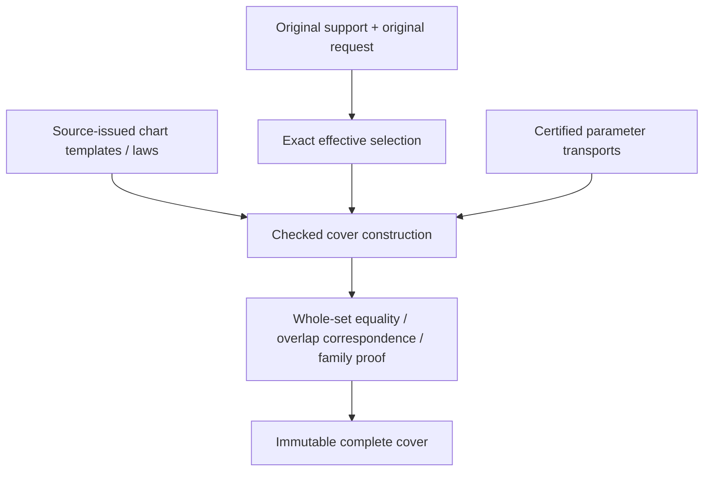

# Original Domain Coverage

## Purpose and Scope

Proposed child of [Original Domain Identity](../DESIGN.md), without children.
Own complete source/request coverage by charts or certified chart families.
Chart coverage is parameter coverage; it does not assert solution existence or
source-map injectivity. Shape producers remain responsible for authored laws.

## Responsibilities and Boundaries

Retain original support, original request, exact effective selection, every selected
chart's local support/transport and all overlap ownership. A separate numerical or
mesh chart width policy does not constrain this intersection issuer's source meaning.
Coverage construction consumes exact set/transport contracts and shape-source tokens.

## Related Designs

| Design | Relationship | Contract Used | Summary | Cautions |
|---|---|---|---|---|
| [Parent](../DESIGN.md) | parent | Source and completeness invariants | Common admission | No partial success |
| [Exact domains](../ExactParameterDomain/DESIGN.md) | depends on | Effective set and exact set equality | Verifies finite coverage | Closed-owner overlap is intentional |
| [Transport](../OriginalParameterTransport/DESIGN.md) | depends on | Whole-chart correspondence | Maps local support to authored space | Preserve unreduced cycles |
| [Native curve](../../OriginalNativeCurveChartCover/DESIGN.md) | coordinates with | Original span/law/source ownership | First existing adapter | Exact finite/Double subset only today |
| [Native surface](../../OriginalNativeSurfaceChartCover/DESIGN.md) | coordinates with | Tensor source spans | First existing surface adapter | Homogeneous-only preparation must be separate from jets |
| [Identity](../OriginalParameterIdentity/DESIGN.md) | used by | Chart support/overlap ownership | Scopes equivalence proofs | Coverage alone does not prove a seam law |
| [L5](../../RationalBivariateAlgebra/ExactParametricRelation/DESIGN.md) | used by, proposed | Complete chart domains and maps | Original equations consume domains | Current single-map implementation needs composition |

## Architecture

## Contracts and Invariants

Proposed OriginalDomainCoverIssuing constructs a cover. OriginalDomainCoverQuerying
exposes source binding, support/request/effective sets, chart/family views, incident
owner queries and verification receipts. All operations are protocol requirements,
with separate implementations and explicit generic admissions. No root/XYZ API is
part of these protocols. Source-law references are retained opaque issuer tokens.

For finite covers, mapped selected charts have union exactly equal to the effective
selection, and each is a subset of the authored support. An exact endpoint event
sweep or Cartesian refinement verifies inclusion/gaps against the retained request;
checking sample points, summed lengths/areas or an array count is insufficient.
Every overlap retains incident chart sides and parameter transports. A singleton
Native knot retains both one-sided owners; a tensor corner retains all applicable
owners. Zero-width knot spans are not ordinary charts. Empty effective selection
retains complete request-versus-support exclusion, not an empty candidate list.

The stored geometric support may be open or unbounded. One unbounded parameter
chart can cover a line/plane without any finite window. Periodic unbounded requests
require a finite template cover plus an exact integer-indexed family certificate:
source period law, complete fundamental support, integer index domain, exact lift,
selection predicate and a proof that every requested coordinate has a template/lift.
Merely storing a lazy generator does not establish these properties. Repeated root
families and original lifts must remain symbolically represented by downstream
results; a consumer demanding an infinite flat array fails explicitly rather than
truncating. Finite requests materialize only admitted charts with checked counts.
No signed-Int overflow is repaired by saturating or wrapping a cycle.

A pole does not shrink an ambient two-coordinate support into a one-coordinate set.
Its collapsed image is retained as a separate identity/fiber witness. The latitude
boundary and every selected longitude stay in the cover. Open pole boundaries exclude
the pole exactly; near-pole points are not collapsed. Infinite endpoint inclusion is
always false; limiting XYZ values are not extra domain points.

Native adaptation validates the original cyclic law, not just its isPeriodic flag.
Exact knots/control laws and original parameter meaning stay unchanged. General
shapes supply their actual supported chart law/transport tokens; unsupported required
coverage remains explicit unfinished implementation. Spatial transforms and parameter
images preserve the original source binding through checked transport, not conversion
of a bounding box or fitted rational surface.

## Runtime Flows

Retain original support/request -> exact intersection -> validate chart templates ->
transport/select -> verify union and ownership/family theorem -> reserve receipt ->
final cancellation. Existing source extraction prepares only required homogeneous
laws. Jets/normals/silhouettes are prepared by separate consumers when necessary.

## State, Ownership, and Lifecycle

One immutable owner stores source, set receipts, chart templates, selected ranges,
transports and proof handles. Views use owner plus index/range; repeated operations
share original buffers. No callback is retained as a promise of coverage. Both source
release and a caller mutation of its COW copy leave proof authority unchanged.

## Failure, Concurrency, and Constraints

Missing chart boundaries, incompatible source tokens, unknown selection or missing
family theorems yield incompleteCoverage or the exact lower failure. Chart count,
family template count, source/transport depth, work and bytes are independently
admitted before allocation. All chart/event/index visits are charged; final cancel
prevents empty/partial successful receipts. Immutable concurrent readers use separate
explicit query admissions. Native/normal/Embedded keep identical owner semantics.

## Verification and Change Impact

Independent expected endpoint cells and open sectors refute holes/extra coverage.
Required cases include nonclamped/multispan/native joins, singleton seams and tensor
corners, negative/large independent cycles, reversed maps, open endpoints, disconnected
requests, exact empty support intersections and unbounded charts/families. Reject a
missing chart even when samples/length sum agree. Test source lifetime, foreign owner,
period-law mismatch, independent count/work/storage/depth and final cancellation.
Existing Native cover suites remain adapter regression owners. New cover acceptance
must include current limits and actual portable execution; source-only adapters do
not establish domain completion or whole-seven acceptance.
