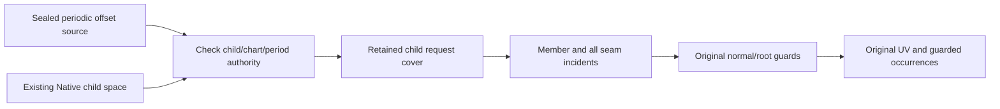
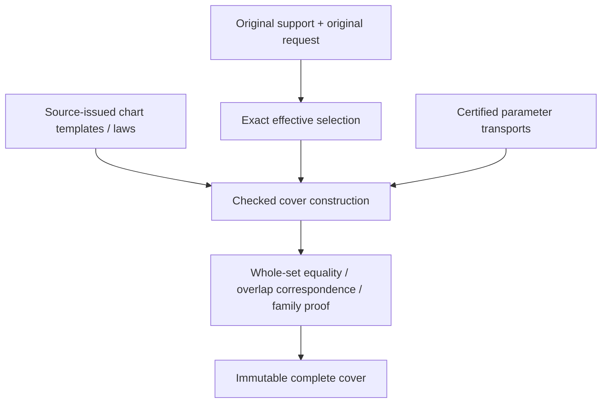
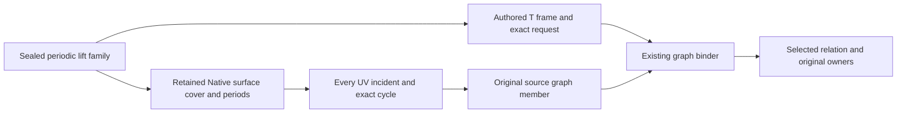

# Original Domain Coverage

## Periodic Native offset domain composition

The periodic offset domain issuer consumes the sealed source fundamental family
and an existing Native child domain space from the same retained child owner and
scalar field. It checks every chart key and period against that space; source law
order need not equal DI template order. It retains a checked ordinal map rather
than copying chart laws. The original offset UV support is all real values on each
proved periodic axis and the original finite support on other axes. Requests are
intersected exactly, including open/disconnected/singleton/empty selections.

Member and enclosure-incident queries delegate arbitrary-size cycle arithmetic,
all seam sides and exact selected correspondence to the existing Native cover.
The occurrence retains original parent selection, child transport, cycle vector,
source family and law ordinal. Position queries evaluate the original offset guard
in the occurrence's fundamental coordinates; lifted queries additionally validate
the positive normal-length root. Nonowning upper knot/seam germs remain available
as occurrences but cannot claim canonical offset position. Every coordinate is
validated before exclusion, including empty requests and the auxiliary root.



The additive public protocol exposes cycle-aware member/enclosure/guarded queries
as requirements, including Embedded generic protocol dispatch. It does not
flatten the infinite family. Same-ledger storage/work, chart/family/source/transport
and coefficient depths, final cancellation and immutable source lifetime remain
mandatory. No geometry solver, new normal formula or unchecked coverage callback
is introduced. Existing finite offset APIs retain their scope. Final symbolic
CS/SSI/image/fiber output is still M7. Verification belongs to the focused periodic
offset fixture and retained finite-offset fixtures; see [source authority](../../OriginalSourceIssuance/DESIGN.md#periodic-native-offset-supply).

## Purpose and Scope

The composition handoff additionally owns `OriginalIssuedDomainBinding`: consume
immutable issued laws and an independently authoritative requested source frame,
prove every finite affine template correspondence, and retain the existing complete
cover together with the selected inverse images and law indices. A law support
union never defines the authoritative source support. Missing templates fail with
the existing incomplete-coverage error; periodic/unbounded and non-affine transport
remain outside this finite handoff. All original source/chart owners and both proof
depth axes survive. Verification composes the new binding with unchanged domain/lower
implementations using independent products; no production-target build.

`DefaultOriginalDomainCoverIssuer.issue` returns selected charts in input-template
order, preserving each retained local frame. Templates with empty selected images
are omitted. The issued-law binder uses this contract to associate template indices
in one forward scan; equal geometric or coefficient values never determine identity.

Child of [Original Domain Identity](../DESIGN.md), without children.
Own complete source/request coverage by charts or certified chart families.
Chart coverage is parameter coverage; it does not assert solution existence or
source-map injectivity. Shape producers remain responsible for authored laws.

## Responsibilities and Boundaries

Retain original support, original request, exact effective selection, every selected
chart's local support/transport and all overlap ownership. A separate numerical or
mesh chart width policy does not constrain this intersection issuer's source meaning.
Coverage construction consumes exact set/transport contracts and shape-source tokens.

## Related Designs

| Design | Relationship | Contract Used | Summary | Cautions |
|---|---|---|---|---|
| [Parent](../DESIGN.md) | parent | Source and completeness invariants | Common admission | No partial success |
| [Exact domains](../ExactParameterDomain/DESIGN.md) | depends on | Effective set and exact set equality | Verifies finite coverage | Closed-owner overlap is intentional |
| [Transport](../OriginalParameterTransport/DESIGN.md) | depends on | Whole-chart correspondence | Maps local support to authored space | Preserve unreduced cycles |
| [Native curve](../../OriginalNativeCurveChartCover/DESIGN.md) | coordinates with | Original span/law/source ownership | First existing adapter | Exact finite/Double subset only today |
| [Native surface](../../OriginalNativeSurfaceChartCover/DESIGN.md) | coordinates with | Tensor source spans | First existing surface adapter | Homogeneous-only preparation must be separate from jets |
| [Identity](../OriginalParameterIdentity/DESIGN.md) | used by | Chart support/overlap ownership | Scopes equivalence proofs | Coverage alone does not prove a seam law |
| [L5](../../RationalBivariateAlgebra/ExactParametricRelation/DESIGN.md) | used by, proposed | Complete chart domains and maps | Original equations consume domains | Current single-map implementation needs composition |

## Architecture



## Contracts and Invariants

OriginalDomainCoverIssuing constructs a finite declared-frame cover.
OriginalDomainCoverQuerying exposes support/request/effective sets, a finite chart
view and incident indices. It does not expose symbolic family operations. Source
provenance is retained through its frames/transports. Specialized Native/sphere
issuers establish source support independently of the caller's declared frame.
No root/XYZ API is part of these protocols. Source-law references retain issuer
authority rather than unchecked callbacks.

### Protocol capabilities and implementation selection

| Contract | Status | Responsibility and implementation |
|---|---|---|
| OriginalDomainCoverIssuing / Querying | Implemented | Verify/read finite frame-relative coverage; DefaultOriginalDomainCoverIssuer does not inspect shapes |
| OriginalBSplineDomainIssuing | Implemented | DefaultOriginalBSplineDomainIssuer derives Native support/spans/periods through OriginalBSplineSourceReading and uses common DI verification |
| OriginalIntrinsicSphereDomainIssuing | Implemented | DefaultOriginalIntrinsicSphereDomainIssuer derives canonical intrinsic support and retains its certified longitude period |
| OriginalDomainBoundRationalChartIssuing | Implemented Native capability | DefaultOriginalDomainBoundBSplineChartIssuer combines the same source law, selected occurrence and local selection; it proves no intersection |
| OriginalChartFamilyQuerying | Implemented at M1 | Generic requirement dispatch for integer-indexed Native/sphere covers, retained support and explicit member/incident; no flattening or replacement owner |

The new family-query protocol is required because OriginalDomainCoverQuerying's
finite `charts` view cannot describe an unbounded set of occurrences. It is an
interface on retained covers, not another execution layer or a type-erased wrapper.
Use Source/Field associated types and an associated Occurrence type so different
source-issued chart keys remain statically typed. Its protocol requirements expose
the retained source, support/request/effective selection, finite template count,
integer-family rank, member lookup by template and exact cycle vector, and all
incident occurrences at an exact tuple. All fallible queries take the explicit
generic admission and DI limits. An occurrence retains its template owner, exact
unreduced cycles, selected image and original correspondence. A zero-rank cover
may implement the same query capability; this does not turn an infinite family
into a finite `charts` view.

The following declaration is a design contract, not an existing source symbol:

```swift
public protocol OriginalChartFamilyQuerying: Sendable {
    associatedtype Source: Sendable
    associatedtype Field: ExactScalarArithmetic & ExactScalarOrdering
    associatedtype Occurrence: Sendable
    var source: OriginalSourceBinding<Source> { get }
    var support: OriginalParameterSelection<Source, Field> { get }
    var request: OriginalParameterSelection<Source, Field> { get }
    var effective: OriginalParameterSelection<Source, Field> { get }
    var templateCount: Int { get }
    var integerFamilyRank: Int { get }
    func member<A: ExactScalarAdmission & ~Copyable>(
        template: Int, cycles: borrowing [OriginalParameterCycle],
        limits: OriginalDomainIdentityLimits, using admission: inout A
    ) throws(OriginalDomainIdentityFailure) -> Occurrence
    func incident<A: ExactScalarAdmission & ~Copyable>(
        at tuple: borrowing [Field.Value], limits: OriginalDomainIdentityLimits,
        using admission: inout A
    ) throws(OriginalDomainIdentityFailure) -> [Occurrence]
}
```

The cycle vector has authored parameter arity, with exact zero on nonperiodic
axes; family rank counts only independently certified periodic axes. Member lookup
may return a valid occurrence with empty selected image. Incident lookup returns
every selected incident side, or no occurrences only after effective-membership
exclusion. Both operations reject foreign scalars/indices and obey retained depths.
The family-specific law issuer consumes that typed occurrence/cover with the same
Source and Field, so the query protocol need not erase different chart-key types.
No operation exposes an iterator that promises to finish over all integer cycles.

Family-query conformance verifies template/index ownership and complete family
authority. It cannot publish a new proof by adding an extension to an arbitrary
array. Native member/incident algorithms already exist; sphere incident queries
exist, while explicit template/member query conformance remains to be implemented.
The same fixture body must exercise both the concrete and generic requirement
calls, including Embedded witness behavior, before this capability is completed.

Specialized issuers receive the smallest required generic protocol dependencies
from their composition root: transport, cover verification, source-period/local-law
issuance as applicable. Match source and coefficient owners through associated-type
constraints and runtime binding checks. Current direct Default construction is
preserved until that injection migration is verified. Common DI does not select
shape enums, request a stronger coefficient field or import a hidden solver.

### Required source-family obligations

The following rows specify domain responsibilities, not newly completed source
formulas. A missing source law/correspondence remains an explicit upstream
implementation dependency under the unchanged full-family acceptance.

| Source capability | Specialized issuer must establish | Evidence handed to common DI | Current DI scope |
|---|---|---|---|
| Native curve/tensor B-spline | Every positive span, exact support, one-sided knot owners, independent cyclic axes | Original chart keys, complete fundamental cover and source-period receipts | Foundation implemented; public multi-span/periodic composition pending |
| Intrinsic sphere | Full two-coordinate support, longitude lifts, exact latitude boundaries | Canonical period/pole authority and all selected longitudes | Foundation implemented; general public consumers pending |
| Line / stored-N plane | Entire unbounded support and exact authored coordinate meaning | Original line law or exact plane-basis owner, support and chart correspondence | Plane basis/coordinate operations exist; full domain/public wiring pending |
| Physical-angle conics / analytic surfaces | Actual angular domains, all seams/branches, original UV and genuine periods | Exact phase/chart correspondence, period/collapse evidence | Image-only source receipts do not establish this capability |
| Spatial operation words | Unchanged parameter support through the retained spatial action | Descendant cover, original word owner and mapped local law | Domain composition pending; spatial action does not itself authorize new parameter identity |
| Affine parameter images / directed traversal | Pullback of the original descendant support, axis roles, reversal and all lifts | Original exact gain/offset word and verified descendant correspondence | Source laws exist in bounded capabilities; complete domain composition pending |
| Nonlinear / singular parameter images | Full supported correspondence, including every preimage and guard | Source-issued relational correspondence; never a guessed inverse | Pending beyond current affine transport; inverse refusal must not discard the required relation |
| Ruled / Coons / revolution / remaining procedural | Original construction domains, descendant restrictions and declared boundaries | Owned child charts/laws/maps and any genuine seam/collapse theorem | Pending complete DI issuance; derivative/normal work remains outside DI |
| Implicit / certified / lift / join / guide | The actual authored parameterization and supported relation to descendants | Original chart authority and full parameter correspondence | Pending where only image membership is issued |

For non-Cartesian restrictions, preserve the separately certified boundary/relation
predicate owner and its exact chart correspondence. DI's interval-product kernel
does not replace it by a bounding box. Pullback/selection must be discharged by
the owner of that restriction before a consumer claims complete restricted coverage.
Until the necessary correspondence capability exists, the required path fails
explicitly and remains incomplete; this is not an alternate approximation policy.

Finite/source-family issuers publish only after whole coverage, owner compatibility
and final cancellation checks. Source-issued local guards are retained when domain
selection is combined with a law; parameter coverage never implies denominator
validity or root exclusion. Converting an implicit image receipt into a complete
parameter cover is prohibited without an independent full correspondence proof.

For finite covers, mapped selected charts have union exactly equal to the effective
selection, and each is a subset of the authored support. An exact endpoint event
sweep or Cartesian refinement verifies inclusion/gaps against the retained request;
checking sample points, summed lengths/areas or an array count is insufficient.
Every overlap retains incident chart sides and parameter transports. A singleton
Native knot retains both one-sided owners; a tensor corner retains all applicable
owners. Zero-width knot spans are not ordinary charts. Empty effective selection
retains complete request-versus-support exclusion, not an empty candidate list.

The stored geometric support may be open or unbounded. One unbounded parameter
chart can cover a line/plane without any finite window. Periodic unbounded requests
require a finite template cover plus an exact integer-indexed family certificate:
source period law, complete fundamental support, integer index domain, exact lift,
selection predicate and a proof that every requested coordinate has a template/lift.
Merely storing a lazy generator does not establish these properties. Repeated root
families and original lifts must remain symbolically represented by downstream
results; a consumer demanding an infinite flat array fails explicitly rather than
truncating. Finite requests materialize only admitted charts with checked counts.
No signed-Int overflow is repaired by saturating or wrapping a cycle.

A pole does not shrink an ambient two-coordinate support into a one-coordinate set.
Its collapsed image is retained as a separate identity/fiber witness. The latitude
boundary and every selected longitude stay in the cover. Open pole boundaries exclude
the pole exactly; near-pole points are not collapsed. Infinite endpoint inclusion is
always false; limiting XYZ values are not extra domain points.

Native adaptation validates the original cyclic law, not just its isPeriodic flag.
Exact knots/control laws and original parameter meaning stay unchanged. General
shapes supply their actual supported chart law/transport tokens; unsupported required
coverage remains explicit unfinished implementation. Spatial transforms and parameter
images preserve the original source binding through checked transport, not conversion
of a bounding box or fitted rational surface.

## Runtime Flows

### Native rolling-ball graph domain consumption

The rolling-ball domain issuer consumes the sealed complete three-child graph
family from [source issuance](../../OriginalSourceIssuance/DESIGN.md#rolling-ball-native-child-graph-family).
It issues an authored UV frame over the original normalized square, verifies
source ownership/coordinate semantics/exact frame support, and intersects the
retained request with that enclosure. Per-template members use the existing graph
binder and retain all positive-root/normalization/regular-arc guards. A request box
does not prove those guards. Lifted incident queries preserve all five graph
coordinates while only U/V belong to the source domain. They validate all coordinate
fields before empty selection can short-circuit, then preserve every closed child
chart incident. No unique inverse, root search or Boolean UV-only validity callback
is introduced. Immutable members retain the same family/source/proof owners;
selection/member/query allocations use one caller admission and terminal cancel.
Focused rolling-ball source/domain verification owns request singleton, strict,
disconnected/empty and foreign-owner/semantics/frame counterexamples. Generic rails
and final ordinary CS/SSI publication remain separate open obligations.

Retain original support/request -> exact intersection -> validate chart templates ->
transport/select -> verify union and ownership/family theorem -> reserve receipt ->
final cancellation. Existing source extraction prepares only required homogeneous
laws. Jets/normals/silhouettes are prepared by separate consumers when necessary.

## State, Ownership, and Lifecycle

One immutable owner stores source, set receipts, chart templates, selected ranges,
transports and proof handles. Views use owner plus index/range; repeated operations
share original buffers. No callback is retained as a promise of coverage. Both source
release and a caller mutation of its COW copy leave proof authority unchanged.

## Failure, Concurrency, and Constraints

Missing chart boundaries, incompatible source tokens, unknown selection or missing
family theorems yield incompleteCoverage or the exact lower failure. Chart count,
family template count, source/transport depth, work and bytes are independently
admitted before allocation. All chart/event/index visits are charged; final cancel
prevents empty/partial successful receipts. Immutable concurrent readers use separate
explicit query admissions. Native/normal/Embedded keep identical owner semantics.

## Verification and Change Impact

Independent expected endpoint cells and open sectors refute holes/extra coverage.
Required cases include nonclamped/multispan/native joins, singleton seams and tensor
corners, negative/large independent cycles, reversed maps, open endpoints, disconnected
requests, exact empty support intersections and unbounded charts/families. Reject a
missing chart even when samples/length sum agree. Test source lifetime, foreign owner,
period-law mismatch, independent count/work/storage/depth and final cancellation.
Existing Native cover suites remain adapter regression owners. New cover acceptance
must include current limits and actual portable execution; source-only adapters do
not establish domain completion or whole-seven acceptance.

## Implementation Boundary

`OriginalDomainCover` certifies exact parameter coverage relative to a declared frame.
It is not an assertion that a caller's frame is a shape's whole support.
`OriginalBSplineDomainSpace` is issued only from a validated retained Native reader;
it derives original knots, positive spans, full support and independently proved periods.
`OriginalBSplineDomainCover` retains the original request and its exact support
intersection. Nonperiodic covers are finite. Periodic covers retain all-integer
Cartesian families over a verified complete closed fundamental cover; `member` and
`incident` materialize only the requested lifts, preserving both seam sides.
No operation implicitly flattens an infinite family.


## M0 implementation acceptance and ownership

This matrix fixes mandatory inputs, proof gaps and receiving consumers. Source
law issuance owns coordinate meaning; coverage never infers it from an image
polynomial. M0-M3 do not change L0-L5 authority, numerical tolerances or limits.

| Family / concrete input | Required domain and correspondence | Existing authority / owned repair | Acceptance / consumer |
|---|---|---|---|
| Native degree-one line and weighted multi-span curve | All positive spans; exact open, closed, singleton, disconnected and excluded requests | OriginalBSplineSourceReading, chart and period receipts; no new producer | member/incident preserve both knot sides; public CS includes all TUV |
| Native tensor surface with independently periodic U/V | Finite selections with independent arbitrary-size cycles; all seam sides | Same source receipts; NativeExactRelations owns multi-chart compilation/publication | CS/SSI cover every selected chart pair; folded fixture retains current work/storage ceilings |
| Infinite original line with nonunit direction | Entire real parameter axis, original origin/direction | OriginalLinearSourceReading; source owner supplies unbounded support, not a finite chart-window law | No intersection request invents whole support; exact selected position and exclusion |
| Stored-N plane, scaled and oblique N | Entire real UV product; exact normalized basis and inverse projection under N+origin authority | OriginalPlaneSourceReading / OriginalPlaneBasisReceipt; source provider and evaluation/UV handoff owned by OriginalSourceIssuance | Exact plane equation, UV roundtrip, owner retention; rounded old basis is not proof |
| Circle/ellipse, hyperbola/parabola | Full authored angular or real coordinate and branch; radius/axis positivity | Conic source-coordinate reading/law capability is missing and belongs to source owner | Original branch/all parameters retained, full support and exact boundaries; no image-only UV assertion |
| Cylinder / cone | Authored angular axis and unbounded axial/radial axis, apex fiber for cone | Primitive/cone image receipts exist; source angular coordinate/phase and branch law are missing | Period proof uses actual original angular map; all apex UV retained |
| Sphere | Intrinsic longitude family, closed latitude and both poles; physical-angle sources retain their distinct meaning | Intrinsic sphere period/pole receipts exist; physical angular source-law capability is separate | Generic family member and incident agree; near-pole cannot become pole |
| Torus | Two independent original angular axes and complete branch/fiber correspondence | Primitive image receipt exists; two-axis source-coordinate law is missing | Independent cycles, seams and all UV retained |
| Rigid/affine/parameter image/original word | Whole descendant support pullback, exact reversal and original axes | Existing OSI word/image/traversal receipts; M4 consumes them | Finite/infinite requests compose without invented inverse |
| Offset/rolling-ball/revolution/Coons/correction/derivative/draft/angular transport | Original construction domains, joins and child correspondence | Existing ruled/Coons receipts reused; remaining specific laws delivered by source owner at M4 | Every defined branch/guard retained; unsupported cannot complete a required cell |
| Implicit/certified/lift/join/guide | Certified original relation and non-Cartesian guards, complete preimages | Specific source relation capabilities delivered by source owner at M4 | Boundary/self/XYZ consume the same certified relation at M6/M7 |

Nonlinear or singular parameter correspondence is a relation, not
OriginalParameterTransport's invertible affine map. Its future receipt must retain
source/target bindings, original equations, denominator/branch guards, complete
selected domain and all preimages. Forward/inverse queries return complete fibers
or typed failure under a fresh explicit admission; no unique inverse is promised.
Non-Cartesian material restrictions stay certified predicates over an ambient
cover. Their implementation belongs to M4; this contract does not authorize
pretending a bounding box proves material membership.

A symbolic public result at M7 retains the family owner, template, independent
integer cycle vector, authored parameter correspondence and full requested
coverage. Its member/incident queries use explicit admissions and preserve all
UV/fibers. A finite convenience entry explicitly refuses an unbounded family;
it cannot silently select one cycle or a finite search window. M2 accepts bounded
requests only and enumerates their complete finite chart occurrences.

| Exclusive owner | Exact files / resources |
|---|---|
| Common DI | OriginalDomainCoverage/OriginalChartFamilyQuerying.swift; existing cover, bound-chart issuer and family methods; OriginalParameterTransport contracts only when required; Tests/OriginalDomainIdentityVerification family fixtures/proof/tests |
| Native composition | NativeExactRelations/*.swift and changed public consumer requirements; its DESIGN and Tests/NativeExactRelationVerification fixtures; separate Native composition scratch path |
| Source authority | OriginalSourceIssuance reading/law/provider/receipt files and original evaluation/UV handoffs; its DESIGN and Tests/OriginalSourceIssuanceVerification; shared source changes serialize |
| Linear/plane issuance | Dedicated linear/plane issuing protocols and implementations in OriginalDomainCoverage; dedicated primitive fixtures in domain verification |
| Angular issuance | Dedicated conic/analytic issuing protocols and implementations in OriginalDomainCoverage; dedicated angular fixtures in domain verification |
| Integration | PROGRESS.md, exact input/artifact receipts and independent latest-main worktree; no simultaneous edits of implementation owners' files |

The implementation task uses one isolated implementation worktree and a separate
main-integration worktree. Each source file has one writer: Native consumer and
source-family work proceed concurrently in disjoint files, while shared contracts
remain with the common DI owner. Production compilation starts after both source
owners freeze their shared module snapshot.
Independent Native, ASAN, ordinary WASM and Embedded scratch paths never mutate
the same build directory. Each milestone records actual behavioral evidence and
its commit before it is marked complete. The matrix itself is not evidence that
any missing source law is implemented.

### M3 primitive issuer implementation boundary

Dedicated linear and plane covers retain the source-owned whole law/basis and
one identity-coordinate occurrence, with rank zero and full real support. Their
issuer reconstructs source support, verifies the supplied frame's full support
and coordinate meaning, and clips only the requested selection. Empty requests
produce empty incident sets without losing source coverage authority. Dedicated
analytic covers retain the complete polynomial symbolic-coordinate law, genuine
source periods, and collapse receipts. Their cartesian family has one closed
fundamental interval per periodic axis and unchanged nonperiodic source support;
member and incident use exact cycle displacement and return all seam combinations.
At a collapsed fiber the full original coordinate tuples remain represented.
Physical parameter wrappers do not pass this intrinsic issuing port.


## M1 implemented composition

Native and intrinsic sphere covers conform to OriginalChartFamilyQuerying.
The default Native issuer delegates to overloads accepting period, parameter
transport and cover-issuance protocols. Bound-chart issuance separately accepts
the rational source-law and transport protocols. Intrinsic issuance accepts its
source-law and transport protocols. All associated Source, Field and chart
Selection types must match statically. Defaults preserve existing call sites;
there is no existential erasure, global cache, mutable owner or new ledger.

Injected source receipts are checked for the retained source/chart owner and
original coordinate role before composing a result. Native period endpoints and
period length must match the authoritative knot interval; a receipt from another
binding fails even when original values are equal. Generic query tests exercise
zero-rank and independent families, arbitrary-size signed cycles, seam/pole
incidence, malformed cycles and terminal cancellation. Both source and transport
failures propagate through the existing typed failure contracts.

## Finite selected-family query

OriginalFiniteChartFamilyQuerying refines the symbolic query with an explicitly
finite selection operation. Native selectedMembers enumerates each original
positive-span template and the exact integer-cycle ranges whose closed template
can meet an effective request interval. Rational integer ranges are canonicalized
before traversal so disconnected requests do not duplicate an occurrence. The
actual selected image filters strict endpoints and excluded cells, preserving
both selected seam sides. Independent periodic axes form the complete product;
no fixed-width cycle conversion or binary64 estimate is used. Unbounded periodic
selection fails unsupportedSourceProof, while a bounded nonperiodic native support
can clip an unbounded request. Count/storage/work/depth/cancel admission remains
one cumulative caller query. Publication occurs only after all templates finish;
result limits and any unresolved arithmetic invalidate the entire returned array.

### M4 affine child-domain composition

`OriginalAffineChildDomainIssuing` prepares an immutable
`OriginalAffineChildDomainCover` from a retained source command and an existing
child `OriginalChartFamilyQuerying` contract. The parameter-image, spatial-action
and directed-traversal implementations exclusively read their source-owner
protocol. The parent support is the exact affine image of child support; traversal
first intersects that support with the authored directed endpoint interval.
Requests are intersected with support, then pulled back. Every selected preimage
must be covered by the child's effective selection or preparation fails with
`incompleteCoverage`. No root solving, coefficient regeneration or arbitrary
caller-supplied support certificate is involved.

The cover retains the child family, original parent binding, source depth and a
checked affine correspondence. An occurrence retains the child's occurrence and
this parent correspondence restricted to the selected request. Consumers must
intersect the child's occurrence scope with the correspondence's local scope;
the correspondence alone is not the individual chart's support. Member cycles
use original parent axis roles; permutation and gain sign map them to the
child-family cycles without narrowing their integer magnitude. Incident transforms original parent tuples and preserves every child incident,
including both closed seam sides. No XYZ deduplication is performed. A composed
occurrence is not interchangeable with a source law or a geometric solution.

All storage and work use the caller admission; source and correspondence depth
are re-admitted on queries. New output owner/index payloads are admitted while
existing immutable family storage is shared. Zero gains, repeated axes, foreign
child bindings, uncovered pullbacks, invalid roles, exhausted limits and cancel
remain failures. Nonlinear correspondence and non-Cartesian material restrictions
remain M4.P responsibilities, not affine fallback cases. Verification owner:
`Tests/OriginalDomainIdentityVerification/Sources/Fixtures/ComposedDomainFixtures.swift`.

## Sealed finite revolution family consumption

OriginalRevolutionDomainIssuing consumes the source-owned
OriginalFiniteRevolutionLawFamily. The source producer owns whole normalized generator
coverage, original U bounds, exact normalized axis, homogeneous Rodrigues law,
denominator/radial guards and intrinsic period; see
[source issuance](../../OriginalSourceIssuance/DESIGN.md). DI never reconstructs that
shape or accepts a caller-edited receipt array as proof of complete support.

OriginalRevolutionDomainCover retains that family, full authoritative support,
requested/effective selection and every chart side. Occurrences retain the original
family/template index and a checked local-to-authored transport. Template angular
support is the source fundamental period and V support is the original chart range.
Only U can carry an integer lift. Before a map enters bounded authored support, its
exact pullback is intersected with the selected request and template. Empty and
singleton supports keep endpoint inclusion and original two-parameter arity.

Incident queries use exact integer reduction and retain both closed angular seam
sides and every generator knot side. Different parameters/XYZ are never deduplicated.
No root solver, trigonometric sample or new generator coefficient preparation occurs.
The family and all laws are admitted once per top-level query; internal occurrence
construction uses that admitted immutable witness and the same caller budget.
Source/scalar depth, chart/family count, generated storage/work and terminal cancel
apply on every query. The guard remains attached to the retained source law; this
domain cover does not claim an evaluated XYZ intersection or erase collapsed UV.

Independent RevolutionDomainFixtures and actual production revolution handoff own
M4.P.R evidence. Generic/non-rational generators, remaining procedural/non-Cartesian
covers and full M4/M5/M6 acceptance remain separate open obligations. New cover state
is immutable on every target, with no conditional ownership or shared mutable cache.


## Guarded offset domain composition

OriginalGuardedChartFamilyQuerying is the non-Cartesian sibling of the existing
OriginalChartFamilyQuerying contract. It exposes enclosingSupport and
effectiveEnclosure explicitly. These are exact requested Cartesian bounds, not
an unconditional position domain. Member occurrences retain their source-owned
law and enclosing selection. Position/lifted-position incident queries apply
all mandatory source predicates before returning an occurrence or complete empty
result. Consumers must retain the law/guard when constructing a relation; a bound
alone cannot certify material membership or domain exclusion inside the enclosure.

OriginalNativeOffsetDomainIssuing consumes only the sealed
OriginalFiniteNativeOffsetLawFamily from the source owner. Source authority owns
all child charts, differential knot ownership, D/transport-D exclusions, C^2>0,
and q>0 with q^2=C^2. DI owns request/frame compatibility and exact clipping,
complete chart traversal and atomic result-count/cancel publication. It does not
solve for q, regenerate a normal or interpret a sampled offset. The positive root
is an auxiliary source relation; the original parameter domain remains two-dimensional.

Public queries use one admission and retain immutable family/law/frame owners.
A selected tuple outside the enclosing request is excluded by exact bounds; an
inside tuple is excluded only after all retained chart predicates reject it.
Singular fibers remain distinguishable from work/storage/cancel failure. Foreign
frames, malformed tuples/templates, source/transport/chart/depth limits propagate
failure. Only nonperiodic Native child identity UV is currently supplied; generic
child/periodic/nonlinear coverage remains an explicit source-owner obligation.

Verification is owned by OffsetDomainFixtures and the actual production
OriginalOffsetSourceProof domain handoff. It checks signed normal branches,
interior singular exclusion at nonzero and zero offset, owning knot faces,
positive/negative/wrong q, exact empty/singleton clipping, immutable lifetime,
independent resource bounds and final cancellation on success and exclusion.
All state is immutable let or exclusive query-local inout on every target.

## Sealed guide station domain composition

OriginalGuideDomainIssuing consumes the source-owned OriginalFiniteGuideChartFamily.
The source issuer owns complete normalized partition, exact C0 join authority,
all child laws/guards, local support and exact aggregate station correspondence.
DI creates a source-bound authored-scalar frame, clips the requested selection,
and verifies the supplied affine correspondence from retained rational transport.
It uses existing OriginalParameterTransporting and OriginalDomainCoverIssuing
for map restriction/inverse and whole-request coverage; no coefficient producer,
root search or independent source continuity proof is introduced.

Each occurrence retains the whole sealed family, original template index and exact
selected local-to-aggregate map. The cover preserves every original closed join
side, including reversed child parameterizations. It exposes nonperiodic finite
family witness requirements; nonzero cycles fail. Empty requests require complete
source/selection proof. Member/incident/selectedMembers admit the retained source
proof and depths under the same caller ledger and perform final cancellation.
All owners/maps/laws are immutable and shared by COW; generated maps, indexes and
result payloads are admitted once when generated. No shared mutable state, global
cache, target-specific synchronization or unchecked ownership is added.

Verification is owned by GuideDomainFixtures in the independent DI graph and the
actual GuideProof source-to-domain handoff. Test exact non-binary station, reversed
weighted child, both closed join sides, disconnected/open/singleton/empty requests,
retained lifetime, foreign source, inherited scalar-owner checks, malformed tuple/template/cycle, independent
work/storage/chart/source/depth and final success/exclusion cancellation. Generic
non-rational traversal/derivative identity coverage remains outside this capability.

## Sealed retained surface domain composition

OriginalRetainedSurfaceDomainIssuing consumes only the source-owned complete
OriginalFiniteRetainedSurfaceCharts witness. The existing producer owns original
XYZ/D, nonzero-denominator cell authority, identity authored UV and complete square
coverage. DI owns frame compatibility and exact request clipping, preserving every
closed original cell side through existing affine transport and whole-domain cover
contracts. It does not reinterpret a bounding box as a guarded material domain.

The immutable cover and occurrences retain the complete family, original cell
index/law and selected identity UV map. Queries use the same caller admission and
retained causal depths; nonzero cycles, foreign sources, wrong dimensional or
coordinate frames and resource/cancellation failures propagate. Empty success
requires the complete source witness plus full effective-selection exclusion.
No original coefficients are regenerated and no independent relation is solved.

RetainedSurfaceDomainFixtures owns independent public issuer/query coverage for
nonbinary cell cuts, all closed sides, clipped/strict/singleton/disconnected/empty
requests, original laws/lifetime and independent source/transport/chart/family/
work/storage/cancel failures. Actual CorrectionProof verifies the genuine
boundary-correction source-to-DI handoff; derivative surface sources can consume
this same contract only after their source owner issues a complete witness.

## Sealed retained curve domain composition

OriginalRetainedCurveDomainIssuing consumes the sealed complete normalized curve
family from the retained source owner. Original XYZ/D, original cell boundaries,
identity normalized T and complete closed support are the source contract. DI
owns only frame compatibility, exact requested selection and existing map/cover
composition. Each occurrence retains its whole family, original law index and
selected authored T map. Empty success requires full coverage evidence.

The same immutable ownership and admission/depth/cancel contracts as retained
surface composition apply. RetainedCurveDomainFixtures verifies nonbinary cell
cuts, both closed sides, strict/singleton/disconnected/empty requests, original
position/lifetime and independent failure bounds. Actual DerivativeCurveProof
consumes the genuine original Hermite/plane-constraint source witness; generic
non-rational derivative sources remain the source owner's open capability.

## Local source graph/request binding (B3)

The additive OriginalParametricGraphDomainBinding protocol binds one sealed source
position graph to an original requested parameter selection. The issuer checks
shared source provenance, parameter arity, source limits and inherited graph/frame/
selection depth. Its immutable receipt retains both values and is a local relation,
not a claim that this one chart covers the whole request. Complete coverage remains
owned by existing rational and guarded family receipts. NativeExactRelations consumes
this receipt without reinterpreting its source or inventing an inverse transport.

The binder neither solves guards nor turns enclosing rectangles into material
domains. The consumer pulls the original request through the retained forward
rational parameter map and conjoins all position guards and source-owned chart
sides. Nonlinear and many-to-one forward maps do not require an inverse. Work,
storage, source/proof depth and cancellation use the same caller admission.
Behavioral verification belongs to OriginalGraphRelationVerification and includes
foreign owners, empty/closed/strict/disconnected selections and inherited limits.


## Native surface lift domain consumption

The Native lift domain issuer consumes only the sealed complete family from
[source issuance](../../OriginalSourceIssuance/DESIGN.md#native-surface-lift-graph-supply).
It derives the original normalized one-coordinate T frame, checks owner, exact
whole support and authored coordinate meaning, and intersects the request exactly.
Members use the existing `DefaultOriginalParametricGraphDomainBinder`, retaining
T as the only source parameter and U/V as auxiliaries. Lifted incident queries
import every compatible coordinate into the retained field once before exclusion,
reject foreign algebraic fields, and apply every graph equation,
UV chart bound and denominator guard. The selected T enclosure alone never proves
UV/material membership. Closed pcurve knots and surface corners return every
incident owner; equal XYZ or auxiliary coordinates do not merge distinct T.

All new state is immutable and target-common. One caller admission accounts for
new selections/members/results, source and proof depths, chart limits and terminal
cancel, including successful empty selection. Existing child storage and graph
preparation are retained without recomputation. The focused lift verification owns
this source-to-DI interaction. General/periodic lift sources and automatic public
geometric results remain required open work, not a finite API fallback.


## Retained pcurve lift domain consumption

The retained lift issuer consumes the sealed retained-pcurve/Native-surface family
from [source issuance](../../OriginalSourceIssuance/DESIGN.md#retained-pcurve-lift-composition).
Its source remains one normalized T coordinate. UV are auxiliary witnesses, never
new authored dimensions. Frame/source semantics and exact whole T support are
checked before selection; members use the existing graph binder, and lifted
incident queries retain all source equations, UV chart bounds and denominators.
Importable rational coordinates are normalized once, foreign algebraic fields fail
even for empty selections, and all closed tensor sides survive. This additive
retained capability preserves the existing Native issuer and its source semantics.
Focused affine-lift and existing Native-lift fixtures own the changed interaction.
No new solver, shared mutable state or alternate caller budget is introduced.


## Rolling-ball generic child graph domain consumption

Consume the sealed child-graph rolling-ball family from
[source issuance](../../OriginalSourceIssuance/DESIGN.md#rolling-ball-child-graph-composition).
Frame authority and effective selection remain the original UV square. Variable
count follows the actual disjoint child auxiliary layout plus radial/root witnesses;
auxiliaries never become authored axes. Validate and import every query coordinate
before empty selection can short-circuit. Member issuance uses the existing graph
binder and retains every child equation, support/branch guard, source owner and depth.
Exact selections, complete empty results and all closed incidents use the caller's
same admission. No predicate callback, inverse reconstruction or second solver is
added. The existing Native domain capability remains available. The focused generic
rolling-ball verification owns this interaction and Native compatibility.

## Periodic Native surface lift domain consumption

The lift-specific DI issuer consumes the sealed periodic Native lift source family
from [source issuance](../../OriginalSourceIssuance/DESIGN.md#periodic-native-surface-lift-supply).
Its authored frame is one-dimensional normalized T with exact enclosing support
[0,1]. The effective enclosure is support intersected with the request, preserving
open/closed, singleton, disconnected and empty selections. Auxiliary U/V remain
inside the graph's three-variable layout; they do not increase authored dimension.



The immutable prepared space retains one full Native surface cover with the
source-issued period receipts, a checked bijection from its chart keys to original
source-law ordinals, the lift family and the authored-T frame. It reuses existing
Native member/incident algorithms; it does not prove periods again or solve the
lift/geometry problem. Issuing another T request shares the same prepared surface
cover and family arrays. No finite selected-members enumeration is used.

The public lift-family querying protocol exposes template count, surface cycle
rank, retained source/request/effective enclosure, explicit member lookup with a
two-axis exact cycle vector, and lifted-position incidents for [T,U,V]. It does
not conform to a source-period family protocol: auxiliary surface cycles are not
periods or identities of T. No T-only method guesses UV, unique inverse or the
finite enumeration of all surface lifts.

Explicit members retain their exact cycle indices, original family and selected
bound graph. Incident queries first validate every coordinate field, including
U/V even for an empty T request. Existing Native incidence supplies every closed
surface side and cycle; each is paired with every original pcurve chart, issued
through the source owner and filtered by the complete original graph conditions.
The existing graph binder retains the exact T request. Hence a singleton seam,
corner or pcurve knot retains all applicable sides, and same-XYZ wrong authored UV
cannot become a position. Empty membership requires exact request/guard exclusion,
not a missing candidate or failed calculation.

All source/proof/transport/chart/family limits, new output and scratch allocations,
work and terminal cancellation use one explicit caller admission. The prepared
space, cover and occurrences are immutable and Sendable on all targets. Occurrences
retain source/period/pcurve owners through their family and graph after preparation
or cover release. There is no mutable shared state, cache, callback or unsafe path.
Foreign frames/owners, malformed indices/tuples, unsupported scalar fields, budget
exhaustion and cancellation propagate the exact lower failure, never empty success.

Verification owner: `Tests/OriginalPeriodicLiftDomainVerification`. Expected seam,
knot/corner counts, exact request sets, wrong UV and huge independent cycle cases
exercise the actual source/DI/binder path. The real lift provider and public point
evaluation are checked using matching retained numerical products. Fixed Native,
ASAN, normal Wasm and Embedded compile/link/runtime validate the changed DI/fixture
boundary with admitted unchanged source/L0/L1 products. Broad CAD/L2-L6 rebuilding
remains prohibited. General lifts and graph CS/SSI/image/fiber publication remain
M4/M7 obligations; this port does not complete those consumers.

## Retained pcurve periodic lift consumption

The existing periodic Native-host lift DI protocols and implementation accept
OriginalLiftSourceReading, including sealed retained pcurves. Native callers keep
their existing signatures and typed child access. Source family pcurveLaws is a
shared immutable view; incidence combines every source law with each checked Native
surface incident and uses the existing graph binder. No new domain formula or
second family consumer is introduced. Source preparation owns complete pcurve
support and coefficient/proof authority; DI preserves the original authored-T
request and all guarded auxiliary U/V cycles. See the
[source contract](../../OriginalSourceIssuance/DESIGN.md#periodic-native-host-with-retained-pcurves).

The same owner/request/field/depth/resource/cancel/lifetime acceptance applies to
Native and retained pcurves. A surface period does not establish a T period.
Verification reuses the original Native domain fixture body with current source
and adds actual affine/constant/reversed/multiturn retained-pcurve paths. General
surface sources, nonlinear correspondence and final CS/SSI/image/fiber are still
separate unfinished obligations.

## Retained atlas host lift consumption

The existing retained-pcurve lift domain issuer/cover accepts the shared sealed
finite lift family with either Native or retained-atlas hosts. Only the source
reading bound widens; request construction, exact enclosure/support intersection,
all-coordinate validation, graph binding, guarded lifted incidence and same-ledger
admission remain one implementation. It never inspects producer cell internals,
infers UV from T, or classifies the T enclosure as material membership. Occurrences
retain the entire source family and both original child laws. Native callers keep
their existing API and typed child access.

The [source owner](../../OriginalSourceIssuance/DESIGN.md#retained-atlas-hosting-surface-lifts)
issues complete charts and guards. Tests/OriginalRetainedHostLiftVerification owns
actual boundary-correction atlas source-to-DI, nonbinary singleton/
strict/disconnected/empty requests, all incident sides, foreign owner/field,
resource/depth/cancel and detached lifetime checks on fixed target lanes. General
nonrational/preimage capabilities and final CS/SSI/image/fiber publication remain
separate M4/M7 obligations.

## Retained host Native pcurve domain consumption

The retained lift domain issuer accepts the common checked lift graph source reader.
Its sealed family may now contain a Native pcurve with authored knot support as well
as a normalized retained pcurve. The original graph producer already transports
normalized T to that support; DI still sees one T parameter and two UV auxiliaries.
No membership/request/guard algorithm changes. Empty queries validate every scalar,
all closed host/span incidents survive, and retained source/graph owners and proof
admission are unchanged. Native-only and retained-pcurve APIs remain compatible.
Source authority and focused verification belong to the
[source component](../../OriginalSourceIssuance/DESIGN.md#retained-atlas-hosts-with-native-pcurves).
M7 automatic/symbolic publication and general nonrational coverage remain open.


### Finite parameter-image and traversal graph consumption

The source-owned relational pullback retains parent T as its parameter and every
child local coordinate/UV as an auxiliary, with a univariate identity parameter
transport. The existing graph binder and rolling-ball domain consumer therefore
retain complete preimages and original guards without a DI algorithm change.
A closed ambient parent support does not imply material membership: source child
bounds, denominator and correspondence equations remain required predicates.
Complete source coverage comes from the sealed finite child family, not a graph
support union. See the [source owner](../../OriginalSourceIssuance/DESIGN.md#parameter-images-and-traversal-over-complete-finite-curve-graphs).
Verification is owned by `Tests/OriginalParameterCurveGraphVerification`, including
all closed incidents, exact singleton/open/disconnected/empty selections and same
caller resource/cancel/lifetime. A diagnosed legacy nested lifted-traversal point
failure remains separate from this parameter-domain proof and blocks that caller's
full acceptance; this additive source/DI handoff does not claim M7 publication.
