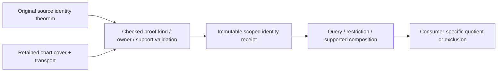
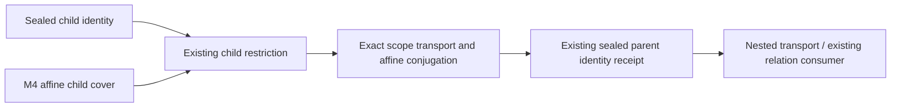

# Original Parameter Identity

## Purpose and Scope

Child of [Original Domain Identity](../DESIGN.md), without children.
Own exact, scoped source-structural equivalence evidence. This is not an intersection
solver, a proximity classifier, a general point deduplicator or topology sewing.

## Responsibilities and Boundaries

Retain participating source/axis/chart handles, exact supporting subsets, original
identity theorem and intended relation kind. The shape issuer proves its original
law; topology supplies explicitly declared shared-boundary roles when applicable.
This component verifies binding, proof kind, scope and supported proof composition.

## Related Designs

| Design | Relationship | Contract Used | Summary | Cautions |
|---|---|---|---|---|
| [Parent](../DESIGN.md) | parent | Three distinct equality relations | Source authority | No XYZ-based identity |
| [Transport](../OriginalParameterTransport/DESIGN.md) | depends on | Original parameter correspondence | Relates chart coordinates | Map correctness is not periodicity |
| [Coverage](../OriginalDomainCoverage/DESIGN.md) | depends on | Supports and incident owners | Scopes identity receipts | Does not merge chart sides |
| [Angular source](../../CanonicalSphereChart/DESIGN.md) | depends on | Intrinsic full/quarter turn and collapsed-pole law | Supplies sphere identity | Physical radians keep symbolic period |
| [Embedding](../../OriginalSurfaceEmbedding/DESIGN.md) | used by, proposed | Scoped exclusion relation | Excludes structural self pairs | Coincident distinct tuples remain contacts |
| [L6](../../RationalBivariateAlgebra/ExactGeometricRelation/DESIGN.md) | used by, proposed | Original parameter/fiber evidence | Keeps all UV correspondence | Parameter versus image dimensions differ |

## Architecture

## Contracts and Invariants

OriginalParameterIdentityIssuing exposes authored-coordinate construction and
OriginalParameterIdentityQuerying exposes decide/restricted/symmetric/compose over
immutable receipts. Rational, Native-periodic and intrinsic-sphere proof operations
are separate refining protocols, not requirements on every source. There is no
public unchecked certificate initializer.
A protocol conformer cannot authorize identity by returning true; supported proof
constructors validate the retained source theorem and exact domains. New proof kinds
need a checked implementation and behavioral evidence before public consumption.

| Kind | Required proof | Permitted interpretation |
|---|---|---|
| Authored coordinate | Same retained parameter space and exact transported tuple | Two charts refer to one authored coordinate |
| Chart boundary | Source-defined boundary correspondence plus whole-boundary original value law when geometric equality is used | Shared source position; retain distinct one-sided germs |
| Periodic orbit | Source-wide G(q+kP)=G(q), original period/turn roles and exact transports | Structural periodic equivalence with every lift retained |
| Collapsed subset | Whole original source map is constant on the issued supported subset | Pole/constant-fiber equivalence, not nearby collapse |
| Declared shared boundary | Original paired boundary maps and declaration verified on their complete supported ranges | Scoped boundary incidence, not global source equality |

An identical authored parameter across knot sides does not prove equal normal/tangent
or continuity; geometric boundary identity additionally requires the source value law.
Equal-valued separate sources do not automatically share an owner. A self-crossing
with distinct tuples remains a geometric intersection unless an original structural
identity theorem applies. Topological adjacency is a declaration to validate, not a
proof that two independently authored boundaries coincide.

Identity scope includes source owner, coordinate semantics, participating roles and
support. Symmetry/restriction preserve that scope. Transitive composition requires
matching intermediate source/role, verified correspondence and full support pullback;
it can strengthen neither support nor proof kind. No global union-find on positions,
residuals, hash matches, tolerance proximity or names is introduced.

An inquiry distinguishes proven structural identity, proved failure of that particular
structural relation, and not established. Not established is not proof of distinct XYZ
and cannot exclude a self-contact pair. Resource, cancellation, foreign binding or
unsupported required proof throws its typed cause. Consumers exclude only supported
pairs covered by an identity receipt; any unresolved remainder stays in the query.

Pole proof uses CanonicalSphereChart's continuous intrinsic phase law. At latitude
quarter-turn boundaries every selected longitude maps to the original collapsed
point. Nearby latitudes do not. Physical-radian transports need the original symbolic
phase equality; a numerical latitude near pi/2 is not a pole certificate. The ambient
UV arity and parameter fiber dimension are retained independently of zero image dimension.

A geometric intersection result may use an identity annotation for quotient topology,
but must keep original requested tuples/chart sides and the correspondence map. The
issuer never chooses a single inverse UV or removes a repeated traversal from coverage.

## State, Ownership, and Lifecycle

Receipts retain immutable source/theorem/cover owners and supported subset handles.
Query borrows and restriction receipts keep those owners alive. No mutable identity
registry, global cache, unowned source pointer or target-specific Sendable weakening.
New composition records allocate under the same exclusive caller admission.

## Failure, Concurrency, and Constraints

Unknown geometric equality is not guessed. Incompatible owners, invalid proof-kind
composition, missing source laws and support violations fail or report not established
as specified above. Independent work/storage/source/depth/result limits and terminal
cancellation apply to proof verification and all subsequent queries. Rebinding requires
an explicit verified source correspondence, never a hash-only match.

## Verification and Change Impact

Refutation fixtures include two chart sides with different tangents at the same knot,
periodic seam versus distinct repeated traversal, a constant pole versus near-pole ring,
self-crossing distinct UV at equal XYZ, false adjacency, partially valid boundary
correspondence, foreign owner and attempted support-widening composition. Success tests
retain every original tuple and allow only precisely supported consumer exclusions.
Test released sources, COW mutation, concurrent immutable readers, separate admissions,
independent limits and final cancellation on Native/ASAN/normal/Embedded. Generic
identity tests use literal exact laws; shape-specific law proofs remain at their
producer. Self-contact/trim/publication composition is verified only when those
consumers actually accept the new receipts.

## Checked Implementation

Authored-coordinate receipts consume two maps into the identical authored frame.
Native periodic receipts consume the complete Native family and its source-issued
period theorem. Rational collapsed-subset receipts prove all three homogeneous
constant-value equations on every selected fiber. Boundary declarations remain
candidates until the complete paired boundary polynomial laws are proved.
No constructor infers identity from a sampled value or a periodic marker.

The identity receipt owns retained source/law/period/declaration evidence. Restriction
and symmetry share that owner. Composition requires the identical middle coordinate
frame and the same proof kind, pulls back the complete intermediate scope, and
retains both parents. Different-kind strengthening is rejected.
Decisions distinguish supported proof, refutation of this particular relation and
unsupported scope; the latter two never assert XYZ distinctness.

The rational constructors do not certify intrinsic trigonometric poles. The
intrinsic sphere constructor instead consumes the canonical source's period/pole
capability, verifies exact latitude and full selected support, and retains every
longitude in the ambient two-coordinate frame. Physical-radian images remain a
distinct producer/adapter obligation.

Retained boundary proofs include both original law owners in addition to the
substituted law and residuals. Composition retains the maximum source depth of
all parent evidence, including intermediate roles absent from the final endpoints.
Reuse admits retained scalar words/period/pole values and polynomial evidence.
These constraints are independent of source-coordinate scope restriction.

## Protocol Composition and Consumer Responsibility

The concrete identity issuer implements only its supported theorem protocols.
Source issuance owns authored period/pole laws; this component also owns exact
whole-scope rational boundary/collapse verification using those retained local
laws. Topology supplies a boundary declaration as a candidate, never proof of
coincidence. Thus the source owner need not pre-prove every selected rational
boundary theorem, while no consumer may invent one from endpoint samples.

A consumer's composition root injects the relevant issuing/querying capability.
Identity receipts are optional annotations for geometric correspondence; required
structural exclusions need an actual supported proof. For self-contact, construct
the complete original source product, restrict each supported identity to the
requested pair scope, and subtract only its proved relation. Return unresolved
pairs to the relation compiler. Coverage, equal XYZ or a failed identity query
cannot justify exclusion. For XYZ results and boundary consumers, keep the original
tuple/chart/lift handles even when a proved quotient is useful for topology.

No consumer inspects the private Proof buffers or reruns their polynomial checks.
Read decisions through protocol requirements. Separate exact-law proof ownership
from any consumer-specific use; tests of the issuer do not establish self-contact
or boundary/publication migration. The latter acceptance is owned by the
[parent consumer matrix](../DESIGN.md#di4-consumer-acceptance-and-migration-boundary).

## Checked whole-relation view

OriginalParameterIdentityRelationQuerying refines the existing querying protocol.
relation(of:limits:using:) re-admits the complete retained identity receipt before
publishing an immutable OriginalParameterIdentityRelation. It retains the receipt,
left/right scopes, proof kind, source/value/coefficient/transport depths and original
proof owner. There is no public relation initializer. Its constraints are either the
exact affine word (right[i] = gains[i] * left[permutation[i]] + offsets[i]) or
completeProduct. completeProduct certifies every pair in the two retained scopes,
including composed collapsed/shared-boundary proofs; it never widens those scopes.
The enum alone is syntax, not an identity certificate. Consumers must retain the
issuer-produced view with any compiled exclusion predicate. Not-established tuples
outside either scope cannot be excluded. Equal XYZ never issues this view.

Coefficient arrays and proof owners share immutable COW backing; acquisition does
not materialize or re-charge payloads. New predicates/refinement payloads belong to
the consuming query's budget. Reuse requires fresh admission and terminal cancel.
Existing querying conformers remain compatible because the capability is a separate
refining protocol. The existing decision/restriction/composition behavior is unchanged.

RelationViewFixtures verify whole affine constraints against decide, a genuinely
constant rational subset against completeProduct, owner release/COW separation,
source/transport/proof limits, exhausted work, zero-storage shared reuse and
entry/terminal cancellation. The
immutable relation is Sendable on Native, WASM and Embedded with identical storage;
no mutable state or target-specific isolation is introduced. Boundary/self adapters
own their higher-level refinement and exclusion tests, using public L4 refinePullback.

## Analytic source theorem consumption

OriginalAnalyticParameterIdentityIssuing refines the source-specific capability for
OriginalAnalyticDomainCover. The existing analytic source issuer remains the only
authority for genuine periods and whole constant fibers. periodic selects a source
period by axis, intersects selected/effective scopes and clips the translated right
scope before issuing the affine relation. A temporary unbounded parameter frame
allows pullback before bounded authored admission; it does not widen final proof.
Empty translated overlap is a valid empty scoped relation. The original coefficient
field, angular semantics, period and source owner are retained and re-admitted.

collapsed selects a source-issued fiber by index, intersects the requested scope,
and requires every fixed-axis interval equal the exact source fixed value. It then
issues a complete-product relation only on that scope. The proof owner retains the
original collapsed-fiber receipt and polynomial position laws; scalar/source depths
and fixed value/position are re-admitted on reuse. Nearby latitude or non-singleton
fixed axis cannot become a collapse. The source law producer is unchanged.

This primitive identity capability closes M5.P only. Child composition, joins and
all-family identity acceptance remain M5.C. AnalyticIdentityFixtures own the new
independent behavioral evidence; production boundary/self composition is separately
owned by M6 consumers. Existing Native/intrinsic/rational receipts and their public
query methods remain compatible and are covered by the same independent regression
package. All storage and proof owners are immutable on every target.

## Source-owned revolution period consumption

OriginalRevolutionParameterIdentityIssuing consumes a retained sealed revolution
cover and its source-owned intrinsic period. It first admits the whole source
family and intersects the selected original UV with the effective request. The
same internal finite-period clipping helper used by analytic identities maps the
translated selection through an unbounded bridge, clips it back to effective
support, then issues the existing periodicOrbit receipt. No period is inferred
from matching XYZ, a binary approximation to mathematical pi, or a generator sample.
The source's intrinsic angular label is authoritative for this particular shape.

Original V remains unchanged; every original UV is retained. Negative cycles and
empty finite overlap are exact. The receipt retains the original period/source
owner; it makes no claim of a solved intersection or a new collapsed-fiber proof.
All source/chart/family/depth/work/storage/identity checks and final cancellation
use the same caller admission. The helper refactor preserves analytic public
contracts and requires their existing behavioral cases on the composed snapshot.
Verification belongs to RevolutionIdentityFixtures and the actual production
revolution source/DI/identity handoff. Generic/non-rational generator, collapsed
revolution fiber and remaining composed/shared-boundary M5 acceptance stay open.

## Affine child identity transport

Completed M4 affine child covers provide the source-authoritative coordinate
correspondence. The child identity's two scopes must share the child cover frame.
The issuer first restricts that proof to the complete pullback of the parent's
effective request, then transports both scopes through the checked correspondence.
It conjugates affine constraints and preserves complete-product constraints only
on the transported scopes. Identity kind and position-only meaning are unchanged.

The existing receipt gains optional immutable proof/readmission retention. A typed
private evidence owner holds the child proof and M4 cover; its lifetime is retained
as Sendable data, never invoked as an approval callback. Original scalar/field pairs
needed for readmission survive affine cancellation. Readmission owners form a typed
immutable chain, sharing earlier owners without flattening or copying their arrays.
Existing receipt restriction/symmetry share that owner; transitive composition
retains applicable inherited owners. An unchanged proof incurs no new retained
owner. No public unchecked initializer or arbitrary Boolean proof is introduced.

The same existing receipt type is returned, so nested affine child covers and
existing relation-view consumers can reuse the result. Its original child owners
and one-sided roles remain retained. Every admission validates original source,
value/coefficient/transport depth, proof counts and retained scalar fields. The
parent and child source types may differ without losing either evidence lifetime.
Same XYZ, a spatial action or failed identity proof never creates a new identity.

`OriginalAffineChildParameterIdentityIssuing` consumes a typed affine child cover
and a sealed child identity. `DefaultOriginalAffineChildParameterIdentityIssuer`
returns the existing parent receipt after checking that authority. Existing query/restriction/symmetry/composition requirements
remain the query contract. All scope, constraint, evidence-owner and scratch
allocations use the same caller admission, with terminal cancel on empty and
nonempty publication. Immutable Sendable storage and invocation-local scratch are
identical on Native/WASM/Embedded. No new unsafe memory or mutable shared state is
introduced. Nonlinear/singular correspondence, join/shared-boundary issuance and
general upper consumers remain required M5.C/M6 work.

Verification owner: [OriginalAffineChildIdentityVerification](../../../../Tests/OriginalAffineChildIdentityVerification/VERIFICATION.md). Required
counterexamples cover reversal/swap/nesting, periodic/collapsed scopes versus
near-pole, exact effective-request pullback, distinct sameXYZ, foreign owner/frame/
role, independent count/depth/resource failures, cancellation and retained lifetime.
Use actual source/DI/identity paths and fixed target compile/link/runtime; verify
changed existing relation consumption and independent latest-main delivery.
