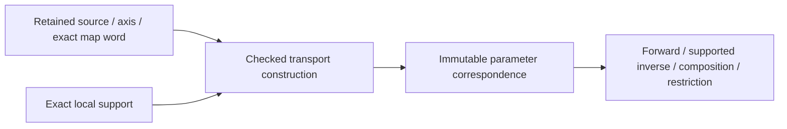

# Original Parameter Transport

## Purpose and Scope

Proposed child of [Original Domain Identity](../DESIGN.md), without children.
Own exact source/axis-bound correspondence between local charts and authored parameter
spaces. Does not own shape evaluation, periodicity proof or geometric equivalence.

## Responsibilities and Boundaries

Retain map expression, local support, authored image, coordinate roles, source owner,
orientation and inherited depths. A periodic lift retains the unreduced authored
coordinate plus cycle expression; choosing a representative never erases that lift.
The shape owner supplies any source-period law and any nonlinear angular correspondence.

## Related Designs

| Design | Relationship | Contract Used | Summary | Cautions |
|---|---|---|---|---|
| [Parent](../DESIGN.md) | parent | Original source binding | Common ownership/failure | No global IDs |
| [Exact domains](../ExactParameterDomain/DESIGN.md) | depends on | Exact support and set operations | Validate map supports | No fuzzy bounds |
| [L0](../../RationalBivariateAlgebra/ExactScalar/DESIGN.md) | depends on | Ordering/arithmetic/import/admission | Exact affine arithmetic | No Double intermediate |
| [ParameterImage](../../ParameterImage/DESIGN.md) | coordinates with | Existing exact gains and periodic translation words | Reuse rather than rebuild | Stored period alone is not proof |
| [Angular source](../../CanonicalSphereChart/DESIGN.md) | coordinates with | Intrinsic/physical phase transport | Supplies nonlinear semantics | pi is symbolic in physical coordinates |
| [Coverage](../OriginalDomainCoverage/DESIGN.md) | used by | Chart support/image relation | Retains every original coordinate | No point-only coverage |

## Architecture

## Contracts and Invariants

Proposed OriginalParameterTransporting defines required source-binding, support,
forward transport, inverse correspondence, composition and restriction operations.
Associated immutable map/proof values and generic admissions enable static dispatch.
No protocol returns an unchecked Bool asserting that an arbitrary callback is a map.
Construction verifies each supported expression and records its proof kind.

Initial concrete maps are identity, nonzero exact affine gain/offset, axis permutation,
and independent integer-period lifts. Exact forward/inverse identities are verified
through the original expressions. Negative gain reverses endpoint order and inclusion
flags without changing the selected set's meaning. Zero gain is a noninvertible map;
it belongs to an explicit image/fiber correspondence, not an invertible transport.
Singular surface parameter images likewise cannot advertise an inverse.

Periodic translation uses the exact source-certified period and integer turn expression.
Reuse OriginalParameterPeriodicTranslation arithmetic where applicable. The product
k*P and transported endpoints need not fit Double. Integer magnitudes use checked
conversion/retained arbitrary-precision scalar arithmetic, not Double cycle indices.
Every map application preserves requested cycle and authored coordinates. Producing
a numerical representative later requires a separate precision/range proof.

Source-defined chart equivalence is distinct from this map's algebraic correctness.
The map q=t+P does not prove G(t+P)=G(t). Source period, joins and poles are certified
by the identity issuer with the shape law owner's evidence.

Intrinsic angular labels and physical radians are distinct semantic spaces.
Intrinsic sphere quarter/full turns use the canonical phase owner. Physical-radian
periods retain mathematical 2*pi symbolically; 2*Double.pi is not that period.
Existing physicalRadianArc gain/endpoints/turns remain authoritative expressions.
A nonlinear conic station map requires the original producer's two-way correspondence,
not atan of a sample or fitted controls. Extensions to such maps retain typed symbolic
expressions and verified source proofs; they cannot fall through an affine facade.

## State, Ownership, and Lifecycle

Map words and exact scalar payloads are immutable retained values. Coordinate roles
and source owner are part of every handle's authority. COW buffers are shared; only
new composed expressions/queries allocate under the caller admission. Foreign maps
cannot be composed even if numerical gains happen to match.

## Failure, Concurrency, and Constraints

Incompatible axes/source/phase, singular inverse, unproved symbolic order and unsupported
map proofs fail explicitly. Bounds overflow or an unavailable numeric representative
cannot corrupt the exact map. Work/bytes/source depth/value and coefficient depth are
inherited and checked across every composition; no unlimited internal fallback.

## Verification and Change Impact

Literal exact maps verify nonunit/reversed gains, restrictions, composition/inverse,
independent surface axes and non-Double cycle products. Original-law tests verify the
actual source period separately. Foreign owner, zero gain, huge integer bounds,
physical/intrinsic mismatch, source mutation/release and independent limits/final
cancellation must refuse correctly. Changes to gain or phase words recheck their
owning ParameterImage/CanonicalSphereChart tests, not unrelated geometric solvers.
