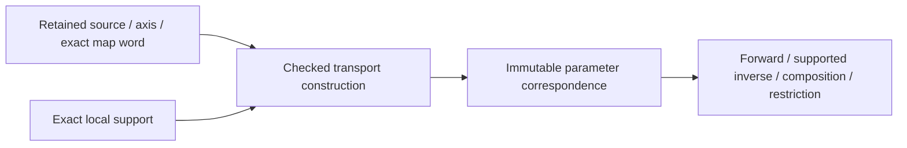

# Original Parameter Transport

## Purpose and Scope

Child of [Original Domain Identity](../DESIGN.md), without children.
Own exact source/axis-bound correspondence between local charts and authored parameter
spaces. Does not own shape evaluation, periodicity proof or geometric equivalence.

## Responsibilities and Boundaries

Retain map expression, local support, authored image, coordinate roles, source owner,
orientation and inherited depths. A periodic lift retains the unreduced authored
coordinate plus cycle expression; choosing a representative never erases that lift.
The shape owner supplies any source-period law and any nonlinear angular correspondence.

## Related Designs

| Design | Relationship | Contract Used | Summary | Cautions |
|---|---|---|---|---|
| [Parent](../DESIGN.md) | parent | Original source binding | Common ownership/failure | No global IDs |
| [Exact domains](../ExactParameterDomain/DESIGN.md) | depends on | Exact support and set operations | Validate map supports | No fuzzy bounds |
| [L0](../../RationalBivariateAlgebra/ExactScalar/DESIGN.md) | depends on | Ordering/arithmetic/import/admission | Exact affine arithmetic | No Double intermediate |
| [ParameterImage](../../ParameterImage/DESIGN.md) | coordinates with | Existing exact gains and periodic translation words | Reuse rather than rebuild | Stored period alone is not proof |
| [Angular source](../../CanonicalSphereChart/DESIGN.md) | coordinates with | Intrinsic/physical phase transport | Supplies nonlinear semantics | pi is symbolic in physical coordinates |
| [Coverage](../OriginalDomainCoverage/DESIGN.md) | used by | Chart support/image relation | Retains every original coordinate | No point-only coverage |

## Architecture

## Contracts and Invariants

OriginalParameterTransporting defines required source-binding, support,
forward transport, inverse correspondence, composition and restriction operations.
Associated immutable map/proof values and generic admissions enable static dispatch.
No protocol returns an unchecked Bool asserting that an arbitrary callback is a map.
Construction verifies each supported expression and records its proof kind.

Initial concrete maps are identity, nonzero exact affine gain/offset, axis permutation,
and independent integer-period lifts. Exact forward/inverse identities are verified
through the original expressions. Negative gain reverses endpoint order and inclusion
flags without changing the selected set's meaning. Zero gain is a noninvertible map;
it belongs to an explicit image/fiber correspondence, not an invertible transport.
Singular surface parameter images likewise cannot advertise an inverse.

Periodic translation uses the exact source-certified period and integer turn expression.
Reuse OriginalParameterPeriodicTranslation arithmetic where applicable. The product
k*P and transported endpoints need not fit Double. Integer magnitudes use checked
conversion/retained arbitrary-precision scalar arithmetic, not Double cycle indices.
Every map application preserves requested cycle and authored coordinates. Producing
a numerical representative later requires a separate precision/range proof.

Source-defined chart equivalence is distinct from this map's algebraic correctness.
The map q=t+P does not prove G(t+P)=G(t). Source period, joins and poles are certified
by the identity issuer with the shape law owner's evidence.

Intrinsic angular labels and physical radians are distinct semantic spaces.
Intrinsic sphere quarter/full turns use the canonical phase owner. Physical-radian
periods retain mathematical 2*pi symbolically; 2*Double.pi is not that period.
Existing physicalRadianArc gain/endpoints/turns remain authoritative expressions.
A nonlinear conic station map requires the original producer's two-way correspondence,
not atan of a sample or fitted controls. Extensions to such maps retain typed symbolic
expressions and verified source proofs; they cannot fall through an affine facade.

### Responsibility of a transport implementation

The family/source issuer supplies coordinate semantics and the authored map word.
OriginalParameterTransporting verifies the supported affine/permutation/period-lift
word, selection pullback, inverse and causal depth. Its implementation does not
inspect a shape enum or prove G(q+P)=G(q). The identity issuer consumes the latter
source theorem separately. Composition roots inject the transport capability;
current Default calls do not establish completed injection migration.

Keep the existing inverse-bearing transport contract narrow. Nonlinear source
correspondence must retain its source-issued exact relation and complete support;
noninjective maps have all original preimages, not an invented inverse. That new
capability must be specified/verified with its source owner and relation consumer
before use. It is not implemented by adding a callback or by weakening the current
affine inverse guarantee. Source-coordinate evaluation, structural identity and
geometric fiber solving remain three distinct operations. The outstanding family
dependencies are recorded in [coverage](../OriginalDomainCoverage/DESIGN.md#required-source-family-obligations).

## State, Ownership, and Lifecycle

Map words and exact scalar payloads are immutable retained values. Coordinate roles
and source owner are part of every handle's authority. COW buffers are shared; only
new composed expressions/queries allocate under the caller admission. Foreign maps
cannot be composed even if numerical gains happen to match.

## Failure, Concurrency, and Constraints

Incompatible axes/source/phase, singular inverse, unproved symbolic order and unsupported
map proofs fail explicitly. Bounds overflow or an unavailable numeric representative
cannot corrupt the exact map. Work/bytes/source depth/value and coefficient depth are
inherited and checked across every composition; no unlimited internal fallback.

## Verification and Change Impact

Literal exact maps verify nonunit/reversed gains, restrictions, composition/inverse,
independent surface axes and non-Double cycle products. Original-law tests verify the
actual source period separately. Foreign owner, zero gain, huge integer bounds,
physical/intrinsic mismatch, source mutation/release and independent limits/final
cancellation must refuse correctly. Changes to gain or phase words recheck their
owning ParameterImage/CanonicalSphereChart tests, not unrelated geometric solvers.

## Implementation contract fixed for DIA.1

Coordinate frames retain the existing SourceBinding through a chart anchor. A frame
is a coordinate declaration, not a source-support or source-identity theorem. Family
cover issuers must derive authoritative support from the source; arbitrary affine
map correctness never proves source periodicity. Local and authored frames have
separate immutable axis owners and explicit coordinate semantics. An axis-separated
invertible map proves the entire local selection maps into authored support. Empty,
disconnected and unbounded sets preserve exact endpoint flags. Composition pulls
back the second support before forming its flattened word. Transport depth records
causal history even though flattened coefficients are reused. Source depth remains
independent under OriginalSourceIssuanceLimits. No phase conversion or singular
inverse is inferred from a numerical coefficient.

DIA.1 uses L0/DI0 arithmetic and the existing binding contract; the independent
compiler graph includes SourceIssuer and its unchanged L1 dependency, never L2-L6
or concrete Geometry. DIA.2/DIA.3 add checked Native source-law/period certificates,
complete cover proofs and supported identity constructors. DIA.4 consumes those
receipts in actual existing source/consumer adapters; its full acceptance remains
separate from a generic kernel test.

Cartesian selection intersection, equality and difference belong to the transport
component. Difference returns disjoint strips and retains all open/closed boundaries;
it does not classify XYZ. Intermediate strip counts use the caller chart limit.
Integer reduction uses exact doubling/bisection in the coefficient field and preserves
unbounded word-size cycles. No binary64 quotient selects a family member.

Retained coefficient words are admitted on reuse even when both supports are
unbounded and no finite endpoint arithmetic is needed. A coordinate frame also
admits its coefficient-field owner. Both rules preserve selected algebraic proof
depth without adding root solving to the transporter.

OriginalPlaneCoordinateQuerying consumes the source-owned basis receipt described
in [source issuance](../../OriginalSourceIssuance/DESIGN.md#stored-n-plane-basis-authority).
It evaluates the whole exact plane law and provides an exact on-plane inverse;
this operation is separate from later numerical output/projection.

## Checked affine-coordinate view

OriginalParameterAffineCoordinateQuerying is a refining protocol implemented by the
existing transporter. affineCoordinates(of:limits:using:) re-admits the retained
transport before returning OriginalParameterAffineCoordinates. Its immutable value
retains the original map and shares its permutation/gain/offset COW buffers. There
is no public view initializer and no new coefficient allocation or storage charge.
For each output axis i, image[i] = gains[i] * local[permutation[i]] + offsets[i],
only on the retained local/image selections. Negative gains and permutations keep
that orientation. The view proves parameter transport, not source identity.
Consumers compile their own boundary laws from this checked contract rather than
sampling the map or accessing transport internals. A later query acquires/admit the
view again under its own caller budget; terminal cancellation precedes publication.
The new protocol avoids adding requirements to existing transport conformers.

The independent RelationViewFixtures tests compile these words into polynomial
constraints, verify exact reversal/permutation and scope, retain owners after the
original local bindings are gone, and exercise work/storage/depth/source/cancel.
The view introduces only immutable let state and computed readers on all targets;
there is no platform-dependent storage/isolation/conformance or mutable registry.

## Explicit query arithmetic field

OriginalParameterFieldQueryTransporting refines the existing transport protocol
with forward evaluation under an explicit compatible arithmetic/ordering field.
The default transporter retains/re-admits the original map, source, coefficient
words and both frame owners; it validates the query tuple and local selection in
the query field, then evaluates the unchanged affine word in that field. No map,
selection or inverse is reissued. Existing forward calls keep their original field.
OriginalParameterSelection exposes the matching field-aware membership operation
through ExactParameterDomainFieldQuerying. M6 boundary/self queries pass one field
through membership, transport and retained-L5 lookup, including empty results and
foreign tuple validation. No new source equality or structural identity follows.
