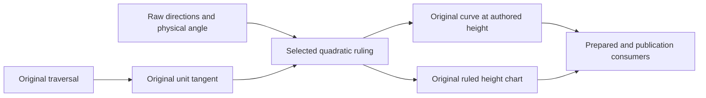

# Original Drafted Section

## Purpose and Scope

This child of [CADGeometry](../DESIGN.md) owns the immutable original quadratic
draft curve and its ruled wall. It retains an [original traversal](../OriginalRootSpan/DESIGN.md),
raw section normal, extrusion axis, pull direction, authored physical-radian
angle and heights. Candidate spline control nets are not source authority.

## Responsibilities and Boundaries

The source owns the selected continuous quadratic ruling, whole closed Taylor
jets, finite normalized domains and strict source serialization. CADModeling
owns construction candidates, final correspondence, topology and publication.
CADGeometry composition owns enum, prepared-owner and common-query adapters.
The parent invocation owns work, storage, source nesting and subdivision limits.

## Related Designs

| Design | Relationship | Contract Used | Summary | Cautions |
|---|---|---|---|---|
| [CADGeometry](../DESIGN.md) | parent | Original geometry value composition | Publishes the persistent source families | Adapters must evaluate this original law |
| [OriginalRootSpan](../OriginalRootSpan/DESIGN.md) | depends on | Retained directed original closed Taylor law | Keeps exact native/chart endpoints and owning coefficients | A derivative hull does not establish cross-join smoothness |
| [SurfaceAreaIntegration](../SurfaceAreaIntegration/DESIGN.md) | depends on | Caller-paid interval Taylor arithmetic | Bounds every source and mixed derivative | Forward actual byte callbacks |
| [DraftedSection](../../CADModeling/DraftedSection/DESIGN.md) | used by | Original drafted curve and wall | Supplies S1/S2 final source authority | Native candidates require a separate whole-source certificate |

## Architecture

## Contracts and Invariants

For the original tangent T, normalized raw normal N, axis A and pull P, define
B=T cross N and Q=T cross A. The ruling is A+kB, where the original angle sets
sine squared and the original quadratic equation sets k. Only angle exactly
zero uses the zero-angle linear equation. No tangent-to-angle reconstruction or
small-angle snapping changes authored source identity. At exactly zero angle
and structurally identical raw axis/pull, `(T cross A) dot A` is identically zero.
After the same nonzero normal/pull clearance and original speed admission, the
ruling is exactly the normalized original axis; interval correlation loss cannot
invent a tangent-dependent offset for this identity. When its raw axis and pull
are identical and normal/pull clearance is proved nonzero, the zero-angle source
queries only the original requested derivative order and adds the constant
normalized original axis. Its continuous translation law also exists at a
stationary curve point; final wall regularity separately rejects zero tangents.
No unnecessary higher generator derivative or unit-tangent normalization is
required to evaluate this exact translation arm. The selected quadratic
root uses the authored angle sign and the same branch as the existing draft
construction. Positive speed, positive quadratic coefficient and positive
discriminant must be proved on the whole closed query; unresolved intervals
subdivide without changing the law. A proved absent real root fails.

The curve is C(u)+height*(A+k(u)B(u)). The wall uses the same raw traversal and
ruling with height(v)=height*(1-v)+endHeight*v on [0,1] squared. Its exact endpoint
roles retain the two authored heights. Every derivative follows this law,
including mixed derivatives and original tangent normalization. The wall does
not interpolate fitted endpoint curves.

The curve and wall first-order continuity issuers first require the retained generator
issuer to prove one original smooth owning law over the query and then proves
the whole positive-speed real ruling branch with closed first-order coefficients.
An aggregate derivative hull or candidate smoothness cannot issue continuity.
A singleton query conservatively uses the complete generator law for this
authority. Whole regularity and embedding are separate final-surface certificates.

Cache fields are immutable enclosures of original expressions, never exact
coefficients or source identity. Equality, hashing and native encoding retain
only the raw source fields. Queries retain the traversal tolerance and take the
minimum of retained and caller capabilities. Exact coefficient algebra depth
remains separate from geometric subdivision and source recursion.

## State, Ownership, and Lifecycle

The value owns one immutable prepared original traversal and fixed direction
and trigonometric caches. No mutable state or target-specific concurrency
contract exists. Queries admit Taylor arrays and the bounded depth-first frontier
before allocation; byte callbacks retain the caller's physical accounting unit.

## Failure, Concurrency, and Constraints

The original draft ceilings remain 4096 owning spans, 65536 query visits and
32 geometric subdivision levels, further reduced by the caller. All lower
coefficient work, fixed trigonometric work and allocated payloads debit the same
caller. Invalid domains or changed tolerance fail; proved nonfinite rulings and
missing real roots retain typed geometry failures; unresolved speed/branch
clearance or exhausted capabilities fail as resource exhaustion. Missing
original higher derivatives propagate the lower typed failure.

### Exact zero-angle Native translation atlas

`OriginalDraftedZeroTranslationRationalAtlas` owns only the position law of the
exact-zero branch with structurally equal raw axis/pull and exactly one nonzero
raw axis component. The canonical unit axis is the corresponding signed unit
coordinate vector, not an interval-cache midpoint. The corresponding original
raw normal component must be nonzero: division by the positive normal length
then proves exact nonzero normal/axis clearance. This source theorem authorizes
the existing constant-ruling identity independently of interval enclosure width.
Other angles, axes, clearances and child source families remain explicitly
unsupported by this atlas.

The source owns one representation-only capability predicate shared by atlas
preparation and the source provider's public `supports` query. Public dispatch
uses it before selecting the exact path, so existing unsupported source families
continue through their existing legacy paths. This predicate performs no source
validation or resource admission; once selected, tolerance, invalid-source,
resource and cancellation failures propagate from the admitted operation.

The generator must be a direct validated positive-weight Native B-spline with
authored traversal endpoints. The atlas consumes the existing original traversal
polynomial pieces once and retains their exact reversed parameter law, selected
owning spans and closed supports. Its position is `(X + D*A.x*h(v),
Y + D*A.y*h(v), Z + D*A.z*h(v))/D`, with exact original authored heights and
`h(v)=height+(endHeight-height)*v`. The uncancelled original denominator `D`
remains unchanged. Native validation supplies finite strictly positive weights,
ordered knots and continuous closed-span endpoint semantics; the exact Native
nonnegative partition-of-unity basis therefore proves `D>0` throughout each
closed retained cell. A nonzero-polynomial test or sampled residual is not this
denominator authority.

The authored wall domain remains `[0,1]^2` independently of the atlas cells.
[Source Issuance](../OriginalSourceIssuance/DESIGN.md) imports these immutable
cells and retains the original generator correspondence
`generatorStart+(generatorEnd-generatorStart)*u`. Its existing finite preparer
must separately prove complete authored coverage and identity original UV.
All exact construction, coefficient import and correspondence evaluation retain
the same caller work/storage, scalar depth, source depth and cancellation
contract; no new mutable state or target-specific capability is introduced.

## Verification and Change Impact

After the source implementation gate, DraftedSection/Extrude tests must exercise
nonzero tiny angles at large heights, oblique pulls, curved sections, directed
reversal, ruled mixed derivatives, exact endpoints, absent roots, budget failure
and cancellation. Whole original distance/tangent/curvature certificates and
final sewn/public output must be checked; a native candidate is not completion
evidence. Geometry dispatch, strict native round trips and exchange source
fingerprints are affected consumers.
