# Original Source Issuance

## Periodic Native offset supply

The fundamental Native chart preparer shares the finite preparer's original span
and rational-law construction. Its sealed result retains every fundamental chart
and independently verified source period. It is a distinct type: a fundamental
template array is never an `OriginalFiniteBSplineCharts` whole finite support.
The finite entry continues to reject periodic children. No sampled closure or
`isPeriodic` flag substitutes for the existing translated-knot/control theorem.

The periodic Native offset preparer consumes that family and the existing offset
law issuer. Its original differential cross product, positive normal-length root,
denominator and nonzero-normal guards remain unchanged, including distance zero.
Periodic upper fundamental endpoints are nonowning: original Native evaluation
wraps them to the lower endpoint and then selects the right owning span. Closed
chart germs remain in the template family; a limit normal is not the authored
offset value at a knot. Translated basis laws imply translated derivative laws,
so the offset's guarded position relation repeats with the proved child periods.

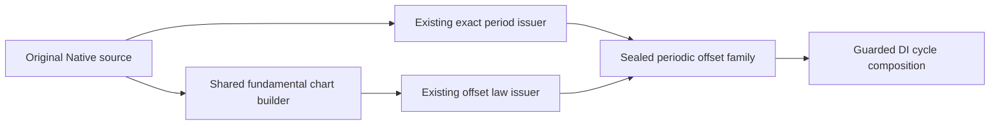

All receipts are immutable Sendable values on Native, normal Wasm and Embedded;
only invocation-local arrays and the exclusive caller admission mutate. Whole
family publication validates source ownership, chart counts, depths and terminal
cancellation. Period and coefficient owners live with the result. General child
surfaces, nonlinear UV and automatic CS/SSI publication remain required work in
their existing owners. The focused periodic-offset verification owns mixed/two-axis
periods, seam/normal ownership, invalid cyclic storage, resources/cancel/lifetime
and unchanged finite chart/offset behavior. See [DI composition](../OriginalDomainIdentity/OriginalDomainCoverage/DESIGN.md#periodic-native-offset-domain-composition).

## Purpose and Scope

Parent: [CADGeometry](../DESIGN.md). Child:
[Original Physical Angle Coefficients](OriginalPhysicalAngle/DESIGN.md).
No new SwiftPM targets. This
component owns common source-issuance contracts inside CADGeometry. The binding
and exact Native selected-span/periodic local-law implementation is independently
verified through source-provider ports. Existing geometry adapters and other
family components retain their implementations until separately verified migration.

Issue a retained description of one authored source and a proved exact local
representation of that source. A law is valid on its stated support and carries
its original parameter correspondence. Issuance does not prove that any two
shapes intersect or that a requested domain has been completely covered.

The complete required family scope remains native splines, analytic lines/conics
and plane/cylinder/cone/sphere/torus, procedural offset/ruled/rolling-ball/
revolution/Coons/boundary-correction/derivative/draft/angular-transport, and
implicit/certified/lift/join/guide/rigid/affine/parameter-image/original-word
sources. A common contract does not establish support for every family.

## Responsibilities and Boundaries

| Owner | Produces | Consumes | Decision authority |
|---|---|---|---|
| Existing authored family | Original representation and semantic rules | Authored fields and retained construction certificates | What the original shape means |
| Source binding issuer | Immutable binding to the original snapshot and descendants | Existing family validation and certificates | Source provenance and retained authority |
| Local law issuer | Original law, guards, support, coefficient provenance and parameter transport | Bound source, selected source chart and caller field | Equality of the local representation to the authored law |
| Domain issuer, outside this component | Requested-domain cover, chart joins and seam/pole identities | Binding and local support/parameter contracts | Whole coverage and identification of distinct chart representatives |
| Relation compiler, outside this component | CS/SSI/projected/self equality and selection predicates | Issued laws and domain evidence | Variable placement and pair/query predicate semantics |
| L3/L4/L5/L6 and publisher, outside this component | Solutions, connections, images/fibers and numerical output | Complete compiled input | Solution completeness, topology and public results |

The issuer validates that a selected chart belongs to its retained source and
that the law is valid throughout its support. This local obligation is distinct
from enumerating every chart needed to cover a caller's request. Domain issuance
may retain these local laws, but source issuance never invokes domain coverage.
Neither side can replace the other's proof with sampled agreement.

Family semantics remain owned by their existing designs. This component owns
provenance, local-representation evidence and the inter-component handoff, not a
second definition of a sphere, plane, ruled surface or operation word.

## Related Designs

| Design | Relationship | Contract Used | Summary | Cautions |
|---|---|---|---|---|
| [Geometry](../DESIGN.md) | parent | Authored family semantics and source dispatch | Owns original meaning | Existing unresolved semantic conflicts cannot be hidden by issuance |
| [Source Validation](../OriginalGeometrySourceValidation/DESIGN.md) | coordinates with | Existing concrete validation policy through source-provider conformance | Providers retain family authority | Not an independent issuer build dependency; validation alone is not law equivalence |
| [L0](../RationalBivariateAlgebra/ExactScalar/DESIGN.md) | depends on | Exact import, ordering, arithmetic and exclusive admission | Coefficient and resource authority | Binary64 values and canonical primitive roles have distinct meanings |
| [L1](../RationalBivariateAlgebra/ExactPolynomial/DESIGN.md) | depends on | Exact polynomials and admitted operations | Rational/polynomial local representation | No new polynomial engine |
| [Physical Angle](OriginalPhysicalAngle/DESIGN.md) | child | Exact ordered physical-radian coefficients | Authored cone angles retain genuine sin/cos | Its scalar field is not rational or algebraic; consumers must select its capability explicitly |
| [L2](../RationalBivariateAlgebra/ExactRealRoot/DESIGN.md) | conditional dependency | Existing selected algebraic coefficient field and transport | Needed only by genuinely algebraic coefficients | No geometric root solve; no silent field extension |
| [Native Exact Relations](../NativeExactRelations/DESIGN.md) | coordinates with | Current Native preparation and coefficient transport | First consuming migration | DI owns source/request clipping; the consumer compiles and resolves the relation from retained source/domain receipts |
| [Domain and Identity](../OriginalDomainIdentity/DESIGN.md) | used by | Retained binding, local support/transport and source period/pole authority | Specialized DI issuer implementations derive whole requested coverage | Source issuance never depends on DI; a local law or implicit image alone is not a complete source-domain cover |
| [Original Revolution](../OriginalRevolution/DESIGN.md) | coordinates with | Original normalized generator and intrinsic Rodrigues law | Retains actual construction authority | Axis collapse is a valid position fiber, not regularity |
| [Actual Revolution Verification](../../../Tests/OriginalRevolutionSourceVerification/DESIGN.md) | test owner | Actual construction/provider/point/derivative handoff | Compares retained source law against Geometry evaluation | Native evidence; independent law verification covers portable targets |
| [Ruled Sources](../OriginalRuledIntersectionSources/DESIGN.md) | coordinates with | Original boundary laws and ruled composition | Existing exact source producer | Pair-equation adapters move to the relation owner when migrated |
| [Coons Sources](../OriginalCoonsIntersectionSources/DESIGN.md) | coordinates with | Original boundary maps, corners and shared position formula | Existing exact source producer | Retain current corner and construction authority |
| [Affine Sources](../OriginalAffineIntersectionSources/DESIGN.md) | coordinates with | Original word coefficients and homogeneous action | Existing exact source producer | Normalized words require their genuine coefficient field |
| [Analytic Sources](../OriginalAnalyticIntersectionSources/DESIGN.md) | coordinates with | Original implicit image equations | Separate representation capability | Image membership does not provide all source UV |
| [Curve Cover](../OriginalNativeCurveChartCover/DESIGN.md) | used by, after migration | Source binding and local law support | Owns requested curve coverage | Exact periodic transport remains a domain obligation |
| [Surface Cover](../OriginalNativeSurfaceChartCover/DESIGN.md) | used by, after migration | Source binding and local law support | Owns requested surface coverage | No tolerance-based chart identification |
| [L5](../RationalBivariateAlgebra/ExactParametricRelation/DESIGN.md) | used by, through compiler | Original homogeneous map laws | Owns pair relation composition | Issuance must not duplicate its CS/SSI equations |
| [Independent Verification](../../../Tests/OriginalSourceIssuanceVerification/DESIGN.md) | test owner | Source-provider and local-law contracts | Exact independent Native laws and failure/lifetime behavior | Does not verify existing geometry adapters or full domains |
| [Native Verification](../../../Tests/NativeExactRelationVerification/DESIGN.md) | subsequent integration test owner | Existing full-module Native/WASI behavior | Reuse unchanged input hashes | Independent issuer evidence does not establish migrated public behavior |

## Architecture

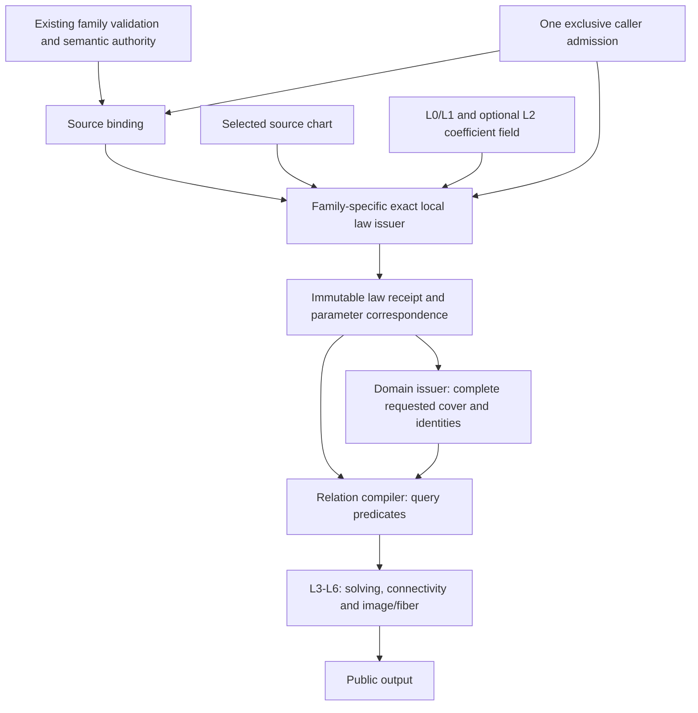

There are two foundational steps, not a new replacement algebra hierarchy:

1. Bind the original source and its authority without claiming any representation.
2. Issue an exact supported local law with its support and original parameter map.

Composite sources use the same two steps recursively for their original
descendants. Consumer-facing conversion to L5 is a checked representation handoff;
it does not create another source owner or run the solver.

## Contracts and Invariants

### Native Swift protocol boundaries

Binding, snapshotting, rational-chart and implicit-image operations are protocol
requirements with separate concrete implementations. Use associated types and generic static dispatch; production hot paths
do not erase coefficient fields or law types into `Any` or callback closures.

### Physical-radian cone image

`OriginalAnalyticConeSnapshotProvider` retains the actual cone, apex, original
binary frame from `analyticOrthonormalBasis`, and physical halfAngle. Its local
image capability explicitly requires `ExactPhysicalAngleCoefficients` for that
same angle. In local coordinates q the exact law is
`cos(a)^2*(qx^2+qy^2)-sin(a)^2*qz^2=0`, including the apex. The original
`AnalyticSurface3D.vDomain` is unbounded, so both nappes belong to the full image;
a one-sided branch guard would incorrectly remove original negative-v points.
This receipt supplies image membership and preserves no claim of full UV fibers.
Angle/cosine/sine positivity is checked exactly and the original frame determinant
is retained as a nonzero guard. A different angle owner is rejected.

### Native geometry providers

`OriginalBSplineCurveSnapshotProvider` and
`OriginalBSplineSurfaceSnapshotProvider` bind the actual CADGeometry value types.
They call the existing bounded family validator with a nonescaping callback to
the same admission. Validation failures are preserved; source depth is zero for
these primitive leaves. The immutable binding shares the original Swift COW
arrays. Reader conformances access controls directly, including V rows with U
columns for surfaces; no flattened control-net allocation is introduced.

These four adapter files are excluded from the primitive verification module.
Their isolated verification imports already-built geometry modules and compiles
only the adapters and proof. This is a distinct evidence scope: the existing
geometry validator is reused, not rebuilt, and no CS/SSI resolver is executed.
The original module identity, validator source hashes and link inputs must be
recorded before treating cached-module evidence as valid.

### Periodic local laws

`OriginalBSplineChartSelection` optionally carries one integer cycle per axis.
Omission means cycle zero. A nonperiodic axis rejects a nonzero cycle. On a
periodic axis the issuer proves that the authored binary64 wrapping period equals
the exact endpoint difference, every cyclic knot difference equals that period,
and the repeated controls and weights agree exactly. Approximate periodic
validation from a geometry provider does not replace these checks.

The basis variable is `authoredParameter - cycle * originalPeriod`. Support is
the exact translated knot interval, and the receipt's parameter transport stays
the identity in authored coordinates. All arithmetic uses the caller's field and
admission. The source issuer does not enumerate cycles, choose representatives,
or identify seam parameters. Domain owners retain those responsibilities and any
additional binary64 representability requirements of their own public domains.

| Protocol / status | Inputs | Successful output | Required guarantee |
|---|---|---|---|
| `OriginalSourceSnapshotting` (implemented) | Borrowed original input, provider-owned validation policy, source limits, same admission | `OriginalSourceSnapshot<Source>` | Validated immutable retained source and inherited source depth |
| `OriginalSourceBindingIssuing` (implemented) | Borrowed concrete source input, injected snapshot provider, source limits, same admission | `OriginalSourceBinding<Source>` | Original immutable snapshot, declared family authority, retained descendant owners and established source depth |
| `OriginalRationalChartIssuing` (implemented Native capability) | Binding, source-specific chart, caller exact coefficient field, same admission | `OriginalRationalChartReceipt<Source, Selection, Field>` | Exact X/Y/Z/W law, all guards, whole local support and original parameter transport |
| `OriginalImplicitImageIssuing` (implemented image capability) | Binding, source-specific support, caller exact coefficient field, same admission | `OriginalImplicitImageReceipt<Source, Selection, Field>` | Exact original image predicate including every required branch/denominator guard; explicitly no complete UV correspondence |

All receipts have read-only public contracts and issuer-controlled construction.
Binding identity and proof ownership are not externally constructible flags.
Protocol operations receive `borrowing` inputs and a generic
`inout A` where `A: ExactScalarAdmission & ~Copyable`; no admission is retained.
Source-limit policy is forwarded from the existing caller instead of defaulting
to a fresh allowance. The concrete chart type retains its own source binding.

The rational-port signature is compiled in the independent verification package.
`OriginalSourceIssuanceLimits` forwards independently remaining source depth;
provider-owned validation policy remains in the injected provider. L0 exclusively
owns arithmetic counters, value/coefficient depth and cancellation.

```swift
public protocol OriginalRationalChartIssuing: Sendable {
    associatedtype Source: Sendable
    associatedtype Selection: Sendable
    associatedtype Field: ExactScalarArithmetic & ExactScalarOrdering & ExactScalarImporting

    func issue<A: ExactScalarAdmission & ~Copyable>(
        source: borrowing OriginalSourceBinding<Source>,
        chart: borrowing OriginalSourceChart<Source, Selection>,
        field: borrowing Field,
        limits: OriginalSourceIssuanceLimits,
        using admission: inout A
    ) throws(OriginalSourceIssuanceFailure) -> OriginalRationalChartReceipt<Source, Selection, Field>
}
```

The concrete issuer validates chart-to-binding provenance; `Sendable` alone
does not prove that relationship. A stronger retained source certificate cannot
override the current caller's tighter depth or capability limit. The binding
port uses the same admission/limits contract, without requiring a coefficient
field or generating a law. The implicit-image port likewise uses a concrete
source/support type and returns only its image predicate capability.

The implicit capability is separate because existing sphere/cylinder/torus
pullbacks prove image membership without issuing a parameterized surface law.
They cannot satisfy the rational-chart protocol merely because they expose an
equation. A full public result still requires the separately proved all-UV map.
The issuer supplies the original guarded image predicate in XYZ. Substitution of
a participating curve or another surface into that predicate belongs to the
relation compiler; the issuer never acquires that second source.
Do not introduce a universal arbitrary-expression solver or symbolic scalar
type to declare every family supported.

The concrete primitive image issuer supports full sphere, cylinder and ring-torus
images. The reading port supplies the family-owned original binary affine frame,
center and separately authored radii. The issuer imports every scalar before
matrix inversion or radius products. Sphere uses its canonical identity image
frame; cylinder and torus retain the actual original chart frame, including its
nonorthogonality. The exact determinant must be nonzero. The cylinder equation is
the circle equation in the exact inverse frame; the torus equation is its raw
quartic, with `majorRadius > minorRadius > 0` proved in the caller's field. This
last condition excludes the extraneous squared branch for the supported ring
torus. Restricted angular subsets require another capability and are not supplied
by a full-image selection. No receipt from this port claims source UV fibers.

### Ruled composition

The common ruled issuer consumes two already-issued rational curve charts from
its parent's own retained boundary bindings. The parent chart selection stores
both complete child receipts; therefore original child owners, coefficient laws,
support, chart selections and parameter correspondence survive with the result.
No erased law, extra owner box, root solve or mutable receipt extension is needed.
The pure reading port has separate first/second source types, so a Native boundary
and a line (or any other certified rational boundary) may compose together.

| Owner | Input / retained state | Guarantee |
|---|---|---|
| Ruled snapshot provider | Actual ruled value, injected boundary snapshot providers | Child bindings come directly from actual start/end values; source depth is one plus maximum child depth |
| Ruled chart selection | Two complete child receipts | Retains original chart and coefficient proof owners without copying polynomial payloads |
| Ruled chart issuer | Parent binding, owned selection, same field/admission | Exact common-U law with original product W; no tolerance equality or cancellation |

Both child transports must equal the authored U coordinate, checked by exact
polynomial cross multiplication. U support is the exact intersection of the
original parent U domain and both selected child supports. V is [0,1]. The
formula is Hxyz=(1-v)*Axyz*WB+v*Bxyz*WA and W=WA*WB. Denominator guards remain in
W and both child receipts; no factor is deleted. Empty support fails invalidChart
rather than claiming an empty query result. Child source limits, scalar depths,
all remap/output buffers, entry/final cancellation and foreign binding failure
are checked on the same admission. This capability is generic over the declared
exact field and both boundary sources. Remaining family issuers and public
ruled CS/SSI migration remain separate unfinished obligations.

The finite linear chart issuer uses the exact original origin + direction*t
law and identity authored parameter transport. Its actual provider accepts the
existing raw and analytic line representations without normalizing directions.
A finite selected chart is not whole unbounded-domain coverage.

### Spatial operation-word composition

The spatial issuer consumes an owned child rational receipt in the caller-selected
exact field. Its source port exposes twelve already-exact coefficients and a
retained child binding. The parent chart selection retains the full child receipt.
The result has H'[row]=sum(M[row,column]*H[column]) and W'=W. Original child support,
all parameter transport and denominator guards remain unchanged. Checked imports
prove coefficient-field compatibility; incompatible owners fail explicitly. The
issuer has no root isolation, rounded transform, solver or domain-cover operation.

Actual curve/surface operation-word providers retain the existing authored image
and prepared word. Rational words import original rational coefficients into an
explicit rational context. Normalized words reuse the existing immutable normalized
frame context and exact field elements. The provider uses the existing L0 numeric
admission bridge for coefficient reads, preserves attained depths, and binds the
exact field by retaining an existing coefficient. It never constructs a second
selected root or uses coefficient enclosures as source values. Word validation
uses the provider-injected current caller tolerance; the original image's transformed
child tolerance never substitutes for the word's normalization policy. Child validation
remains an injected capability; source depth is one plus the retained child's
source depth. Both actual provider paths are independently compiled against the
validated geometry module; no upper target build is required by this boundary.

### Parameter images

Parameter-image issuance keeps the child's local variables, exact local support
and complete child receipt. It does not invert a child law or find another root.
For each parent authored parameter j, choose the original child axis k and publish
q_j=(childTransport_k-offset_j)/gain_j. Original nonzero signed gains and offsets
are imported exactly into the caller's field. Every child axis occurs once; the
actual swapped-surface convention maps parent U to child V and parent V to child U.
Nonunit transport denominators and all child source guards survive. A finite
local support is not a rounded parent-domain bound or whole-domain cover.

Actual gain variants use their existing exactCoefficient authority: binary,
ratio, retained product and directed difference. Canonical numerator/denominator
words are imported with exact field integer arithmetic; value/enclosure getters
never provide source coefficients. The provider retains the original wrapper and
its injected child binding. Source depth is one plus child depth. The rational
chart port computes parent correspondence under the same exclusive admission.
Surface wrappers additionally apply the original stored affine columns and
translation to child homogeneous coordinates. Curve wrappers share the child's
position laws. Coefficients, child-law imports, transport buffers and final
publication are admitted atomically; zero gain, foreign authority, invalid axis
mapping, tighter depth, budget exhaustion and cancellation fail explicitly.

### Coons composition and endpoint evidence

The Coons reader retains four independently typed boundary bindings. Each boundary
selection keeps its current rational chart and two sealed endpoint receipts, which
may use other charts of the same original binding. The endpoint issuer proves
closed local membership, nonzero position/transport denominators, the exact
original parameter and XYZ using L0/L1 evaluation. It retains the full original
chart and attained evaluation depths. No extrapolated corner or interval cache
is an exact coefficient authority.

The Coons issuer imports each boundary transport and proves by exact polynomial
division that it is a nonconstant affine function of the local coordinate. It
then substitutes its exact inverse into all original homogeneous laws and guard
polynomials. This is a coefficient transformation, not inverse geometry, fitting,
root selection or a whole-domain claim. Signed gains reverse support exactly.
Transport denominator factors remain in HXYZW even when their quotient is affine.
Non-affine transport is explicitly unsupported by this constructor; its full
family obligation remains open rather than being counted as complete.

| Owner | Consumes | Guarantees |
|---|---|---|
| Endpoint issuer | Owned curve chart, exact local and expected original parameter | Closed membership, guarded exact XYZ, complete source and evaluation-depth retention |
| Coons selection | Four position charts and eight endpoint receipts | Persistent boundary/corner proof ownership; no independent source substitution |
| Coons issuer | Parent and owned selection, same field/admission | Exact corner equality, normalized support intersection, uncancelled original Coons laws |

Corner pairs are bottom-start/left-start, bottom-end/right-start,
top-start/left-end and top-end/right-end. Every start/end receipt must prove
original parameter 0/1 and retain the parent's corresponding boundary owner.
Corners come from bottom/top endpoint XYZ only after all four exact pair checks.
For each spatial axis, the law is (1-v)B(u)+vT(u)+(1-u)L(v)+uR(v) minus
the four-corner bilinear interpolation. Original denominators are multiplied and
never deleted. Bottom/top support intersects normalized [0,1] on U; left/right
support does so on V. Closed singleton intersections remain valid; disjoint
charts fail invalidChart. Foreign bindings, invalid corner identity, zero guard,
non-affine transport, tighter source/scalar depths, exhaustion and final cancel
fail before publication under one caller admission. The receipt's optional proofDepth retains causal decision depths beyond coefficient
payloads. All derived ruled, spatial and parameter-image issuers admit and propagate
it. Endpoint receipts retain every decision depth, including endpoint membership and
corner comparisons. The original noncopyable caller admission records these
local decisions in its own exclusive observation scope and passes directly into
source helpers. Native, WASM and Embedded use the same state/access contract.
Endpoint/Coons success, limits/cancel and ASAN checks verify this direct boundary. Existing Coons construction
and traversal authorities remain with their source providers; the generic
formula alone does not complete those providers or consuming migration.

### Directed traversal providers

A directed traversal retains its actual OriginalCurveRootSpan3D, original child
binding and exact start/end coefficients. Authored endpoints import their stored
binary64 bits. Algebraic endpoints bind their existing sealed root in one explicit
parent coefficient field using the additive L0 retained-root extension contract.
A Coons provider prepares all endpoint coefficients into one ancestor chain
before issuing child charts; prior values import through that chain. Original
endpoint coefficients stay paired with their actual directed source in the
prepared binding. Neither representative bounds nor interval corner caches are source
coefficients, and root isolation is never repeated by the provider.

Within one endpoint preparation, identical sealed rational root laws/selectors
reuse their already-imported coefficient. Equality requires original polynomial
equality, exact isolation endpoints, both open flags and isolation depth; every
comparison uses the same admission. The actual boundary owners remain distinct.
The lookup borrows prior traversal definitions and coefficient indices without
another registry allocation. Hashes, XYZ or estimated endpoints never decide
reuse. Different selectors take the retained-root port rather than guessed reuse.

The traversal chart issuer keeps child-local variables and all position/transport
guards. It proves affine child correspondence t=a*s+b and clips selected support
exactly to t in the closed interval between original start/end. Its directed
authored coordinate is q=(t-start)/(end-start), with signed direction preserved.
Zero extent, non-affine child transport, foreign owners, disjoint support and
resource/cancellation failures are explicit. This produces a local law only;
whole coverage/span connections remain with the domain issuer. Static injection
owns actual child-family validation and existing Coons construction/continuity
authority. No child law or coefficient is imported through a numeric estimate.

### Receipt content and evidence

| Retained value | Owner and invariant |
|---|---|
| Source snapshot | One immutable binding; original controls, weights, knots, frames, operation words and construction owners remain reachable |
| Source authority | Reference to the existing family rule; stored binary values and canonical symbolic roles are never conflated |
| Source chart and support | Concrete original chart selection plus the full support on which the representation is valid; bounds are exact values, not necessarily Double |
| Coefficient field | Same caller-selected field, original embeddings and inherited coefficient depths; unrelated fields fail |
| Law and guards | Original construction and denominator validity; no fitted source or unexplained cancellation |
| Parameter correspondence | Exact map from representation parameters to authored parameters; every auxiliary variable and its guard is retained |
| Equivalence evidence | Family-owned algebraic construction/rewrite evidence tying the representation to the retained source on the stated support |

A rational receipt denotes the exact graph of the original source on its support:
every admitted local parameter produces the original point, and the retained
correspondence accounts for all authored parameters represented by that chart.
No injectivity is assumed. If the transport is relational, every valid original
parameter must be retained; downstream code cannot select one inverse UV.
An implicit receipt instead denotes the guarded original image set. A necessary
equation with unexcluded extraneous branches does not satisfy that contract.

W is permitted to have zeros, but W!=0 remains an explicit source guard. A proved
positive denominator may strengthen that evidence; it never authorizes deleting
the original law. Representation singularities and genuine collapsed source
fibers must remain distinguishable. Removing a factor requires retained exact
rewrite and domain evidence; tolerance cannot provide that evidence.

Source binding identity establishes provenance only. Equal-valued independent
bindings are distinct owners unless an explicit structural equality proof is
issued. Different source charts, periods or UV values are not identified by XYZ,
hashes or close numerical evaluation. Cross-chart seam/pole equivalence belongs
to the domain issuer, including when different parameters map to one point.

### Applicability and unresolved authority

Dispatch owns capability selection before issuance. A known family outside a
specific issuer's capability may be routed to another declared issuer before
work starts. Once issuance starts, resource exhaustion, cancellation, invalid
binding or unresolved evidence aborts; no other issuer is silently retried.
Unsupported required representation remains an explicit incomplete family.

The user fixed legacy nil-U/direct analytic plane authority to stored N and origin
(PROGRESS I7R.SA.CP). Exact normalization and basis evidence must connect evaluation
and UV to that original equation; frozen rounded U/V is not source authority.
OriginalPlaneBasisIssuing and its coordinate queries implement the independent
proof boundary. Actual legacy evaluators and public contact adapters still require
migration; this remaining implementation is not an unresolved authority decision.

## Runtime Flows

Same admission -> entry checkpoint -> original source validation/binding ->
source-chart ownership validation -> coefficient import and exact construction ->
support/transport/guard evidence -> retained receipt -> final checkpoint.

Source preparation does not receive a second shape, CS/SSI variable order,
projection query or requested intersection output. Later consumers borrow the
same prepared receipt. They create new coefficients only when an actual operation
or variable transformation changes the law, and do not replay source preparation.
Position-law issuance computes no normals, silhouette laws or geometric roots.
Optional derivative consumers derive needed evidence from the retained original
law under an explicit admission, retaining the correct parameter chain rule.

## State, Ownership, and Lifecycle

The binding retains immutable COW snapshots and existing coefficient/proof
owners. Law receipts retain that binding, their field and construction evidence.
A value copy preserves the same proof owner; releasing or mutating the caller's
source cannot change an issued receipt. Views retain their owner or remain within
a scoped borrow. Externally stored pointers and weak owners are not introduced.

Layer handoff shares original buffers; it does not materialize copies proportional
to their payload. Arithmetic outputs, changed variable maps and evidence indices
are necessary admitted storage. No global cache, new Mutex, actor or mutable
cross-query ledger is introduced. Independent queries use independent admissions.
Native, normal WASM and Embedded retain identical ownership and Sendable contracts.
These are design constraints, not new zero-copy benchmark results.

## Failure, Concurrency, and Constraints

Use typed `OriginalSourceIssuanceFailure` with distinct invalid source,
foreign binding/chart, incompatible coefficient field, unsupported representation,
unresolved source authority/equivalence, and preserved lower failure causes.
Exact cancellation, work/storage/depth/overflow and caller rejection remain
distinguishable through those causes. Every failure publishes no receipt; there
is no successful empty law meaning absence. A domain issuer may separately prove
that a caller selection is empty.

Reuse L0 work, generated-byte storage, coefficient/value depth and cancellation.
Retained source depth is an independent structural axis owned by the source caller;
each actual descent consumes it before the child. Source validation, term visits,
field transport, new payload allocations and final publication use the same
admission. Checked word/byte adapters retain current storage semantics. Reuse does
not recharge retained allocation, but capability/depth/cancellation checks and
new operations remain charged. Fixed limits and mathematical tolerances are not
changed by the handoff.

The independent rational implementation depends on the source-provider validation
contract, L0 and L1. Concrete geometry validation is supplied by later providers.
L2 is needed only when exact source coefficients require the existing algebraic
field. It does not depend on L3/L4/L5/L6, Kernel, Topology or public intersectors.
Coefficient-root evidence from L2 is distinct from solving a geometric relation.
Existing homogeneous extraction and exact construction arithmetic are reused
through their current checked admission bridges; this boundary does not require
reimplementing the legacy polynomial producers or moving them to a new target.

## Verification and Change Impact

### Current implementation mapping and target migration

| Current path | Confirmed behavior | Required target change |
|---|---|---|
| `RationalBivariateAlgebra/OriginalRationalCurvePolynomial.swift` | Original control/weight/knot law and retained span/translation | Bind existing law evidence behind the rational-chart port |
| `RationalBivariateAlgebra/OriginalRationalSurfaceHomogeneous.swift` | Homogeneous-only preparation, source/native-span validation | Reuse this position issuer; no differential preparation |
| `NativeExactRelations/DefaultNativeExactRelationResolver+Sources.swift` | Prepares laws, imports coefficients and clips selected finite domains | Common issuer prepares the law; this facade retains its checked L1 import and existing request clipping |
| `OriginalRuledIntersectionSources/OriginalRuledSurfacePolynomial.swift` | Original common-U composition and product W | Reuse exact formula and bound descendants; consume selected charts without scanning for a whole request |
| `OriginalRuledIntersectionSources/OriginalRuledRelationEquations.swift` | Pair equations and denominator predicates shared with Coons | Move consuming pair composition to the relation compiler, preserving raw laws and guards |
| `OriginalCoonsIntersectionSources/OriginalCoonsHomogeneousAtlas.swift` | Shared original position law and directed boundary correspondence | Retain construction/corner authority behind the same receipt contract |
| `OriginalAffineIntersectionSources/OriginalAffineSurfaceIntersectionSource.swift` | Original rational word action, but prepares the differential Native polynomial | Consume the homogeneous-only descendant; preserve original word and UV |
| `OriginalAnalyticIntersectionSources/OriginalAnalyticCurvePullback.swift` | Implicit image pullback; no complete analytic UV | Keep image capability separate; gate unresolved semantic paths |

Existing family DESIGN.md files own current behavior. This document owns the
target common handoff; family contracts are changed together with their actual
migration, not relabeled as migrated by adding this document. Existing relation
facades may delegate after migration but may not retain duplicated algorithms.
Existing public CS/SSI API/result/Codable changes are not part of the independent
issuer task.

### Behavioral acceptance and migration obligations

| Invariant | Required positive and negative evidence | Verification owner |
|---|---|---|
| Authored coefficient meaning | Independent exact coefficients/construction identity; reject rounded transform, radius/weight products and foreign field imports | Corresponding family issuer tests in CADGeometryTests |
| Local law equivalence | Exact whole-law formula/identity and guards; reject invalid corners, unsupported source/word and unproved branch removal | Existing ruled/Coons/affine/analytic test owners |
| Source/parameter binding | Reversed/nonunit/weighted charts, retained original parameters; reject foreign chart and changed source | NativeExactRelationVerification and family issuer tests |
| Lifetime and ownership | Release/mutate original input and retain exact laws; reject independent foreign owner | Family issuer tests and Native portability smoke |
| Atomic same-ledger failure | Independently exhausted work/bytes/source/coefficient depths, overflow, entry/final cancellation; no receipt or retry | Issuer protocol and concrete-family verification |
| Representation capability | Implicit image cannot masquerade as a UV map; unsupported required families remain visibly incomplete | Protocol consumers and analytic issuer tests |
| Consumer composition | Existing exact L5 equations and original public correspondence/empty/failure unchanged on migrated inputs | NativeExactRelationVerification on all fixed target lanes |

Existing source tests inspect actual formulas, unsupported inputs, lifetime and
resource boundaries: OriginalRuledIntersectionSourceTests,
OriginalCoonsIntersectionSourceTests and OriginalAffineIntersectionSourceTests
in Tests/CADGeometryTests. Their prior success is evidence for those existing
paths only. Independent protocol behavior is recorded in the issuer verification
package; it does not verify their migration. The current integrated
[review-fix evidence](../../../Tests/NativeExactRelationVerification/PublicReviewFixEvidence/VERIFICATION.md)
remains valid for unchanged compiled sources.

Implement foundational binding and rational-chart handoff first, then migrate
Native, ruled, Coons and affine through this same contract. Extend genuine
analytic/procedural/composite representations without weakening the contract.
Domain coverage and whole-seven acceptance remain independent completion gates.
A lower change that breaks source authority, field import, guard meaning or
parameter transport requires rechecking every direct consuming family/compiler;
unchanged lower evidence is reused by source hash.


## Independent Implementation Boundary

The verification package at Tests/OriginalSourceIssuanceVerification owns an
independent SwiftPM graph: validated linked L0 and L1 production sources, the
issuer directory, independent fixtures and one proof executable. It must build
its contract target and inspect actual compiler inputs before adding the issuer
implementation. CADCore, CADGeometry as a whole, L3-L6, domain cover, relation
compilers and public intersectors are outside that graph. No external dependency
is added. The additive retained-root constructor is owned and verified at L0;
all pre-existing lower inputs remain unchanged. Actual traversal/Coons adapters
are additionally compiled as source-only overlays against immutable validated
geometry modules; this does not build the complete geometry target or a solver.
Optional L2 coefficient tests may add only the existing L2 sources.

Existing geometry source types and validation implementations are supplied by
static source-provider protocols. OriginalSourceSnapshotting creates an immutable
validated snapshot with its inherited source depth. OriginalBSplineSourceReading
provides constant-time original knot/weight/control reads from that snapshot.
Providers own validation of their concrete raw source and snapshot isolation;
the issuer owns exact local law construction. Neither protocol references a
solver, domain-cover implementation or Curve3D/Surface3D enum. Source-provider
conformance for those existing geometry values is a later integration obligation.

DefaultOriginalSourceBindingIssuer publishes the retained snapshot atomically.
Binding-owned chart selections are provenance-bearing candidates, not proofs of
coverage or valid chart membership. DefaultOriginalBSplineChartIssuer validates
one selected positive span per axis, consumes those candidates and
constructs the exact original homogeneous law in the caller's L1 ring. It does
not restrict the original source to one total span. The unchanged Cox-de Boor
recurrence is expressed through existing L0/L1 operations so no legacy Geometry
arithmetic target is required. It introduces no root engine; the old producer
remains in place until its separately verified consuming adapter is migrated.

The initial Native representation uses one/two original native parameters,
finite closed span support and identity parameter transport. It retains all raw
source knots, positive weights and controls, with W!=0 explicit. Native periodic local laws require the checked period capability described below;
other family constructors retain their explicit capability boundaries and are not
considered whole-family completion. Future
issuers use the same source-binding and rational-chart contracts rather than
changing the meaning of this finite Native receipt.

The common protocol design is now concretized by OriginalSourceSnapshotting,
OriginalSourceBindingIssuing and OriginalRationalChartIssuing. The independent
failure type preserves scalar/polynomial failures and source-provider rejection.
L0 retains byte/work/coefficient/value accounting. Source depth is checked
independently on binding, chart selection and issuance, including receipt reuse.
No tolerance is an input to Native coefficient equality; a provider retains its
own existing validation policy. The limits value contains remaining source depth
only and creates no new allowance or algorithm ceiling.

### Native provider assumptions and exact-law proof

The Native reader requires validated, immutable one-/two-axis B-spline data:
positive degree, control count greater than degree, finite nondecreasing knots,
count+degree+1 knots, nonempty native interval, finite XYZ controls, positive
finite weights and checked tensor layout. Interior knot multiplicity is at most
degree; this positional continuity makes both endpoints of a selected positive
span valid for its closed local law. Periodic sources additionally require the independently checked original period
contract below before any local law is published. A provider must establish these
assumptions before returning its snapshot; `Sendable` is not that proof.

For selected span k, seed N[k,0]=1 and other basis values=0 on its interior.
Cox-de Boor recurrence constructs the exact degree-p polynomial for each active
control. Every knot and weight/control component is imported individually from
original binary64 bits before subtraction, division or multiplication. Nonnegative
basis functions sum to one; positive source weights give W>0 throughout the
closed span by continuity. Tensor products preserve this property on both axes.
The four issued polynomials are sums of N_i*w_i*(x_i,y_i,z_i,1); no differential,
root, clipping, fit, normalization or sampled identity is used. Native parameters
are unchanged and their explicit transport denominators are one.

`OriginalBSplineChartSelection` is a caller-owned array of candidate span indices.
The binding charges its newly generated chart payload, shares the retained
selection and source, and the Native issuer validates each span before indexing.
Receipt construction is module-internal. Public reads retain the immutable owner.
Independent tests compare the complete coefficient laws and distinguish separate
owners even when their values agree. Source-limit refusal is independent of L0
value/coefficient depth refusal; both are forwarded without resetting admission.

## Checked Native period capability

OriginalSourcePeriodIssuing and DefaultOriginalBSplinePeriodIssuer issue immutable
OriginalSourcePeriodReceipt values for validated Native cyclic storage. The issuer
preserves the original binary wrapping subtraction and proves it equals the exact
endpoint difference; every cycle-separated knot must differ by that period and all
repeated XYZ/weight controls must agree. Cox-de Boor translation then proves the
whole original orbit law, not sampled seams. No period or source owner can be minted
by a Bool initializer. Rounded wrapping differences, altered translated knots and
unmatched homogeneous controls fail unresolvedAuthority. The DI transporter consumes
the source-owned receipt and retains arbitrary-precision cycle expressions.
The local chart issuer consumes this period capability; existing geometry/public
consumer migration still requires separate verification.

Periodic Native local law issuance now retains a whole cyclic-storage receipt for
each periodic axis. The local polynomial remains in unreduced fundamental Native
coordinates with identity transport. Domain-issued family members supply exact lifts;
the source issuer neither wraps caller coordinates nor truncates an infinite family.
Changing the periodic marker alone cannot authorize a local law. The period issuer
validates exact translated knots and repeated homogeneous controls before success.

## Intrinsic Sphere Capability

`OriginalIntrinsicSphereSourceReading` has the exact continuous phase law owned by
[CanonicalSphereChart](../CanonicalSphereChart/DESIGN.md). It is not a physical-radian
image or a fitted sphere. The law issuer proves longitude label periodicity and
whole longitude-fiber collapse only at the exact authored quarter-turn labels.
The label period is the dyadic original label, not mathematical pi rounded into a
coefficient. Actual geometry snapshot conformance is an adapter obligation; the
independent primitive provider does not certify that adapter.

## Stored-N Plane Basis Authority

The user decision fixes the original plane to stored N and origin. The new
OriginalPlaneSourceReading contract requires finite coordinates and a nonzero N.
OriginalPlaneBasisIssuing takes positive caller-field normalization lengths and
proves their squares equal the exact source squared lengths before constructing
U and V. It proves orthogonality, unit length and N alignment over the entire
plane. A rounded normalization candidate fails; it cannot redefine that plane.
Reference-axis selection belongs to OriginalPlaneBasisIssuing.referenceAxis. It
returns X when abs(N.x) <= abs(N.y), otherwise Y, using the original finite
binary64 components and charging the same caller admission. Ties choose X. A
nonzero N cannot be parallel to the selected axis: if both compared components
are zero, N.z is nonzero. This comparison is exact, avoids norm overflow or
underflow, and is invariant under exactly proportional nonzero source normals.
Caller candidate-length generation consumes this same protocol operation:
firstLength is the positive exact norm of N cross the selected unit axis;
normalLength is the positive exact norm of N. The issuer uses the same rule and
continues proving both squared lengths, orthogonality and unit lengths in Field.
Previously issued basis receipts retain their owned U/V and UV meaning. New
issuance may choose a different axis from the old unnormalized 0.8 heuristic;
callers must obtain the axis from the protocol rather than replicate that heuristic.
The existing independently verified (0,1,1) fixture keeps its X-axis choice.

Selected algebraic roots remain owned by the injected coefficient field. This
issuer does not solve for roots or introduce an L2 dependency.

OriginalPlaneBasisReceipt retains the source and coefficient-field owners with
exact origin/N/U/V. The domain component consumes this receipt to evaluate the
plane and its exact on-plane UV inverse; off-plane points fail rather than being
projected. Both operations preserve source/value/coefficient depth and caller
admission. This implements the foundational handoff, not a claim that legacy
Plane3D or analytic point/UV paths have already migrated. Authored-U planes retain
their distinct previously fixed authority.

Independent verification injects the existing L2 selected-root field for N=(0,1,1),
checks whole-plane algebra and point/UV round trip, refuses rounded sqrt(2),
off-plane inputs, low depth/work/storage and final cancellation. L2 is a fixture
dependency only; production SourceIssuer and DI dependency directions remain
unchanged. Legacy analytic consumers require their own migration evidence.

### Shared-divisor plane normalization

The issuer delegates both three-component normalization steps to the
[L0 ordered shared-divisor arithmetic contract](../RationalBivariateAlgebra/ExactScalar/DESIGN.md).
The coefficient implementation owns reuse of exact inverse calculations; the
issuer never casts or examines its field. All existing positive-length,
squared-length, orthogonality and unit-length checks are retained, as are source
and terminal cancellation checks. The batch owns generated U/V array payloads;
the issuer owns origin/N/cross and the newly generated cross-product payload.
Retained receipts and position/UV queries are unchanged. The
[independent verification owner](../../../Tests/OriginalDomainIdentityVerification/DESIGN.md)
checks exact equivalence and rational/algebraic cost separately. This optimization
does not establish migration of legacy Plane3D evaluation or full CS/SSI paths.


## Composition Consumer Handoff Design

Status: design fixed against main `5de88ec1`; scalar/coordinate transfer is verified.
Finite source/domain/map binding and exact original TUV extraction are verified;
public consumer migration remains open.
This section owns the target handoff for `OSI.ALL.C.W.K.C.M`. The independently
completed issuer and its verification boundary remain unchanged. The consumer task
also closes the composition portion of `DIA.4.I`; boundary and self-query consumers
remain separate obligations. This task creates no production target or solver.

### Purpose and Scope

Connect issued ruled, continuous Coons, spatial/affine/original-word and invertible
parameter-image laws to existing relation preparation and public CS entries.
Preserve every capability already issued for these families: exact weighted laws,
retained algebraic endpoints, reverse traversal, exact normalized word coefficients,
original parameter correspondence and finite selected-chart composition. Single-span
success is not evidence for the complete finite cover. Families still absent from
the issuer, non-affine Coons traversal, discontinuous one-sided construction,
periodic/unbounded families and intrinsic poles remain visibly incomplete under
their existing owners; they do not become completed through this migration.

The public acceptance gate is the existing family CS isolated-result contract,
including atomic rejection of positive-dimensional or mixed solutions. SSI source
preparation/equality handoffs are included; completing general public SSI curves,
regions, or whole-seven requirements is not a claim of this task. Rich CS entry
points retain their existing discrete-family failure behavior until their separate
complete-relation publisher is implemented.

### Confirmed Execution Paths

| Current path | Confirmed gap | Target consumer |
|---|---|---|
| `DefaultCurveSurfaceIntersector` and `CurveSurfaceOverlapResolver` call three family point producers | Ordinary, caller-admitted, discrete and rich entries prepare legacy laws and solve legacy cells | One receipt-based family producer selected before legacy dispatch |
| `OriginalRuledSurfacePolynomial` / `OriginalRuledRelationEquations` | Rebuild boundary laws and pair equations | Ruled issuer supplies laws; existing L5 compiler supplies pair equations |
| `OriginalCoonsSurfacePolynomial.boundary` | Requires authored Double endpoints and one Native span | Existing Coons/traversal issuer supplies exact endpoint field, transport and selected laws |
| `OriginalAffineCurveSurfacePointProducer` / `OriginalAffineSurfaceIntersectionSource` | Prepares differential Native data and rejects normalized algebraic words | Homogeneous-only child issuer and existing spatial issuer |
| `DefaultNativeExactRelationResolver` | Public Native receipt and aliases fix rational Base | Preserve Native receipt; generic internal composition binds the appropriate Base |
| `OriginalCoonsCurveSurfacePoints` and corresponding ruled/affine receipts | Expose original scalar coordinates, source and coverage owners | Retain existing public accessors through an exact coordinate bridge |
| `OriginalCoonsRationalDifferentialAtlas` | Consumes the shared legacy position atlas | Retain this differential dependency until a separately verified delegation; do not delete its position provider |

### Responsibilities and Boundaries

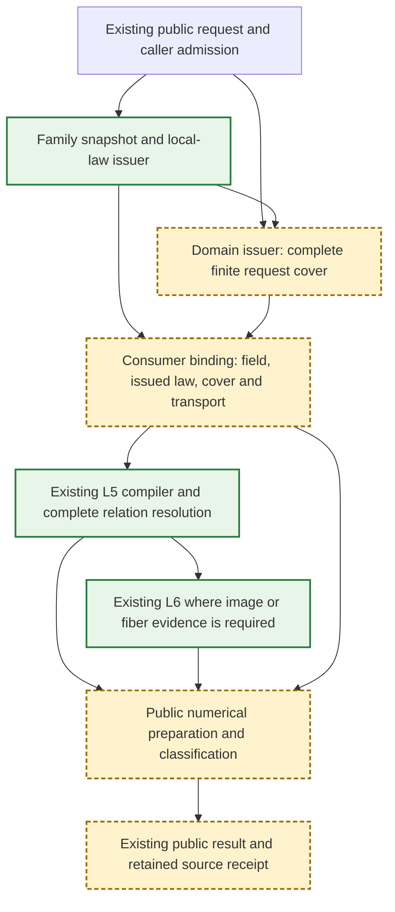

Green denotes existing implementations to reuse; amber denotes the consumer
connection to implement, not a missing replacement for the lower algorithm.
The domain engine already exists; amber D denotes missing family frames/covers.

| Owner | Produces and retains | Does not decide |
|---|---|---|
| OriginalSourceIssuance and concrete source providers | Original source binding, HXYZW, field provenance, exact parameter expressions and source guards | Request-wide coverage or intersection existence |
| OriginalDomainIdentity plus family frame adapter | Authored support, request, effective selection, all selected charts, overlap ownership and certified transports | Shape equations or numerical root identity |
| Existing family intersection-source component | Bound chart receipt and checked import to the solver ring | Roots, connection, image dimension or public accuracy |
| Existing L5 compiler/resolver | Raw equality, guards, complete cells/incidence/components for each selected chart pair | Source meaning or public numerical classification |
| Existing geometric/public family consumer | Complete aggregate ownership, numerical representatives and existing point handles | New geometric equality inferred from residuals |

The binding is a retained value containing the existing law receipt, domain chart
and solver map. Its generic parameter keeps source and field types statically
known. Reuse `OriginalRationalChartIssuing`, domain cover/transport protocols and
`ExactParametricRelationConstructing/Resolving`; do not create a second generic
source facade or expose solver arrays through the issuer. A new protocol is needed
only for the checked source-to-solver coefficient/coordinate transfer described
below, which existing same-type `importing` cannot express.

### Coefficient and Coordinate Contract

1. Retain the rational Native lane and its current public result types. A genuinely
   rational source is admitted by its representation certificate, not by rounded
   values or an attempted conversion followed by retry.
2. Algebraic endpoint/word sources use `OriginalExactScalarDomain` as Base and
   `ExactAlgebraicScalarDomain<OriginalExactScalarDomain>` as the solving field.
   Existing L2/L3 support this Base; use `importingBase` for issued coefficients.
   L5/L6 generic composition is reused without changing their mathematical contract.
3. One query fixes a common coefficient owner before constructing solver maps.
   Same-owner/ancestor imports use the existing import contract. Independent
   retained algebraic owners require an explicit immutable embedding receipt.
   Reuse `OriginalSingularFieldTransport` behind the source/scalar boundary: retain
   original definitions and selected-root isolations, validate the transported
   selector, and import coefficients. This validation can consume Sturm work;
   it is not another geometric solve or a search for a replacement coefficient root.
   Ordinary `importing` continues to reject foreign owners.
4. The new checked-transfer protocol accepts the retained source field/value,
   destination authority and the same admission; it returns a destination value
   together with retained original-to-destination evidence. Failure preserves
   incompatible-domain, invalid-evidence, depth, budget and cancellation errors.
   Root choice, denominators, value/coefficient depths and the original owner must
   survive transport. Its implementation belongs to the scalar owner, with only
   a typed receipt consumed by the family binder. No raw context escape is exposed.
5. Existing public family point accessors return `OriginalAlgebraicCoordinate`.
   Convert retained L2 tuple coordinates through the same checked-transfer boundary,
   including their defining relation, chosen selector, original coefficient owner
   and attained depths. No conversion through Double, rational-only polynomial
   or new geometric solve is permitted. Keep points/overlaps Codable payloads intact.
   Transport walks the retained L2 field tower from its original Base, maps
   parent coefficients and fractional numerators/denominators, and retains each
   chosen root definition. Where a legacy root handle requires rational isolation
   bounds, obtain a dyadic enclosing bracket by certified refinement of that same
   selected root, then validate unique-root coverage in the destination field.
   Refinement is charged, retains attained depths and does not solve the original
   intersection again. One invocation-local embedding table reuses already mapped
   owners across coordinates; immutable transfer evidence survives in the receipt.
   Failure to establish this exact compatibility is a failed publication, and
   blocks the migration milestone; a new result type alone is not completion.

### Domain, Composition and Complete Publication

The consumer's explicit coefficient importer supplies the checked scalar transport
receipt to spatial/traversal issuers. Ordinary issuance retains strict field import.
This port maps only coefficients read from the retained original snapshot; it does
not replace that snapshot or its child/source binding owners. The preparation owner
retains the immutable transfer receipt with its issued laws. Generic chart/law
receipt layout and existing lower cached consumers remain unchanged. No issuer
performs a root search to create a replacement snapshot.

`OriginalFiniteBSplineChartPreparing` enumerates every positive nonperiodic native
span, including tensor products. Full support comes directly from validated native
knots at degree/control-count ordinals, independently of the emitted law union.
It retains the same original binding for every chart and passes the same admission
to the existing issuer. Caller chart ceilings, checked counts, depth and cancellation
remain mandatory. The existing periodic capability remains separate. A bounded
preparation cannot be reported as a periodic or unlimited-source cover.

The finite ruled preparer enumerates all compatible closed boundary-span pairs,
including zero-width joins. It validates child owners before composition, counts
output before reserving storage, and propagates a typed `chartLimit` when the caller
ceiling is exceeded. Coons similarly counts all normalized U/V combinations, using retained start/end
witnesses from their original charts. Spatial and parameter-image preparation
transform every child chart once. Traversal clips all child charts through exact
affine station correspondence and preserves reversed/algebraic endpoints.
Authoritative parent support is still provided independently
to the domain issuer; emitting laws is not by itself a complete-cover proof.

Ruled uses authored common U and linear V. Coons uses original normalized U/V;
its boundary native station is `a + (b-a)q` in the retained exact endpoint field.
Spatial actions preserve the child's original parameter frame. Parameter images
retain exact inverse affine gains, offsets, axis permutations and orientation;
solver-local coordinates and published original coordinates remain distinct.
The source receipt's support array is not a complete-request cover.

The family adapter supplies every finite chart template and exact frame transport
to the existing domain issuer. The cover must establish that the union of selected
images equals the exact requested/support intersection. Preserve all native
one-sided owners at shared endpoints. Empty success requires cover exclusion or
complete L5 exclusion for every selected chart pair. A missing template fails.

Bind each law/selected chart once. Check inherited proof depth, import four
homogeneous laws into the L3 ring, create the existing L5 map, then compile CS
variables `(t,u,v)` or SSI `(u,v,s,t)`. Preserve source W and all transport-denominator
predicates in addition to the existing pair guards. No preparation of silhouette
or normal occurs for a parameter-only query. Public classification generates
required differential evidence from the issued law only when requested.

Current L5 constructs one map pair; it does not prove a multi-chart cover. The
consumer owns a retained collection of pair results plus the complete cover.
Resolve every selected pair exactly once under one cumulative admission. Reconcile
shared-boundary duplicates through original parameter correspondence and proved
chart identity, using existing finite-chart reconciliation rules. Distinct native
sides and different UV fibers survive unless their source identity is proved.
A failed pair or unresolved reconciliation invalidates the entire publication.

For the existing discrete-family public contract, inspect all selected relations
before generating output: any positive-dimensional component, including a mixed
isolated/positive result, produces `.nonDiscreteIntersection`. Retain all isolated
original parameter tuples, exact correspondence and complete exclusion evidence.
Rich relation/image publication consumes retained L5/L6 evidence when its separate
capability is available; it never reruns the TUV/UVUV relation.

### State, Ownership, Failure and Compatibility

One invocation owns scratch, checked word/byte conversion and exclusive admission.
Source, field/embedding, chart cover and solved relation owners are immutable and
retained by public receipts. Pass owners and index/range views between stages;
allocate only new transformed coefficients, maps, evidence or public output.
No global cache, mutable solver sharing, target-specific raw state or new lock is
introduced. Reuse admissions without resetting cumulative work/storage/depth.

Applicability returns not-applicable before entering this producer. Once admitted,
invalid input, unsupported required coverage, failed transport, unresolved algebra,
exhausted resources or cancellation propagates without legacy solver fallback.
The final publication checkpoint also applies to empty results. Mathematical
precision, existing degree/result limits and source/value/coefficient depth axes
retain their current meanings.

Existing rational family entry points and receipt accessors remain source-compatible.
Legacy implementations delegate only after their migrated route is verified. Keep
explicit incomplete markers on remaining family branches. The shared Coons
position provider remains callable by differential consumers until they migrate;
its mere presence must not keep a second intersection preparation route active.

### Implementation Ownership and Completion

One implementation owner serializes shared source contracts, family binding,
public dispatch, receipt changes and verification scripts. Integration owns only
snapshot/commit comparison and main merging. No parallel edits to these files.

| Sprint | Owned paths | Completion evidence |
|---|---|---|
| M.B | Scalar checked-transfer boundary; OriginalSourceIssuance; OriginalDomainIdentity family frame adapters; generic preparation in NativeExactRelations | Rational and retained algebraic binding, exact round-trip parameter/coordinate transfer, finite cover/exclusion, independent budget/foreign-owner failures |
| M.R | OriginalRuledIntersectionSources and OriginalPolynomialCurveSurfacePoints | Weighted/reversed common-U charts, multi-chart closed endpoints, same public receipt and atomic positive/mixed rejection |
| M.C | OriginalCoonsIntersectionSources and OriginalCoonsCurveSurfacePoints | Authored and retained algebraic endpoints, exact corners and reversed traversal, finite selected chart cover, unchanged differential caller regression |
| M.W | OriginalAffineIntersectionSources, OriginalAffineCurveSurfacePoints and concrete spatial/parameter-image providers | Rational and normalized original words, forward/inverse action, swapped/reversed parameters, nested admitted descendants and released-source ownership |
| M.P | NativeExactGeometricRelations, DefaultCurveSurfaceIntersector, CurveSurfaceOverlap and shared result receipts | All existing ordinary/caller-admitted rich/discrete entries select the same producer; SSI preparation retains both UV; no old relation replay |
| M.V | OriginalSourceIssuanceVerification and NativeExactRelationVerification granular overlays | Native/ASAN, normal WASM and Embedded build/link/runtime of changed paths; success/empty/input/work/storage/source/value/coefficient depth/result-limit/cancel failures |
| M.I | Independent integration worktree and PROGRESS.md | Coherent reviewed implementation commits, current-main source comparison, changed public integration proof and main merge |

Compile granular changed source overlays against immutable validated lower caches.
Do not build complete CADCore/CADGeometry, Kernel or L2-L6 targets. Reuse lower
behavioral evidence only while its actual source and toolchain premises match.
The OriginalCoefficientFixtures in L2/L3 establish algebraic Base use, not the new
public coordinate bridge or all four target lanes of composition publication.
Those new boundaries require focused behavioral evidence; docs/type presence do
not close them. Time-bound every proof execution. Compare identical public inputs,
semantics and ceilings for weighted CS, tangency, distinct UV, empty and folded SSI
preparation. Record phase work/generated bytes and whether differential preparation
or relation resolution ran twice; claim performance only from measured results.

Design completeness means these boundaries and gates are fixed. Implementation
completeness requires every row above, without counting unsupported issuer families
or whole-seven requirements as completed. `DIA.4.I` remains open for its other
boundary/self consumers after this composition handoff completes.

### Whole primitive coordinate laws (DI M3)

The whole linear law imports original origin/direction once, rejects an exactly
zero direction, and represents `O + D*t` on all real authored t. Its domain is
unbounded and is independent of the older finite rational chart selection.
`OriginalLinearSourceReading` is the authority for this generic coordinate-law
capability and permits every finite nonzero original direction, including a
nonunit direction with its original parameter scale. This is a whole `O+D*t`
position law, not a shape descriptor. The existing `Line3D` and
`AnalyticCurve3D.line` representations separately require unit directions;
`OriginalLinearCurveSnapshotProvider` retains their actual validation contract
and therefore rejects a nonunit `Curve3D` input. M3 neither widens that legacy
representation nor treats a rejected Geometry input as a successful source.
Independent generic-source fixtures prove nonunit scale, while the production
Geometry fixtures prove the two valid unit-direction representation handoffs.
Stored-N plane providers accept raw/analytic N+origin planes with no explicit U
axis. The exact basis receipt owns the whole normalized plane law. The numeric
plane basis and inverse projection use the same smaller-component reference-axis
rule; numeric candidates are not reused as exact source coefficients. An explicit
Plane3D.uDirection retains its own authored authority and is not admitted by the
N-only provider.

The analytic coordinate capability stores a polynomial in *defined symbolic
coordinate leaves*, with each leaf tied to an original source axis: authored t,
intrinsic sine/cosine, hyperbolic sine/cosine, or physical sine/cosine of the
retained cone half-angle. This is an explicit complete original parametric law,
not an implicit image predicate. The immutable source provider copies the actual
family's frame and defining values; the issuer imports them before arithmetic,
checks frame determinant and radius/focal positivity, and retains all original
branches. Hyperbola means its original cosh/sinh branch; cone v ranges over all
real numbers, and v=0 retains every U. Sphere closed latitude boundaries retain
all longitude representatives. Intrinsic periods are the exact binary label
period used by CanonicalSphereAngularPhase, never mathematical physical 2*pi.

| Law | Symbolic pullback into retained affine frame | Whole support |
|---|---|---|
| Circle/ellipse | `(a*cos_I(t),b*sin_I(t),0)` | real t |
| Hyperbola | `(a*cosh(t),b*sinh(t),0)` | real t, original positive transverse branch |
| Parabola | `(t*t/(4*f),t,0)` | real t |
| Cylinder | `(r*cos_I(u),r*sin_I(u),v)` | real U,V |
| Cone | `(v*sin(a)*cos_I(u),v*sin(a)*sin_I(u),v*cos(a))` | real U,V, both nappes and apex fiber |
| Sphere | `(r*cos_I(v)*cos_I(u),r*cos_I(v)*sin_I(u),r*sin_I(v))` | real U, closed intrinsic latitude |
| Torus | `((R+r*cos_I(v))*cos_I(u),(R+r*cos_I(v))*sin_I(u),r*sin_I(v))` | real U,V |

Physical angular wrappers use the separately selected `OriginalPiGenerating`
capability described below. Original rational gain/offset and normalized arc
endpoints/turns remain retained; exact periods are `2*pi/abs(gain)` and sphere
latitude endpoints are the inverse images of exact `±pi/2`. The intrinsic-only
field explicitly refuses physical sources. Normalized physical arcs own `[0,1]`
and family members first clip the inverse translation to actual source support.
This avoids manufacturing an out-of-support image before the exact restriction.

The production snapshot ports retain the actual `Curve3D`/`Surface3D`, copy their
original parameter frame, and issue this law without a separate image producer.
The existing harmonic surface producer also evaluates physical cone longitude
with the original physical half-angle and scalar V; physical sphere latitude is
admitted over its actual phase support. Numerical latitude endpoint uncertainty
fails explicitly rather than clipping to a binary approximation of a pole.
Legacy numerical analytic SSI solvers keep their unit-normal precondition at
their consumer boundaries; scaled N is valid source/evaluation authority, but
cannot silently enter their unit-distance formulas. The shared
PlaneBSplineSurfaceIntersector boundary checks this precondition before boundary
coincidence, isoparametric reduction or analytic conversion. A nonunit normal
returns unsupportedCapability without changing the original source normal or
plane-basis authority. Actual raw/analytic plane and reversed-operand fixtures
use a unit-separated Native patch: unit N returns empty, tiny/large N fails
explicitly, and source evaluation remains valid.

### Exact physical-period coefficient carrier

M3's physical angular support requires mathematical pi, not the dyadic intrinsic
label Double.pi. OriginalPiGenerating extends the existing L0 arithmetic,
ordering and import ports with an exact pi generator. OriginalPiScalarDomain is
the source-level ordered field Q(pi): immutable rational polynomials in pi retain
one owner and a nonzero polynomial denominator. Transcendence of mathematical pi
makes formal polynomial zero equivalent to exact scalar zero, so no unresolved
ordering becomes zero. Sign is certified by exact rational interval evaluation
and successively tighter Machin enclosures pi=16*atan(1/5)-4*atan(1/239); alternating
series remainder bounds include the mathematical value. Refinement uses the same
caller work/storage/depth/cancel admission and explicitly fails on exhaustion.
There is no floating candidate, new L0-L5 engine, shared mutable refinement or
cache. Exact imports between pi owners check and transfer rational coefficients
into the receiving polynomial owner, retaining source values for their lifetime.
Physical periods and pole endpoints can therefore carry 2*pi/gain and pi/(2*gain)
without claiming a binary64 endpoint is exact. Dedicated behavioral fixtures own
zero/cancellation, rational separation of pi, arithmetic, reciprocal, owner import,
period cancellation and explicit independent resource failures.

### M4 retained rational revolution supply

The first M4 source capability composes an existing rational generator chart with
`OriginalRevolutionSurface3D`'s original normalized directed generator and intrinsic
angular law. The actual provider retains that construction and delegates generator
binding to the existing traversal snapshot provider. The generic source port owns
axis/origin bits, the authored closed U interval and the normalized generator owner.

```text
OriginalRevolutionSurface3D -> injected traversal/child snapshot
                                       |
retained original rational child law ---+-> checked exact Rodrigues pullback
                                              |
                         symbolic position / denominator / exact support
                         child-local correspondence / intrinsic period
                                              |
                                  DI composition owner (separate intake)
```

The issuing port accepts the caller's exact positive axis length, checks its square
against the sum of the original axis-component squares, and normalizes only in the
chosen exact field. The generator's proved affine local-to-normalized parameter
correspondence is inverted algebraically and substituted into its retained law.
For `k=N/|N|`, `r=g(v)-O`, the exact law is
`O+k*(k dot r)+(r-k*(k dot r))*cos_I(u)+(k cross r)*sin_I(u)`.
Its polynomial leaves are the defined original intrinsic cosine/sine of U and
original scalar V, not free image variables. The homogeneous denominator remains
an explicit inherited position guard. The squared radial numerator is retained
for later fiber/normal consumers; no regularity or parameter injectivity is implied.

Each receipt covers the authored U interval times the exact intersection of its
normalized generator chart range with `[0,1]`. A finite preparation port preserves
all chart sides and checks that supplied generator charts cover the entire normalized
interval before returning a sealed `OriginalFiniteRevolutionLawFamily`. Its internal
initializer is available only to source issuance; the family retains every law,
authoritative full U times `[0,1]`, source period, field and decision proof depth.
Callers may inspect its immutable laws but cannot forge a smaller whole family.
Re-admission checks the source, inherited decision depth and every retained law. A gap, foreign owner, incorrect
axis length, unsupported nonlinear child correspondence, budget/depth/cancellation
or chart-limit failure propagates explicitly. The typed rational-child capability
is not a claim that non-rational generators or other M4 families are complete.
No old construction/evaluator, domain guard, tolerance or source limit is replaced.

### Checked revolution axis section

`OriginalRevolutionAxisSectionIssuing` consumes an actual sealed finite revolution
law family and an original linear source binding in the family's exact field.
Its sealed receipt retains both inputs and one guarded authored U/V graph per
original law. This is an axis-section theorem for that line/surface pair, never a
complete graph family for the whole revolution image.

```text
Actual revolution family + original line binding
    -> checked raw-axis incidence and nonzero parallel line
    -> exact Rodrigues coefficient/norm identities
    -> radial-zero position graphs + radial-nonzero exclusion theorem
    -> separate DI pair owner retaining the full revolution domain cover
```

The issuer imports original raw axis/origin and line coefficients, proves both
directions nonzero, and checks the direction and displaced-origin cross-products
exactly. A line outside the axis is explicitly unsupported. For each actual law,
it extracts the constant/cosine/sine coefficients and checks the complete affine
identity, denominator/radial independence from those symbolic leaves, axial-base
incidence, perpendicular cosine/sine coefficients, equal squared radial norms and
their zero dot product. The defined intrinsic cosine/sine leaves have unit squared
norm. Consequently the rotated radial squared norm equals the retained radial
squared numerator; a nonzero radial cannot meet the axis. On its zero set the
ordered-field sum-of-squares theorem makes both radial coefficients zero, so the
original position is its axial projection for every authored U.

The graph re-expresses that existing homogeneous law at cosine=sine=0 in authored
`(U,V)`, retains `radialSquared=0` and `W!=0`, uses identity U/V transport and
closed original support, and introduces no auxiliary, angle sampling or period
premise. Original generator correspondence, source/line owners, exact residuals
and all inherited/decision depths remain retained. Re-admission checks the whole
family, line, graph guards/transports and maximum proof depth with the same caller
ledger; every persistent array and receipt is charged before publication and final
cancellation aborts publication.

The DI consumer must separately retain its full `OriginalRevolutionDomainCover`
and this pair-bound section/exclusion receipt. It may compile each local graph
through the existing binder/compiler and publish through the shared exact relation
path. It must not label the restricted graphs a complete `OriginalIssuedGraphFamily`.
This theorem establishes positional axis incidence, not a normal, differential
identity or geometric injectivity certificate. Verification belongs to the ordinary
`CS-REVOLUTION-AXIS-FIBER-01` public acceptance: complete T=0/V=1/all-U, original
generator parameter zero, image/fiber dimensions, incidents, off-axis refusal,
guards, owner/field/depth/resource/cancellation/lifetime and Native/WASM/Embedded
changed-path controls. Source implementation alone does not complete that cell.

The independent source verification owns exact weighted/reversed generator laws,
axis normalization, support coverage, complete child correspondence, ownership,
independent resource limits and cancellation. The actual-provider verification
runs the original Geometry construction and confirms its numerical point/derivative
handoff against the exact source law. DI receives the retained law/support/guard
and generator bindings; DI contract changes require its separate owner approval.

### M4 guarded rational Native offset supply

The next source capability retains the original Native child and distance bits.
It consumes a sealed finite Native child family, verifies identity authored UV
correspondence and derives its exact rational differential normal without a new
normal solver. For the retained child `N/D`, set `A=N_u D-N D_u`,
`B=N_v D-N D_v`, and `C=A cross B`. The additional positive function q is defined
by `q*q=C dot C`, `q>0`; the offset law is `(q*N+d*D*C)/(q*D)`.
The original denominator guard and `C dot C>0` define the position domain, including
when d is zero. Native differential ownership follows the actual `BSplineBasis.knotSpan` law:
internal knots belong to the positive span on their right; the final source
endpoint belongs to the final span. Every closed child chart remains retained,
but each offset law records whether its upper U/V boundary owns the original
differential. A nonowning side is explicitly excluded from the offset predicate,
without changing the original child support or treating tolerance as ownership.
The family exposes only enclosing chart support: its rectangle is
never an unconditional domain proof. Every child chart side and its source proof
are retained in the sealed result; no public family initializer is available.

```text
sealed Native child family -> exact authored differential normal
                 |                         |
        child ownership/UV          q positive root equation
                 +-------------------------+-> guarded offset family
                                               -> DI predicate composition
```

The actual `OffsetSurface3D` public evaluation separately admits tangent length,
angular separation and numerical normalized-cross thresholds under the chosen
query tolerance. Source issuance neither removes those failures (including d=0)
nor treats query tolerance as original equality or source support. Independent
fixtures distinguish exact positive-normal domain predicates from those numerical
query admissions; actual provider fixtures run both success and failure. The
first typed capability is finite nonperiodic Native child support, not all offset
children or the entire M4 producer scope. Changes affect SourceIssuer tests and
the actual Geometry source-handoff proof; DI alone owns predicate coverage intake.

### M4 retained guide station composition

Guide issuance retains the original chain constructor's immutable C0 join/partition
authority, every original directed traversal and exact normalized rational station.
The existing traversal producer supplies child position laws. A guide chart leaves
those position/denominator laws in the child's local variable and composes only
its authored parameter correspondence: `T=a+(b-a)*t_child`. It retains original
segment ordinal and traversal index, so both closed incidents at a join stay distinct.
A sealed finite family proves every normalized traversal interval is covered before
exposing whole `[0,1]` support. Missing traversal/chart coverage, changed provenance,
invalid exact stations, limits and cancellation are explicit failures.

```text
original guide chain constructor -> retained C0 joins + exact stations
existing traversal law ----------------------|
                            exact aggregate correspondence
                                             -> sealed whole guide family
```

Snapshotting imports authored rational stations directly into the final retained
exact child field; no binary64 station roundtrip is permitted. This source capability
claims original position/support/correspondence. The existing guide higher-derivative
publication gap remains separate; position supply does not authorize smooth joins.

The first concrete composition capability is finite rational child charts with an
exact affine normalized traversal map; reversed maps retain their direction.
Uncancelled original homogeneous and parameter denominators remain present, and
consumers keep their inherited child guards. It is not a new position producer.
Behavioral evidence is owned by
[GuideFixtures](../../../Tests/OriginalSourceIssuanceVerification/Sources/Fixtures/GuideFixtures.swift)
and the [actual guide proof](../../../Tests/OriginalRevolutionSourceVerification/Sources/GuideProof/Proof.swift).
Their [receipt](../../../Tests/OriginalRevolutionSourceVerification/GuideSourceEvidence/VERIFICATION.md)
binds the immutable compiled inputs and portable products.

The portable guide proof uses the same fixture and admission files through a
focused verification target when the unrelated aggregate fixture WMO compile
exceeds its 120-second bound. This reduces verification work without changing
source semantics or the fixture being executed.

### M4 Retained Rational Surface Atlas Intake

A retained surface source provides immutable original rational homogeneous cells
and exact closed authored bounds. The concrete boundary-correction provider calls
the existing correction atlas once, preserves its original shape/C0 authority,
and imports the retained coefficients exactly into the caller field. It creates
no second positional producer and changes no numerical query admission.
The finite preparer retains every cell, checks complete exact coverage of `[0,1]^2`
before publishing a sealed family, and exposes identity authored UV correspondence.
Missing coverage, changed provenance, unavailable rational authority, chart limits,
source depth, work/storage and cancellation propagate explicit failure. Original
uncancelled denominators remain in each receipt; differential stripped fields are
never substituted for position law. The current concrete provider is rational
boundary correction, with general angular/algebraic correction still separate.

```text
original correction atlas -> retained exact XYZ/D + closed cell bounds
                          -> exact coefficient import -> whole sealed family
unchanged stripped tangent/normal ---------> existing differential consumers
```

The retained surface reading contract guarantees every closed cell belongs to the
original position domain with a nonzero denominator throughout. The concrete
correction atlas inherits that guarantee from validated positive-weight native
laws and complete original rational traversals; its denominator is their
uncancelled product. A polynomial descriptor, nonzero polynomial test, bounding
box or stripped normal cannot prove this assumption. Guarded original domains
use a separate predicate contract, rather than conform to this rectangle port.
The preparer's denominator check rejects corrupted zero laws and does not replace
the original producer's whole-cell denominator authority.

### M4 Retained Rational Derivative Curve Intake

The plane-derivative curve provider retains its actual constructor, source root
span and support-plane derivative constraints. It calls the existing original
rational piece producer once, imports its generated Hermite position coefficients
exactly, and retains all authored normalized cells. A sealed finite curve family
checks exact complete `[0,1]` coverage before publishing identity correspondence.
It consumes original closed-cell/nonzero-denominator authority, not interval
endpoint/projection caches. Every original cell side remains retained. Source,
depth, caller chart/work/storage limits and cancellation remain explicit failure;
non-rational derivative source supply and derivative surfaces remain separate.
The capability grants position/support/correspondence, not new differential join
continuity. Existing point/derivative query tolerance admission is unchanged.

```text
original source + original plane constraints -> existing rational Hermite pieces
                                           -> exact import -> sealed curve family
```

Behavioral evidence is owned by the
[retained curve fixtures](../../../Tests/OriginalSourceIssuanceVerification/Sources/Fixtures/RetainedCurveFixtures.swift)
and the [actual curve proof](../../../Tests/OriginalRevolutionSourceVerification/Sources/DerivativeCurveProof/Proof.swift).
Their [receipt](../../../Tests/OriginalRevolutionSourceVerification/DerivativeCurveSourceEvidence/VERIFICATION.md)
binds the compiled source inputs and portable artifacts.

## Original parametric graph contract (B0-B1)

Source issuance owns checked variable roles and immutable local position graphs,
not solver decomposition or pairwise intersection. OriginalParametricGraphIssuing
consumes an existing sealed rational or offset law, never an intersection partner.
The graph retains that typed receipt as Evidence, its source binding, coefficient
ring, homogeneous XYZ/W, exact conjunctive polynomial sign guards, closed local
enclosure and source-owned upper-side flags, rational authored correspondence and
inherited proof depth. No public unchecked graph initializer is exposed.

For a valid local parameter there exists an admissible auxiliary witness; every
admissible witness represents the same authoritative source position. This theorem
is inherited from the sealed producer, not inferred from an arbitrary polynomial
or protocol conformance. A rational graph has no auxiliaries. Offset retains UV
and q separately, q squared minus normalSquared equal zero, q positive, original
denominator and correspondence denominator exclusions and canonical owning sides.
Enclosures do not certify material membership. Reuse shares immutable payload; new
guards/layouts allocate through the same admission, retaining original proof depth.

The public checked layout partitions every solver coordinate exactly once into
ordered local parameters and auxiliaries. Authored coordinates remain the retained
correspondence capability, not an assumed inverse. Field import and unsupported
representation failures propagate. Issuance does not certify L2 coefficient
adaptation: physical-angle coefficients require a separate compatibility proof.
XYZ-only implicit evidence does not supply the missing UV theorem. Tests live
in OriginalSourceIssuanceVerification.
The L5 contract is [ExactParametricRelation](../RationalBivariateAlgebra/ExactParametricRelation/DESIGN.md);
conversion and DI request selection are consumed by the B3 ports in NativeExactRelations; source issuance still owns no solving or whole-request coverage.

### Rolling-ball Native child graph family

The rolling-ball provider retains the actual construction and separately bound
center/first-contact/second-contact curves. The Native preparation capability uses
the existing complete finite curve families. Every child has original support
`[0,1]` and identity authored U; all triples with nonempty closed U intersection
are retained, including singleton intersections at different child knots. Different
degrees, weights and knot partitions are supported. This is not the translated-rail
area shortcut. Generic/non-Native child supply remains an explicit unfinished
producer dependency, not a completed rolling-ball family.

For each triple the source issuer constructs the existing minor-arc expression
in `(u,v,q1,q2,w)`. The ordered local parameters are U/V; positive radial lengths
q1/q2 and positive half-angle w are auxiliary witnesses, not extra source axes.
The length equations, positive-root branches, original child denominators, radius
admission, radial normalization threshold, regular-arc threshold and output
denominator are conjunctive source guards. The regular-arc threshold is the same
stored numerical feasibility policy used by the original evaluator; it never
establishes equality, periodicity or identity. No root is rounded into a coefficient.
Each admissible witness gives the same original position; an invalid radial has no
witness. Complete parameter enclosure and guarded position support remain distinct.

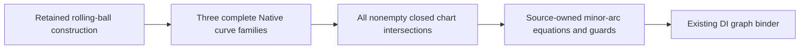

Graphs retain the source and all three child-law owners. Immutable family storage
and local scratch use the caller's same admission, checked chart counts and inherited
source/value/coefficient depths. Entry and terminal cancellation precede publication.
No new mutable state, unsafe boundary or target-specific concurrency contract is
introduced. The rolling-ball component owns the original evaluation formula; DI
consumes its graph and does not generate another shape expression. Focused tests
must compare actual construction/evaluation with graph positions, unequal knots,
all closed incidents, exact guard failures, independent budgets and post-source
lifetime on Native/ASAN/normal-WASM/Embedded before delivery.
The actual-source test owner is
[OriginalRollingBallIntakeVerification](../../../Tests/OriginalRollingBallIntakeVerification/VERIFICATION.md).

### M4 Retained Rational Derivative Surface Intake

The concrete derivative-surface provider consumes the immutable exact position
atlas owned by [Plane Derivatives](../OriginalCoons/PlaneDerivatives/DESIGN.md).
It retains the actual construction, final boundaries and original constraints,
imports original XYZ/D coefficients without another producer, and uses the
existing retained-surface preparer to seal complete `[0,1]^2` support and identity
UV correspondence. Source-owned boundary selection, denominator authority and
inherited proof depth remain with the producer. Numerical tolerance/precision
admission remains independent of source equality and support. General angular
or non-rational derivative surfaces require their original ordered-field producer.
Coefficient transfer consumes the existing admitted canonical term order, so hash
iteration cannot change polynomial import work between identical preparations.
The temporary ordered view and imported term storage both use the same caller.

### Exact-zero drafted Native wall intake

The drafted coordinate-projection provider binds the separate immutable
OriginalDraftedCoordinateProjection input owned by Original Drafted Section.
It imports that projected source's exact homogeneous cells through the existing
retained-surface port. The projected input retains the original wall, source
guards and inherited depth. Its graph denotes the projected position, never
original XYZ. Original UV is unchanged and authored support remains [0,1]^2.
The self-exclusion consumer may use an empty projected residual to prove original
exclusion because original position equality implies projected equality. A
nonempty projection grants no original contact or identity authority.

`OriginalDraftedRuledSurfaceSnapshotProvider` consumes the single immutable
`OriginalDraftedZeroTranslationRationalAtlas` owned by
[Original Drafted Section](../OriginalDraftedSection/DESIGN.md). It accepts only
the producer's canonical exact-zero constant-ruling branch with a direct
positive-weight Native generator and authored endpoints. The snapshot retains
the actual original wall, raw normal/axis/pull, heights, reversed traversal and
uncancelled original denominator. General draft families fail explicitly before
source publication.

The provider's static `supports` query delegates the source-owned representation
predicate before public selection. Unsupported representations retain existing
legacy dispatch. This capability decline does not catch admitted preparation
failures: tolerance, invalid-source, resource and cancellation errors propagate
after selection under the same caller ledger.

The provider imports original ordered coefficients exactly into the supplied
`OriginalExactScalarDomain` under the caller's existing ledger and source-depth
limit. `OriginalDraftedRuledSurfaceSnapshot` implements the existing immutable
retained-surface reading port. The existing finite preparer proves coverage of
the independent authored `[0,1]^2` domain and identity original UV; an atlas cell
union does not redefine that domain. Exact denominator authority belongs to the
source producer's Native positive-weight theorem, not the preparer's corruption
check.

The snapshot also retains exact generator offset/gain from the original authored
traversal labels. Its checked `originalGeneratorParameter(atU:using:)` evaluates
that source-owned affine correspondence only for original `u` in `[0,1]` using
the independently supplied caller admission and inherited proof depth. It never
infers generator parameters from numerical XYZ or reconstructs a Native curve.

```text
original zero-angle wall -> source-owned exact XYZ/D + closed cells
                        -> exact field import -> retained surface reading
original traversal labels -> retained exact offset/gain -> checked child parameter
retained surface reading -> existing complete cover -> identity original UV
```

The bounded public acceptance case `CS-DRAFT-ZERO-RULED-01` owns Native, WASM,
Embedded and sanitizer execution, complete public incident/image-fiber receipts,
the reversed `u=2/3 -> generator=1/3` transport and caller failure boundaries.
This source intake alone does not establish complete public intersection success.


## Native surface lift graph supply

### Complete polynomial lift law for rational child composition

`OriginalPolynomialNativeLiftChartIssuing` consumes an already issued complete
Native lift graph family. Its finite capability requires one whole nonperiodic
surface chart and one whole pcurve chart. The sealed family and Native snapshot
prove whole traversal coverage: the original pcurve image lies inside Native
support, positive original spline weights keep both denominators nonzero, and
the sole closed charts include every incident point. The existing checked
polynomial lift reducer supplies the unique forward auxiliary correspondence.
These assumptions establish every original graph guard throughout [0,1]; no
sampled guard test or bounding enclosure grants this authority.

The issued rational law's selection retains the complete family and reduction,
including every original condition and nonlinear UV law. The rational law is
valid on full normalized T support and retains the original lift source owner;
ruled composition therefore consumes the existing producer rather than fitting
a constant XYZ curve. Multiple charts, periodic hosts and non-polynomial
auxiliary equations remain explicitly unsupported by this bridge, not absent
intersections. The nonlinear-collapse acceptance owns this bridge's downstream
ruled/DI/identity/self-contact behavior and resource/owner refusal evidence.

The lift source owner retains the actual `SurfaceLiftCurve3D`, a validated Native
surface binding and a validated rational B-spline pcurve binding. The 2D source
reader exposes original U/V controls and exact zero as its third homogeneous
coordinate; it never fits or constructs a replacement XYZ curve. This finite
capability requires nonperiodic Native children and no priority B-spline image.
The pcurve image must lie inside exact Native support. A contained positive-weight
control hull remains sufficient. A single clamped equal-positive-weight quadratic
also consumes the whole-image extremum proof owned by
[source validation](../OriginalGeometrySourceValidation/DESIGN.md#exact-quadratic-pcurve-image-admission),
so an outlying control point alone does not reject an original curve whose entire
image is contained. Unproved out-of-support hulls remain unsupported; numerical
tolerance or clamping cannot supply correspondence. Other pcurve/surface variants and a priority image without retained equality proof
fail explicitly and remain required unfinished family work.

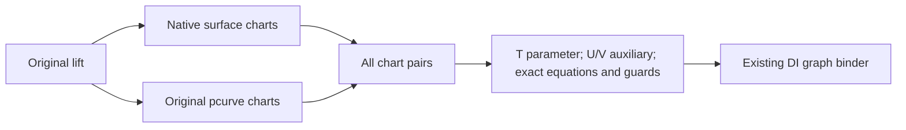

The sealed family keeps every surface-chart/pcurve-chart pair, including guarded
empty pairs. It derives whole normalized T support from the authored pcurve knot
support [a,b] with tau=a+(b-a)T. Each graph uses original surface XYZ/D in auxiliary
U/V and equations U*Dp(T)-NpU(T)=0 and V*Dp(T)-NpV(T)=0. Both UV chart bounds and all
source/transport denominators remain conjuncts. Thus nonmonotone, constant and
self-overlapping pcurves retain every original T; no nonlinear inverse is claimed.
Only the affine tau-to-T normalization is inverted. Closed chart boundaries retain
all incident sides. Source snapshots validate original child data and the existing
pcurve control-domain admission under the caller ledger; query guards use exact
bounds, independently of modeling tolerance.

The preparer accepts only sealed complete child families with matching retained
owners, identity Native coordinate transports and dimensions 2/1. Checked product
counts, all coefficient/term work/storage, source/proof depths and final cancel
share the caller admission. Immutable families retain child laws and original lift
for result lifetime on Native, WASM and Embedded. No shared mutable state is added.

Verification owner: `Tests/OriginalSurfaceLiftIntakeVerification`. Actual unchanged
lift evaluation is admitted from matching source/product receipts. Independent
expectations cover weighted and nonmonotone UV, constant fibers, all knot/corner
sides, wrong UV, outside-chart guards, exact clipping/empty requests, foreign owner
and scalar field, resource boundaries, cancellation and COW/source lifetime.
[Domain coverage](../OriginalDomainIdentity/OriginalDomainCoverage/DESIGN.md#native-surface-lift-domain-consumption)
consumes this sealed witness; ordinary all-family CS/SSI/XYZ publication remains M7.


## Retained pcurve lift composition

The common lift source requirement owns immutable surface/pcurve bindings and the
pcurve chart-key type. The existing Native requirement refines it with a Native
pcurve/key, preserving its public API and complete Native family constructor.
A retained-pcurve refinement consumes `OriginalFiniteRetainedCurveCharts` and its
complete normalized support instead. Both use the same existing lift polynomial
producer; neither DI nor another consumer regenerates a shape expression.

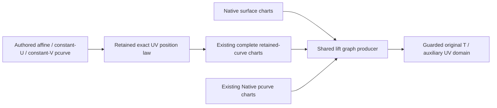

The affine pcurve owner retains original origin, raw direction and authored start/
end parameters. Its normalized polynomial is origin + direction *
(start + (end-start)*T), evaluated in the original exact scalar field. Constant-U/V
retains the unchanged constant coordinate and directed interpolation, including
reversal. No rounded endpoint or fabricated Native control net is source authority.
The retained curve's third coordinate is exact zero and denominator exact one.
Construction validity matches the actual pcurve validator. Parent lift validation
uses the actual fixed-visit affine/constant validator after Native child validation;
its bounded scalar visits and temporary arrays are charged to the same admission.
Exact endpoint checks then prove the whole affine UV segment lies inside exact
Native support. Tolerance-only/clamped support and unproved priority images fail
explicitly. Other pcurve branches remain required unfinished capabilities.

The sealed retained lift family accepts only the original matching Native surface
and retained-pcurve family, verifies identity coordinate transports, normalized
whole pcurve support and every closed chart pair. Compatible pcurve support
endpoints and law coefficients are imported into the surface field before
comparison or composition; independent rational field owners are not rejected.
It shares source/theorem owners
and common XYZ/D/equations/guards without a second formula producer. New immutable
families and invocation-local scratch retain identical Native/WASM/Embedded
ownership. Work, bytes, source/proof/chart depths and terminal cancel use one caller
ledger. The old Native family/issuer retains its signature and behavioral contract.

Verification owner: `Tests/OriginalAffineSurfaceLiftVerification`. Compile/link/run
actual new source/DI and both old Native and new retained fixtures on fixed target
lanes with admitted unchanged children. Independent exact expectations refute
rounded affine endpoints, wrong direction/UV, missing tensor sides, foreign owners,
strict/empty selection and lost cancellation/lifetime. No broader publication or
all-family completion is inferred.


## Rolling-ball child graph composition

The source owner supplies normalized complete curve position graphs from existing
sealed Native or surface-lift families. A complete curve graph family retains its
source, original coverage owner, exact [0,1] enclosure, every original position
graph and proof depth. Its constructor is internal; arbitrary graph arrays or
Boolean callbacks cannot publish completeness. This source-level family precedes
L5 intersection preparation and does not duplicate that upper relation family.

A concrete Curve3D snapshot retains the actual Native curve or lift source binding.
Its explicit branch selection supports Native curves, rational B-spline pcurve
lifts and retained affine/constant-U/V pcurve lifts on Native surfaces. Existing
producers prepare each branch once. Rebinding position graphs retains original
law/graph evidence and coverage arrays through COW ownership, without resampling,
fitted controls, root solving or expression regeneration. Other required child
families remain explicit upstream capabilities, not an alternate solver fallback.

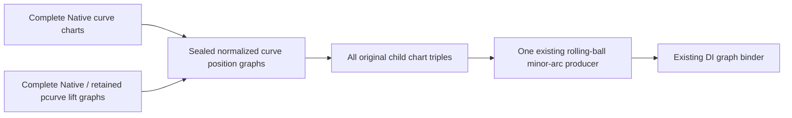

The existing Native source requirement refines a common child-binding/construction
requirement. The Native public family/preparer keeps its signature. One source-owned
minor-arc algorithm accepts embedded child positions and guards; its Native entry
and generic graph entry differ only in child embedding. Generic embedding maps each
child's one parameter to original U, assigns disjoint auxiliary coordinates, then
allocates the three positive radial-length/half-angle witnesses. Original U/V remain
the only authored coordinates. Every child condition, support endpoint inclusion,
parameter-transport denominator, normalization/branch guard and owner is retained.
Arbitrary variable permutations use canonical polynomial construction, never an
assumed monomial order. Every admissible child witness represents the same original
child position; every resulting witness represents the original minor-arc formula.

The complete child product includes every nonempty enclosure intersection, including
singletons and tuples whose guards later exclude them. No sampled feasibility or
XYZ agreement prunes coverage. Checked graph/variable/condition counts, coefficients,
embedding scratch, source/value/coefficient depths and terminal cancellation share
one caller admission. Families/evidence are immutable Sendable owners on all targets.
No unsafe boundary or shared state is introduced. General shape and ordinary fillet
validity remain separate from this source/domain obligation.

Verification owner: Tests/OriginalRollingBallGraphIntakeVerification. Actual mixed
and lifted source/evaluation, independent exact expectations, child auxiliary guards,
all incidents, source/request authority, coefficient transfer, resource boundaries,
cancel/lifetime and unchanged Native regression must pass fixed target lanes before
commit and independent main delivery.


## Original affine position-action supply

The affine-action issuing protocol supplies a sealed binding plus one immutable
3x4 coefficient owner in the requested exact field. Parameter images read their
original spatial action only when it is present; spatial words use the existing
coefficient importer; directed traversal supplies the identity position action.
This reuses the existing construction readers without generating another source
position formula. The receipt owns no parameter map, intersection or continuity
claim. Equal action matrices are sufficient to transport an existing child position
identity through two parents; differing matrices require a separate scoped source
law proof and are not evidence of nonintersection.

The action value owner retains original coefficients and causal admission depths.
DI shares this owner rather than copying its coefficient array. Source binding,
coefficient-field compatibility, every coefficient visit, checked object/array
allocation and terminal cancellation use the caller's same admission. Owners are
immutable Sendable on all targets; no callback is retained as proof approval.

The consuming contract is [paired affine identity](../OriginalDomainIdentity/OriginalParameterIdentity/DESIGN.md).
Verification owner is Tests/OriginalAffinePairedIdentityVerification: original
source matrix/identity supply, all three reader families, foreign bindings/fields,
causal scalar depth, exact resource boundaries, final cancel and owner lifetime.
Independent verification does not establish actual upper geometry dispatch.

## Periodic Native surface lift supply

The sealed periodic lift family retains the original lift binding, complete Native
fundamental surface laws with their source-issued periods, and every finite
rational pcurve law. Its finite template count is the checked chart-pair product;
its members are indexed by two exact arbitrary-size rational integers, one per
surface axis. Nonperiodic axes require zero. These indices describe auxiliary surface lifts,
not periods or identities of authored T. DI must consume a lift-specific relation
family instead of claiming that the source T coordinate is periodic.
This is an all-integer family, never
a finite whole-surface cover or a promise that all members can be enumerated.

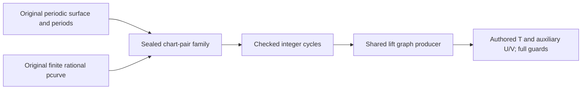

For translation delta_i = cycle_i * period_i, the shared position producer
substitutes local UV = authored UV - delta into the original surface law and
surface guards. The pcurve equations continue to use authored UV directly.
Every closed fundamental chart side is available, including the two translated
sides of a seam. Existing continuity and exact periodic source theorems establish
their position agreement; no derivative continuity or new identity is asserted.
All cycles remain exact integers without Int conversion. The complete family
covers every pcurve value because the fundamental surface cover and every integer
translate cover the original periodic axes. Nonperiodic axes retain exact original
support guards. No pcurve inverse, hull selection or tolerance clamp is introduced.

The actual snapshot provider accepts out-of-fundamental control coordinates only
on periodic axes, matching the original surface's periodic domain and evaluator.
It retains strict exact-support admission on nonperiodic axes, original positive
pcurve weights and priority-image refusal. The existing finite lift API still
refuses periodic children and preserves its contract.

Family preparation and member queries retain original children/period owners,
readmit causal value/coefficient/source depths, charge all new arrays/polynomials
and use the same caller admission with terminal cancellation. Storage is immutable
and Sendable on every target; no callback or mutable shared state is retained.
Protocol requirements expose preparation and graph querying without unchecked
certificate initialization. The family does not solve intersections or establish
M5 identity, DI query integration, M6 or M7 publication.

Verification owner: `Tests/OriginalPeriodicLiftVerification`. Actual source-to-graph
positions are compared with original public lift evaluation at seam, negative and
independent cycles. Counterexamples cover wrong authored UV despite equal XYZ,
noninteger/nonperiodic cycles, chart/owner/field/depth/resource failures, cancellation,
source release/COW and unchanged finite lift behavior. Fixed Native, changed-source
ASAN, normal Wasm and Embedded execution use admitted unchanged numerical children;
broad CAD and L2-L6 rebuilding remains prohibited. Source/DI and final publication
change impacts are tracked in the existing progress items.

## Periodic Native host with retained pcurves

The periodic lift family consumes original Native or retained normalized pcurve
chart laws through the same lift graph producer and one checked family preparation
body. The host remains Native. Original T is normalized once from the authoritative
pcurve support; auxiliary U/V carry the surface cycles. Retained chart support
must be exactly [0,1], with identity local parameter transport and original source
owner. Compatible coefficients are imported by the existing producer; foreign
scalar fields fail explicitly. All denominator/branch guards and closed sides remain.

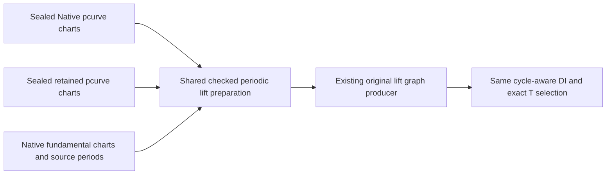

The family's source requirement widens to OriginalLiftSourceReading. Existing
Native prepare signatures and conditional typed pcurve property are preserved;
that getter creates only a value view sharing the same original arrays/owners.
Retained preparation is an additional refining protocol and overload, with no
public unchecked family initializer. Retained proof depth is admitted before
composition. Every support endpoint and polynomial coefficient must import into
the hosting field before publishing the lazy family; an incompatible algebraic
coefficient cannot remain hidden until member generation. No pcurve law array is materialized again at this boundary.

OriginalAffineSurfaceLiftSnapshotProvider retains the actual affine/constant
validator and original coefficient expressions. Its exact endpoint enclosure is
required only on nonperiodic axes, where tolerance-only clamps remain refused.
Periodic axes have the source-issued complete real support and retain negative,
positive, independent and arbitrary-size cycles. Priority images and other general
surface/pcurve sources remain explicitly incomplete. The family constructor still
requires certified periods, not a periodic flag as evidence of a source theorem.

Preparation/member/query costs, checked chart products, causal depths and final
cancel use the same admission. All stored data is immutable and Sendable on every
target; mutable scratch remains invocation-local. Changing this capability affects
periodic lift DI and Native/finite lift callers; their original fixtures are rerun
with current source/DI. Verification belongs to
Tests/OriginalPeriodicRetainedLiftVerification and compiles only source/DI overlays
against admitted unchanged lower/numerical products. Broad CAD/L2-L6 rebuilds remain
prohibited. General M4, identities, consumers and final publication remain open.

## Retained atlas hosting surface lifts

The common lift graph reader owns both child bindings and their chart-selection
roles. OriginalLiftSourceReading remains its Native-host refinement, preserving
existing associated types and typed Native family access. Retained pcurve lifts
share one sealed finite family and preparer; a retained-atlas refinement accepts
the existing complete OriginalFiniteRetainedSurfaceCharts instead of a Native
host. Both paths use OriginalSurfaceLiftGraphProducer unchanged except for its
source/selection generic requirement. No position polynomial, preimage formula,
chart cover, or pcurve array is regenerated by this composition.

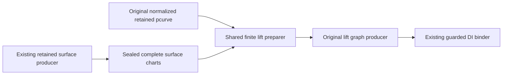

The actual boundary-correction provider exposes a host-reading
requirement that extracts only their own original Surface3D variant and delegates
to their existing bounded source issuer. The generic atlas lift snapshot retains
the entire original SurfaceLiftCurve3D and both source children. Affine/constant
pcurve validation uses the actual fixed-visit validator and exact endpoint support
checks on the source-defined unit square; tolerance-only clamping remains refused.
Priority images and other host/pcurve variants require their own correspondence
and remain explicit unfinished paths. All source depths and both inherited proof
depths are admitted before composition; compatible coefficients are imported into
the host field by the original producer before finite publication.

The family stores shared immutable child bindings, surface laws/support/field and
pcurve family. Native typed surface access reconstructs only the value view over
those same arrays. No new mutable shared state, unsafe memory, target-specific
Sendable or synchronization is introduced. Every graph retains both original law
owners and all closed chart-pair guards, including one-sided discontinuous values.
The T enclosure is not a proof that every T has an admitted UV witness; exact
position membership remains the retained graph relation.

Verification owner: Tests/OriginalRetainedHostLiftVerification. Actual source and
independent literal producers must exercise nonbinary cell intersections, all
closed sides, exact T/UV, denominator/foreign-field failures, missing coverage,
resource/cancel/depth boundaries and detached lifetime. Existing Native/periodic
lift regressions must run on current compiled source. The [DI contract](../OriginalDomainIdentity/OriginalDomainCoverage/DESIGN.md#retained-atlas-host-lift-consumption)
owns selected domain consumption. General/nonrational sources and automatic M7
publication are not completed by this refinement.

The plane-derivative typed source atlas is already implemented. Its actual Surface3D
host routing remains a subsequent source integration obligation: the immutable
numerical cache predates that nominal type implementation, so current typed producer
evidence cannot certify a new cached-enum caller. It is not replaced by reconstruction
or an unchecked cast in this lift composition.

## Retained atlas hosts with Native pcurves

The additive retained-host/Native-pcurve snapshot binds the actual SurfaceLiftCurve3D
children through the existing retained host and B-spline snapshot providers. The
host has its retained normalized square; the pcurve keeps its authored knot domain.
The existing finite B-spline preparer remains authority for every positive span.
No curve formula, normalized spline, chart partition or inverse is regenerated.
Priority images, unsupported hosts and control hulls requiring tolerance-only UV
clamps fail explicitly. General pcurve and derivative actual-host routing remain open.

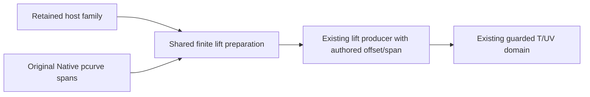

The shared finite lift owner retains typed surface/pcurve source bindings, law arrays
and supports. Existing retained-pcurve and Native-surface typed views share those
immutable arrays; the new Native-pcurve view does likewise. Preparation validates
both child authorities, identity chart coordinates, inherited depth and complete
product cardinality before using the original lift graph producer. The producer
already maps T to the authored pcurve coordinate with the exact offset/span, and
retains every span guard and auxiliary UV. No source theorem is strengthened.

All configuration/evidence is immutable Sendable on Native/Wasm/Embedded; scratch
and the exclusive admission remain invocation-local. Work/storage/source/value/
coefficient/chart limits and terminal cancellation apply to all paths, including
empty DI requests and reuse. Retained children and original lift survive input release.
Verification owner: Tests/OriginalRetainedNativePcurveLiftVerification, actual
boundary-correction hosts with weighted multi-span pcurves, exact nonbinary knot
incidence, guarded UV versus numerical point accuracy, all old retained-host
fixtures and independent limit/cancel/foreign-binding/lifetime counterexamples.
The [DI consumer](../OriginalDomainIdentity/OriginalDomainCoverage/DESIGN.md#retained-host-native-pcurve-domain-consumption)
uses the same graph source contract and does not solve or infer UV.

## Retained Coons atlas lift hosts

OriginalFaceSurfaceBinding supplies sealed literal support bindings for an existing
Coons atlas snapshot or Native surface source. It retains the exact source binding
and original Surface3D value for the [boundary consumer](../OriginalBoundaryClipping/DESIGN.md#issued-graph-face-boundary-connection).
It issues no new position law, identity or source approximation. Its factories
admit source depth and caller storage/cancellation; downstream role binding must
verify the same source owner before comparing the actual stored face support.

OriginalCoonsAtlasSnapshotProvider consumes the existing position-only
[Coons homogeneous atlas](../OriginalCoonsIntersectionSources/DESIGN.md) and retains
its actual constructor, four directed boundary owners, exact corners and every
positive closed cell. It imports coefficients in canonical order into the selected
exact field and exposes the existing retained-surface reader. The snapshot is
sealed; no consumer can inject a cover or position theorem. Original normalized
UV and denominator laws are unchanged. Position continuity grants no differential
continuity, regularity or embedding certificate.

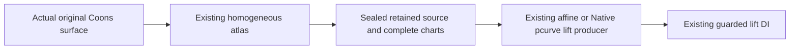

The provider validates tolerance, requires the maximum retained boundary source
depth plus one, charges the same caller admission and retains producer proof depth.
The existing chart preparer independently verifies the whole closed square; lift
preparation retains all child chart pairs, guards and auxiliary UV. Actual host
extraction matches only the originalCoons variant and delegates to this provider.
Unsupported angular/algebraic or discontinuous sources fail before publication;
there is no alternate correction, fitted tensor, inverse or differential atlas.
All fields and evidence are immutable Sendable across Native/Wasm/Embedded;
no shared mutable state or cache exists. Terminal cancellation is checked after
all callbacks. Detached results retain original producer and coefficient owners.

Verification owner: Tests/OriginalCoonsLiftVerification. The changed source/host
path is freshly compiled on receipt-bound numerical children, then exercised
through actual SurfaceLiftCurve3D and existing DI, with four-target success,
resource/depth/cancel/foreign-owner/lifetime cases and prior retained-host fixtures.
General nonrational hosts/pcurves, priority images, M5/M6/M7/M8 remain open.

## Retained lift hosts in rolling-ball children

The actual OriginalRollingBallCurveSnapshotProvider explicitly selects the
existing Coons, boundary-correction or plane-derivative host provider and Native
B-spline or retained affine/constant pcurve provider. Sealed capabilities retain
the corresponding original lift binding. Existing Native child/lift capabilities
and signatures are preserved; unsupported host/pcurve/priority variants fail,
with no alternative provider retry or image-only correspondence assertion.

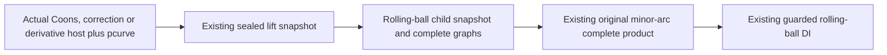

The child graph preparer consumes the existing complete retained host charts and
pcurve spans, then invokes the unchanged shared lift producer. Typed evidence and
coverage retain both child bindings and immutable law/graph arrays. Rebinding
retains original parameter roles, every auxiliary UV, chart/domain guard and
proof depth; no source position is recomputed. The original rolling-ball product
accepts these graphs through its existing child contract, preserves all chart
triples and keeps radial normalization/positive-root guards and radius policy.

Child/provider descent uses the same source-depth budget and ledger. Output
metadata sizes use actual generic strides; graph/evidence growth is admitted
before allocation. All configuration and retained evidence are immutable Sendable
on every target; scratch and admission are exclusive and invocation-local.
Terminal cancellation, foreign binding/field rejection and detached lifetime
apply at both the child and composed-surface boundaries.

Verification owners: Tests/OriginalRetainedRollingBallVerification and
Tests/OriginalDerivativeRollingBallVerification. Fresh original
source/child adapters and actual rolling-ball constructor/evaluator compile on
receipt-bound retained-host/source/DI and numerical children. All four fixed lanes
exercise complete products/UV/guards, exact domains/resources/depth/cancel/lifetime
and unchanged Native child behavior. General periodic/nonrational child sources,
priority-image correspondence, M5/M6/M7/M8 remain open. The
[rolling-ball owner](../RollingBall/DESIGN.md) retains numerical and feasibility
policy; this source connection is not a whole-solid fillet certificate.


## Plane-derivative retained lift host

OriginalPlaneDerivativeSurfaceSnapshotProvider also implements the existing
OriginalRetainedLiftHostSnapshotting protocol. It accepts only the actual
Surface3D.procedural.originalPlaneDerivative payload, retains it unchanged and
delegates to the same checked source binding issuer. This extraction adds no
position/projection atlas, no derivative-continuity claim and no inferred UV.
The existing Native and retained affine/constant pcurve lift providers, complete
chart producer and guarded DI consume the sealed result without another dispatch
layer. General angular/algebraic derivative sources still require their source
capability and remain explicitly unsupported here.

One caller admission pays extraction, the original source and lift preparation,
query scratch and publication. Retained projection/connector/source owners and
original depth survive the result. Foreign host variants fail before source
publication; source/field/depth/resource/cancellation failures preserve their
cause. Configuration and returned owners are immutable Sendable on every target.

Verification owner: Tests/OriginalDerivativeLiftHostVerification. It exercises
actual Surface3D/lift values, the unchanged original constructor/evaluator,
current positional atlas/source and existing graph/DI consumers. The independent
assembly records any additive-helper difference from receipt-bound numerical
modules and compiles those exact helper bodies; unchanged ABI/storage/public
bodies must be verified before reuse. No broad production rebuilding is implied.


## Direct retained derivative curves in rolling-ball children

The actual rolling-ball child provider also consumes Curve3D.originalPlaneDerivative
through the existing OriginalPlaneDerivativeCurveSnapshotProvider. This source
owner retains the original rational Hermite producer, source traversal and plane
constraints. The existing complete retained-curve chart preparer establishes full
normalized T support and all closed cell sides. No curve fitting, position formula
or derivative continuity theorem is added by the rolling-ball adapter.

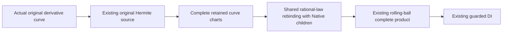

A sealed capability, typed law evidence and retained family coverage keep the
original source and proof owners. Native and retained rational laws share one
rebinding implementation: normalized T remains the sole authored parameter,
homogeneous laws and parameter transport retain their immutable backing, and
original position/transport denominators remain explicit guards. Every closed cell
side survives. Field authority and source/proof depth are inherited from the child;
all preparation/output allocation, work and cancellation use the same caller
admission. Later independent prepared queries use their explicit caller admissions.
All owners are immutable Sendable on every target; scratch is invocation-local.
Foreign bindings/fields, invalid support, exhausted limits and cancellation
propagate typed failure, with no fallback or source reconstruction.

Verification owner: Tests/OriginalDerivativeCurveRollingBallVerification. Actual
projected, weighted and reversed curve construction, exact original Hermite XYZ,
all child chart sides and composed rolling-ball/DI guard/resource/cancel/lifetime
behavior are checked alongside unchanged Native and retained-lift callers on the
four fixed lanes. General angular/algebraic derivative supply, other rail families,
M5/M6/M7/M8 and whole-solid fillet certification remain separate open obligations.


## Retained normalized guide curves in rolling-ball children

The normalized guide source provider accepts actual OriginalGuideTraversalChain3D
and OriginalGuideEndpointConnectorCurve3D carriers. Their existing
OriginalSplineTraversalPolynomialPiece producer owns station/traversal composition
and endpoint correction. This provider transfers those exact rational coefficient
laws into the requested field; it does not reconstruct a guide or correction law.
The original carrier and produced pieces remain retained as authority. Other
carriers are refused, and unavailable angular/algebraic original position laws
remain incomplete rather than approximate success.

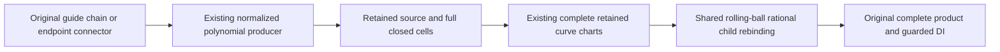

The authored support is the original normalized closed interval [0,1]. Exact
nonbinary stations, reversed child traversals, all join sides and endpoint basis
coefficients are preserved by the original producer. The existing retained-curve
preparer verifies that the supplied cells cover that full support with no gaps.
T remains the sole authored parameter and the original rational denominators
remain graph guards. Position authority does not imply higher-order continuity,
join identity, embedding or whole-solid fillet feasibility.

One caller admission accounts for original extraction, coefficient transfer,
complete charts, rolling-ball child/product preparation and publication. Required
source depth is the carrier's retained depth, and unavailable depth, field, work,
storage or cancellation propagates its typed cause. Snapshot, laws and coverage
owners are immutable Sendable on Native, normal WASM and Embedded; scratch stays
invocation-local. COW copies and released input carriers cannot alter retained
proofs. Independent later queries use explicit independent admissions.

Verification owner: Tests/OriginalGuideCurveRollingBallVerification. It constructs
actual weighted/reversed guides with exact nonbinary stations and nonzero original
endpoint corrections, then checks exact independent XYZ/T, every closed side,
complete mixed/direct products and DI selection, guard, owner, field, depth,
resource, cancel and lifetime behavior on the four fixed lanes. Existing Native,
derivative and retained-lift child regressions remain required. General nonrational
guide supply, arbitrary correspondence and full M4-M8 remain open.


## Retained Construction Curves in Rolling-Ball Children

Sealed normalized construction-curve snapshots consume the source-owned endpoint
connector/affine construction-chart entry described by
[Original Coons](../OriginalCoons/DESIGN.md#normalized-construction-curve-position-supply).
The actual carrier, exact position pieces and proof depth remain retained. Existing
complete retained-curve preparation and rational child rebinding establish the
whole normalized support and keep all denominator guards and closed incidents.
The consumer neither rebuilds formulas nor invents an inverse parameter map.

One admission owns extraction, exact coefficient transfer, charts, child products
and publication. Carrier/source-depth overflow, incompatible owners or fields,
missing C0 authority, exhausted resources and cancellation preserve typed failure.
Snapshots and law backing are immutable Sendable in every target; independent
queries use independent admissions. The changed producer entry has no stored-state
change. Position supply is not join identity, smoothness or embedding certification.
Verification owner: Tests/OriginalConstructionCurveRollingBallVerification. General
non-affine construction laws and full M4-M8 remain open.


## Spatial Operation Words over Complete Curve Graphs

OriginalAffineWordCurveSnapshotProvider supplies the original retained prepared-word
coefficients and descendant source binding. Rolling-ball child preparation consumes
that source through OriginalSpatialGraphIssuing, then rebinds its complete child
family without reconstructing a curve or losing auxiliary coordinates. The existing
spatial rational-chart issuer and graph issuer share one internal position composition;
no second word producer or rounded affine matrix is introduced.

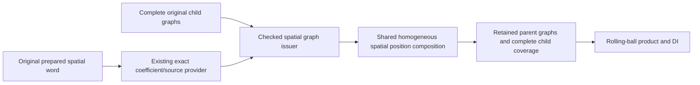

Spatial graph issuance verifies parent and child source owners, readmits original
source/scalar depths and applies only the original spatial coefficients to XYZ/D.
Parameter transports, support, boundary inclusion, auxiliary layout and every
condition retain their original immutable backing. The output proof depth includes
child authority and all attained coefficient/import/composition depths. The rational
chart issuer keeps its existing chart/support contract and adopts the same depth
retention. Neither position transport nor source coverage creates parameter identity.

A single immutable coverage owner retains the whole child family and word binding;
parent graph evidence refers to that owner and the original child ordinal. Its
object header/payload and all new graph/output storage are admitted before creation.
Nested child preparation passes the same original native inout admission rather than
creating forwarding admission types. No source is re-extracted for each graph.
The stored descendant calculation tolerance is retained; world coefficient validation
uses the original caller tolerance and field depth ceilings. Foreign coefficient
fields fail without numerical rounding, field extension or solver switching.

All source/graph/coverage state is immutable Sendable on Native, normal WASM and
Embedded; scratch and exclusive ledgers are invocation-local. Later queries use
explicit fresh admissions. Entry/final cancellation, count/source/value/coefficient
limits and original guards remain failures. General rigid/affine/parameter-image
and traversal graph adapters, nonlinear correspondence and whole M4-M8 remain open.
The test owner is Tests/OriginalSpatialCurveGraphVerification; changed public source,
old rational-chart interactions, complete/mixed rolling-ball/DI and the four fixed
target lanes must pass before delivery. No broad production/lower rebuild is implied.

The spatial graph issuer composes in the retained child polynomial ring and field.
Field selection belongs to child graph preparation; the spatial port takes no
independent field argument. Conditions and parameter transports are ring-owned
polynomials, so retaining their backing requires retaining that same ring authority.
Every incoming guard/support/transport coefficient is validated in that field before
composition. New XYZ polynomials belong to that ring; no guard or transport rebase
or duplicate array is introduced.


### Parameter images and traversal over complete finite curve graphs

The source owner composes the existing exact parameter-image reader and retained
traversal endpoint producer with every supported finite curve graph. A sealed
`OriginalFiniteCurveGraphs` retains the child's authored closed support independently
of chart unions. `OriginalCompleteCurveGraphs` remains normalized [0,1]; the existing
rolling-ball preparer's public boundary verifies that interval exactly before
publishing the normalized family. Arbitrary Native knot support is accepted only
by internal finite preparation, not by weakening the normalized contract.

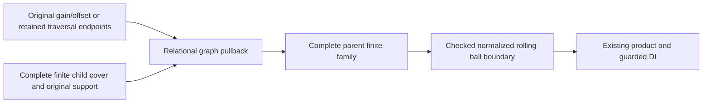

The common pullback introduces parent T and retains all child local coordinates as
auxiliaries. It embeds the original position and every guard into the new ring,
retains child interval/owning-side restrictions, and adds
`childN - (gain*T + offset)*childD == 0` with the original denominator guard.
There is no inverse of the child transport. The identity parent transport remains
univariate, matching the existing lift/product contract. Image support is the exact
affine pullback of independently authored child support. Traversal support is [0,1]
only after both retained endpoints lie in that complete child support. All child
charts remain available, including guard-empty occurrences and every incident side.

Source/child bindings and fields must agree; map gain must be nonzero. A selected
local graph interval is an ambient restriction, not a newly asserted complete
cover. Only the sealed family preparer combines it with source completeness.
The existing rolling-ball polynomial embedding is shared with the pullback;
variable maps are checked and all new term/power arrays are admitted before
allocation. Immutable family owners retain children once, while graph evidence
retains the same owner and ordinal. All targets use the same Sendable/immutable
storage and invocation-local admission; no unsafe state or new solver is added.

The public spatial-word coverage's `Children` view now uses the sealed finite
family rather than promising normalized support for every descendant. Its source,
coverage, field, graphs, support and proof-depth readers remain available. Only
the outer rolling-ball boundary promises [0,1]. This permits an image around a
spatial word with arbitrary Native support without changing the normalized caller.

Verification belongs to `Tests/OriginalParameterCurveGraphVerification`: actual
image/traversal construction and evaluation, independent exact T/UV/XYZ witnesses,
arbitrary Native support, nonmonotone/constant lifted fibers, reversal/nesting,
full/strict/singleton/disconnected/empty DI requests, all incidents, foreign owner/
field, exact resource and depth boundaries, entry/intermediate/terminal cancel,
COW/lifetime, and retained Native/word callers. Fixed Native/changed-source-ASAN/
normal-WASM/Embedded assembly reuses only receipt-admitted unchanged lower products.
General nonlinear authored maps, infinite child families, other sources, M5/M6 and
M7/M8 remain required independent work.

The actual numerical nested lifted-traversal caller remains incomplete: retained
construction traversal of a parameter image of a surface lift requests a low-order
jet from the legacy higher-surface provider, which requires order four or greater.
Graph/domain completeness does not repair or certify that numerical caller. The
required requested-order repair and actual public evaluation proof remain PG.J in
PROGRESS.md; the fixture preserves its typed refusal instead of accepting a point.

## Original Euclidean polyline pcurve supply

The polyline snapshot consumes the existing
`OriginalEuclideanPolylineParameterLaw` as its only arc-length authority. Its
positive segments define closed normalized parameter cells; exactly repeated
points remain in the original input and original point indices, while zero-length
segments are not charts. Unequal incident derivative germs and repeated UV on
nonmonotone traversal remain separate cells. No tolerance merges points or roots.

The source retains the producer's exact algebraic coefficient field explicitly.
It exports the original affine-in-global-fraction UV law per segment through
`OriginalRetainedCurveSourceReading`; Z is zero and W is one. The source proof
depth includes attained coefficient/value depths from construction and transfer.
A caller may prepare compatible host laws in that retained field; the source does
not silently upgrade an independently selected field or claim generic lift dispatch.
The existing finite retained-curve preparer and domain issuer verify complete
normalized support and request restriction; no new chart or coverage algorithm
is introduced. Ordinary source binding preserves owner/source-depth authority.

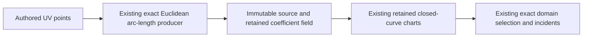

Every producer/transfer visit, output allocation and attained depth uses the same
caller admission. Entry and terminal cancellation are checked, failure retains its
original scalar/source cause, and source/input release or COW mutation does not
alter receipts. New production state is immutable and identical on Native, normal
WASM and Embedded. Verification is owned by
[OriginalPolylinePcurveVerification](../../../Tests/OriginalPolylinePcurveVerification/VERIFICATION.md)
and covers the actual producer/source/chart/domain chain, irrational stations,
all join sides, duplicated points, folded traversal, exact requests and resource
boundaries, cancellation, field/depth refusal and detached lifetime on four fixed
lanes. General surface-lift/rolling-ball and M7 dispatch remain separate required
work; this source capability does not close a whole M4-M8 milestone.

## Shared coefficient preparation prerequisite

`OriginalPolylinePcurveFamilyPreparing` prepares each ordered original pcurve once
through its existing Euclidean producer. The first source starts in a rational
context; each subsequent source receives the preceding retained context explicitly.
The returned immutable family retains every independently bound child and the final
field. Existing exact scalar/polynomial import can therefore embed earlier child
values through actual ancestry; no isomorphic-owner guess, repeated preparation of
earlier roots, coefficient rounding or station regeneration is needed. Formula/root/branch
authority remains with the [original producer](../RationalBivariateAlgebra/DESIGN.md#shared-context-euclidean-polyline-preparation).
The default individual initializer retains its original independent-field behavior.

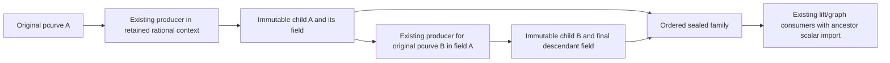

The source family is preparation authority, not a structural identity or contact
result. Equal input values remain separate child bindings. Required curve count,
each producer's attained value/coefficient depth, child source depth, work, bytes
and terminal cancellation are checked under one caller admission. Empty input is
a valid empty preparation family with a retained field, never an empty intersection
claim. Inputs and outputs are immutable COW values on all targets; partial families
cannot escape failure/cancellation. Consumer adapters still validate child source
owners and import original coefficients into the selected final field.

Verification belongs to
[OriginalPolylineFieldFamilyVerification](../../../Tests/OriginalPolylineFieldFamilyVerification/VERIFICATION.md).
It covers independently expected irrational stations from distinct polylines,
forward ancestry import versus unrelated/backward-field refusal, all original
children/segments/germs, retained Native/atlas lift and DI consumption, exact count/
work/bytes/depth/cancel, empty publication and detached source lifetime on four
fixed lanes. Automatic rolling-ball rail dispatch and other source families remain
separate required work after this source prerequisite.

## Prepared polyline Native surface lift

The additive Native lift source receives the already-bound complete
`OriginalPolylinePcurveSnapshot` and retains that same owner. It verifies every
original input point exactly against the retained polyline, validates/binds the
original Native host through its existing producer, and proves every vertex lies
within each finite Native axis. Every segment is affine between those vertices,
so this establishes whole-segment support without samples, a guessed inverse or
UV clipping. Periodic axes retain their complete real support; exact cycle and
seam proofs are supplied later by the existing fundamental-chart preparer.
Priority images and other host families require their own correspondence and
remain explicitly incomplete at this specialized port.

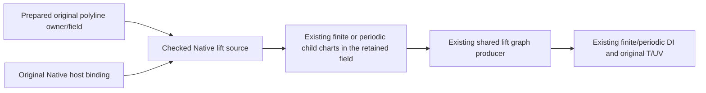

The source never rebuilds the pcurve's arc-length roots. Source-depth admission is
one level above the maximum retained child depth; original coefficient/value
proof depths are re-admitted before a new owner may be published. Input matching,
finite-axis checks, new source storage and terminal cancellation use the same
caller ledger. Original construction, pcurve input and Native net remain immutable
COW values; repeated preparation retains the same child owner with independent
query admission. The actual public numerical point remains a separate regression
of the original equation and does not certify identity from a residual.
Verification belongs to
[OriginalPolylineSurfaceLiftVerification](../../../Tests/OriginalPolylineSurfaceLiftVerification/VERIFICATION.md),
covering irrational joins/all child pairs, folded/closed traversals, finite and
periodic Native hosts, all lifted UV/seam sides, exact request/material-free domain
selection, field/owner/support refusal, source/depth/resource/cancel/lifetime and
four fixed target lanes. General-host and automatic rolling-ball/M7 migration are
not completed by this additive prepared-source path.

## Prepared polyline retained-atlas lift

The retained-atlas lift source consumes the same bound Euclidean polyline and an
`OriginalRetainedLiftHostSnapshotting` provider. The provider owns the original
host formula and coefficient field; the composition root supplies that provider
in the retained pcurve's field. The new source retains both child owners, checks
the original polyline points exactly, re-admits inherited pcurve depth, and proves
all vertices lie in the authored normalized square. Affine segments therefore
remain in that square without sampling, clipping or another arc-length producer.
The existing retained-surface preparer separately verifies complete square coverage
from the host cells; a source snapshot alone does not certify chart completeness.

```mermaid
flowchart LR
 P[Prepared polyline owner and exact field] --> L[Checked retained-atlas lift source]
 H[Existing original host producer in that field] --> L
 L --> C[Existing complete retained child chart preparers]
 C --> G[Unchanged shared lift graph producer]
 G --> D[Existing guarded DI selection and all T/UV]
```

`OriginalPolylineRetainedAtlasLiftSnapshot` conforms to the existing retained-atlas
reading protocol. No new graph, field transport, coverage or numerical equation is
introduced. Coons and boundary-correction providers use their original retained
rational atlas. Other providers can compose only through their existing source
contract; this unit does not establish new host capability. Priority images and
tolerance-only UV clamps remain explicit unsupported branches with incomplete
markers. Source depth is one above both children; charged input/support visits,
new receipt storage and final cancellation use the caller's admission. Immutable
COW inputs, prepared coefficient context and host atlas remain owned by the result
on Native, normal WASM and Embedded without new shared mutation or unsafe storage.

Verification belongs to
[OriginalPolylineAtlasLiftVerification](../../../Tests/OriginalPolylineAtlasLiftVerification/VERIFICATION.md).
It exercises actual original Coons and boundary-correction construction, irrational
stations/folded traversals, all chart products and incident sides, exact original
XYZ/UV and public point regression, selected domains, owner/field/resource/depth/
cancel/lifetime counterexamples and four fixed lanes. Unchanged Native finite and
periodic prepared-polyline lift evidence remains the lower regression authority.


### Polynomial lift witness reduction for a retained public query

The lift/whole-plane public cell consumes a sealed reduction of an already issued
lift graph when each auxiliary coordinate has a retained equality of the form
`a * auxiliary + p(T) = 0` with exact nonzero constant `a`. The source reducer
checks the complete one-parameter/two-auxiliary layout and derives both forward
polynomials from those equations. It substitutes them into every original position
law and every guard through existing polynomial operations. It retains the original
graph and the complete forward coordinate map; no inverse, new geometric formula,
chart sampling, guard deletion or enlarged caller allowance is involved.

| Authority | Guarantee |
|---|---|
| Original sealed graph | Original source, chart sides, authored T and full guarded UV relation |
| Checked equality coefficients | Every admitted original tuple has exactly the supplied UV at that T |
| Reduced graph plus forward coordinates | Exact two-way correspondence with the original guarded graph, including empty/constant/singleton subsets |
| Public lift/plane owner | Retains both graph forms and exposes the coordinate correspondence for points and continuous fibers |

An unavailable constant-coefficient elimination is an explicit unsupported
capability of this reducer. It does not establish empty contact and does not
silently select another solver. General rational/implicit source obligations stay
unchanged. The concrete need is the CS-POLY-01 prepared query exhausting its
existing 8,388,608 work allowance when solving two uniquely determined auxiliary
UV variables as independent variables. Verification must run that original input
under the same ceiling, compare all original guards and lifted tuples, and retain
failure/depth/cancel/lifetime checks before public-cell completion.


## Positive Rational Quadratic Boundary Authority

The concrete [B-NATIVE-RATIONAL-QUADRATIC-CLOSED-01 stop](../../../Tests/OriginalPublicAcceptanceVerification/Evidence/B-NATIVE-RATIONAL-QUADRATIC-CLOSED-01/native-observation-v1/receipt.json)
requires the complete directed arc authority consumed by [boundary clipping](../OriginalBoundaryClipping/DESIGN.md#rational-quadratic-directed-winding).
`OriginalRationalQuadraticBoundaryIssuing` issues a sealed receipt for one
nonperiodic clamped degree-two source with exactly three positive-weight controls,
six knots and a noncollinear two-coordinate control triangle. The issuer selects
its sole actual span internally and calls the existing generic B-spline chart
issuer once. Other degrees/spans/degenerate triangles remain explicit unsupported
capabilities; they are not approximated or reported as successful clipping.

For controls P0,P1,P2 and positive weights w0,w1,w2, the receipt retains that
actual chart, its full closed authored support, original parameter transport,
positive denominator theorem, exact endpoints, signed triangle determinant D,
and three exact affine barycentric laws lambda_i(U,V). It checks the transformed
homogeneous source laws against the normalized Bernstein weight laws over the
original source interval. Their coefficients and zero residuals retain the
attained scalar/polynomial proof depths. All imports, proof work, scratch and
retained owners use the caller admission and original coefficient field.

```text
validated original source binding
  -> existing exact sole-span B-spline law
  -> checked barycentric Bernstein identities + positive weights + D != 0
  -> immutable full directed arc/cap receipt
  -> boundary consumer's forward UV substitution and winding correction
```

The whole arc is exactly lambda_i>=0 and
E=4*w1^2*lambda0*lambda2-w0*w2*lambda1^2=0. Positive Bernstein weights
prove nonzero denominator on the full closed interval. Conversely, for an
interior point of this conic branch, the nonnegative ratio determined by
lambda1/lambda0 determines the unique normalized source parameter; endpoints
are P0/P2. This is a complete branch/preimage theorem, not an unchecked inverse
map supplied by the consumer. The cap between that arc and directed chord
P0->P2 has lambda_i>=0 and E>0; its oriented winding contribution is sign(D).
Position/branch authority implies neither a surface identity nor differential
continuity. The receipt cannot be initialized by external callers or Boolean
approval callbacks.

The result retains its original binding, actual issued chart/law, guards and
proof coefficients until the boundary result is released. It is immutable
Sendable on Native/WASM/Embedded; preparation has no shared mutable state.
Independent source admission/cancellation and unsupported capability failures
remain explicit. The dedicated public-cell fixture owns source-law equality,
full closed support, reversal, weighted controls, exact resource/depth/cancel,
detached/COW lifetime and the actual Kernel material result. It reuses unchanged
B-spline and L5 evidence, rather than generating another source-position formula
or solving the intersection again.

## Finite Physical-Cosine Zero Authority

The frozen [CS-ANGULAR-PHYSICAL-ARC-PLANE-01 cell](../OriginalDomainIdentity/OriginalDomainCoverage/DESIGN.md#cs-angular-physical-arc-plane-01-exact-physical-phase-candidate)
requires the existing analytic coordinate law's complete zero set, rather than
adaptive residual candidates. `OriginalAnalyticCosineZeroIssuing` consumes that
issued law under the same exclusive admission. Its default implementation issues
an immutable sealed `OriginalAnalyticCosineZeroReceipt` only for an original
one-parameter circle law with the matching physical cosine/sine gain and offset,
nonzero gain and finite closed authored support. The complete phase image must
lie strictly between -pi/2 and5pi/2, as verified in the actual pi-capable field.
Within that supported window cos(phi)=0 iff phi is pi/2 or3pi/2. Each candidate
is pulled back through the original affine physical phase and filtered against
the complete authored support, preserving closed endpoint incidence and either
gain sign. A wider phase image is explicit unsupported capability, not absence.

```text
existing full physical analytic law
  -> checked complete phase window and zero phases
  -> original T, exact child label, position and derivative at every zero
  -> retained source theorem + original law/support/depth
  -> selected-domain/plane consumer -> public exact tuple and image/fiber receipt
```

The issuer evaluates the existing position polynomials at C=0,S=+1/-1; it does
not generate another circle formula. The derivative uses the same polynomial
law and the proved physical phase. Original child labels use the exact imported
binary angular-label period B and mathematical phase, giving B/4 and3B/4 for
these phases. Rounded Double angle expressions are not proof coefficients.
The full law and neighbouring excluded zero phases remain retained beside the
selected roots; isolated zero graphs never claim to cover the whole circle.
The consumer must prove its whole original plane equation is a nonzero multiple
of this cosine law and retain the actual analytic request cover and checked
plane basis before using this theorem as pair completeness authority.

All roots, polynomial evaluations, proof comparisons, arrays, actual depth and
terminal checkpoints use the caller admission. `admitProof` readmits retained
source and attained proof depth without repeating root decomposition. There is
no public unchecked receipt initializer, shared mutable backing or target-specific
synchronization branch. Source/field/guard/cancel/resource failures remain typed.
The cell fixture owns full zero-set/exclusion and original law/label equality,
foreign-field/refusal, exact resources/depth, cancellation and detached/COW
lifetime on the changed Native/ASAN/ordinary-WASM/Embedded paths. General angular
windows, other source families and other trigonometric equations remain open.

## Certified Pair Authority for Remaining Acceptance

### Certified coaxial cone-cylinder root and traversal

The source owner issues the negative/positive full branch of the original
coaxial unit cylinder and cone at origin with unit-Z axes. It retains the actual
certified curve and both original surfaces. The cone angle uses the existing
physical-angle coefficient field: s=sin(alpha)>0, c=cos(alpha)>0, and the exact
selected height is+c/s for negativeFullBranch and-c/s for positiveFullBranch.
Cone slant is correspondingly+1/s or-1/s. These values solve the original
quadratic; regenerated cos metrics and residual bounds do not issue equality.

The final source evaluation delegates to cylinder U=lower+(upper-lower)*T.
For the full0/B traversal, physical phase is2*pi*T. Complete support is[0,1].
PlaneY0 selects exactly T=1/4 and3/4; both endpoints remain distinct source T.
Cylinder U includes B*T+kB; cone U includes B*T+kB or B*T+B/2+kB according to
the selected slant. All integer lifts and requested-domain restrictions belong
to downstream DI, not numerical projection. Continuous cylinder coincidence
retains the same full T law. Source depth1, inherited scalar depth, guards,
work/storage and cancellation use the original caller admission.

The user delegated the authority decision after the recovered acceptance mapping
identified a concrete conflict between regenerated binary position coefficients
and exact parent-surface UV. The authoritative certified intersection is the
retained original surface pair plus the declared branch and authored traversal.
Regenerated binary64 configuration, libm coefficients, projected UV and sampled
root estimates are numerical candidates, not exact source equality authority.
The five direct CertifiedIntersectionCurve3D variants retain those source pairs,
component/certificate selection and T domains. Their Codable definitions persist
source/selection data rather than the regenerated sine/cosine coefficients.

The source owner must issue the complete selected original-pair relation and its
T-to-allUV correspondence. Common DI and consumers only retain/compose that proof.
No tolerance establishes a root, branch join, closure, period or parent equality.
Full/open/bounded/apex/nodal kinds and every endpoint structure require their own
exact source branch/traversal receipt. Persisted explicit physical labels remain
physical labels; binary2*Double.pi is never silently made a mathematical period.
Where a producer supplied a numerical localization of a critical endpoint, the
source owner must establish and retain its exact selected endpoint/root law and
full traversal before the exact route accepts it. Ambiguous selection fails
explicitly. A root estimate alone cannot be reinterpreted as exact endpoint data.

The exact producer migration preserves the original surfaces, selected branch,
requested T and all defined source guards. Numerical point/evaluation APIs may
remain candidate-producing APIs with their existing accuracy contract; they do
not issue equality or complete UV. Any correction to their endpoint/traversal
behavior requires explicit source-contract and compatibility verification.
Preserving a regenerated coefficient law while attaching false parent UV is not
an allowed compatibility strategy.

This choice permits exact source equality, scoped identity and downstream UV
consumption. Its cost is source-owned physical coefficients, critical endpoint
selection and branch/traversal proof, with migration checks for numeric evaluation,
serialization and public callers. These are the causal missing receipts for the
positive certified cells, not permission to redesign the lower solver.

The limited apex separation capability below is unchanged: it deliberately bounds
both physical and regenerated coefficient interpretations and proves neither
sphere/cone membership nor UV. Its accepted empty result remains scoped evidence;
that binary snapshot cannot be promoted to the general original-pair source law.

## Certified Apex Whole-Support Plane Separation

This contract owns the source proof for CS-CERT-SPHERECONE-APEX-EMPTY-01 in
[the coverage catalog](../OriginalDomainIdentity/OriginalDomainCoverage/DESIGN.md#cs-cert-spherecone-apex-empty-01-complete-direct-height-exclusion-oracle).
It supplies a strict separation theorem for the actual apex-reduced stored
position law, not sphere membership, host UV recovery or a general certified graph.

```text
actual certified apex -> original private configuration / generator producer
  -> immutable source snapshot and binding
actual plane snapshot -> existing plane basis in the same physical-angle field
  -> checked whole-support separation issuer -> sealed retained receipt
```

`OriginalCertifiedSphereConeApexSnapshot` and its provider retain the actual
component, source surfaces, original angle labels, normalized closed T support
[0,1], source depth and original configuration/basis coefficients. A small
read-only port in CertifiedSphereConeIntersectionCurve.swift calls its existing
private makeConfiguration and actual generator basis; it does not widen private
visibility or reconstruct those equations in DI. No public unchecked snapshot
or certificate initializer is added.

`OriginalCertifiedSphereConeApexPlaneSeparationIssuing` and its default issuer
consume the bound snapshot, actual OriginalPlaneBasisReceipt in the existing
OriginalPhysicalAngleScalarDomain and one caller admission. The sealed
OriginalCertifiedSphereConeApexPlaneSeparationReceipt retains those same owners,
field, closed support, signed-plane lower/upper bounds, coefficient semantics
and attained proof depth. Issuance proves its interval strictly excludes zero.
Physical coefficients are exact functions of the retained authored angle;
regenerated binary64 configuration coefficients are separately exact imports.
The common envelope covers both, preserves every denominator/branch condition
and every endpoint, and uses whole-phase sin/cos bounds. It performs no cosine
cancellation, point sampling, residual exclusion or assumption of parent-sphere
equality. The fixed unit-Z configuration and planeZ2 capability is explicit;
other required certified branches remain incomplete with local markers.

The actual Native public stop is an independent sign refinement of the expanded
physical A=1+k^2 lower-bound comparison (degree8), before denominator or
readmission checks. The issuer therefore composes monotone rational interval
bounds from its already checked positive k and c bounds: A, D=A*c, 1/D and 2/D
need no repeated transcendental sign decision. The derived A upper bound is
1+(33/64)^2=5185/4096; this internal envelope preserves the same height bound
31581/35392 and strict plane clearance. Original physical expressions and all
binary coefficients remain retained. Readmission uses field.importing to
validate each immutable value owner and attained scalar/coefficient depth
without proving its already sealed sign theorem again. The sealed owner retains
the previously admitted coefficient storage; readmission charges its new work
and scratch without materializing those immutable coefficient buffers again. This
changes neither modeling tolerance nor caller resource limits.

All temporary and retained values, coefficient storage, source/value/coefficient
depths and final publication checkpoints use the same admission. readmission
checks every retained value and source/plane authority without regenerating
configuration, decomposing the original pair or creating a new allowance.
Unsupported capability, nonseparation, foreign field/owner, invalid guard,
resource failure and cancellation remain explicit failures.

The [pair owner](../NativeExactRelations/DESIGN.md#certified-apex-empty-pair-binding)
owns exact request/effective selection; the source theorem covers all authored T.
Verification compares the ordinary fixed input with the independent complete
height oracle, actual original coefficients/support/guards and the retained
strict interval. Changed source port/configuration and proof admission require
focused source and public failure/boundary/resource/cancel/lifetime checks on
Native/ASAN/normal-WASM/Embedded. Selected-body validation may extract exact
private helper ranges into an extension of the admitted cached concrete type;
source/range/prefix/compiler/product hashes must preserve the actual bodies and
nominal owner. It must not redeclare the curve/constructor/enum or hand-copy its
formula. No broad CADGeometry or L2-L6 rebuild is implied.

## Single-Cell Native Implicit Curve Graph

This section extends the parametric graph source contract for
CS-IMPLICIT-DYADIC-PARABOLA-PLANE-01. The two retained Native hosts are the
construction sources of the immutable certified curve, not its later query
partner. The source supply owns exact original T-to-host-UV-to-position
correspondence; DI owns request binding and intersection with the query target.
The end-to-end cell remains incomplete until its public result and failure
contracts are verified.

```text
actual immutable certified curve + single stored cell
  -> validated Native child bindings -> existing complete Native chart issuers
  -> original position equalities + stored free-coordinate T law
  -> checked triangular elimination + whole closed-support bounds
  -> sealed complete curve graphs and retained forward-coordinate evidence
```

OriginalImplicitCurveSnapshotProvider retains the actual certified curve, cell,
both Native child owners and source depth max(child depths)+1. It consumes the
existing immutable certification contract without replaying constructor proofs.
Its shared capability predicate selects only a finite, nonclosed, forward,
firstV-free single cell over nonperiodic single Bezier Native hosts of degrees
(1,1) and (2,1), with constant positive weights and an axis-separated triangular
control net. The first host has X(firstU), Y(firstV), constant Z; the second has
X(secondU), linear Y(secondU), linear Z(secondV). Required linear pivots are
nonzero. The predicate selects representation only; issuance still validates
all exact coefficients, cell bounds, denominators and proof assumptions.
Other source representations remain explicit unsupported branches with local
incomplete implementation markers. Invalid input, unresolved authority,
cancellation and exhausted resources never become a capability decline.

DefaultOriginalFiniteImplicitCurveGraphPreparer consumes the existing complete
Native chart laws, retaining their actual binding owners. The guarded graph has
parameter T at index 0 and original host auxiliaries firstU, firstV, secondU,
secondV at indices 1 through 4. It retains the three cross-multiplied original
position equalities, the stored free-coordinate affine equation, every closed
cell and Native span bound, both original homogeneous denominators and every
original parameter-transport denominator. Normalized support is the entire
closed [0,1], including both endpoint roots. No fitted curve or host inverse is
introduced.

Forward host coordinates are derived from those issued equations by triangular
elimination: each step isolates one unresolved coordinate with a nonzero
constant pivot and a remainder depending only on already resolved coordinates
and T. The issuer verifies all original equalities after substitution and
retains the elimination order and pivots. This triangular Jacobian witness
proves a unique auxiliary tuple for every T, independently of numerical anchor
residuals. Exact univariate Bernstein convex-hull bounds prove the resulting
tuple lies in every original closed cell and host span throughout [0,1].
The immutable constructor's unique graph theorem and this checked exact tuple
therefore select the same original graph, including endpoints. The composed
original homogeneous position and its total T derivative are retained for
numeric publication without holding auxiliaries constant. No fixture-specific
coordinate, polynomial, Jacobian value or oracle coefficient is production
authority.

The actual ordinary query exhausted its unchanged work allowance during L5/L3
projection of the seven-coordinate curve/target relation, before publication.
Source issuance therefore supplies a checked one-parameter reduction of this
already proved graph. OriginalImplicitCurveGraphReduction retains the full
original five-coordinate graph, the reduced one-T graph, all five univariate
original-coordinate laws [T,firstU,firstV,secondU,secondV], and attained depth.
The source producer substitutes those exact forward coordinates into every
original homogeneous component and all 27 original conditions, preserving their
relations, field, source owner, closed support and parameter transport. No guard
is discarded from the retained source authority. Triangular uniqueness proves the inverse direction is projection
onto T; whole-support containment proves every reduced point lifts to an
admissible original tuple. This sealed bijection transfers both positive and
empty-domain completeness without a new root solver or a new allowance.

OriginalCompleteCurveGraphs now uses OriginalImplicitCurveGraphReduction as its
coverage and the reduced graph as its sole solver graph. The existing CS
compiler solves coordinates [T,U,V]. Publication evaluates the retained five
coordinate laws to expose original T and host UV4. The resulting L6 solver
witness has three coordinates; it is never represented as an unchanged
seven-coordinate decomposition. Original five-coordinate source guards and the
whole-support bijection remain available through the retained source coverage.
Reduction readmission checks both original and reduced graph coefficients,
original evidence, source ownership and attained depth under the caller ledger.

The next actual raw root-isolation stop exhausted value depth 32 during L2
subdivision, before publication. The one-T solver graph still contained guards
already true over its whole support. The source producer
therefore retains an exact closed-range witness for every substituted guard and
removes only guards proved true throughout the entire closed [0,1] support from
the solver graph. Forced equalities have range [0,0]. Coordinate-bound guards
and original constant denominators use the existing univariate Bernstein
convex-hull helper on their exact substituted coefficients. This is the same
finite rational range algorithm already used for the four host-coordinate
hulls; zero and constant guards produce singleton ranges. There is
no second root isolation, sampled sign test or rounded bound.

The reduction retains substitutedConditions and conditionRanges in original
condition order, plus retainedConditionOrdinals and eliminatedConditionOrdinals
as a complete disjoint partition. Each range is checked for exact ordering.
Equality needs both bounds zero, nonzero needs a range strictly excluding zero,
positive needs a strictly positive lower bound, and nonnegative needs a lower
bound at least zero. Conditions whose range does not prove their relation remain
in the solver graph. Scalar, owner, cancellation and resource failures propagate.
Readmission retains and checks every original/substituted condition coefficient,
range boundary and ordinal correspondence; a guard is never treated as true
because its proof is unknown. This removes redundant solver work without
changing original geometry, support, topology, source correspondence or limits.

OriginalImplicitCurveGraphEvidence is sealed and retains the actual source,
both complete Native chart families, field, forward host polynomials, composed
homogeneous position/derivative, exact coordinate ranges, elimination witnesses
and attained proof depth. Its admitProof rechecks source owners and limits and
imports every retained coefficient under the same caller admission; it does
not solve or redecompose the source. All traversal, allocation, exact work,
source/value/coefficient depth and cancellation use that admission. Stored
state is immutable and COW-retained; target conditionals do not change storage,
Sendable, synchronization or lifetime.

Verification must compare the actual public finite cell with the independent
complete oracle and retained original host UV, then exercise unsupported
capability, foreign owner, whole-support guard, depth/budget, cancellation and
detached/COW lifetime failures. The existing graph compiler and L5/L6 consumers
are unchanged assumptions; this source implementation alone does not establish
public completeness. Verification must also check all substituted conditions,
the range/relation proofs and retained/eliminated partition, the reduced/original forward and projection identities, complete original
coordinate publication and both full and empty requested domains under the
unchanged allowance. The SourceIssuance component owns these five source files;
the pair owner owns the complete-family/request bridge and numeric publication.

## Finite Forward Implicit Cell Coverage

This contract extends the preceding single-cell contract for
CS-IMPLICIT-SPLIT-DYADIC-PARABOLA-PLANE-01. Its baseline ordinary observation
returned one numerical representative without any original receipt or the two
closed seam incidents while the source selector declined the two-cell input.
The accepted capability now includes one or two forward firstV cells over the
same bounded triangular Native host profile. The subsequent
[Single Reversed Implicit Cell](#single-reversed-implicit-cell) contract defines
the limited single-cell reverse extension. Closed sources, reversed multi-cell
traversal and other host representations remain outside the admitted capability.
This source contract alone does not establish ordinary public completeness.

```text
Immutable original curve + two retained Native host bindings
    -> complete Native laws prepared once
    -> stored-cell order / closed global-T span / checked local-T law
    -> per-cell original five-coordinate graph and checked reduction
    -> sealed finite coverage + existing complete graph family
    -> existing DI graph compiler / L5 / L6 / every closed seam incident
```

OriginalFiniteImplicitCurveGraphCoverage is a new sealed source receipt. Its
initializer remains internal; consumers cannot manufacture a complete cell
cover. It owns the following public contract:

| Member | Meaning |
|---|---|
| source: OriginalSourceBinding<OriginalImplicitCurveSnapshot> | The same immutable original curve and Native parent owners retained by every reduction. |
| field: OriginalExactScalarDomain | The field owning all retained spans, polynomials and coefficients. |
| reductions: [OriginalImplicitCurveGraphReduction] | Exactly one checked reduction per actual stored cell, in original order, without omissions or duplication. |
| support: OriginalSourceParameterInterval<Field.Value> | The complete closed authored global T support [0,1], independent of the requested subdomain. |
| proofDepth: ExactScalarDepth | The attained depth of the complete cover and every retained proof. |
| admitProof(limits:using:) | Generic ExactScalarAdmission readmission, with typed OriginalSourceIssuanceFailure and the same caller ledger. |

OriginalImplicitCurveGraphEvidence adds cellOrdinal: Int,
globalSupport: OriginalSourceParameterInterval<Field.Value>, and
localParameter: ExactPolynomial<Field>. OriginalImplicitCurveGraphReduction
exposes those same fields through its retained original evidence. For actual
cell count n and ordinal i, the source derives globalSupport = [i/n,(i+1)/n]
and localParameter = n*T-i by exact integer field arithmetic. It validates the
stored free-coordinate law lower + width*localParameter, including the exact
binary imports of lower, upper and the original stored width. Its affine
global coefficients must reproduce both authored free endpoints exactly.
No fixture coordinate, special seam fraction or fitted curve is authority.

Both the original five-coordinate graph and reduced one-coordinate graph use
original global T, with identity parameter transport. Each span includes both
endpoints. Forward host-coordinate laws, homogeneous position and total T
derivative are derived and checked in that global coordinate. All original
three position equations, the free-coordinate equation, all 27 conditions,
denominators, elimination witnesses and ordinal correspondence remain retained
per cell. Existing exact Bernstein range proofs operate after affine pullback
of each global span to local [0,1]; a guard may be removed from solver input
only when its range proves it on that entire closed span. Unknown guards stay
active, and unresolved authority or scalar failures propagate.

The source verifies a complete ordered closed cover, the local/global endpoint
identities, and exact agreement of all four issued host-coordinate maps at
every shared endpoint. Triangular uniqueness then identifies the two endpoint
lifts with the same original host tuple, retaining both cell ordinals and
local labels. Position equality follows from the retained original host laws;
constructor tolerance connectivity or numerical anchors are not substituted
for this exact seam proof. The family uses this finite coverage as Coverage,
with family.graphs[i] equal to coverage.reductions[i].graph. Whole support
remains [0,1]; request clipping is owned by the existing domain binder.

Readmission checks original source and Native parent owners, field imports,
original cell order/count, closed span cover, local endpoint maps, every
per-cell reduction and attained depths under the same admission. Allocation,
traversal, comparisons, work, storage and cancellation are charged to that
ledger. Native laws are prepared once and immutably shared by the per-cell
evidence. Cell count does not invent another source nesting level. Maximum
chart, source depth and exact-work failures propagate without becoming a
capability decline. Stored state, Sendable and lifetime contracts remain the
same on Native, WASM and Embedded.

The pair owner consumes the complete coverage through a finiteCoverage reader
requirement and selects the actual reduction using checked firstGraphIndex
and cellOrdinal correspondence. Explicit firstReduction/firstEvidence views
describe only the first stored cell. Legacy reduction/evidence accessors are
deprecated aliases of those first-cell views, preserving single-cell source
compatibility; they never denote complete multi-cell authority. Existing
per-pair coordinate publication and exact TUV incident grouping are reused.
No lower graph contract, new root solver, query ceiling or materialized
seven-coordinate solver partition is introduced.

Verification must preserve the accepted single-cell behavior and show one
public seam point with both exact stored-cell incidents, source-issued local
labels 1 and 0, original host UV4 and XYZ, plus complete empty restricted T.
It must check cover/order/owner identity, all per-cell original and substituted
conditions, span-scoped range witnesses, foreign-field/depth/budget/cancel
failures and detached/COW lifetime. The existing compiler and relation
consumers remain unchanged premises; actual ordinary publication is required
before this finite cell counts as complete.

## Single Reversed Implicit Cell

CS-IMPLICIT-REVERSE-DYADIC-PARABOLA-ON-HOST-01 extends the existing Native
triangular source capability only to one stored firstV-free cell whose actual
direction is reversed. Its actual ordinary rich baseline reaches subdivision
and fails before DTO publication because non-rational candidate uniqueness and
completeness are unproved. This contract preserves the accepted forward
one-cell and two-cell capabilities. Reversed multi-cell traversal, true closed
sources, firstU-free cells, singular sources and other host profiles remain
outside the admitted capability; unsupported required coverage cannot become
empty success.

```text
Actual immutable reversed cell + retained Native host laws
    -> original global T / local parameter T / closed support [0,1]
    -> checked free-coordinate law upper - originalWidth*T
    -> original five-coordinate graph / all 27 conditions
    -> existing checked reduction and finite cover
    -> existing public relation consumer / complete original correspondence
```

The original cell evaluator applies directedFraction = 1-localFraction for
reversed traversal. The global-to-cell local map remains identity for a single
cell. Source issuance therefore retains localParameter = T, closed global
support [0,1] and identity original parameter transport. It imports the actual
authored lower, upper and stored width exactly, verifies width > 0 and
lower + width = upper, and derives the free-coordinate equation from
lower + width*(1-T). The resulting offset is upper and gain is -width.
It verifies free(0) = upper and free(1) = lower exactly. Changing only the
forward gain sign or reversing localParameter as well would violate this
contract. Forward issuance retains its existing law and endpoint checks.

The three original host-position equalities and this direction-correct free
equation feed the existing triangular elimination and unique auxiliary-map
proof. The original five-coordinate graph, all 27 conditions and denominators,
ordered closed cell/host bounds, nonzero dependent Jacobian and elimination
witnesses remain retained. Existing exact Bernstein ranges prove containment
and each removable guard over the whole closed support; negative traversal
gain does not reverse lower/upper domain bounds. The composed homogeneous
position and total global-T derivative are derived from the exact substituted
polynomials, applying the original direction once. Original coordinates stay
in [T,firstU,firstV,secondU,secondV] order.

The existing sealed reduction and finite coverage retain the actual reversed
cell ordinal, immutable original curve and Native parent owners. Cover
readmission admits this single reversed direction while preserving identity
transports, local endpoints 0/1, field ownership, complete support and attained
depth. Native laws are prepared once; all work, storage, comparisons,
source/value/coefficient depth and cancellation use the same caller admission.
Source nesting depth and target storage/Sendable/lifetime contracts do not
change. No new receipt type, unchecked issuer, lower solver, query allowance
or direction-specific upper API is introduced.

The source change is limited to the direction-dependent branches in
OriginalImplicitCurveSnapshotProvider, OriginalFiniteImplicitCurveGraphCoverage
and DefaultOriginalFiniteImplicitCurveGraphPreparer. Existing graph evidence,
reduction and public consumer contracts remain premises. Source issuance alone
does not complete the cell: actual public rich publication must retain the
whole requested relation, original host UV, XYZ, cover and dimensions. The
independent fixed oracle is tau = 3/4-T/2 with tuples (T,tau^2,tau), source
coordinates [T,tau^2,tau,tau,1/2], XYZ (tau^2/32,tau/64,0) and dimensions 1/1/0.
Verification also requires complete empty restricted target V, bare refusal
of the non-discrete result, exact reversed endpoints and total tangent,
forward one/two-cell regression, and unchanged typed unsupported,
owner/depth/budget/cancellation/lifetime behavior. The pair owner retains
public verification responsibility; source-only success is insufficient.

## Implicit Whole-Host Plane Separation

CS-IMPLICIT-CLOSED-PLANE-EMPTY-01 consumes the actual immutable implicit curve's
common-root position contract without constructing a positive UV parameterization.
Every original common-root position belongs to both retained Native hosts. A
whole-domain exclusion of the second host therefore excludes every curve point
over the complete authored T support [0,1], including all stored cells and the
closed connection. Numerical representatives and residuals supply no equality
or separation authority. This position-only proof does not complete a positive
closed implicit graph, source parameter map, smooth join or general Native family.

```text
immutable implicit curve / all original cells / both Native bindings
    -> exact closed cell containment in the original host domains
    -> second Native host's positive weights and constant homogeneous Z law
    -> exact signed gap from the original unit-Z target plane
    -> sealed whole-support source exclusion
    -> original request/effective selections and target plane cover
```

OriginalImplicitHostExclusionSnapshotProvider is a separate capability from the
existing triangular implicit graph provider. Its bounded static selector accepts
nonempty implicit sources with two nonperiodic Native hosts and a degree-1/1,
2-by-2 second host whose four finite positive-weight controls share one exact
stored Z coordinate. The target selector requires an authored analytic unit-Z
plane at a different finite stored height. Admitted issuance independently checks
the same assumptions. It consumes validateCertificationContract for the immutable
curve, binds both original Native hosts through their counted snapshot provider,
and checks every actual cell's closed bounds against both retained Native domains.
It preserves the original free coordinate, direction, cell order and closed flag;
source depth is one above the maximum child depth. It does not replay root,
connection, subdivision or interval-jet proofs.

DefaultOriginalImplicitHostPlaneSeparationIssuer imports the four original
weights and weighted Z coefficients exactly into OriginalExactScalarDomain.
Positive weights and the Native nonnegative partition-of-unity basis prove a
strictly positive denominator over the entire original closed host support.
It verifies each homogeneous Z coefficient equals the retained host height times
its weight, and proves the host height minus the actual plane height is nonzero.
The original unit-Z plane basis, source and selected second-host owner remain
bound to this theorem. The fixed recipe's stored 0.8 is an exact binary64
coefficient, and no mathematical sphere, angular period or fitted spatial law is
introduced.

OriginalImplicitHostPlaneSeparationReceipt has a sealed initializer and retains
the source, actual plane basis, exact field, selected host, host support, authored
T support, exact weights/homogeneous Z, heights, signed gap and attained proof
depth. Cells and cell count are views of the retained original source; no duplicate
cell bounds or T-map arrays are manufactured for this exclusion. Its proof scope
is originalCommonRootPositionOnly. Readmission checks source/host/plane ownership,
the caller's maximum cell allowance, source depth and every retained scalar and
coefficient depth through the same admission without re-solving or re-proving
the sealed theorem. Work, actual retained payload storage and cancellation remain
caller-owned on every target; no mutable shared state is introduced.

Unsupported source/plane capabilities fail explicitly at direct issuance and
decline before public selection. A zero gap, invalid cell containment, foreign
field, insufficient source/scalar depth, work/storage exhaustion or cancellation
cannot become empty success or a caught fallback. Verification must show actual
ordinary empty publication with complete original source/request/plane ownership,
all four cells and the closed flag, exact signed gap and denominator coefficients;
it must also preserve nonseparation/unsupported, cell allowance, foreign owner,
depth, budget, cancellation and COW lifetime failures. The pair owner binds actual
T and plane UV requests using existing parameter transport and plane-domain
issuance; source-only construction does not complete the public cell.

## Checked rolling graph auxiliary reduction

The finite rolling SSI consumer may eliminate only auxiliaries uniquely determined
by retained graph equalities: a nonzero constant linear coefficient, or a constant
quadratic with an exact rational positive square root and the original strict
positive coordinate guard. Every remaining original condition is substituted,
including support, branch, normalization, radius and denominator conditions.
The sealed reduction evidence retains the full original graph and a polynomial
forward lift for every original coordinate. It does not replace the minor-arc
position producer or infer equality from evaluation. Unsupported reductions fail
explicitly; no general rolling-family completion is asserted. The fixed
SSI-ROLLING-BALL-PLANE-01 fixture owns positive/wrong-root/full-incident behavior.

The reducer consumes the scalar owner's package-only rational square-root
capability. It neither reads scalar storage nor owns another numeric allowance.
The existing producer is unchanged and available in standalone L0 as well as
full Geometry. Conditional imports retain the independent SourceIssuer contract.


### Sphere-cone full-branch phase and selected radical

The source owns the unit radial phase of the actual cone generator, with
physical theta=B*T on authored T[0,1]. It is a distinct auxiliary source,
not a replacement for the intersection curve's position. The existing physical
analytic-coordinate and cosine-zero issuers supply its complete two zeros.
For sphere0/R3 and cone(1,0,-4)/Z, source bounds on the original sin/cos establish
L<0, D=L^2-8>0, both positive slants and absence of sphere poles over the entire
phase support. Existing generic real-root issuance selects the positive sqrt(D)
at each zero; the declared branch selects -L plus or minus that radical.
No regenerated binary metric establishes parent equality.

The source retains separate exact phase/Pi and physical-angle algebraic fields.
The former owns T; each radical field owns XYZ and planeUV. They are never
coerced through rounded coefficients. Cone labels and sphere longitude are exact
intrinsic labels with arbitrary integer lifts. Sphere latitude is a sealed
canonical inverse-sine coordinate retaining exact sine/cosine and interval,
rather than a rounded scalar. All its witnesses denote the same source position.
Consumers retain these owners and restrict the actual domains with the same
admission. Full-branch cells and the affected physical/coaxial paths own focused
verification; other certified variants remain independent obligations.

### Cone-cone full-branch exact cardinal contacts

For the frozen reference cone0/Z and parameterized cone4Z/Y, retain both
original physical angles as separate coefficient owners. Exact bounds on their
sines/cosines prove q>0, k<0, discriminant>0, nonzero selected slant and positive
reference height over the whole theta=B*T support. Therefore planeX0 contacts
are exactly theta0 andpi, T0 andpi/B; thetaB is excluded by B<2*pi.

At tau=cos(theta)=+1/-1 put A=cos(alpha)*cos(beta),
C=sin(alpha)*sin(beta). The declared positive root is lambda=4sin(alpha)/(A+tau*C),
the negative root is lambda=-4sin(alpha)/(A-tau*C). This follows from
q=(A-C)(A+C) and sqrt(discriminant)=4sin(alpha)A; both denominators are positive.
Retain a sealed symbolic coordinate relation for these original products and
ratios. No foreign coefficient import, rounded mixed field or invented algebraic
independence is needed. Source-owned outward localization proves numeric output
bounds and finite target guards only; it never establishes original equality.

Both parent UV retain independent arbitrary-integer intrinsic lifts. Reference
U is0 for the positive root andB/2 for the negative root; parameterized U is0
orB/2 by phase ordinal. Slants and planeUV are sealed coordinate expressions
retaining the original pair/branch and both coefficient owners. Existing Pi
arithmetic and DI transport own exact T support/request/selection. Same-admission
depth/work/storage/cancel and retained-source lifetime apply to every query.
Verification includes the observed erroneous extra endpoint and full positive
contact publication, resources/failures/cancel/lifetime on the fixed targets.

### Certified coaxial pcurve-role lift supply

A supported certified analytic-pair lift retains its actual pcurve, selected
parent surface/role, directed binary64 fractions and the existing original
coaxial cone-cylinder binding. Both actual pair surfaces must equal the declared
original pair; the selected lift surface must equal its role's surface. Authored
local r has support[0,1], child t=start+(end-start)*r with nonzero extent and
exact fractions within[0,1]. This source-owned correspondence proves the whole
lift position equals the original child curve, including both reverse endpoints.
Numerical UV projection, canonical representative snapping and residuals are
approximate evaluation paths and never establish this source theorem.

The curve/pcurve/lift hierarchy has sourceDepth3, preserving the retained child
owner at depth1. Track every proof value/coefficient admission during child
issuance so subsequent readmission cannot lose proof depth. The selected role
is part of the retained source, while cone/cylinder UV families keep independent
integer indices. Other certified pairs and fraction windows remain required
capabilities; this supply does not infer their source laws. Shared numeric height
localization belongs to the existing coaxial source owner and uses the same
admission. No original shape formula or separate solver is duplicated.

### Coaxial primitive pair whole-source law

Exact equal radial origins and positive unit-Z axes select this capability;
coincidence is never admitted by distance/angle tolerance. Both axial origins,
positive authored radius and original physical cone angle remain independent
source data. The shared coefficient producer issues sin(alpha)>0, cos(alpha)>0,
positive slant R/sin(alpha), relative height R*cos(alpha)/sin(alpha), and intrinsic
label periodB. Existing certified unit-coaxial source issuance consumes the same
producer; no duplicate original quadratic or new lower solver is introduced.

Whole primitive SSI consists of both signed circles: coneV=+/-R/sin(alpha),
cylinderV=coneApexZ-cylinderOriginZ+/-R*cot(alpha), XYZ=(cx-R*sin(2*pi*s),
cy+R*cos(2*pi*s),coneApexZ+/-R*cot(alpha)). Independent cone/cylinder U lifts are
B*s+mB+offset andB*s+nB, offset0 on positive slant andB/2 on negative slant.
Fundamental s in[0,1) plus all integer pairs covers every original tuple; both
seam incidents remain source-period meaning. Source fields/guard proof depth
are tracked and retained with both original primitive bindings. Coordinate
expressions retain their source rather than substituting rounded circle centers.

### Bounded sphere-cone plane-contact source

The bounded R2 source authority is the original sphere0/R2 and coneA(2,0,-4)/Z
with the authored physical angle. Original scalar s=sin(alpha), c=cos(alpha)
remain in the existing physical field. The source issuer proves0<k=2(1-c)/s<1
and retains the unique L=asin(k) on(0,pi/2), U=pi-L. Numeric stored critical
endpoint angles are isolating hints for the explicitly migrated critical branch,
not replacements for L/U. Only this fixed pair/branch with its actual validated
critical selectors is admitted.

The retained law theta=pi/2-(pi/2-L)*cos(2*pi*T) has all T[0,1]; positive slant
root owns[0,1/2], negative root owns(1/2,1]. Its discriminant is
(2*s*sin(theta)+4*c)^2-16>=0 on the whole interval, both slants are positive,
and original sphere/cone equality follows by substitution. Every critical
endpoint/join side remains authored; no high-order continuity is inferred.

Since0<pi/2-L<pi/2 and s/lambda>0, planeY0 iff cos(2*pi*T)=0: exactly
T1/4,3/4. Reuse the existing physical phase issuer with an auxiliary normalized
full mathematical turn (start=end0/additionalTurns1), then the existing DI
request/restriction and retained parent-UV publisher. At both contacts the cone
phase ispi/2; the first selects the plus radical and the second the minus. The
source radius and exact X sign select canonical sphere latitude/azimuth, rather
than the old full-branch enum assumption.

The sealed bounded-arc receipt retains the source/field, critical sine, selected
interval theorem and proof depth. It does not offer an unchecked initializer or
a numeric inverse. Consumers retain the same receipt through result lifetime.
Verify original construction -> source -> DI -> all four public CS entries,
quarter singleton versus neighbouring excluded phases, branch/order/UV guards,
exact resource/depth/cancel/lifetime and full-branch regressions on fixed targets.
Other bounded configurations/open/apex/parent SSI remain separate requirements.

The bounded contact source adjoins the positive original slant root on(6,7)
under the proved coefficient bounds, retaining lambda^2-2*b*lambda+16. The second
root is2*b-lambda in the same field, by Vieta. This exact basis avoids the
near-zero physical constant2-s*b produced by a centered radical basis; no
zero rounding or ceiling change occurs. The one original root/poly owner is
shared. The radical remains lambda-b and all original equalities are unchanged.

### Bounded sphere-cone whole-pair source

The fixed R2/A(2,0,-4)/Z/alpha bits3fddac670561bb50 parent SSI source reuses
the preceding critical-arc receipt and the existing primitive source/law issuers.
Let t=tan(theta/2), q=1+t*t, S=2*t/q, C=(1-t*t)/q, b=2*s*S+4*c.
The source owns both roots of lambda^2-2*b*lambda+16=0. Exact c_L is the
positive root of c_L^2=1-k^2, k=2(1-c)/s. The complete half-angle support
is [k/(1+c_L),(1+c_L)/k], both endpoints included. Physical coefficient
bounds already owned here imply b>0 at every angle, so D>=0 iff S>=k; no
other angular interval or negative slant component exists. Both roots coincide
only at the two critical endpoints. Each root arc is nonconstant; together
they form one closed common curve, image1/fiber0.

Original XYZ is (2-s*lambda*S,s*lambda*C,-4+c*lambda). Source equality
follows from the retained quadratic and unit-circle laws. Bounds on c/s
exclude1 and3, hence neither sphere pole occurs. Cone angle is2*atan(t) on
(0,pi); sphere azimuth is atan2(-X,Y), sphere latitude asin(Z/2) on the
canonical latitude branch. Store these exact inverse relations with the
intrinsic label scale B/(2*pi) and independent integer B lifts. Binary B
is the primitive label period, not a mathematical physical period.

The source snapshot retains both primitive laws/supports and the original
ordered pair. Its source depth is1 over primitive depth0. The existing scalar
tower isolates c_L; per-member evaluation isolates one plus slant then obtains
the minus slant by Vieta, sharing its point section. No intersection problem
is decomposed again. Closed incident sides survive at both endpoints; no
higher-order continuity is claimed.

For interior point evaluation the retained b bounds4<b<9/2 yield P(4)<0
and P(7)>2. Use the exact rational(4,7) isolating interval for the plus
slant, then Vieta for the minus. This removes parameter-dependent root-count
boundaries without changing the original polynomial/root selection.

The bounded parent snapshot keeps ordinary coefficients/primitive laws in the
level0 field and retains a separate criticalField for the endpoint extension.
A point section retains its input scalar context through the checked public
Field(retaining:) initializer and imports ordinary coefficients upward. The
critical field owns support/boundary comparisons only; unrelated critical
extensions do not enter a rational interior point quadratic.

### Full sphere-cone parent source

The fixed R3/A(1,0,-4)/Z/authored-alpha parent uses the same admitted physical
coefficients and primitive laws as the bounded parent. Source-owned chart0 has
S=2t/(1+t*t), C=(1-t*t)/(1+t*t), chart1 has their negatives; each t in[-1,1].
Their closed endpoints pair by tOther=-t. Together they cover the entire original
unit circle, retaining both incident parameter sides. b=s*S+4*c lies strictly
between3.11 and4.05; lambda^2-2*b*lambda+8=0 has two positive distinct roots.
P(4)<0, P(7)>0 isolate the plus root; Vieta gives the minus. Each is a closed
nonconstant curve; source cone coordinates distinguish the two everywhere.
XYZ=(1-s*lambda*S,s*lambda*C,-4+c*lambda), with sphere radius3.
The existing scalar/root operations are shared through source-issued section
values with the bounded parent, whose constant16 and apexX2 remain unchanged.

Cone U is B/(2*pi)*2*atan(t)+chart*B/2+n*B. The half-period shift is an exact
intrinsic label, not rounded mathematical pi. Sphere inverse arguments retain
atan2(-X,Y), asin(Z/3) and every independent integer label lift. Neither sphere
pole occurs because c/s is neither1 nor7. No certified curve endpoint window
is mistaken for the entire parent angular support.

### Full original cone-cone parent source

For the fixed cone0/Z/alpha and cone4Z/Y/beta, preserve the two independent
physical-angle owners. Two closed rational circle charts use S,C and their
negatives, t in[-1,1], with paired tOther=-t. Source coefficients obey the
existing sa(.44,.45),ca(.89,.90),sb(.35,.36),cb(.93,.94) proofs.
q=ca^2-sb^2*C^2>0, b=4*sa^2*sb*C, k=-16*sa^2<0. The source law
q*lambda^2+2*b*lambda+k=0 has two opposite signed nonzero roots everywhere.
Retain r as the positive beta-field root r^2=1-sb^2*C^2, r>=cb>.93.
Rationalization gives lambda=sign*4*sa/(ca*r+sign*sa*sb*C). Both denominators
are strictly positive and |lambda|<4. Original XYZ is
(-sb*lambda*S,cb*lambda,4-sb*lambda*C); reference slant is Z/ca.
Coordinate receipts retain this exact expression and both coefficient owners;
no fictitious common field, rounded coefficient or interval-as-equality is used.
Cardinal r=cb/1 reuses source unit laws; other r uses existing exact root ports.

Parameterized U is2*atan(t) plus chart*pi in intrinsic labels and arbitrary
integer lifts. Reference U uses atan2(-X,Y); since referenceZ>2.56 its slant
is positive and no reference apex occurs. Parameterized signed slant remains
authored all-real support. B is the saved intrinsic label, not physical2*pi.

### Apex sphere-cone parent source

The original sphere0/R1 and cone(1,0,0)/Z/alpha parent owns
lambda*(lambda-2*s*S)=0. Lambda0 is the apex with all original cone U.
The nonzero law is XYZ=(1-2*s*s*S*S,2*s*s*S*C,2*s*c*S).
Its S>0 and S<0 arcs meet at the apex; image is one connected figure8 with
apex image0/fiber1 and regular image1/fiber0. Two closed circle charts retain
all four incident sides at S0. Primitive signed coneV and independent U lifts
are preserved. Earlier candidate curve regenerated binary64 coefficients are
not the authoritative exact parent law. Reuse original primitive/bounds issuers.

### Common-apex point cone pair source

Signed cardinal unit axes and exactly equal authored apices are retained. Both
physical half angles lie in(0,1/2]. Orthogonal axes use independently certified
cos(angle)>7/8, so the two squared direction constraints exceed the unit norm.
Parallel or opposite axes with exactly DISTINCT authored angles use strict
monotonicity of physical cosine on this interval: no nonzero direction can
satisfy both original cone metrics. A1ULP angle difference is distinct; modeling
tolerance never turns it into coincident cones. Equal-angle parallel cones and
nonpoint/noncardinal families are separate capabilities. Source owns the exact
authored apexXYZ and both full angular fibers. The rational parameter-label field
never represents a physical trigonometric coefficient. Retain independent angle
proof owners and original primitive collapse theorems.

### Equal-authored cardinal cone source

Exact identical primitive cone inputs retain both independent original owners,
cardinal basis, authored apex and one physical angle field. Source equality
proves all nonzero tuples iff V1=V2 and U2-U1 is an arbitrary integer label B;
V1=V2=0 permits every independent U1/U2. Positive physical sine/cosine establish
nonzero radial/axial injectivity. Source owns exact intrinsic XYZ definitions,
not sampled coordinates, and retains existing primitive period/collapse laws.

### Sphere-cone normalized node capability

For sphere0/R1 and cone1X/Z, source physical angles in(0,1/2] satisfy0<s<1/2,
c>0, hence X>=1-2*s^2>1/2 and no sphere pole. Reuse the original wave/apex
factorization and position producer. Source-issued upper/lower traversal maps
normalized T[0,1] to intrinsic label B*(branch+T)/2, with exact critical labels
0,B/2,B and physical angles0,pi,2pi. Direct authored physical endpoints never
inherit this root-selected normalization. Retain both original owners and every
apex cone U. This traversal receipt does not itself manufacture a Curve3D truth
or accept the still-unconverted upper/lower public CS callers.

### Source-issued node curves for ordinary CS

The public SSI owner issues the existing sphere-cone Curve3D with a sealed
normalized traversal receipt. Direct authored constructors retain their physical
endpoint meaning and no receipt. Generated upper/lower curves have T[0,1],
physical phase pi*(branch+T). Candidate binary pi bounds are rendering metadata;
they are not coefficient authority. The curve snapshot retains the same original
pair/physical field and critical source positions. Source generation computes no
new surface intersection. Curve codecs refuse to discard the source traversal.

### G01 root-free sphere-cone family consumption

The existing full-pair owner accepts authored sphere center/radius and cone apex,
unit-Z axis and actual physical half-angle, rather than an equality check against
one numeric recipe. Source authority computes delta=A-O, C=dot(delta,delta)-R^2
and b(theta)=s*(-deltaX*sin(theta)+deltaY*cos(theta))+c*deltaZ. Its original
quadratic is lambda^2+2*b*lambda+C=0. A source proof admits two distinct full
branches exactly when C!=0 and min_theta(b^2-C)>0. C<0 suffices; for C>0,
m=c*deltaZ, h2=s^2*(deltaX^2+deltaY^2) give the exact strict criterion
m^2>h2, m^2+h2-C>0 and (m^2+h2-C)^2>4*m^2*h2. No residual establishes that proof.

Existing two circle charts, DI support and independent original UV families are
retained. Ordered roots use an admitted exact Cauchy bound derived from actual
coefficients, with the strict source-proved quadratic midpoint separating one
upper root; the lower root is retained by Vieta without a second decomposition. XYZ uses the authored apex and sphere inverse arguments use the
authored center/radius. A sphere pole retains an unrestricted angular family;
no atan2(0,0), sampled pole or arbitrary finite root window is published.
The existing bounded numeric recipe is selected before this full source route;
required general bounded/open/apex and nonempty finite UV refinement remain open
until their own source/selection receipts arrive. This family extension is partial
G01, not completion of the goal or any whole intersection requirement.

Verification must exercise the actual source/DI/public path on independent
radius/center/apex/angle inputs, both signs/orders and exact metric/UV, with
resource/depth/cancel/lifetime controls. Existing scoped full/bounded consumers
are regression assumptions; no lower solver or coefficient field is redesigned.

### G01 aligned bounded sphere-cone source

The existing bounded SSI source consumes actual sphere center/radius and the
unit-Z cone with aligned offset deltaY=0, deltaX>0 and deltaZ<0. It owns its
original quadratic independently of any regenerated certified candidate curve.
Put C=dot(delta,delta)-R^2, m=-deltaZ*cos(alpha), r=deltaX*sin(alpha).
The exact single bounded-arc capability is m>r>0 and m^2<C<(m+r)^2.
Then b=m+r*sin(theta)>0 on the full circle and b^2>=C iff
sin(theta)>=k=(sqrt(C)-m)/r, with0<k<1. This is the whole-pair theorem;
no sampled critical point or candidate endpoint is authority.

The source issues sqrt(C)>0 and H=sqrt(r^2-(sqrt(C)-m)^2)>0 using retained
exact pure-square root receipts. Its exact half-angle boundaries are
L=(r-H)/(sqrt(C)-m), U=(r+H)/(sqrt(C)-m). The common inverse uses
1/(sqrt(C)-m)=(sqrt(C)+m)/(C-m^2), with the positive physical coefficient
denominator already proved by classification. Both endpoints retain the shared
quadratic double root and source-issued sine=(sqrt(C)-m)/r, cosine=+/-H/r.
Endpoint publication consumes those retained values without re-evaluating a
nested half-angle inverse. Interior root selection and XYZ use the same actual
source data through OriginalSphereConeSurfaceSectionValues. Primitive laws
retain original support, intrinsic labels and independent UV cycles.
Other bounded topologies, general axis frames and finite-UV clipping retain
their separate G01 obligations; absence of this capability proves no empty set.

For aligned bounded interiors, the shared sphere-cone section issuer uses the
exact equivalent positive radical d^2=b^2-C instead of shifted-quadratic
isolation. Its source
position theorem retains both slants b+d and b-d in one field/root owner.
The bound1+abs(b)+abs(C) bounds d when the discriminant is positive. No second
intersection decomposition, rounded branch selection or root merging is added.
This replacement is required by the general bounded interior t1 input, whose
shifted quadratic square-free normalization exhausts its8388608-work admission.

For root-free full sections the existing source-owned original slant quadratic
and midpoint separation remain selected, with the second root retained by Vieta.
Aligned bounded sections select the positive discriminant root representation.
This is an explicit construction-owner choice before solving, not a failure
fallback. It avoids unnecessary migration of the full negative-slant arithmetic;
its concrete regression is the original sphere-metric oracle exhausting work
after full member generation with the changed radical representation.

### G01 finite original-UV arc source

`OriginalBoundedSphereConeSurfaceFiniteArcReceipt` owns a complete closed raw
cone-U interval whose exact periodic reduction lies within the aligned bounded
parent's principal positive-angle chart. Its immutable parent binding retains the same physical coefficient owner,
primitive laws and original source values. A caller admission charges every
rational enclosure, subdivision, coefficient depth and retained descriptor.
Each query retains one immutable coefficient-depth memo for physical sine/cosine
and the four fixed sphere UV boundaries. Cells share that memo; a deeper
coefficient request replaces it with a newly charged, stronger memo. No mutable
cache survives the query or is shared between callers.
The first memo uses coefficient depth two. A cell requests the next depth when
its raw width divided by the exact label period is no greater than the largest
retained trigonometric enclosure width; an unresolved singleton therefore
refines coefficients on its next visit. This schedules proof effort from actual
uncertainty without changing any acceptance guard. The middle coefficient and
discriminant are rounded outward to dyadic enclosures before the positive-root
proof, preserving inclusion while limiting irrelevant denominator growth.

```text
Original bounded pair + finite original UV requests
    -> exact rational interval cover of every raw cone U
        -> selected quadratic root inside all requested UV guards
        -> other quadratic root excluded by the original cone V guard
            -> sealed finite arc and original symbolic XYZ/UV descriptors
```

Before reducing either U interval, the source verifies each independent primitive
law's period anchor ownership, axis zero, intrinsic angular meaning and exact
equality of its issued period with B. Exact rational floor determines cone cycle
`floor(rawConeLower/B)` and sphere cycle `floor(rawSphereUpper/B)+1`. Subtracting
each independent integer multiple of B retains exact rational principal bounds;
these bounds are never rounded into a binary64 surface box. Arbitrary signed
integer cycles use the existing canonical rational representation and import.

The capability requires principal cone U in `(0,B/2)`, positive cone V, principal
sphere U in `(-B/2,0)` and sphere V in `[-B/4,0]`. With exact physical phase
`theta=2*pi*principalConeU/B`, source-owned coefficients give `b=m+r*sin(theta)`,
`D=b*b-C>0` and ordered slants `b+sqrt(D)`, `b-sqrt(D)`. Rational enclosures
prove one unchanged root is inside cone V throughout every closed cover cell,
while the other root is outside throughout. Relative X is strictly positive;
sphere azimuth membership follows from oriented boundary determinants on
`(-pi,0)`, and latitude membership follows from monotonic sine on
`[-pi/2,0]`. These prove both sphere UV guards without treating numerical
bounds as source equality. Selected roots retain their exact defining expression.
The cover uses a shared midpoint and includes both incident sides. A singleton
raw U is an image-dimension-zero result; every nondegenerate interval has image
dimension one because its positive slant gives an injective cone U chart.

Source positions expose the actual authored apex, physical coefficients,
quadratic coefficient/ordered root, intrinsic phase and sphere inverse relations.
Their symbolic XYZ follows the original cone law and their sphere membership
follows the original retained quadratic. Positions preserve raw cone U separately
from its exact principal phase label. Sphere inverse U retains its independently
issued cycle and exact azimuth offset. The sealed receipt checks both requested
integer cycles against these independent authorities; zero-cycle callers keep
their original meaning. Exact binary64 endpoints remain original
labels; mathematical pi belongs only to the physical phase conversion. The
retained field raw-U member must pass exact closed endpoint comparisons.

Unsupported charts or boundary clipping are explicit unsupported coverage;
insufficient refinement, cancellation, work/storage/depth exhaustion propagate
failure. An unresolved cell never becomes an omitted arc or successful empty
result. Existing half-angle members require separate finite membership proof and
must not bypass this receipt. Behavioral verification owns endpoint/interior,
translated/scaled source, swapped hosts, singleton, outside/cycle/branch and
resource/cancellation failures through the actual source/DI/public path. This
strict finite capability leaves general boundary-root clipping unconverted.


### Direct Source Proof Recording

Original source issuers pass the original generic `inout A: ExactScalarAdmission
& ~Copyable` directly through every helper and original numeric producer.
The admission owns exclusive nested observation scopes; no source forwarding
admission or raw caller pointer remains. Receipts read the current local scope's
reached depth, including comparison/sign decisions not present in scalar payloads.
The cumulative caller maximum from preceding unrelated work cannot contaminate
that receipt. Nested source scopes observe mapped child events at their own
boundary and never map them a second time. Close is a resource-free state change;
throw preserves the original failure and all cumulative work/storage.

```text
Original caller admission -> source observation scope -> child source/numeric owner
    -> same native inout admission -> local decision depths -> immutable receipt
```

The scalar owner defines numeric mapping and axis routing in
[direct local proof scopes](../RationalBivariateAlgebra/ExactScalar/DESIGN.md#direct-local-proof-scopes).
Verification is owned by `EndpointDepthFixtures.endpointDecisionDepths` and
`DirectScopeFixtures.directProofScopes`, together with existing Coons, traversal,
scalar transport, retained-root and physical-angle source fixtures. Actual full
Native/ASAN/WASM/Embedded source execution is required before claiming migration
complete; the local scope fixture alone proves no whole-source capability.

## Original Bounded Sphere-Cone Boundary Law

The internal boundary-jet provider retains the original bounded sphere/cone pair
and its analytic child bindings. It consumes the existing rational coordinate
laws and [physical-angle evidence](OriginalPhysicalAngle/DESIGN.md); it owns no
second construction of sphere/cone equations. Its exclusive query session owns
coefficient continuation and holds no caller execution, budget or callback.
Returned jets retain original order, raw closed box and attained proof depth.
Singleton raw axes use the same source law. The integration issuer re-admits
independent source depth and checks every jet owner/order/box before consumption.

The source guard issuer supplies local selected/excluded/single-active-guard
receipts for the existing constructed bounded family. It retains the original
quadratic, principal inverse-chart guards, branch, period lifts and full scalar
depth. Candidate necessary slant and latitude bounds preserve every original
candidate; they do not replace its domain predicate. Contiguous proof unions
verify owner/branch/period/scope without repeating the original decision.
Coefficient scheduling reuses the existing comparison of normalized cell width
and the attained trigonometric enclosure width.

[Native mathematical relations](../NativeExactRelations/DESIGN.md#retained-bounded-sphere-cone-finite-cuts)
own complete requested coverage, boundary-root issuance and cut composition.
They consume the [existing gauge contract](../SurfaceSurfaceQueryAdmission/DESIGN.md#original-source-boundary-gauges).
Source issuance neither calls that solver nor publishes a root or whole-query
coverage. Its local guard receipts alone cannot establish public SSI completion.
