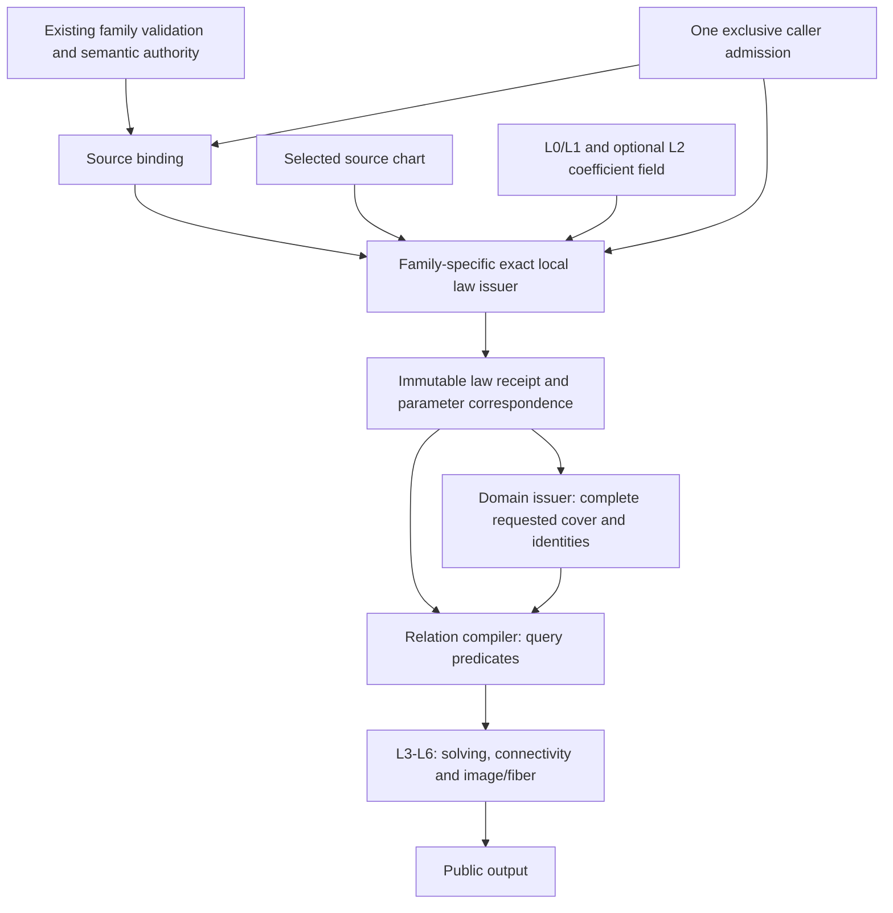

# Original Source Issuance

## Purpose and Scope

Parent: [CADGeometry](../DESIGN.md). Child:
[Original Physical Angle Coefficients](OriginalPhysicalAngle/DESIGN.md).
No new SwiftPM targets. This
component owns common source-issuance contracts inside CADGeometry. The binding
and exact Native selected-span/periodic local-law implementation is independently
verified through source-provider ports. Existing geometry adapters and other
family components retain their implementations until separately verified migration.

Issue a retained description of one authored source and a proved exact local
representation of that source. A law is valid on its stated support and carries
its original parameter correspondence. Issuance does not prove that any two
shapes intersect or that a requested domain has been completely covered.

The complete required family scope remains native splines, analytic lines/conics
and plane/cylinder/cone/sphere/torus, procedural offset/ruled/rolling-ball/
revolution/Coons/boundary-correction/derivative/draft/angular-transport, and
implicit/certified/lift/join/guide/rigid/affine/parameter-image/original-word
sources. A common contract does not establish support for every family.

## Responsibilities and Boundaries

| Owner | Produces | Consumes | Decision authority |
|---|---|---|---|
| Existing authored family | Original representation and semantic rules | Authored fields and retained construction certificates | What the original shape means |
| Source binding issuer | Immutable binding to the original snapshot and descendants | Existing family validation and certificates | Source provenance and retained authority |
| Local law issuer | Original law, guards, support, coefficient provenance and parameter transport | Bound source, selected source chart and caller field | Equality of the local representation to the authored law |
| Domain issuer, outside this component | Requested-domain cover, chart joins and seam/pole identities | Binding and local support/parameter contracts | Whole coverage and identification of distinct chart representatives |
| Relation compiler, outside this component | CS/SSI/projected/self equality and selection predicates | Issued laws and domain evidence | Variable placement and pair/query predicate semantics |
| L3/L4/L5/L6 and publisher, outside this component | Solutions, connections, images/fibers and numerical output | Complete compiled input | Solution completeness, topology and public results |

The issuer validates that a selected chart belongs to its retained source and
that the law is valid throughout its support. This local obligation is distinct
from enumerating every chart needed to cover a caller's request. Domain issuance
may retain these local laws, but source issuance never invokes domain coverage.
Neither side can replace the other's proof with sampled agreement.

Family semantics remain owned by their existing designs. This component owns
provenance, local-representation evidence and the inter-component handoff, not a
second definition of a sphere, plane, ruled surface or operation word.

## Related Designs

| Design | Relationship | Contract Used | Summary | Cautions |
|---|---|---|---|---|
| [Geometry](../DESIGN.md) | parent | Authored family semantics and source dispatch | Owns original meaning | Existing unresolved semantic conflicts cannot be hidden by issuance |
| [Source Validation](../OriginalGeometrySourceValidation/DESIGN.md) | coordinates with | Existing concrete validation policy through source-provider conformance | Providers retain family authority | Not an independent issuer build dependency; validation alone is not law equivalence |
| [L0](../RationalBivariateAlgebra/ExactScalar/DESIGN.md) | depends on | Exact import, ordering, arithmetic and exclusive admission | Coefficient and resource authority | Binary64 values and canonical primitive roles have distinct meanings |
| [L1](../RationalBivariateAlgebra/ExactPolynomial/DESIGN.md) | depends on | Exact polynomials and admitted operations | Rational/polynomial local representation | No new polynomial engine |
| [Physical Angle](OriginalPhysicalAngle/DESIGN.md) | child | Exact ordered physical-radian coefficients | Authored cone angles retain genuine sin/cos | Its scalar field is not rational or algebraic; consumers must select its capability explicitly |
| [L2](../RationalBivariateAlgebra/ExactRealRoot/DESIGN.md) | conditional dependency | Existing selected algebraic coefficient field and transport | Needed only by genuinely algebraic coefficients | No geometric root solve; no silent field extension |
| [Native Exact Relations](../NativeExactRelations/DESIGN.md) | coordinates with | Current Native preparation and coefficient transport | First consuming migration | Its resolver currently also clips domains and resolves relations |
| [Ruled Sources](../OriginalRuledIntersectionSources/DESIGN.md) | coordinates with | Original boundary laws and ruled composition | Existing exact source producer | Pair-equation adapters move to the relation owner when migrated |
| [Coons Sources](../OriginalCoonsIntersectionSources/DESIGN.md) | coordinates with | Original boundary maps, corners and shared position formula | Existing exact source producer | Retain current corner and construction authority |
| [Affine Sources](../OriginalAffineIntersectionSources/DESIGN.md) | coordinates with | Original word coefficients and homogeneous action | Existing exact source producer | Normalized words require their genuine coefficient field |
| [Analytic Sources](../OriginalAnalyticIntersectionSources/DESIGN.md) | coordinates with | Original implicit image equations | Separate representation capability | Image membership does not provide all source UV |
| [Curve Cover](../OriginalNativeCurveChartCover/DESIGN.md) | used by, after migration | Source binding and local law support | Owns requested curve coverage | Exact periodic transport remains a domain obligation |
| [Surface Cover](../OriginalNativeSurfaceChartCover/DESIGN.md) | used by, after migration | Source binding and local law support | Owns requested surface coverage | No tolerance-based chart identification |
| [L5](../RationalBivariateAlgebra/ExactParametricRelation/DESIGN.md) | used by, through compiler | Original homogeneous map laws | Owns pair relation composition | Issuance must not duplicate its CS/SSI equations |
| [Independent Verification](../../../Tests/OriginalSourceIssuanceVerification/DESIGN.md) | test owner | Source-provider and local-law contracts | Exact independent Native laws and failure/lifetime behavior | Does not verify existing geometry adapters or full domains |
| [Native Verification](../../../Tests/NativeExactRelationVerification/DESIGN.md) | subsequent integration test owner | Existing full-module Native/WASI behavior | Reuse unchanged input hashes | Independent issuer evidence does not establish migrated public behavior |

## Architecture



There are two foundational steps, not a new replacement algebra hierarchy:

1. Bind the original source and its authority without claiming any representation.
2. Issue an exact supported local law with its support and original parameter map.

Composite sources use the same two steps recursively for their original
descendants. Consumer-facing conversion to L5 is a checked representation handoff;
it does not create another source owner or run the solver.

## Contracts and Invariants

### Native Swift protocol boundaries

Binding, snapshotting, rational-chart and implicit-image operations are protocol
requirements with separate concrete implementations. Use associated types and generic static dispatch; production hot paths
do not erase coefficient fields or law types into `Any` or callback closures.

### Physical-radian cone image

`OriginalAnalyticConeSnapshotProvider` retains the actual cone, apex, original
binary frame from `analyticOrthonormalBasis`, and physical halfAngle. Its local
image capability explicitly requires `ExactPhysicalAngleCoefficients` for that
same angle. In local coordinates q the exact law is
`cos(a)^2*(qx^2+qy^2)-sin(a)^2*qz^2=0`, including the apex. The original
`AnalyticSurface3D.vDomain` is unbounded, so both nappes belong to the full image;
a one-sided branch guard would incorrectly remove original negative-v points.
This receipt supplies image membership and preserves no claim of full UV fibers.
Angle/cosine/sine positivity is checked exactly and the original frame determinant
is retained as a nonzero guard. A different angle owner is rejected.

### Native geometry providers

`OriginalBSplineCurveSnapshotProvider` and
`OriginalBSplineSurfaceSnapshotProvider` bind the actual CADGeometry value types.
They call the existing bounded family validator with a nonescaping callback to
the same admission. Validation failures are preserved; source depth is zero for
these primitive leaves. The immutable binding shares the original Swift COW
arrays. Reader conformances access controls directly, including V rows with U
columns for surfaces; no flattened control-net allocation is introduced.

These four adapter files are excluded from the primitive verification module.
Their isolated verification imports already-built geometry modules and compiles
only the adapters and proof. This is a distinct evidence scope: the existing
geometry validator is reused, not rebuilt, and no CS/SSI resolver is executed.
The original module identity, validator source hashes and link inputs must be
recorded before treating cached-module evidence as valid.

### Periodic local laws

`OriginalBSplineChartSelection` optionally carries one integer cycle per axis.
Omission means cycle zero. A nonperiodic axis rejects a nonzero cycle. On a
periodic axis the issuer proves that the authored binary64 wrapping period equals
the exact endpoint difference, every cyclic knot difference equals that period,
and the repeated controls and weights agree exactly. Approximate periodic
validation from a geometry provider does not replace these checks.

The basis variable is `authoredParameter - cycle * originalPeriod`. Support is
the exact translated knot interval, and the receipt's parameter transport stays
the identity in authored coordinates. All arithmetic uses the caller's field and
admission. The source issuer does not enumerate cycles, choose representatives,
or identify seam parameters. Domain owners retain those responsibilities and any
additional binary64 representability requirements of their own public domains.

| Protocol / status | Inputs | Successful output | Required guarantee |
|---|---|---|---|
| `OriginalSourceSnapshotting` (implemented) | Borrowed original input, provider-owned validation policy, source limits, same admission | `OriginalSourceSnapshot<Source>` | Validated immutable retained source and inherited source depth |
| `OriginalSourceBindingIssuing` (implemented) | Borrowed concrete source input, injected snapshot provider, source limits, same admission | `OriginalSourceBinding<Source>` | Original immutable snapshot, declared family authority, retained descendant owners and established source depth |
| `OriginalRationalChartIssuing` (implemented Native capability) | Binding, source-specific chart, caller exact coefficient field, same admission | `OriginalRationalChartReceipt<Source, Selection, Field>` | Exact X/Y/Z/W law, all guards, whole local support and original parameter transport |
| `OriginalImplicitImageIssuing` (implemented image capability) | Binding, source-specific support, caller exact coefficient field, same admission | `OriginalImplicitImageReceipt<Source, Selection, Field>` | Exact original image predicate including every required branch/denominator guard; explicitly no complete UV correspondence |

All receipts have read-only public contracts and issuer-controlled construction.
Binding identity and proof ownership are not externally constructible flags.
Protocol operations receive `borrowing` inputs and a generic
`inout A` where `A: ExactScalarAdmission & ~Copyable`; no admission is retained.
Source-limit policy is forwarded from the existing caller instead of defaulting
to a fresh allowance. The concrete chart type retains its own source binding.

The rational-port signature is compiled in the independent verification package.
`OriginalSourceIssuanceLimits` forwards independently remaining source depth;
provider-owned validation policy remains in the injected provider. L0 exclusively
owns arithmetic counters, value/coefficient depth and cancellation.

```swift
public protocol OriginalRationalChartIssuing: Sendable {
    associatedtype Source: Sendable
    associatedtype Selection: Sendable
    associatedtype Field: ExactScalarArithmetic & ExactScalarOrdering & ExactScalarImporting

    func issue<A: ExactScalarAdmission & ~Copyable>(
        source: borrowing OriginalSourceBinding<Source>,
        chart: borrowing OriginalSourceChart<Source, Selection>,
        field: borrowing Field,
        limits: OriginalSourceIssuanceLimits,
        using admission: inout A
    ) throws(OriginalSourceIssuanceFailure) -> OriginalRationalChartReceipt<Source, Selection, Field>
}
```

The concrete issuer validates chart-to-binding provenance; `Sendable` alone
does not prove that relationship. A stronger retained source certificate cannot
override the current caller's tighter depth or capability limit. The binding
port uses the same admission/limits contract, without requiring a coefficient
field or generating a law. The implicit-image port likewise uses a concrete
source/support type and returns only its image predicate capability.

The implicit capability is separate because existing sphere/cylinder/torus
pullbacks prove image membership without issuing a parameterized surface law.
They cannot satisfy the rational-chart protocol merely because they expose an
equation. A full public result still requires the separately proved all-UV map.
The issuer supplies the original guarded image predicate in XYZ. Substitution of
a participating curve or another surface into that predicate belongs to the
relation compiler; the issuer never acquires that second source.
Do not introduce a universal arbitrary-expression solver or symbolic scalar
type to declare every family supported.

The concrete primitive image issuer supports full sphere, cylinder and ring-torus
images. The reading port supplies the family-owned original binary affine frame,
center and separately authored radii. The issuer imports every scalar before
matrix inversion or radius products. Sphere uses its canonical identity image
frame; cylinder and torus retain the actual original chart frame, including its
nonorthogonality. The exact determinant must be nonzero. The cylinder equation is
the circle equation in the exact inverse frame; the torus equation is its raw
quartic, with `majorRadius > minorRadius > 0` proved in the caller's field. This
last condition excludes the extraneous squared branch for the supported ring
torus. Restricted angular subsets require another capability and are not supplied
by a full-image selection. No receipt from this port claims source UV fibers.

### Ruled composition

The common ruled issuer consumes two already-issued rational curve charts from
its parent's own retained boundary bindings. The parent chart selection stores
both complete child receipts; therefore original child owners, coefficient laws,
support, chart selections and parameter correspondence survive with the result.
No erased law, extra owner box, root solve or mutable receipt extension is needed.
The pure reading port has separate first/second source types, so a Native boundary
and a line (or any other certified rational boundary) may compose together.

| Owner | Input / retained state | Guarantee |
|---|---|---|
| Ruled snapshot provider | Actual ruled value, injected boundary snapshot providers | Child bindings come directly from actual start/end values; source depth is one plus maximum child depth |
| Ruled chart selection | Two complete child receipts | Retains original chart and coefficient proof owners without copying polynomial payloads |
| Ruled chart issuer | Parent binding, owned selection, same field/admission | Exact common-U law with original product W; no tolerance equality or cancellation |

Both child transports must equal the authored U coordinate, checked by exact
polynomial cross multiplication. U support is the exact intersection of the
original parent U domain and both selected child supports. V is [0,1]. The
formula is Hxyz=(1-v)*Axyz*WB+v*Bxyz*WA and W=WA*WB. Denominator guards remain in
W and both child receipts; no factor is deleted. Empty support fails invalidChart
rather than claiming an empty query result. Child source limits, scalar depths,
all remap/output buffers, entry/final cancellation and foreign binding failure
are checked on the same admission. This capability is generic over the declared
exact field and both boundary sources. Remaining family issuers and public
ruled CS/SSI migration remain separate unfinished obligations.

The finite linear chart issuer uses the exact original origin + direction*t
law and identity authored parameter transport. Its actual provider accepts the
existing raw and analytic line representations without normalizing directions.
A finite selected chart is not whole unbounded-domain coverage.

### Spatial operation-word composition

The spatial issuer consumes an owned child rational receipt in the caller-selected
exact field. Its source port exposes twelve already-exact coefficients and a
retained child binding. The parent chart selection retains the full child receipt.
The result has H'[row]=sum(M[row,column]*H[column]) and W'=W. Original child support,
all parameter transport and denominator guards remain unchanged. Checked imports
prove coefficient-field compatibility; incompatible owners fail explicitly. The
issuer has no root isolation, rounded transform, solver or domain-cover operation.

Actual curve/surface operation-word providers retain the existing authored image
and prepared word. Rational words import original rational coefficients into an
explicit rational context. Normalized words reuse the existing immutable normalized
frame context and exact field elements. The provider uses the existing L0 numeric
admission bridge for coefficient reads, preserves attained depths, and binds the
exact field by retaining an existing coefficient. It never constructs a second
selected root or uses coefficient enclosures as source values. Word validation
uses the provider-injected current caller tolerance; the original image's transformed
child tolerance never substitutes for the word's normalization policy. Child validation
remains an injected capability; source depth is one plus the retained child's
source depth. Both actual provider paths are independently compiled against the
validated geometry module; no upper target build is required by this boundary.

### Parameter images

Parameter-image issuance keeps the child's local variables, exact local support
and complete child receipt. It does not invert a child law or find another root.
For each parent authored parameter j, choose the original child axis k and publish
q_j=(childTransport_k-offset_j)/gain_j. Original nonzero signed gains and offsets
are imported exactly into the caller's field. Every child axis occurs once; the
actual swapped-surface convention maps parent U to child V and parent V to child U.
Nonunit transport denominators and all child source guards survive. A finite
local support is not a rounded parent-domain bound or whole-domain cover.

Actual gain variants use their existing exactCoefficient authority: binary,
ratio, retained product and directed difference. Canonical numerator/denominator
words are imported with exact field integer arithmetic; value/enclosure getters
never provide source coefficients. The provider retains the original wrapper and
its injected child binding. Source depth is one plus child depth. The rational
chart port computes parent correspondence under the same exclusive admission.
Surface wrappers additionally apply the original stored affine columns and
translation to child homogeneous coordinates. Curve wrappers share the child's
position laws. Coefficients, child-law imports, transport buffers and final
publication are admitted atomically; zero gain, foreign authority, invalid axis
mapping, tighter depth, budget exhaustion and cancellation fail explicitly.

### Coons composition and endpoint evidence

The Coons reader retains four independently typed boundary bindings. Each boundary
selection keeps its current rational chart and two sealed endpoint receipts, which
may use other charts of the same original binding. The endpoint issuer proves
closed local membership, nonzero position/transport denominators, the exact
original parameter and XYZ using L0/L1 evaluation. It retains the full original
chart and attained evaluation depths. No extrapolated corner or interval cache
is an exact coefficient authority.

The Coons issuer imports each boundary transport and proves by exact polynomial
division that it is a nonconstant affine function of the local coordinate. It
then substitutes its exact inverse into all original homogeneous laws and guard
polynomials. This is a coefficient transformation, not inverse geometry, fitting,
root selection or a whole-domain claim. Signed gains reverse support exactly.
Transport denominator factors remain in HXYZW even when their quotient is affine.
Non-affine transport is explicitly unsupported by this constructor; its full
family obligation remains open rather than being counted as complete.

| Owner | Consumes | Guarantees |
|---|---|---|
| Endpoint issuer | Owned curve chart, exact local and expected original parameter | Closed membership, guarded exact XYZ, complete source and evaluation-depth retention |
| Coons selection | Four position charts and eight endpoint receipts | Persistent boundary/corner proof ownership; no independent source substitution |
| Coons issuer | Parent and owned selection, same field/admission | Exact corner equality, normalized support intersection, uncancelled original Coons laws |

Corner pairs are bottom-start/left-start, bottom-end/right-start,
top-start/left-end and top-end/right-end. Every start/end receipt must prove
original parameter 0/1 and retain the parent's corresponding boundary owner.
Corners come from bottom/top endpoint XYZ only after all four exact pair checks.
For each spatial axis, the law is (1-v)B(u)+vT(u)+(1-u)L(v)+uR(v) minus
the four-corner bilinear interpolation. Original denominators are multiplied and
never deleted. Bottom/top support intersects normalized [0,1] on U; left/right
support does so on V. Closed singleton intersections remain valid; disjoint
charts fail invalidChart. Foreign bindings, invalid corner identity, zero guard,
non-affine transport, tighter source/scalar depths, exhaustion and final cancel
fail before publication under one caller admission. The receipt's optional proofDepth retains causal decision depths beyond coefficient
payloads. All derived ruled, spatial and parameter-image issuers admit and propagate
it. Endpoint receipts retain every decision depth, including endpoint membership and
corner comparisons. A private noncopyable forwarding admission borrows the existing
exclusive ledger only inside a synchronous scoped stack-pointer closure. It owns no
allocation, shared state or allowance; initialized/aligned A is never rebound,
deallocated or accessed concurrently, and its pointer never crosses the closure or
Sendable boundary. Native, WASM and Embedded use the identical declaration/access
path. Endpoint/coons success, limits/cancel and ASAN checks own this narrow unsafe
boundary. Existing Coons construction
and traversal authorities remain with their source providers; the generic
formula alone does not complete those providers or consuming migration.

### Directed traversal providers

A directed traversal retains its actual OriginalCurveRootSpan3D, original child
binding and exact start/end coefficients. Authored endpoints import their stored
binary64 bits. Algebraic endpoints bind their existing sealed root in one explicit
parent coefficient field using the additive L0 retained-root extension contract.
A Coons provider prepares all endpoint coefficients into one ancestor chain
before issuing child charts; prior values import through that chain. Original
endpoint coefficients stay paired with their actual directed source in the
prepared binding. Neither representative bounds nor interval corner caches are source
coefficients, and root isolation is never repeated by the provider.

Within one endpoint preparation, identical sealed rational root laws/selectors
reuse their already-imported coefficient. Equality requires original polynomial
equality, exact isolation endpoints, both open flags and isolation depth; every
comparison uses the same admission. The actual boundary owners remain distinct.
The lookup borrows prior traversal definitions and coefficient indices without
another registry allocation. Hashes, XYZ or estimated endpoints never decide
reuse. Different selectors take the retained-root port rather than guessed reuse.

The traversal chart issuer keeps child-local variables and all position/transport
guards. It proves affine child correspondence t=a*s+b and clips selected support
exactly to t in the closed interval between original start/end. Its directed
authored coordinate is q=(t-start)/(end-start), with signed direction preserved.
Zero extent, non-affine child transport, foreign owners, disjoint support and
resource/cancellation failures are explicit. This produces a local law only;
whole coverage/span connections remain with the domain issuer. Static injection
owns actual child-family validation and existing Coons construction/continuity
authority. No child law or coefficient is imported through a numeric estimate.

### Receipt content and evidence

| Retained value | Owner and invariant |
|---|---|
| Source snapshot | One immutable binding; original controls, weights, knots, frames, operation words and construction owners remain reachable |
| Source authority | Reference to the existing family rule; stored binary values and canonical symbolic roles are never conflated |
| Source chart and support | Concrete original chart selection plus the full support on which the representation is valid; bounds are exact values, not necessarily Double |
| Coefficient field | Same caller-selected field, original embeddings and inherited coefficient depths; unrelated fields fail |
| Law and guards | Original construction and denominator validity; no fitted source or unexplained cancellation |
| Parameter correspondence | Exact map from representation parameters to authored parameters; every auxiliary variable and its guard is retained |
| Equivalence evidence | Family-owned algebraic construction/rewrite evidence tying the representation to the retained source on the stated support |

A rational receipt denotes the exact graph of the original source on its support:
every admitted local parameter produces the original point, and the retained
correspondence accounts for all authored parameters represented by that chart.
No injectivity is assumed. If the transport is relational, every valid original
parameter must be retained; downstream code cannot select one inverse UV.
An implicit receipt instead denotes the guarded original image set. A necessary
equation with unexcluded extraneous branches does not satisfy that contract.

W is permitted to have zeros, but W!=0 remains an explicit source guard. A proved
positive denominator may strengthen that evidence; it never authorizes deleting
the original law. Representation singularities and genuine collapsed source
fibers must remain distinguishable. Removing a factor requires retained exact
rewrite and domain evidence; tolerance cannot provide that evidence.

Source binding identity establishes provenance only. Equal-valued independent
bindings are distinct owners unless an explicit structural equality proof is
issued. Different source charts, periods or UV values are not identified by XYZ,
hashes or close numerical evaluation. Cross-chart seam/pole equivalence belongs
to the domain issuer, including when different parameters map to one point.

### Applicability and unresolved authority

Dispatch owns capability selection before issuance. A known family outside a
specific issuer's capability may be routed to another declared issuer before
work starts. Once issuance starts, resource exhaustion, cancellation, invalid
binding or unresolved evidence aborts; no other issuer is silently retried.
Unsupported required representation remains an explicit incomplete family.

The legacy nil-U/direct analytic plane authority is recorded as unresolved in
PROGRESS I7R.SA.CP. This design neither selects stored-normal authority nor
evaluation-basis authority for that unresolved path. Only already-resolved family
semantics may authorize successful issuance. The common ownership and local-law
contracts are independent of that choice; affected plane migration remains gated.

## Runtime Flows

Same admission -> entry checkpoint -> original source validation/binding ->
source-chart ownership validation -> coefficient import and exact construction ->
support/transport/guard evidence -> retained receipt -> final checkpoint.

Source preparation does not receive a second shape, CS/SSI variable order,
projection query or requested intersection output. Later consumers borrow the
same prepared receipt. They create new coefficients only when an actual operation
or variable transformation changes the law, and do not replay source preparation.
Position-law issuance computes no normals, silhouette laws or geometric roots.
Optional derivative consumers derive needed evidence from the retained original
law under an explicit admission, retaining the correct parameter chain rule.

## State, Ownership, and Lifecycle

The binding retains immutable COW snapshots and existing coefficient/proof
owners. Law receipts retain that binding, their field and construction evidence.
A value copy preserves the same proof owner; releasing or mutating the caller's
source cannot change an issued receipt. Views retain their owner or remain within
a scoped borrow. Externally stored pointers and weak owners are not introduced.

Layer handoff shares original buffers; it does not materialize copies proportional
to their payload. Arithmetic outputs, changed variable maps and evidence indices
are necessary admitted storage. No global cache, new Mutex, actor or mutable
cross-query ledger is introduced. Independent queries use independent admissions.
Native, normal WASM and Embedded retain identical ownership and Sendable contracts.
These are design constraints, not new zero-copy benchmark results.

## Failure, Concurrency, and Constraints

Use typed `OriginalSourceIssuanceFailure` with distinct invalid source,
foreign binding/chart, incompatible coefficient field, unsupported representation,
unresolved source authority/equivalence, and preserved lower failure causes.
Exact cancellation, work/storage/depth/overflow and caller rejection remain
distinguishable through those causes. Every failure publishes no receipt; there
is no successful empty law meaning absence. A domain issuer may separately prove
that a caller selection is empty.

Reuse L0 work, generated-byte storage, coefficient/value depth and cancellation.
Retained source depth is an independent structural axis owned by the source caller;
each actual descent consumes it before the child. Source validation, term visits,
field transport, new payload allocations and final publication use the same
admission. Checked word/byte adapters retain current storage semantics. Reuse does
not recharge retained allocation, but capability/depth/cancellation checks and
new operations remain charged. Fixed limits and mathematical tolerances are not
changed by the handoff.

The independent rational implementation depends on the source-provider validation
contract, L0 and L1. Concrete geometry validation is supplied by later providers.
L2 is needed only when exact source coefficients require the existing algebraic
field. It does not depend on L3/L4/L5/L6, Kernel, Topology or public intersectors.
Coefficient-root evidence from L2 is distinct from solving a geometric relation.
Existing homogeneous extraction and exact construction arithmetic are reused
through their current checked admission bridges; this boundary does not require
reimplementing the legacy polynomial producers or moving them to a new target.

## Verification and Change Impact

### Current implementation mapping and target migration

| Current path | Confirmed behavior | Required target change |
|---|---|---|
| `RationalBivariateAlgebra/OriginalRationalCurvePolynomial.swift` | Original control/weight/knot law and retained span/translation | Bind existing law evidence behind the rational-chart port |
| `RationalBivariateAlgebra/OriginalRationalSurfaceHomogeneous.swift` | Homogeneous-only preparation, source/native-span validation | Reuse this position issuer; no differential preparation |
| `NativeExactRelations/DefaultNativeExactRelationResolver+Sources.swift` | Prepares laws, imports coefficients and clips selected finite domains | Common issuer prepares the law; this facade retains its checked L1 import and existing request clipping |
| `OriginalRuledIntersectionSources/OriginalRuledSurfacePolynomial.swift` | Original common-U composition and product W | Reuse exact formula and bound descendants; consume selected charts without scanning for a whole request |
| `OriginalRuledIntersectionSources/OriginalRuledRelationEquations.swift` | Pair equations and denominator predicates shared with Coons | Move consuming pair composition to the relation compiler, preserving raw laws and guards |
| `OriginalCoonsIntersectionSources/OriginalCoonsHomogeneousAtlas.swift` | Shared original position law and directed boundary correspondence | Retain construction/corner authority behind the same receipt contract |
| `OriginalAffineIntersectionSources/OriginalAffineSurfaceIntersectionSource.swift` | Original rational word action, but prepares the differential Native polynomial | Consume the homogeneous-only descendant; preserve original word and UV |
| `OriginalAnalyticIntersectionSources/OriginalAnalyticCurvePullback.swift` | Implicit image pullback; no complete analytic UV | Keep image capability separate; gate unresolved semantic paths |

Existing family DESIGN.md files own current behavior. This document owns the
target common handoff; family contracts are changed together with their actual
migration, not relabeled as migrated by adding this document. Existing relation
facades may delegate after migration but may not retain duplicated algorithms.
Existing public CS/SSI API/result/Codable changes are not part of the independent
issuer task.

### Behavioral acceptance and migration obligations

| Invariant | Required positive and negative evidence | Verification owner |
|---|---|---|
| Authored coefficient meaning | Independent exact coefficients/construction identity; reject rounded transform, radius/weight products and foreign field imports | Corresponding family issuer tests in CADGeometryTests |
| Local law equivalence | Exact whole-law formula/identity and guards; reject invalid corners, unsupported source/word and unproved branch removal | Existing ruled/Coons/affine/analytic test owners |
| Source/parameter binding | Reversed/nonunit/weighted charts, retained original parameters; reject foreign chart and changed source | NativeExactRelationVerification and family issuer tests |
| Lifetime and ownership | Release/mutate original input and retain exact laws; reject independent foreign owner | Family issuer tests and Native portability smoke |
| Atomic same-ledger failure | Independently exhausted work/bytes/source/coefficient depths, overflow, entry/final cancellation; no receipt or retry | Issuer protocol and concrete-family verification |
| Representation capability | Implicit image cannot masquerade as a UV map; unsupported required families remain visibly incomplete | Protocol consumers and analytic issuer tests |
| Consumer composition | Existing exact L5 equations and original public correspondence/empty/failure unchanged on migrated inputs | NativeExactRelationVerification on all fixed target lanes |

Existing source tests inspect actual formulas, unsupported inputs, lifetime and
resource boundaries: OriginalRuledIntersectionSourceTests,
OriginalCoonsIntersectionSourceTests and OriginalAffineIntersectionSourceTests
in Tests/CADGeometryTests. Their prior success is evidence for those existing
paths only. Independent protocol behavior is recorded in the issuer verification
package; it does not verify their migration. The current integrated
[review-fix evidence](../../../Tests/NativeExactRelationVerification/PublicReviewFixEvidence/VERIFICATION.md)
remains valid for unchanged compiled sources.

Implement foundational binding and rational-chart handoff first, then migrate
Native, ruled, Coons and affine through this same contract. Extend genuine
analytic/procedural/composite representations without weakening the contract.
Domain coverage and whole-seven acceptance remain independent completion gates.
A lower change that breaks source authority, field import, guard meaning or
parameter transport requires rechecking every direct consuming family/compiler;
unchanged lower evidence is reused by source hash.


## Independent Implementation Boundary

The verification package at Tests/OriginalSourceIssuanceVerification owns an
independent SwiftPM graph: validated linked L0 and L1 production sources, the
issuer directory, independent fixtures and one proof executable. It must build
its contract target and inspect actual compiler inputs before adding the issuer
implementation. CADCore, CADGeometry as a whole, L3-L6, domain cover, relation
compilers and public intersectors are outside that graph. No external dependency
is added. The additive retained-root constructor is owned and verified at L0;
all pre-existing lower inputs remain unchanged. Actual traversal/Coons adapters
are additionally compiled as source-only overlays against immutable validated
geometry modules; this does not build the complete geometry target or a solver.
Optional L2 coefficient tests may add only the existing L2 sources.

Existing geometry source types and validation implementations are supplied by
static source-provider protocols. OriginalSourceSnapshotting creates an immutable
validated snapshot with its inherited source depth. OriginalBSplineSourceReading
provides constant-time original knot/weight/control reads from that snapshot.
Providers own validation of their concrete raw source and snapshot isolation;
the issuer owns exact local law construction. Neither protocol references a
solver, domain-cover implementation or Curve3D/Surface3D enum. Source-provider
conformance for those existing geometry values is a later integration obligation.

DefaultOriginalSourceBindingIssuer publishes the retained snapshot atomically.
Binding-owned chart selections are provenance-bearing candidates, not proofs of
coverage or valid chart membership. DefaultOriginalBSplineChartIssuer validates
one selected nonperiodic positive span per axis, consumes those candidates and
constructs the exact original homogeneous law in the caller's L1 ring. It does
not restrict the original source to one total span. The unchanged Cox-de Boor
recurrence is expressed through existing L0/L1 operations so no legacy Geometry
arithmetic target is required. It introduces no root engine; the old producer
remains in place until its separately verified consuming adapter is migrated.

The initial Native representation uses one/two original native parameters,
finite closed span support and identity parameter transport. It retains all raw
source knots, positive weights and controls, with W!=0 explicit. Native periodic
transports are now issued under the exact checks in the Periodic local laws
section. Remaining family constructors are not considered whole-family completion. Future
issuers use the same source-binding and rational-chart contracts rather than
changing the meaning of this finite Native receipt.

The common protocol design is now concretized by OriginalSourceSnapshotting,
OriginalSourceBindingIssuing and OriginalRationalChartIssuing. The independent
failure type preserves scalar/polynomial failures and source-provider rejection.
L0 retains byte/work/coefficient/value accounting. Source depth is checked
independently on binding, chart selection and issuance, including receipt reuse.
No tolerance is an input to Native coefficient equality; a provider retains its
own existing validation policy. The limits value contains remaining source depth
only and creates no new allowance or algorithm ceiling.

### Native provider assumptions and exact-law proof

The Native reader requires validated, immutable one-/two-axis B-spline data:
positive degree, control count greater than degree, finite nondecreasing knots,
count+degree+1 knots, nonempty native interval, finite XYZ controls, positive
finite weights and checked tensor layout. Interior knot multiplicity is at most
degree; this positional continuity makes both endpoints of a selected positive
span valid for its closed local law. Periodic sources additionally require the exact original transport checks in
the Periodic local laws section. A provider must establish these
assumptions before returning its snapshot; `Sendable` is not that proof.

For selected span k, seed N[k,0]=1 and other basis values=0 on its interior.
Cox-de Boor recurrence constructs the exact degree-p polynomial for each active
control. Every knot and weight/control component is imported individually from
original binary64 bits before subtraction, division or multiplication. Nonnegative
basis functions sum to one; positive source weights give W>0 throughout the
closed span by continuity. Tensor products preserve this property on both axes.
The four issued polynomials are sums of N_i*w_i*(x_i,y_i,z_i,1); no differential,
root, clipping, fit, normalization or sampled identity is used. Native parameters
are unchanged and their explicit transport denominators are one.

`OriginalBSplineChartSelection` is a caller-owned array of candidate span indices.
The binding charges its newly generated chart payload, shares the retained
selection and source, and the Native issuer validates each span before indexing.
Receipt construction is module-internal. Public reads retain the immutable owner.
Independent tests compare the complete coefficient laws and distinguish separate
owners even when their values agree. Source-limit refusal is independent of L0
value/coefficient depth refusal; both are forwarded without resetting admission.
