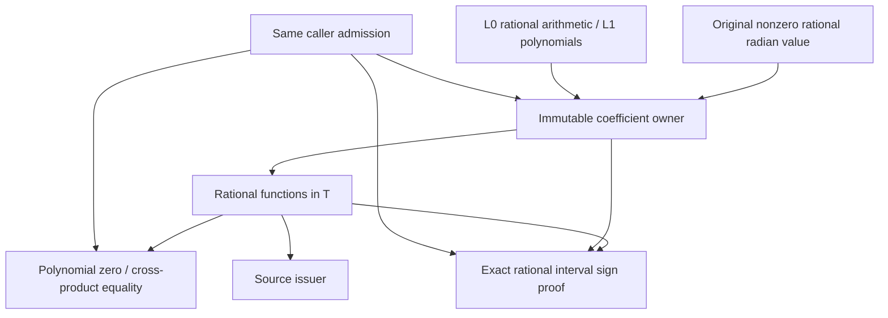

# Original Physical Angle Coefficients

## Purpose and Scope

Parent: [Original Source Issuance](../DESIGN.md). No children or new module.
This component provides an ordered exact coefficient field for one nonzero,
finite authored binary64 angle, interpreted as its exact rational radian value.
Its only dependencies are the unchanged [L0 scalar contracts](../../RationalBivariateAlgebra/ExactScalar/DESIGN.md)
and [L1 polynomial operations](../../RationalBivariateAlgebra/ExactPolynomial/DESIGN.md).
It does not solve geometric relations or identify source parameters.

## Responsibilities and Boundaries

The coefficient owner retains the original angle, the rational polynomial basis,
and exact range reduction. Values retain this owner and rational functions in
T = tan(angle / 2). The domain owns arithmetic, exact equality, and certified
ordering. A source issuer selects the angle and consumes sin/cos coefficients;
it cannot replace them with rounded library results. Independently created owners
are incompatible; no implicit coefficient-field extension is attempted.

## Related Designs

| Design | Relationship | Contract Used | Summary | Cautions |
|---|---|---|---|---|
| [Issuer](../DESIGN.md) | parent / used by | Immutable original coefficient ownership | Physical-angle families consume this field | No UV or complete geometric coverage claim |
| [L0](../../RationalBivariateAlgebra/ExactScalar/DESIGN.md) | depends on | Arithmetic, ordering, importing, same exclusive admission | Exact rational primitives and resource authority | Preserve failure and independent depth axes |
| [L1](../../RationalBivariateAlgebra/ExactPolynomial/DESIGN.md) | depends on | Univariate rational polynomials | Numerator/denominator arithmetic | No second polynomial engine |
| [Verification](../../../../Tests/OriginalSourceIssuanceVerification/DESIGN.md) | test owner | Scalar behavior through public requirements | Independent exact identities, ordering and failures | No upper geometry build |

## Architecture

## Contracts and Invariants

For a nonzero algebraic angle a, e^(ia) is transcendental by the
[Lindemann-Weierstrass theorem](https://arxiv.org/abs/2306.14352).
Consequently T is transcendental: algebraic T would make
(1+iT)/(1-iT) = e^(ia) algebraic. This deduction makes every nonzero rational
polynomial in T nonzero. Thus zero and equality use polynomial identities,
not numerical separation. A denominator is admitted only if its polynomial is
nonzero. The identities sin(a)=2T/(1+T^2) and cos(a)=(1-T^2)/(1+T^2)
preserve the physical radian interpretation exactly. Zero angles are outside
this field's constructor domain; a source with zero angle uses rational constants.

Ordering uses exact rational enclosures. Halve |a|/2 exactly until the reduced
argument is below 1, bound sin/cos by alternating Taylor sums and their next
terms, and undo halving by interval angle doubling. Division by the enclosed
cosine occurs only after its interval excludes zero. Exact dyadic neighbours enclose the returned tangent bounds with four additional
bits per coefficient-refinement step. Horner polynomial evaluation then isolates numerator and denominator signs. Refinement terminates
mathematically for every nonzero rational function, subject to the caller's
work, storage, coefficient-depth and cancellation limits. No rounded pi, libm
trigonometry, heuristic zero, or successful indeterminate sign is used.

Scalar construction cancels the polynomial GCD and makes the denominator monic
using the existing L1 exact operations. It first rejects an identically zero
denominator, then preserves the exact rational function and its original angle
owner. This does not remove any source/domain guard. The concrete acceptance
counterexample is sphere-cone's (s+4c)^2-8 coefficient: uncancelled denominator
powers exhaust the unchanged caller allowance before real-root intake. The source
field owns normalization; lower root/cell solvers remain unchanged. Verification
compares exact original identities, the stopped coefficient/root intake, resource
boundaries and the affected physical-angle/coaxial public paths.

## Runtime Flows

Import angle -> exact rational reduction -> immutable owner -> admitted
numerator/denominator arithmetic -> exact zero or interval refinement -> final
checkpoint. Each operation receives the same generic, noncopyable admission.
No operation resets a budget, retains the admission, or retries another solver.

## State, Ownership, and Lifecycle

The owner is an immutable Sendable class; rational and polynomial arrays retain
their existing COW ownership. Values retain the owner after the domain leaves
scope. Sign refinement is invocation-local and mutable only within its exclusive
admission. There is no global cache or shared mutable state on any platform.
New rational/poly payloads, owner headers and refinement workspace are admitted;
passing retained values does not duplicate or recharge existing payloads.

## Failure, Concurrency, and Constraints

Preserve ExactScalarFailure, including divisionByZero, incompatibleDomain,
invalidSource, resource/depth exhaustion, cancellation and caller rejection.
Polynomial failures retain their cause. Final cancellation prevents publication.
Refinement visits the coefficient axis independently of the value axis. Checked
integer arithmetic protects all iteration/depth/storage counts.

## Verification and Change Impact

### Checked source rational enclosures

The source-owned `OriginalPhysicalAngleRationalBounds` validates closed endpoint
order using the caller admission. `enclosing` evaluates a retained physical-angle
coefficient over a fixed requested refinement of its original tangent generator;
an unresolved denominator returns explicit invalid evidence. It does not change
the exact coefficient or its owner.

`OriginalPhysicalAngleRationalEnclosures.normalizedLabelSineCosine` bounds the
entire rational label interval under theta = 2*pi*U/B. B is the caller's exact
positive label period, including the exact binary64 value 2*Double.pi when that
is the authored label law; B never replaces physical pi. Machin bounds enclose
pi. Alternating Taylor sums at the rational phase midpoint, exact halving and
angle doubling enclose its sine/cosine. Widening each result by the complete
phase interval's radius is justified by the unit Lipschitz bound for sine and
cosine. This is interval coverage, with no sampling or angle inversion.

`positiveSquareRoot` separately bisects each rational endpoint, maintaining
lower^2 <= input <= upper^2; its input lower endpoint must be strictly positive.
Its initial upper bracket starts at integer one and doubles until its square
encloses the input upper endpoint. Every doubling consumes the same admission's
work and checkpoint. Integer brackets keep source-radicand fractional bits out
of the dyadic bisection grid without weakening its squared inclusion proof.
Requested refinement depth controls the admitted iteration count, without
claiming that overlapping bounds establish zero, equality, or absence.

| Boundary | Guarantee | Failure |
|---|---|---|
| Physical coefficient | Original retained value lies within bounds | Owner mismatch, unresolved denominator |
| Normalized label interval | All authored labels' sine/cosine lie within bounds | Reversed interval, nonpositive B |
| Positive radical | All positive roots of enclosed inputs lie within bounds | Nonpositive input lower bound |
| Every operation | Same work/storage/depth/cancellation admission | Propagated typed failure; no approximate fallback |

Independent rational-inequality fixtures own midpoint/interval coverage, physical
angle enclosure, radical bracketing, invalid inputs and admission refusal. The
bounded source issuer separately owns the complete geometric cover and output
source correspondence; these bounds alone do not certify a geometric result.

Independent tests must prove sin^2+cos^2=1, nonzero transcendental expressions,
quotient equality, sign on both sides of a rational separator, negative angles,
angle doubling, original-input lifetime, foreign-owner rejection, zero divisor,
work/storage/depth refusal and entry/final cancellation. Native, ASAN, normal
WASM and Embedded execute identical source/ownership contracts. The cone issuer
must separately prove its source law and branch predicates before completion.

### Width-matched rational enclosure precision

Before tangent division and again before polynomial evaluation, outward dyadic
rounding uses each certified enclosure's rational width. This keeps factorial-sized
Taylor denominators out of interval division without changing source coefficients. For positive width N/D,
let n and d be the canonical numerator/denominator UInt32 word counts. The
precision32*(max(d-n,0)+1) makes the dyadic step strictly smaller than that
width. Counts and multiplication are overflow checked. Thus rounding never
forces additional Taylor terms merely because an unrelated order*4 grid is
coarser than the existing proof. The exact interval remains enclosed, unresolved
signs continue refinement, and work/storage/causal coefficient depth/cancel
contracts are unchanged. Zero-width enclosures use the exact interval directly.
The concrete regression is the nonzero coefficient cos(alpha)-2*sin(alpha) for
alpha=the stored atan(1/2); it must not become zero, pole or proximity identity.

Interval multiplication selects extremal endpoint products from exact endpoint
signs. For two intervals spanning zero it compares the two possible minima and
two possible maxima; all other sign combinations require two products without
rational cross-corner comparisons. Closed zero endpoints remain included.
The concrete regression is the generalized bounded section's repeated nested
critical comparison exhausting work inside four-corner rational comparison.
An independent integer four-corner oracle covers every sign pair and zero
singletons; public new/legacy bounded sections remain the acceptance gate.
