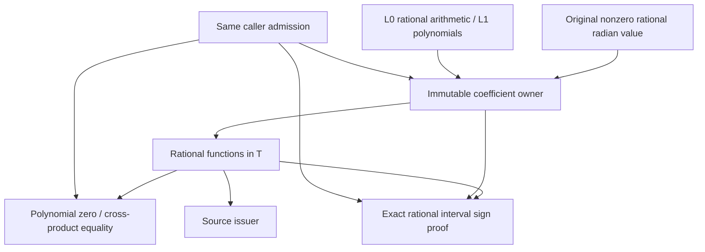

# Original Physical Angle Coefficients

## Purpose and Scope

Parent: [Original Source Issuance](../DESIGN.md). No children or new module.
This component provides an ordered exact coefficient field for one nonzero,
finite authored binary64 angle, interpreted as its exact rational radian value.
Its only dependencies are the unchanged [L0 scalar contracts](../../RationalBivariateAlgebra/ExactScalar/DESIGN.md)
and [L1 polynomial operations](../../RationalBivariateAlgebra/ExactPolynomial/DESIGN.md).
It does not solve geometric relations or identify source parameters.

## Responsibilities and Boundaries

The coefficient owner retains the original angle, the rational polynomial basis,
and exact range reduction. Values retain this owner and rational functions in
T = tan(angle / 2). The domain owns arithmetic, exact equality, and certified
ordering. A source issuer selects the angle and consumes sin/cos coefficients;
it cannot replace them with rounded library results. Independently created owners
are incompatible; no implicit coefficient-field extension is attempted.

## Related Designs

| Design | Relationship | Contract Used | Summary | Cautions |
|---|---|---|---|---|
| [Issuer](../DESIGN.md) | parent / used by | Immutable original coefficient ownership | Physical-angle families consume this field | No UV or complete geometric coverage claim |
| [L0](../../RationalBivariateAlgebra/ExactScalar/DESIGN.md) | depends on | Arithmetic, ordering, importing, same exclusive admission | Exact rational primitives and resource authority | Preserve failure and independent depth axes |
| [L1](../../RationalBivariateAlgebra/ExactPolynomial/DESIGN.md) | depends on | Univariate rational polynomials | Numerator/denominator arithmetic | No second polynomial engine |
| [Verification](../../../../Tests/OriginalSourceIssuanceVerification/DESIGN.md) | test owner | Scalar behavior through public requirements | Independent exact identities, ordering and failures | No upper geometry build |

## Architecture

## Contracts and Invariants

For a nonzero algebraic angle a, e^(ia) is transcendental by the
[Lindemann-Weierstrass theorem](https://arxiv.org/abs/2306.14352).
Consequently T is transcendental: algebraic T would make
(1+iT)/(1-iT) = e^(ia) algebraic. This deduction makes every nonzero rational
polynomial in T nonzero. Thus zero and equality use polynomial identities,
not numerical separation. A denominator is admitted only if its polynomial is
nonzero. The identities sin(a)=2T/(1+T^2) and cos(a)=(1-T^2)/(1+T^2)
preserve the physical radian interpretation exactly. Zero angles are outside
this field's constructor domain; a source with zero angle uses rational constants.

Ordering uses exact rational enclosures. Halve |a|/2 exactly until the reduced
argument is below 1, bound sin/cos by alternating Taylor sums and their next
terms, and undo halving by interval angle doubling. Division by the enclosed
cosine occurs only after its interval excludes zero. Interval polynomial
evaluation then isolates numerator and denominator signs. Refinement terminates
mathematically for every nonzero rational function, subject to the caller's
work, storage, coefficient-depth and cancellation limits. No rounded pi, libm
trigonometry, heuristic zero, or successful indeterminate sign is used.

## Runtime Flows

Import angle -> exact rational reduction -> immutable owner -> admitted
numerator/denominator arithmetic -> exact zero or interval refinement -> final
checkpoint. Each operation receives the same generic, noncopyable admission.
No operation resets a budget, retains the admission, or retries another solver.

## State, Ownership, and Lifecycle

The owner is an immutable Sendable class; rational and polynomial arrays retain
their existing COW ownership. Values retain the owner after the domain leaves
scope. Sign refinement is invocation-local and mutable only within its exclusive
admission. There is no global cache or shared mutable state on any platform.
New rational/poly payloads, owner headers and refinement workspace are admitted;
passing retained values does not duplicate or recharge existing payloads.

## Failure, Concurrency, and Constraints

Preserve ExactScalarFailure, including divisionByZero, incompatibleDomain,
invalidSource, resource/depth exhaustion, cancellation and caller rejection.
Polynomial failures retain their cause. Final cancellation prevents publication.
Refinement visits the coefficient axis independently of the value axis. Checked
integer arithmetic protects all iteration/depth/storage counts.

## Verification and Change Impact

Independent tests must prove sin^2+cos^2=1, nonzero transcendental expressions,
quotient equality, sign on both sides of a rational separator, negative angles,
angle doubling, original-input lifetime, foreign-owner rejection, zero divisor,
work/storage/depth refusal and entry/final cancellation. Native, ASAN, normal
WASM and Embedded execute identical source/ownership contracts. The cone issuer
must separately prove its source law and branch predicates before completion.
