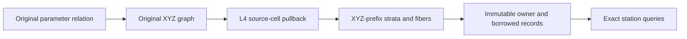

# Exact Geometric Relation (L6)

## Purpose and Scope
Parent: [RationalBivariateAlgebra](../DESIGN.md). Interpret original L5 rational CS/SSI
parameter relations geometrically. The initial acceptance scope is finite closed,
nonperiodic single-map Native-compatible laws, including isolated/positive/mixed,
folded and collapsed images. No new production module, source extraction, periodic
identity, smooth branch continuation or numerical representative publication.

## Responsibilities and Boundaries
L5 retains source maps and parameter topology. L6 constructs exact rational XYZ graphs
and image/fiber strata, preserves every source cell and connected component, and exposes
complete exact station fibers. Geometry owns authored source extraction and KernelError
publication. Equal XYZ does not erase distinct parameter tuples.

## Related Designs
| Design | Relationship | Contract Used | Summary | Cautions |
|---|---|---|---|---|
| [Parent](../DESIGN.md) | parent | Child index | Existing production module | No new package |
| [L5](../ExactParametricRelation/DESIGN.md) | depends on | Complete source relation | Original maps/guards/domains/topology | Parameter topology is not image topology |
| [L3](../ExactRealCell/DESIGN.md) | depends on | Definitions, decomposition and exact membership | Complete graph proof | Never copy root ordinals across partitions |
| [L4](../ExactRealTopology/DESIGN.md) | depends on | Quantified cell pullback and components | Full-cell correspondence | Witness dimensions are not geometric fibers |
| [Verification](../../../../Tests/L6GeometricRelationVerification/DESIGN.md) | test owner | Isolated actual implementation paths | Success/failure/lifetime/resources | Upper Geometry publication remains separate |

## Architecture

## Contracts and Invariants
Input uses L5 public owners and original homogeneous laws. XYZ equality is
X*W-Hx=Y*W-Hy=Z*W-Hz=0 under retained nonzero W guards. Graph variable order is
XYZ then original parameters. Each included free graph cell maps to exactly one
original selected cell. XYZ-prefix dimension proves image dimension; free graph
cell dimension minus prefix dimension proves fiber dimension. Quantified root
witnesses are excluded from both. Original L5 incidence owns parameter connectivity;
no extra graph closure or sample/rank-based connectivity is inferred.

CS maximal t coverage uses exact source prefix order and boundary inclusion, retaining
component associations. Exact queries retain all UV/t solutions, not a single inverse.
Foreign owners/fields fail. Empty success retains complete exclusion evidence.

## Runtime Flows
One caller admission: validate -> original graph -> exact pullback -> strata ->
retained result -> final cancellation. Later station queries receive an explicit
independent query ledger and inherit retained source and coefficient depths.

## State, Ownership, and Lifecycle
Result is a Copyable value retaining immutable Sendable storage. Builder buffers are
invocation-local. Source buffers are shared; graph laws and flat index/record buffers
are necessary admitted materialization. Scoped Span borrows expose records without
rebuilding arrays. No shared mutable cache, unsafe pointer, actor or no-op lock.

## Failure, Concurrency, and Constraints
Typed errors retain lower causes. Work/storage/depth and cell/stratum/component limits
remain independent. No failed-solver retry, partial publication or unproved empty result.
No platform-specific weakening of ownership or synchronization.

## Verification and Change Impact

### Finite isolated parameter relations

If every cell in the complete selected SSI relation has parameter dimension zero,
the original nonzero-denominator maps take each cell to one point. Both the image
and each original-parameter fiber therefore have dimension zero without constructing
a second XYZ graph partition. The resolver retains the entire original L5 selection
and issues one zero-dimensional stratum per original cell with evidence kind
`isolatedParameters`. This does not merge equal images, establish image connectivity
or remove any UV tuple. Explicit station queries continue to use the retained
original maps and source predicate. All cell visits and output storage are admitted.
The weighted quadratic Native SSI isolated-point fixture verifies this branch; any
positive-dimensional selected cell keeps the existing image/fiber proof path.
L6 isolated tests/proof execute actual public protocols on fixed L0-L5 production
sources. Native/ASAN and matching normal/Embedded WASM use identical source snapshots.
Review owner retention, root transport, image/fiber dimensions, endpoint selection,
complete station fibers and terminal cancellation. KernelError and legacy rich/discrete
adapters require a separate upper public-path verification; isolated evidence does not
complete that gate or any whole seven requirement.

Compatibility: macOS14/iOS17 remain the existing deployment floor. Borrowed Array
for small coordinate maps and owner-backed views are baseline APIs. Span-based
record borrows are additive availability-gated APIs on platforms providing them;
Array.span availability never raises the package deployment floor.

Certified shortcuts consume original map laws before choosing an algorithm:
* If either source map is constant, the common XYZ image is that constant.
* Two affine injections give a globally injective tuple-to-XYZ map.
* Two maps with a nonconstant polynomial coordinate for each independent parameter
  (constant W) have finite fibers: each fixed coordinate gives a nonzero univariate
  equation. Restricted source-cell image dimension equals its parameter dimension,
  even at folds; finite fibers are not unique fibers. Retain derivative witnesses.
* If the first SSI map is a nonconstant rational curve in its first parameter and
  independent of its second parameter, its image on each source cell has the
  first CAD-prefix dimension. Remaining parameter dimensions are fiber dimensions.
  Retain exact zero/nonzero homogeneous derivative numerators.
These proofs keep all original parameter cells and complete station queries.
No rank at a representative point grants any shortcut. General maps still use
the full XYZ-prefix graph. Every original selected cell must occur in its pullback.

Station authority: XYZ applies to CS and SSI; curveParameter applies to CS.
firstSurfaceUV requires a surface as the first source (SSI); secondSurfaceUV
applies to the surface second source in both CS and SSI. Offsets derive from
retained source arity, never a fixed SSI coordinate assumption.
