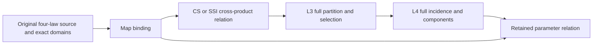

# Exact Parametric Relation

## Purpose and Scope

Parent: [RationalBivariateAlgebra](../DESIGN.md). This component composes the verified
L0-L4 contracts into a complete parameter relation for two authored homogeneous
polynomial maps. It accepts one-parameter/ two-parameter CS or two-parameter/
two-parameter SSI; coordinates are ordered first-map parameters then second-map
parameters. Each map retains its four original X,Y,Z,W laws and exact domains.
This bounded milestone does not issue native B-spline extraction, seam identity,
XYZ image/fiber dimensions, smooth branch continuation or geometry publication.
There are no children or new production modules/packages.

## Responsibilities and Boundaries

The map issuer validates a source-bound four-law input. The relation compiler
constructs all three cross-multiplied equalities and both nonzero W guards in one
ring without root solving, coefficient rounding or point merging. A full original
nonconstant W may divide an equation only with a retained exact zero-remainder
division witness and its unchanged nonzero guard. Raw equations remain retained.
L3 owns complete decomposition and exact parameter identity; L4 owns complete
closure/incidence/components. The result retains both map sources, the compiled
predicate, complete selection and all topology receipts. Upper consumers own
geometric interpretation and publication. This component does not depend on
Curve3D, Surface3D or legacy IntersectionAlgebra internals.

## Related Designs

| Design | Relationship | Contract Used | Summary | Cautions |
|---|---|---|---|---|
| [Parent](../DESIGN.md) | parent | Child index | Existing component boundary | No new production target |
| [L0](../ExactScalar/DESIGN.md) | depends on | Arithmetic/order/import, exclusive admission | Same cumulative resources | Never reset or refund |
| [L1](../ExactPolynomial/DESIGN.md) | depends on | Public terms, construction, arithmetic | Exact slot remapping | Import every original coefficient |
| [L2](../ExactRealRoot/DESIGN.md) | depends on | Retained coefficient field and exact intervals | Original family and extension ceiling | No silent field adjoining |
| [L3](../ExactRealCell/DESIGN.md) | depends on | Bind, decompose, select, locate, coefficientField | Whole original parameter product | No private owner access |
| [L4](../ExactRealTopology/DESIGN.md) | depends on | Incidence and components protocols | Complete selected topology | Parameter topology is not image topology |
| [Verification](../../../../Tests/L5ParametricRelationVerification/DESIGN.md) | test owner | Actual independent composition | Native/ASAN and both WASI | No upper CAD build evidence |

## Architecture

## Contracts and Invariants

- Public operations are requirements of construction and resolution protocols;
  the concrete domain receives the Cells type and topology implementation.
- A map has exactly four original homogeneous laws, in one or two parameters.
  W may vanish; those tuples are explicitly excluded, never cancelled away.
- CS requires (1,2) parameters; SSI requires (2,2). The maps' independent local
  slots are embedded into disjoint ranges. Every original term and coefficient,
  including each zero map's field identity, is validated in the first field.
  Compatible ancestor coefficients may be imported; unrelated families fail.
- For k in X,Y,Z, equality is H1[k]*W2-H2[k]*W1 == 0, AND W1 != 0 AND W2 != 0.
  Under those guards this is exactly equality of both rational maps. No partial
  equation subset or sample residual proves equality. The compiler may remove a
  full nonconstant W factor once per original guard from each equation. Every
  quotient is backed by its exact division identity and unchanged nonzero guard;
  only its zero set is used, never its sign. Failed division applicability retains
  the original equation; division failure aborts, with no retry after exhaustion.
- Domains are the complete Cartesian product of original selections, preserving
  open/closed/singleton/empty and unbounded endpoints. Empty results retain their
  complete partition, predicate and exclusion evidence.
- Every selected parameter tuple and UV branch remains represented. Equal XYZ
  or adjacent representatives never merge distinct tuples. Result dimensions
  are explicitly parameter dimensions; collapsed map fibers remain present.
- Failure in binding, compilation, decomposition, closure, components or final
  checkpoint publishes no relation. No fallback or partial/empty success.

## Runtime Flows

Bind original maps -> compile relation -> L3 full decomposition -> selection ->
L4 complete incidence -> complete components -> retain result -> terminal cancel.
A later exact tuple membership query uses a new explicit admission, retains the
original relation, locates the exact tuple in the full partition and compares
issued cell identity against the complete selection. Foreign fields fail.

## State, Ownership, and Lifecycle

All published values are immutable Swift values retaining L3/L4 owners. Only
invocation-local Array buffers mutate. Borrowed inputs are retained by results;
no provider callbacks, unsafe pointers, cache or shared mutable state are added.
The same Sendable and ownership contracts apply on every target. Remapping must
materialize new power vectors for the expanded ring; source law buffers are shared.

## Failure, Concurrency, and Constraints

ExactParametricRelationFailure distinguishes invalid map/kind and overflow, and
retains scalar, polynomial, cell and topology failure causes. Original limits are
supplied explicitly. One exclusive caller admission flows through every phase;
checked typed payload sizes precede allocations, every source/term/slot/member
visit is charged, source depths are inherited, and final cancellation follows the
last allocation. L3 stored-cell and L4 generated/closure/piece/component limits
retain separate meanings; this layer introduces no hidden default or new cap.
Concurrent immutable readers use independent query admissions.

## Verification and Change Impact

The isolated verification package compiles production L0-L5 only, pinned Swift
6.4.0 and matching ordinary/Embedded WASM SDKs. Unchanged lower evidence is reused.
Required behavior: weighted CS isolated and repeated roots, endpoints, multiple UV
at one XYZ, guarded denominator exclusion, complete empty and continuous results,
folded SSI topology, released-input lifetime, invalid map/kind/field, exact resource
boundaries and cancellation including terminal publication. One stable review and
finding-specific correction suffice. No whole seven-requirement completion is
claimed; upper producer extraction and geometric publication remain separate.
