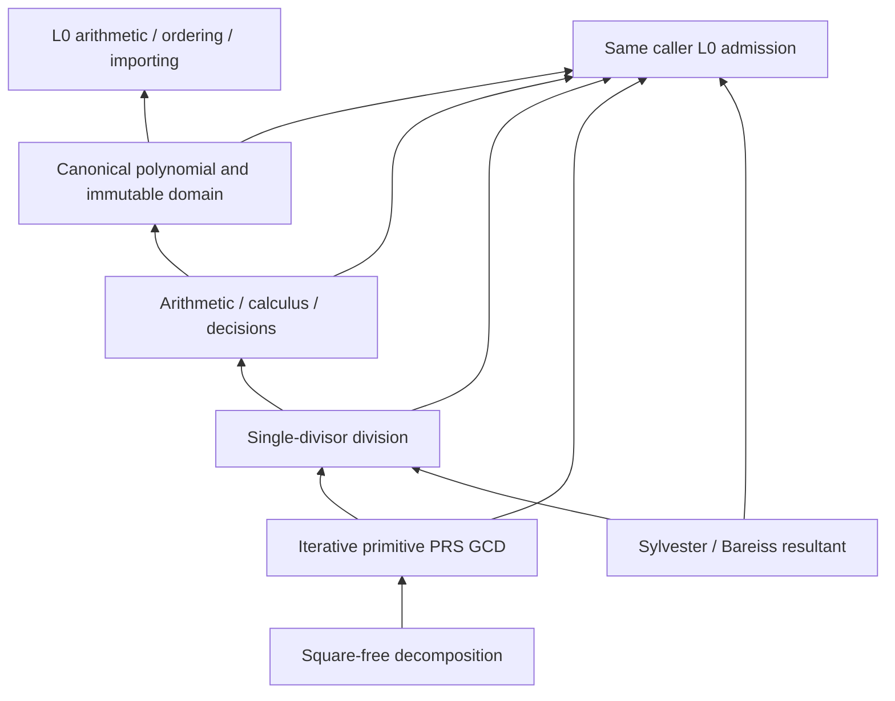

# Exact Polynomial (L1)

## Purpose and Scope

Parent: [RationalBivariateAlgebra](../DESIGN.md). Children: none. L1 owns finite
multivariate polynomials over one explicit exact ordered scalar field. It remains
in CADGeometry's existing production target. Its only lower contract is
[ExactScalar (L0)](../ExactScalar/DESIGN.md), plus Swift standard-library ownership,
collections and integer primitives. L0 is unchanged and never depends on L1.

## Responsibilities and Boundaries

L1 constructs canonical sparse polynomials, performs exact arithmetic, evaluation,
differentiation, substitution, identity decisions, single-divisor division,
primitive PRS GCD, characteristic-zero square-free decomposition and Sylvester
resultants. It owns variable slots and coefficient-domain identity. It does not
own geometric variables, source parameter domains, real-root existence, cell
connectivity, ideal membership, arbitrary irreducible factorization or XYZ/UV.
Existing polynomial algorithms inside L0's scalar proof implementation stay there.

## Related Designs

| Design | Relationship | Contract Used | Summary | Cautions |
|---|---|---|---|---|
| [RationalBivariateAlgebra](../DESIGN.md) | parent | Component composition | Owns higher numeric consumers | Not built by this task |
| [ExactScalar](../ExactScalar/DESIGN.md) | depends on | Arithmetic, ordering, importing and admission | Exact coefficient values and retained owners | No concrete scalar internals or legacy polynomial implementation is used |

## Architecture

Public capabilities are small protocols. One generic ExactPolynomialDomain<F>
implements them with F's L0 requirements. Generic dispatch does not invoke generic
requirements through existentials. An isolated verification manifest gives the
same production sources an L1 module depending only on L0. The explicit
L1_ISOLATED_VERIFICATION switch changes imports only, never storage, semantics,
isolation or Sendable. No production target or external dependency is added.

## Contracts and Invariants

- A polynomial belongs to an immutable context retaining its scalar operation
  owner and variable count. Same-domain operations require context identity even
  for zero polynomials; transfer is explicit and uses L0 importing.
- A term has exactly variableCount nonnegative Int powers and one admitted
  coefficient. Descending lexicographic order gives x0 priority, then x1, etc.
  Duplicate powers are combined; only certified zero coefficients are removed.
  Construction never changes the polynomial by monic or square-free conversion.
- Empty terms denote zero; degree is nil. Nonzero constants have degree zero.
  Powers and slot/count/byte arithmetic are checked, with typed failures.
- Every coefficient decision is delegated to L0. Its failure cannot become zero,
  absence, inequality, or a discarded term.
- Evaluation returns a retained ExactPolynomialEvaluation containing its scalar
  value and attained proof depth. This receipt, not its bare value alone, owns the
  inherited polynomial proof depth. Reuse must admit that depth.
- Division returns q and r with p=q*d+r and no remainder monomial divisible by
  the divisor's leading monomial. Nonzero remainder in exact division fails.
  This is not multivariate ideal membership.
- GCD is the monic common divisor of maximum divisibility. gcd(0,0)=0. Recursive
  coefficient-content and primitive pseudo-remainders are evaluated by an
  explicit finite task stack, not native recursive calls proportional to arity.
- Square-free decomposition returns a retained unit and monic factors with
  positive distinct multiplicities. Their powered product times the unit equals
  the input; factors are pairwise coprime and square-free. Zero fails with
  undefinedMultiplicity; a nonzero constant has an empty factor list.
- Resultant is the Sylvester determinant in the selected variable, using
  fraction-free Bareiss with exact polynomial division and pivot row swaps.
  Its output retains the same variable basis with the eliminated power zero.
  Zero input gives zero; two nonzero constants give one. It proves no real roots.

## Runtime Flows

Entry cancellation, owner checks and inherited two-axis depth admission precede
work. A noncopyable scoped observer forwards every callback to the same caller
ledger and records L0 depth visits. Term traversal, exponent inspection, sorting,
new buffers/COW, task frames and matrix slots are admitted before execution.
L0 coefficient operations use that same observer. Publication follows a terminal
checkpoint after all callbacks. Empty/constant/reuse paths follow the same rule.

## State, Ownership, and Lifecycle

Contexts and stored polynomial terms are immutable and Sendable. Values retain
context, coefficient/root owners and attained depth after source variables and
operation-owner variables leave scope. Internal scratch arrays are invocation
local. No mutable shared cache or platform-specific raw state is introduced.
The observer borrows an initialized inout ledger via one scoped pointer: no
allocation, rebind, offsets, manual deallocation, escaping handles or cross-task
transfer. Existing generic coefficient operations cannot receive an inout ledger
and simultaneously expose its depth notifications without this scoped observer.
The pointer lifetime is owned by the enclosing operation; Native ASAN verifies it.

## Failure, Concurrency, and Constraints

ExactPolynomialFailure distinguishes invalid variable count/index/exponents,
polynomial-domain mismatch, exponent/count overflow, zero divisor, non-exact
division, undefined multiplicity, invalid certificates and preserved L0 failures.
Unmapped errors retain their cause. No alternate solver or partial success is
published. Paid work and cumulative admitted payload storage are never reset or
refunded. Storage units cover typed slots and buffers, including transient sorting
space and necessary copies; they do not promise an allocator-specific RSS cap.
No arbitrary degree, arity or algorithm cap is added. Native, WASM and Embedded
share the same state, ownership, admission and failure implementations.

## Verification and Change Impact

[Tests/L1PolynomialVerification](../../../../Tests/L1PolynomialVerification)
compiles only the pinned L0 production closure and these L1 production files.
Behavioral fixtures cover rational and retained algebraic coefficients, exact
identities, arbitrary finite arity including zero variables, duplicate and zero
terms, equal XYZ-independent coefficient values, division identities and
irreducible remainders, common contents, PRS and pivoting, multiplicity restoration,
explicit import, invalid input, independent resource axes, overflow, callback and
Task cancellation, and lifetime after owner destruction. Independent expected
coefficient fixtures and algebraic identities refute implementation mistakes.
Native, normal WASM and Embedded WASM use Swift 6.4.0 and matching SDKs. Higher
geometry/intersection builds and main integration are outside the task. Unchanged
L0 evidence is reused. L1 completion requires actual behavior, one stable review,
local commits and final snapshot/evidence correspondence.

The completed target-specific evidence and reproduction commands are recorded in
[L1PolynomialVerification/VERIFICATION.md](../../../../Tests/L1PolynomialVerification/VERIFICATION.md).
