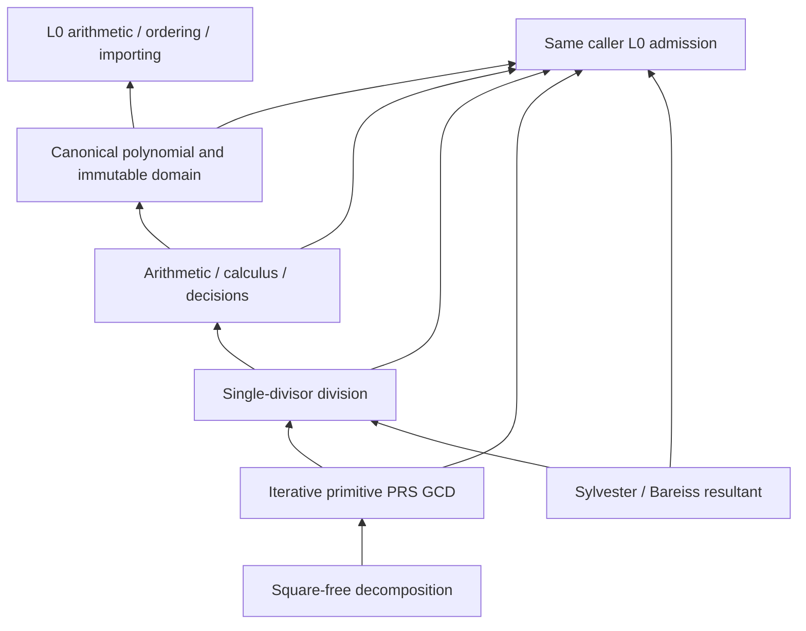

# Exact Polynomial (L1)

## Purpose and Scope

Parent: [RationalBivariateAlgebra](../DESIGN.md). Children: none. L1 owns finite
multivariate polynomials over one explicit exact ordered scalar field. It remains
in CADGeometry's existing production target. Its only lower contract is
[ExactScalar (L0)](../ExactScalar/DESIGN.md), plus Swift standard-library ownership,
collections and integer primitives. L0's mathematical contracts are retained;
the shared sizing contract belongs to L0, which never depends on L1.

## Responsibilities and Boundaries

L1 constructs canonical sparse polynomials, performs exact arithmetic, evaluation,
differentiation, substitution, identity decisions, single-divisor division,
primitive PRS GCD, characteristic-zero square-free decomposition and Sylvester
resultants. It owns variable slots and coefficient-domain identity. It does not
own geometric variables, source parameter domains, real-root existence, cell
connectivity, ideal membership, arbitrary irreducible factorization or XYZ/UV.
Existing polynomial algorithms inside L0's scalar proof implementation stay there.

## Related Designs

| Design | Relationship | Contract Used | Summary | Cautions |
|---|---|---|---|---|
| [RationalBivariateAlgebra](../DESIGN.md) | parent | Component composition | Owns higher numeric consumers | Not built by this task |
| [ExactScalar](../ExactScalar/DESIGN.md) | depends on | Arithmetic, ordering, importing and admission | Exact coefficient values and retained owners | No concrete scalar internals or legacy polynomial implementation is used |
| [NativeExactRelations](../../NativeExactRelations/DESIGN.md) | used by | Checked ordered construction | Native final-buffer import | Caller order is fully validated, never trusted |

## Architecture

Public capabilities are small protocols. One generic ExactPolynomialDomain<F>
implements them with F's L0 requirements. Generic dispatch does not invoke generic
requirements through existentials. An isolated verification manifest gives the
same production sources an L1 module depending only on L0. The explicit
L1_ISOLATED_VERIFICATION switch changes imports only, never storage, semantics,
isolation or Sendable. No production target or external dependency is added.

### Native-first dependency boundary

The mathematical capabilities and immutable result types stay fixed. L1 uses
Swift Array/COW for sparse terms, an immutable ARC context for domain identity,
borrowing operands and a noncopyable, invocation-local observation handle. Work
and storage belong to the caller's one L0 admission; the observer retains only
attained depth and borrows that admission. It does not allocate a second budget.

Payload-byte sizing is consumed from L0's exactScalarPayloadBytes free
function, whose authority is [ExactScalar's resource contract](../ExactScalar/DESIGN.md#resource-semantics-and-lifecycle).
L1 maps its countOverflow failure to the existing ExactPolynomialFailure case.
It adds no independent sizing policy, allocator, scheduler or shared cache.

## Contracts and Invariants

- A polynomial belongs to an immutable context retaining its scalar operation
  owner and variable count. Same-domain operations require context identity even
  for zero polynomials; transfer is explicit and uses L0 importing.
- A term has exactly variableCount nonnegative Int powers and one admitted
  coefficient. Descending lexicographic order gives x0 priority, then x1, etc.
  Duplicate powers are combined; only certified zero coefficients are removed.
  Construction never changes the polynomial by monic or square-free conversion.
- Empty terms denote zero; degree is nil. Nonzero constants have degree zero.
  Powers and slot/count/byte arithmetic are checked, with typed failures.
- Every coefficient decision is delegated to L0. Its failure cannot become zero,
  absence, inequality, or a discarded term.
- Evaluation returns a retained ExactPolynomialEvaluation containing its scalar
  value and attained proof depth. This receipt, not its bare value alone, owns the
  inherited polynomial proof depth. Reuse must admit that depth.
- Division returns q and r with p=q*d+r and no remainder monomial divisible by
  the divisor's leading monomial. Nonzero remainder in exact division fails.
  This is not multivariate ideal membership.
- GCD is the monic common divisor of maximum divisibility. gcd(0,0)=0. Recursive
  coefficient-content and primitive pseudo-remainders are evaluated by an
  explicit finite task stack, not native recursive calls proportional to arity.
- Square-free decomposition returns a retained unit and monic factors with
  positive distinct multiplicities. Their powered product times the unit equals
  the input; factors are pairwise coprime and square-free. Zero fails with
  undefinedMultiplicity; a nonzero constant has an empty factor list.
- Resultant is the Sylvester determinant in the selected variable, using
  fraction-free Bareiss with exact polynomial division and pivot row swaps.
  Its output retains the same variable basis with the eliminated power zero.
  Zero input gives zero; two nonzero constants give one. It proves no real roots.

## Runtime Flows

Entry cancellation, owner checks and inherited two-axis depth admission precede
work. A noncopyable scoped observer forwards every callback to the same caller
ledger and records L0 depth visits. Term traversal, exponent inspection, sorting,
new buffers/COW, task frames and matrix slots are admitted before execution.
L0 coefficient operations use that same observer. Publication follows a terminal
checkpoint after all callbacks. Empty/constant/reuse paths follow the same rule.

After the existing entry work, owner and inherited-depth checks, multiplication
checks whether either canonical term list is empty. If so, it returns a retained
zero polynomial without traversing either term list. That result preserves the
merged input depth and identical domain context, and still receives the terminal
checkpoint. This is a certified algebraic zero rule, not a fallback from failure.
Nonzero single-monomial multiplication continues through pre-admitted products
and exponent buffers; general products use the heap contract below. Entry validation retains its existing failure and budget semantics.

## State, Ownership, and Lifecycle

Contexts and stored polynomial terms are immutable and Sendable. Values retain
context, coefficient/root owners and attained depth after source variables and
operation-owner variables leave scope. Internal scratch arrays are invocation
local. No mutable shared cache or platform-specific raw state is introduced.
The observer borrows an initialized inout ledger via one scoped pointer: no
allocation, rebind, offsets, manual deallocation, escaping handles or cross-task
transfer. Existing generic coefficient operations cannot receive an inout ledger
and simultaneously expose its depth notifications without this scoped observer.
The pointer lifetime is owned by the enclosing operation; Native ASAN verifies it.

## Failure, Concurrency, and Constraints

ExactPolynomialFailure distinguishes invalid variable count/index/exponents,
polynomial-domain mismatch, exponent/count overflow, zero divisor, non-exact
division, undefined multiplicity, invalid certificates and preserved L0 failures.
Unmapped errors retain their cause. No alternate solver or partial success is
published. Paid work and cumulative admitted payload storage are never reset or
refunded. Storage units cover typed slots and buffers, including transient sorting
space and necessary copies; they do not promise an allocator-specific RSS cap.
No arbitrary degree, arity or algorithm cap is added. Native, WASM and Embedded
share the same state, ownership, admission and failure implementations.

## Verification and Change Impact

[Tests/L1PolynomialVerification](../../../../Tests/L1PolynomialVerification)
compiles only the pinned L0 production closure and these L1 production files.
Behavioral fixtures cover rational and retained algebraic coefficients, exact
identities, arbitrary finite arity including zero variables, duplicate and zero
terms, equal XYZ-independent coefficient values, division identities and
irreducible remainders, common contents, PRS and pivoting, multiplicity restoration,
explicit import, invalid input, independent resource axes, overflow, callback and
Task cancellation, and lifetime after owner destruction. Independent expected
coefficient fixtures and algebraic identities refute implementation mistakes.
Native, normal WASM and Embedded WASM use Swift 6.4.0 and matching SDKs. Higher
geometry/intersection builds and main integration are outside the task. Unchanged
L0 evidence is reused. L1 completion requires actual behavior, one stable review,
local commits and final snapshot/evidence correspondence.

The completed target-specific evidence and reproduction commands are recorded in
[L1PolynomialVerification/VERIFICATION.md](../../../../Tests/L1PolynomialVerification/VERIFICATION.md).

## Resource Repair Verification

Review R2 is closed within this independent polynomial scope. A certified zero
operand returns an empty canonical term list after both input owners and depths
have been admitted. The result retains the attained depth and existing final
checkpoints. Both operand orders, foreign-domain rejection, both retained depth
axes, entry cancellation and terminal cancellation are verified.

Native debug scaling measurements confirm elimination of the formerly unmetered
outer traversal. Existing independent resource failure fixtures also execute
through the shared L0 payload sizing rule; L1 count overflow keeps its original
failure case. Public mathematical contracts and resource limits are unchanged.

Current snapshot evidence and the before/after measurement are recorded once in
[RESOURCE-REPAIR-VERIFICATION.md](../../../../Tests/L1PolynomialVerification/RESOURCE-REPAIR-VERIFICATION.md).
Native, Address Sanitizer, normal WASM and Embedded WASM use the same repaired
production sources. Higher geometry/intersection builds and main integration are
outside the task.

## Scoped Ordered Arithmetic Optimization

Issued polynomials already contain strictly descending, unique, nonzero terms.
After both input owners and depths are admitted, addition and subtraction merge
those ordered streams. Matching exponents invoke coefficient arithmetic and
remove proven zeros. Right-only subtraction terms are negated as they are
emitted. Unchanged terms retain their buffers; only output slots are allocated
and admitted. No public construction validation is bypassed for caller terms.
Differential fixtures use public canonical construction as the reference and
cover cancellation, complete cancellation of coefficients, zero operands,
foreign owners and shared inherited depth. All original algebraic identities
remain regression obligations; resource limits are unchanged.

## Ordered Product Optimization

Multiplication with a one-term operand translates every exponent by the same
nonnegative vector; canonical order and uniqueness are preserved. Coefficient
scaling changes no exponents. Both operations validate operands and retain their
depths through the existing query before emitting canonical terms without sorting.
Every emitted coefficient still receives an exact zero test. Checked exponent
addition, typed payload pre-admission, cancellation and final checkpoints remain.
Differential fixtures use public arbitrary-term canonical construction.

## Checked Ordered Construction
ExactPolynomialOrderedConstructing exposes polynomial(orderedTerms:using:).
Its input must be strictly descending lexicographic, unique and certified nonzero.
The concrete domain checks dimensions, nonnegative exponents, adjacent order and
each coefficient through the same L0 admission before retaining the input Array
backing. A foreign coefficient, zero, duplicate or unordered term is explicit
failure; caller claims cannot bypass validation. Empty input is canonical zero.
The existing arbitrary-term constructor still sorts and merges without change.
Inherited context/coefficient depth and terminal cancellation are preserved.
No new term buffer or sorting workspace is required by this retaining operation.
Native source transport owns its new buffer and admitted in-place sort workspace.
The behavioral owner is NativeExactRelationVerification's ordered-construction
fixture, covering differential equality, malformed terms, ownership, independent
limits and final callback cancellation in Native/ASAN and both WASM targets.

## Sparse Product and Principal Subresultant Contract
L1 owns ordered row-stream heap multiplication and all principal-subresultant
coefficient production. Inputs remain in their identical context; both inherited
depths and owner checks precede zero/empty/specialized paths. No L0 change, source
normalization, variable permutation, cache, shared state or unsafe allocation is
introduced. A product stream is a translated canonical input order. Each heap
node holds two input indices; the smaller input bounds heap slots. Per-axis
maximum exponent sums are checked before generating any nonzero product, even
if its eventual coefficient cancels. Equal exponents are summed before exact
zero testing; only final nonzero terms allocate exponent buffers. Heap, maxima,
result growth, comparisons and coefficient work use the same admission.

ExactPolynomialSubresultantProducing issues ExactPrincipalSubresultantSequence,
retaining original first/second polynomials, eliminated slot, complete values
indexed 0..<min(m,n), and cumulative inherited depth. Nonzero constant or zero
input issues an empty sequence, after owner/axis/depth/cancel checks. Missing PSCs
are retained as exact zero entries, never removed. Values have eliminated power
zero and exactly the existing determinant's coefficient, sign and index.

For index j, the reference square matrix has size m+n-2j and descending columns
starting at degree m+n-j-1. Its first n-j rows are shifted coefficients of the
original first input; remaining m-j rows are shifted second-input coefficients.
This determinant definition is the sign authority. The complete reference lives
in L1; L3 only consumes the sequence and preserves its .principal witnesses.

Brown PRS runs on f,g with deg(f)>=deg(g). It uses full prem(f,g), defined by
lc(g)^(deg(f)-deg(g)+1)*f=q*g+r, deg(r)<deg(g). Unlike the existing primitive-GCD
pseudo-remainder, skipped cancellation degrees still multiply by the remaining
lc(g) power. No primitive/content or monic normalization is applied.
Initially d=deg(f)-deg(g), h=(-1)^(d+1)*prem(f,g), lc=lc(g), c=-lc^d.
For nonzero h of degree k: replace (f,g) with (g,h), set d=oldDegree(g)-k;
b=-lc*c^d; nextH=prem(f,g)/b by exact polynomial division. Set lc=lc(g), then
c=(-lc)^d/c^(d-1) if d>1, else c=-lc. PSC[k]=-c. Degrees absent from this
sequence have zero PSC, including the defective upper subresultant whose degree
is below its index. If original inputs were swapped, restore each j with
(-1)^((m-j)*(n-j)); parity is computed without overflowing degree products.
All divisibility, strictly decreasing degree, count/exponent and final
eliminated-slot invariants fail explicitly. The reference verifies arbitrary
nonprimitive inputs, rational/retained algebraic and multivariate coefficients.
References: Brown (1978), The Subresultant PRS Algorithm, Theorems 1-3,
https://people.eecs.berkeley.edu/~fateman/282/readings/brown.pdf.

Algorithm selection belongs to L1, before remainder/determinant work begins.
Measured small/dense/sparse inputs select a direct 2x2 determinant for two
linear inputs and PRS for larger degrees. The linear formula is
a1*b0-a0*b1, in the original input order. Complete matrix determinants remain
forceable for reference on other degrees. Every branch remains complete and determinant
identical. Failure/cancel after selection propagates without retry. Test-only
internal entry points force either complete algorithm for differential evidence.

Verification owner: [HeapPSCVerification](../../../../Tests/HeapPSCVerification/DESIGN.md).
The stable fixtures compare an independent cartesian product/reference
construction and all PSC determinants, including common factors, abnormal degree
jumps, source contents, input swapping, arbitrary eliminated axes and inherited
algebraic owners. L3, L4, L5 and full Native public paths verify composition;
fixed-toolchain Native/ASAN/normal/Embedded proofs execute the same code.

Equal product keys encountered on heap insertion retain a row-index chain, with
one cursor and one next-index per row. A removed chain is consumed once before
its successors are inserted. Heap nodes still retain no coefficient/exponent
payload; all auxiliary indices are bounded by the smaller term count and
admitted before allocation. Canonical row/column ordering remains the authority.
If the varying axes of the first input strictly precede all varying axes of the
second (or vice versa), translated row streams have disjoint, ordered ranges.
The admitted structural check permits direct ordered output without a heap or
sort. This is complete preselection, not recovery from an exhausted algorithm.

## Caller Cell Visit Forwarding

The scoped ExactPolynomialAdmission forwards every L0 `visitCell(axis:depth:)`
to the same caller and retains attained depth. It neither issues a second depth
mapping nor resets the cumulative visit count. See [L0 authority](../ExactScalar/DESIGN.md#caller-cell-visits).

### Univariate field GCD remainder control

The GCD owner selects field Euclidean division when its active variable is zero.
All other slots are then proved inactive by the existing active-variable check;
coefficients belong to the admitted exact ordered field. Nonzero remainders and
the next divisor are made monic using exact field units before recurrence. This
preserves the unique monic GCD while avoiding unbounded pseudo-remainder unit
magnitudes. Multivariate content and pseudo-remainder processing is unchanged.
All arithmetic and payload remain on the same caller admission; failures do not
switch algorithms or reset allowances. The weighted quadratic Native CS witness
exhausted 16,777,216 work in L2 square-free decomposition of a degree-nine root
union before any Sturm chain. That fixed input and the independent L1 GCD and
L2 multiplicity fixtures must pass under the original limits.
