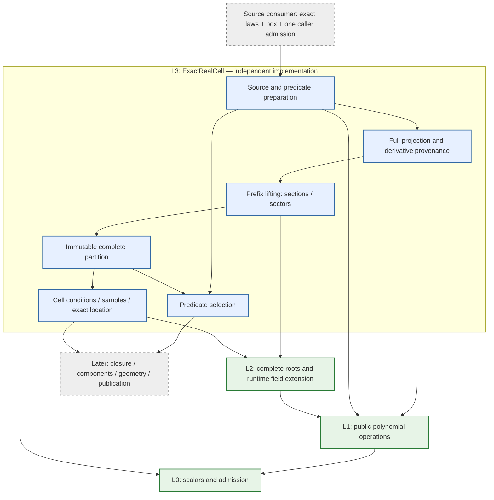
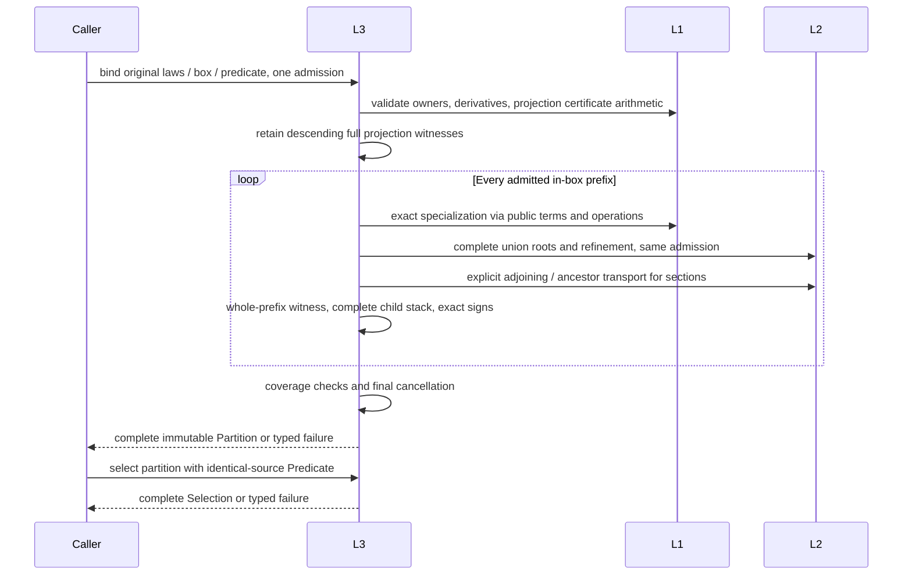

# Exact Real Cell (L3)

## Purpose and Scope

Parent: [RationalBivariateAlgebra](../DESIGN.md). Children: none. This is the
fixed L3 design authority; its ports and receipts below are implemented as independent
production declarations. L3 owns a complete sign-invariant cylindrical real-cell
partition of an exact requested box, selection by a quantifier-free polynomial
predicate, and exact cell conditions and point location.

L3 depends only on the public [L0](../ExactScalar/DESIGN.md),
[L1](../ExactPolynomial/DESIGN.md), [L2](../ExactRealRoot/DESIGN.md) contracts
and Swift standard-library facilities. It is a component of the existing
CADGeometry target. This design creates no production package, target, external
dependency or lower-layer change. Isolated verification must compile these four
components without higher CAD sources.

Inputs are finite multivariate polynomials over the effective ordered
real-algebraic coefficient fields admitted by L2. Rational and retained algebraic
coefficients, arbitrary finite variable count, zero/constant laws, repeated and
shared factors, singularities, degree drops, nullified fibers, finite/open/closed/
singleton/empty/unbounded boxes and all Boolean sign conditions are mandatory.
There is no mathematical degree cutoff or hidden four-variable cutoff. Resource
limits can refuse a calculation atomically. A zero-variable input has the unique
empty coordinate tuple in R^0, subject to its predicate.

L3 does not own authored shape semantics, chart covers, periodic or pole identity,
closure, adjacency, connected components, quantifier elimination, XYZ images,
fiber dimension, geometric multiplicity, numerical localization or CAD result
publication. Complete L3 cells are not complete connected components or complete
CS/SSI. The seven requirements keep their separate completion conditions.

## Responsibilities and Boundaries

| Owner | Generates / retains | Consumes |
|---|---|---|
| Shape and domain consumers | Exact source equations, denominator and structural exclusion laws, source parameter roles and complete chart cover | Their original shape contracts |
| L3 source preparation | Original polynomial list/order, exact variable slots and requested box | Public L1 owner validation and public L0/L2 endpoint validation |
| L3 projection | Exhaustive projection levels, derivative and reductum provenance, principal-subresultant witnesses | Public L1 construction and arithmetic |
| L3 lifting | Whole-prefix delineability evidence, complete root stacks, section/sector descriptions, exact sample tower and dimensions | L2 complete root evidence and explicit ancestor embeddings |
| L3 selection | Immutable source-bound Boolean program and truth for every full cell | Proven constant original signs |
| L3 queries | Exact retained cell conditions, samples and point location | The same issued partition, original laws and fresh caller admission |
| Later topology consumers | Closure, incidence and connected components | L3 symbolic whole-cell conditions and complete partition |
| Later geometry/publication consumers | XYZ/TUV/UVUV correspondence, image/fiber dimension, contact classification and representatives | Original source bindings and algebraic/topological receipts |

### Exact projection cut normalization

Projection insertion uses the existing L1 monic normalization, restoring the
original leading sign, before deduplicating cut laws. The resulting multiplier
is positive, preserving existing derivative/Thom sign orientation as well as
original source signs. A nonzero scalar multiple has exactly the same zero set; normalization
does not remove any root or alter requested source equations or their signs.
Derivative, coefficient and principal-subresultant witnesses retain the original
arithmetic results. The normalized laws define root cuts; original laws still
provide final predicate signs, and whole-cell sign queries use their exact
constant quotient orientation. All normalization arithmetic, generated payload,
work and cancellation use the same caller admission.

Lifting constructs the univariate root union as a square-free least common
multiple through public L1 GCD, differentiation and exact division. Each
specialized source law, coefficient sign, active-law index and Thom condition
remains retained. Only the auxiliary union polynomial removes repeated/shared
factors: its distinct real zeros and their global order are unchanged. Prefix
location reconstructs the same root union with the same admission, so its branch
ordinals and retained cell identities match lifting. No requested source root
multiplicity or source predicate is replaced by the auxiliary union's multiplicity.
All required roots over the full real line remain in the stack, including
neighbors needed to describe clipped sector boundaries.

Before adjoining a nonlinear root, L3 selects a smaller-degree original
specialized cut only after proving it vanishes at that complete union root.
L2 then refines its defining-divisor proof while preserving original source,
ordinal, multiplicity and isolation. The resulting coefficient field describes
the identical selected root through a smaller exact defining law. Original
root-stack coverage, source-cell handles and Thom conditions remain unchanged.

If every active specialized cut law is linear, L3 computes its coefficient-field
root by exact division, sorts and deduplicates using exact order, and consumes
L2's complete sorted-candidate publication port. L2 independently proves all
original roots, multiplicities and singleton identities. A nonlinear cut makes
this strategy inapplicable before publication; failures after selecting it
propagate without switching to generic isolation. All-root and selected-domain
coverage, original source signs and per-prefix cells remain unchanged.

Each lifting level keeps one query-local root domain and one immutable root-set
slot for prefixes that retain the original coefficient-field level. L3 creates
those prefixes solely by retaining the field or by adjoining a root (which
strictly raises its level), so equal original levels prove the identical original
field lineage. Cache reuse additionally requires exact equality of the auxiliary
union polynomial in the same polynomial owner; approximate samples or hashes
are never sufficient. Extended sibling fields use separate domains. A reused
root set retains its complete full-real coverage and depth; comparisons, slot
storage, result ceilings and cancellation stay admitted. New per-prefix source
signs, coefficient signs, sections, sectors and cell visits remain generated.

Point location may use its retained stack's root domain only after the query
field's successful ancestor import and equal original field level prove that
same lineage. Exact union equality and the query root ceiling are rechecked;
otherwise it isolates the newly specialized union. This is reuse of a retained
proof, with no failure fallback or budget reset.

The weighted quadratic CS tangency is the regression witness: its unnormalized
axis-one projection produced 23 laws and exhausted the existing 16,777,216 work
allowance while isolating their union. Sign-preserving scalar normalization alone leaves
a degree-17 auxiliary union and still exhausts that allowance; shared-factor
removal addresses that measured isolation cost. Canonical scalar-multiple deduplication
must preserve the original tuple and required source sign semantics under that
same ceiling. The L3 sign-invariance and complete partition fixtures validate
positive/negative scalar orientation, repeated roots and retained conditions.

Projection, lifting and selection are responsibilities inside this one component,
not new modules or public solver frameworks. Polynomial arithmetic belongs to L1;
root algorithms and coefficient extension belong to L2. No legacy private exact
field, root or polynomial implementation is accessed by L3.

## Related Designs

| Design | Relationship | Contract Used | Summary | Cautions |
|---|---|---|---|---|
| [RationalBivariateAlgebra](../DESIGN.md) | parent | Component index | Owns higher consumers | No existing consumer migration is implied |
| [ExactScalar](../ExactScalar/DESIGN.md) | depends on | Arithmetic/order/import, admission and retained depths | Owns scalar and resource meanings | No replacement quota, allocator or implicit failure conversion |
| [ExactPolynomial](../ExactPolynomial/DESIGN.md) | depends on | Canonical construction, public terms, calculus, GCD/division, resultant and complete PSC sequence | Owns polynomial operations | Coefficient extraction and cross-variable reindexing are not public operations |
| [ExactRealRoot](../ExactRealRoot/DESIGN.md) | depends on | Complete roots, refinement/sign, runtime field family and explicit embeddings | Owns exact section coordinates | Sibling fields are incompatible; no automatic compositum |
| [IntersectionAlgebra](../../IntersectionAlgebra/DESIGN.md) | prospective used by | Complete partitions and retained conditions | Existing real-relation composition is a future integration consumer | Its current one-through-four-variable API and combined closure result are unchanged |
| [ExactRealTopology](../ExactRealTopology/DESIGN.md) | used by | Certified definitions, complete traversal, prefix location and partitions | L4 owns closure/incidence/components | Inspection extension independently verified in L4.I1; upper geometric consumers remain separate |

### Confirmed Current Facts

| Fact and actual implementation path | Design consequence |
|---|---|
| [L1 calculus](../ExactPolynomial/ExactPolynomialDomain+Calculus.swift) evaluates or substitutes all slots in the same polynomial owner; importing preserves variable count | L3 specialization extracts/reindexes admitted public terms and imports coefficients explicitly; it cannot pretend a public partial-specialization port already exists |
| [L1 PSC port](../ExactPolynomial/ExactPolynomialSubresultantProducing.swift) now issues complete principal coefficients; coefficient helpers remain internal | Projection consumes the public L1 principal-subresultant sequence; the determinant sign definition and complete algorithm selection belong to L1 |
| [L2 extension](../ExactRealRoot/ExactAlgebraicScalarDomain.swift) keeps one static type, requires identical parent identity at adjoining, and accepts own/ancestor scalar imports | Every sample has one runtime field family; each section explicitly transports all earlier coordinates into its child |
| [Existing projection](../../IntersectionAlgebra/ExactIntersectionProjection.swift) retains reducta and principal-subresultant conditions; [tower](../../IntersectionAlgebra/ExactIntersectionProjectionTower.swift) adds derivatives | These are algorithmic/reference paths, not allowed L3 implementation dependencies or already verified new L3 behavior |
| [Existing resolver](../../IntersectionAlgebra/DefaultOriginalPolynomialRelationResolver.swift) composes selected cells, incidence and components | New L3 stops at cells/selection; later integration keeps connection decisions separate |
| [Native system](../../IntersectionAlgebra/OriginalRationalIntersectionSystem.swift) constructs three homogeneous coincidence laws in three CS or four SSI slots | Geometry can supply the same mathematical relations without giving L3 shape owners |
| [SSI publisher](../../NativeSurfaceSurfaceRelations/NativeSurfaceSurfaceRelationPublisher.swift) additionally partitions an XYZ/parameter graph | Parameter-cell dimension cannot replace image/fiber dimension |

Lower implementations and their previously recorded target evidence have been
reviewed independently. The preparation/producing/selecting/querying protocol witness paths are implemented;
C1-C10 behavior is tracked by the independent verification package. No existing higher engine execution
establishes the new L3 projection/lifting implementation. No higher engine is built by this design.

## Architecture

Arrows inside the component are data flow. Lower arrows denote dependencies.
Solid green is independently verified lower scope; blue is the implemented L3
responsibility boundary. Gray is later integration.

### Public Ports

The concrete owner is `ExactRealCellDomain<Base>`. Base conforms to L0
arithmetic, ordering and importing with Source == Value. Its coefficient Field
is the existing `ExactAlgebraicScalarDomain<Base>`. The caller supplies that
field, including its existing explicit extension ceiling. Source polynomials
are constructed in the domain's read-only L1 `polynomials` property. Base may
itself contain previously retained real-algebraic coefficients.

Operations are requirements on small Sendable protocols. Generic admission
requirements use static dispatch; they are not invoked through `any P`.

| Protocol | Requirements / output |
|---|---|
| `ExactRealCellPreparing` | Initialize with field/variable count; recover identical domain from source; expose polynomials; bind laws and box into Source; validate and bind a Boolean program into Predicate |
| `ExactRealCellProducing` | Decompose Source with explicit limits into Partition |
| `ExactRealCellSelecting` | Select Partition with a Predicate bound to its identical Source into Selection |
| `ExactRealCellQuerying` | Obtain a cell Sample or Condition; prepare an exact query point with its field; locate a point in Partition with explicit L2 root limits; test that point against an issued Condition |

Each fallible requirement takes `inout A`, with A: ExactScalarAdmission &
~Copyable, and throws `ExactRealCellFailure`. The concrete implementation is
separate from these protocols. Read-only receipt structs are not protocols
introduced merely to abstract storage. These ports are implemented with static generic admission dispatch.

### Required Operation Shapes

All operations below additionally take the same explicit generic inout admission;
receipt types below are implemented. Initialization creates one immutable L3 context
retaining its Field and public L1 construction domain. Sources retain that L3
context. Producing/selecting/querying validate it through their own source binding,
without reading L1/L2 private contexts.

| Operation | Inputs besides admission | Output |
|---|---|---|
| Initialize | Field, checked variableCount | Domain |
| Retaining initialize | Issued Source | Identical Domain |
| bind | Original L1 laws, n exact L2 domain intervals | Source |
| predicate | Validated sign instructions, Source | Predicate |
| decompose | Source, ExactRealCellLimits | Partition |
| select | Partition, same-source Predicate | Selection |
| sample | CellID, its Partition | ExactRealCellSample |
| condition | CellID, its Partition | ExactRealCellCondition |
| point | Supplied Field, n exact coordinates | ExactRealCellSample with no membership claim |
| locate | Prepared point, Partition, L2 ExactRealRootLimits | Optional CellID; nil means proved outside box |
| contains | Prepared point, issued Condition, L2 ExactRealRootLimits | Exact Boolean or typed failure |

### Public Retained Values

| Receipt | Owner and retained meaning |
|---|---|
| `ExactRealCellSource<Base>` | Immutable source owner: Field, identical L1 domain, original laws, variable count/order, exact box and inherited depth |
| `ExactRealCellPredicate<Base>` | Identical source owner plus validated Boolean sign program |
| `ExactRealCellPartition<Base>` | Source, projection derivations, complete in-box prefix tree/stacks, full cells, original signs, root sections/sectors and attained depths |
| `ExactRealCellSelection<Base>` | Partition, identical-source Predicate and all selected full-cell offsets/truth; empty selection still retains complete coverage |
| `ExactRealCellID<Base>` | Opaque partition owner plus checked cell offset; no public raw-index initializer or cross-partition equality |
| `ExactRealCellSample<Base>` | Exact sample/query-point coordinates in one retained Field, and causal depth; it establishes no whole-cell bound |
| `ExactRealCellCondition<Base>` | Partition owner, cell ID and complete ancestral section/sector condition with root addresses and sign evidence |
| `ExactRealCellLimits` | Explicit nonnegative maximumStoredCells and maximumRootsPerStack; no guessed default |

Cell handles expose read-only axis, parent ID, section/sector kind,
parameter-space dimension, source signs, matching projection law/sample sign
arrays (including the derivative closure) and attained depth.
Section addresses retain the whole-prefix union-law binding and distinct root
ordinal; sector addresses retain neighboring section addresses or infinity tags.
A zero-dimensional full cell's sample is its exact point. A positive-dimensional
cell's sample is one witness, never the cell's extent.

## Contracts and Invariants

### Source, Domain and Predicate

Variable slots x0...x(n-1) have mathematical identity only. The caller retains
TUV/UVUV roles and authored chart identity. The source uses one identical L1
polynomial owner; public L1 validation precedes public-term traversal. Foreign
polynomials require explicit L1 import/construction before binding. Original
law order and duplicates are preserved; derived projection deduplication never
changes predicate indices or original signs.

The requested box has exactly n L2 ExactRealRootInterval<Field.Value> entries.
L3 revalidates finite endpoint values/order/inclusion, admits each depth and
retains emptiness. Bounds and source coefficients enter the same supplied
field's admitted own/ancestor path. Infinite bounds are tags. Domain boundary
laws are included in projection so clipping is a whole-cell decision. An empty
axis proves an empty box; an open singleton is empty, a closed singleton is a
section. Finite windows never stand in for infinite requested domains.

The Boolean program uses an English-named enum of literal, polynomial sign
comparison, not, and, and or instructions. Sign comparisons are zero equality,
non-equality, strict order or non-strict order. Native Array stores a validated
postfix program. Binding checks every law index, stack underflow, checked stack
counts and exactly one final value; it retains the identical source owner.
Scalar/operation failure never becomes false. Selection requires the same source
owner as its partition. A changed law list or new boundary requires new source
binding and a complete refinement/decomposition, not silent reuse of old truth.

### Projection and Whole-Cell Sign Authority

Use one full projection-and-lifting algorithm. At each descending axis retain
active laws and their derivative closure, every coefficient and nonzero reductum,
principal subresultant coefficients for a reductum and its derivative and for
pairs of reducta, and all already lower-variable laws. Retain exact provenance
and the mapping to original laws. No reduced projection that assumes nonvanishing
or well-orientedness is selected as the baseline.

The classical projection/lifting basis is Collins' real decomposition method;
[Strzebonski, Sections 3.1 and 3.3](https://arxiv.org/pdf/1405.4925) provides explicit
coefficient/degree-drop and principal-subresultant delineability arguments.
L3 uses exhaustive retained conditions rather than that paper's local selection,
irreducible-factor input assumption or restart strategy. Its obligation is to
prove the induction below using the exact retained coefficient/rank conditions.

L1 owns complete principal-subresultant production through its public protocol.
L3 consumes the source-retaining, complete index-preserving values and retains
same-input .principal witnesses. The determinant orientation and Brown recurrence
are authoritative in [L1's contract](../ExactPolynomial/DESIGN.md#sparse-product-and-principal-subresultant-contract).
No lower algorithm is duplicated in L3. Its j=0 value agrees with L1 resultant;
independent rank/GCD fixtures cover higher coefficients, repeated/shared factors
and specialization degree drops.

All original variable slots, input order and zero PSC indices are retained.
The L1 contract owns the determinant definition and value/sign/index convention;
L3 owns exhaustive derivative/reductum pairs, projection provenance and lifting.

The lifting induction owns these proof obligations:

1. The parent is a connected cylindrical cell with all required projected
   coefficient and rank signs constant on its whole extent.
2. Those coefficient signs fix specialization degree or prove that every
   coefficient is identically zero on the parent. A zero sample is insufficient.
3. The retained principal-subresultant zero/nonzero pattern fixes repeated-root
   and common-root degrees. For the nonnull families this justifies continuous,
   ordered sections, constant root multiplicities and equal-or-disjoint branches.
4. The complete L2 sample fiber therefore determines every section/sector over
   that whole parent. Root ordering/derivative signs retain the branch address.
5. Original-law signs evaluated at exact samples extend over the whole child
   only through those induction witnesses. They never acquire authority from
   sampling alone.

A globally zero law and a nullified fiber have constant zero sign and add no
section. Degree drops use the retained coefficient and reductum witnesses. Such
mandatory cases cannot be classified unsupported or omitted. An unestablished
witness fails; it never publishes a complete partition.

### Lifting and One Coefficient Family per Sample

Start at the unique R^0 prefix. At ascending axis k, its sample has one Field and
k coordinates. Reindex active public polynomial terms and explicitly import
original coefficients into that sample field; compute the specialized
one-variable coefficients with L0/L1 operations. Each evaluation/transport keeps
both receipt depths. Any later-variable power at this level is invalid evidence.
No L1 context, internal field getter or private coefficient helper is inspected.

For one stack, multiply the nonzero, positive-degree specialized laws in a single
L1/L2 root domain. L2 isolates its complete distinct root union over the real
line under the same caller admission and explicit per-stack root limit. A
constant product has no roots. A wholly nullified family creates one open
sector. This avoids independently adjoined sibling root fields; it does not
infer common roots from matching numerical brackets. Union-law multiplicity
is auxiliary and must not be reported as source contact multiplicity.

Retain all root receipts and refine neighboring brackets until their finite
bounds have a strict gap. A bounded sector sample is the midpoint of that gap
in the parent field. Outer samples use finite root bounds plus/minus one; with
no roots use zero. Samples are proved strictly interior by exact signs. Keep
refinement receipts and depths; never recompute an old root under a reset quota.

For a section, first inspect retained degree-one source laws in the same
stack. A linear law whose zero at the selected root is proved by L2 supplies
its exact parent-field value -b/a, so the sample stays in its existing field.
Otherwise adjoin its selected root to the identical prefix sample field with
L2, explicitly embed every earlier coordinate into the child and append the
generator. This is an applicability proof before adjoining, not a retry after
resource failure. For a sector, remain in the parent field and append the exact
interior sample. Sibling samples can retain different immutable child owners;
L3 never mixes their scalars. Source coefficients always enter by the verified
ancestor path. Extension policy is the supplied L2 field-family policy; L3 does
not invent another or ignore extensionLevelLimit.

A section preserves parent dimension; a sector adds one checked dimension.
Box boundary signs keep all permitted children and exact endpoint sections.
A child outside the box is discarded only with the whole-prefix boundary
witness; no later suffix is searched. These exclusions and complete retained
in-box stacks establish coverage of the requested box. Predicate-false cells
are retained in the partition; selection runs only after that partition is
complete. No early predicate pruning or partial-CAD optimization is required.

### Conditions, Identity and Point Location

A cell condition is its ancestral cylindrical definition, with section root
functions or strict sector inequalities, projection binding and derivative
signs. Neither an arbitrary sign vector nor a sample identifies a cell. Two
cells with the same XYZ image or close coordinates remain distinct. Cell IDs
are local to one immutable partition; reissued partitions need explicit new
identifiers, not guessed equality.

Point preparation validates all coordinates in one caller-supplied Field and
retains depths. Location proves that original coefficients embed into that
field from the partition's source owner, checks the requested box, then descends
the retained stack definitions. This compatibility check includes importing a
source-field unit through public L2 importing, even with no source terms or
finite bounds, so a constant/empty relation cannot bypass field-family identity. At each supplied exact prefix, specialize the
retained nonnull union law, use L2 roots, and use L2 signs of xk-queryCoordinate
to locate an exact section or open sector. The retained root ordinal, coefficients
and parent delineability justify the correspondence with the original stack.
This does not compare scalars from unrelated siblings or invoke a compositum.
A compatible descendant query field is allowed; an unrelated query field fails.

A point outside the box returns nil only after exact exclusion; a valid inside
point must map to exactly one full cell. A missing/ambiguous stack is invalid
coverage, not nil. Condition membership uses exact location and the issued
cell identity. Foreign IDs, conditions or selection/source pairings fail.
Queries that reconstruct root stacks take the existing explicit L2
ExactRealRootLimits, applied unchanged to each stack. Sample/condition access
creates no cell graph and takes no redundant cell-count policy. Every query
uses fresh caller admission and retains the stored proof depth. Immutable evidence owns no prior mutable allowance.

### L4 Inspection Extension

[L4](../ExactRealTopology/DESIGN.md) needs symbolic cell identity and complete
prefix-tree access. Existing ports do not provide these capabilities. This
section owns the additional L3 contract implemented by the inspection extension. It does not change the meaning of
existing decomposition, sample metadata, selection or full-point location.

| Public port | Requirement | Guarantee |
|---|---|---|
| `ExactRealCellDescribing<Base>` | `coefficientField(of:using:)` | Validate and retain the source's original effective coefficient field, even for empty/constant sources |
| `ExactRealCellDescribing<Base>` | `definition(of:in:using:)` | Issue the exact whole-cell path and certified boundary-root descriptions for a valid full or prefix ID |
| `ExactRealCellTraversing<Base>` | `root(in:using:)` | Unique issued R^0 origin, or nil only for proved empty full-domain coverage |
| `ExactRealCellTraversing<Base>` | `children(of:in:using:)` | All and only in-domain children in branch order; empty only at a terminal cell; complete coverage retained |
| `ExactRealCellQuerying<Base>` | `locatePrefix(_:in:limits:using:)` | Locate a compatible m-coordinate point in the issued m-prefix cell, 0<=m<=n; nil only for proved exclusion |

Each operation is a protocol requirement with generic A: ExactScalarAdmission &
~Copyable and typed ExactRealCellFailure. Native immutable owner-retaining values
are the result boundary. No generic factory/existential shortcut or private-array
access is required of L4. Existing querying conformers must add the prefix
requirement; ordinary locate still requires n coordinates and has unchanged
success/failure meaning. The current production conformer is ExactRealCellDomain.

`ExactRealCellDefinition<Base>` retains its original partition/cell,
source coefficient field, coordinateCount m, complete path steps and attained
depth. Each step retains its parent identity and exact root-ordinal/sector address.
A finite boundary is a privately issued `ExactRealCellBoundaryRoot<Base>`:

- its nonnull incoming cut binding and a supporting polynomial in the original
  coefficient field (that cut law or its certified derivative);
- the parent cell, axis and root ordinal in its complete distinct union;
- the complete derivative sign signature from order zero through the polynomial's
  global axis degree, including any higher derivatives nullified on the parent;
- original degree/rank/complete-root evidence and attained depth.

For every point in that parent cell, the polynomial remains nonzero, its effective
positive degree is fixed, and exactly one real root realizes the signature. It is
precisely the addressed union root there. The signature is a whole-branch
certificate, not sampled derivative metadata. Exact root identity first prefers a certified globally affine supporting law
with constant nonzero axis coefficient, then the first active cut law in source
order vanishing at that union root. An auxiliary derivative may support the same
root when its identity is proved; it does not become a new cut. No rounded match
identifies it. Bounds outside the requested box can still be needed
as sector boundaries, and their original complete root evidence is retained.

Issuing algorithm: use the stored incoming cut/active-law binding, full coefficient
and reductum/PSC rank evidence, and complete root ordinals. L2's exact root-sign
operation certifies every derivative at the selected sample root. Effective degree
and pairwise rank invariance keep ordered roots delineable; a common-root membership
cannot switch ordered branches without a collision or changed rank. Hence each
zero derivative sign stays zero on the connected parent. Each nonzero derivative
value is continuous and never zero, so its sign cannot change. Thom root uniqueness
then identifies that same root throughout the parent. Retain this evidence chain.
Rank invariance alone, without delineability and root identity, is insufficient.
An issuer unable to establish the chain fails instead of issuing a sampled claim.

A section step requires the actual coordinate to equal its described root. A
sector step requires strict order between the described finite boundaries or its
single finite boundary and infinity; a rootless step is the entire line. Conjoin
all steps and the exact prefix of the original box, including inclusion flags.
This is exactly the original m-prefix cell, not an arbitrary same-sign region.
L3 owns these semantics; L4 owns their polynomial/quantifier serialization.
No global derivative-root refinement or changed default cutting policy is needed.

A child view may share existing immutable index storage. If valid-child offsets
must be materialized from clipped slots, charge their payload before allocation;
do not claim that copy is zero-copy. Prefix location validates the coefficient
family and m-coordinate bounds, traverses only those m stacks and uses the caller's
original root limit/admission. It does not pick any later-coordinate sample.
A proved empty product projects to an empty set, even at prefix arity zero.

Before L4 consumes the extension, independent L0-L3 tests must establish its new
whole-branch signatures on nonsample parent points, nullification/degree drops,
repeated/shared roots, close distinct roots, clipped neighboring roots, algebraic
coefficients, all child coverage and full/zero-prefix query boundaries. Existing
L3 tests/evidence remain unchanged where their premises did not change. The
extension needs actual Native/ordinary-WASM/Embedded execution, source-bound
ownership, count/depth/cancellation failures and updated snapshot manifests.

### Handoff to Swift-CAD

The current Native equations remain a reference for later integration:

| Consumer | L3 relation | Responsibility after L3 |
|---|---|---|
| CS | Three homogeneous coincidence laws in t,u,v; denominator nonzero and exact box | Connect cells; evaluate original XYZ; preserve all TUV and classify image/contact |
| SSI | Three homogeneous coincidence laws in u1,v1,u2,v2; guards and box | Connect cells; establish XYZ image/fiber dimension and all UVUV correspondence |
| Continuous overlap | Same complete CS parameter relation with positive-dimensional cells | Establish maximal projected intervals and geometry, not sample ranges |
| Boundary clipping | Original raw laws plus boundary sign conditions | Preserve source/chart identity and clipped geometric components |
| Real decomposition requirement | L3 partition/selection | Closure and connected-component completion remain separate |
| Projected/self contact | Exact original contact laws and proved identity-exclusion predicates supplied by consumers | Interpret projection/contact and authored shared-boundary identity |

L3 can additionally partition a graph relation supplied by the geometry owner
with XYZ slots first and parameter slots later. It guarantees that new relation's
cells and prefix dimensions. It does not invent the graph, decide its physical
meaning, or equate parameter dimension/Jacobian rank with geometric image
dimension. More than four slots require no new L3 mathematical capability.

## Runtime Flows

Projection witnesses alone cannot escape as a complete partition. Building
scratch progresses through validated source, projected levels, lifted levels,
coverage checked and final checkpoint. Throw destroys scratch while preserving
caller counters and every previously issued immutable receipt.

## State, Ownership, and Lifecycle

| Logical state | Owner/lifetime | Access and retention |
|---|---|---|
| Source field, laws, predicate, box | Immutable ARC owners, retained by receipts | Same Sendable contract on every target |
| Projection levels / cell graph / root evidence | Partition owner and immutable arrays | Prefix/stack offsets stored internally; public handles retain owner |
| Sample coefficient towers | L2 immutable parent-only owners | Children retain ancestors and exact coordinates; no sibling mutation |
| Selection | Immutable owner retaining partition/predicate | Selected offsets share partition data rather than copying cell payloads |
| Work queues, matrices and construction buffers | Invocation-local native Array/COW | Exclusive synchronous construction; admit materialization/COW before mutation |
| Admission | Caller-owned exclusive inout borrow | Same cumulative L0 ledger through all stages and subqueries; never stored in receipts |

Internal graph records hold indices, not handles that retain their own partition,
preventing an ARC cycle. Public IDs/conditions/views retain the partition. Public
root and polynomial owners outlive the caller's original shape/field variables.
Read-only Array buffers are shared; no unsafe view can outlive its owner.

Use native structs/enums, immutable final classes, Array/COW and generic static
dispatch. No mutable global cache, actor, scheduler, custom allocator or type-erased
public adapter is needed. A fixed internal non-Sendable invocation handle may
follow the scoped L2 forwarding pattern to keep recursive admission specialization
finite in Embedded. Any new unsafe borrow needs its own minimal owner/lifetime,
non-escape and ASAN evidence; private L2 forwarding types are not an L3 port.

## Failure, Concurrency, and Constraints

ExactRealCellFailure distinguishes invalidSource, invalidDomain,
invalidVariable, invalidPredicate, incompatibleDomain, invalidCell,
invalidCoverage, countOverflow, cellLimit, unresolved, and preserved scalar,
polynomial and root causes. Invalid projection witnesses are invalidCoverage.
All lower resource/cancellation/extension failures retain their causes. Typed
failure is not a successful exclusion, constant zero or predicate false. A
resource failure does not trigger another solver or a fresh allowance.

| Constraint | Fixed owner and semantics |
|---|---|
| Work/storage | Existing L0 admission; charge source traversal, projection generation, L1 PSC and polynomial operations, reindexing/transport, stacks, roots, selections, queries and publication |
| Payload sizing | Public L0 exactScalarPayloadBytes with checked counts; cumulative logical payload, not RSS or guessed allocator capacity |
| Value/coefficient depths | Preserve both lower receipt axes; L3 geometric-coordinate refinement uses value axis; existing coefficient depths remain admitted |
| Stored cell limit | Explicit maximumStoredCells applies to all retained prefix/full records, including predicate-false cells and the R^0 record when materialized |
| Stack root limit | Explicit maximumRootsPerStack passed unchanged to L2; exhaustion prevents complete partition or location publication |
| Extension level | Caller-supplied L2 field policy; checked at actual adjoining, not a hidden new default |
| Cancellation | Entry, causal work, after the last admission callback, before every result or Boolean/optional publication |
| Native stack | Projection axes and prefix queues are iterative; L2 coefficient descent is bounded by its supplied extension policy |

Source binding consumes one work unit before validating each domain, including
empty and unbounded domains. Depth admission and cancellation checkpoints do not
replace this traversal charge. The existing invocation charge and any lower
finite-bound operation charges remain cumulative in the same caller admission.
Retaining an unchanged caller array does not materialize a second payload.

Count policies are checked nonnegative Int values with no defaults. Zero stored
cell capacity admits a proved empty box but refuses a materialized nonempty
partition; count zero roots permits rootless stacks. Overflow refuses before
allocation or index arithmetic. Budget selection is caller/deployment policy;
fixtures measure their required allowance without changing production contracts.

All targets retain the same owner, Sendable, state, failure and admission contract.
There is no Embedded-only raw mutable state or no-op synchronization. Independent
readers share immutable receipts and use distinct exclusive caller admissions.
WASM synchronous evidence must not be generalized to untested multithreading.

## Verification and Change Impact

The test owner is Tests/L3RealCellVerification. It must compile the actual production L0/L1/L2/L3 source
inventories through an isolated SwiftPM graph. No higher CAD target is needed.
Use fixed Swift 6.4.0/matching SDKs, dedicated cached paths, explicit timeouts,
Native behavior/ASAN and normal/Embedded WASM compile/link/runtime evidence.
Lower evidence is reusable only when its hashes and consumed assumptions match.

| ID / invariant | Refutable behavioral completion evidence |
|---|---|
| C1 exact source binding | Owner mismatch, wrong slots/box count, foreign endpoint, lost depth, invalid postfix/index; zero-variable true/false cases |
| C2 projection authority | j=0 minors match L1 resultant; independent higher-minor/GCD degree expectations; repeated/shared factors; all coefficients/reducta and original-index mappings retained |
| C3 whole-cell lifting | Degree drop and nullification such as xy=0 and xz+y=0, including positive-dimensional prefixes; samples on both sides within each emitted cell agree with proved signs, with proof structure checked separately |
| C4 complete requested coverage | All endpoint flags, closed/open singleton, empty box, both infinities, no active laws, identically zero/nonzero constants; exact expected stacks/roots/selected cells, not only presence assertions |
| C5 singular and mixed real sets | Crossing, cusp y^2-x^3=0, isolated x^2+y^2=0, repeated (x-y)^2 and union of a line with an isolated point; finite samples/complex-ideal rank alone cannot pass |
| C6 exact identity / conditions | Every produced sample locates in its original cell; exact nonsample points obey retained section/sector conditions; foreign owner/ID refuses; separate cells with identical signs are distinguished by branch definitions |
| C7 algebraic families | Algebraic base coefficients, multiple runtime section levels, explicit earlier-coordinate transport; sibling query fails and verified ancestor/descendant query succeeds without compositum |
| C8 CAD-shaped algebraic inputs | Three-slot CS isolated/overlap relations; folded parameterization retains two UV solutions for one XYZ; four-slot SSI line/coincidence relations; a small greater-than-four-variable relation succeeds |
| C9 atomic resources / lifetime | Independent work/storage/both depths/cell/root/extension exhaustion, checked overflow, terminal callback cancellation; no partial/empty success; usable receipts after source destruction and failed queries |
| C10 portable ownership | Native concurrent immutable readers with independent admissions, ASAN scoped forwarding normal/throw/cancel paths, both WASM runtime families with unchanged storage/Sendable contracts |

C3 uses the projection induction as the whole-cell authority; extra sample points
are counterexample detectors, not a replacement proof. C8 validates algebraic
input and output correspondence only; it does not run or complete public CS/SSI.
Auxiliary derivative/projection cells can subdivide a geometric set more finely
than its connected components. That is valid L3 output and must not be reported
as duplicate geometric intersections.

Implementation order is bounded: first source/program/box and full projection
certificates; then complete lifting and retained conditions; then exact queries,
selection and cumulative portability/lifetime/resource verification. One owner
controls this directory and the future isolated test package. Stable snapshots
receive one overall review and one scoped finding recheck. This design task
creates no callable placeholders and does not authorize implementation.

L3 completion requires all C1-C10 evidence, review, coherent commits and final
snapshot correspondence. Source structure or theorem citations alone do not
establish implemented correctness. Closure/incidence performance, shape-family
coverage and public CS/SSI migration are separate tasks. Their future consumers
must verify the L3 handoff rather than reopen its internal arithmetic contracts.

Direct lower contract changes invalidate the corresponding L3 assumption and
its affected evidence. Direct parent indices must remain reachable from the
package master. No existing upper contract changes in this design: its new L3
consumer relationship is prospective. The implementation task must update the
real consumed upper contracts when it actually migrates those paths.

### Implementation Sprint I1

Source preparation, postfix validation and full coefficient/reductum/PSC projection
are implemented in this directory. Exact structural deduplication retains original
coefficients; no normalization erases provenance. Derivative, coefficient and PSC
witnesses retain their inputs and outputs. Native tests compare the zero-th PSC with
L1 resultant and a higher PSC with its known rank-deficient minor. The producer,
lifting and querying ports remain pending until their implementation sprints.

### Implementation Sprint I2

Full projection levels feed ascending complete L2 root unions. Each stack retains
its source-bound specialized laws, coefficient signs, complete root count/set,
active-law indices and branch-to-child table. These data implement the projection
induction stated above; a sample alone is never exposed as a whole-cell proof.
Immutable partition storage retains the full graph without cycles. The cell view
shares a retained index buffer and creates handles without intermediate arrays.
Native fixtures cover positive-dimensional nullification, cusp/isolated/repeated
loci, open/closed/singleton/empty boxes and exact coordinate transport.

### Boundary Laws and Auxiliary Derivative Closure

Each projection level distinguishes its incoming source/projection/boundary laws
from its retained auxiliary derivative closure. Only the incoming laws cut the
fiber into sections/sectors. The closure still participates fully in coefficient,
reductum and PSC projection and supplies exact derivative/Thom signs at the issued
samples. Original source signs are invariant on every cell; derivative signs on
sectors describe the sample, not an additional sign-invariance claim. On source
sections, the full retained pairwise rank conditions certify the Thom behavior.

This distinction avoids introducing roots of derivatives of high-multiplicity
projection polynomials as unrelated parameter boundaries. The mixed fixture
previously reached 200M work while isolating a ten-term axis-0 auxiliary union;
the corrected union contains only the required incoming-law zero sets. Resource
ceilings, complete source partitioning and all projection rank conditions stay
unchanged. Branch IDs are issued only after this complete construction.

### Implementation Sprint I3

Selection evaluates only validated source-bound programs over proved original
cell signs. Location validates the field family even on constant/empty relations,
reconstructs complete L2 fiber unions at the supplied exact prefix and finds its
retained branch through signs of x minus the query coordinate. Conditions retain
the full ancestral branch path and partition owner. All failures and final
checkpoints are propagated. Ancestor bounds are explicitly imported both during
validation and before forming projection boundary laws.

The isolated package exercises all four ports through generic protocol requirements.
[Verification package](../../../../Tests/L3RealCellVerification/DESIGN.md) owns
Native/sanitizer/portable evidence. Higher CAD consumers remain outside this task.

### Issued Prefix Handles

The public parent handle is an issued cell ID in the retained graph. Sample and
condition queries accept these prefix IDs as well as full cells. A prefix sample
has one coordinate per attained axis; location still requires a full source point.
A prefix condition tests the corresponding ancestral region intersected with the
complete requested box. Source-sign selection remains restricted to full cells.
The generic cell-query contract never turns a valid parent handle into invalidCell.

## Scoped Coefficient Grouping Optimization

Coefficient extraction validates the polynomial via its public L1 degree query.
A degree-zero law is its own coefficient and can retain its existing backing.
Other laws are counted and grouped by the selected exponent using two linear
term traversals, then each coefficient is constructed through public L1.
Counts, bucket headers, actual term/power payloads and output slots are admitted
before materialization. Degree gaps still produce exact zero coefficients and
all original projection/PSC witnesses remain unchanged. Query-local arrays add
no shared mutable cache or new public contract. Differential fixtures compare
against independently filtered original terms and exercise all selected axes.

## Shared Principal Coefficients

A complete family of principal subresultant coefficients for the same ordered
polynomial pair and axis reuses its two issued coefficient vectors. Each required
matrix and determinant is still constructed and certified; no rank witness is
omitted. The existing one-index entry remains a wrapper. Reused arrays retain
immutable polynomials, depths and the caller admission; only actual new payloads
are admitted again. Public decomposition plus independent small Sylvester/minor
fixtures establish equality of the full witness family.

## Batched PSC Consumption
L3 requests one L1 principalSubresultants sequence for each existing reductum /
derivative pair or reductum family pair. It retains every same-index .principal
witness and inserts exactly the same value into lower projection. Original
polynomial order, derivative/reductum enumeration, zero/constant exclusion,
nullification, cell coverage and lifting do not change. L1 owns the determinant
orientation and PRS recurrence; L3 contains no second PRS or determinant engine.
Its existing coefficient vectors remain for coefficient/degree evidence.
The same borrowed admission flows through L1 without a budget reset.
[HeapPSCVerification](../../../../Tests/HeapPSCVerification/DESIGN.md) compares
projection witness values and full lower topology; Native integration verifies
source-to-public success, absence, limits and retained correspondence.

## Collection Position and Cell Identity

ExactRealCellView stores partition cell ordinals separately from Collection indices.
Its public indices always denote positions 0..<count, including when upper layers
compile in the same production module. No internal stored property shadows that
standard-library requirement. Subscript maps one view position to its retained
partition ordinal. Full production L6 public Native fixtures own the same-module
regression: a one-cell selection at partition ordinal93 must not subscript93 in
a one-element view. Independent target visibility previously hid this collision.

## Caller Cell Visit Propagation

L3 forwards every required L0 `visitCell(axis:depth:)` through its scoped
invocation owner and borrowed admission to the same caller. The owner retains
the maximum attained depth on the supplied value/coefficient axis after a
successful visit. It neither remaps the caller depth nor creates a cell ceiling.
Its fifth forwarding closure and scoped context are admitted before allocation.

Decomposition visits the R^0 origin before materializing its record and each
accepted in-domain branch before materializing its coordinates and record.
These geometric-coordinate visits use the attained value depth. Excluded
branches and proved empty boxes materialize no record and issue no L3 record
visit. Nested L2 interval visits forward through the same L3 admission; their
original axis and depth remain unchanged. Existing algorithmic work, storage,
stored-cell and root-per-stack limits continue independently.

The caller's cumulative visit ceiling is shared by both root intervals and
L3 records across repeated decompositions. A rejected visit preserves consumed
resources, propagates its typed scalar cause, and publishes no partial partition.
Entry, causal callback and terminal cancellation checkpoints remain in force.
Immutable partitions retain attained depth and never retain mutable admission.

[Visit propagation fixtures](../../../../Tests/L3RealCellVerification/Sources/Fixtures/VisitAdmissionFixtures.swift)
exercise origin, nested roots and accepted records, two decompositions under one
caller, exact cumulative count and count-minus-one rejection with an independently
sufficient stored-cell ceiling, and callback/depth/cancellation failure.

## Linear Section Isolation

Before separating overlapping union-root intervals, L3 checks each specialized
linear law at each retained root. A proved zero supplies its exact coefficient-
field value, which is passed to the L2 exact-candidate refinement contract.
L2 verifies isolation inclusion and unique-root evidence. Original union laws,
complete root count, ordinals, multiplicities and projection witnesses remain
unchanged; arbitrary close nonlinear roots continue through width refinement.
This avoids repeated bisection between zero and a requested subnormal singleton.
Same-module SSI publication and L2 invalid-candidate fixtures verify the path
under the existing work/storage/depth/cancellation admission.

## Retained Projection Cut Sign Invariants

`ExactRealCellDescribing.signInvariant(for:in:using:)` issues an immutable
`ExactRealCellSignInvariant` only for an exact nonzero constant multiple of a
retained projection cut law (`lawIndex < level.cutLawCount`). The receipt owns
the partition, requested polynomial, matched projection law, exact constant
quotient and zero remainder, axis/law index, quotient orientation and cumulative
depth. Public L1 division and equality establish the complete polynomial
identity before issuance. A missing match returns nil, never an assumed zero.

`ExactRealCellQuerying.sign(of:at:using:)` validates the issuer domain and identical
partition owner, requires the cell to attain the receipt's axis, and reads the
retained ancestor's projection sign, adjusted by the nonzero quotient orientation.
The cut-law lifting contract establishes that sign on the whole cell; neither a
new decomposition nor sample evaluation or root solving is performed.

Auxiliary derivative laws outside `cutLawCount` carry sample-only sector signs
and cannot issue this receipt. In particular, the sole sector of the source
`x^2 + 1` has sample zero, while its auxiliary derivative `2x` changes sign.
Coefficient and principal-subresultant laws projected into lower cut levels
remain eligible. Empty partitions issue no receipt. All owner validation, exact
division, storage, inherited depth and final checkpoints use the caller's same
admission. The receipt has no public initializer or mutable state.

L4 consumes this port through its public protocol requirements when composing
retained polynomial graphs. [L3 sign invariant fixtures](../../../../Tests/L3RealCellVerification/Sources/Fixtures/SignInvariantFixtures.swift)
verify positive/negative constant proportionality, source/projected cuts,
ancestor and foreign-owner handling, auxiliary rejection, retained lifetime,
independent admission failures and terminal cancellation. L4 and public Native
integration own the upper constant-cut graph and unchanged caller-cap evidence.

## Twenty-Requirement Convergence Contract

This revised independent L0–L3 task completes the following L3 obligations.
[L2](../ExactRealRoot/DESIGN.md) exclusively owns selected-root signs, order,
refinement, field operations, transport and separating values. L3 contains no
root bisection algorithm. Original charts, periodic/pole identity, incidence,
closure and geometric image publication remain upper responsibilities.

| Requirement | Public port / retained evidence | Owning implementation / behavioral fixture |
|---|---|---|
| L3-01 Original relation | bind, predicate / Source | Preparation / variable order, duplicate laws, domains, Boolean references |
| L3-02 Complete projection | decompose, projection evidence / original coefficients, derivatives, reducta, PSC, positive normalization | Projection / source provenance and exact PSC identities |
| L3-03 Degenerate specialization | stack evidence / effective degrees, coefficient signs, rank conditions | Lifting / degree drop, nullification, shared and multiple roots |
| L3-04 Parent-wide branches | boundary and stack evidence / parent projection conditions and root correspondence | Lifting, Inspection / non-sample prefixes, changing root order split |
| L3-05 Complete lifting | decompose, children / all sections/sectors and samples | Lifting via L2 separation / close roots, field transport, mixed dimensions |
| L3-06 Complete box | Partition / disjoint full-cell cover and boundary cuts | Lifting / finite, infinite, endpoint, singleton, empty, R0 |
| L3-07 Original signs | select, invariant / original law signs and predicate | Selection / false cells retained, complete empty exclusion, arbitrary finite Boolean |
| L3-08 Definition and location | definition, point, prefixPoint, locate, locatePrefix, contains | Inspection, Query / every prefix length, distinct same-sign cells, clipped boundary |
| L3-09 Evidence reuse | retained stack / exact union-law and prefix correspondence | Lifting, Query / new specialization for non-sample prefix, compatible owners |
| L3-10 Resource and ownership | all ports / immutable owner, causal depths, independent limits | Scoped admission / last callback cancel, failure and later owner reuse |

Each stack retains the proof chain: connected parent cylindrical cell; invariant
signs of all required projection conditions over that parent; constant effective
degrees and subresultant rank conditions; ordered delineable root branches;
complete section/sector fiber partition; original-law signs on each child.
The theorem assumptions are checked through retained coefficient/reductum/PSC
provenance, not inferred from a single sample or Jacobian rank. Root-union
multiplicity is never reported as the multiplicity of an incoming original law.
Auxiliary derivative sample signs are not sector-wide sign invariants.

Finite box boundaries are original cut laws, which makes sample-based box
acceptance constant over each cell. False cells remain in the partition. R0 has
one empty tuple for a nonempty domain; true selects it and false excludes it.
Public prefixPoint admits zero through n coordinates using the same field,
owner, depth and cancellation checks as point; point/locate still require n.
Prefix-condition membership accepts exactly its prefix or a full point and
checks the retained condition coordinate length. locatePrefix is raw partition
location, not existential projection of a selection.

New-prefix queries import through proven field lineage, specialize required
original laws and validate parent-wide degree/rank and branch correspondence.
They reuse retained roots only after exact same-owner specialized-law equality;
same parent cell or similar coordinates alone never establishes reuse.
All successful in-box queries locate exactly one full/prefix cell, while proven
outside points return nil and missing/ambiguous branches fail invalidCoverage.

The final stable snapshot verifies all requirements and cost fixtures on Native,
ASAN and matching normal/Embedded WASM in the independent graph. Upper builds
and historical success do not substitute for this contract.

### S4 Issued Proof Boundary

Projection retains public read-only witnesses for normalization, derivatives,
coefficients, reducta and every indexed PSC, including duplicate normalization
correspondence. Normalization records its exact nonzero scalar and checks the
polynomial identity before reuse. For each lifting parent, every required lower
coefficient/PSC condition is either an exact constant or associated with a cut
law from the preceding level by normalization. Its stored sign is taken from
that whole-parent cut invariant and checked against specialization. These
conditions, connected cylindrical parent construction, complete reducta and full
PSC families establish constant effective degree and common-root rank, hence
ordered root-function delineability and stable original-law membership. Sample
signs of auxiliary derivatives are not promoted to sector invariants.

A stack retains effective degrees, indexed parent conditions, exact incoming-law
membership and original multiplicity for every union root. Nullified laws have
degree -1 and are zero on the whole parent fiber, rather than producing a root
list. The union radical's multiplicity is never used as incoming multiplicity.
Public projection/stack evidence views retain the partition owner and read its
immutable indexed payloads; no self-retaining handle is stored in that owner.
Boundary definitions expose incoming multiplicity and their parent stack proof.

The query owner adds public prefixPoint(0...n), keeps point/locate at exactly n,
and validates membership at the condition's prefix length. At a different prefix,
`validateParentConditions` checks coefficients and every retained parent condition;
`validateRootCorrespondence` then checks the new complete union's root count,
original membership and multiplicity against the issued stack. Only identical
specialized source laws within the same original field reuse a fixed root set.
Both helpers belong to the proof/lifting owner and use the query's admission.
Queries and publication do not infer branch identity from equal sample counts.
Lifting obtains each finite sector sample from L2's separation receipt and retains
its strict-order evidence, without interval contraction in L3.

### S4 Independent Evidence

The fixed Swift 6.4.0 Native graph passes 26 L3, 22 L2, 8 L1 and 12 L0 tests.
Projection-proof fixtures inspect issued public normalization identities, indexed
PSC correspondence, reductum degree removal, parent-condition bindings, radical
union versus original multiplicity, incoming Thom signs and retained L2 sector
separation. Prefix fixtures exercise all lengths, changing non-sample parabola,
crossing and cusp fibers, whole-fiber nullification, exact parent membership,
closed singleton boxes in five dimensions, R0, outside-domain exclusion,
foreign fields/coordinate owners and terminal cancellation. Existing complete
partition/false-selection, clipping, resource and immutable-reader fixtures pass.
Source review checks that each nonconstant binding indexes a preceding cut law,
auxiliary derivatives are not whole-sector sign invariants, and L3 contains no
root-interval bisection. Required weighted input and final portable evidence
were deferred at this S4 snapshot; final evidence is linked below.

### Complete Small-Factor Root Union

The mandatory recorded weighted input uses the existing exact W division,
positive-square reduction and original-law remainder correspondence before L3.
Its six laws and all three closed unit intervals remain retained. The independent
fixture checks those exact identities under the same work16,777,216/depth32
allowance; raw sign partition before that proven relation reduction is a different
workload and is not substituted for this recorded input.

For nonlinear root unions, L3 consumes its specialized cut laws as candidate
factors of the retained union. Exact gcd and division partition the union into
small disjoint factors. L2 independently validates full factorization, disjointness,
source owners and original variable placement before issuing count evidence. L3
then consumes the existing isolate(count) contract. The original union source,
all roots, original ordinals and multiplicities are retained. Missing or overlapping
factors and all resource/cancellation failures propagate; there is no solver retry.
Above this root-isolation choice, projection conditions and all whole-parent
branch correspondence proofs remain unchanged.

### S5 Final Independent Evidence

All twenty L2/L3 requirements are implemented and verified on the same source
snapshot: Native70, ASAN70, normal WASI and Embedded WASI succeed with pinned
Swift6.4.0 and matching SDKs. The mandatory recorded weighted input completes
within work16,777,216/depth32, and the actual three-stage coefficient tower passes.
Actual compiler inventories, source/log hashes, original reduction identities,
review scope and ownership/platform limits are recorded in
[ConvergenceEvidence](../../../../Tests/L3RealCellVerification/ConvergenceEvidence/VERIFICATION.md).

Source-bound lower evidence certifies this component and its composed L0–L3
graph. It does not certify L4 closure/incidence, geometric producers, upper
publication or the seven upper requirements. No upper CAD build was performed.
