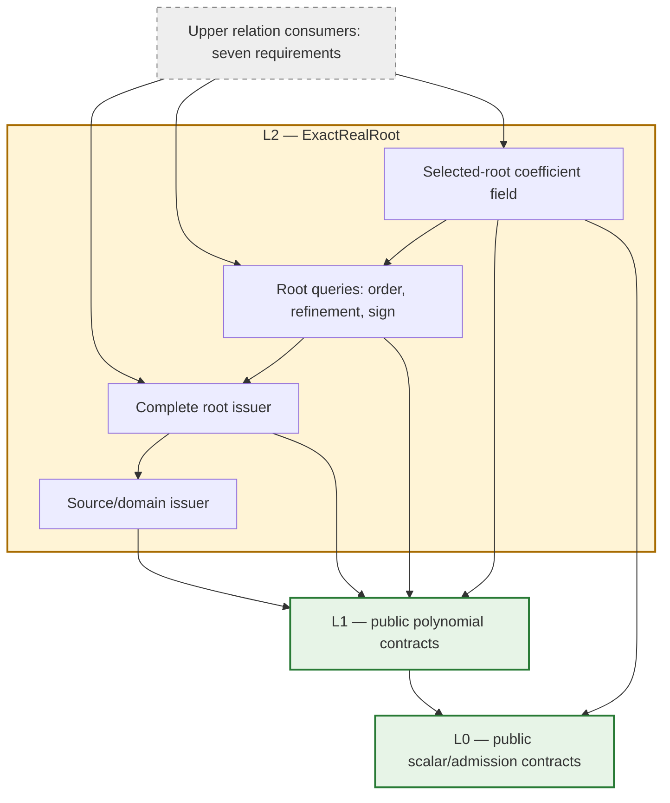
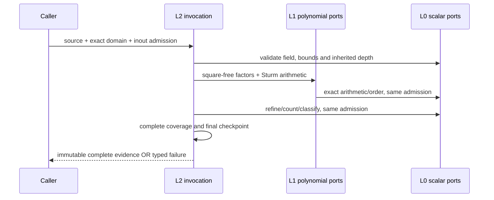
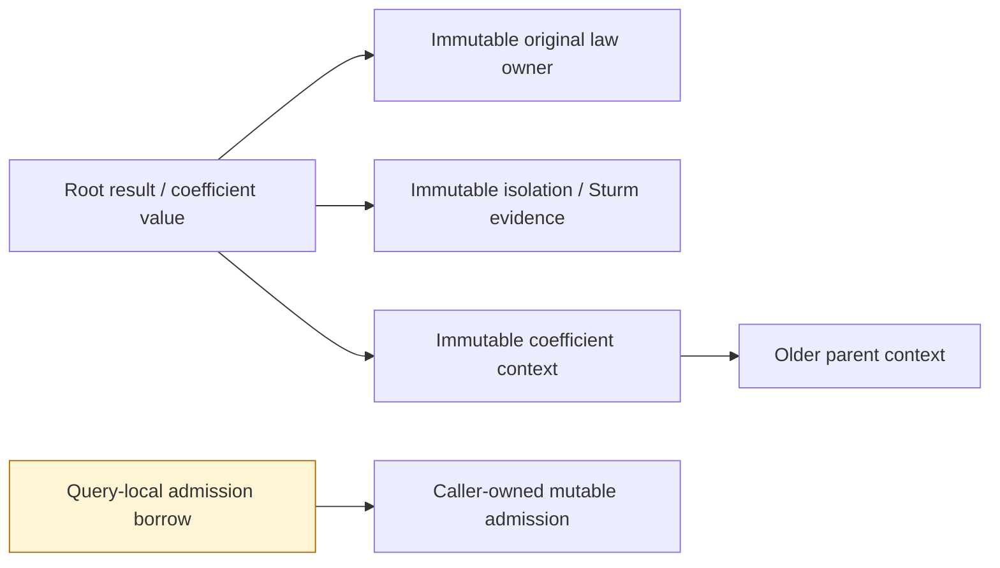

# Exact Real Root (L2)

## Purpose and Scope

Parent: [RationalBivariateAlgebra](../DESIGN.md). This document owns the proposed
L2 contract. L2 supplies complete real roots of a univariate polynomial and
retained selected-root coefficients. Its dependencies are L0, L1 and the Swift
standard library. This contract is the implementation authority. Implementation and target evidence
are tracked in the task PROGRESS.md; names below define the required public ports.

The supported mathematical input is an effective ordered subfield of the real
algebraic numbers, of characteristic zero. Scalar arithmetic and order must obey
the [L0 contract](../ExactScalar/DESIGN.md); conforming to a Swift protocol alone
does not establish these mathematical assumptions. Rational and retained
real-algebraic coefficients are required. Polynomial degree has no hidden fixed
cutoff; computation may fail under the caller's explicit resource limits.

L2 owns counting, isolation, original multiplicity, exact identity/order,
refinement, signs at selected roots and repeated algebraic extension. It does not
own multivariate cell decomposition, closure/incidence, geometric meaning,
parameter-domain seams or publication of CAD intersections. Those consumers use
L2 evidence later. L2 completion cannot count as completion of the seven CAD
requirements.

Placement is a component directory in the existing CADGeometry target, not a new
production package or module. An isolated verification graph may compile this
component against independently compiled L0 and L1. No higher CAD target is
required to establish this component's contracts.

## Responsibilities and Boundaries

| Owner | Generates and retains | Consumes |
|---|---|---|
| L0 | Exact scalars, arithmetic/order, admission capabilities | Caller work/storage/depth/cancellation |
| L1 | Polynomial owner, canonical terms, division, GCD, square-free factors | L0 public protocols |
| L2 source issuer | Original polynomial, selected variable, canonical one-variable law and coefficient owner | L1 public construction/validation |
| L2 root issuer | Complete counts, exclusions, isolations and original multiplicities | Bound source, exact domain, L1 arithmetic |
| L2 root queries | Equality/order, refined isolation, signs at one retained root | Issued roots and the same coefficient field |
| L2 extension issuer | Immutable parent field, selected root, exact fractions and explicit embeddings | Complete unique-root evidence |
| Upper consumers | Multivariate relations and geometric results | L2 public contracts; no root-issuer internals |

L2 calls public L1 operations. It does not read polynomial `context`, domain
`field`, internal coefficient extraction or private legacy field/root machinery.
Extraction/reindexing of public terms is L2 source preparation, charged to the
same admission; polynomial arithmetic remains in L1.

## Related Designs

| Design | Relationship | Contract Used | Summary | Cautions |
|---|---|---|---|---|
| [RationalBivariateAlgebra](../DESIGN.md) | parent; used by | Issued root evidence | Higher algebra consumers compose L2 | Existing consumers require their own migration and verification |
| [ExactScalar](../ExactScalar/DESIGN.md) | depends on | Arithmetic, ordering, importing, admission, depth and typed failures | L0 owns exact values and resource semantics | Do not introduce a replacement ledger or inspect private field contexts |
| [ExactPolynomial](../ExactPolynomial/DESIGN.md) | depends on | Construction, decisions, calculus, division, GCD, square-free decomposition | L1 owns polynomial semantics | Polynomial-owner checks and inherited depth remain mandatory |

### Confirmed Lower Facts and Required Change

| Confirmed implementation path | Consequence for L2 |
|---|---|
| [L0 admission](../ExactScalar/ExactScalarAdmission.swift) has four non-generic requirements | Every stage forwards the same caller admission |
| [L1 domain](../ExactPolynomial/ExactPolynomialDomain.swift) validates identical polynomial context; its field getter is internal | Create coefficient field and polynomial domain together; expose the retained construction domain |
| [L1 calculus](../ExactPolynomial/ExactPolynomialDomain+Calculus.swift), [division](../ExactPolynomial/ExactPolynomialDomain+Division.swift), [GCD](../ExactPolynomial/ExactPolynomialDomain+GCD.swift) and [square-free decomposition](../ExactPolynomial/ExactPolynomialDomain+SquareFree.swift) are public | Build root algorithms from these ports, not a second polynomial engine |
| [Legacy isolation](../ExactScalar/ExactUnivariateRootIsolator.swift) returns rational finite-interval root brackets | This does not establish the proposed complete result, unbounded domains or generic algebraic coefficients |
| [Legacy selected root](../ExactScalar/ExactAlgebraicRealRoot.swift) retains a defining law and Sturm evidence | Retention and exact zero decisions are existing foundations; legacy private APIs are not L2 dependencies |

The [current lower verification record](../../../../Tests/L1PolynomialVerification/RESOURCE-REPAIR-VERIFICATION.md)
establishes its recorded L0/L1 snapshots and targets. It establishes no new L2
algorithm or interface. Existing implementations remain intact during this
design task; lower declarations and resource meanings are unchanged.

## Architecture

Arrows denote dependency on a contract, not scheduling prerequisites for an
entire upper requirement.

Green denotes implemented lower contracts with the recorded evidence. Yellow
denotes this fixed design awaiting implementation. Gray denotes upper scope.
The coefficient field's recursive calculations always use a strictly smaller
parent extension level. This is value-level recursion within L2, not a module
dependency back from L0 or L1 to L2.

### Proposed Protocols and Implementations

Each operation below is a protocol requirement. Public protocols are generic
over associated field/value types; calls involving generic admission use static
dispatch. Immutable result data are structs with read-only properties, not
protocols added solely to abstract their storage. Each implementation file owns
one principal type.

| Protocol | Requirements | Concrete owner |
|---|---|---|
| `ExactRealRootPreparing` | Retained construction domain; bind polynomial/variable; validate exact root domain | `ExactRealRootDomain<F>` |
| `ExactRealRootProducing` | Count distinct roots and multiplicities; isolate every selected root | `ExactRealRootDomain<F>` |
| `ExactRealRootQuerying` | Compare issued roots; refine to positive exact width; sign of a bound polynomial at an issued root | `ExactRealRootDomain<F>` |
| `ExactAlgebraicExtending` | Establish base family; adjoin a selected root; return generator and explicit parent embedding | `ExactAlgebraicScalarDomain<Base>` |

Root operations take `inout A`, where `A: ExactScalarAdmission & ~Copyable`, and
throw `ExactRealRootFailure`. Field operations conform to existing L0
`ExactScalarArithmetic`, `ExactScalarOrdering` and `ExactScalarImporting`, using
their existing `ExactScalarFailure`. No unbudgeted convenience entry performs
the same root computation.

The associated types are the coefficient field F, its L1 polynomial, and the
issued source/count/set/root types below. Required operation shapes are fixed:

| Requirement | Input besides admission | Output |
|---|---|---|
| `polynomials` | Read-only property | Retained `ExactPolynomialDomain<F>` for source construction |
| `bind` | Polynomial, selected variable, explicit value/coefficient refinement axis | `ExactRealRootSource<F>` |
| `domain` | Empty selection or bounds and inclusion flags | Validated `ExactRealRootInterval<F.Value>` |
| `count` | Source and domain | `ExactRealRootCount<F>` |
| `isolate` | Source, domain and immutable query limits | `ExactRealRootSet<F>` |
| `compare` | Two roots in the retained common coefficient owner | L0 `ExactOrder` |
| `refine` | Root and strictly positive width in F | New `ExactRealRoot<F>` with unchanged scalar/source identity |
| `sign` | Bound polynomial and root in that common owner | L0 `ExactSign` |
| `base` | Base field and immutable extension policy | Level-zero `ExactAlgebraicScalarDomain<Base>` |
| `adjoin` | Root issued over the identical parent field | New domain, generator and read-only verified parent embedding |

Refinement and count retain the source's policy and inherited depth; no
operation takes a replacement source law to redefine an issued root. Field
`importing` accepts a retained scalar from this family and proves the identical
owner or ancestor embedding path under the caller admission.

## Contracts and Invariants

### Source and Input Domain

`ExactRealRootDomain<F>` retains F and creates its L1 construction domain in the
same admitted initialization. Source issuance validates polynomial ownership
through a public L1 decision before inspecting its terms. All powers outside
the selected variable must be zero. A checked, admitted map creates a canonical
one-variable law while retaining the original polynomial and variable index.
Foreign polynomials require explicit L1 import when F supports it; they are not
accepted by guessing coefficient or context equivalence.

`ExactRealRootInterval<F.Value>` has exact finite bounds or signed infinity and
explicit endpoint inclusion. Infinity is a domain tag, never a scalar or Double.
There is an explicit empty domain. Reversed finite bounds are invalid; equal
finite bounds select a singleton only when both endpoints are included. Endpoint
values must belong to the retained coefficient field or be explicitly embedded
before issuance. L2 supports every finite inclusion combination and both
unbounded directions.

### Issued Evidence

All evidence constructors are issuer-only. Read-only data retain strong
immutable owners; consumers cannot manufacture completeness flags.

| Proposed value | Required retained meaning |
|---|---|
| `ExactRealRootSource<F>` | Original polynomial, variable mapping, canonical law, coefficient owner and inherited depths |
| `ExactRealRootCount<F>` | Requested domain; finite distinct count and total multiplicity, or whole-domain zero-law classification; source and counting evidence |
| `ExactRealRootSet<F>` | Same classification; every selected root in exact increasing order; complete coverage and exclusion evidence |
| `ExactRealRoot<F>` | Source, square-free factor, original multiplicity, unique-root isolation, global distinct-root ordinal of the source on the real line, depth provenance |

For the zero polynomial, the solution is the whole requested domain; no finite
root list or finite multiplicity is invented. An empty requested domain has a
certified empty result even for the zero law. A nonzero constant has a complete
empty result. For a nonzero polynomial, emitted distinct roots equal the exact
domain count and their multiplicities sum to the counted total multiplicity.
Unfinished enumeration cannot return a result object.

A root's isolation is a representation of its value, not its identity. Refining
or filtering its domain preserves source/root identity. Original multiplicity
belongs to the source occurrence: the same scalar can have different
multiplicities in different input polynomials. Cross-polynomial equality is an
exact decision in a common coefficient owner; source identifiers, pointers,
overlapping intervals and close numerical values do not prove scalar equality.

### Root Algorithm

1. Validate source, domain, field and inherited depth under the caller admission.
2. Use L1 square-free decomposition, preserving each factor's original
   multiplicity. Construct Sturm chains by differentiation and negative exact
   remainders. Degree must strictly decrease. Only proven positive rescaling
   preserves chain signs; arbitrary monic normalization of signed chain members
   is not allowed.
3. Evaluate finite endpoint signs exactly, with explicit endpoint-zero treatment.
   Determine signs at infinity from degree and leading coefficient. An exact
   coefficient root bound encloses all real roots; it is not a finite search
   window assumed to cover an unbounded input.
4. Subdivide admitted exact brackets until each selected root has count one.
   Root counts and endpoint selection, rather than residuals, certify each root.
   Order roots from all factors exactly; preserve nearby distinct roots.
5. Verify the selected count, multiplicities and exclusions before final
   checkpoint and atomic result issuance.

The root bound can be formed in F as `1 + max(abs(a_i / a_n))` for a nonconstant
law. All arithmetic and comparisons use L0, including signs at algebraic
endpoints. Exact bisection uses field arithmetic, not rounded representatives.
Global root ordinals use counts from negative infinity, preserving identity
when the same source is queried on different domains.

When a public L1 evaluation returns `ExactPolynomialEvaluation`, its depth
receipt is admitted and retained with the result; extracting the bare scalar
must not discard attained depth from the root evidence.

Equality between roots of different laws uses their GCD and unique-root
evidence in the common field. If roots are different, exact refinement separates
their order. To sign q at a selected root of p, first prove zero or nonzero using
GCD and root counting. For a nonzero value, refine the selected isolation until
q has no zero in that bracket and evaluate its strict sign. A singleton uses
exact evaluation. Every step retains the original root law and inherited depth;
failure to establish the requested result propagates.

### Selected Roots as Coefficients

`ExactAlgebraicScalarDomain<Base>` uses one stable Swift value type
`ExactAlgebraicScalar<Base>` at every runtime extension level. Repeated
adjoining does not construct successively nested Swift generic types or require
a compile-time tower depth. Base is an L0 exact ordered/importable field;
rational and previously retained algebraic bases must be supported.

An immutable extension context retains its parent and one uniquely selected
root over that parent. A value is a retained base value or a fraction
`N(alpha)/D(alpha)` whose L1 polynomials belong to the parent field. The issuer
proves the denominator is nonzero at this selected root. Equality and signs use
selected-root decisions. A reducible defining law is acceptable: no assumption
that its quotient ring is a field, or that the law is a minimal polynomial,
replaces these decisions. Arithmetic may reduce expressions exactly, but must
validate a denominator before any cancellation that could hide its zero.

`adjoin` returns a new domain, its generator and a verified parent-to-child
embedding. Imports accept the identical owner or a certified ancestor path and
preserve the exact selected conjugate, coefficients and depths. Unrelated or
sibling owners fail `incompatibleDomain`; this design does not add automatic
compositum construction. A relation consumer needing several roots chooses a
common ordered tower and issues/transports each defining law through explicit
verified embeddings before asking L2 to decide them. Equality in an unrelated
field is not falsely reported as inequality.

## Runtime Flows

Repeated root queries borrow retained evidence but receive a new explicitly
supplied caller admission. Stored proofs retain their attained depths; they do
not retain an old mutable budget or acquire a fresh allowance internally.

### Bounded Admission Specialization

L1 wraps its admission generically. Naively nesting such wrappers while a
coefficient sign recursively invokes a parent root calculation can demand
unbounded Embedded specialization. The proposed internal root kernel therefore
uses one fixed `ExactRootBorrowedAdmission` type.

A synchronous invocation owns a scoped forwarding object with the caller's
exclusive admission borrow and observed depth. A private class-bound protocol
declares all four admission operations and depth observation as non-generic
requirements. The fixed handle calls only these requirements; no extension-only
existential calls or `type(of:)` are used. The generic public entry establishes
the borrow once for that entry and invokes the fixed kernel. Nested field
entries also enter this fixed kernel, keeping its generic type set finite.

The only unsafe boundary is a scoped pointer to the caller's `inout` admission,
following the existing lower invocation pattern. Its owner and handles cannot
escape the synchronous scope, enter a result, cross concurrency isolation or
outlive that pointer. All reads/mutations forward to that one exclusive caller
borrow. The forwarding object is allocated with native Swift ownership and its
typed payload/header is admitted before allocation. No manual memory allocator,
global ledger, copied allowance or new public adapter framework is introduced.
This new bridge requires its own compile/link/runtime and ASAN evidence; lower
bridge evidence does not prove it works.

## State, Ownership, and Lifecycle

Strong ARC references retain laws, coefficients and proof buffers after original
input variables leave scope. Contexts refer only to older contexts and their
evidence; they contain no child back-reference. Refinement returns new immutable
evidence and leaves existing evidence usable. Arrays/COW retain admitted owners;
sharing does not justify unadmitted mutation copies. No shared mutable cache is
required. Independent queries may share immutable evidence, with separate
exclusive admissions, on all targets under the same Sendable contracts.

## Failure, Concurrency, and Constraints

`ExactRealRootFailure` distinguishes invalid source/variable/domain, incompatible
owner, invalid evidence, unresolved proof, count overflow, root-result limit,
extension-level limit, and original L0/L1 failures. It preserves cancellation,
division by zero and caller admission rejection, not a blanket `unresolved`.
Field protocol implementations keep L0's typed failure signature; additional
L2 causes are retained in `admissionRejected` when no existing L0 case expresses
the cause. No lower enum must change for this design.

| Resource | Owner and rule |
|---|---|
| Work | Same caller L0 admission for validation, factorization, counting, comparisons, refinement and issuance |
| Storage | Same cumulative logical payload admission; checked native typed sizing for arrays, terms, pending slots, chains and owners before materialization/COW |
| Value/coefficient depth | Preserve both inherited axes; source explicitly selects the refinement axis; moving a root into a coefficient never erases an attained axis |
| Returned root count | Immutable L2 query limit; count-only queries need not enumerate; isolation refuses atomically when the exact count exceeds the limit |
| Extension level | Immutable field-family ceiling, separate from refinement depth; checked before parent descent and adjoining |
| Cancel | Entry, every causal work operation and after the final callback before publication |

Extension level bounds native call nesting as well as retained tower complexity.
Depth observers capture opaque base-value admission without inspecting concrete
scalar representation. L2 preserves the L0 cumulative payload meaning; it does
not claim to cap exact allocator capacity, RSS or unmeasured stack bytes.

This implementation requires explicit caller result/extension ceilings and
provides no implicit default. Both are checked nonnegative Int policies; zero
refuses enumeration/adjoining while preserving count-only/base operations. The
caller/deployment owns their selection and the same cumulative L0 limits. A
future convenience default requires guarded measurements on its supported
configuration and corresponding boundary/failure evidence. Changing deployed
ceilings requires boundary/resource tests on affected targets. There is no budget reset between stages or alternative-solver replay
after failure. An interrupted query returns no partial root set.

The same owner, Sendable, admission and failure contracts apply to Native,
ordinary WASM and Embedded WASM. Embedded is not a reason to remove synchronization
or weaken ownership. The proposed implementation has immutable shared state and
query-local mutable state; adding shared mutable state requires a separate
review of the owning design before implementation.

## Verification and Change Impact

Verification belongs to a future `Tests/L2RealRootVerification` owner compiling
the actual L2 sources against only L0/L1. It must use timeouts, dedicated build
paths and recorded source inventories. No L2 build or runtime evidence exists
from this design task.

| Contract | Required behavioral evidence |
|---|---|
| Complete roots | Rational and algebraic coefficients; no hidden degree cutoff; simple/even/odd multiple roots; close distinct roots; count/list/multiplicity agreement |
| Domain completeness | Empty/zero/constant laws; all endpoint flags; singleton; roots outside selection; both infinities and proved root bounds |
| Exact root queries | Same scalar from different laws; different conjugates; order after overlapping brackets; exact zero/nonzero sign; positive-width refinement preserves identity |
| Extension composition | Runtime repeated adjoining using the same static type; ancestor embedding; selected conjugate retention; reducible law; denominator vanishes at selected root; incompatible sibling rejection |
| Ownership/concurrency | Drop original inputs and creating domains, then query evidence; retain old refinements; concurrent immutable readers with independent admissions |
| Resources/failure | Independently exhausted work/storage/both depths/root count/extension level; overflow; entry/final cancellation; unresolved operation cannot publish empty/partial success |
| Portable invocation | Native and ASAN scoped-borrow paths; ordinary and Embedded WASM compile/link/runtime; protocol witness forwarding and recursively nested root-as-coefficient calculation |

Fixed Swift 6.4.0 and matching SDKs are the current target baseline. Validation
must execute each actual path; compilation or protocol declarations alone do
not prove the forwarding bridge or root algorithm. Explicit caller extension
ceilings must be exercised through success and refusal paths on each target;
no unmeasured default or unlimited-resource completion is claimed.

Implementation should close three bounded units in order: (1) source/domain,
receipts, admission bridge and rational complete roots; (2) exact root queries
and algebraic-coefficient roots with complete domain/multiplicity semantics;
(3) runtime extension composition and cumulative portable verification. These
are implementation stages, not additional changes authorized by this design
task. L2 is complete only when all required inputs and evidence above are closed.

L0/L1 evidence may be reused while their source and assumptions remain unchanged.
A lower contract change requires rechecking L2's actual consumed guarantees.
L2 implementation changes require its component tests; upper public CAD paths
require separate integration evidence when consumers adopt L2. No seven-requirement
completion or main integration is inferred from this document.

### Implementation Ownership

The L2 implementer owns this directory, the direct parent index, the isolated
Tests/L2RealRootVerification package and task PROGRESS.md. L0/L1 production files
and the production package graph are preserved. The three implementation units
and final cumulative verification in PROGRESS.md close only this design's gaps.
Root result and extension limits require explicit caller arguments until measured
portable defaults can be justified; no implicit guessed ceiling is issued.

The forwarding implementation uses a non-generic class with four scoped closures.
This preserves macOS 14: erasing a class parameterized by noncopyable admission
would otherwise require macOS 15 runtime support. Closure storage uses ordinary
throwing functions internally; requirements map the preserved scalar failure to
their typed signature. Class payload, header and the four captured pointer
contexts are admitted before construction. Pointer lifetime and fixed kernel
specialization are unchanged.

Fraction normalization cancels the parent-field polynomial GCD only after the
original selected-root denominator has been proved nonzero, then normalizes its
leading coefficient through public L1 scaling. Already lower-degree expressions
retain their buffers. Constant signs delegate to the parent field; linear signs
compare their exact zero with the retained original Sturm root, without creating
another root law. This bounds expression growth without relaxing admission.

Public retaining initializers recover the identical root domain from an issued
source, and the identical coefficient domain from a retained scalar. These
initializers admit inherited depth and cancellation without rebuilding owners
or changing extension policy. They make post-input-destruction evidence usable.
