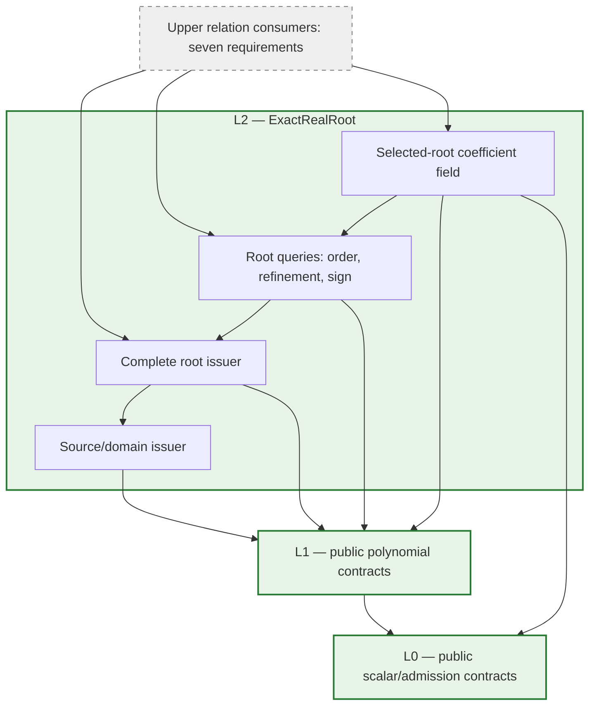
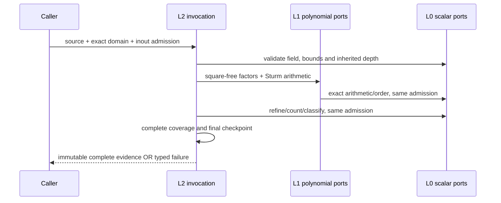
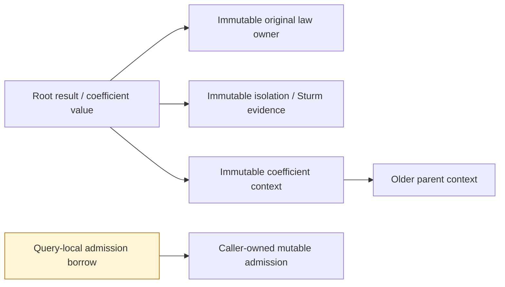

# Exact Real Root (L2)

## Purpose and Scope

Parent: [RationalBivariateAlgebra](../DESIGN.md). This document owns the implemented
L2 contract. L2 supplies complete real roots of a univariate polynomial and
retained selected-root coefficients. Its dependencies are L0, L1 and the Swift
standard library. This contract is the implementation authority. Implementation and target evidence
are tracked in the task PROGRESS.md; names below define the required public ports.

The supported mathematical input is an effective ordered subfield of the real
algebraic numbers, of characteristic zero. Scalar arithmetic and order must obey
the [L0 contract](../ExactScalar/DESIGN.md); conforming to a Swift protocol alone
does not establish these mathematical assumptions. Rational and retained
real-algebraic coefficients are required. Polynomial degree has no hidden fixed
cutoff; computation may fail under the caller's explicit resource limits.

L2 owns counting, isolation, original multiplicity, exact identity/order,
refinement, signs at selected roots and repeated algebraic extension. It does not
own multivariate cell decomposition, closure/incidence, geometric meaning,
parameter-domain seams or publication of CAD intersections. Those consumers use
L2 evidence later. L2 completion cannot count as completion of the seven CAD
requirements.

### Single-root count consumption

If a retained count proves exactly one distinct root from one square-free
factor, isolation consumes that complete count and the same finite scope. It
retains the original factor proof, source, global ordinal and multiplicity,
performs the causal visit and final publication checkpoint, and avoids counting
the same scope again. Unbounded scopes first use the existing complete Cauchy
bound. Global ordinal is still proved against the preceding full-real interval.
The general multi-factor/multi-root separation algorithm remains unchanged.
The concrete sphere-cone interior radical otherwise repeats its complete count
inside the one-root branch and exhausts the unchanged work admission.

### Adjoining an issued immutable root

Every L2 root issuer proves one unique defining root in its retained isolation;
refinement preserves that property before publishing a replacement. Adjoin
validates coefficient-context identity and readmits source/root/isolation/proof
depth, extension ceiling and cancellation, then consumes that immutable
receipt. It does not count the same root again. Public callers cannot construct
an unchecked root. Original source, global ordinal and multiplicity remain
retained by the child context. The concrete bounded sphere-cone source reaches
its unchanged work ceiling during that redundant second count.

### Linear signs at a retained pure-square root

For a retained root z of the checked monic law z^2-r, r>0, an isolation
entirely on one side of zero proves its sign. For a linear expression a+b*z,
same-signed terms decide directly; opposing terms compare b^2*r with a^2 in
the parent ordered field. Exact equality gives zero. This avoids a second
Sturm-Tarski construction while preserving the selected root, its original
owner/ordinal and all caller admission. An incompatible law or isolation keeps
the existing general sign algorithm. The required source input is the
sphere-cone critical cosine over sqrt(C); near-zero is never rounded to zero.

### Already-finite isolation domains

After source/endpoint/depth validation, an already finite requested isolation
interval is retained directly. Its exact root count already refers to that full
interval. A Cauchy bound is needed only to turn an unbounded endpoint into a
finite isolation scope. Open/closed endpoints, original ordinals and refinement
visits remain unchanged; no admitted interval is widened or replaced by samples.

### Checked pure-square Sturm construction

A canonical monic univariate law x^2-r with r>0 admits the exact Sturm chain
[x^2-r,x,1]. It has no repeated root because r is nonzero. L2 verifies the
polynomial shape, leading coefficient and constant sign in the original field,
then counts the requested interval with this retained chain. Original source,
root ordinals, multiplicity one, domain endpoints, root ceiling, causal visits,
owners and caller work/storage/depth/cancel admission are unchanged. No generic
square-free or field-inverse operation is needed for this verified form.
Other law shapes and r<=0 keep the existing complete generic algorithm.
The concrete caller is the sphere-cone critical-cosine source law over a retained
physical/algebraic field; generic square-free normalization exhausts8388608 work.

### Positive Sturm unit normalization

Sturm construction makes each nonzero chain member monic through L1, then
restores its original leading sign. The exact multiplier is positive, so every
finite/infinite variation sign, zero, root count and original multiplicity is
unchanged. Recurrence uses those same normalized members; positive scaling of
the dividend/divisor preserves the sign of the negative remainder. Original
source law and defining root identity remain retained. Arithmetic, payload,
refinement depth and cancellation use the same caller admission.

The weighted quadratic Native CS regression reached square-free decomposition
and both Sturm constructions after the L1 field-GCD repair, but exhausted its
unchanged 16,777,216 work allowance evaluating the unnormalized rational chains.
That input, complete L2 multiplicities/domains/signs and retained L3 definitions
are the behavioral evidence for coefficient-size control, without changing
root existence, merging roots or weakening the requested domain.

### Complete sorted exact candidate publication

`ExactRealRootProducing.isolate(_:fromSortedExactCandidates:limits:using:)`
accepts strictly ordered coefficient-field values. Exact L1 division strips every
power of each candidate's monic linear factor, proving its original multiplicity.
A nonzero constant quotient proves complete splitting over the entire real line;
no generic square-free decomposition or interval isolation is needed in that
case. A remaining nonconstant quotient must have an exact zero-real-root count.
Each root retains a singleton linear Sturm proof, the original source and its
global ordinal. Incomplete, duplicated, unordered or extraneous candidates fail
atomically. Zero source laws are rejected by this finite-candidate port.
The source owner, full-real exclusion proof, independent root ceiling, causal
root visits, retained depths and final cancellation are preserved. This port
avoids repeating generic root isolation when exact values have already been
proved; it does not infer existence from residuals or expose partially validated
candidates. Exact division and any remaining exclusion proof consume the same
caller admission; failure does not trigger another solver.

### Retained defining-divisor refinement

Root queries can refine a retained root's internal defining proof to an exact
polynomial divisor. L1 exact division proves that the new law divides the
existing square-free defining law; the new Sturm proof must count exactly one
root inside the already retained isolation. That isolation already excludes
all other original roots, so this proves the same selected original root.
Source owner, global ordinal, original multiplicity and isolation are unchanged;
attained depths, causal refinement visit and final cancellation are retained.
A constant, unrelated or nondividing law fails explicitly. No root set is solved
again. L3 uses this port before adjoining a nonlinear section when an original
specialized cut of smaller degree vanishes at its complete union root, avoiding
an unnecessarily high-degree coefficient representation without changing identity.

### Refinement by an original vanishing law

`refine(usingVanishingLaw:)` consumes an original cut without assuming that it
is a divisor of the selected root's retained computational factor. L2 computes
the exact GCD with that factor, requires positive degree and exactly one root
in the retained isolation, and constructs the replacement Sturm proof. The
original source, ordinal, multiplicity and isolation remain unchanged. Invalid
or nonvanishing cuts fail explicitly. All GCD, proof and final checkpoint work
uses the same admission. The strict `usingDefiningDivisor` port is unchanged.

The composed mixed CS fixture exposes a concrete integration defect: L3 formerly
computed a divisor against the whole union, which need not divide the smaller
factor retained by factored isolation. L3 now delegates factor-relative
refinement through this port; it does not inspect L2 internal factor storage.
The regression includes a factored union and a vanishing cut that also contains
another union factor. Existing L2 rejection and L3 full-coverage tests remain
required, together with mixed CS and folded SSI publication.

### Exact Candidate Refinement

Root queries may refine an issued root to a supplied coefficient-field value
only after proving that the value is inside the original isolation, respects its
open endpoints, and is the unique root of the retained defining proof in the
new singleton interval. This retains the original source, ordinal, multiplicity,
proof and inherited depth. An approximate candidate or another root is rejected.
The operation uses the same admission and does not reset refinement depth.

L3 uses this contract when a specialized linear law proves the selected root's
exact value. In the production SSI singleton at `Double.leastNonzeroMagnitude`,
the previous L3 path repeatedly bisected overlapping isolations for zero and
that value, exceeding depth32 before applying the requested domain. Exact
candidate refinement separates those roots without weakening that limit or
changing the complete root set. Public SSI selection and root-query rejection
fixtures verify this change; existing width refinement remains unchanged.

Placement is a component directory in the existing CADGeometry target, not a new
production package or module. An isolated verification graph may compile this
component against independently compiled L0 and L1. No higher CAD target is
required to establish this component's contracts.

## Responsibilities and Boundaries

| Owner | Generates and retains | Consumes |
|---|---|---|
| L0 | Exact scalars, arithmetic/order, admission capabilities | Caller work/storage/depth/cancellation |
| L1 | Polynomial owner, canonical terms, division, GCD, square-free factors | L0 public protocols |
| L2 source issuer | Original polynomial, selected variable, canonical one-variable law and coefficient owner | L1 public construction/validation |
| L2 root issuer | Complete counts, exclusions, isolations and original multiplicities | Bound source, exact domain, L1 arithmetic |
| L2 root queries | Equality/order, refined isolation, signs at one retained root | Issued roots and the same coefficient field |
| L2 extension issuer | Immutable parent field, selected root, exact fractions and explicit embeddings | Complete unique-root evidence |
| Upper consumers | Multivariate relations and geometric results | L2 public contracts; no root-issuer internals |

L2 calls public L1 operations. It does not read polynomial `context`, domain
`field`, internal coefficient extraction or private legacy field/root machinery.
Extraction/reindexing of public terms is L2 source preparation, charged to the
same admission; polynomial arithmetic remains in L1.

## Related Designs

| Design | Relationship | Contract Used | Summary | Cautions |
|---|---|---|---|---|
| [RationalBivariateAlgebra](../DESIGN.md) | parent; used by | Issued root evidence | Higher algebra consumers compose L2 | Existing consumers require their own migration and verification |
| [ExactScalar](../ExactScalar/DESIGN.md) | depends on | Arithmetic, ordering, importing, admission, depth and typed failures | L0 owns exact values and resource semantics | Do not introduce a replacement ledger or inspect private field contexts |
| [ExactPolynomial](../ExactPolynomial/DESIGN.md) | depends on | Construction, decisions, calculus, division, GCD, square-free decomposition | L1 owns polynomial semantics | Polynomial-owner checks and inherited depth remain mandatory |

### Confirmed Lower Facts and Required Change

| Confirmed implementation path | Consequence for L2 |
|---|---|
| [L0 admission](../ExactScalar/ExactScalarAdmission.swift) has four non-generic requirements | Every stage forwards the same caller admission |
| [L1 domain](../ExactPolynomial/ExactPolynomialDomain.swift) validates identical polynomial context; its field getter is internal | Create coefficient field and polynomial domain together; expose the retained construction domain |
| [L1 calculus](../ExactPolynomial/ExactPolynomialDomain+Calculus.swift), [division](../ExactPolynomial/ExactPolynomialDomain+Division.swift), [GCD](../ExactPolynomial/ExactPolynomialDomain+GCD.swift) and [square-free decomposition](../ExactPolynomial/ExactPolynomialDomain+SquareFree.swift) are public | Build root algorithms from these ports, not a second polynomial engine |
| [Legacy isolation](../ExactScalar/ExactUnivariateRootIsolator.swift) returns rational finite-interval root brackets | This does not establish the L2 complete result, unbounded domains or generic algebraic coefficients |
| [Legacy selected root](../ExactScalar/ExactAlgebraicRealRoot.swift) retains a defining law and Sturm evidence | Retention and exact zero decisions are existing foundations; legacy private APIs are not L2 dependencies |

The [current lower verification record](../../../../Tests/L1PolynomialVerification/RESOURCE-REPAIR-VERIFICATION.md)
establishes its recorded L0/L1 snapshots and targets. It establishes no new L2
algorithm or interface. Existing implementations remain intact during this
design task; lower declarations and resource meanings are unchanged.

## Architecture

Arrows denote dependency on a contract, not scheduling prerequisites for an
entire upper requirement.

Green denotes independently verified implementation. Gray denotes upper scope.
Target-specific L2 evidence is owned by the verification package below.
The coefficient field's recursive calculations always use a strictly smaller
parent extension level. This is value-level recursion within L2, not a module
dependency back from L0 or L1 to L2.

### Public Protocols and Implementations

Each operation below is a protocol requirement. Public protocols are generic
over associated field/value types; calls involving generic admission use static
dispatch. Immutable result data are structs with read-only properties, not
protocols added solely to abstract their storage. Each implementation file owns
one principal type.

| Protocol | Requirements | Concrete owner |
|---|---|---|
| `ExactRealRootPreparing` | Retained construction domain; bind polynomial/variable; validate exact root domain | `ExactRealRootDomain<F>` |
| `ExactRealRootProducing` | Count distinct roots and multiplicities; isolate every selected root | `ExactRealRootDomain<F>` |
| `ExactRealRootQuerying` | Compare issued roots; refine to positive exact width; sign of a bound polynomial at an issued root | `ExactRealRootDomain<F>` |
| `ExactAlgebraicExtending` | Establish base family; adjoin a selected root; return generator and explicit parent embedding | `ExactAlgebraicScalarDomain<Base>` |

Root operations take `inout A`, where `A: ExactScalarAdmission & ~Copyable`, and
throw `ExactRealRootFailure`. Field operations conform to existing L0
`ExactScalarArithmetic`, `ExactScalarOrdering` and `ExactScalarImporting`, using
their existing `ExactScalarFailure`. No unbudgeted convenience entry performs
the same root computation.

The associated types are the coefficient field F, its L1 polynomial, and the
issued source/count/set/root types below. Required operation shapes are fixed:

| Requirement | Input besides admission | Output |
|---|---|---|
| `polynomials` | Read-only property | Retained `ExactPolynomialDomain<F>` for source construction |
| `bind` | Polynomial, selected variable, explicit value/coefficient refinement axis | `ExactRealRootSource<F>` |
| `domain` | Empty selection or bounds and inclusion flags | Validated `ExactRealRootInterval<F.Value>` |
| `count` | Source and domain | `ExactRealRootCount<F>` |
| `isolate` | Source, domain and immutable query limits | `ExactRealRootSet<F>` |
| `compare` | Two roots in the retained common coefficient owner | L0 `ExactOrder` |
| `refine` | Root and strictly positive width in F | New `ExactRealRoot<F>` with unchanged scalar/source identity |
| `sign` | Bound polynomial and root in that common owner | L0 `ExactSign` |
| `base` | Base field and immutable extension policy | Level-zero `ExactAlgebraicScalarDomain<Base>` |
| `adjoin` | Root issued over the identical parent field | New domain, generator and read-only verified parent embedding |

Refinement and count retain the source's policy and inherited depth; no
operation takes a replacement source law to redefine an issued root. Field
`importing` accepts a retained scalar from this family and proves the identical
owner or ancestor embedding path under the caller admission.

## Contracts and Invariants

### Shared-divisor specialization

L2 implements the [L0 ordered shared-divisor contract](../ExactScalar/DESIGN.md)
inside one scoped scalar invocation. For at least three numerators and a
nonconstant polynomial divisor in the selected coefficient field, it generates
one exact reciprocal through the existing division/local-inverse algorithm and
multiplies each numerator by that retained value. Original selected-root
calculation receipts, embeddings and inherited depth remain authoritative.
Base-field and constant-polynomial divisors use direct division; geometry never
selects this representation branch. Applicability is checked before arithmetic;
resource/cancellation/unresolved failures propagate without direct retry.
All outputs, including zero numerators, pass the existing scalar operations.
One caller admission owns applicability, inverse generation, element visits and
output publication. No new root solver, field extension or cache is added.
The [plane verification](../../../../Tests/OriginalDomainIdentityVerification/DESIGN.md)
checks equivalence, independent limits, foreign owners and performance against
scalar division while unchanged root-isolation evidence remains scoped separately.

### Source and Input Domain

`ExactRealRootDomain<F>` retains F and creates its L1 construction domain in the
same admitted initialization. Source issuance validates polynomial ownership
through a public L1 decision before inspecting its terms. All powers outside
the selected variable must be zero. A checked, admitted map creates a canonical
one-variable law while retaining the original polynomial and variable index.
Foreign polynomials require explicit L1 import when F supports it; they are not
accepted by guessing coefficient or context equivalence.

`ExactRealRootInterval<F.Value>` has exact finite bounds or signed infinity and
explicit endpoint inclusion. Infinity is a domain tag, never a scalar or Double.
There is an explicit empty domain. Reversed finite bounds are invalid; equal
finite bounds select a singleton only when both endpoints are included. Endpoint
values must belong to the retained coefficient field or be explicitly embedded
before issuance. L2 supports every finite inclusion combination and both
unbounded directions.

### Issued Evidence

All evidence constructors are issuer-only. Read-only data retain strong
immutable owners; consumers cannot manufacture completeness flags.

| Issued value | Required retained meaning |
|---|---|
| `ExactRealRootSource<F>` | Original polynomial, variable mapping, canonical law, coefficient owner and inherited depths |
| `ExactRealRootCount<F>` | Requested domain; finite distinct count and total multiplicity, or whole-domain zero-law classification; source and counting evidence |
| `ExactRealRootSet<F>` | Same classification; every selected root in exact increasing order; complete coverage and exclusion evidence |
| `ExactRealRoot<F>` | Source, square-free factor, original multiplicity, unique-root isolation, global distinct-root ordinal of the source on the real line, depth provenance |

For the zero polynomial, the solution is the whole requested domain; no finite
root list or finite multiplicity is invented. An empty requested domain has a
certified empty result even for the zero law. A nonzero constant has a complete
empty result. For a nonzero polynomial, emitted distinct roots equal the exact
domain count and their multiplicities sum to the counted total multiplicity.
Unfinished enumeration cannot return a result object.

A root's isolation is a representation of its value, not its identity. Refining
or filtering its domain preserves source/root identity. Original multiplicity
belongs to the source occurrence: the same scalar can have different
multiplicities in different input polynomials. Cross-polynomial equality is an
exact decision in a common coefficient owner; source identifiers, pointers,
overlapping intervals and close numerical values do not prove scalar equality.

### Root Algorithm

1. Validate source, domain, field and inherited depth under the caller admission.
2. Use L1 square-free decomposition, preserving each factor's original
   multiplicity. Construct Sturm chains by differentiation and negative exact
   remainders. Degree must strictly decrease. Only proven positive rescaling
   preserves chain signs; arbitrary monic normalization of signed chain members
   is not allowed.
3. Evaluate finite endpoint signs exactly, with explicit endpoint-zero treatment.
   Determine signs at infinity from degree and leading coefficient. An exact
   coefficient root bound encloses all real roots; it is not a finite search
   window assumed to cover an unbounded input.
4. Subdivide admitted exact brackets until each selected root has count one.
   Root counts and endpoint selection, rather than residuals, certify each root.
   Order roots from all factors exactly; preserve nearby distinct roots.
5. Verify the selected count, multiplicities and exclusions before final
   checkpoint and atomic result issuance.

The root bound can be formed in F as `1 + max(abs(a_i / a_n))` for a nonconstant
law. All arithmetic and comparisons use L0, including signs at algebraic
endpoints. Exact bisection uses field arithmetic, not rounded representatives.
Global root ordinals use counts from negative infinity, preserving identity
when the same source is queried on different domains.

When a public L1 evaluation returns `ExactPolynomialEvaluation`, its depth
receipt is admitted and retained with the result; extracting the bare scalar
must not discard attained depth from the root evidence.

General signs use Sturm–Tarski signed Euclidean remainder chains for the
square-free retained defining law p and p' * (q mod p). Every negative remainder
strictly descends degree; positive unit normalization preserves all variation
signs. One-sided signs at finite endpoints are obtained from the first nonzero
exact derivative, so open/closed root endpoints have explicit contributions.
A uniquely selected root gives a Tarski sum in {-1, 0, 1}; any other value is
invalid evidence. Constant, exact singleton and certified direct linear queries
remain valid short paths. PSC values do not serve as signed remainder chains.

Root equality/order first uses validated same-source global ordinals, then
certified disjoint isolations. Overlapping different laws are decided by exact
endpoint signs and Sturm variation counts with the selected root as a boundary;
chain signs at that boundary use the same Sturm–Tarski query. General ordering
and signs never wait for numeric isolations to separate. Width refinement and
strict separating-value generation remain separate explicit L2 operations.
Shared multi-sign evidence retains the same original root and all query sources,
with one derivative preparation and the same admission. No caller can issue
proof flags or manufacture source/selection evidence.

### Selected Roots as Coefficients

`ExactAlgebraicScalarDomain<Base>` uses one stable Swift value type
`ExactAlgebraicScalar<Base>` at every runtime extension level. Repeated
adjoining does not construct successively nested Swift generic types or require
a compile-time tower depth. Base is an L0 exact ordered/importable field;
rational and previously retained algebraic bases must be supported.

An immutable extension context retains its parent and one uniquely selected
root over that parent. A value is a retained base value or a fraction
`N(alpha)/D(alpha)` whose L1 polynomials belong to the parent field. The issuer
proves the denominator is nonzero at this selected root. Equality and signs use
selected-root decisions. A reducible defining law is acceptable: no assumption
that its quotient ring is a field, or that the law is a minimal polynomial,
replaces these decisions. Arithmetic may reduce expressions exactly, but must
validate a denominator before any cancellation that could hide its zero.

`adjoin` returns a new domain, its generator and a verified parent-to-child
embedding. Imports accept the identical owner or a certified ancestor path and
preserve the exact selected conjugate, coefficients and depths. Unrelated or
sibling owners fail `incompatibleDomain`; this design does not add automatic
compositum construction. A relation consumer needing several roots chooses a
common ordered tower and issues/transports each defining law through explicit
verified embeddings before asking L2 to decide them. Equality in an unrelated
field is not falsely reported as inequality.

## Runtime Flows

Repeated root queries borrow retained evidence but receive a new explicitly
supplied caller admission. Stored proofs retain their attained depths; they do
not retain an old mutable budget or acquire a fresh allowance internally.

### Bounded Admission Specialization

L1 wraps its admission generically. Naively nesting such wrappers while a
coefficient sign recursively invokes a parent root calculation can demand
unbounded Embedded specialization. The internal root kernel therefore
uses one fixed `ExactRootBorrowedAdmission` type.

A synchronous invocation owns a scoped forwarding object with the caller's
exclusive admission borrow and observed depth. A private class-bound protocol
declares all four admission operations and depth observation as non-generic
requirements. The fixed handle calls only these requirements; no extension-only
existential calls or `type(of:)` are used. The generic public entry establishes
the borrow once for that entry and invokes the fixed kernel. Nested field
entries also enter this fixed kernel, keeping its generic type set finite.

The only unsafe boundary is a scoped pointer to the caller's `inout` admission,
following the existing lower invocation pattern. Its owner and handles cannot
escape the synchronous scope, enter a result, cross concurrency isolation or
outlive that pointer. All reads/mutations forward to that one exclusive caller
borrow. The forwarding object is allocated with native Swift ownership and its
typed payload/header is admitted before allocation. No manual memory allocator,
global ledger, copied allowance or new public adapter framework is introduced.
This new bridge requires its own compile/link/runtime and ASAN evidence; lower
bridge evidence does not prove it works.

## State, Ownership, and Lifecycle

Strong ARC references retain laws, coefficients and proof buffers after original
input variables leave scope. Contexts refer only to older contexts and their
evidence; they contain no child back-reference. Refinement returns new immutable
evidence and leaves existing evidence usable. Arrays/COW retain admitted owners;
sharing does not justify unadmitted mutation copies. No shared mutable cache is
required. Independent queries may share immutable evidence, with separate
exclusive admissions, on all targets under the same Sendable contracts.

## Failure, Concurrency, and Constraints

`ExactRealRootFailure` distinguishes invalid source/variable/domain, incompatible
owner, invalid evidence, unresolved proof, count overflow, root-result limit,
extension-level limit, and original L0/L1 failures. It preserves cancellation,
division by zero and caller admission rejection, not a blanket `unresolved`.
Field protocol implementations keep L0's typed failure signature; additional
L2 causes are retained in `admissionRejected` when no existing L0 case expresses
the cause. No lower enum must change for this design.

| Resource | Owner and rule |
|---|---|
| Work | Same caller L0 admission for validation, factorization, counting, comparisons, refinement and issuance |
| Storage | Same cumulative logical payload admission; checked native typed sizing for arrays, terms, pending slots, chains and owners before materialization/COW |
| Value/coefficient depth | Preserve both inherited axes; source explicitly selects the refinement axis; moving a root into a coefficient never erases an attained axis |
| Returned root count | Immutable L2 query limit; count-only queries need not enumerate; isolation refuses atomically when the exact count exceeds the limit |
| Extension level | Immutable field-family ceiling, separate from refinement depth; checked before parent descent and adjoining |
| Cancel | Entry, every causal work operation and after the final callback before publication |

Extension level bounds native call nesting as well as retained tower complexity.
Depth observers capture opaque base-value admission without inspecting concrete
scalar representation. L2 preserves the L0 cumulative payload meaning; it does
not claim to cap exact allocator capacity, RSS or unmeasured stack bytes.

This implementation requires explicit caller result/extension ceilings and
provides no implicit default. Both are checked nonnegative Int policies; zero
refuses enumeration/adjoining while preserving count-only/base operations. The
caller/deployment owns their selection and the same cumulative L0 limits. A
future convenience default requires guarded measurements on its supported
configuration and corresponding boundary/failure evidence. Changing deployed
ceilings requires boundary/resource tests on affected targets. There is no budget reset between stages or alternative-solver replay
after failure. An interrupted query returns no partial root set.

The same owner, Sendable, admission and failure contracts apply to Native,
ordinary WASM and Embedded WASM. Embedded is not a reason to remove synchronization
or weaken ownership. The implementation has immutable shared state and
query-local mutable state; adding shared mutable state requires a separate
review of the owning design before implementation.

## Verification and Change Impact

Verification belongs to the [L2 verification package](../../../../Tests/L2RealRootVerification/DESIGN.md), compiling
the actual L2 sources against only L0/L1. It must use timeouts, dedicated build
paths and recorded source inventories. Executed target/snapshot evidence is in its
[verification record](../../../../Tests/L2RealRootVerification/VERIFICATION.md).

| Contract | Required behavioral evidence |
|---|---|
| Complete roots | Rational and algebraic coefficients; no hidden degree cutoff; simple/even/odd multiple roots; close distinct roots; count/list/multiplicity agreement |
| Domain completeness | Empty/zero/constant laws; all endpoint flags; singleton; roots outside selection; both infinities and proved root bounds |
| Exact root queries | Same scalar from different laws; different conjugates; order after overlapping brackets; exact zero/nonzero sign; positive-width refinement preserves identity |
| Extension composition | Runtime repeated adjoining using the same static type; ancestor embedding; selected conjugate retention; reducible law; denominator vanishes at selected root; incompatible sibling rejection |
| Ownership/concurrency | Drop original inputs and creating domains, then query evidence; retain old refinements; concurrent immutable readers with independent admissions |
| Resources/failure | Independently exhausted work/storage/both depths/root count/extension level; overflow; entry/final cancellation; unresolved operation cannot publish empty/partial success |
| Portable invocation | Native and ASAN scoped-borrow paths; ordinary and Embedded WASM compile/link/runtime; protocol witness forwarding and recursively nested root-as-coefficient calculation |

Fixed Swift 6.4.0 and matching SDKs are the current target baseline. Validation
must execute each actual path; compilation or protocol declarations alone do
not prove the forwarding bridge or root algorithm. Explicit caller extension
ceilings must be exercised through success and refusal paths on each target;
no unmeasured default or unlimited-resource completion is claimed.

Implementation should close three bounded units in order: (1) source/domain,
receipts, admission bridge and rational complete roots; (2) exact root queries
and algebraic-coefficient roots with complete domain/multiplicity semantics;
(3) runtime extension composition and cumulative portable verification. These
are implementation stages, not additional changes authorized by this design
task. L2 is complete only when all required inputs and evidence above are closed.

L0/L1 evidence may be reused while their source and assumptions remain unchanged.
A lower contract change requires rechecking L2's actual consumed guarantees.
L2 implementation changes require its component tests; upper public CAD paths
require separate integration evidence when consumers adopt L2. No seven-requirement
completion or main integration is inferred from this document.

### Implementation Ownership

The L2 implementer owns this directory, the direct parent index, the isolated
Tests/L2RealRootVerification package and task PROGRESS.md. L0/L1 production files
and the production package graph are preserved. The three implementation units
and final cumulative verification in PROGRESS.md close only this design's gaps.
Root result and extension limits require explicit caller arguments until measured
portable defaults can be justified; no implicit guessed ceiling is issued.

The forwarding implementation uses a non-generic class with five scoped closures.
This preserves macOS 14: erasing a class parameterized by noncopyable admission
would otherwise require macOS 15 runtime support. Closure storage uses ordinary
throwing functions internally; requirements map the preserved scalar failure to
their typed signature. Class payload, header and the five captured pointer
contexts are admitted before construction. Pointer lifetime and fixed kernel
specialization are unchanged.

Fraction normalization first reduces numerator and denominator modulo the retained
root's defining proof. This exact congruence preserves both values at that root,
including denominator zeros. For a variable denominator, admitted extended
Euclidean division through public L1 operations attempts an inverse modulo the
same law. A constant final GCD and checked remainder identity d * inverse = 1
prove the original denominator nonzero at every root of that law. The numerator
is then reduced with the inverse and the denominator becomes one. No interval
sign refinement is needed to re-prove this unit property.

For a reducible law with a nonconstant denominator GCD, the selected-root sign
must establish nonzero before removing the GCD from the calculation law. Exact
unique-root evidence proves that the quotient retains the selected root. A checked
modular inverse then gives a polynomial representation under that local law.
The original immutable coefficient context is unchanged. Per-value calculation
receipts retain both original and reduced root proofs. Operations combine local
laws by their exact GCD and verify the same selected root before reduction;
values without a local receipt use the original context law. Neither an
operand's receipt nor another retained value is mutated. Constant signs delegate
to the parent field. Typed failures never trigger another solver.

Root transport is an explicit requirement on importing coefficient fields. It
imports the original polynomial coefficients and finite endpoints through the
field's self/ancestor embedding, reissues the source in the target polynomial
owner, and verifies its selected interval contains exactly one root. It checks
original ordinal and multiplicity, imports any reduced defining law, and retains
both root owners in a read-only receipt. Input and isolation depths are admitted
before any work and are included in the issued root. Siblings and unrelated
coefficient owners are rejected by the embedding; there is no implicit compositum.

The Native weighted tangency stack reaches depth33 inside fraction denominator
sign refinement during exact coefficient subtraction. This normalization closes
that concrete representation amplification; its public input retains depth32
and work16,777,216. Reducible and zero-denominator fixtures remain mandatory.

Public retaining initializers recover the identical root domain from an issued
source, and the identical coefficient domain from a retained scalar. These
initializers admit inherited depth and cancellation without rebuilding owners
or changing extension policy. They make post-input-destruction evidence usable.

Receipts from separate root issuers require explicit reissuance in one common
root domain before root-to-root queries. The coefficient owner and polynomial
basis must both be compatible; a common field alone does not silently import a
foreign receipt. Public L1 importing/construction, the retained original law and
variable map, and certified L2 isolation provide that explicit path.

## Scoped Disjoint Comparison Optimization

After both root receipts, owners and depths are admitted, disjoint finite
isolation intervals decide order before GCD/Sturm construction. Equal endpoints
are disjoint only when at least one touching endpoint is excluded. Overlapping
receipts retain the original common-root proof and refinement algorithm.
Exact field comparison uses the same cumulative admission. Fixtures cover both
orders, identical roots, touching intervals and different-source comparisons;
existing multiplicity, refinement, tower and failure fixtures remain obligations.

## Singleton Sign Optimization

After both sources, proof ownership and causal depths are admitted, a finite
singleton isolating interval identifies its exact root coordinate. A nonlinear
query polynomial can be evaluated there directly without a GCD/Sturm proof.
Non-singleton intervals keep the existing exact algorithm. Zero/constant/linear
queries and all independent failure contracts retain their meaning. Verification
compares public polynomial evaluation and includes zero, either sign, foreign
owners, resource rejection and terminal cancellation.

## Cumulative Interval Visits

L2 consumes L0's required `visitCell(axis:depth:)` observation on the same caller
admission. Isolation observes each pending interval before its Sturm count,
including intervals proved empty. `contracted` observes the retained interval
before each refinement split, covering width refinement and isolation against
other source factors. General sign and root-order decisions use signed remainder
queries without interval bisection. Exact-candidate
refinement observes its retained isolation before proving candidate inclusion and
singleton root count. The source's `refinementAxis` identifies value versus
coefficient depth; the observed depth includes the interval and all already
admitted causal evidence. Merely re-admitting a receipt or calculating a depth
maximum does not create a visit.

`ExactRootInvocation`, its immutable scoped forwarding closures, and the borrowed
admission forward each event exactly once without changing its axis/depth, adding
work, or creating a new counter. The enclosing caller owns any shared cumulative
ceiling and any visit-related work charge. Existing L2 work charges, structural
root limits, depth steps, source/ordinal/multiplicity and algorithms remain
unchanged. Caller rejection and cancellation propagate atomically through the
existing typed scalar failure. Storage admission includes the fifth closure and
its captured pointer context before the scoped owner is constructed.

[Cell visit fixtures](../../../../Tests/L2RealRootVerification/Sources/Fixtures/CellVisitFixtures.swift)
exercise actual isolate plus refinement on one recorder: its measured cumulative
count N succeeds at N and fails at N-1 with the caller's retained cause. Both
refinement axes, exact-candidate refinement, inherited depths, terminal
cancellation and the existing work/storage limits retain separate evidence.
Geometry integration owns its allowance and public migration evidence; this port
does not claim that stored root count bounds cumulative visits.

## Twenty-Requirement Convergence Contract

The revised task is independent L0–L3 implementation and verification. It does
not change production package/module placement or add a dependency. Previous
upper integration snapshots and evidence are preserved; they do not prove this
revision. [L3](../ExactRealCell/DESIGN.md) consumes only the public ports below.

| Requirement | Public port / retained evidence | Owning implementation / behavioral fixture |
|---|---|---|
| L2-01 Original source | bind / ExactRealRootSource | Domain / retainedOwners, selected variable |
| L2-02 Exact domain | domain / ExactRealRootInterval | Domain / all endpoint and infinite cases |
| L2-03 Complete roots | count, isolate(source), isolate(count) / Count, Set | Producing / zero, constant, multiplicity, complete exclusion |
| L2-04 Original identity | compare, all refine / original source, ordinal, multiplicity | Query / same number under different laws, different conjugates |
| L2-05 Exact decisions | sign, signs, compare / query evidence | Signed remainder / common factors, dropped degrees, endpoint roots |
| L2-06 Selected-root field | scalar arithmetic / local calculation-law proof | Scalar arithmetic / reducible local inverses, zero denominator, mixed local laws |
| L2-07 Extension and transport | adjoin, importing, transport / original and embedded root correspondence | Extending, Transport / ancestor transfer, sibling rejection, original ordinals |
| L2-08 Refinement and separation | refine, separate / unchanged root and strict separation proof | Query, Separation / exact candidates, small defining factors, close roots |
| L2-09 Evidence reuse | isolate(count), signs / immutable original owner | Producing, Signed remainder / new independent admission and limits |
| L2-10 Lifetime and resources | all required ports / retained source, field lineage and depths | Scoped admission / input destruction, cancellation, storage, work, depth, readers |

Count consumption validates issuer ownership, original domain, inherited depth
and result ceiling; it does not repeat square-free factorization. Every root's
global original ordinal still requires full-source evidence. Separation returns
read-only refined left/right roots and a coefficient-field value with strict
left < value < right proof, preserving all original identities. Explicit root
transport validates self/ancestor coefficient embeddings, imports original and
computational laws and endpoint conditions, and preserves original ordinal,
multiplicity and attained depth in an immutable correspondence owner. Siblings
and unrelated owners fail; no automatic compositum is introduced.

For reducible calculation laws, denominator validation precedes cancellation.
If gcd(m,D) is nonconstant and D is nonzero at the selected root, m/gcd(m,D)
retains that root by exact unique-root evidence; its checked modular inverse
produces a local calculation representation. Calculation proofs are immutable
per value; operations establish a common selected-root law rather than changing
the coefficient context or any other retained value. Source identity and selected
conjugate always remain independent of the calculation law.

Required cost fixtures retain the weighted CS algebra equations/domains and
work16,777,216, storage and depth32 source limits, plus actual multistage
coefficient fields. A resource failure is not completion of either required
fixture. Fixed Swift6.4.0, matching normal/Embedded SDKs and ASAN run only the
independent graph. Final evidence binds the exact compiled source snapshot.

### S1 Independent Evidence

Swift 6.4.0 Native L2 verification passes 18 behavioral tests, including the
signed-decision fixture's roots separated by an exact least-subnormal coefficient,
different original laws selecting the same root, open/closed endpoint contributions,
batched zero/positive/negative queries, exact work/storage N and rejection at N-1,
terminal cancellation and foreign issuer rejection. All operations use the same
admission and preserve typed scalar or polynomial-wrapped scalar failures.
Normal-WASM, Embedded and ASAN evidence for this revision remains pending S5.

### S2 Independent Evidence

The Swift 6.4.0 Native L2 graph passes 20 behavioral tests. Local-law fixtures
prove two different degree-four calculation divisors under one original degree-six
law combine into a degree-two common law without changing either input receipt.
They reject the original zero denominator even with a zero numerator and retain
owners after preparation locals are released. Transport fixtures exercise a real
ancestor-to-child import at work16,777,216 and both depths32, three-variable
original layout, opposite conjugates, reduced laws, repeated singleton roots,
open endpoints, foreign polynomial owners, incompatible siblings, independent
allowances, inherited-depth rejection and final cancellation. The existing actual
three-stage coefficient tower also succeeds at work16,777,216 and both depths32.
Source review confirms immutable owners and one scoped caller admission; no
platform-specific stored state or synchronization branch was introduced.

### S3 Construction Boundary

#### Complete factored-count input

`count(source,in:domain,factoredBy:using:)` accepts untrusted factor sources in
the same root issuer and original variable. Each factor must have positive degree.
Pairwise exact GCDs must be constant, and sequential exact division of the retained
original law by every factor must leave a nonzero constant. These identities prove
complete coverage and disjoint root membership; incomplete, overlapping, foreign
or nonfactor hints fail without fallback. A nonzero constant source permits an
empty factor list, while a zero source cannot satisfy this factorization contract.

Each factor uses the existing square-free/count implementation under the same
borrowed admission. Its complete Sturm factors and original multiplicities are
combined in a count that retains the original source and requested domain. Existing
count isolation consumes that evidence to issue original global ordinals and
multiplicities without isolating a high-degree product. All hint, domain and proof
depths, exact divisions/GCDs, payloads and terminal cancellation remain admitted.
The mandatory weighted input owns the concrete regression: small verified cut
factors must complete under its unchanged work and depth ceilings. Invalid hints,
repeated factors, incomplete products and independent resource failures must reject.

Count isolation consumes the retained square-free factor Sturm chains. The sum
of their distinct counts certifies full-source exclusion and global ordinal, so
no second full-source decomposition or Sturm construction is needed. All retained
factor and domain depths are admitted. Exact-candidate count receipts use the
same port: their linear factors and residual exclusion proof cover the original
source. A new query pays its actual validation/refinement/output costs, while
sharing existing factor payloads.

`separate(left,right)` first proves strict order without bisection. It then owns
the necessary interval refinement, retains both unchanged original identities,
and issues a field value only after exact signs prove left < value < right.
Equal/reversed roots reject. Refinement retains attained depths and uses the same
caller admission; budget rejection never becomes a midpoint result. L3 consumes
this receipt for bounded sectors and owns no root-bisection loop.

### S3 Independent Evidence

Swift 6.4.0 Native L2 passes 22 tests. A measured fresh isolation and retained-count
isolation return the same original roots/ordinals/multiplicities; retained-count
uses fewer admitted work units and generated storage bytes. Complete exact-candidate
counts, constant exclusion, whole-domain zero, singleton selection, foreign owners,
result caps, exact resource ceilings and final cancellation are exercised.
Separation fixtures prove both strict inequalities through public sign queries for
overlapping roots, exact endpoints and every adjacent pair of a complete union.
Equality/reversed/foreign inputs reject; work/storage N-1 and depth limits reject
without modifying retained evidence. Scoped source review checks factor-count sums,
unchanged root source identities and only L2-owned interval contraction.

### S5 Final Independent Evidence

All twenty L2/L3 requirements are implemented and verified on the same source
snapshot: Native70, ASAN70, normal WASI and Embedded WASI succeed with pinned
Swift6.4.0 and matching SDKs. The mandatory recorded weighted input completes
within work16,777,216/depth32, and the actual three-stage coefficient tower passes.
Actual compiler inventories, source/log hashes, original reduction identities,
review scope and ownership/platform limits are recorded in
[ConvergenceEvidence](../../../../Tests/L3RealCellVerification/ConvergenceEvidence/VERIFICATION.md).

Source-bound lower evidence certifies this component and its composed L0–L3
graph. It does not certify L4 closure/incidence, geometric producers, upper
publication or the seven upper requirements. No upper CAD build was performed.

## Canonical Scalar Execution Optimization

`fraction` is the sole issuer of fraction storage; negation, arithmetic and
ancestor embedding return through that issuer. Its existing checked normalization
proves a constant unit denominator. Copies retain the same immutable proof and
owner. Arithmetic can therefore use polynomial numerators directly and reuse
the unit denominator; division still validates the original divisor numerator
and performs the existing checked modular inverse and local-law reconciliation.
Sign needs only the numerator. No public constructor can issue an unnormalized
fraction. This is an internal representation invariant, not a new public port.

After original root and polynomial depths/ownership are admitted, zero and constant
polynomial signs delegate to the retained parent coefficient field. Nonconstant
polynomials keep the original selected-root sign algorithm. Base scalar comparison
delegates to Base.compare after both scalar embeddings/depths are admitted.
Public entry and terminal cancellation, same cumulative work/storage, original
source/root/calculation receipts, reducible laws and zero denominator failure remain.
Removed products/source bindings generate no payload and receive no storage charge.

Verification compares optimized signs with independently bound public root-sign
queries and arithmetic identities, including zero, either sign, inverses, ancestor
embeddings, incompatible siblings, exact work/storage N and N-1, inherited depth
and terminal cancellation. Existing full weighted and real three-stage fixtures
measure cold-process batches at unchanged original ceilings. Native/ASAN and both
matching WASM SDKs verify the composed lower graph; upper adoption remains separate.

## Exact Domain Foundation Composition

[Exact Parameter Domain](../../OriginalDomainIdentity/ExactParameterDomain/DESIGN.md)
owns the shared L0-only interval/set meaning. `ExactRealRootBound` and
`ExactRealRootInterval` expose lossless wrappers; the root facade delegates construction
to its checked kernel, retains depths discovered by its admission, and maps failures
back to the established L2 error cases. Root field ownership, algorithms and original
source receipts remain in L2. Its isolated graph adds DI0, while DI0 never imports L2.
Open/closed/singleton/empty/unbounded root-count fixtures and existing L2 failure,
depth and owner tests own the affected regression. No shape or L3-L6 build is required
for this boundary. Six downstream verification manifests declare the transitive DI0
module so the isolated facades remain composable; those upper graphs are not executed
as part of DI0 acceptance.

The isolated L2 facade keeps its bound enum and read-only interval member types local
to L2. The interval contains exactly one shared DI0 value; bound conversion preserves
finite values and infinity tags, adds no coefficient buffer, and performs no second
validation. This avoids leaking the DI0 alias into consumers on Embedded, whose
specialization requires the declaring module to be imported by the consuming file.
Only the root construction/access files import DI0; no upper source changes are needed.

### Original Coordinate Handoff

An additive exact-coordinate transfer consumes retained L2 field values over an
OriginalExactScalarDomain Base. It walks their parent tower, translates exact
parent coefficients and fractional expressions, and retains the original selected
root. A dyadic bracket is refined until the same retained L2 root is the unique
root of its original definition within the bracket. L0 then validates and binds
that selector through its checked transfer protocol. The bridge keeps the full
L2 value owner and attained depths; no geometric equations are solved again.
An invocation-local table shares transferred owners. This addition changes no
existing root-solving, field-import or selected-root contract. Its proof compiles
only the new bridge against immutable cached L2 modules; it does not rebuild L2.
The first base-context transfer admits its internal one-value source array before
materialization, using checked typed payload bytes on the same caller admission.
The L0 receipt shares that backing; reusing a mapped base context creates no new
source array and receives no repeated payload admission. CoordinateProof verifies
the first base transfer stops at this admission when only the output array fits,
without deriving the expected limit from an execution-measured ledger total.

A fraction evaluates its retained sparse polynomials before requesting a generator.
Exponent-zero terms use only their exact parent coefficients; zero polynomials
require no generator. A positive exponent requests the original context generator
once, shared by numerator and denominator. Parent coefficients that themselves
depend on a root still use the existing checked recursive transfer. This uses the
issued canonical term powers, never numerical residuals or proximity. The returned
value explicitly retains the maxima of source, context, calculation and produced
value depths on both axes, even when its output field omits an unused extension.
The transfer receipt retains the full original L2 source tower after caller inputs
leave scope. Denominator division, destination depth policy, storage admission,
entry/final cancellation and original selectors on necessary roots remain checked.
Constant, zero, reduced rational and parent-dependent values are verified alongside
unchanged nonconstant/nested-root fixtures and complete Native TUV composition.
Performance compares identical source values and result guarantees with the same
cached lower artifacts; work/storage reduction does not relax any caller limit.
