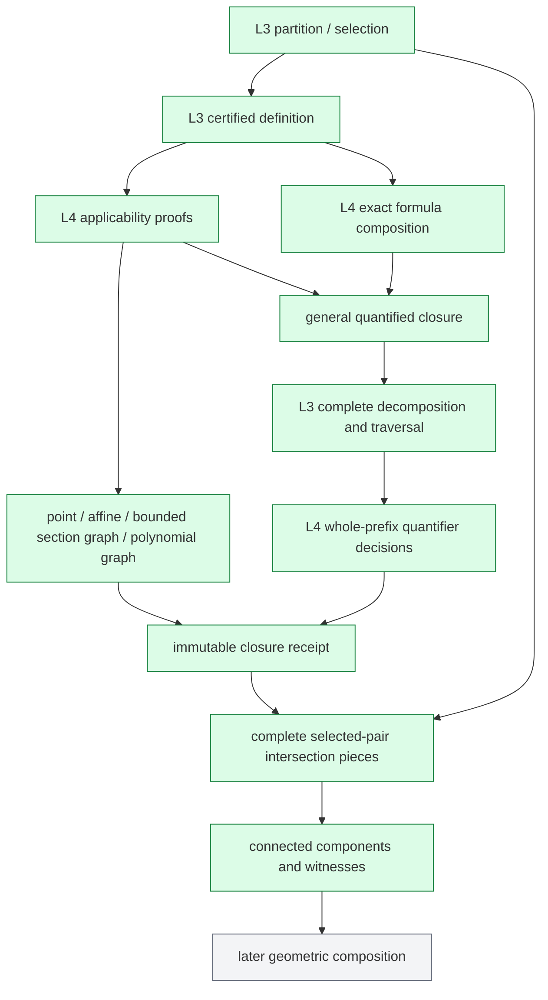
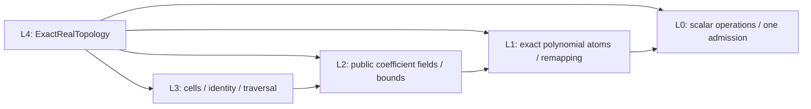
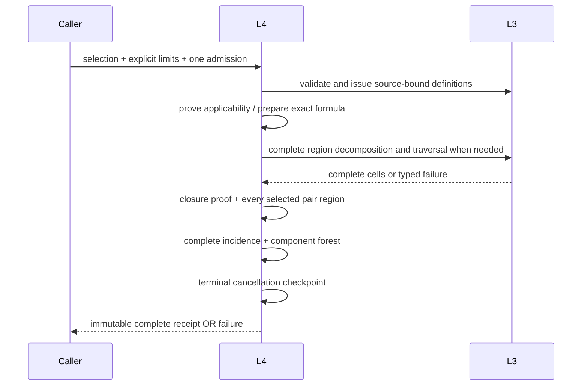

# Exact Real Topology (L4)

## Purpose and Scope

Parent: [RationalBivariateAlgebra](../DESIGN.md). No children. This is one
component of the existing CADGeometry module, not a new package or production
SwiftPM target. Independent verification compiles actual L0-L4 directories.

L4 consumes complete L3 cells/selection and produces ambient Euclidean closures,
complete directed incidence pieces and connected components of the selected
parameter set. Inputs include arbitrary finite variable count, zero variables,
open/closed/singleton/empty/unbounded domains, rational and retained algebraic
coefficients, nullification, singularities, repeated factors and mixed dimensions.
Successful receipts certify the entire requested result; resource failure is
explicit and atomic. L4 completion is not completion of the seven CAD requirements.

L4.I1-I3 are implemented and independently verified. The scoped cumulative review,
Native/ASAN and both actual WASI executions are recorded in
[L4 verification](../../../../Tests/L4TopologyVerification/VERIFICATION.md).
Existing unchanged lower evidence is reused only for byte-identical sources.

## Responsibilities and Boundaries

| Owner | Generates and retains | Consumes |
|---|---|---|
| L3 | Exact whole-cell and boundary-root definitions; complete child coverage | Public L0-L2 contracts and its issued partition |
| L4 formula composition | Capture-free polynomial predicates and explicit quantifier scopes | Issued L3 definitions, original coefficient field and public L1 terms/arithmetic |
| L4 quantified evaluation | Whole-free-cell truth and complete child decisions | Complete L3 decomposition/traversal, caller admission |
| L4 closure | Ambient closure and its proof kind | Issued definitions and validated point/affine/section-graph or quantified proof |
| L4 incidence | All selected-cell pair decisions and exact intersection pieces | Original selection, closures and complete refinements |
| L4 components | Every selected cell exactly once, with its attachment witnesses | A complete, privately issued incidence receipt |
| Later consumers | Geometric images, chart quotients, branch continuation and publication | These parameter-space receipts and original shape bindings |

L4 owns no root solver, polynomial projection/lifting, approximate identity,
shape producer, chart/seam/pole equivalence, image/fiber dimension or XYZ contact
classification. Connectedness does not specify how smooth branches continue
through a crossing. The incidence graph preserves that information for later work.
General quantified evaluation is an internal supporting responsibility, not a new
public general-purpose quantifier-elimination product.

## Related Designs

| Design | Relationship | Contract Used | Summary | Cautions |
|---|---|---|---|---|
| [RationalBivariateAlgebra](../DESIGN.md) | parent | Child index | Owns the existing component hierarchy | No new package or legacy numeric dependency |
| [ExactRealCell](../ExactRealCell/DESIGN.md#l4-inspection-extension) | depends on | Whole-cell definitions, boundary roots, complete traversal, prefix location | Owns all cell and root-branch identity | Inspection implementation is verified by L4.I1 before L4 composition |
| [ExactRealCell verification](../../../../Tests/L3RealCellVerification/VERIFICATION.md) | depends on evidence | Complete current L3 public paths and appended inspection evidence | Native/ASAN and both WASI families | Historical snapshots retain their original proof scope |
| [L4 verification](../../../../Tests/L4TopologyVerification/DESIGN.md) | test owner | Public closure, incidence, components and queries | Independent actual L0-L4 execution | No upper CAD build or geometric-image claim |
| [ExactPolynomial](../ExactPolynomial/DESIGN.md) | depends on | Polynomial construction/arithmetic/decisions and public terms | Exact variable remapping and formula atoms | No private context or symbolic root-count engine |
| [ExactRealRoot](../ExactRealRoot/DESIGN.md) | depends on | Public coefficient field and interval construction; root solving through L3 | Preserves original field-family policy | No independent root solver, silent adjoining, coefficient rounding or extension-cap change |
| [ExactScalar](../ExactScalar/DESIGN.md) | depends on | Arithmetic/order/import and admission | Same caller work/storage/depth/cancel | No local replacement allowance |
| [IntersectionAlgebra](../../IntersectionAlgebra/DESIGN.md#parameter-connected-components) | reference / prospective used by | Closure and parameter-component meaning | Existing implementation is a reference, not a dependency | No upper CAD build or private legacy implementation reuse |
| [CADGeometry](../../DESIGN.md) | prospective used by | Complete parameter topology | Later original-shape/image composition | No completion claim for CS/SSI or other geometry |

### Confirmed facts and required differences

| Pre-implementation fact | Implemented difference |
|---|---|
| L3 publishes cells, conditions, selection, dimensions and point queries | Keep those contracts and receipts; topology is an additional consumer |
| L3 conditions contain root ordinals, not a standalone polynomial formula | L3 now issues a definition with certified boundary-root descriptions |
| Auxiliary derivative signs on sectors describe their samples | Never use that sign vector as a whole-sector definition |
| L3 public leaves retained parent handles, but exposed no complete child port | Owner-validating complete traversal now exposes the issued coverage |
| Prior locate required a full tuple | Exact prefix location now supports quantified free-prefix regions |
| Legacy incidence retains refined target pieces and rejects excluded-point joins | Preserve that meaning; replace implementation dependency with lower public contracts |
| Complete L3 generation already admits resource failure | L4 cannot turn that failure into false, empty or partial topology |

The native implementations behind these facts are ExactRealCellDomain,
ExactRealCellDomain+Lifting/+Query, ExactRealCellID/Condition, and
OriginalRationalIntersectionIncidence/OriginalRationalParameterComponents.
Current L3 runtime evidence is reused; independent implementation builds no upper target.

## Architecture



Green denotes implemented paths exercised by the independent evidence below.
Gray denotes later consumers outside this task. Runtime evidence is limited to
its recorded inputs, resource caps and targets.



No dependency goes from these layers back to IntersectionAlgebra, Curve3D,
Surface3D, CADCore geometry errors, or application modules.

## Contracts and Invariants

### Public ports

Public operations are protocol requirements, with generic noncopyable admission
and typed throws. Implementations are separate; native Sendable immutable values
represent receipts. A protocol is not added merely to abstract an array.

| Protocol | Operation | Complete output |
|---|---|---|
| `ExactRealClosureProducing<Base>` | `closure(of:in:strategy:limits:using:)` | `ExactRealClosure<Base>` for one issued full cell |
| `ExactRealIncidenceProducing<Base>` | `incidence(of:strategy:limits:using:)` | `ExactRealIncidence<Base>` for a complete L3 selection |
| `ExactRealComponentsProducing<Base>` | `components(of:limits:using:)` | `ExactRealComponents<Base>` from issued complete incidence |
| `ExactRealTopologyQuerying<Base>` | `contains(_:in:limits:using:)` | Exact Boolean membership in a retained closure |

`Base` uses the same arithmetic/order/import constraint and Source == Value
condition as L3. `ExactRealTopologyDomain<Base, Cells>` implements these
ports. `Cells` is injected by its concrete generic provider type conforming to
L3 preparation, production, query, description and traversal protocols; its Base
must equal Base. The default provider is ExactRealCellDomain<Base>. This domain
is stateless: each operation constructs a provider retaining the input source.
Receipts own source identity; no singleton, mutable cache or shared quota exists.

| Receipt | Retained authority |
|---|---|
| `ExactRealClosure` | Original partition/cell, coefficient field, proof kind, complete free-region cover, included region cells and attained depth |
| `ExactRealIncidence` | Original selection, every source closure, every directed pair decision and all nonempty intersection pieces |
| `ExactRealAttachment` | Source/target original IDs, closure owner, refined region owner and included piece ID |
| `ExactRealComponents` | Incidence owner, deterministic member offsets and witness offsets for every component |

Constructors establishing completeness are internal to the issuer. Public callers
cannot manufacture incidence from an attachment array. A point closure can retain its original complete partition with the point ID as
its truth label. An affine closure may retain that partition when the original
box is closed and every atom has the sign-invariance certificate described below.
The closed box bounds the ambient closure, so exclusion outside the retained box
is explicit evidence. All other closures generate a complete real free cover.
Retained input records do not count as generated cells.
Region cells can be prefix
IDs in a retained quantified partition; coordinateCount states their parameter
arity. Queries use L3 prefix location, not a suffix sample or guessed embedding.
Different refinements retain separate owners and explicit original-ID mappings.

### Exact cell formulas

The L3 definition contract is authoritative in its own design. L4 serializes that
contract, not public sample metadata. A section uses the issued polynomial and
its complete certified derivative sign signature at the actual coordinate.
A sector introduces at most two fresh boundary variables. Each satisfies its
issued selected-root signature, and the actual coordinate lies strictly between
them (or beyond the single finite boundary). Rootless fibers need no witness.
Conjoin these clauses with the exact parent path and original endpoint flags.

When a boundary has an issued affine law with constant nonzero axis coefficient,
substitute its exact linear expression and sign before introducing a witness.
This is an equivalence proved from the same root identity, not numerical fitting.

A globally affine factor may additionally replace a selected boundary law after
public L1 exact division proves it is a factor and the issued complete Thom
signature identifies its root. Its affine root is continuous over the connected
parent; original delineability and absence of root collisions preserve the union
ordinal. Retain the division, factor, parent and exact signature match. A factor
candidate without these certificates does not change the definition.

Thus membership has the finite form C(x) iff exists b: Psi_C(x,b), with at most
two witnesses per sector axis. Witness variables are not original parameters.
All atoms use the original coefficient field, never sample-field generators as
new original constants. Polynomials are transported through public L1 terms and
construction with checked injective variable maps. Fresh witness names and scopes
prevent capture when combining different definitions; identity-based reductions
require proof, not proximity. Zero variables compile to the unique empty tuple.

### Ambient closure

For a full cell C in R^n, the general proof is exactly:

```text
p in closure(C) iff
  forall epsilon:
    epsilon <= 0 OR
    exists q, b:
      Psi_C(q,b) AND
      AND_i (-epsilon < p_i - q_i AND p_i - q_i < epsilon).
```

This uses the open-box neighborhood basis of the Euclidean topology. Free p
coordinates come first, then the radius and existential original/witness slots.
All slots range over the entire real line; restricted domains are formula guards,
not a finite search window. Counts and mappings are checked, with no four-variable,
degree or neighborhood cutoff. The exact box basis avoids a quadratic norm.

Closure is ambient, not relative to the input box or selected set. Open-box
endpoints and excluded denominator points can belong to it. Infinity is not a
point: an unbounded cell acquires only finite limits. Periodic/pole quotients are
later domain responsibilities. Original equations and guard meanings are retained.

### Quantifier reduction

L3 decomposes all formula atoms on the complete real product under the same
admission. Leaf truth uses L3's proven constant original signs. Starting from the
last coordinate, existential reduction is OR of complete child truth; universal
reduction is AND. Each free-prefix truth retains its contributing subtree and
coverage. The initial implementation traverses all children; later pruning would
require a separately proved whole-parent consequence, not a favorable sample.
Before decomposition, a neighborhood matrix may eliminate an existential slot
from a mandatory linear equality with constant nonzero coefficient. Substitution
is capture-free, exact and recorded with the original matrix, replacement and
variable map. The independent epsilon guard contains no eliminated slot, so
exists x: guard OR (a*x+b=0 AND rest) is exactly guard OR rest[-b/a].
Existential suffix slots may be reordered within the same quantifier block.
For each current matrix, find the final existential block with one backward
quantifier pass, charging each visit before reading it. Candidate equality
searches consume work only within that block; no repeated unadmitted suffix
scan is permitted. Factor preparation likewise charges each section/lower/upper
candidate visit before reading it, including absent boundaries. These visits
use the same admission and cancellation contract as subsequent arithmetic.
Within a mandatory conjunction, an explicitly proved nonzero signed coordinate
factor may be removed from another atom with its parity/sign retained. Original
matrices and the derived atoms remain in reduction evidence. This normalization
supports the polynomial-graph theorem below, without introducing another root
solver or raising limits.
Traversal is iterative with admitted native arrays, never unbounded recursion.
For free arity zero the result is one closed Boolean decision. Failed or missing
children are failures, not false/universal success. A free region may subdivide
an original target; its identity remains explicit.

This is the standard CAD consequence of sign-invariance and cylindricity
([Basu, Section 2.2](https://www.math.purdue.edu/~sbasu/raag_survey2011_final.pdf)).
That reference justifies the mathematical method, not this implementation or its
budget performance. Connectivity is proved by the finite attachment graph below,
not inferred from quantifier elimination alone.

### Applicable closure proofs and performance

`automatic` considers the following proofs in order; `quantifiedOnly` disables
closure-specific theorems for differential verification. Both preserve original
meaning, budgets and coefficient policy. Formula-level exact linear substitution
remains permitted in either strategy.

| Proof | Applicability and guarantee |
|---|---|
| Point | Issued dimension zero; the cell is one exact point and is closed |
| Affine cell | The complete issued definition reduces to a nonempty conjunction of affine equations/strict or weak inequalities, with constant nonzero boundary leading coefficients. Weakening strict inequalities gives exactly its closure: segments from any interior point prove sufficiency |
| Bounded section graph | An affine base and section-only suffix; every suffix has an issued zero law with constant nonzero leading coefficient. A complete weak-condition decomposition must prove exactly one zero-dimensional suffix fiber over every weak-base cell |
| Polynomial graph | Exact constant-leading linear elimination of original coordinate slots and certified signed-coordinate factor cancellation produces a nonempty affine base. The retained equalities reconstruct every removed coordinate uniquely as a polynomial of the remaining original coordinates. The graph embedding and its coordinate projection are continuous inverses; closing the affine base gives exactly the ambient closure. An original vanishing leading coefficient never grants this proof; the alternate constant-leading equations must be explicitly certified. |
| Quantified | Every remaining valid cell; exact neighborhood formula and complete reduction |

For bounded section graphs, Cauchy bounds give local boundedness successively in
each suffix coordinate near every finite base point. Continuity puts every cluster
point in the weak conditions; complete fiber uniqueness makes it the sole limit.
Affine-base paths approach every weak-base point, proving inclusion. The same
arguments exclude all other limits. An unbounded base end contributes no point
at infinity. Nonconstant leading coefficients that can vanish at a boundary,
missing/nonunique weak fibers, or nonaffine bases refuse this theorem.

Structural checks and any required full weak-fiber decomposition are applicability
work in the original admission. A completed negative applicability result chooses
the general method before closure evaluation. Failure during that check aborts;
it does not trigger another solver. No retry after exhaustion/unresolved/cancel.

The issued proof kind and hypothesis evidence remain inspectable. Point and affine
paths are required, and the bounded-section path must close the folded algebraic
SSI-shaped fixture under its existing budget. A nominal general algorithm that
cannot close the required regression within its recorded limits is not milestone
completion. Numeric defaults/performance claims are chosen only from measured
independent fixtures; no cap is raised to make a test green.

### Complete incidence and components

For every ordered distinct selected pair (C_i,C_j), establish the exact region
A_ij = closure(C_i) intersect C_j. Compose both definitions at the same free tuple
and produce a partition truth-invariant for their conjunction. Retain all true
pieces with source/target IDs; retain complete exclusion evidence if empty.
An existing original partition is reused only after proving every closure atom
has constant sign on all its cells. A globally affine atom qualifies when it is
a divisor of an incoming cut law whose leading coefficient on that axis is a
nonzero constant (so the cut never nullifies), or is an original finite box cut. A nonzero division remainder can be reduced
exactly to zero using earlier mandatory equalities involving only lower-axis
coordinates. Retain all divisions and assumption indices. The certificate is
then conditional on those equalities; a target failing an earlier equality is
already excluded, and no later sample sign is used. Each accepted assumption's
whole-cell sign has its own earlier certificate, preserving acyclic proof order.
Complete original delineability/rank coverage then prevents its affine root from
switching union ordinals or crossing a section without a recorded collision.
An original polynomial that vanishes on the source also vanishes on its closure
by continuity. Its proven nonzero original sign can exclude a target before
sample-field arithmetic. This is a whole-cell exclusion, with original source
and sign evidence retained. Constants are decided exactly. Retain the incoming law/division, original cover,
and target identity. Only after this certificate may the exact target sample
read the already proved whole-cell sign. The conjunction with the target ID is
then constant on the original cover, and every included/excluded piece is issued
without a new decomposition. An unproved atom declines reuse before solving.
No representative alone decides membership of an entire target. Each pair can own its
own complete refinement; a global frontier-compatible partition is not assumed.
Diagonal containment C_i subset closure(C_i) is recorded without a graph edge.

An attachment exists exactly when A_ij is nonempty. Only selected targets become
vertices/endpoints. Two closures meeting at an excluded point do not grant an
edge. Partial target intersections retain their exact subset rather than claiming
the whole target is in the closure. A complete incidence receipt covers every
ordered pair, even those with no attachment; missing pairs cannot imply separation.

Build an invocation-local union forest from these issued attachments, using
union by size and path compression. Each selected cell appears exactly once;
components are ordered by first occurrence in the original selection. Witness
ordering follows original source/target order and local refined-cell order.
Every attachment stays inside its component. Empty components require a complete
empty selection; singleton cells need no edge to constitute a component.

Proof: each cell is connected. If closure(C_i) meets selected C_j, their union is
connected. Conversely, for a graph component S, finiteness gives closure(S) as the
union of member closures. No missing cross-component incidence means
closure(S) intersect the selected set equals S. Each graph component is therefore
relatively closed and, by finite complement, relatively open. These graph
components are exactly the connected components of the selected set.

## Runtime Flows



Later membership queries take a fresh explicit caller admission, inherit receipt
depths, locate the full/free-prefix cell and read its proven truth. They do not
reuse or restore an exhausted mutable allowance.

## State, Ownership, and Lifecycle

| State | Owner / lifecycle | Isolation |
|---|---|---|
| Original selection and definitions | Immutable retained L3 owners | Same Sendable contract on every target |
| Formula atoms/maps/program | Immutable L4 owner retaining original owners | No mutable expression cache |
| Construction buffers and union forest | One synchronous invocation | Exclusive local mutation before publication |
| Quantifier and incidence decisions | Immutable DAG with indices | No handles retaining their own owner internally |
| Public closure/attachment/component views | Strong receipt owner plus offsets | Native collection views; no escaped pointers |
| Admission and count state | Exclusive inout query | One work/storage/depth/cancel authority |

Use Swift value types, Array/COW and owner-retaining views. Charge all new payloads,
COW copies, decision slots and map traversals before materialization or mutation.
Reused backing is not charged again. Share the retained region partition between
its pieces instead of copying its cells. Each future file has one principal type.
No unsafe memory or shared mutable state is required by this design. If an
implementation later requires either, its contract must be designed before use.
Native, ordinary WASM and Embedded use identical owners/conformances and state;
Embedded is not a reason to remove synchronization or Sendable.

## Failure, Concurrency, and Constraints

Proposed `ExactRealTopologyFailure` distinguishes invalid definition/formula,
foreign receipt, invalid coverage, count overflow, result/count limit and unresolved
proof. Lower scalar/polynomial/cell failures and external admission rejection retain
their original typed causes. No failure becomes an empty region or disconnected
component result. Incomplete internal paths require the standard code marker.

| Authority | Scope |
|---|---|
| L0 work/storage and two depth caps | Cumulative applicability, remapping, decomposition, quantifier reduction, pair checks, graph assembly and publication; never reset/refunded |
| L2 coefficient extension ceiling | Original effective field-family policy, inherited through L3 |
| `maximumGeneratedCells` | Cumulative newly generated L3 prefix/full records across successful helper decompositions; each helper gets only the remaining capacity |
| `maximumRootsPerStack` | Existing per-stack L3 meaning on every helper |
| `maximumClosures` | Count of newly issued source closures in this operation |
| `maximumAttachmentPieces` | All retained nonempty directed intersection pieces |
| `maximumComponents` | All published connected components |
| Cancellation | Entry, causal work and terminal publication after the last callback |

Each public entry creates one local count state. Nested closure/pair/decomposition
helpers receive that same inout state and admission; incidence must not call public
closure entries that would restart count state. Components and later queries start
new explicit operations over already retained evidence. No mutable counters enter
a published receipt.

Proposed `ExactRealTopologyLimits` holds the five nonnegative checked counts above;
there are no guessed defaults or hidden mathematical cutoffs. Existing input
partitions are retained rather than newly generated, so they do not consume new
cell/storage capacity. A helper receipt is counted once before further work;
failure aborts the entire operation. Any cumulative count addition or variable
map size checks overflow before allocation. Formula variable count is not a new
shape-recursion or coefficient-root depth axis.

No asynchronous callback, I/O, actor or Mutex is required for local synchronous
mutation. Concurrent immutable readers each supply a separate admission. A future
shared cache would change this design and require an explicit isolation owner.

## Verification and Change Impact

The owner is [Tests/L4TopologyVerification](../../../../Tests/L4TopologyVerification/DESIGN.md), with source links to the
actual L0-L4 files, dedicated build paths and an external timeout.
Native/ASAN, ordinary WASM and Embedded each execute
public success/failure fixtures on the pinned Swift 6.4.0/matching SDK combination.
Lower tests are reused when their assumptions are unchanged.

| Evidence ID | Counterexample / required public behavior |
|---|---|
| T1 lower inspection | Exact root signatures and complete children on nullified/repeated/close roots, degree drops, clipped roots, unbounded stacks and zero variables; prefix samples and nonsample points locate exactly; ordinary sector sample signs cannot substitute for definitions |
| T2 closed versus excluded | x != 0 has two components; xy = 0 has one connected union with crossing witnesses; excluding its origin leaves four components |
| T3 singular / mixed | Tangent and cusp branches, repeated factors, line plus isolated point; retain every incidence rather than pairing by rank or proximity |
| T4 partial target | C: 0<x<1, 0<y<x, x*z-y=0. At x=y=0 its closure includes precisely 0<=z<=1, subdividing the original nullified full z-fiber; reject z outside that interval |
| T5 ambient domain | Open intervals acquire endpoints; singleton is closed; an unbounded ray gains its finite endpoint only; separated cells approaching excluded denominator loci remain separate |
| T6 complete graph | Every ordered selected pair has inclusion/exclusion evidence; every member appears once and every witness stays inside its component; empty selection and R^0 true/false are exact |
| T7 applicable proofs | Point/affine/bounded graph agree with forced quantified results on small admitted fixtures; a vanishing leading coefficient or nonunique weak fiber refuses the graph theorem; budget exhaustion cannot trigger fallback |
| T8 folded / field | The complete four-parameter folded relation x0^2-x2^2=0, x1-x3=0 on the closed original box retains both sheets and their meeting set; algebraic coefficients, inherited two-axis depths and the original extension cap stay intact |
| T9 count / admission | Work/storage/both depths/root/generated-cell/closure/piece/component counts fail independently; exact boundary succeeds; checked overflow, cancellation during checks and at final callbacks publish no receipt |
| T10 lifecycle / portability | Drop original inputs/providers; retained closures/pieces/components remain queryable. Native concurrent readers, failure followed by valid fresh query and both actual WASI execution families preserve ownership |

Record work, admitted storage, generated cells, coefficient levels, proof kind and
wall time for the closure, incidence and graph phases. These observations identify
the bottleneck; graph traversal success cannot substitute for closure success.
Required Native algebraic fixtures keep the current independent lower fixture
policy (200M work, 700M admitted bytes, 400 for each depth axis), or a smaller
recorded budget of the same reference input. No source or result-count cap is
raised after a failing run. These independent fixtures do not certify the legacy
Native SSI composition under its separate 80M work limit.
If a mandatory input exhausts them, report that input and the outstanding algorithm
rather than broadening scope, increasing limits or declaring a partial milestone.
The previously failing two-level L3 review probe is not repaired by this design.

### Implementation order and completion gates

| Gate | Ownership / completion |
|---|---|
| L4.I1 | Implement and independently verify the required L3 inspection ports; existing L3 paths remain behaviorally equivalent except additive capability |
| L4.I2 | Implement complete symbolic formulas, internal quantifier reduction, closure/query receipts and the applicable proofs together; verify stable public success/failure |
| L4.I3 | Implement complete incidence pieces/exclusions and connected components from issued evidence; close partial-target/excluded-point fixtures |
| L4.V | One cumulative review plus finding recheck; fixed-source Native/ASAN and both WASI runs, retained evidence, coherent commits |

One implementation owner owns L3 inspection changes and L4 integration in this
isolated worktree. Verification artifacts identify exact snapshots and build inputs.
No upper-module build, legacy-source migration, main merge or seven-requirement
completion is part of these independent gates. An implemented structure or type
cannot satisfy any behavioral completion gate.

## Retained Decision and Mask Optimization

This optimization retains public protocols, result fields and proof selection.
Incidence creates one immutable original cover and maps selected IDs through
public equality once. When a closure already carries a complete truth table on
that same original cover, its issued decisions answer whole-target containment.
A successful whole-target result shares the target's one-hot native Array; an
excluded target shares one all-false Array. Arrays are admitted on creation and
never mutated after publication; pair handles are still admitted. There are no
shared mutable caches, new unsafe paths or implicit budget resets.

Other certified reuse keeps its exact sign proof; partial targets retain complete
refinement. Every directed pair remains represented and every nonempty piece is
retained. Whole-target and excluded pairs emit their known piece count directly
without scanning the complete cover. Components validate all pairs once and
bucket members/witnesses by deterministic component offsets; no per-component
rescan of all pairs is needed. Value/depth owners and final checkpoints remain.

The folded integration fixture separately exercises each public closure before
incidence. Performance measurements separate that diagnostic work from the
actual partition/selection/incidence/components path. Proof-route requirements
and the general solver are outside this performance change; no new completion
claim for the seven CAD requirements is made.

## Source Cell Pullback Contract

L6 consumes a complete source selection through an injective coordinate-slot map.
The target is an original polynomial predicate and its exact domains; accepting the
predicate before decomposition avoids a redundant target solve. This is an additive
contract, not a change to existing closure/incidence semantics. Source cell definitions
come only from L3 public definition. Existing L4 cell formula construction transports
root identities and quantifies sector boundary witnesses. One common decomposition
resolves all source-cell labels; a sample alone never establishes a label.

The immutable pullback retains source selection, target predicate, original slot map,
quantified region and one source-cell ordinal for every included free-coordinate cell.
Excluded cells retain -1. Both domains enter the exact predicate. Auxiliary quantified
root-selection coordinates never contribute to returned free-cell dimension.

All source definitions, label instructions, common atoms and label decisions consume
the same caller work/storage/depth ledger. Generated-cell limits accumulate over the
operation; cancellation is checked before publication. Invalid maps, foreign fields,
ambiguous labels and resource/cancellation failures reject the whole receipt.

Used by [L6](../ExactGeometricRelation/DESIGN.md). Verified by the isolated
[L6 verification package](../../../../Tests/L6GeometricRelationVerification/DESIGN.md),
including changed root ordinals, positive and negative branches, strict boundaries,
empty source/target, quantified sectors, lifetime and independent admission failures.

Pullback sector inequalities use the exact order of realizable Thom sign vectors
(Perrucci/Roy, arXiv:1609.02879, Notation3/Proposition4). This removes boundary
witness variables before the common decomposition. The original root polynomial,
full derivative signs and source parent remain retained. Existing closure calls
keep their unchanged quantified boundary path by default. The rejected witness
implementation exhausted the unchanged80M work limit on two simple quadratic
sectors; the acceptance test preserves this input and ceiling.

L6 integration counterexample: `t=u`, `v*(u-1/2)=0` on a closed box needs
the coordinate factor `v` in addition to `v +/- t` factors. Exact division and
complete issued Thom-signature matching use the same existing factor receipt.
No sampled residual or leading-coefficient limit establishes this identity.
Pullback reduction may restrict decomposition to the original target box; default
closure reduction remains ambient. The target source retains that coverage scope.

Formula atom insertion interns exactly equal original polynomials before projection.
Existing instruction ordinals remain stable; later clauses reuse the issued atom
ordinal. All equality checks and allocation are admitted. This removes repeated
box/equality laws in mixed-component closure/target intersections, without changing
sign predicates, domains or whole-target constancy requirements.

Mixed-cell incidence fast path: on a closed source box, if every selected cell
is exactly affine (including retained globally affine factors), one complete
refinement contains all weak source-cell and strict target-cell clauses. Exact
sign truth on each refined cell proves every closure/target intersection. Partial
attachments are retained as refined cells; an interior point of an unsplit target
is never promoted to whole-target truth. Eligibility is established before solving;
resource failure never triggers another solver. Ordinary original-cover reuse remains
the path when no affine factor requires refinement.

Bounded reduction substitutes exactly equal included finite endpoints before
projection and retains a domainRestriction reduction witness for each coordinate.
Atom ordinals/instructions remain unchanged. This equivalence applies on the retained
box only; it is not a global equality. Bounded-section closure uses original domains
only when that source box is closed, so all ambient limits remain in the box.
This is necessary for a collapsed graph on a singleton parameter slice; it avoids
projecting nonexistent variation without loosening any coverage requirement.

Bounded-section graph eligibility and formula construction consume the same
retained affine-factor receipts as affine closure. A known coordinate factor
must not be discarded before the constant-leading graph proof. The factor law
is used for uniqueness and closure checks and remains retained in the closure.

Quantifier-free closure/strict-target intersections reduce on the target's original
domain. Every possible attachment belongs to that strict target, including singleton
coordinates. Quantified intersections retain their existing ambient witness domains.
