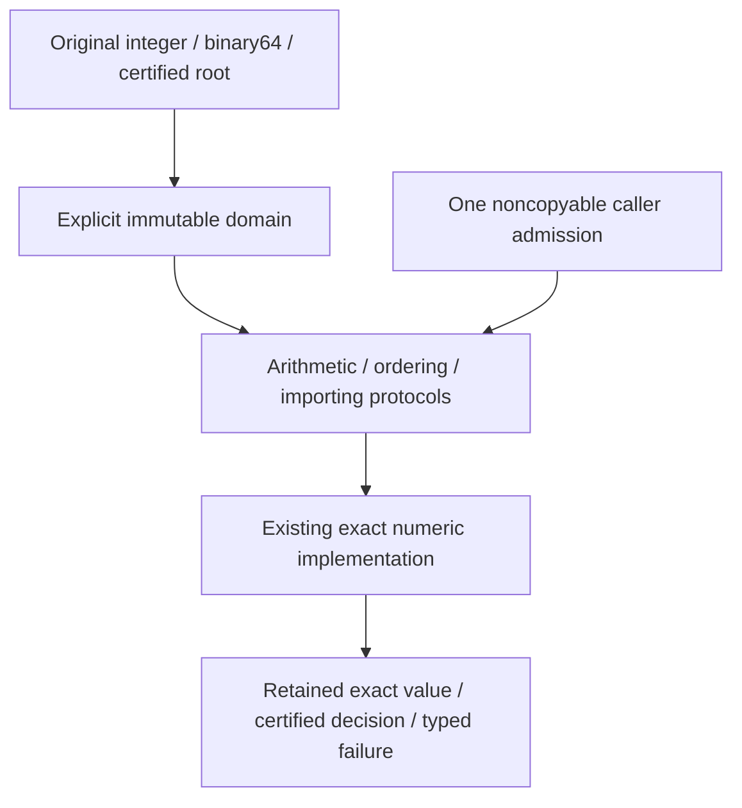
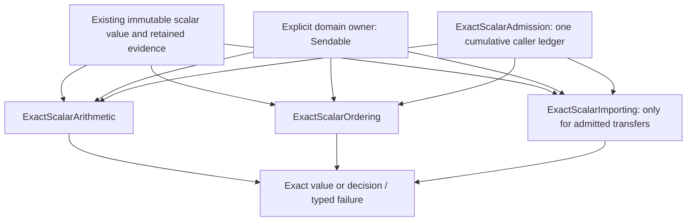

# Exact Scalar (L0)

## Purpose and Scope

Parent: [RationalBivariateAlgebra](../DESIGN.md). This child owns exactly the five
L0 contracts: value meaning, exact decisions, arithmetic, immutable ownership and
cumulative resources. It remains inside the existing CADGeometry module. The
isolated verification manifest builds this directory alone; it introduces no
production target or package dependency. Native and both WASM SDKs use the same
sources. Children: none.

## Responsibilities and Boundaries

The operation owner fixes one rational or retained algebraic domain. It creates
values, admits explicit embeddings, performs exact arithmetic and certifies sign
and order. Values retain immutable original root and coefficient authority.
The existing integer, rational, polynomial and selected-root algorithms implement
these operations. No additional root-search algorithm is introduced. Cell
decomposition, geometric shapes, XYZ/UV relations and floating-point enclosures
are consumers outside L0.

### Native-first resource boundary

L0 owns the scalar meaning and the minimal query-resource contract. Swift owns
buffer management, value copying, ARC lifetime, task cancellation state and
checked machine-integer primitives. The admission policy does not own an
allocator, collection implementation, scheduler or process-memory monitor.

The native-first redesign preserves existing scalar protocols, result meaning,
owner identity, independent limits and typed failures. Only payload sizing is
centralized and erroneous call sites are repaired. The mathematical algorithms
and higher geometry APIs are not redesigned.

| Responsibility | Implementation authority |
|---|---|
| Exact scalar mathematics | Existing L0 arithmetic/ordering/importing protocols and concrete domains |
| Retained buffers and immutable evidence | Swift Array COW, value semantics, strong ARC retention and Sendable |
| Borrowed operands and one caller ledger | borrowing parameters, noncopyable values and inout admission |
| Cancellation state | Task.isCancelled plus the caller's explicit cancellation flag |
| Payload size | MemoryLayout<T>.stride and multipliedReportingOverflow |
| Cumulative counters | Existing query-local ExactScalarLedger with checked addition and limit comparison |
| Mathematical refinement depth | Existing independent value/coefficient depth evidence |

L1 may use the scalar protocols, admission requirements and the payload-size
contract below. It does not inspect scalar root implementations or introduce a
second resource owner.

## Related Designs

| Design | Relationship | Contract Used | Summary | Cautions |
|---|---|---|---|---|
| [RationalBivariateAlgebra](../DESIGN.md) | parent and used by | RationalAlgebraAdmitting and retained scalar values | Existing higher numeric consumers | Their builds are outside this task |

## Architecture



The source dependency closure in this directory is the complete L0 build scope.
No imports of CADCore, geometry types or external numerics are needed. The old
parent error helpers remain for its non-scalar consumers. L0 implementation
failures use ExactScalarFailure and Swift cancellation directly.

## Contracts and Invariants

### Standard-library protocol decisions

The pinned Swift 6.4.0 macOS `Swift.swiftinterface` is the checked declaration
source. `Sendable` and `Error` apply directly. Canonical rational values retain
`Equatable` and `Hashable`; small sign/order/resource tags can use ordinary enum
conformances. `BinaryInteger` is the generic integer input constraint. `Double`
is the existing binary64 source boundary, not the exact result representation.

`Comparable`, `AdditiveArithmetic`, `Numeric`, and `SignedNumeric` require
nonthrowing operations without caller admission. `Numeric` does not require
field division. They therefore cannot express this resource-bounded field
contract. `BinaryInteger`/`BinaryFloatingPoint` conformance is not added to
rational or context-bound field values merely to obtain operators.

Existing nonthrowing rational equality/hashing remains meaningful. Budgeted
algorithms must admit its traversal cost; standard operator conformance does
not supply metering. General context-bound values do not get a numeric
`Equatable`/`Hashable` conformance based on expression or owner identity.

### Responsibilities and architecture



The three scalar operation protocols describe capabilities of an immutable
operation owner, not conformance of an expression tree to `Numeric`. The owner
fixes the target exact domain. Arithmetic and ordering require values admitted
to that domain. Explicit importing establishes a value-preserving embedding and
charges its work; unsupported transfers fail, rather than selecting the left
operand's context implicitly. A concrete type may implement several capabilities
with the same `Value`. Cross-context numeric comparison can be offered by a
verified ordering implementation with a documented domain; failure to import
cannot become a negative equality decision.

Ownership needs no additional marker protocol. Values satisfy `Sendable` and
retain immutable backing/evidence by value or strong reference. `borrowing`
inputs avoid requiring a copy of owned buffers at the operation boundary.
Sendability alone proves neither immutability nor exactness; each conformance
must verify its actual storage and lifetime paths.

### Implemented protocol declarations

| Capability | Declaration | Implementations |
|---|---|---|
| Arithmetic | [ExactScalarArithmetic](ExactScalarArithmetic.swift) | ExactRationalScalarDomain, OriginalExactScalarDomain |
| Certified decisions | [ExactScalarOrdering](ExactScalarOrdering.swift) | The same explicit domains |
| Explicit source/owner transfer | [ExactScalarImporting](ExactScalarImporting.swift) | The same explicit domains |
| Cumulative admission | [ExactScalarAdmission](ExactScalarAdmission.swift) | Noncopyable ExactScalarLedger; caller-supplied handles |
| Publication failures | [ExactScalarFailure](ExactScalarFailure.swift) | Preserved across every operation |

Generic call paths use concrete conforming types. Generic requirements are not
called through operation-owner existentials. Equality and zero are derived free
functions using certified order/sign, with no overridable alternative algorithm.

`ExactScalarAdmission: ~Copyable` permits noncopyable invocation ledgers; it does
not force every conformance to be noncopyable. A copyable handle is valid only
when all copies refer to the same authoritative ledger. Snapshot counters are
not an admissible copied budget. No singleton, task-global mutable budget, or
new shared cache is part of this design.

### The five fixed contracts

| Contract | Assumption | Guarantee and failure |
|---|---|---|
| Value meaning | Valid canonical rational parts, finite binary64 bits, or retained original exact scalar evidence | Rationals denote reduced signed integer ratios; binary64 import denotes that stored binary value exactly; signed zeros become the same rational zero. Nonfinite input fails. Algebraic values keep their original law and selected-root evidence. Unsupported source representations fail explicitly. |
| Exact decision | Values belong to the operation owner's documented comparison domain | `sign` and `compare` return certified mathematical decisions. Equality is `compare == .equal`; zero is `sign == .zero`. Insufficient proof is a typed failure, never zero, equality, inequality, or absence. |
| Arithmetic | Valid admitted operands; nonzero divisor for division | Results denote exact addition, subtraction, multiplication, negation, or division. All successful same-domain operations satisfy the corresponding field laws. Domain mismatch, zero division, exhausted resources, cancellation, and invalid evidence remain distinguishable failures. |
| Ownership | Valid immutable source values and retained evidence | Results retain every needed source/context/root owner after input variables and operation-owner variables leave scope. Refinement retains the same exact value. Failure leaves operands usable; intermediate allocations may be released but paid work/storage is not refunded. |
| Resources | One invocation owns work, cumulative admitted storage and independent depth caps | Every operation receives that same admission; traversal and allocation/COW are admitted before work/mutation. Counts and byte/word conversions are checked. Entry and terminal checkpoints cover fast paths. |

The declared capabilities cover existing rational and admitted algebraic scalar
representations. Adding a new exact source family requires a concrete issuer and
verified operations; the protocol declaration is not that capability.

### Resource semantics and lifecycle

The shared sizing API is one non-overridable free function:

```swift
public func exactScalarPayloadBytes<T>(count: Int, of type: T.Type)
    throws(ExactScalarFailure) -> Int
```

It returns count multiplied by MemoryLayout<T>.stride, rejects negative counts
and multiplication overflow with countOverflow, and performs no allocation,
counter mutation or callback. Its implementation is ExactScalarPayloadBytes.swift.
Its only purpose is to give L0 and the independently
compiled L1 the same native sizing rule without publishing numeric internals.

Allocation owners call it and admit the resulting bytes before materializing
each new payload or necessary COW copy. Existing RationalAlgebraStorage typed
helpers delegate to this rule. A raw word count denotes UInt32 storage only;
it never denotes one polynomial term. Single-term polynomial temporaries admit
the actual (Power, ExactRationalCoefficient) payload and every generated term.
Native's observed 40-byte stride is evidence for that target, not a hard-coded
cross-target size. The same generic rule selects WASM's actual layout.

ExactScalarAdmission remains unchanged. Bytes are its canonical storage unit.
The legacy RationalAlgebraAdmitting entry remains source-compatible: the existing
checked byte-to-word rounding and word-to-byte conversion are isolated at that
compatibility boundary. Original work and storage accounting is not reset.

`retainStorage(bytes:)` accounts cumulative admitted storage, including temporary
and retained buffers, owner payloads and necessary copies; it is not an inferred
peak-RSS limit. Existing raw UInt32-word admission is preserved through checked
ceil(bytes / MemoryLayout<UInt32>.stride), followed by checked word-to-byte
multiplication at the L0 admission boundary. Counts, strides and depth arithmetic
reject negative values and overflow before mutation. Storage reuse does not charge
the same retained allocation again; newly materialized output storage is charged.

Work units retain the existing scalar algorithm's declared accounting policy.
A meter is not reset by suboperations, importing, normalization, or fast paths.
No new arbitrary numeric cap is chosen by this design.

The two depth axes remain independent. `value` corresponds to the existing scalar
root/parameter admission axis and `coefficient` to the existing coefficient-root
axis. Each value retains its attained/inherited depth. A derived visit maps as
`inherited + max(0, local - originalBaseline)` with checked arithmetic, independently
for each axis. Both inherited baselines are checked at entry, including constants;
refinement may increase them and never erase them. Both the operation owner's limits and the caller's limits remain authoritative;
the lower limit applies, without resetting either axis.

A successful operation follows this sequence:

```text
entry checkpoint -> source/domain/depth validation -> pre-admission
 -> exact operation and any admitted refinement -> terminal checkpoint -> result
```

Every successful fast return follows the same terminal rule, including zero,
one, identical operands and reused buffers. A callback may trigger cancellation;
therefore the terminal checkpoint occurs after the last admission callback.
Cancellation observed at that checkpoint fails; asynchronous cancellation after
the publication point cannot retroactively invalidate an already returned value.

`ExactScalarFailure.admissionRejected` preserves an otherwise unmapped caller
error and its retained cause; it does not relabel it as a mathematical result.
Known resource and cancellation failures use their specific cases. Errors do not
require printing or copying the input expression. Internal counters must retain
already spent resources on every thrown path.

A query-local noncopyable ledger needs no shared-state lock. If a caller supplies
a shared ledger handle, all access must use its existing synchronized owner with
the same contract on all targets; external callbacks run outside its critical
section. Values and evidence add no mutable lazy cache.


## Runtime Flows

Entry checkpoint, inherited-depth admission and explicit domain validation precede
numeric work. One scoped borrowing bridge passes the same caller admission into
the existing RationalAlgebraAdmitting algorithms. All copied bridge handles
refer to the same stack-borrowed ledger and depth state. The terminal checkpoint
runs after all callbacks and before publication, including reused-value paths.

## State, Ownership, and Lifecycle

ExactScalarLedger is noncopyable and query-local. Counters are cumulative and
are preserved on failure. It is not a shared-state owner. Exact values and domain
owners are Sendable with immutable retained backing. No mutable cache is added.
The internal borrowing bridge uses pointers only inside nested scoped borrows.
The caller owns the ledger; the invocation owns the attained-depth stack value.
Only these initialized values are borrowed. No allocation/deallocation, binding,
re-binding, stride/offset arithmetic or cross-task transfer occurs. The bridge
and all copied handles are internal and never stored in a result or owner; their
lifetime ends before the terminal caller checkpoint. The existing copied numeric
admission API cannot directly borrow a noncopyable inout ledger, which is why this
scoped bridge is required. Native Address Sanitizer and target runtime fixtures
verify the borrowed storage and failure paths. No performance claim is made.

The current bridge remains an internal synchronous compatibility borrow because
the existing numeric protocol passes copyable handles. Native inout is used at
public and directly expressible boundaries. Removing this bridge would require
changing that lower calling contract and its consumers; it is not part of this
redesign. No new unsafe boundary or shared resource state is introduced.

## Failure, Concurrency, and Constraints

Failures distinguish invalid sources, zero division, incompatible domains,
invalid evidence, unsupported representations, unresolved decisions, cancellation,
resource axes and count overflow. Unmapped caller errors retain their cause.
Rational words convert to admitted bytes using checked multiplication. Admission
precedes new buffer/COW payloads and owner allocation. Reused backing is retained
without charging a second allocation. Domain algorithms preserve their original
work accounting. Both depth axes are checked at entry and mapped independently.

## Verification and Change Impact

The scalar-only verification owner is Tests/L0ScalarVerification. It compiles
actual production files from this directory; no alternative arithmetic, mock
backend or CADGeometry/CADCore build is used. Assertions cover exact binary64
bits, canonical rationals, integer boundaries, rational field identities,
selected algebraic conjugates, distinct values closer than Double resolution,
explicit domain rejection and supported import, retained evidence after owner
scope exit, independent limits, failure counter retention, count overflow,
noncopyable admission and entry/final callback cancellation. The same portable
fixture runs on Native, normal WASM and Embedded WASM with Swift 6.4.0 and its
matching SDKs. Browser/non-WASI execution and higher consumers are not claimed.

Declarations alone do not establish completion. The final evidence must name
source inventory, exact toolchain/SDK, compile/link result and executed assertions.


The exact pair authority retains only the projection root, original fiber and
selected fiber root. SurfaceParameterBox, geometric enclosures and conversion to
floating intervals stay in the parent, outside this independent build. Existing
parent wrappers delegate to the scalar authority, but their compilation and
higher-level behavioral compatibility have not been verified in this task.

Execution evidence and reproducible commands are owned by the
[isolated verification package](../../../../Tests/L0ScalarVerification/VERIFICATION.md).

## Resource Repair Verification

Review R1 is closed within this independent scalar scope. The shared payload
helper and both numeric division call sites admit the typed monomial before
construction. Negative counts, overflow, target-specific stride, storage
rejection before materialization, retained failure counters and the public sign
of alpha squared minus three for the positive root of alpha cubed minus two are
verified. The direct internal univariate fixture first reproduced rejection after
an insufficient one-word admission, then passed with pre-admission rejection.

Current snapshot evidence is recorded once in
[RESOURCE-REPAIR-VERIFICATION.md](../../../../Tests/L1PolynomialVerification/RESOURCE-REPAIR-VERIFICATION.md).
It covers isolated Native tests, Address Sanitizer and the combined L0/L1 proof
on normal and Embedded WASM. Higher consumers and main integration remain outside
this task; no production package or target was introduced.

### Typed payload admission repair (R3)

This repair owns typed storage pre-admission in monomial construction, axis
exchange, restricted polynomial term temporaries, algebraic fiber coefficient
maps and their division COW, ordered degree buffers, Sturm chains, root/pending
slots and pair fiber term reconstruction. These are the same payload-byte
contract, not a new allocation policy. Raw UInt32 limb admissions retain their
existing meaning and counters. Mathematical algorithms, work policy, original
input meaning, proof depth and failure semantics remain unchanged.

| Materialized payload | Native size authority |
|---|---|
| Bivariate terms | (ExactBivariatePolynomial.Power, ExactRationalCoefficient) |
| Fiber coefficient map / division COW | (Int, ExactAlgebraicFieldElement) |
| Ordered degrees | Int |
| Sturm chain | ExactAlgebraicFiberPolynomial |
| Fiber roots and pending cells | Root and Pending respectively |

RationalAlgebraStorage.retain applies the shared checked sizing rule before
materialization or the first mutation requiring COW. Reused division coefficients
with no degree-reducing mutation do not create a charged copy. Constant Sturm
chains also admit their one slot. Endpoint iteration uses a two-element range
instead of an unadmitted temporary array. No new production protocol or state
owner is required.

The isolated verification targets enable standard compiler testability solely
to execute internal fiber paths from the same portable fixture. Production
visibility is unchanged. A rejecting word gate refutes the known public
monomial undercharge before repair. Direct slot admission tests and exact fiber
identities cover the changed internal paths; bounded-ledger success/failure
fixtures preserve operands and spent counters. Normal and Embedded WASM execute
the same assertions. The completed stable review and scoped cumulative L0/L1 verification are
recorded in the existing repair verification owner. The R3 obligations above
are closed for the verified snapshot; upper consumers remain outside scope.
