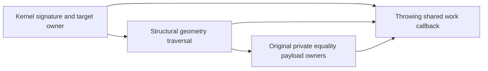

# Structural Geometry Work

## Purpose and Scope

Parent: [CADGeometry](../DESIGN.md). No children. PAR.STRUCTWORK1 owns package-only original geometry payload work admission required by standalone item-characterization current-geometry proof. It preserves existing structural equality and hashing semantics.

## Responsibilities and Boundaries

Geometry owns knowledge of its original stored fields and private certificate equality payloads. The caller owns a throwing cumulative work callback, cancellation, the operation limit, and topology/signature graph traversal. This component charges before traversing variable arrays, rows, and recursive geometry children. It computes no geometric samples, replacement signature, hash, or equivalence policy.

## Related Designs

| Design | Relationship | Contract Used | Summary | Cautions |
|---|---|---|---|---|
| [CADGeometry](../DESIGN.md) | parent | Original immutable geometry values | Supplies concrete payload owners | Private caches excluded by actual equality remain excluded |
| [Product Attribute Resolution](../../CADKernel/ProductAttributeResolution/DESIGN.md) | used by | Shared work callback before metadata signature operations | Kernel proves original metadata attachment to current local geometry | Existing assignment and stable-reference policy remain unchanged |

## Architecture



## Contracts and Invariants

Package entry points consume Curve3D, Surface3D, or SurfaceParameterCurve and a caller work callback. Each fixed record and recursive child is charged before descent. Variable array counts and row counts are charged before iteration; integer additions and conversion must be checked. Private general cone/torus differential partitions, trace parameters, and slant rows are admitted by that original certificate owner. General torus/cylinder traceParameters/heightsByBranch and fixed derivative bounds are admitted by their original private certificate owner. General torus/torus synthesized equality includes its private trace parameters/value rows/permutation, cycle rows, meridian completeness fields and spatial differential partitions even though its custom hash omits the derived certificate; its original owner therefore admits that complete variable equality payload. These cost-only package forwarding methods change neither certificate state nor equality/hash semantics. Rolling-ball original spine/contact curves are traversed inside CADGeometry without broadening public visibility. Fixed-size parallel torus certificates need no extra variable-payload accessor. Original SurfaceLift equality excludes cached exact B-spline candidates; they do not create comparison work. The traversal must cover every reachable original field used by equality or hashing; shared references do not silently waive a repeated comparison cost. Recursion/storage must remain bounded by precharged caller work, with no private guessed budget or unsupported-family fallback.

## Failure, Concurrency, and Constraints

The callback's typed exhaustion/cancellation propagates before the affected traversal or result/cache growth. No mutable retained cache, task, I/O, or ownership transfer is introduced. Arithmetic overflow fails explicitly. The helper never weakens the caller's original equality, geometry validity, source freshness, or stable-target policy.

## Verification and Change Impact

Dedicated Geometry behavioral tests cover unequal positive-weight B-spline arrays, nested original wrappers, private variable certificate payloads where constructible, fixed-size families, exact-budget and one-less refusal, cancellation, and no geometry mutation. Kernel integration proves source and actual signature cost admission occurs before comparison and complete target-key hashing, and a live same-kind target with changed original geometry fails. Changes to concrete equality/hash payloads require updating this local traversal and the consuming Kernel tests.

Persistent parameter gains charge every original factor or directed-difference
translation descendant. Root traversals charge raw source and endpoint rational
word arrays, excluding derived root/Taylor/preparation caches. Original Coons and
Revolution charge their retained traversal sources before structural identity.

Construction charts charge the original source, authored labels, law and both canonical rational fraction payloads, or the retained traversal's original endpoint payloads. Parameter-polynomial root constraints charge every original coefficient word and power before structural comparison. Derived preparation and Sturm caches remain excluded.

## Direct Structural Admission

Structural traversal and private certificate payload charging borrow the caller's
original `A: ExactScalarAdmission & ~Copyable` directly. Every stored field and
recursive child retains its existing comparison work cost. No callback adapter,
new allowance, geometric sample or replacement equality law is introduced.

```text
original structural comparison -> stored payload owner -> same direct admission
```

Existing behavioral work-limit and cancellation tests must invoke these direct
entries; parsing cannot prove complete payload coverage. Private certificate
helper ports change admission transport only, preserving equality semantics.

## Native Surface Metering Stack Boundary

The package surface entry retains its existing cancellation check and one-unit
Surface3D record debit before selecting a family. A Native B-spline payload goes
directly to the existing private B-spline payload traversal. The complete enum
switch is outlined behind a non-inlined private non-Native dispatcher; its case
bodies and recursive child order remain unchanged. The Native payload helper is
also non-inlined. This keeps unrelated procedural scratch storage outside the
Native source-validation call chain without changing structural equality or
metering semantics. No source-validation check, receipt, allocation, or depth
admission is skipped or added.

```text
surface entry: cancellation + original record debit
  -> Native B-spline: original payload traversal
  -> other surface: unchanged full enum case traversal
```

The concrete normal-worker counterexample is the Native-span validation call in
Drawing extraction: the old surface meter reserved 65,088 bytes before inspecting
its enum discriminator. Focused Native and portable metering fixtures must retain
exact debit sequences for Native surfaces/curves and non-Native surface families,
N/N−1 cumulative work refusal, checked counter overflow, entry and terminal
cancellation, and unchanged source payloads. Actual Drawing execution is owned by
the caller integration gate; reduced source syntax or a successful module build
alone does not close that worker-stack finding.

Test owners: [StructuralSurfaceMeteringTests](../../../Tests/CADGeometryTests/StructuralSurfaceMeteringTests.swift)
and [StructuralSurfaceMeteringPortable](../../../Tests/OriginalQueryExecutionVerification/StructuralSurfaceMeteringPortable.swift).
The four checks exercise actual OriginalQueryExecution/OriginalQueryBudget paths;
observer closures only record admitted work. Native, WASM and Embedded use the
same Mutex-protected test counters and cancellation state, with budget callbacks
outside the budget lock. Production structural traversal retains no shared state.
