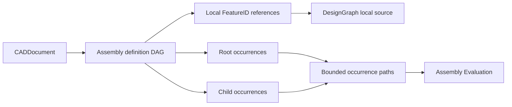

# Document Assembly

## Purpose and Scope

This component owns PARX.X2 source assembly definitions, shared occurrences,
nesting, and local coordinate systems. Parent: [CADIR](../DESIGN.md). No children.
An assembly references existing feature-owned local shapes; it does not own a
second B-rep source. Product attributes and general long-term topology reference
resolution remain outside this component.

## Responsibilities and Boundaries

`CADDocument.assembly` is the sole assembly source authority. A definition has a
persistent definition identity, descriptive name, local body-producing FeatureID
references, and child occurrences. An occurrence has a persistent identity, a
definition reference, and a proper rigid transform into its containing frame.
Roots are occurrences in the document world frame. Reusing a definition retains
sharing; it never duplicates its feature source. A complete occurrence path,
rather than the final edge identity alone, identifies an expanded occurrence of
a shared nested assembly.

The feature graph owns local geometry and feature dependencies. Assembly source
validation owns structural references and finite proper rigid placements;
[Assembly Evaluation](../../CADKernel/AssemblyEvaluation/DESIGN.md) owns resolution
against live evaluated outputs and world topology. No synthetic feature node is
created to impersonate an occurrence. Local modeling remains in feature coordinates.

## Related Designs

| Design | Relationship | Contract Used | Summary | Cautions |
|---|---|---|---|---|
| [CADIR](../DESIGN.md) | parent | CADDocument, FeatureID, source validation | Retains assembly as source value data | Fast validated-document transitions must preserve assembly admission |
| [CADGeometry](../../CADGeometry/DESIGN.md) | depends on | RigidTransform3D | Provides exact coordinate transforms | Assembly admits proper rotations, without scaling or reflection |
| [Assembly Evaluation](../../CADKernel/AssemblyEvaluation/DESIGN.md) | used by | occurrence expansion and local output resolution | Generates world results from this source | Evaluation artifacts are derived, never persisted source |
| [STEP Assembly](../../CADExchange/STEPAssembly/DESIGN.md) | used by | product definitions and occurrence placements | Maps standard STEP structure to this source | Ambiguous alternative geometry is explicitly refused |
| [CADExchange](../../CADExchange/DESIGN.md) | used by | NativePackageStore strict envelope | Persists source references and frames | Envelope 0.4.0 requires nullable assembly; older envelopes fail |

## Architecture



## Contracts and Invariants

- The development source envelope is 0.4.0. `assembly` is required in encoded
  documents and may explicitly be null. Unknown keys, missing fields, malformed
  identifiers, and older versions fail; no implicit migration is performed.
- Assembly definitions, direct occurrence records, and roots have unique valid
  identities. Every referenced definition and feature exists. A referenced
  feature is active and declares a body or sheet output. Definition references
  form an acyclic graph. Every retained definition is reachable from a root;
  an unreachable product is not silently discarded. An empty root list is invalid
  source, independently of resource ceilings.
- A definition may contain local feature shapes and explicit child occurrences.
  Their source meaning is additive and unambiguous. STEP files whose assembly
  geometry could instead be an alternative flattened representation are refused
  by the exchange owner rather than assigned this additive meaning implicitly.
- Placements are finite orthonormal frames with positive determinant. Their
  translations use internal meters; direction vectors are dimensionless. World
  composition applies each parent placement to the child's local placement.
- Occurrence paths retain all persistent edge identities from root to leaf.
  Sibling order or dictionary serialization order is not identity. Repeated
  nested definitions generate distinct paths while retaining one definition.
- Validation and expansion use explicit owner limits for source record count,
  depth, expanded occurrence count, work, and derived topology storage. Counters
  use checked arithmetic and charge before growing derived collections. Source
  record/work admission precedes duplicate-detection allocation. The protocol's
  expansion result reports consumedWork together with the complete occurrence list;
  downstream assembly evaluation carries that consumption into the same cumulative
  maximumWork ceiling, rather than granting each phase a fresh allowance.
  Callers may choose positive limits; limits do not relax source invariants.
- Assembly values participate in member-wise document equality and stable source
  fingerprints. Graph-stable replacement and append fast paths recheck assembly
  source admission. Deleting or suppressing a referenced feature fails before a
  copied document is published.
- `translatingSources` on an assembly translates only root placements. It leaves
  local feature sources and nested relative placements intact, then validates
  the complete copy. Ordinary nonassembly translation retains its existing contract.

## Runtime Flows

```text
source DAG -> validate IDs/feature references/frames -> bounded cycle/reachability
 -> bounded occurrence expansion -> resolve local outputs -> world materialization

source edit -> copied document -> full or justified fast-path validation -> publish
native decode -> strict envelope/keys -> source validation -> owned CADDocument
```

## State, Ownership, and Lifecycle

Assembly source is owned value data with the CADDocument lifetime. Removing an
occurrence ends that path identity; removing a definition is admissible only when
no retained occurrence references it. Derived expansions and local/world indexes
belong to an evaluated snapshot. They never mutate the source or become a hidden
second authority. Validation has operation-local counters and no shared registry.

## Failure, Concurrency, and Constraints

New public operations are exposed through protocols with typed assembly errors.
Missing, suppressed, cyclic, duplicate, unreachable, nonfinite, nonrigid, or
resource-exhausted source is refused. Cancellation propagates at traversal
boundaries. All validation is synchronous over immutable snapshots; a failure
does not publish partial source or an incomplete occurrence list.

## Verification and Change Impact

[DocumentAssemblyTests](../../../Tests/CADIRTests/DocumentAssemblyTests.swift)
owns source sharing/nesting, frame validation, cycle/dangling/suppression refusal,
bounded expansion, fingerprint changes, strict decoding, validated fast paths,
and root-only translation. STEP and native package tests verify persistence
through their real public paths. Source contract changes require coordinated
revalidation of Assembly Evaluation, STEP Assembly, and strict NativePackageStore
admission; parent design indexes are maintained by the integration owner.
